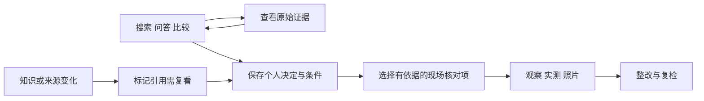

# reno 装修决策与现场核对落地方案

> 2026-10-21最新记录：§17.555（r1178实际库入口/回归范围静态核对，无运行安装准入；r1175完整候选未装，主方案未完）。Goal active。

**目标：**在现有视频知识库上，补齐查证据、保存个人决定、现场核对和整改复检的使用流程，让用户能说明一个选择为什么适合自己家，并保留其依据。

**架构：**继续使用 FastAPI、SQLite、React 和现有采集流水线。先修复知识复核、检索与阅读连续性，再新增轻量个人项目、决策卡和现场记录；个人数据与机器生成的知识结果分开存储，首版由一个主实例负责写入。

**技术栈：**Python 3.11+（SQLite 支持 serialize/deserialize）、FastAPI、SQLite FTS5、React 19、TypeScript、React Router 7、TanStack Query、Zustand、Tailwind 4、pytest、Vitest、MSW、Playwright。P01 起归档使用内存 SQLite 序列化；当前实测解释器为 Python 3.12，最低版本专项由 CI 配置覆盖。

**文档日期：**2026-09-30，进度更新至2026-10-21。**状态：**M0–M2、S01–S07及P01–P05工程完成；P06完整历史兼容、T16写权切换／永久撤销分享、条件T15和生产云仍有工程工作。最新进度见§17.555。最近正常本机服务、个人保全和前端加载基线仍为§17.178；历次状态保留各自原时点。

## 当前工程状态（2026-10-21，§17.555）

r1178核明8库入口、74候选静态参数组合及COMPAT/harness证据边界；实际运行输入与发布故障未闭，无产品运行安装。live仍r1171+r1174，Goal active。

当前检查点：data/t16-h02-entry-regression-scope-r1178/CURRENT-STATUS-01.md。

## 既往工程状态（2026-10-21，§17.554）

r1177补齐49份本地资源/声明候选及OpenCC文件链；实际运行资源图/入口绑定未闭，无产品运行安装。live仍r1171+r1174，Goal active。

当前检查点：data/t16-h02-resource-dependency-r1177/CURRENT-STATUS-01.md。

## 既往工程状态（2026-10-21，§17.553）

r1176完成230份Python源码静态依赖/分类及harness分列，实际runtime未闭、无执行或安装。live仍r1171+r1174，完整Goal active。

当前检查点：data/t16-h02-source-dependency-closure-r1176/CURRENT-STATUS-01.md。

## 既往工程状态（2026-10-21，§17.552）

r1175已合成15产品4测试完整候选，未安装/运行；live仍r1171+r1174，完整Goal active。

当前检查点：data/t16-h02-integrated-cleanup-rebase-r1175/CURRENT-STATUS-01.md。

## 既往工程状态（2026-10-21，§17.551）

r1174失败记录清理已装5产品+1测试，21helper案通过；三组完整caller未运行。r1173 IO/scope仍未装，完整Goal active。

当前检查点：data/t16-failure-record-cleanup-r1174/CURRENT-STATUS-02.md。

## 既往工程状态（2026-10-21，§17.550）

r1173共享Target清理候选未装；9call中8Fake通过/1夹具失败，21未跑，04修夹具未执行。live仍r1171，完整Goal active。

当前检查点：data/t16-target-close-first-error-r1173/CURRENT-STATUS-01.md。

## 既往工程状态（2026-10-21，§17.549）

r1172完成持久raw3完整三方重基，9产品+2测试候选未安装/未运行；live仍r1171。首次request原因未定，Target清理合同待修，完整Goal active。

当前检查点：data/t16-h02-package3-rebase-r1172/CURRENT-STATUS-01.md。

## 既往工程状态（2026-10-21，§17.548）

r1171已安装下层锁首错/关闭尝试修复，28Fake+2实际采集通过；完整持久包/恢复及H01/H03/H05仍待，服务未重启，Goal active。

当前检查点：data/t16-existing-lock-first-error-r1171/CURRENT-STATUS-01.md。

## 既往工程状态（2026-10-21，§17.547）

r1170已安装共享raw source清理修复，29Fake+1实际采集通过；完整持久raw3包/恢复、H01/H03/H05仍待，服务未重启，Goal active。

当前检查点：data/t16-source-close-first-error-r1170/CURRENT-STATUS-01.md。

## 既往工程状态（2026-10-21，§17.546）

r1169已安装handoff实际原字节采集，单child 26/26通过；wire/layout/role未扩。完整持久raw3包/恢复、H01/H03/H05及base.close首错窗口仍有工程，服务未重启，Goal active。

当前检查点：data/t16-h02-handoff-raw-capture-r1169/CURRENT-STATUS-01.md。

## 既往工程状态（2026-10-21，§17.545）

r1168已安装新handoff实际锁与GC保护，单child 29/29功能回归通过。仅完成GC物理保护接点；source3/package3/恢复、真实handoff owner和全writer停写等仍待，两个纯合同未安装。服务未重启，完整Goal active。

当前检查点：data/t16-h02-handoff-gc-lock-r1168/CURRENT-STATUS-01.md。

## 既往工程状态（2026-10-21，§17.544）

r1167已准备独立handoff文件布局与联合字节合同；首轮7绿/1个夹具错误，修订后21项续跑通过，原红保留。合同未安装。真实producer/reader、H02新布局采集/恢复/GC和H05全writer/send接线仍待，H03运行功能未交付。最近产品安装仍r1165，完整Goal active。

当前检查点：data/t16-h03-files-contract-r1167/CURRENT-STATUS-01.md。

## 既往工程状态（2026-10-21，§17.543）

r1166固定源码调查确认H03缺少现代handoff永久事实存储及真实producer/reader owner；r1156纯pending不能直连现有namespace3。本轮已纠正实施依赖，未新增产品执行或安装；最近实际源码交付及30项模拟回归仍为r1165。完整Goal active。

当前检查点：data/t16-h03-modern-fact-storage-audit-r1166/CURRENT-STATUS-01.md。

## 既往工程状态（2026-10-21，§17.542）

已应用State流式读写与既有锁流的首错保留修复，唯一q1165的30项模拟回归通过。真实State和request发布失败仍未定位，raw3与镜像候选未安装；完整Goal仍未完成。

当前检查点：data/t16-state-stream-first-error-r1165/CURRENT-STATUS-01.md；专项：docs/plans/2026-10-21-state-stream-first-error-r1165.md。

## 既往工程状态（2026-10-21，§17.541）

已应用State独占锁的首错保留及完整退出修复，唯一q1164的30项模拟回归全部通过。真实State与request发布失败仍未定位，raw3与镜像候选仍未安装；当前源码基底及55同+1合法迁移以§17.541为准。上一轮r1163的_replace修复保留。完整目标仍未完成。

当前检查点：data/t16-state-lock-first-error-r1164/CURRENT-STATUS-01.md；专项：docs/plans/2026-10-21-state-lock-first-error-r1164.md。

## 既往工程状态（2026-10-21，§17.539）

r1162已准备镜像实际写入拒绝的完整候选：3产品源码及2测试共119940B，before/after/diff及Root+同一只读代理源码复审完成。固定接入现有legacy presence fence与current-primary/原request epoch，提前覆盖catalog登记及已有receipt推进；submission按真实State→profile SH→原request持续覆盖enqueue/commit，保只读查询、原冻结blob重试及过期lease本地receipt的原源码语义。这只是有限legacy接线，不是现代H01 grant/H03 pending实现。候选未安装。

双审冻结后，仅全新q1162一个普通pytest child执行精确1case选集；实际在原sender_env的StateStore.update(session_id/lease)夹具阶段报公开SYNC_STATE_STORAGE_ERROR。只有setup failed和teardown passed，没有call阶段、没有新增gate执行验证，0 passed。约3.594秒，无timeout/cleanup/输出溢出/reader或monitor失败，reader已join。不能推断具体native API、WinError、底层首错，也不能与r1159/r1160发布失败合并为同因。只保原标准pytest短报告2167B；未读隐藏异常链/frames/locals/notes。

精确58输入1452717B、manifest13085B，SHA141deb8a7ca73dd03b79293dea6a8fc3f1ef0255fc9da64484f3c64d46590485；113模块2926950B仅静态调查，worker采用关键有限选集并明确不全pin，不能称runtime完整图。产品control静态包络1027700B<1MiB，非实测；逐db.connect的schema正文与完整request descriptor已计，source-only真实guard按4根核。准入生成器取消重复58重pin、只用196608B小账；runner实际1500588B加generator128608B=1629196B<1732759B上界<2MiB。原20/25/共享cleanup10秒、parent360/matrix1680及max2保持，仅启动1child。原5测试定义中仅选1案且未进入body；其他4定义、旧queue整模块及HTTP/receipt/blob兼容未新跑。

运行后四live before与新测试严格缺席保持，保护56同/18严格缺、r1106完整159及r1157/1158/1159/1160/1161旧封存56/78/108/63/53均保持，raw3四before/七缺同。当前产品源码仍为r1158+r1157 GC保护+r1161目录关闭修复；本批3产品及旧raw3持久包9产品均未安装，服务未重启。后继先另做原State read/update/_write/原子替换及清理完整合同静态审查，不绕fixture预置State、不自动fallback、不重用q1162或新增native/异常链诊断。r920/r964单次诊断已耗，正常库/服务/dist/既有权限/settings/Git未主动操作。H01完整source/caller/state/生命周期/COMPAT及B001/B002 open2、H02下游、H03现代pending真实落点/占位/全部writer暂停恢复仍待；P06七历史身份用户无备份不再问，永久分享撤销、条件T15及生产云仍待。不是只剩验收，Goal active未完成。

## 既往工程状态（2026-10-19，§17.499）

r1122明确原23个P2及CORE factory body均在return前产生业务effect，不能藏入effectless fresh producer。仅CORE拟将原两个真正local返回为exact pair，并以三个新caller local跨CORE001/CORE002持根；原15403 finally、15381 getter及15515正常路径del保持。38处原global context观察仍须P0联合消费，来源运输不代metadata可信或N4。B001/B002仍open2，完整设计/source/execution均False，源码仍r1106 SOURCE02完整159，Goal active未完。

## 既往工程状态（2026-10-19，§17.498）

r1121已选择固定三模块的namespace-resolver新接口：subscription保reserved或MF2解析，get/contains及枚举只看局部绑定，明确print示例的不对称。13处原顶层import确实运输locals；默认C实现不读locals，自定义import第三参G→L是显式兼容变化。L十字段/活动lease/退出detach释放与A/J分寿命已具体设计；未新K，完整N4/消费者仍待，B001/B002仍open2，完整设计/source/execution均False，源码仍r1106 SOURCE02完整159，Goal active未完。

## 既往工程状态（2026-10-19，§17.497）

r1120裁决MF1只转G再造KeyError并非透明原lookup；选MF2为原module LOAD_NAME的条件解析方向：保两次G读取，再用公开getter取该实际当前B，B命中不造中间KeyError。最终NameError逐操作保UTF8、准确%.200s文案、实际异常/name字段/忽略setter失败后的原对象恢复。完整mapping接口、原消费者及N4仍未闭，B001/B002仍open2，完整设计/source/execution均False，源码仍r1106 SOURCE02完整159，Goal active未完。

## 既往工程状态（2026-10-19，§17.496）

r1119提出PL条件通道：原helper保持body，未来显式将exec两位置参数改为三参K/G/L，由actual native私有locals的固定mapping C slot交付原C/A，不从可写G的同名alias取入口。保留名成功只回state-held原根，失败必须非KeyError以阻断LOAD_NAME回查G。该子方向有具体静态接线，当前三源没有新名字，未来实际LOAD_NAME、完整映射兼容及原消费者绑定未完成。B001/B002仍open2，完整设计/source/execution均False，源码仍r1106 SOURCE02完整159，Goal active未完。

## 既往工程状态（2026-10-19，§17.495）

r1118完成一个具名DGI入口的有限静态裁决：loader将原C入口及opaque attempt写入原G，再经原helper/builtin exec执行。原exec audit仍位于module执行前，条件回调可替换该alias，unknown callable可能先执行；C内后验太晚，因此不采用这条接线。r1117条件环境读取保持，真实入口/原调用关联仍未闭。B001/B002保持open2，完整设计/source/execution均False；源码仍r1106 SOURCE02完整159，Goal active未完。

## 既往工程状态（2026-10-19，§17.494）

r1117完成原module直达C的环境取得子设计：已知原module直接进入原native body时，公开PyEval_GetBuiltins可取得该实际帧环境，再在同帧直接New产品函数；不替换原builtin/EvalCode。当前三源仍是两参Python constructor，真实native入口/attempt接线未闭，getter不证明caller或原pair。B001/B002继续open2，完整设计/source/execution均False，源码仍r1106 SOURCE02完整159，Goal active未完。

## 既往工程状态（2026-10-18，§17.493）

r1116完成R2替代执行器的原顺序核对与兼容裁决：三份既有module根的首constant字符串与候选docstring核同，公开New与原private构造在CREATE时doc不同，现行约束下否决R2。原r1111 builtin接线保持；条件carrier方向不变，原X来源仍待。B001/B002继续open2，完整设计/source/execution均False，源码仍r1106 SOURCE02完整159，Goal active未完。

## 既往工程状态（2026-10-18，§17.492）

r1115完成公开构造器与私有环境carrier的有限接点裁决：已持原X时可用独立scratch globals建立carrier，再在其活动帧下直接构造保原G的函数；X最初取得仍未闭。原builtin exec接线是可显式修订的内部设计，R2自持module function仅为备选，CREATE/doc/audit/错误delta未准入。B001/B002仍open2，完整设计/source/execution均False；源码仍r1106 SOURCE02完整159，Goal active未完。

## 既往工程状态（2026-10-18，§17.491）

r1114完成P0 context与原builtins环境依赖静态调查：control的context[3][19][21]保存两次独立原求值，实际环境运输须先于context assembler。第二次原helper不保证同module环境；本机3.12.10 DLL无私有constructor named export。B001/B002仍open2，完整设计/source/execution均False；源码仍r1106 SOURCE02完整159，Goal active未完。

## 既往工程状态（2026-10-18，§17.490）

r1113完成P2原源码caller运输静态调查：三既有constructor的实际参数/工厂临时值是函数局部，C位置参数到localsplus有原文路径。23顶层P2与24原tail行分列；const注入因改变exec原根否决。post-helper方案仍有P0实际context和builtins来源两项阻塞，未获实施批准。完整设计/source/execution均False，源码仍r1106 SOURCE02完整159，Goal active未完。

## 既往工程状态（2026-10-18，§17.489）

r1112完成固定T0有限授信、native实际构造根与发布交接子设计修订02。01把字典发布叫无callback终段的B001经双红审否决；02改为可再入准备/释放、最终raw重核与list-only安装成功段。六组具体C API和引用路线已列，完整metadata/P2实际local/联合消费/N4/COMPAT仍待。完整设计/source/execution均False，源码仍r1106 SOURCE02完整159，Goal active未完。

## 既往工程状态（2026-10-18，§17.488）

r1111安装子设计修订02选择原PathFinder槽位C代理及原loader执行包装，单次get_code实际根经捕获原helper/builtin exec消费；明确全局槽位与调用帧delta。01的builtins预插方案被实质红审否决，02恢复原helper环境；首native根/实际发布/联合消费/兼容仍待，完整设计/source/execution均False。源码仍r1106 SOURCE02完整159，Goal active未完。

## 既往工程状态（2026-10-18，§17.487）

r1110已明确原代码根/原exec消费/实际function产物三事实，否决CREATE watcher来源方案；P2 native实际producer与23顶层factory的空tuple For模板取得3.12.10静态依据。L1可信安装、完整来源与共同消费接线仍待，完整设计/source/execution均False。源码仍r1106 SOURCE02完整159，Goal active未完。

## 既往工程状态（2026-10-18，§17.486）

r1109完成原消费契约和五入口代码树静态目录：8条原要求、三处actual incoming、两个local call0及精确co_consts路径已对应；静态N1目录完成不代表runtime原根取得，完整设计及source/execution仍False。源码仍r1106 SOURCE02完整159，Goal active未完。

## 既往工程状态（2026-10-18，§17.485）

r1108完成联合校验/实际调用的有限架构可行性调查及后续设计契约，明确C侧metadata检查、实际call尝试、frame代码参数、closure与首body的不同保证；完整修复设计仍未闭，未获产品实施批准。源码仍r1106 SOURCE02完整159，未执行，Goal active未完。

## 既往工程状态（2026-10-18，§17.484）

r1107完成五个具名入口及直接相关catalog的有限静态调查，确认连续审计读取的metadata一致性与caller来源阶段freshness两类源码缺口。两处inner local factory已有词法来源，不重复24项已完成运输；源码仍r1106 SOURCE02完整159，未执行，Goal active未完。

## 既往工程状态（2026-10-18，§17.483）

r1106已生成私有factory首次来源运输的159完整候选，三改156继承；24个私有协议变化与其余399个原code保留均已核对。源码双审本次变换0、完整认证仍各1红，候选未安装，Goal active未完。

## 既往工程状态（2026-10-18，§17.482）

r1105已核24个私有factory及具名caller，并完成首次source前移/实际对象参数运输设计02双审。尚无新候选，源码仍r1104完整159；完整来源认证仍红、Goal active未完。

## 既往工程状态（2026-10-18，§17.481）

r1103已解释46个原code的244指令flag变化，来自122处import基对象调用；r1104完整159候选三改156继承，以literalFalse保原module导入符号，423原code逐字节恢复。原context尾桥保持，完整factory/caller/audit认证仍未闭，未安装、Goal active未完。

## 既往工程状态（2026-10-18，§17.480）

r1102已生成活动构造帧的159完整候选，三改156继承；四处末尾context读取改为实际P0原RHS参数。423原ABI/闭包布局保持，8匿名qualname及68处CO_NESTED变化明列；完整认证与调用来源仍未闭，候选未安装，Goal active未完。

## 既往工程状态（2026-10-18，§17.479）

r1101完成三模块原context来源静态调查；tuple两轮方案DESIGN01被双审各1项阻塞否决，未生成候选。延迟__exit__原实现可变与active-frame的exec audit/builtins窗口均保未闭；原P001仍open，r1100完整159源码保持，完整Goal active未完。

## 既往工程状态（2026-10-18，§17.478）

r1100完成实际引用生命周期源码修订：159完整候选三改156继承，17段/1449静态slot、105非锁For逐轮finally加7keyword region、279锁内For仅正常exactstr出口清理；旧S001具名释放顺序修订获静态双审。三模块入口原context/pin来源仍为源码阻塞，候选未获准执行，完整Goal active未完。

## 既往工程状态（2026-10-18，§17.477）

r1099完成实际引用生命周期调查与修复设计02双审：冻结20份完整输入，盘点17个lease/962赋值循环事件/384个For。设计采用每次实际取得的静态slot及每轮scanner逆序清空，明确bad key含None先解锁、PFIN原row分区、原iterator强根与五处S002保留。尚无新产品候选，S001源码仍未修、执行准入False，完整Goal active未完。

## 既往工程状态（2026-10-18，§17.476）

r1098完成原读取结果一致性修订：159完整候选三改156继承，BP002/004/006/007/008原get各一次移入原foreign锁，actual/同phase完整fact/current核对；四witness与原运输STORE在锁外。设计双审与源码双审确认S002静态修订，S001实际引用逆序仍为源码阻塞。未import/QA/安装，完整Goal active未完。

## 既往工程状态（2026-10-18，§17.475）

r1097已生成三模块bootstrap/readiness的159完整SOURCE01候选（三改156继承），源码双审均发现实质阻塞：实际引用逆序释放及原get实际返回与原阶段匹配未闭。18正逆、236原声明/10类、原ABI及import保持；结构核同不等于源码批准。候选未import/QA/安装，完整认证与Goal active未完。

## 既往工程状态（2026-10-18，§17.474）

r1096完成三模块bootstrap/readiness来源设计02双审；当前源码仍r1095 SOURCE03的159文件，无新候选。BP001–008/PFIN001覆盖control/scope/registration入口，三early record9/两ready global fact/独立link4事实、原晚registration import与三导入顺序固定。拟三改156继承，未实施；原skip/False/deferred/再入保，完整认证与Goal active未完。

## 既往工程状态（2026-10-18，§17.473）

r1095完成control固定认证读边CR001–008的SOURCE03完整候选与源码双审：159文件仅control一改158继承，原slot12合法None/三static根、record11/native8/三独立fact、descriptor原RHS/STORE与依赖actual local来源接线。两个local gen保4/5参数与唯一fact freevar；旧两版红保，释放逆序及lazy entry成本已修。42普通入口条件候选不变；未import/QA/安装，bootstrap和完整认证仍未闭，Goal active未完。

## 既往工程状态（2026-10-18，§17.472）

r1094完成control固定认证读边设计04双审，当前源码仍r1093 SOURCE01。原slot12合法None/SEALED与三static root分列，record11/native8/三独立fact及DEPENDENCIES实际local来源固定，descriptor保原getter，两个local gen与held any末次准入明确。42普通入口条件候选不变；本批无新候选/compile/import/QA，bootstrap及完整认证仍未闭，Goal active未完。

## 既往工程状态（2026-10-18，§17.471）

r1093完成resources十入口完整候选与源码双审：159文件仅resources一改158继承，197原声明签名/9类AST/具名qualname保持。record15/native7/fact6、原top bootstrap/既有nested factory、15consumer的36次module记录GET先原根，034append/039参数/040双weakref与原异常/3gen及041held dedup完整RHS保。42普通入口已有条件候选，完整caller/认证尚未闭，未import/QA/安装，Goal active未完。

## 既往工程状态（2026-10-18，§17.470）

r1092完成resources十入口来源与原求值设计02双审，未产生新产品源码。原顶层maker保def/签名/qualname，可信bootstrap边界显式；record15/native7/fact6、3gen、034append、039参数后读、040两weakref/原Name STORE/两handler与041held dedup分列。原ABI和锁表述修订，旧稿/红保。当前源码仍r1091 SOURCE01，普通入口32候选/10待实现，完整认证与Goal active未完。

## 既往工程状态（2026-10-18，§17.469）

r1091完成registration八入口候选及源码双审：159完整文件，registration一改158继承。record15/native7/fact6、五maker/self原点、14consumer的28次module记录GET均先原根身份核对，027 append及两gen/PINS四项RHS原序保。普通入口现32候选/10待实现；caller/fullclosure与完整认证仍未闭。仅静态候选、未import/QA/安装，source_gap_closed0、准入False、产品pass0，Goal active未完。

## 既往工程状态（2026-10-18，§17.468）

r1090完成registration八入口来源交接与原求值顺序设计02双审，尚未产生新源码。独立record15/native7/fact6、五maker与原二跳scope/control来源、027 outer append先取及两gen明确；GET原primitive文字错误已修、旧红保。当前源码仍r1089 SOURCE02，普通入口24候选/18待实现；registration8/resources10及完整认证/Goal active未完。

## 既往工程状态（2026-10-18，§17.467）

r1089完成scope十一入口候选修订02及源码双审：159完整文件、scope一改158继承。修订01身份核对前解引用运输record的R001/I001原红保留，02在19个consumer先核原records/fact身份再读record/native/module。普通入口现24候选/18待实现；caller-return/STORE与完整认证仍未闭。仅静态候选、未import/QA/安装，source_gap_closed0、准入False、产品pass0，完整Goal active未完。

## 既往工程状态（2026-10-18，§17.466）

r1088完成scope十一处helper入口设计修订02及双审：固定原control import来源、record9/native10/fact6，保持scope ABI18/13槽与control20/16/28；五既有maker词法转交、五gen原求值顺序和022两control读取明确。初稿getattr缺席可能触发未知__getattr__的R001已显式修订，原红保留。仅设计，尚无新候选/compile/import/QA；普通入口仍13候选/29待实现，完整认证与Goal active未完。

## 既往工程状态（2026-10-18，§17.465）

r1087完成继承Profile三个alias effect的原点键前验候选：159完整文件，较r1086仅storage_lifecycle一改、158继承；设计及源码双审通过。原锁内逐点完整检查current globals exactdict/exactstr，前验成功后才原attempted/STORE/effect。control十三incoming保持，余29入口和完整认证接线待续。仅静态候选、未import/QA/安装，源码缺口闭0、准入False、产品pass0，Goal active未完。

## 既往工程状态（2026-10-18，§17.464）

r1086完成control余六处incoming与deadline/core原来源候选SOURCE02：159完整文件，较r1085两改157继承。control十三入口均有候选门，具名42入口中13处candidate、余29处pending（scope11/registration8/resources10）。两份源码审查完成，仅静态候选；未import/QA、未安装，完整helper批次False、源码缺口闭0、准入False、产品pass0，Goal active未完。

## 既往工程状态（2026-10-18，§17.463）

r1085完成control五处direct incoming候选SOURCE02：159完整文件，较r1084仅control一改、158继承；首次maker、binder与class-auth三处调用前门已静态双审。继承helper内部两处后，具名42入口中7处有候选门、余35处待接线。仅源码静态核对，未import/QA；完整helper批次False、4类源码缺口闭0、准入False、产品pass0，Goal active未完。

## 既往工程状态（2026-10-18，§17.462）

r1084完成四helper消费余体候选SOURCE03：159完整文件，较r1083仅control一改、158继承；六个generator的求值门、动态mapping来源与双flag异常路线已形成候选并完成源码双审。helper内部2处incoming有候选门，余40处（含maker与history alias）仍待接线。仅静态核对，候选未import/QA；完整helper批次False、4类源码缺口闭0、准入False、产品pass0，Goal active未完。

## 既往工程状态（2026-10-18，§17.461）

r1083完成四helper基础来源候选修订02：159完整文件、control/lifecycle两改157继承，原primitive ABI20、原_MISSING来源与顶层Profile来源记录已形成候选并通过源码双审。42处普通incoming及四helper消费门仍待接线，本轮仅静态验证，未导入或执行候选；4类源码缺口闭0、准入False、产品pass0，完整Goal active未完。

## 既往工程状态（2026-10-18，§17.460）

r1082完成control四helper来源/实际求值顺序设计修订02及设计双审，41直接词法调用加1个history别名调用、45设计事件/9隐式协议/5新增scaffolding组。本批无新产品候选或执行；原159文件继承为后续源码父，4类源码缺口闭0、准入False、产品pass0，完整Goal active未完。

## 既往工程状态（2026-10-18，§17.459）

r1081完成control七认证函数14处及初始模块1处原_fail调用的实际前门候选；159完整文件相对r1080仅control一改、158继承。两源码审0阻塞，仍有其他13处control业务_fail及全子图边待接；4类源码缺口闭0、准入False，未执行或安装、产品pass0，完整Goal active未完。

## 既往工程状态（2026-10-18，§17.458）

r1080形成control错误构造与原super两条实际前检查候选修订02；159完整文件相对r1079两改、157继承。修复新ValueError被原catch吞掉的S001，源码双审0阻塞；仍缺incoming前门及完整EDGE/PHASE，四类缺口闭0、准入False、未执行或安装，产品pass0，完整Goal active未完。

## 既往工程状态（2026-10-18，§17.457）

r1079完成registration/resources/enrollment三模块原定义、发布与scope原行转交候选修订02；159完整文件相对r1078三改、156继承，五模块均有初步归属记录。源码双审0阻塞，仍未接实际precall和完整EDGE/PHASE，四类源码缺口闭0，未执行或安装候选、产品pass0，完整Goal active未完。

## 既往工程状态（2026-10-18，§17.456）

r1078完成scope原定义与四个实际root发布的ownership候选修订02；159完整文件相对r1077仅scope一改、158继承。本阶段源码双审0阻塞，仅静态验证、未执行候选；control/scope已有归属记录，业务调用前门及其余三模块仍待接线，四类源码缺口闭0，未安装、产品pass0、完整Goal active未完。

## 既往工程状态（2026-10-18，§17.455）

r1077完成control原定义与四个实际root发布的ownership候选修订02；159完整文件仅control一改、158继承。源码双审0阻塞，仅静态验证、未执行候选；业务调用前门与其余四模块接线仍待完成，四类源码缺口闭0，未安装、产品pass0、完整Goal active未完。

## 既往工程状态（2026-10-18，§17.454）

r1076新增metadata核心，形成158继承加1新增的159完整基础候选；五个业务模块尚未接线。核心源码双审0阻塞，QA02脚本/准备及实际记录双审后单次28pass/0fail/缺0；仅纯metadata组件模型，四类源码缺口仍闭0，未安装、产品pass0、完整Goal active未完。

## 既往工程状态（2026-10-18，§17.453）

r1075完成统一认证目录与原producer内联发布方案，修订02设计双审0阻塞；明确五改一增159候选范围、P0–P8两种导入与原阶段，163词法调用点作实施输入。新候选与QA仍0，四类源码缺口待实现；产品pass0、完整Goal active未完。

## 既往工程状态（2026-10-18，§17.452）

r1074完成固定认证子图静态调查：八源、31完整定义、602句法调用经独立重导核同；确认四类源码缺口，材料复审阻塞0。尚未修订源码或执行QA；候选未安装，产品pass0。下一步统一认证目录与实际晚期root发布owner设计；F001阶段/原因仍未知，完整Goal active未完。

## 既往工程状态（2026-10-18，§17.451）

r1073完成resources两个直接依赖调用的前置身份和完整函数元数据门，实际22项完整包+8项纯工厂模型共30pass/0fail/缺0；源码/脚本/准备/实际双审通过。候选未安装，产品pass0；本批不证传递认证目录或原生链。F001仍20.016秒超时且阶段未知；完整Goal active，仍有开发工作。

## 既往工程状态（2026-10-18，§17.450）

r1072固定静态核对确认resources在校验scope/registration绑定及callee code之前先执行依赖认证；缺口尚未修订，下一步逐callee前置门。本批不改产品、不执行QA/诊断、不归因F001。合法循环bootstrap需保留；完整Goal active，仍有开发工作。

## 既往工程状态（2026-10-18，§17.449）

r1071新增31项组/guard-plan legacy调用者差分，实际31pass/0fail/缺0。两完整来源与原body/原filesystem执行，目录/custody/OS/guard准入依赖显式合成；这不是完整模块或原生链证明。r1070关键词默认值修订九项通过保持，候选未安装。

F001完整原生链仍20.016秒超时，阶段/根因未知；Task9A真实多root/first/tb/清理、Task9B全precall/物理费用债务/guard消费者/两阶段terminal/容量durable恢复、原111/94/r919/真实Store写权及主方案其他开发仍未完成。Goal active，非只剩验收。

## 既往工程状态（2026-10-18，§17.448）

r1070已补齐profile构造前关键词默认值的完整预期，九项实际回归9pass/0fail/缺0。完整候选158文件仅origin一改，设计/源码/脚本/准备/记录均双审，候选尚未安装。此前r1068元数据去重检查通过，但完整F001仍20.016秒超时、双空输出，具体执行阶段和根因未知，本版未重跑。

仍有开发工作：Task9A余矩阵、Task9B完整precall/物理费用债务/guard消费者/两阶段terminal/容量durable恢复，原111/94/r919/真实Store写权、T16其他项/永久分享与完整历史兼容。P06七源文件的历史身份仍0/7，用户无备份，不能补签或重复索取。最新细节见§17.448与data/t16-h01-profile-keyword-default-integrity-r1070/CURRENT-STATUS-01.md；Goal保持active，非只剩验收。

## 既往工程状态（2026-10-17，§17.423）

r1032原批54项5pass/49fail/缺0、54.485秒，48项fixture漏选原lifecycle._profile，W002实际30秒timeout/kill/wait，捕错循环仅静态解释；原T/G/pulse未到目标动作，两scope纠正及Root/独审漏项保。r1033只补选原_profile/私有包名，原49检查函数AST与r1032保持，候选r1031 SOURCE03二十三完整不改；两源码/最终六脚本/实际准备两审后仅49旧失败ID新claim49pass/0fail/缺0、25.656秒，49wait/timeout0/kill0。旧5不重跑，两批103尝试/54唯一ID最新全pass，非单批54绿。原Cycle/StateStore/实际worker caller、来源配对与callback语义覆盖；4项真实Python线程检查含T003显式ContextVar复制/无TLS转移、4 carrier/原tb GC分列；heartbeat原target但调度/两个Store消费者、shared获取协议/schema/IO/SQL/网络/OS锁合成，Path.resolve普通metadata逐项注明，非EX/native/Store写权或custody/pending完成。385准备pairs/7434093bytes、388准入输入、924实际完整pairs/15528245bytes及两actual审0，旧584pairs核同；46保护32同14缺。入口data/t16-h01-profile-cycle-state-repair-r1033/CURRENT-STATUS-01.md。canonical/c973本段apply0/历史累计11、产品pass0；6D/Task7最后借用pending与完整Goal active未完，原限额和正常库service-dist/ACLsettings/平台/Git保持。

## 既往工程状态（2026-10-17，§17.396）

r1001承接r1000 source06，当前source03为七份完整未安装候选，scope/group/resources三改、其余四份全文继承。新增原root来源记录：调用固定原_roots前核exact StorageProfile、原Cdict及四个exact WindowsPath并强根保存；实际_roots返回先保存，每个原RootOwners type-call整体return与init partial-self分列，两slot原C setter和group roots setter的return/effect分列，tuple实际创建返回保留。scope及resources通过原root entry/index取得创建时Path，目录构造使用同一原Path，真正legacy None分支保持；既有真实API route未接这条半组合。

设计S001前件缺口、源码S002可变描述符字典权威及脚本C001/C002准入/来源全文缺项均在执行前关闭，旧稿、差异及红记录保留。source03直接闭包捕获两个原C slot descriptor；原函数pins在base门先核其cell身份。部分group阶段仅base+phase，不提前要求完整group pins/claim；成功子call清空child_call，末clock/context错误仅归外层group。CHECK-003是独立审查误报，按实际raw getter读取独立row[2]撤回，原P024断言正确且实际通过；保留澄清。builder01在group CRLF锚点失败、部分产物原保，builder02处理换行后完整生成，不把失败记为产品执行。

两源码、脚本和实际准备复核无阻断。唯一Toold54d3f exit0，P001–P054全部54pass/0fail/缺0，8.062秒；唯一claim已耗不重跑。九项正常词法来源（含两项严格合成resource交接），覆盖1/2/4 roots及共享去重/排序/database.parent；七非法profile、十四root锚/slot、六部分root、重入/profile变化、末group错误、固定alias/重复消费、线程及legacy/描述符拒绝均按各自oracle通过。P031–P038为明确合成producer AST故障，P050一真实Python线程，ContextVar为真实原语；不能把54pass写成54次完整root构造都成功。

模型实际选取原StorageProfile/_path/_key/_roots和正常RootOwners type-call，WindowsPath只作词法运算；目录/stream/IO/native/clock/contract/EX context仍合成。未执行产品文件I/O/native、真实EX/SQL/pytest或产品运行，固定C setter真实写后抛覆盖仍False。仅root选择与目录输入交接这一段已获模型证据，Directory内部Path转换、root/LOCK_NAME连接、native字符串和CreateFile参数仍待接齐；profile历史构造、Path私有内部状态及完整stdlib/global闭包未认证，path_input_origin/physical_resource_chain_authenticated、marker/计费/发布门保持False。

17份当前来源全文451200bytes及19份前驱来源468904bytes逐份核同；17执行输入、186准备完整pairs/4138635bytes及196实际完整pairs/4252566bytes核同，Tool全文和result54分项一致。Root与同一独立actual复核只确认模型与记录边界一致。正式/c973本段apply0，累计正式应用11，产品pass0；正常库、服务/dist、既有ACL/settings、真实平台和Git保持。

下一步继续Directory内两次Path转换/native参数串接及固定callee目录、ctypes/lock内部实际返回和C IO完整链、三marker实际read与同唯一budget计费/完整future N和容量、完整globals/dispatch/Context区间、新五件图/final/正常父退出/四类恢复。原111/94/r919、Store/source_closed/live witness/写权、H02–H06/永久分享及完整Goal active未完。固定C setter有限调查未找到可安全稳定触发且满足现有固定callee约束的实际异常，不能用错误receiver/替换setter或合成故障提升该覆盖；不扩大诊断。

r967仍待原专门问题，不执行/重问；r920/r964耗，重复旧r964答复不重跑；P06历史0/7不问。原case30/parent360/matrix1680/native20–25–10/cleanup10/最多2pytest child/control1MiB保持，普通开发和同一只读代理授权继续，不新增审批。

## 既往工程状态（2026-10-17，§17.395）

r1000承接r999 DESIGN02，当前source06为七份完整未安装候选，五改动scope/owned factory/group/resources/enrollment，control/registration全文继承r998 source02。新固定constructor helper先独立占位，实际原factory分配binding/list后立即根存，setter返回与effect分列；fixed caller保factory和group type-call整体实际普通返回、group部分self/原claim。budget._owned_ex实际赋值先于旧scope claim，origin/group/scope三claim不同，scope消费失败也耗；stream持续反查工厂原list，保前序/未来槽。原stream14方法、六raw清理、旧enrollment函数及legacy None分支保持，既有真实route仍未调用新helper。

原稿和红记录全部保留：R001/R002关闭被吞钩子错误后继续及claim setter失败记录缺项；S001–003关闭单锚丢失、budget setter effect和export pin缺项；S004及R003关闭失败保全再次执行当前可写_gget/dictionary/remember/checker的风险，改用闭包原C描述符、原raw及原remember，并在调用前直接核原class/MRO/字典/函数pins，bootstrap失败也耗。首次实际44项Tool289b75 exit1，仅F002/F003/F004通过，41项均control首入初始化_BUDGET_DICT AttributeError，缺0、3.735秒；源码/脚本两审漏审照实保留。R004静态定位另三处checker/pin提前捕获；source06从已导入namespace._Budget经原Cget取同一dict描述符，移除提前checker读取并把function pin延至原_BOUND就绪后。先前首入失败不能被改写为fixture通过。

source06及runner04/prepare03两源码/脚本/实际准备复核无阻断。新epoch因共同bootstrap捕获改变而对四种首入完整复检44项，唯一Tool3d0058 exit0、44pass/0fail/缺0、5.765秒；两批共88尝试、44唯一ID，当前source06单批44绿，旧3/41失败批保留，不称88全绿。模型实际选取原factory与完整group类type-call和原RootOwners，不用fixture自造binding/list冒充来源；6项正常origin、2项严格stream、2项legacy及F039一真实Python线程通过，ContextVar为真实原语。其余Path/contract/clock/native/IO/EX context合成，真实IO/真实EX/native/SQL/pytest/产品运行均0，固定C setter写后抛尚未覆盖，完整物理来源链/marker/计费/发布仍False。raw recipe选择字段不等于44次factory/group均成功返回。

19份固定来源全文468904bytes逐份核同。首批实际207完整pairs/4703475bytes、新批259完整pairs/5615590bytes，两批Tool全文与各自result及44分项核同，Root和同一独立实际复核只确认记录与模型边界一致。两claim均耗，不重跑；正式/c973本段apply0、累计正式应用11，产品pass0。正常库、服务/dist、既有ACL/settings、真实平台及Git保持。

下一步补固定C setter失败路径的有界覆盖，以及逐root/Path原输入与转换、ctypes/lock内部原始返回、C IO完整链、三marker实际read及同唯一budget计费/完整future N和容量、完整globals/dispatch/Context区间、新五件图/final/正常父退出/四类恢复。原111/94/r919、Store/source_closed/live witness/写权、H02–H06/永久分享及完整Goal active未完，不把本段合成模型当产品验收。

r967仍待原专门问题，不执行/重问；r920/r964耗，重复旧r964答复不重跑；P06历史0/7不问。原case30/parent360/matrix1680/native20–25–10/cleanup10/最多2pytest child/control1MiB及既有保护范围保持；普通开发与同一只读代理复审授权继续，不新增审批。

## 既往工程状态（2026-10-17，§17.394）

r999完成binding factory原owners-list来源的有限静态调查及实施设计02。原_new_owned_ex_binding创建[None]*4而_pins不保存list身份；group构造经过_roots、唯一_group_claim写入及末clock/context后才整体返回，scope claim与stream init观察更晚。因此r998的binding_factory_origin_proven=False保持，不能用当前快照补签工厂来源。c973 origin_capture另有factory/group legacy caller，后继须保原合同。

采用五文件窄接线：复用guard_scope原raw-record及独立origin attempt/index；fixed新enrollment constructor helper在factory调用前占位，factory内实际binding/list创建立即强根保存、C setter return/effect分列，固定caller分别保存factory与group class-call实际普通return。group只加显式私有来源分支的部分self/原group claim及其setter记录；scope先消费一次再检查和交接，stream核同原list与合法前序/未来槽。origin/group/scope三claim身份不互代，不以__init__内部ready代整体返回，不以ambient/可写ready标记授来源；失败保部分原根和原first，不重试/清_group_claim/调用未进入的exit。

设计01新增独立模块的草稿保留；02按同一代理有限调查改为复用现有scope，不新增模块或ContextVar来源证明。owned/group只有显式私有_origin非None分支惰性调用hooks；未参加新helper的legacy不import/call来源hooks。五改动文件为owned/group/scope/resources/enrollment，另两完整前驱继承；三个已有真实route本段不调用新helper，候选正式安装另审完整组合。

14份固定来源全文396236bytes逐份长度/SHA/原件copy核同，两份设计审查无阻断。这里只完成调查与设计，没有新增产品候选、候选compile/import、模型/pytest/native/SQL/诊断或产品运行；新产品pass0。r998首49项47pass/2fail与新两项2pass原记录保持，49唯一ID最新pass/两批51尝试不重跑。正式/c973 apply0、累计11，marker/计费/完整物理链/发布门保持未完成。

下一步生成这五文件改动的七份完整未安装候选，完成源码/脚本/实际准备双审后以新claim验证实际producer/两个外层return、单次消费/失败原根/原list持续身份及legacy；再补逐root/Path来源、ctypes与lock内部返回、C IO完整链、三marker实际返回与唯一共享计费/完整future N和容量、完整globals/dispatch/Context区间、新五件图/final/正常父退出/四类恢复。原111/94/r919、Store/source_closed/live witness/写权、H02–H06/永久分享与完整Goal active未完。

r967待原专门问题不执行/重问；r920/r964耗，重复旧r964答复不重跑；P06历史0/7不问。原case30/parent360/matrix1680/native20–25–10/cleanup10/最多2pytest child/control1MiB与正常库/service-dist/既有ACLsettings/真实平台/Git边界保持；普通开发及同一只读代理授权继续，不新增审批。

## 既往工程状态（2026-10-17，§17.393）

r998 source02七份完整未安装候选承接r997六份及c973原owned源码。stream的四个原slot list在18slots初始化后、原try及_directory/_binding/任何动态getter或clock前强根保存；binding._owners仅为init前观察，明确不认factory原始来源。C list setter的实际return/result与独立effect分列。十类固定内部调用create_file/handle_info/address/get_info/open_osfhandle/file_io/raw_fileno/raw_closefd/buffered_reader/buffer_raw，不接收callee/provider/pins；实际attempt/普通return/result/error先存，再交原owned合法性、未知债务、关闭及filesystem包装，业务first不提前改。后继step持续核原四list身份，stream整体return仍由原caller独立记录。

source01的S001末clock换list未复核、S002外来kind/参数__eq__、S003非Windows bootstrap误取HandleInfo/O_BINARY均在source02关闭；旧稿/红/父逆向及完整diff保留。原owned14方法及六raw清理不变；本段不证明Path/root原始输入、binding factory原owner list、ctypes布局/字段、lock内部fstat/overlapped或buffer→raw→fd/native完整物理链，marker/计费/发布许可恒False，route未启。

首批49项唯一Toolb21dac exit1：47pass/2fail/缺0，6.422000000002299秒；U036为TypeError，U046为AssertionError。静态确认两合成fixture直接赋值冻结dataclass字段先触发FrozenInstanceError，使预期篡改没有到达；双方先前零脚本审漏此限制，旧零审/脚本/结果/Tool/claim原样保留，A001单列。只把两fixture改为固定object.__setattr__，source02未改；新runner04保49完整定义、实际仅选U036/U046。新两脚本及准备审0后，新claim唯一Toold6ae75 exit0：2pass/0fail/缺0，0.2809999999990396秒，不重跑47绿。49唯一ID最新全pass、两批51次尝试，不能称单次49全绿。

首批U043一真实Python线程且通过；复检不含线程。两批均用真实C ContextVar环境，Stream及13 helper/Error为实际选取AST，native/IO/ctypes/directory/binding/clock均合成，未创建真实I/O；U048/U049明确raw OSError→Stream.first→filesystem包装first分列。不证Windows/native、真实EX/SQL/Store、资源物理关闭或产品验收，产品pass0。

两批完整Tool输出解析后与result一致、各17inputs；准备/actual完整pairs及bytes依次{'CHECK-01': [82, 1370503], 'ACTUAL-01': [90, 1426596], 'CHECK-02': [102, 1535254], 'ACTUAL-02': [110, 1595514]}逐份核同，Root与同一只读代理实际审0仅证各自记录一致。两claim已耗，正式/c973 apply0、累计11。真实原始来源/完整实例认证、三marker/唯一1MiB共享计费/完整future N/容量、动态callee/global/code/class/consumer目录及最后probe→IO的Context区间、五件图/final census/正常父退出/四类恢复、原111/94/r919、source_closed/live witness/写权、H02–H06/永久分享与完整目标active未完。

r967待原专门问题不执行/重问，r920/r964单次许可已耗，重复旧r964答复不重跑；P06历史0/7不问。原case30/parent360/matrix1680/native20–25–10/cleanup10/最多2pytest child/control1MiB保持，脚本时间门不代可抢占超时。正常库/service-dist/既有ACLsettings/真实平台/Git边界保持。

## 既往工程状态（2026-10-17，§17.392）

r997 source03完成六份未安装完整候选，在原group `_open_root`插入严格资源producer分支，legacy原body及六个原资源raw清理函数完整保留。r996登记构造返回不代目录/流/锁方法外层返回，本段按18个固定stage记录check、两journal factory、三分配、三登记、三init、两enter、stat、acquire与verify实际表达式attempt/普通return/result，独立核effect。factory/分配返回先根存，部分原对象及原callbacks保留，不用内部journal布尔值补认外层返回；固定group caller另存producer整体实际return。

两个原filesystem区间的create/enter/body/exit分槽，body已返回但exit失败仍保body返回并停止后继。内部OSError保在raw cell，等原wrapper映射后才捕获业务first；False/truthy acquire拒绝marker但不清journal未知状态或unlock debt。首次marker前缀在verify内部观察，此时verify已attempted而尚未returned，不能把verify完成作为首次准入前提。本段prefix不是marker许可，marker/物理资源链/发布准入恒False。

ROOT001重复初始化替换原baseline及ROOT002已enter后非法返回漏exit在source02关闭；S001未来空资源槽变化被跳过并覆盖在source03关闭：五槽含None始终核原expected身份，observed actual先保独立根，setter前核旧expected、return/effect合法后才迁移expected。旧source01/02、完整parents/inverse/diffs、两份红审保留。专用GeneratorCM exact ABCMeta/MRO与wrapper及原generator function pins不放宽原core合同；新组件局部pins不等于完整dynamic/global目录或probe→I/O区间。

两份源码/脚本/实际准备审0后，新claim唯一Toolae6e7e exit0无session，Q001–Q052共52pass/0fail/缺0，5.5秒。覆盖1/4root及四导入次序、20个callee前后故障、错误返回/债务/原OSError映射、filesystem非法enter及exit失败、未来槽损坏、非法begin/outer未知/重复、错误线程/空或复制Context、原baseline重初始化与legacy。52环境用真实C ContextVar/Token，Q046一真实Python线程；资源、binding、clock及底层owner状态均合成，原filesystem采用选取AST（两个显式合成CM变体分列）。不是DLL/Windows native/buffer-fd完整身份链、真实EX/SQL/Store、资源关闭或产品功能验收，产品pass0。

完整Tool与result一致，17输入、89准备pairs/1457476bytes、97actual pairs/1517399bytes逐份全文核同；Root与同一只读代理actual复核0。新claim已耗，不复用r996或其他旧claim。正式/c973 apply0、累计11；本候选未启route、未接三marker/grant/actual charge、未完成全费用/future N/容量。真实buffer→raw→numeric fd/native与原父/lease/journal/guard完整认证、完整动态目录/Context区间、五件图/final census/正常父退出/四类恢复、原111/94/r919、source_closed/live witness/写权、H02–H06/永久分享及完整目标active未完。

r967待原专门问题不执行/重问；r920/r964单次授权已耗，重复旧r964回答不产生新授权；P06历史0/7不再问。原case30/parent360/matrix1680/native20–25–10/cleanup10/最多2pytest child/控制1MiB保持，脚本时间门不冒充可抢占超时。正常库/service-dist/既有ACLsettings/平台/Git保持。

## 既往工程状态（2026-10-17，§17.391）

r996 source07完成五份未安装完整候选，新增原root登记历史：固定原group/binding/pins前10字段与roots，按directory→stream→lock顺序保存至多3R的原callback/record/owner/journal、原retirements槽与原ExitStack/deque及bound exit entry身份。登记attempt先占位，部分callback/record/fact对象在init前根存；七个固定步骤分别保attempt、实际普通返回/result、独立effect及异常。原构造调用的实际外层返回仅由固定group caller记录，__init__完成不充外层返回；pending/部分写后抛保first和原根，不重试、修镜像或取得业务权限。

S001–S005的导入握手、独立map先恢复、构造attempt边界、原描述符/容器身份与固定原callee缺口均保旧稿及红。首轮source06/runner01唯一Toolbbbbac exit1，0pass/51fail/缺0，2.875秒；47项在bootstrap被ExitStack的ABCMeta合法元类拒绝，R016/17/18/24四项被脚本相对导入AST判据误拒。两者均为此前主/独审漏项，原零审和失败结果保持，不称产品正文通过；R050线程操作未进入。

source07仅改registration的原ExitStack专用exact ABCMeta/完整MRO、描述符和函数pin，ABCMeta本身走原core exact-type合同，未放宽通用门。runner02修level1+alias判据；A001/A002把计划目录、实际尝试及confirmed pass分列，旧脚本/差异/原红保留。core/enrollment原字节及六个原清理函数与r995相同；本地固定绑定不代完整dynamic/global catalog或probe→I/O完整Context区间。

新source07/runner02两源码/脚本/实际准备/actual复核0阻断。新claim唯一Tool347c3e exit0无session，51pass/0fail/缺0，4.860000000000582秒；是对首轮51失败ID在新组合下复检，不是首轮通过，也不是102个唯一ID。通过的51项环境使用真实C ContextVar/Token，R050一真实Python线程；ExitStack/deque为stdlib，四push故障用显式合成子类。资源/binding/clock均合成，部分fault只在bootstrap前定义；无DLL/真实native/SQL/真实EX/产品导入或资源关闭验收，产品pass0。

首轮16inputs/106准备pairs2042207bytes/115actual pairs2122490bytes保持；新轮16inputs/146准备pairs2503092bytes/154actual pairs2590566bytes及完整Tool逐字节核同。两claim均耗，不复用。正式/c973 apply0/累计11；固定route、三marker与实际I/O返回/计费、完整动态目录/未来需求容量、五件真实图/final census/正常父退出/四类恢复及原111/94/r919、source_closed/live witness/写权、H02–H06/永久分享和完整目标active未完，publication仍拒绝。

r967待原问题不执行/重问；r920/r964耗，重复旧r964答复不产生新授权；P06历史0/7不再问。原case30/parent360/matrix1680/native20–25–10/cleanup10/最多2pytest child/控制1MiB保持；case/parent脚本门不冒充可抢占超时。正常库/service-dist/既有ACLsettings/平台/Git保持。

## 既往工程状态（2026-10-17，§17.390）

r995 source07完成四份未安装完整候选：新增guard_scope的原budget/group/owner/claim索引与部分原根、独立ContextVar及原Token一次set/reset返回和effect记录；guard_control接一次pending grant与原scope首错关联，enrollment仍同r994原字节，group仅新增slot/初始化并保留一次anchor换行差异。固定joint路线仍不claim或安装，不获得publication资格。

新request用自身实际Token的reset→set轮换区分同线程/task的复制Context，原MISSING与显式None分开。复制Context拒绝后不回原Context重试已attempted Token；未知或损坏metadata保原根，可能保留原meter值，不能以set(None)伪修。它不操作lifecycle._CURRENT或EX Token。context_reset只表示自身ContextVar普通reset，不是业务退休或原根释放。

有效request仅留一个原pending grant；已有grant在scope/core停止新业务后，仍在原budget/counter可认证时唯一结算31/0等actual，先写原control_bytes/独立账，再原post-clock。grant不是实际I/O返回证据。settlement_finished只表示一次尝试结束；charge_cell=None保持未知/未应用，不称计费成功，不猜或重试。自有record原slots/私有expected保存原事实；facade损坏永久停新业务，已知actual仍结算。

首版R001–R003/S002–S004、后继S005原grant损坏未捕获及S006原scope first与actual post-clock/finish外层返回缺口均在执行前关闭；原首错与实际后继异常分列，finish新错也不冒充charge正常返回。全部原稿/红/父逆向/精确raw diff保留；source02归一化换行的起草diff不称精确，后继raw diff保全。Root核对脚本两次换行假设红保留，第三版先证精确重建再通过，未改候选。

两源码/脚本/准备/actual复核均0阻断。唯一Tool2be3fb exit0无session，39pass/0fail/缺0，2.0159999999996217秒。36项使用真实C ContextVar/Token环境，S029–031为合成Context API写后抛/重入；S010/011为两真实Python线程。group/binding/clock及资源事实全部合成，S039仅合成clock hook，不是产品计时/诊断。15固定inputs、107准备pairs2030507bytes、117actual pairs2102056bytes与完整Tool输出核同；claim已耗不重跑。

正式/c973均未安装apply0/累计11，产品import/native/SQL/真实EX/Store及产品pass均0；局部认证不代完整dynamic/global catalog。root实际登记历史与constructor外层返回、三marker固定读点、probe到真实I/O返回区间、完整费用/未来需求/容量、五件真实图/final/正常父退出/四类恢复与原111/94/r919、source_closed/live witness/写权、H02–H06/永久分享及完整目标active未完。r967待原问不执行/重问，r920/r964耗，P06历史0/7不问；原限额及正常库/service-dist/既有ACLsettings/平台/Git保持。

入口data/t16-h01-guard-context-r995/CURRENT-STATUS-01.md。

## 既往工程状态（2026-10-17，§17.389）

r994 source02完成两份未安装计费核心候选：新增personal_authority_guard_control的预算一次claim/部分原根、局部固定class/function认证、原control_bytes与独立原单调账；enrollment只加request/charge委派及一次class绑定。未claimed的旧路径直接走captured原方法，custom clock/已有first/subclass原合同保持；固定joint路线尚不调用claim，未接EX/group/ContextVar/marker或root登记。

request保持先clock/不扣费/返回原partial grant；charge保持exact int/原LIMIT→实际counter写入→独立raw累计→原post-clock，已有first或期限错误仍先结算31/0等实际字节，counter/ledger写入返回、可观察effect和post-clock/charge实际返回分列。坏counter/实例覆盖/局部class或依赖变化拒绝；失败记录保留首错，后续不得以恢复镜像继续。

独审S001初稿缺陷已关闭：主budget索引丢失或换foreign时仍通过另一原锚保本budget的failed/first，反向claim索引损坏同样处理；foreign预算不被污染。source01/原红/父本/逆向/精确差异和检查旧稿完整保留。两源码/脚本/实际准备/actual复核均0阻断；唯一Tool f98655 exit0无session，51pass/0fail/缺0，1.3590000000003783秒。B042为真实Python线程；全部Budget/RestrictedBudget/owner/core仅在fresh合成模块/时钟环境按固定AST执行，不是产品导入或实际EX/native/SQL。

12固定输入、27完整准备pairs378203bytes及35完整actual pairs403777bytes核同，claim已耗不重跑。局部认证不代完整dynamic/global catalog；没有scope安装/退出/最终原根释放、marker读取/31与32实物合同、完整未来需求/容量或publication准入。正式/c973未安装apply0/累计11，产品pass0，正常库/service-dist/既有ACLsettings/平台/Git保持。下一步接同一budget/group/owner的原scope及ContextVar实际return-effect、合法root历史和三marker固定入口，再闭合完整费用图/五件发布/final/正常父退出/四类恢复/fixed目录；原111/94/r919、source_closed/live witness/写权、H02–H06/永久分享及完整目标active未完。r967待原问不执行/重问，r920/r964耗，P06历史0/7不问，原限额保持。

入口data/t16-h01-guard-control-ledger-r994/CURRENT-STATUS-01.md。

## 既往工程状态（2026-10-17，§17.388）

r993 DESIGN03完成guard实际控制读取的有限源码调查及实施设计，两份设计复核0阻断。明确marker31bytes/原request32、整组R根计费、正常owned EX进入2R/退出R；预算从budget._owned_ex后且首EX marker前绑定，覆盖source/Store/SQL/completion和正常EX退出。所有actual charge接原control_bytes并同步独立原单调账，32必须完整获准，返回后先按实际len收费再判内容；未知返回不猜、不能建影子counter或回填估计。

严格计费路线在guard/lock/parent动态lookup前完成固定catalog及实例/原owner认证，拒绝custom fallback/未知callback，保原fresh和取消语义。Root纠正r991 lineage仅raw措辞：它会重新进入completion live/guard，只是不重读旧40件；旧稿保持历史。R002补原group._pins合法迁移：前10原身份/roots固定，原root directory→stream→lock登记按实际历史追加，attempt/部分record/写入/outer constructor实际return与effect分列，不冻结初始tuple、不以相等镜像补返回或重试。

25源码956178bytes、1020定义/10592句法call及18具名条件DAG已核；该子图的completion live4/custody8/directory normal17/filegraph context21均不是实测或完整未来N，native获取/census/新文件全流程仍须继续闭合。6正式/c973对比5同、group仅catalog/codec差异保全；97完整pairs4158801bytes及r99280输入/93actual核同。三设计稿/两完整旧稿与精确diff保留。

本轮无新candidate/候选compile/import/模型/测试/SQL/native/诊断或产品执行；正式/c973 apply0/累计11、产品pass0。原r992的54pass仅历史合成证据，未重跑。计费实现、完整动态callee及future demand/容量仍未完成，publication保持拒绝；完整文件图/五件发布/final census/正常父退出/四类恢复/fixed目录和原111/94/r919、source_closed/live witness/写权、H02–H06/永久分享撤销及完整目标active未完。r967待原问不执行/重问，r920/r964耗，P06历史0/7不问；原限额与正常库/service-dist/既有ACLsettings/平台/Git保持。

入口data/t16-h01-guard-control-accounting-r993/CURRENT-STATUS-01.md。

## 既往工程状态（2026-10-17，§17.387）

r992 source02四完整未安装候选新增正常initial handoff与独立file-graph原根：actual completion先claim/部分allocation，fresh context前捕获journal原history prefix，names/normal retirement实际return与effect分列；不造first、不清first。新图仅五个原空集合，结构上尚无cycle/resource/reader/publisher，publication固定拒绝；empty-root退休保留原根，不能称完整metadata释放或witness。

R001/R002源码缺陷已关闭：presentation/empty镜像损坏仍独立按raw suffix尝试已知slot唯一关闭；每次helper返回后同步actual custody原first，后续proof错误不覆盖它。原prefix不关，UNKNOWN不猜关闭，close已attempted不重试。五whole门先验新graph raw；直接successor门和abort后父门还须实际custody/reset/history原关闭事实。empty证明不充journal/Token/父成功。

两源码/脚本/实际准备/actual复核范围内均0阻断，旧稿/Root漏审及H001–H003测试缺口保留。唯一session23129、Tools a388fa/a1b641 exit0，54pass/0fail/缺0，13.328000000001339秒；真实ctypes存储/parser与F011真实Python线程分列，其余Directory/namespace/catalog/clock/EX/content/SQL-close/legacy/kernel均合成。没有DLL/真实Windows native/SQL/Store/产品执行。80输入1337925bytes、93完整actual pairs1463498bytes及r990125输入/141actual逐份核同。claim已耗，不重跑。

正式/c973未安装、apply0/累计11、产品pass0。完整文件图/五件六遍或两遍发布、guard marker固定callee与真实计费、actual witness/final census、正常父引用退出、四类新EX恢复/fixed目录和新完整回归仍未完成；完整111/94/r919、source_closed/live witness/写权、H02–H06/永久分享撤销及原目标active未完。r967仍待原问题，不执行/重问；r920/r964耗，P06历史0/7不问。原case30/parent360/matrix1680/native20–25–10/cleanup10/最多2pytest child/控制1MiB与正常库/service-dist/既有ACLsettings/平台/Git保持。

入口data/t16-h01-completion-normal-handoff-r992/CURRENT-STATUS-01.md。

## 既往工程状态（2026-10-17，§17.386）

r991完成发布图设计草稿04与有限源码调查的两份架构复核，范围内新增阻断0；不是发布准入。新图固定actual completion先claim/部分原根、正常initial names捕获后独立无first退休、新五件6/2遍与actual历史reservation表示、实际witness→final exact subject→两段图退休/父退出；原40历史材料不称新fresh，四类恢复另建真实新EX witness。初代失败退休API不能充正常交接；16KiB旧reader/通用三读包装/Owner.retired均不能替新资源合同。

固定normal调用链已确认通过Post/source当前guard验证，storage_lifecycle的原dispatch及fallback均有os.read锁marker正文；所核路径没有把这些实际字节接入namespace control_bytes的request/charge。完整动态callee catalog、marker既有计费范围与实际接线仍未闭，不推定豁免、不估计预扣、不删fresh；publication入口保持拒绝。可先实施未安装normal handoff/graph原根候选，不因设计复核取得真实新图运行、容量或产品通过。

60完整pairs1273761bytes/37来源（旧25current）逐份核同，四草稿与三完整旧稿/全部精确差异保留。仅源码/文档/整数静态分析，新候选/候选compile/import/模型/SQL/native/诊断/产品pass均0，正式/c973 apply0/累计11。r990历史65pass保持且未重跑。完整图/五件发布/预算接线/final census/正常父退出/四类恢复/fixed目录/新完整回归和原111/94/r919、source_closed/live witness/写权、H02–H06/永久分享撤销及完整目标active未完。r967待原问题不执行/重问，r920/r964耗，P06历史0/7；原限额及正常库/service-dist/既有ACLsettings/平台/Git保持。

入口data/t16-h01-completion-publication-graph-r991/CURRENT-STATUS-01.md。

## 既往工程状态（2026-10-17，§17.385）

r990 source04五完整未安装候选接独立initial census subject，先claim/部分原根、稳定parent5/root41允许目录，结果仅等base36加五件连续prefix之一。native原entry/nonce与consumer core、outer、names实际返回分列；metadata退休实际return、历史观察和当前登记effect独立核验，未决query阻止整体journal退出，单slot物理关闭保持。D001/R001–R004/C001–C003及H001–H003执行前关闭，Root对象身份漏审保留；两源码/脚本/准备/actual复核均0阻断。唯一session47377、Tool aa7c46/851228 exit0，65pass/0fail/缺0，12.766秒；真实ctypes存储/解析及F005 Python线程分列，Directory/catalog/namespace/clock/EX/SQL-close/legacy/kernel合成，无DLL/native/SQL/真实Store/产品pass。125输入1963088bytes、141完整actual pairs2150855bytes，及r98983输入/98actual逐份核同；claim耗。入口data/t16-h01-completion-initial-census-r990/CURRENT-STATUS-01.md。

正式/c973未安装、apply0/累计11、产品pass0。final census须绑定实际五件发布witness，五件无覆盖发布/共享预算、完整graph关闭和正常父退出、四类恢复witness、fixed目录及新完整回归仍未完成，完整原目标active未完。r967待原问题不执行/重问，r920/r964耗，P06历史0/7；原限额及正常库/service-dist/ACLsettings/平台/Git保持。

## 既往工程状态（2026-10-16，§17.384）

r989 source04三完整候选接actual completion一次目录claim、部分分配原根、完整namespace五件关联和creator四身份，只读parent/可写existing root及raw无clock唯一关闭；整个journal退休单列。R001–R005/H001/P001执行前关闭，旧稿/红保，两源码/脚本/准备/actual复核均0阻断。唯一session41837、Tool af708d/2dcc3b exit0，46pass/0fail/缺0、9.313秒；两真实Python线程，Directory/namespace/lifecycle/kernel/EX/SQL-close/legacy及S001二号context明确合成。83输入1399242bytes、98完整actual pairs1522698bytes核同；旧64副本完整、62原件current和两处后继可恢复；claim耗。入口data/t16-h01-completion-directories-r989/CURRENT-STATUS-02.md。

正式/c973未安装、apply0/累计11、产品pass0。census/query/两代扫描/五件发布/共享预算/完整graph与正常父退出、四类恢复witness、fixed目录及新完整回归仍待完成，完整原目标active未完。r967待原问题不执行/重问，r920/r964耗，P06历史0/7；原限额及正常库/service-dist/ACLsettings/平台/Git保持。

## 既往工程状态（2026-10-16，§17.383）

r988修订04的三完整候选完成actual completion scope/预算双索引、独立custody及第三exact dispatch；C001–C004和Root R001–R006关闭，旧稿/红保留。两源码、脚本、准备和actual复核范围内均0阻断。唯一66pass/0fail/缺0，11.235秒；Python线程2/foreign Token2分列，kernel/native/EX/source/content/SQL-close和X008二号context均为合成。94输入1282068bytes、108完整actual pairs1418637bytes及r98716来源pairs核同；claim已耗不重跑，正式/c973未安装、apply0/累计11、产品pass0。入口data/t16-h01-completion-custody-dispatch-r988/CURRENT-STATUS-01.md。

后继实际目录/census/五件无覆盖发布与共享预算、正常父引用退出、四类恢复witness、fixed目录及新完整回归仍未实现；完整111/94/r919、origin期限根因、source_closed/live witness/写权、H02–H06和永久分享撤销及原目标active未完。r967待原专门问题不执行/重问，r920/r964耗，P06历史0/7；正常库/service-dist/既有ACLsettings/平台/Git及原限额保持。

## 既往工程状态（2026-10-16，§17.381–17.382）

r986修订04的四完整交接候选与唯一46项合成检查已封存：46pass/0fail/缺0，3.578秒，两份源码/脚本/准备/actual复核范围内0阻断；GC3/线程3与合成EX/source/content/SQL-close/native事实分列，真实SQL/native/Store及产品验收仍为0。候选未安装，真实完成图、发布/恢复和完整目标仍未完成。入口data/t16-h01-completion-custody-lineage-r986/CURRENT-STATUS-01.md。

r987 DESIGN02完成第三custody/dispatch与scope/budget先claim、旧spent完整复核、独立类型/history/ContextVar和无clock清理的设计，两份设计复核0阻断；D001已知原slot无Owner仍需cleanup已闭、01/Root漏审原保。16完整来源pairs/295147bytes核同，仅设计无新候选/候选compile/import/模型/SQL/native/产品执行。入口data/t16-h01-completion-custody-dispatch-r987/CURRENT-STATUS-01.md，下一步实现完整候选和新必要检查。r967待原专门问题不执行/重问，r920/r964耗，P06历史0/7；正常库/service-dist/既有ACLsettings/平台/Git及原限额保持。

## 既往工程状态（2026-10-16，§17.362）

r967修订02已完成两份源码审查、35项fake monitoring纯模型及两份结果复核；430输入/333同raw ASTcompile、两份准备复核后freeze434，原r964391来源保持。仅准备八个固定代码对象的local START/RETURN聚合计时，未启用真实monitoring或运行产品/pytest/诊断；产品pass0。修订01 C001未知callback槽位清理错误及Root漏审原保，02明确未知槽位不再setter、不free，首次close模型补齐；builder02提前重命名导致写前锚点红保，03仅修装配顺序后生成。完整K001及data/q967新隔离目录、原限额保持，尚无授权/admission/claim/child；本次计时须新的明确单次授权，不能复用r964异常链许可。入口data/t16-h01-fixed-code-timing-diagnostic-r967/CURRENT-STATUS-01.md。namespace期限根因、完整94/Store/SQL/source_closed/写权及原目标仍未完；P06无材料0/7不问。普通开发和同一只读代理复审授权保留，正常库/service-dist/既有ACLsettings/平台/Git保持。

## 既往工程状态（2026-10-16，§17.361）

r966完成有限静态后继：固定fresh K001在namespace失败点前未进入RP1活跃目录扫描分支，class keyscan不作为本次修复；Root14函数AST核对固定正常binding含3次guard验证、正常fetch含6次，这不是实测计数或热点。当前目录校验已按每次phase合并共同祖先stat，未选出保持动态语义且与当前失败相关的窄修订。同一代理分支/目录调查及Root结构复核均0，产品/测试改动、import/native/pytest/诊断及产品pass均0；r964仍为namespace期限setup error，旧origin异常和期限根因未定。入口data/t16-h01-guard-binding-cost-review-r966/CURRENT-STATUS-01.md。r920/r964及旧claims耗不重跑，累计应用11与原限额保持；普通开发和同一代理复审授权保留，无新授权待答。完整目标未完，P06无材料0/7不问，正常库/service-dist/既有ACLsettings/平台/Git保持。

## 既往工程状态（2026-10-16，§17.360）

r964修订02按用户明确授权唯一运行完整K001；Tool/child/pytest1、55.438秒，无timeout/cancel/kill，具名[1,0,0,1,0]/缺0、setup error/call0/teardown pass。当前越过origin reserve/两原件hash/cross_validate，在namespace初始化发现COMMITTED_IMAGE_DEADLINE_DEADLINE；受限链350bytes仅unlisted/null/end、无errno，不证旧origin修复或性能根因。436完整pairs/12313280bytes、391冻源及两actual审0只证失败一致，产品pass0。入口data/t16-h01-origin-exception-chain-diagnostic-r964/CURRENT-STATUS-02.md。session7537及本次授权/claims耗不重跑；r965仅9源静态后继，无产品改动/模型/执行。完整94/Store/SQL/source_closed/写权和原目标仍未完，普通开发与同一只读代理复审授权保留、无新授权待答。P06无材料0/7不问，正常库/service-dist/既有ACLsettings/平台/Git保持。

## 既往工程状态（2026-10-16，§17.359）

r963扩大静态因果核对未发现确定新缺陷，原异常类别/errno/操作及Nt是否到达仍未知；23审查来源与r962全部352输入current。r964完整K001单次异常链诊断候选两源码审0、20纯模型pass及两结果审0、387准备/314compile、准备两审0、freeze391；仅静态/模型，产品与诊断执行0，未获本次诊断授权、无admission/claim/child，待用户针对具体封存包明确批准。入口data/t16-h01-origin-exception-chain-diagnostic-r964/CURRENT-STATUS-01.md。正式产品/测试apply0、累计11保持，完整94/Store/SQL/source_closed/写权和原目标未完；r920及旧claims耗/P06无材料0/7不问。正常库/service-dist/既有ACLsettings/平台/Git保持。

## 既往工程状态（2026-10-15，§17.357）

r958将增长历史与presentation身份比较改为局部固定的C is_/all/map，保history/fresh/native/clock/关闭门；两源码审0、96纯模型pass及16同catalog回调检查分列产品0。r959一次apply2产品/1测试（累计10），八完整ID本批具名[8, 0, 0, 8, 0]、缺0、Tool1、26.922秒；638完整raw pairs和两actual审0只证记录一致。八项均setup报ORIGIN_RESERVATION_STATE_UNAVAILABLE，Store正文0，不证C优化成效。入口data/t16-h01-enrollment-store-history-c-identity-qa-r959/ACTUAL-DELIVERY-01.json。session98547/claims耗；未证期限根因，完整94/r919、Store/SQL/source_closed/写权和原目标仍未完，Goal active。正常库/service-dist/ACLsettings/平台/Git保持。

## 既往工程状态（2026-10-15，§17.348）

r943已应用六产品/一测试，唯一94批全部在consumer capture收集阶段失败，0产品通过；完整失败证据与两份实际复核已封存。r944固定40生产consumer export与测试单group source pin的窄修订，两份源码审查均无阻断，正式尚未应用、实际回归尚未运行。正式结果入口分别为data/t16-h01-enrollment-store-owning-qa-r943/ACTUAL-DELIVERY-01.json和data/t16-h01-enrollment-store-callable-catalog-repair-r944/SOURCE-REVIEW-DELIVERY-01.json。完整目标active未完，正常库/service-dist/ACLsettings/平台/Git保持。

## 既往工程状态（2026-10-15，§17.347）

r943已一次应用r942六产品/一测试并完成完整94批隔离回归；全部在收集阶段失败，Tool1、child/pytest均4、0普通phase/0具名终态、缺94，无timeout/cancel/kill。1272完整raw pairs与327冻源核同，Root及同一代理独立actual审0只证失败记录一致。正式入口data/t16-h01-enrollment-store-owning-qa-r943/ACTUAL-DELIVERY-01.json。r944固定consumer目录窄修候选准备中，正式尚未应用。完整目标active未完，正常库/service-dist/ACLsettings/平台/Git保持。

## 既往工程状态（2026-10-14，§17.329）

r922 Win32兼容候选02两份源码复审各0；r923唯一受控运行34/34通过、0失败、4项静态核对分列，Tool0、native/真实资源/产品pass均0。21完整保全pairs757218bytes核同，Root与测试作者实际复核各0，作者独立于Root执行、不独立于测试设计；入口data/t16-h01-native-rename-controlled-tests-r923/ACTUAL-DELIVERY-01.json。r924回归脚本01两审各2来源pin阻断保留；02已封存并由Root源码核对0，等待新独立复审。三产品及一测试仍未apply，R001/R002/N001普通回归未执行。真实Windows接受及WinError6根因未证。r920唯一诊断及双claim已耗，不重复；普通开发授权保持。P06无材料七身份0/7不再问，完整目标未完，Goal当前active。

## 既往工程状态（2026-10-14，§17.328）

r920修订03按用户明确授权完成唯一一次隔离诊断：Tool/child均0、0.297秒、无超时或kill；NtSetInformationFile实际返回0xc0000008（STATUS_INVALID_HANDLE/WinError6），原文件保留、目标不存在。两个自有资源正常关闭；Tool0只证观察交付，产品pass0、根因及修复未确认。24完整原件/副本188405bytes与12冻结输入核同，Root及fresh actual证据审各0；入口data/t16-h01-isolated-native-rename-diagnostic-plan-r920/ACTUAL-DELIVERY-01.json。本次单次授权及双claim已耗，不重复执行。r918原三设置错误/0pass、r919设计未实施保持。P06没有历史材料七身份0/7不再问；完整目标未完，Goal工具记录仍为blocked。

## 既往工程状态（2026-10-14，§17.327）

r920隔离native诊断03及具体单次执行方案已准备，两fresh源码审各blocking0；原01静态red3与两02red1完整保留。仅静态准备，尚未取得本次明确授权或admission，native/fixture/claim/实际运行均0。入口data/t16-h01-isolated-native-rename-diagnostic-plan-r920/SOURCE-REVIEW-DELIVERY-01.json。r918三项设置错误/0pass和根因未确认、r919设计已审但未实施保持；P06用户无材料七身份0/7不再问。完整目标未完，Goal工具记录仍为blocked。

## 既往工程状态（2026-10-14，§17.326）

r919持有读取设计02已封存，两独审各blocking0仅关闭D001/D002设计缺项：独立final generation/双代际settled及IO原强图/runtime return-effect-release接点明确，4L与旧5L/7L分列。入口data/t16-h01-enrollment-store-held-reader-design-r919/DESIGN-REVIEW-DELIVERY-01.json；未实现或运行。r918三项设置错误/0pass及根因未确认保持；r920单次隔离native诊断仅候选准备、尚无授权准入/fixture/claim/执行。P06没有历史材料七身份0/7，不再问；完整目标未完，Goal工具本次读回仍为blocked。

## 既往工程状态（2026-10-14，§17.325）

r917登记类型窄修已一次apply1产品/1测试；r918三项实际进入设置阶段但均因NtSetInformationFile返回WinError6后包装STORAGE_IO_ERROR而失败。具名统计[3,0,0,3,0]、缺终态0、普通phase6，Tool/child/pytest全1，矩阵9.25秒无超时或取消，测试主体均未开始。300冻源与350完整原件/副本核同，两actual证据审0仅证失败记录一致。入口data/t16-h01-enrollment-store-directory-catalog-repair-qa-r918/ACTUAL-DELIVERY-01.json。根因仍未确认；r919持有读取设计待独审，Store/SQL/source_closed/写权与完整目标未完。P06用户再次确认没有历史材料，七身份0/7，不再问。

## 既往工程状态（2026-10-14，§17.324）

r915 source03与首批三项测试经完整源码审后，r916一次apply5产品/1测试。实际运行在收集时由_capture_module对mappingproxy调用dict.get失败：Tool1，三个child/pytest均4，无timeout或cancel，具名终态0、缺3，普通phase0；XML三项仅collection error。343完整原件/副本和308冻源核同，两actual证据审0只证失败结果一致。入口data/t16-h01-enrollment-store-directory-selection-qa-r916/ACTUAL-DELIVERY-01.json。r917登记类型窄修仅隔离候选准备；Store/SQL/source_closed/写权与完整goal仍未完。P06无来源七身份0/7，不再问。

## 既往工程状态（2026-10-14，§17.323）

r915 目录 B 路线七份隔离源码候选已封存，尚未 apply 或运行。两份独立源码审共发现三项阻断：R915-S001 弱回调身份、R915-I001 首次工厂移交后的清理责任、R915-I002 工厂未返回时的路由清理。原稿和红报告均保留，revision02 正修订固定 owning wrapper；完整 goal active。详见§17.323。P06 用户没有历史材料，七身份0/7，不再问。

## 既往工程状态（2026-10-14，§17.322）

r913 H05权限展示窄修一次apply1产品/2测试；r914固定53项全部通过、159普通phase，Tool0。证据见§17.322与data/t16-h05-capabilities-fence-qa-r914/ACTUAL-DELIVERY-01.json。只同步现有拒绝结果到三个写能力字段，不授新权限；Store/SQL与完整H05及完整goal仍未完。P06无来源0/7不再问。

## 既往工程状态（2026-10-14，§17.321）

r910产品04/测试05已一次apply4产品/1测试；r911固定24项24项全部通过，72普通phase，Tool0。证据见§17.321与data/t16-h01-enrollment-store-content-plan-qa-r911/ACTUAL-DELIVERY-01.json。目录/selection/Store29持久化/SQL及写权与完整goal未完；P06无历史来源七身份0/7，不再问。

## 既往工程状态（2026-10-14，§17.320）

r90704/r90802 Store阶段已实际apply6产品/2测试；r90922项固定隔离验证全部通过、66phase、无缺终态，Tool/child/pytest全0。证据见§17.320与data/t16-h01-enrollment-store-stage-qa-r909/ACTUAL-DELIVERY-01.json。真实Store29持久化/SQL与写权及完整goal仍未完成；P06无历史来源七身份0/7，不再问。

## 既往工程状态（2026-10-14，§17.319）

r905完整SQL successor纯内容模块、独立测试与20份portable fixture已实际加入项目；r906唯一212项全部通过，Tool/child/pytest全0、parent16.406秒，无失败/错误/跳过/缺终态。636条普通phase和JUnit逐ID相同，324冻结输入与1007对完整原件/副本核同；三组实际successor与独立expected全文一致。正式结果见data/t16-h01-enrollment-successor-content-qa-r906/ACTUAL-DELIVERY-01.json。公开入口仍在完成内容核验后由真实空schema发布表拒绝，不授COMMIT、Store或写权资格。r907 Store独立阶段候选审出两类关闭完整性问题，正在修订；r908固定catalog接线候选已准备，均未apply或运行。实际Store/SQL事务、独立post与恢复、运行registry、写权及完整goal仍未完成；P06无来源七身份0/7，不再问。

## 既往工程状态（2026-10-14，§17.318）

r901完整联合观察纯模块、独立测试与17份fixture已实际加入项目；r902唯一236项全通过（Tool/child/pytest全0、parent13.968秒），原11/pure2及29份Store声明的11阶段内容认证也已完成。正式结果见data/t16-h01-joint-observation-codec-qa-r902/ACTUAL-DELIVERY-01.json。r903独立核定当前首次publish到empty Store安排的读写下界1058385bytes，比1MiB超9809；verify仅未被下界排除，实际C0未知。新Store publisher合同与完整SQL successor纯内容设计已通过有限审查，待实现；实际Store/SQL事务、独立post、恢复、运行registry与写权仍未完成。完整goal active；P06七身份0/7且用户无来源，不再问。

## 既往工程状态（2026-10-14，§17.317）

r898联合SQL schema纯模块、固定参考、独立测试和四份完整A/B数据已加入项目；r899唯一254项全部通过（Tool/child/pytest全0，parent7.969秒），762条普通phase与JUnit逐ID相同，缺终态0。完整原始结果和1051对原件/副本已核同，正式入口data/t16-h01-joint-sql-schema-codec-qa-r899/ACTUAL-DELIVERY-01.json。该批完成目录结构、精确candidate匹配和未发布时公开拒绝；完整observation、Store持久化、SQL事务/独立post与恢复仍未完成。r900发现一种旧Store读取安排超过1MiB，替代读取设计正独立审查，尚未实际验证。完整goal active；P06七历史身份0/7，用户没有来源，不再问。

## 既往工程状态（2026-10-14，§17.316）

首个配置的隔离SQLite参考A/B已完整结构核同；r894纯Store模块及测试已加入项目，r896唯一150项全部通过（Tool/child/pytest全0、parent6.547秒）。本批只完成29文件声明与原件引用链的纯内容校验；Store持久化、完整联合观察、实际SQL事务/独立读回与恢复仍待完成。新joint observation节点设计改为含key32768，其余额度和期限保持，完整B04尚未通过。证据见§17.316及data/t16-h01-enrollment-store-codec-qa-r896/ACTUAL-DELIVERY-01.json。完整goal active；P06七历史身份0/7且用户没有来源，不再问。

## 既往工程状态（2026-10-14，§17.315）

r891 首个隔离 SQLite 参考 A 已正常完成，9 条 DDL 与新增10对象/两表元数据核同，原187对象/58表前后保持；Tool/child/source均0，parent0.438秒。完整结构目录231330bytes，但按现有含key口径有18675nodes，超过设计16384，完整观察容量仍待明确修订。B独立重建及Store纯codec候选并行推进。证据见§17.315及data/t16-h01-joint-sql-reference-a-r891/ACTUAL-DELIVERY-01.json。完整goal active；P06七历史身份0/7，用户没有来源，不再问。

## 既往工程状态（2026-10-14，§17.314）

r887纯prepare/reservation模块与70项固定测试已实际应用；r888唯一运行70项全通过，Tool/child/pytest均0、parent11.422秒。只完成纯内容子集，SQL/Store持久化与完整successor尚未完成。正式证据见§17.314及data/t16-h01-enrollment-sql-prepare-qa-r888/ACTUAL-DELIVERY-02.json。完整goal active；P06七身份0/7，用户无来源，不再问。

## 既往工程状态（2026-10-14，§17.313）

r883原字节packet已实际应用；r885本批110项实际结果[110, 110, 0, 0, 0]，缺终态0，本批全部固定用例通过。证据见§17.313及data/t16-h01-enrollment-packet-qa-r885/ACTUAL-DELIVERY-01.json。旧DEADLINE根因未定，SQL/Store及完整goal仍未完成；P06无历史来源、七身份0/7，不再问。

## 既往工程状态（2026-10-14，§17.312）

预算弱索引寿命修复已应用，97项相关回归通过；r879四项内部期限失败仍未解决，SQL packet仍为设计，完整goal active。详见 §17.312 和 data/t16-h01-custody-registry-qa-r882/ACTUAL-RESULT-01.json。

## 既往工程状态（2026-10-14，§17.311）

r879仅复验原r878已应用源码，product_apply_count=0；27批最多两个独立子进程，本批 actual unique/pass/failure/error/skip=[342, 336, 2, 3, 1]，缺具名终态 10，固定验证存在失败或未完成项，未标完成。详细证据与边界见 §17.311 及 data/t16-h01-enrollment-physical-node-qa-r879/ACTUAL-DELIVERY-01.json。原r878超时/最终0与r876的219分别保留，不跨批累计；QA调度变化不作产品根因修复证明。

内部来源前件仍无完整 source_closed 或写权；SQL/Store、H05/H03/H04 及其余原未完继续，goal active。P06 七项历史身份缺失且用户没有来源，不再追问。

## 既往工程状态（2026-10-14，§17.310）

physical/node 与登记来源汇总实现已应用；本批 actual unique/pass/failure/error/skip=[0, 0, 0, 0, 0]，缺具名终态 352，固定验证存在失败或未完成项，未标完成。详细证据与边界见 §17.310 及 data/t16-h01-enrollment-physical-node-qa-r878/ACTUAL-DELIVERY-01.json。r876 的 219 通过为保留的历史结果，不跨批累计。

内部来源前件仍无完整 source_closed 或写权；SQL/Store、H05/H03/H04 及其余原未完继续，goal active。P06 七项历史身份缺失且用户没有来源，不再追问。

## 既往工程状态（2026-10-13，§17.309）

enrollment custody接线五产品及新测试已应用；本批实际unique/pass/failure/error/skip=[219, 219, 0, 0, 0]，缺具名终态0，全部固定用例通过。详细证据与边界见§17.309及data/t16-h01-enrollment-custody-wiring-qa-r876/ACTUAL-DELIVERY-01.json。r874的144通过为保留的历史结果，不跨批累计。

Task3 physical/node来源聚合、活EX来源carrier及SQL/Store写权链仍未完成，goal保持active。P06七项历史身份缺失且用户没有来源，不再追问。

## 既往工程状态（2026-10-13，§17.307）

Task3固定隔离验证完成。test07只将测试spy的tamper前件加actual._consume_attempted is False；首次实际注入和selected==1/consumedempty/attemptTrue/第二次CLOSED等原断言、25函数/67固定cases及fixtures全文保持。两源码窄审后Root仅写test07，六产品仍与r868 manifest05全文同，旧r869两失败完整保全。

r871唯一固定矩阵实际Tool/child/pytest=[0, [0, 0, 0, 0, 0], [0, 0, 0, 0, 0]]，timeout批0，总671.2649999999994秒；combined unique/pass/failure/error/skip=[123, 122, 0, 0, 1]，owner=[51, 51, 0, 0, 0]、legacy=[56, 55, 0, 0, 1]、prefix=[16, 16, 0, 0, 0]，缺具名终态0。368普通phases不计额外cases，Windows原POSIX-only skip明确保留。实际结果不与旧r869重叠或原93历史3累加。

273冻结输入/218同raw ASTcompile始末/current同；1443完整selected原件/副本47758317bytes保全，两独立actual复核严格矛盾0。正式入口data/t16-h01-owned-ex-group-spy-once-qa-r871/ACTUAL-DELIVERY-01.json。当前及旧claim均已耗，未重放旧红、未扩期或新增trace/profiling。

下一块已明确为enrollment实际额外owner custody：七类native取得点之外还需递归verify/security临时owner、physical四目录及node。细案docs/plans/2026-10-13-h01-enrollment-source-custody.md；r872仅独立候选准备，不改本轮冻结源码，不把design/source0作runtimepass。Task3 receipt仍source_closed=False/write_authority=False；jointauthoritySQL/journal-CAS、Store/livewitness、H05/H03/H04及全部原未完继续，完整goal active。

P06用户没有历史材料七身份0/7不再问；product30/parent360/matrix1680/native20-25-10/r730耗尽保持。正常DB/service/dist、既有ACL/settings、真实平台、Git未主动修改，无commit/push。本轮有限普通dormant验证不代表active原图/native ABI/整体source_closed或生产写权完成。

## 既往工程状态（2026-10-13，§17.306）

Task3后继实际应用两项窄修：test06保持constructor失败的UNKNOWN与CLOSED区别；group04保持SQLite close前缓存exact bool并另核native connection/cursors CLOSED，不以in_transaction=False作合法关闭前件。产品两独立源码审及测试窄审完成，原first/normal/once/source_closed=False/write_authority=False门保持。

r869唯一固定矩阵五批child/pytest=[0, 0, 1, 1, 0]，Tool1，均无timeout，总505.01600000000326秒。combined unique/pass/failure/error/skip=[118, 115, 2, 0, 1]，owner=[51, 51, 0, 0, 0]、legacy=[56, 55, 0, 0, 1]、prefix=[11, 9, 2, 0, 0]；5选定项因失败即停缺具名终态，不能填绿。Windows下原POSIX-only项skip保持。353普通phase不计额外用例。两个新失败均在测试spy第二次重复tamper/graft自身前件，首次真实拒绝与attempt已发生；只依据实际普通报告，不解释既往timeout。

268冻结输入/218同raw ASTcompile始末/current同，1345完整selected原件/副本43336495bytes保全。两actual独审仅核本轮部分失败证据一致；入口data/t16-h01-owned-ex-group-fixed-qa-r869/ACTUAL-DELIVERY-01.json。本轮claim已耗，不重跑未改红，旧r866失败及claims保持。后继只改测试spy每个实际group首次consume的注入前件，未运行通过前不称16prefix全完。

Task3完整关闭、enrollment额外owner custody与source_closed聚合、jointauthoritySQL/journal-CAS、Store/livewitness、H05写gate、H03/H04及全部原未完继续，完整goal active。P06用户再次答没有历史来源，七身份0/7不再问；product30/parent360/matrix1680/native20-25-10/r730耗尽保持。正常DB/service/dist、既有ACL/settings、真实平台、Git未主动修改，无commit/push。

## 既往工程状态（2026-10-13，§17.305）

本批落实Task3最外EX/group、实际capture血缘及一次consume入口。经本批产品和测试源码审，Root实际写六产品和新测试七目标；新增Windows ABI类补齐原完整class catalog接线，原verifier/C1正文保持。r86505修graft numeric FD取值与首次注册拒绝的测试预期；所有25函数/67新声明、51owner/16prefix和原fixture保持。五相关默认入口完整保留。

r866固定矩阵实际五批均返回1、无timeout，总126.10900000000038秒；combined unique/pass/failure/error/skip=[7, 2, 5, 0, 0]，owner=[3, 2, 1, 0, 0]、legacy=[0, 0, 0, 0, 0]、prefix=[4, 0, 4, 0, 0]。123声明仅7有具名终态，116未完成，普通phase21不计额外用例。两正常物理root场景通过；constructor故障测试1失败、四prefix批各1失败，首次失败停止后不把余项填绿。

264冻结输入/218同raw ASTcompile，始末/current同；404完整selected原件/副本11150041bytes保全。两actual审仅确认失败证据一致。正式入口data/t16-h01-owned-ex-group-qa-r866/ACTUAL-DELIVERY-01.json。所有本批claim已耗，未重跑未改红；原r864108pass1POSIXskip及原93历史3保持独立旧时点。

后继分别窄修测试对constructor UNKNOWN的错误预期及cached SQLite pre-close bool与native CLOSED的合同接线；尚未新准入/运行，不把静态候选当修复通过或既往timeout根因。source_closed、enrollment额外owner关闭、jointauthoritySQL/journal-CAS、Store/livewitness、H05写gate、H03/H04及全部原未完继续，完整goal active。P06用户没有历史来源七身份0/7不再问；product30/parent360/matrix1680/native20-25-10/r730耗尽保持。正常DB/service/dist、既有ACL/settings、真实平台、Git未主动修改，无commit/push。

## 既往工程状态（2026-10-13，§17.304）

本批是r861首批错误测试预期封存后的新后继验证。r863仅将一处guard.verify() is None改为is guard，完整before/inverse保持原test02；原StorageGuard.verify返回self正文不变，23函数/53新声明及两旧文件56声明均保。产品04与Task1未因测试oracle而修改。r861实际3项（2pass1failure）和106无终态、耗尽claim及两actual原记录保持，不重跑未改红，不以本批通过回写旧失败。

r864两当前源码审无阻断后唯一新隔离运行：unique/pass/failure/error/skip=[109, 108, 0, 0, 1]，新journals=[53, 53, 0, 0, 0]，相关默认lifecycle/group回归=[56, 55, 0, 0, 1]，Tool/child/pytest=[0, 0, 0]，parent=53.39099999999962秒，timeout=False。109声明中0无最终具名结果，skip身份[{'classname': 'tests.test_storage_lifecycle', 'name': 'test_final_lock_symlink_and_nonprivate_permissions_are_rejected'}]，failure/error身份[]；具体普通phase、JUnit和实际错误/skip原因保在原raw及CASE-OUTCOME-DETAIL-01.json，跳过或无终态项不称通过。

271冻结输入/190同raw ASTcompile，current与始末一致分别为True/True；914完整selected原件/副本33680660bytes保全，两actual审只确认结果证据一致，不授完整native/source_closed/SQL/Store或写权。正式入口data/t16-h01-owned-ex-journals-qa-r864/ACTUAL-DELIVERY-01.json。用例仅按具名身份计一次，普通phase、受控子断言、旧批重叠不累加；受控native返回/故障不当自然OS/OOM/所有writer终态证明。

Task3实际最外EX/group/capture/once-consume及完整固定callee注册候选仍在r862隔离准备，尚未产品apply。本块不建立整体source_closed、jointauthoritySQL/journal-CAS、Store安装、活witness或写权，后续继续Task3、原H05写gate、H03/H04停写/最终包/晋升及所有原未完。完整goal仍active；原93历史3、所有旧red与耗尽claims、product30/parent360/matrix1680/native20-25-10及r730采样耗尽保。P06用户没有历史材料、七身份0/7，不再追问。正常DB/service/dist、既有ACL/settings、真实平台/Git未主动修改，无commit/push。

## 既往工程状态（2026-10-13，§17.303）

本批实现H01 owned EX Task2 private opt-in directory/acquire/unlock journals。Root经两candidate源码审实际写sync_media49147/1a634816…、storage_lifecycle49033/40c3fe15…完整candidate04；原before35244/88a695dd…与33205/61ef9305…及全部01–03/inverse保持。17原verifier/dispatch/_guard_many等正文不变，默认None保原native/error body。

Directory在实际Create前登记一槽、legalHANDLE在query/append/postclock前接管，失败publicreturn前自清理与外层exit不doubleclose；CloseHandle strict signed32非零，UNKNOWN不numeric retry。FileLock保原类型/验证、借Task1同raw/FD与原transferredHANDLE，acquire/owedunlock独立于locked=False；actualnativeopaque异常仍欠一次独立unlock，native前失败/knownzero不凭空欠账。release consume在getter/clock前，expiry不跳过清理，physicalUNLOCKED在外层context退出前缓存。receipt getter只读自身缓存事实，没有writer/source_closed grant。

01–04静态迭代保存完整原字节：Root修native准备后strictclock、counter在attempt/debt前、UNLOCKED缓存前置、合法foreignCRT HANDLE对照与exactbool参数；独立审发现live DEFAULT owner可opt-in重初始化丢旧HANDLE/unlock义务，04两个构造器在claim/oldfield覆盖前拒绝已有own字段。Task3 group/catalog、actualcapture/enrollment lineage候选在r862隔离准备，尚未产品apply。

r861唯一新隔离运行actual unique/pass/failure/error/skip=[3,2,1,0,0]，新journals3（2pass1failure），旧fulldefault回归0具名终态；预选53新+56旧共109，maxfail1使106无最终结果。Tool/child/pytest=[1,1,1]，parent=2.125秒，timeout=False。失败为新test_actual_default_none_journals_keep_original_shared_exclusive_and_verification错误期望guard.verify() is None；原StorageGuard.verify返回guard本身，原实现/回归合同未改变。前两个actual新测试通过只证明所选实际owner关闭顺序与cached getter，不称完整Task2已过。252frozen inputs/190同rawcompile、9普通phase、273原件/副本6334849bytes完整保全，两actual严格证据矛盾0，仅失败一致；正式入口data/t16-h01-owned-ex-journals-qa-r861/ACTUAL-DELIVERY-01.json。

本次claim耗尽，不重跑未改红；后继先只修该一个测试预期、保test02全文before/inverse，经新两源码审和新一次隔离准入后继续全部53/56。产品04不为oracle错误而修改。目录/解锁完整验证、owned _guard_many最终ExitStack后聚合、同operation/token/capture一次consume、完整callee/native catalog、source_closed、jointauthoritySQL/journal-CAS、Store/livewitness/写权、H03–H06及全部原未完仍active。r859已封存64pass（56新+8旧）不重发累计，旧source当前同是当时epoch事实；此次产品delta有明确旧before，不回写旧记录。原93历史3、其他旧red/claims、product30/parent360/matrix1680/native20-25-10及r730采样耗尽保持。P06用户无历史材料七身份0/7不再追问；正常DB/service/dist、既有ACL/settings、真实平台/Git未主动修改，无commit/push。

## 既往工程状态（2026-10-13，§17.302）

本批落实H01 owned EX Task1，新增reno/personal_authority_owned_ex_deadline.py。actual binding保存同operation三元组、实际parent/effective token对象与独立scope身份，四固定root槽在native创建前登记，重复初始化/ordinal不能重置owner。borrow原exact _Directory，固定旧锁配方；exact FileIO(closefd=False)/BufferedReader借用同FD，sole numeric owner唯一关闭FD。HANDLE转移不等于关闭。

合法HANDLE/FD先adopt再postclock；opaque transfer/Create异常保持UNKNOWN，不试探未知数字或重试。foreignraw/foreignFD/wrongbuffer先拒并保强引用，不调用alien closer；同FD closefdTrue阻止第二次numeric close。Root纠正初稿过度保守的FileIO borrowing constructor异常分支：closefd=False没有转移已知FD义务，构造前/实际borrow后alias抛错均继续唯一FD关闭。完整产品01/before02/candidate02/inverse02保，apply为新模块实际一次字节写入。

buffer/raw/FD/尚未转移HANDLE分别once清理，strictNone/exact signed32非零BOOL门，UNKNOWN不重试；first/body/control保持，物理CLOSED与normal_exit分开。getter只读自身cachedfacts，不读lower/binding/clock，不输出资源数字/路径或writer grant。预执行源码审发现两类测试前提不符，test03仅三literal预期窄修，原52与新增4共56声明保持；正常退役re-exit应CLOSED，opaque Create异常HANDLE应UNKNOWN。Root报告writer01在AST literal_eval BinOp处写报告前失败，subject0；原helper保，新02只计固定列表元素，非测试或产品故障。

r859唯一新隔离运行unique/pass/failure/error/skip=[64, 64, 0, 0, 0]，新锁流=[56, 56, 0, 0, 0]，六旧函数展开回归=[8, 8, 0, 0, 0]，actual Tool/child/pytest=[0, 0, 0]，timeout=False，parent=7.42200000000048秒。267冻结输入始末/current同=True；525完整selected原件/副本、10634393bytes保全，两actual限定结果一致审关闭。具名cases只计一次，普通phases/参数内子断言和历史重叠不累加。实际原_FileLock/dispatch/verify/acquire/release通过仅属选定边界，受控return/fault不作自然OS失败、OOM或全runtime证明。正式入口data/t16-h01-owned-ex-stream-r859/ACTUAL-DELIVERY-01.json。

Task1只关闭锁流；其directory仍borrow，未完成实际directory/unlock journal、_guard_many全部ExitStack后EX聚合、同operation/token/capture一次消费、source_closed、jointauthoritySQL/journal-CAS、Store安装、活witness或writer权。Task2正在隔离候选中实施原exact directory/unlock journals，Task3继续原group/catalog与enrollment接线；随后接原H05写gate及H03/H04停写、最终包和晋升，不围绕本局部测试改写完整goal。

§17.301 r858216pass/r856原失败/r854无效准入subject0和其余历史保，不与本批累计；原93历史仍3。原35全域/2short/TEST08组合、旧r839根因、全部耗尽claims、product30/parent360/matrix1680/native20-25-10及r730 profiling授权耗尽保持。producer4S/H01–H06/allwriters/复制恢复/newconsumers/永久撤销分享/条件T15-cloud及完整goal仍active未完。P06用户没有历史材料、七身份0/7，不再追问。正常DB/service/dist、既有ACL/settings、真实平台和Git未主动修改，无commit/push。

## 既往工程状态（2026-10-13，§17.301）

本批为live-SQL、Held、SQLite bootstrap、TEMP及image补齐真实owner的缓存关闭事实。lower HANDLE的转移与FD关闭分开，CloseHandle仅exact signed32非零int可成功，raw/FD及Cursor/Connection必须None；UNKNOWN不重试。foreign raw先exactFileIO拒绝，不能由alien.closed=True伪报CLOSED。首异常和独立资源清理责任保持，真实合法物理CLOSED不因外层异常或末deadline失败被抹去；normal_exit另需实际完整退出和原末门。

Held缓存下层actual DTO并以自身sticky状态形成回执，getter不读shared budget、lower或clock。bootstrap固定四Cursor/Connection回执复用已有账本，不代表额外caller Cursor。TEMP观察actual temporary.cleanup而不是丢弃返回的super-return，once/sticky，scope仅owner_cleanup_facts_only，post_cleanup_path_missing恒None。image缓存SQL/TEMP实际DTO，保旧evidence shape/aggregate语义和失败不升级规则。

源码审在运行前关闭foreignraw类型漏口及两个测试前提：SQL cache expiry必须在active而非constructor NEW时触发，fixture真实CloseHandle须先合法非零。r854第二审报告工具生成错误在freeze后被审者指出，未启动subject；原无效报告/freeze/claim完整保，0运行且不复用。r856一次actual得[43,42,1,0,0]、Tool/child/pytest=[1,1,1]、9.953秒非timeout；失败为测试预期错误码漏PERSONAL_PRESERVATION_既有前缀。原43项、129phase、317冻结输入与704rawpairs及双actual失败一致审封存，r857只改该一个预期literal，产品代码不为此改动。

r858一次新准入结果全部通过：unique/pass/failure/error/skip=[216, 216, 0, 0, 0]，新增close_chain=[53, 53, 0, 0, 0]，相关既有回归=[163, 163, 0, 0, 0]，Tool/child/pytest=[0, 0, 0]，timeout=False，parent=23.40600000000086秒。362冻结输入（current一致=True、始末一致=True）、1505选定原件/副本完整保全，两独立actual审限定结果一致。普通phase、受控子断言和重叠case不累加；受控fault/return不当自然OS故障证明。正式入口data/t16-h01-close-chain-qa-r858/ACTUAL-DELIVERY-01.json，分模块/skip原因在CASE-OUTCOME-DETAIL-01.json。

本块仍没有完整最外EX关闭聚合、同operation/token/capture来源的一次消费、source_closed、jointauthoritySQL/journal-CAS、Store安装、活witness或写权。r855已交付最小后继设计：先新增真实锁流soleFDowner，再接原exact directory/unlock/group/catalog，不改现有shared/exclusive业务行为、不拿locked=False或context reset代替实际关闭。该设计尚未实施。继续这些关闭/登记链后接H05写gate和H03/H04停写/最终包/晋升恢复。

§17.300 r852原135pass1skip（旧junction capability项）及r851前缀34pass/r850失败均保，不与本批重叠累计；原93仍历史3。原35全域/2short/TEST08组合、旧r839根因、耗尽claims、product30/parent360/matrix1680/native20-25-10及r730采样耗尽保持。producer4S/H01–H06/allwriters/复制恢复/newconsumers/永久撤销分享/条件T15-cloud及完整goal仍active未完。P06无历史来源七身份0/7，不再追问。正常DB/service/dist、既有ACL/settings、平台及Git未主动修改。

## 既往工程状态（2026-10-13，§17.300）

本批实现目录与只读lease的固定缓存关闭回执，scope仅native_owner_close_facts_only。actual HANDLE关闭先ATTEMPTED，只有合法signed32 exactint非零BOOL返回才CLOSED；零/False原GetLastError保持、其他非法返回拒绝。FD与wrapper retirement必须None。UNKNOWN不重试，HANDLE TRANSFERRED与FD CLOSED分开；normal_exit要求原enter已返回、首次正常收尾及末deadline通过，body/enter/cleanup/末deadline失败保首异常且不能由后续空exit升级成功。

NodeStream/HeldFile分别缓存当次exact下层回执，成功和异常收尾及失败进入都保留实际记录；getter只读自身缓存。source普通退出还核lower合法None、exact retired/normal True；新增cache后的同原budget末gate已补齐。image新增private_pin_close_receipt，保持旧evidence和private_pin_state原义，物理CLOSED可以与外层UNKNOWN/normal False同时存在。回执不含数字HANDLE/FD、路径、异常或callback，不调用clock/provider/nativeprobe或frames/locals检查。

本批一次新隔离Windows验证完成（新增39项通过；合并135项通过、1项跳过，无失败或错误）：unique/pass/failure/error/skip=[136, 135, 0, 0, 1]，Tool/child/pytest=[0, 0, 0]，timeout=False，parent=15.061999999999898秒。新增close-receipt模块39项全部通过，既有directory/source/image三个相关回归模块合并96通过、1跳过。跳过项为旧junction拒绝用例，实际报告原因仅actual junction capability unavailable，不推ACL/审批/OS根因，不提权或重跑；该项仍未验证，合并136项并非全过。普通phase不叠case，受控return/fault不当自然OS故障证明。冻结、真实工具返回、JUnit/普通报告、完整选定原件/rawcopies及两独立actual审均在data/t16-h01-native-close-r852/，正式入口ACTUAL-DELIVERY-01.json。

本批只完成这些actual owner的缓存native close事实及上层接线；没有整体source_closed、TEMP/live-SQL/最外EX完整回执聚合、同operation/token一次消费、jointauthoritySQL/journal-CAS、Store安装、活witness或写权。后续继续补齐这些关闭和登记链，再接H05写gate、H03/H04停写/最终包/晋升恢复。

§17.299的r851前缀34项通过与r850失败原保；本批相关回归不累计进原93（历史仍3）或旧批次。原35全域/2short/TEST08组合、旧r839根因、所有耗尽claim、product30/parent360/matrix1680/native20-25-10及r730采样耗尽保持。producer4S/H01–H06/allwriters/复制恢复/newconsumers/永久撤销分享/条件T15-cloud及完整goal仍active未完。P06用户没有历史来源、七身份0/7，不再追问。正常DB/service/dist、既有ACL/settings、平台及Git未主动修改。

## 既往工程状态（2026-10-13，§17.299）

本批新增正式登记前缀 continuation 和独立 Windows 发布适配器，消费原五件与封存 intent，按 binding→intent→local contract→init seal→genesis→prefix 六固定文件顺序发布。新层在同实际 EX/同受限30秒下核原件SHA、双profile role、creator native/path identity、当前physical/node和两次fresh origin；完整新状态独立校验，partial/stage/重发拒绝，不扩大旧namespace3同版allowed set。原namespace verifier在后继root状态继续拒绝。

独立可写root重开核实际目录身份与私有权限，stage CreateNew、flush、同句柄全文/EOF、no-replace rename、creator-live独读及creator关闭后全文独读保留。六新文件在cold/final读回还核私有ACL。locked API保留caller EX；公共API只在自己EX普通合法False退出和末deadline后交付有限文件事实，首body/control/MemoryError与正常close失败均拒交付。普通退出不当完整native source_closed证明。

两源码审0后一次新隔离验证通过：unique/pass/failure/error/skip=[34, 34, 0, 0, 0]，Tool/child/pytest=[0, 0, 0]，timeout=False，parent=82.73500000000058秒。测试设计共34项（1实际Windows临时profile集成、33受控）；测试声明和实际结果分别保留，不叠phase/旧批次/原93。实际集成门只有其终态通过才成立；入口data/t16-h01-prefix-r851/ACTUAL-DELIVERY-01.json。两结果审0仅核本批结果资料一致。

选定输入与完整raw保全为普通read_bytes，非全档案/native identity/ACL/restore/allwriter终态证明。普通TestReport/JUnit计具名身份，重复JUnit元素不阻失败证据保全，pass排任一error/failure/skip；真实Tool返回与源码预期supervisor返回分别记录。源码和静态审期间发现的write-root权限、锁内完整tree oracle与记录脚本门已先修，不运行已知错误前件。

本批只交付durable_authority_prefix_files_only后继状态。没有Store/SQL安装或COMMIT、journal-CAS、完整来源/native关闭receipt、活witness或产品写权。下一步聚合directory/node/image/private-copy/EX实际owner关闭回执，再实现jointauthoritySQL与登记完成链，接H05写gate及H03/H04停写/最终包/晋升恢复。

原35全域/2short/TEST08组合、旧r839因、原93历史3、所有耗尽claims、原30/360/1680/native20/25/10及r730采样耗尽保持。producer4S/H01–H06/allwriters/复制恢复/newconsumers/永久撤销分享/条件T15-cloud与完整goal仍active未完。P06用户无来源七身份0/7不追问；正常DB/service/dist、既有ACL/settings、平台和Git未主动修改。

本批为r850失败后的独立后继验证：仅fixture目录actual-prefix-home→p，完整17bytes delta/inverse保持；prod两源码未改、34case正文和所有断言未删减。原r850唯一failure/0pass、82.062秒、耗尽claim及272selected原保；270字符终态stage另extended普通读2035bytes与binding同，非旧272或原生关闭/具体NTSTATUS证明。新目录缩短以避测试长路径前件，不改Windows设置，结果不作为原rename错误或旧r839超时根因证明。

## 既往工程状态（2026-10-13，§17.298）

本批新增正式登记前缀 continuation 和独立 Windows 发布适配器，消费原五件与封存 intent，按 binding→intent→local contract→init seal→genesis→prefix 六固定文件顺序发布。新层在同实际 EX/同受限30秒下核原件SHA、双profile role、creator native/path identity、当前physical/node和两次fresh origin；完整新状态独立校验，partial/stage/重发拒绝，不扩大旧namespace3同版allowed set。原namespace verifier在后继root状态继续拒绝。

独立可写root重开核实际目录身份与私有权限，stage CreateNew、flush、同句柄全文/EOF、no-replace rename、creator-live独读及creator关闭后全文独读保留。六新文件在cold/final读回还核私有ACL。locked API保留caller EX；公共API只在自己EX普通合法False退出和末deadline后交付有限文件事实，首body/control/MemoryError与正常close失败均拒交付。普通退出不当完整native source_closed证明。

两源码审0后一次新隔离验证尚未通过：unique/pass/failure/error/skip=[1, 0, 1, 0, 0]，Tool/child/pytest=[1, 1, 1]，timeout=False，parent=82.0619999999999秒。测试设计共34项（1实际Windows临时profile集成、33受控）；测试声明和实际结果分别保留，不叠phase/旧批次/原93。实际集成门只有其终态通过才成立；入口data/t16-h01-enrollment-prefix-r850/ACTUAL-DELIVERY-01.json。两结果审0仅核本批结果资料一致。

选定输入与完整raw保全为普通read_bytes，非全档案/native identity/ACL/restore/allwriter终态证明。普通TestReport/JUnit计具名身份，重复JUnit元素不阻失败证据保全，pass排任一error/failure/skip；真实Tool返回与源码预期supervisor返回分别记录。源码和静态审期间发现的write-root权限、锁内完整tree oracle与记录脚本门已先修，不运行已知错误前件。

本批只交付durable_authority_prefix_files_only后继状态。没有Store/SQL安装或COMMIT、journal-CAS、完整来源/native关闭receipt、活witness或产品写权。下一步聚合directory/node/image/private-copy/EX实际owner关闭回执，再实现jointauthoritySQL与登记完成链，接H05写gate及H03/H04停写/最终包/晋升恢复。

原35全域/2short/TEST08组合、旧r839因、原93历史3、所有耗尽claims、原30/360/1680/native20/25/10及r730采样耗尽保持。producer4S/H01–H06/allwriters/复制恢复/newconsumers/永久撤销分享/条件T15-cloud与完整goal仍active未完。P06用户无来源七身份0/7不追问；正常DB/service/dist、既有ACL/settings、平台和Git未主动修改。

## 既往工程状态（2026-10-13，§17.297）

H01最新未安装候选实际在r729的22文件源码族，包含Store/enrollment/SQL-CAS；canonical Store/witness模块仍未创建，不能把这两件事混为没有任何候选。旧登记从六个观察标量重造intent、绑定namespace2，activation adapter仍固定NOT_ADMITTED；本批没有搬入旧族或删除拒门。

新增正式reno/personal_authority_enrollment_contract.py（16106/e1d9c556b2964c8560ab76b36bd0933de416b9b6beca8bfb3962cc25088dc3ef）和测试（20221/5883eaa9a10dca6df213d270d9db652976da0a3ab6c156e56a61f709847382d4）。新family personal_authority_enrollment_binding v1只有enrollment_binding/authority_prefix、唯一content_only；闭合五原raw、原UUID/domain/facility/node、ARRAY issuer与DICT physical两role及second内原SQL观察，不改旧authority format1。

prepare_authority_prefix直接保留second封存的原intent bytes，准备local_contract/init_seal/genesis四原format1内容链；新prefix只引用binding和四record SHA，无自环。frozen内容DTO的每份bytes仍须重新核验。strict字段/版本/type、JSON/大小/深度/节点、原件替换和角色混用拒绝及控制/MemoryError原对象保持。五portable fixture原字节来自r847真实隔离工厂保全，测试不打开其中的旧物理路径；合成变体不当作新物理事实。

r849源码两独审0后Root冻结49项/16同raw ASTcompile，仅唯一新pure suite实际运行76unique/76pass/0failure-error-skip，Tool/child/pytest=0/0/0，无timeout；parent2.5149999999999864秒，228普通phase完整但不叠case，49执行输入首末同。291完整原件/rawcopy对5221095bytes经两独立结果审核同，仅普通read_bytes保全不证明native identity/ACL。入口data/t16-h01-enrollment-binding-r849/ACTUAL-DELIVERY-01.json。

中断恢复的当前source/review pins已核同，系统CIM进程查询OSAccessDenied记录原保（非自动审批拒绝）；本QA先前未启动，后本次明确创建的directchild有真实终态0，不据系统查询缺口或directchild退出推全writers。全局Git ignore读取权限警告亦不是QA失败；新fixture均可随源码版本管理，无commit/push。

本批完成的是H01必需的原字节内容适配依赖，仍不证明实际Store发布、SQL COMMIT、source_closed、最外EX完整关闭、活witness或写权。后续继续同实际EX/同原30秒deadline的登记continuation、原件no-replace独立读回、真实owner/producer关闭与外层factory、jointauthoritySQL/journal-CAS，再接H05写gate及H03/H04停写/最终包/晋升。详细决策和接口见docs/plans/2026-10-13-h01-enrollment-binding.md。

原35全域/2short/TEST08完整组合、旧r839超时因、原93历史3、耗尽claims和原30/360/1680/native20/25/10、r730采样耗尽保持。namespace产品接线/producer4S/H01–H06/allwriters/复制恢复/newconsumers/永久撤销分享/条件T15-cloud及完整goal仍active未完。P06没有来源、七历史身份0/7，不再追问；正常DB/service/dist、既有ACL/settings、平台和Git未主动修改。

## 既往工程状态（2026-10-13，§17.296）

r844 SHA02两个locked/init/absent固定场景的独立源码双审已关闭。原活EX内完整baseline读取移至实际退锁后；两个完整baseline、活guard身份、真实origin文件、仅一个合法hex字符变化、原异常对象及拒绝时零发布/写入断言保持。SHA02完整628972bytes与r848 materialized相同；旧r843源码/红审、r842/r845旧失败及审者自身工具错误完整保留。

r848七helper及Root join/admit/seal仅机械派生并完整正逆核同；对应两组分别继承r847未改范围、SHA02对应独审和本批helper独审。仅选择SHA-FIRST/SHA-SECOND，未运行前缀旧8项或原r839旧红；新runner只填122个静态声明来源，初始声明不是完整runtime/C闭包。

唯一实际运行unique/pass/failure/error/skip=[2,2,0,0,0]，Tool/child/pytest=0/0/0，无timeout；parent23.5秒。6份普通phase报告完整；1629冻结项/123执行输入首末同，1664完整原件/rawcopy对/104262211bytes经两独立实际结果审核同。实际交付入口data/t16-namespace-origin-sha-refusal-qa-r848/ACTUAL-DELIVERY-01.json。

两个SHA fixed-scene与原guard/requested-token/falsey的非重叠7+1分开记录；没有一次全10项运行，不叠加旧批次或原93（历史仍3）。原35全域义务、2short、TEST08完整组合、allwriters/source_closed/product normalclose与旧r839超时根因未由这两项关闭。候选测试未apply canonical，原claim仍耗尽；原30/360/1680/native20/25/10与r730采样耗尽保持。

后续有产品意义的实现块是H01原主登记：计划中的reno/personal_authority_store.py、personal_authority_witness.py尚未创建。需要同实际EX/同deadline绑定namespace文件事实、原库/current primary/epoch与完整SQL，永久init reservation后完成contract/seal/genesis前缀；source_closed及活witness/联合SQL未齐前不得发布active/writable。再接H05个人写gate与H03/H04停写、最终包和安装晋升。补局部测试不等于补齐业务caller或写权状态机。

namespace产品接线/enrollment/jointauthoritySQL、producer4S/livewitness/H01–H06/globaljournal-CAS/allwriters/复制恢复/newconsumers/永久撤销分享/条件T15-cloud及完整goal仍active未完。P06没有目标来源、七历史身份0/7，问题关闭不再追问；正常DB/service/dist、既有ACL/settings、平台和Git未主动修改，无commit/push。

## 既往工程状态（2026-10-13，§17.295）

r845真实8项7pass/1failure保持；唯一FALSEY失败在正常invoke返回后，把所有RestrictedBudget构造数3误当仅主namespace构造数1。回调bool0/call1、原ownerT与EX入场断言当时已通过，后续断言未到；旧红与两实际结果独审完整保留，不归产品deadline或Codex审批问题。

r846仅改FALSEY一个517→866bytes context：通过已有唯一NamespaceState ctor输入的state_budget身份，关联已有ctor receiver is state_budget的唯一记录；仍要求主B类型、input T is owner原T、effective State T is原T以及无ctor异常。全部后续资料/protocol/guard断言保持，其余完整622960bytes前后上下文不变。静态主entry与两fresh-origin capture链可解释共用类的构造域，旧失败repr不证明三条完整runtime receiver/token；没有新forward或隐式采样。

r847只准入修后FALSEY一个selector，旧已pass7和SHA候选未重放。实际unique/pass/failure/error/skip=[1,1,0,0,0]，Tool/child/pytest=0/0/0，无timeout；parent34.92199999999866秒。3份标准phase全部完整；1543冻结项/123执行输入同，1570完整原件/rawcopy对/98939511bytes经两独立实际结果审核同。入口data/t16-namespace-falsey-budget-binding-qa-r847/ACTUAL-DELIVERY-01.json。

这8个固定guard/requested-token/falsey-callback场景已有不相交7+1通过证据；不是同一次8项全绿，也不累计r842旧2、重叠批次或原93（历史仍3）。首批global-count与active-EX快照oracle错误已各按源码修正后验证；完整TEST08/35原全域义务/2short/native全部返回域/旧r839超时根因均未由此关闭。候选未apply canonical；正常DB/service/dist、既有ACL/settings、平台与Git未主动修改，无commit/push。

下一工程范围为SHA02第二独立源码审与其两fixed-scenes验证，再补剩余原义务和产品写权编排。namespace/enrollment/jointauthoritySQL、source_closed/producer4S/livewitness/H01–H06/globaljournal-CAS/allwriters/复制恢复/newconsumers/永久分享/条件T15-cloud及完整goal仍active未完。P06没有目标来源、七历史身份0/7，问题关闭不再追问；原30/360/1680/native20/25/10与r730耗尽保持。

## 既往工程状态（2026-10-13，§17.294）

r842 首批新8项选择实际只终结3项：2pass/1failure、另外5项未运行；Tool/child/pytest=1/1/1，无timeout，parent46.469秒。9份普通phase报告完整，1433冻结项/123执行输入同；1487对完整原件/rawcopy、91106248bytes经两结果独审核同。唯一具名失败在WRONG-PROFILE测试持有other EX时完整baseline读锁文件；原权限拒绝与guard身份断言已完成。这是测试oracle顺序问题，非Codex审批拒绝；不解释r839旧9F/3dot或360秒超时。入口data/t16-namespace-pending-guard-qa-r842/ACTUAL-DELIVERY-01.json。

r844 仅修三上下文/两个新test函数：wrong-profile other baseline、ambient EX baseline及两个requested token baseline移到实际EX正常退出后；SH原活窗核、liveguard身份、完整两次baseline及旧canonical前缀保持。r845七helper仅换exact batch目录/schema，8selector不变，原360/30/1680/native20/25/10保；新准入为具体修正后的独立运行，不覆盖旧红或复用claim。

r845 唯一实际结果unique/pass/failure/error/skip=[8, 7, 1, 0, 0]，Tool/child/pytest=1/1/1；parent127.60899999999674秒，timed_out=False。固定8项全绿=False，未终结所选项=0；1486冻结项、123执行末输入核同；1599完整原件/rawcopy对、96712923bytes经两独立实际结果审核。入口data/t16-namespace-guard-baseline-order-qa-r845/ACTUAL-DELIVERY-01.json。重叠批次不相加，原93历史仍3pass。

r843 两个SHA fixed locked/init/absent候选首次双审各1同族active-EX snapshot阻断，旧源/红保。r844 SHA02同根因修正已封并有一份独立源码0；尚无SHA02双审/QA/apply，new SHA runtime pass0，原applies_to=all不按两个scene关闭。原35pending中的8个固定新场景与另2个SHA候选均按各自证据边界记录，不将其余原义务、2short原义务或全部native返回域称完成。

namespace产品接线/enrollment/jointauthoritySQL、source_closed/producer4S/livewitness/H01–H06/globaljournal-CAS/allwriters/复制恢复/newconsumers/永久分享/条件T15-cloud及完整goal仍active未完。P06没有目标来源、七身份0/7、不再追问；正常DB/service/dist、既有ACL/settings、平台和Git未主动修改，无commit/push。

## 既往工程状态（2026-10-13，§17.292）

r839 当前 IO180085/a39a340e…、composition47152/85827b92…、owner17984/3f3b18e2…、TEST08607915/2c1f7788…；四 constructor 的结果域前置修复、七 helper 和 TEST08 的有限独立源码审关闭。303 forwards、194 ordinary aliases×PRE/POST与54原义务已核；443仅拟行数，35待实现及2个有限输入变体的原义务仍保。

唯一隔离运行在原360秒期限超时：实际parent360.34400000000096秒，supplied tool/directchild OS=1/1，pytest返回未知；源码预计timeoutreturn124与实际tool1差异分别保留且未解释。1372冻结来源当前同，123运行前来源当前同；运行后inputs、JUnit及childresult均缺，完整unique/pass/failure/error/skip未知，具名confirmedpass0。stdout原raw为FFFFFFFFF...（9F/3dot，共12bytes），不能当具名9fail/3pass或443已collect。

实际1546对完整原件/rawcopy、89761923原bytes保全；两独立结果审矛盾整数0，仅证失败资料一致。Root最终读回见data/t16-namespace-control-deadline-qa-r839/ACTUAL-DELIVERY-01.json。精确child wait返回不证明全部writers、产品正常关闭/source_closed或超时根因；本次claim已耗，不重跑未改旧红或扩期。

调用侧限定静态检索未找到app/CLI/scripts的六入口业务caller：旧owner/adapter与旧测试仍保，另13个deadline类型/校验消费者不能当13个待迁移业务caller。后继先明确正向fixture/失败报告与剩余义务，再接产品写权编排；namespace/enrollment/jointauthoritySQL、producer4S/livewitness/H01–H06/globaljournal-CAS/allwriters/复制恢复/newconsumers/永久分享/条件T15-cloud和完整goal仍active未完。

P06用户没有目标来源，七历史身份0/7，问题关闭不再追问。正常DB/service/dist、既有ACL/settings、模型平台和Git未主动修改，无commit/push；原30/360/1680/native20/25/10、原93历史3pass、旧红和耗尽claims、r730采样耗尽保持。

## 既往工程状态（2026-10-13，§17.290）

r838只修测试两处：native absolute路径直接加extended前缀以保留原basename，不先走普通Win32绝对化；R53以唯一stage CREATE_NEW实际返回后的P16窗口核一次关闭，另核全部尝试都有实际返回及exact signed32非零BOOL。完整旧94095-byte测试保，新测试94993/f4feb9f700df3cfeea56e8a1cb31e6a149133efaaaa42254075401afd2e508ec；三个production模块和旧调用入口保持。

唯一新隔离QA实际：unique/pass/failure/error/skip=[56, 56, 0, 0, 0]；Tool/child/pytest=0/0/0，timeout=False；固定56实例矩阵全绿=True；stdout173.71s、wrapper173.82800000000134s、parent174.28099999999904s；276冻结/119执行末输入同，740完整原件/rawcopy对/16419503bytes。入口data/t16-origin-reservation-test-native-fix-r838/ACTUAL-DELIVERY-01.json。

原r834实际54pass/2fail和全部静态漏检保留，不将重叠56实例累计覆盖，原93仍历史3pass。设计0不是runtime pass；native alias有限返回不证明所有nativeBOOL/generations/allwriters/source_closed。namespace/enrollment/jointauthoritySQL/producer4S/活witness/H01–H06/global journal-CAS/复制恢复/newconsumers/永久分享/条件T15-cloud及完整goal active未完；P06没有、七身份0/7、不再追问，原期限/旧红/claims/r730保持。

## 既往工程状态（2026-10-13，§17.289）

r834新增同一effective deadline的reservation组合、publisher和owner三个模块：first永久create-only发布并独立读回，完整origin捕获，second发布并全文核对，全部已知正常退出后才能返回。锁定125别名、5公共API、55 IDs/56实例；旧源码和调用入口保持。首源码审3项及第二生产审1项保留，修后审与实际结果分别记录。

唯一新隔离QA实际：unique/pass/failure/error/skip=[56, 54, 2, 0, 0]；Tool/child/pytest=1/1/1，timeout=False；固定56实例矩阵全绿=False；stdout168.56s、childwrapper168.70299999999952s、parent169.38999999999942s；439冻结/119执行末输入同，915完整原件/rawcopy对/38452878bytes。入口data/t16-origin-reservation-deadline-r834/ACTUAL-DELIVERY-01.json。

有限alias故障投影不证明全部nativeBOOL、allwriters或source_closed。namespace/enrollment/jointauthoritySQL、producer4S/活witness/H01–H06/global journal-CAS/复制恢复/newconsumers/永久分享/条件T15-cloud及完整goal仍active未完。原93历史3pass不加本批、不叠旧模块；P06没有、七身份0/7、不再追问，原期限/旧红/claims/r730保持。

## 既往工程状态（2026-10-13，§17.288）

r836只把测试退出核对中的Counter(ledger.raw.leases)改为Counter(ledger.raw.leases.keys())，净增7bytes。原字典值为文件后缀，Counter(mapping)把这些字符串当权重；keys迭代才表达每个实际租约一次退出。原fixture return opened保留、30ID和其他断言不改，生产origin29778/b49f9c90保持。

唯一新隔离QA实际：unique/pass/failure/error/skip=[30, 30, 0, 0, 0]；Tool/child/pytest=0/0/0，timeout=False；固定矩阵全绿=True；stdout201.13s、childwrapper201.23400000000038s、parent201.625s；195冻结/113执行末输入同，401完整rawpairs/11468884bytes。入口data/t16-origin-test-exit-counter-r836/ACTUAL-DELIVERY-01.json。

r833首次0pass/30failure、r835后继8pass/22failure及静态漏检全部保留；不把重叠计数叠成新覆盖，旧93仍历史3pass。reservation publication/namespace/enrollment/jointauthoritySQL、source_closed/producer4S/活witness/H01–H06/journal-CAS/allwriters/复制恢复/newconsumers/永久分享/条件T15-cloud及完整goal active未完。P06没有、七身份0/7、不再追问，原期限/旧红/claims/r730保持。

## 既往工程状态（2026-10-12，§17.287）

r835只在测试fixture qa_case添加return opened（净增18bytes），生产origin源码29778/b49f9c90保持，原8组30ID、测试正文/oracle/14完整helper保持。r833首次30failure/0pass是在fixture工厂None处失败，尚未调用产品capture/observe；原双静态审漏此fixture返回门及全部失败证据保持，不把它当产品根因或超时。

唯一新隔离QA实际：unique/pass/failure/error/skip=[30, 8, 22, 0, 0]；Tool/child/pytest=1/1/1，timeout=False；完整固定矩阵全绿=False。stdout194.12s，childwrapper194.21900000000005s，parent194.59400000000005s；171冻结输入/113执行末输入，377完整original/rawcopy对/9969987bytes。入口data/t16-origin-test-fixture-return-r835/ACTUAL-DELIVERY-01.json。三条actual组合及二十七有限边界的实际覆盖以本次JUnit和独审为准，旧0pass不叠计。

旧调用入口保持；reservation publication/namespace/enrollment/jointauthoritySQL、source_closed/producer4S/活witness/H01–H06/global journal-CAS/allwriters/复制恢复/newconsumers/永久分享/条件T15-cloud及完整goal active未完。P06没有、七历史身份0/7、问题关闭；旧93历史3pass不加本批，原期限/旧红/耗尽claims/r730保持。

## 既往工程状态（2026-10-12，§17.286）

r833完整origin组合模块及固定测试已实现：borrowed/owned两入口，固定串联r823 sourcepin、r824 node、r828 image、r830 present五scan和r832完整SQL投影，原fourmeta/node/default门与whole intent/evidence bytes/两个logicalSHA保持。image先退出、Held末第五scan与soleexit完成后，仍在sourcepin/EX活窗核原absent WAL/journal末metadata。owned原754首poll在用户callback后核无ambientguard；后续791允许本次实际newguard。旧origin与既有调用者保持当前路径。

唯一新隔离QA：本次未完成30项全绿；actual unique/pass/failure/error/skip=[30, 0, 30, 0, 0]，confirmed observed pass=0，timed_out=False；Tool=1、direct child OS=1、pytest=1；childwrapper2.342999999999847s、parent2.7960000000002765s分别记录。365冻结项/113执行末输入，377完整original/rawcopy对/8255603bytes，入口data/t16-origin-capture-deadline-r833/ACTUAL-DELIVERY-01.json。独审0只证明实际证据一致，全绿以真实计数为准。

固定矩阵为三条完整actual组合和二十七有限域/故障；正常protocol返回、alias故障投影、缺失metadata门均不证明原全部nativeBOOL/ABA/allwriters。reservation publication适配、namespace/enrollment/jointauthoritySQL、source_closed/producer4S/活witness/H01–H06/journal-CAS/复制恢复/newconsumers/永久分享/条件T15-cloud与完整goal仍active未完。旧93历史3pass不加本批、不叠旧模块；P06没有、七历史身份0/7、不再追问，原期限/旧红/claims/r730保持。

## 既往工程状态（2026-10-12，§17.285）

r832完整typed SQL投影模块及固定测试已实现：借原r828 image/EX/同token，自持唯一r831 observer；个人十表、receiver四表的fresh before/raw/typed/after与原结果三元组保持。source receiver4仅扩既有三个descriptor recipe域，r831历史43076bytes合法映射本批完整before。私有snapshot/wire clones使用实际owned personal reference生成的same schema_bytes，避免旧冷cache隐藏memoryCon。

唯一新隔离QA：19unique pass/0failure-error-skip；stdout99.65s；Tool=0、direct child OS=0、pytest=0；childwrapper99.84400000000005s、parent100.5s各自记录。216冻结输入、110执行末输入；323完整original/rawcopy对/7846062bytes，入口data/t16-sql-projection-deadline-r832/ACTUAL-DELIVERY-01.json。独审0仅证明本次实际证据一致，是否全绿以本句真实计数为准。

固定矩阵为四条actual SQLite正向与十五有限域/故障，G07仅功能metadata投影。origin/reservation/enrollment/namespace显式接线和missing optional末门仍未完成；source_closed/producer4S/活witness/H01–H06/journal-CAS/allwriters/复制恢复/newconsumers/永久分享/条件T15-cloud及完整goal active未完。旧93历史3pass不加本批、旧模块不叠计；P06没有备份、七身份0/7、问题关闭；旧红/claims/r730/原期限保持。

## 既往工程状态（2026-10-12，§17.284）

r831固定SQL观察骨架已实现：同一actual r828 image/EX与原token；17固定recipes、借用sourceCon、两固定memory refs、游标单次close与独立rows/bytes/VM reported费用。r828仅增deadline_token与require_active，旧r830 canonical引用合法映射本批完整before，不能说旧current仍同。

唯一新隔离QA Tool/child/pytest0，17unique pass/0failure-error-skip；stdout2.21s、childwrapper2.3440000000009604s、parent2.889999999999418s分别记录。191冻结项及109执行输入同；208完整original/rawcopy对/4216665bytes保全独核，入口data/t16-sql-observation-deadline-r831/ACTUAL-DELIVERY-01.json。

仅固定SQL资源/费用层的一条真实组合正向与有限故障；typed schema/table projection、origin/reservation/enrollment/namespace显式接线和missing optional末门尚未完成。source_closed/producer4S/活witness/H01–H06/journal-CAS/allwriters/复制恢复/newconsumers/永久分享/条件T15-cloud与完整goal active未完。原93历史3pass不加本批、旧模块不叠计；P06七身份0/7无备份问题关闭，旧失败/claims/r730/原期限保持。

## 既往工程状态（2026-10-12，§17.283）

r830持续liveSQL Held模块已实现；同一真实EX/sourcepin/原absolute token，各DB/WAL/emptyjournal原FD持续持有，固定五次全文扫描及实际bytes/calls/EOF账本。ACTIVE重入首错与成功RETIRED历史不变两轮窄修完整before/inverse保，有限source/helpers独审后唯一新QA运行。

实际5aea96 Tool/child/pytest0，12unique pass/0failure-error-skip；stdout1.41s、childwrapper1.5310000000026776s、parent2.0320000000028813s各自保。178冻结项和109执行inputs保持，195完整original/rawcopy对/3787581bytes独核；入口data/t16-live-sql-held-deadline-r830/ACTUAL-DELIVERY-01.json。前端typecheck及41files/314Vitest通过，仅组件/Mock边界。

仅一条真实组合正向与有限故障，不加原93或叠旧模块计数；来源缺失optional末门、SQLprojection/reference内存消费费用与origin/登记/namespace显式providers尚未接线。source_closed/producer4S/活witness/H01–H06/journal-CAS/allwriters/复制恢复/newconsumers/永久分享/条件T15-cloud与完整goal active未完；P06七历史身份0/7无备份问题关闭，旧失败/claims/r730/原期限保。

## 既往工程状态（2026-10-12，§17.282）

r828固定committed-image组合已新增源码26718/6f88ca3e…，同一borrowed真实EX/sourcepin与原absolute token；固定五次source观察、DB/WAL实际copy/SHA、r827 SQL侧车及SQL→私有pin→TEMP内部收尾。D001资源UNKNOWN、source aggregate自检及H001/重复JUnit收尾记录修订全部before保，双设计与source/helpers有限独审0后唯一新QA运行。

实际54c8e0 Tool/child/pytest0、10unique pass/0fail-error-skip；stdout1.43s、childwrapper1.5309999999990396s、parent1.9690000000009604s分开。159freeze与108执行inputs始末同，175完整rawpairs/3434180bytes保全独审；入口data/t16-committed-image-deadline-r828/ACTUAL-DELIVERY-01.json。只证明一条真实EX/WAL正向与有限故障，不加原93或叠旧模块计数；child schema遗留SQLbootstrap标签保持，实际target据TESTS/JUnit/inputs与scope绑定，不为标签重跑。

连续liveSQLheld、SQLprojection/reference内存SQL、origin/登记/namespace显式providers接线仍未完；r830仅设计。source_closed/producer4S/活witness/H01–H06/journal-CAS/allwriters/复制恢复/newconsumers/分享/条件T15-cloud及完整goal active未完。P06七历史身份0/7无备份问题关闭，旧失败/claims/r730/原期限保。

## 既往工程状态（2026-10-12，§17.281）

r829仅修测试Ledger.connected首参及四个Name引用uri→database（5tokens/+25bytes），fixed uri=True/mode=ro/真实转发和全部68用例正文保持，生产源码15214/451d3a4c…未改。原r827首次20pass/48fail及静态漏signature/原S0011完整保，r829候选before/inverse、apply、有限source审0后新隔离运行。

实际唯一fc0b9c Tool/pytest0、68unique pass/0failure-error/0skip，78执行项始末同、113冻结项同；191原件/rawcopy对/3714783bytes保全独审。入口data/t16-sql-bootstrap-deadline-r829/ACTUAL-DELIVERY-01.json。原20与本批68重叠不累计88、不加原93；真实RO/DB-WAL、故障投影与AST按notes和actual独审分别限定。

完整committed-image/连续liveSQLheld/SQLconsumer/origin/namespace与EX接线仍未完成；r828只有设计。source_closed/producer4S/登记活witness/H01–H06/journal-CAS/allwriters/复制恢复/newconsumers/永久分享/条件T15-cloud保持未完，goal active。P06七历史身份0/7没有备份不再问，原期限/旧失败/耗尽claims/r730保持。

## 既往工程状态（2026-10-12，§17.280）

r827 private SQLite候选实际首次运行红：68unique=20pass/48failure/0error-skip，pytest/terminal均1；78执行项始末同、120冻结项同。测试Ledger.connected把首参命名uri，与固定生产调用uri=True关键字冲突，在实际connect转发前TypeError。此前静态source0漏此测试signature，不当生产性能/旧360秒根因；完整结果与197原件/rawcopy对保全独审，入口data/t16-sql-bootstrap-deadline-r827/ACTUAL-FAILURE-DELIVERY-01.json。

原source S001正常返回结果postclock顺序修复及before保持，源码15214/451d3a4c…不因本测试wrapper问题改动。下一步只窄修测试并新隔离验证，不覆盖原红或重跑未改旧红；旧r82658等不叠加本批20、不加原93。r828完整image组合仅设计，provider/连续SQLheld/SQLconsumer/origin/namespace/EX生产接线及全部原未完仍保，goal active。P06没有备份/七身份0/7不追问，原期限/旧claims/r730耗尽保持。

## 既往工程状态（2026-10-12，§17.279）

新增Windows镜像字节阶段：借r825 liveSQL来源租约和exact私有owner/r823目录，同一absolute token；copy-read B+K、private-hash-read B+K*128KiB、target-write B独立实际账本，实际返回数先计数后期限门，EOF0保持。新O_EXCL目标隐私初始化先于原SQL字节，shortwrite按实际数补余段，唯一FDcloser；复制后目标close完成才冻结pathsignature，SHA前与末轮分别核同该对象。

唯一隔离运行48d23b实际58unique pass/0fail-error/0skip，77执行inputs始末同、124freeze保持；192原件/rawcopy对/5735051bytes选定证据独核。入口data/t16-image-bytes-deadline-r826/ACTUAL-DELIVERY-01.json；旧r82533/r82440/r82346+1skip等独立，不加原93。

本层只证明相应copy/privateSHA有限调用门与明确真实/故障素材，不建立完整SQLimage或source_closed。legacy privateTEMP/ACL内部仍outergate，SQLite/bootstrap/provider/origin/namespace/EX编排、producer4S/登记活witness/H01–H06/globalSQLjournal-CAS/allwriters/namespace复制恢复/分享/条件T15-cloud未完，goal active。P06七历史身份0/7无备份不追问；旧失败/期限/claims/r730保持。

## 既往工程状态（2026-10-12，§17.278）

新增Windows live-SQL只读租约：借exact r823 ACTIVE目录与同一absolute token，READ/shareREAD|WRITE=3/noDELETE；exact FileIO(closefd=False)只退休wrapper，lease唯一关闭数值FD。保原首轮path/fstat[:4]与末轮各表示完整signature，关闭前由已知FD实际rawfileno→fstat→freshget_osfhandle/GetInfo(nativeunsafe/identity)→path→directory.verify，再关闭与末clock才成功退出。

唯一新隔离运行1e262a实际33unique pass/0fail-error/0skip；76inputs始末同、110freeze保持，152pairs/4135053bytes选定原件/rawcopy独审核同。交付 data/t16-live-sql-deadline-r825/ACTUAL-DELIVERY-01.json；旧r82440/r82346+1junctionskip/r82245等独立，不加原93。

本层允许原RW连接共存，writer造成可观察签名变化则末门拒；没有内容不变或committedimage保证。caller直接rawread/seek无本层自动计费/期限门，opaque可跨期，CRT无实际FD返回保持UNKNOWN不猜owner。copy/privateSHA/privateTEMP/ACL/readonlySQLite/origin/EX与完整orchestrator/source_closed/producer4S/登记活witness/globalSQLjournal-CAS/allwriters/namespace-aware复制恢复/分享/条件T15-cloud仍未完，goal active。P06七历史身份0/7无备份不追问，原失败/期限/耗尽claims/r730保持。

## 既往工程状态（2026-10-12，§17.277）

新增固定node元数据读取接缝：DeadlineNodeDirectory/DeadlineNodeStream/DeadlineHeldFile借exact r823目录和exact r822预算，同一effective token；直接raw读避免buffer预取，实返bytes先计费，EOF、seek/fileno/fstat与额外目录stat有前后门，完整终末摘要/身份复核先于lease唯一关闭数值FD。

唯一隔离运行abfa20实际40unique pass/0fail-error/0skip，75执行输入始末同、105冻结项保持，155pairs/2170192bytes原件/rawcopy独审核同。交付 data/t16-source-deadline-r824/ACTUAL-DELIVERY-01.json；旧r82346pass+1skip/r82245与其他历史计数独立，不加原93。

本批只覆盖固定node-identity.json。新scalar期限测试是明确合成故障，parentclock持续调用；opaque操作可跨期。liveSQL不同share语义、晚期file-nativewitness、完整orchestrator/source_closed/producer4S/登记与活witness、其余native接缝及H01–H06/globalSQLjournal-CAS/allwriters/namespace-aware复制恢复/永久分享/条件T15-cloud仍未完成，goal active。P06七历史身份0/7，用户无备份，不再追问；原失败/期限/耗尽claims/r730保持。

## 既往工程状态（2026-10-12，§17.276）

新增Windows existing-directory/readonly lease期限接缝，显式同一exact r822 effective token；本模块直接stat/open/info/CRT/wrapper操作前后检查，成功资源先登记再末验。新类不继承或替换旧Directory，不支持创建/写/lock，FD由lease唯一关闭。

唯一新隔离运行58ef3c实际46unique pass/0fail-error/1skip，74执行输入始末同、125冻结项保持，274pairs/4469590bytes原件/rawcopy独审同。实际skip边界见JUnit/test-notes；本批不加旧45/77/30/84/41/红83与原93。交付 data/t16-namespace3-directory-deadline-r823/ACTUAL-DELIVERY-01.json。

CRT调用开始未返FD保持TRANSFER_UNKNOWN，不盲关闭/探测或成功返回；测试夹具自身收尾不计subjectnormalclose。已经开始的opaque syscall可跨期，yield后caller直接stream read/seek和prefetch尚须新budgeted adapter。新Node/Held/source/namespace接线以及其余native接缝、source_closed均未完成。

完整H01–H06/producer4S/登记与活witness、globalSQLjournal-CAS/allwriters、namespace-aware复制恢复/新consumer、永久分享、P06七历史身份0/7与条件T15/cloud仍未完，goal active。用户无备份的问题已结束，不再询问。原失败/期限/claims/r730耗尽保持。

## 既往工程状态（2026-10-12，§17.275）

namespace3新增同一绝对期限版本：新public owner在参数验证前自建token，新locked adapter自建受限budget并直接调用原_perform，effective=min(原局部30秒,owner绝对期限)。原已有budget检查点及producer callback点持续使用相同收紧期限；原计数、字节格式、caps、guard和ordinary exit门保持。

唯一新隔离运行061835实际45unique pass/0fail-error-skip，37inputs始末同、70冻结项保持；314pairs/19171141bytes原件/rawcopy独审同。交付 data/t16-namespace3-deadline-r822/ACTUAL-DELIVERY-01.json；旧77/30/84/41/红83及原93独立，不累计。

本批只证明已有检查点合作收紧。已开始的opaque helper或单个syscall可跨期限，旧helper内部逐native门与完整source_closed尚未完成；不保证所有迟到文件动作均被禁止，不用cleanup动作冒称deadline违规或硬中断。§17.274的外层仅拒交付事实更正保持。

H01–H06/完整source_closed/producer4S/登记及活witness、globalSQLjournal-CAS/allwriters、namespace-aware保全恢复/新consumers、永久分享与条件T15/cloud仍未完。P06七历史身份0/7用户无备份，不再追问；完整goal active。原失败/耗尽claims/30-360-1680/native20-25-10/r730耗尽保留。

## 既往工程状态（2026-10-12，§17.274）

namespace3新增三个public owned EX入口：init、strict unstarted resume、readonly verify，自己一次取得实际EX，拒借已有SH/EX，等正常EX退出及outerclock/no-guard/profile末验才交付原十字符串filesystem facts。

唯一新隔离运行2cc867实际30unique pass/0fail-error-skip，35inputs始末同、60冻结项保持，376pairs/24382795bytes原件/rawcopy独审一致。交付 data/t16-namespace3-owner-r821/ACTUAL-DELIVERY-01.json；前77/84/41/旧红83及原93各自单列不累计。

**期限事实更正。** r818/r820的externalcallback仅初始poll一次，透传ownerclock不持续收紧inner的局部30秒。outer只在owner检查点拒交超时结果；不证明inner所有文件动作在outer30秒前停止。此前r819“callee接outerclock不扩期”不能当作持续clip证据；原41pass/原源码不改。真正合作同一绝对deadline的全动作接线仍未完成。

完整native/source_closed、producer4S/登记/livewitness、globalSQLjournal-CAS/allwriters、namespace-aware恢复/新consumer、H01–H06、永久分享及条件T15-cloud保持未完；P06七身份0/7用户无备份不追问。全goal active，旧红/原期限/耗尽claims/r730保持，无正常库/服务/dist/旧ACL-settings/平台/Git操作。

## 既往工程状态（2026-10-12，§17.273）

新增 namespace3 三源码：纯声明codec、Windows原创建HANDLE与私有权限/原生发布IO、借实际EX的init/strictresume/readonlyverify。完整原origin双锚与freshproducer raw绑定，永久预留完成且独立回读/正常退出后才创建root；原creator HANDLE持续持有，实际identity/owner/DACL核验后seal→header发布，全scope正常退出和末验后才返回十字符串filesystem facts。

唯一新隔离运行 d5aa8b 实际 77 unique pass，0失败/错误/跳过；34运行输入、74冻结项及608pairs/40933772bytes原件/rawcopy核同，独审限定范围0。新计数与r81884/r81941/旧红83及原directory93均单列。交付 data/t16-namespace3-r820/ACTUAL-DELIVERY-01.json。

本批是Windows文件系统事实，不授登记/写权或完整source_closed；publicownedEX factory、producer4S/livewitness、globalSQLjournal-CAS/allwriters、namespace-aware保全恢复/新consumer、H01–H06、永久分享及条件T15-cloud仍未完。P06无备份0/7不再追问；旧红/原期限/耗尽claims/r730保持，完整goal active。

## 既往工程状态（2026-10-12，§17.272）

新增公开 origin reservation owner 入口：自己获得实际EX，锁内调用原r818 reserve/resume，等自己的EX正常退出，再做原30秒/无当前guard/原profile末验，才返回原三字符串声明结果。已有SH/EX拒绝借用，UUID/profile/SHA/callback先于新EX效检查；假值callback仅一次，原body异常跨cleanup保持，正常EX退出失败阻DTO。

唯一新隔离运行449ed2实际41具名通过，0失败/错误/跳过；30运行输入、42冻结项和365对选中原件/rawcopy核同，结果独审限定范围0。前批r818的84与原红83单列，不累计为新41或原directory93。交付入口 data/t16-origin-owner-r819/ACTUAL-DELIVERY-01.json。

本批只建立这个owner的ordinary EX正常退出交付门，不证明全部native/source_closed或活写权。永久namespace/登记、producer4S/活witness、全域SQL journal-CAS/全部writer/namespace-aware保全恢复、H01–H06/target-copy-restore/newconsumers/永久分享/条件T15-cloud保持未完。P06无备份0/7不再追问；原旧红/期限/claims/r730保持，完整goal active。

## 既往工程状态（2026-10-12，§17.271）

新增两阶段不可覆盖的 origin reservation 族。实际四根/node/domain/facility 和原 init UUID 先发布为 first，并经独立持有读回；之后才调用真实 r815 产生 SQL 来源事实，完整 intent/evidence bytes 保存为 second 并绑定 first SHA。严格续跑核原物理绑定与 fresh 完整来源；未知名字/stage、变化、末验/正常退出或原入口30秒失败均不返回，不删除残件。locked API借caller EX且末验仍活；三字符串DTO不授写权或证明返回后的caller EX关闭。

测试名称定点修订后，唯一后继隔离运行 e02097 实际84具名通过：纯声明46、真实Windows隔离fixture及明确合成故障38，0失败/错误/跳过。30运行输入和60冻结项核同；387对选中原件/rawcopy核同，结果独审限定范围0。此前r816的57及r817的34单列，原directory93仍历史3。交付入口 data/t16-origin-reservation-r818/ACTUAL-DELIVERY-02.json。

永久namespace/完整登记、producer4S/source_closed/活witness、全域SQL journal-CAS/全部writer和namespace-aware保全恢复仍待实现，H01–H06、target-copy-restore/新消费者、永久分享及条件T15/cloud保持未完。新族不安装或收编旧namespace2，其旧30秒红不变；P06无备份0/7不再追问。旧红/360/1680/native20-25-10/H01原30/耗尽claims与r730保持，完整goal active。

## 既往工程状态（2026-10-12，§17.270）

正式旧个人写入口已增加现存 authority 名字拒绝门：原profile SH/EX内，对DB父目录三轮fresh增量观察，任意 .reno-personal-authority*标记/空目录/残件/别名都拒；未知、名称变化、超限、正常关闭失败也拒。personal.require_write内部在capabilities/主节点/epoch/CAS/receipt之前接门；上传锁在实际SH后、mkdir/open前接门。它不创建永久登记或grant，不把无标记当历史未登记证明；原capabilities/can_write展示与cleanup参数先cap读取仍保原边界。

唯一隔离运行212ac2实际34具名通过：新拒写25、原个人writer5、原附件4，0失败/错误/跳过。20运行输入和29冻结源核同，282对选中原件/完整rawcopy保全；结果独审范围0。前批目录关闭57单列，继承回归不累计成新功能覆盖，原directory93仍仅历史3。交付入口 data/t16-legacy-authority-fence-r817/ACTUAL-DELIVERY-01.json。

永久namespace2/登记工厂、完整source_closed/活witness、全域SQL journal/CAS、全部write窗口、新保全恢复消费者及H01–H06、producer4S、target-copy-restore、永久分享和条件T15/cloud仍有工程工作。r721完整Store/shared未通过原30秒，候选不因本批安装。P06无备份0/7不再追问；旧红/360/1680/native20-25-10/H01原30/耗尽claims与r730保持，完整goal active。

## 既往工程状态（2026-10-12，§17.269）

H01 来源观察及其已登记目录关闭修补已进入正式源码。r815 交付原主 committed SQL/原 DB-WAL-journal/node 来源候选；r816 检查目录 CloseHandle BOOL、逆序穷尽且不重试未知数值，关闭后拒绝文件操作和借已关闭 parent。新唯一隔离运行 57 具名通过：Windows 目录10、合成 POSIX1、来源40、媒体6，0失败/错误/跳过。23运行输入及36冻结源核同，独审范围0；352对选中原件/完整 raw 副本保持，来源40继承回归不重复累计。

交付入口 data/t16-directory-close-r816/ACTUAL-DELIVERY-01.json。此组件结果不等于完整 resource-close/source_closed、永久 enrollment/grant、SQL journal/CAS或全部 writer 接线；_win_open 未登记清理及其他 closer仍待补。r721 namespace/Store候选没有原30秒完整成功证明，不能据此安装或开放写权。下一步落实永久登记前件、旧写入口拒绝门、活 witness和全域 SQL journal/CAS，再接工厂与新保全/恢复消费者。P06用户无历史来源，七身份0/7；完整goal active，其余H01–H06、producer4S、target-copy-restore、新消费者、永久分享和条件T15/cloud仍未完。原93仅历史3、旧360/1680/native20-25-10/H01原30、耗尽claim/r730及原红保持。

## 既往工程状态（2026-10-12，§17.267）

H06 私有文件诊断链已接入正式源码：服务器 env 显式选择目标，status 在原持有窗口核 reservation/binding/node/profile，runtime 保生命周期 SH 与同 FD 节点到正常退出，GET /api/personal/authority/status 在真实 worker 排空后返回 private/no-store。目标声明不建立设施登记或 grant，effective authority 仍 unknown，write/handoff 仍 not_established。说明见 docs/personal-authority-status.md。

唯一受控运行 d42cfa 实际84具名通过、0失败/错误/跳过、2弃用警告：runtime24/API31/status15/旧纯叶子14，另45内部subtest不加成129具名。16运行输入及19静态freeze当前同；独立实际核对范围0。旧14方法重叠复验不累计，原directory93历史通过仍3。

真实 Windows 新隔离设施直接观察已返回 ready/head missing，并两次 EX 重获；native01监督器漏记OS退出码与writer完整性，原unknown保持。随后不同的新ASGI场景 native02 经正式router→AnyIO worker→真实read返回200/private-no-store，OS退出整数0、进程及两输出reader终态真；两类锁可重新 EX 获取，10份1433字节fixture始末同且数据库始终不存在。独立实际范围0；此为隔离ASGI/native文件证明，不是正常服务启动、native认证、SQL/grant/RP1或原whole超时根因证明。

交付入口 data/t16-h06-read-runtime-r814/ACTUAL-DELIVERY-01.json；92对选定完整raw2336341字节保全。P06用户没有目标来源，七历史身份仍0/7、不再追问。H01–H06完整授权runtime、producer4S/source_closed、target-copy-restore/new consumers/writers、永久分享/P06/条件T15-cloud及完整goal仍active/未完。原single360/matrix1680/native20-25-10/H01原30、旧红和耗尽r730保持，没有新live采样、正常DB/服务/dist、既有ACL/settings、平台、commit/push操作。

## 既往工程状态（2026-10-12，§17.266）

r813 的固定构造计数实验已完成，唯一具名方法通过，0失败/错误/跳过。内部18正常与2故障子场景分别核对独立walk清单、完整4C/9函数pin/cell事件顺序、第二link变化的首坏拒绝及恢复后fresh重验。40输入始末同；46对完整选定原件/副本9820514字节核同，实际结果独审0个未决。

在L=1/2/4、N=255/256/257的固定克隆前件中，O07完整B为5909–5957次，O08为2955–2979次；仅证明本夹具的次数与公式一致，不是实际产品耗时、性能或原360秒超时根因证据。完整原g1仍保持r812原360.031秒超时/最终具名0；原directory93仍历史3。本批未安装O08，正常库/服务/dist保持。

P06用户无可用目标窗口线索，七历史身份0/7、不再追问。H01–H06 runtime、完整producer4S/source_closed/target-copy-restore/new consumers/writers、永久分享/P06/条件T15-cloud及完整goal继续active/未完。后继须从固定源码提出具体工程增量，再独立验证；不重跑未改r812、不扩原期限或重置r730。

## 既往工程状态（2026-10-11，§17.260）

r805完整driver克隆的四条提前退出路径已唯一运行并独立核实：4通过，0失败/错误/跳过，12个固定输入始末相同；22对选定原始文件与副本590064字节核同。加载7个完整原源码块，包含完整source driver factory/run；registration由实际克隆driver创建、enroll和bind，解除绑定也由driver外层finally完成。固定构造前件在预算创建时抛首个异常，四case分别验证正常退休、真实retire pop后再抛错、清理后peek抛错、清理前lock抛错。首错对象均保持原身份；retire调用分别1/1/0/0，无重试；解除绑定后的failure交付只选私有旧first，不回写原镜像。

这属于显式合成输入与故障callee下的完整driver提前退出克隆行为。第三case两live/owner表已空，但原first与anchor仍留；第四case两表仍live，原first仍留，均是未确认清理/退休状态。guard/native及非空source/unit资源cleanup未到，不代表完整normalclose、资源清理、真实C或完整catalog/source输入/消费者。VD09–VD11仅新增这四条实际覆盖，VD01–VD12未全完成；canonical O/N/S和正常服务未安装加载候选。

上一批28项root/helper克隆已全过，首轮26通过/1个fixture失败及修订过程完整保留。28与本4的方法互异，分别按范围记录，不加原directory93；原93仍历史3、完整原g1仍whole360.032秒超时/最终具名0。1800秒产品覆盖不解释或修复原超时，360/1680/native20-25-10/H01原30及已耗claim/r730保持。§17.259文档独审范围0、完整plan before/inverse保持。

P06用户没有目标窗口来源线索，七历史身份仍0/7，不再追问、不用当前源码替代。完整goal active；完整source producer/target-copy-restore/new consumers/writers、H01–H06 runtime、永久分享/P06/条件T15-cloud仍未完成。下一步补完整catalog/helper路径和guard/native及资源清理的真实接线与验证。本批未改正常库/服务/dist、既有ACL/Codex设置、真实平台或Git提交/推送。

## 既往工程状态（2026-10-11，§17.259）

r805 repair-07 的有限源码审查与固定克隆验证已完成。首轮27项实际26通过、1失败：regex测试table仅1项却声明captured301项，在原数量门先触发RECORD_CHANGED，未进入预期内扫描；原失败及旧审完整保留。新fixture保原27项和期限预期、其余26方法AST不变，修合法301项数量及共享int键身份，另增非法数量拒绝回归。新唯一运行28通过、0失败/错误/跳过，25个固定输入始末同，32对选定原始文件与副本821571字节核同。实际入口data/t16-h02-replica-validation-deadline-r805/controlled-run-02/result.json及独立结果审。

本结果只证明显式合成前件下8个完整原源码块的固定行为。合法regex内扫描第256项边界期限20clock、非法数量门8clock断言实际通过；这些不是性能数据或真实CPython regex capture证明。跨两批为28个唯一方法有通过，不累计55，也不加入原directory93。完整driver/cleanup、完整catalog/flag/dispatch、真实C provenance、source/guard/native/消费者与正常关闭仍待验证，VD01–VD12未全完成；独立4项完整driver退出测试已准备候选但未准入或执行。

O repair-07未安装到canonical，N/S与正常服务也未因本次加载。产品1800秒覆盖不解释或解决原whole360.032秒超时；原whole最终具名0、原directory93历史3、matrix1680/native20-25-10/H01原30及全部已耗claim/r730保持。H04切主声明与H06文件报告两个正式纯叶子各14方法已过，§17.258发布独审0个范围finding、完整before/inverse与33对raw保持；真实API/停写/恢复/切主接线仍未完成。

P06用户没有目标窗口来源线索，七历史身份仍0/7，不再追问、不用当前源码替代。完整goal active；H01–H06 runtime、完整producer/target-copy-restore/new consumers/writers、永久分享/P06/条件T15-cloud仍未完成。下一步独审并验证完整driver的正常退休、退休后故障及清理前后异常退出候选。本批未改正常库/服务/dist、既有ACL/Codex设置、真实平台或Git提交/推送。

## 既往工程状态（2026-10-11，§17.258）

H06 文件报告诊断与 H04 切主声明诊断两个纯叶子模块已纳入正式源码：reno/personal_authority_read_contract.py、reno/personal_handoff_transfer_contract.py。正式路径各14项纯合成测试通过，均0失败/错误/跳过；源码与候选全文相同，测试只改加载路径，所有14个原测试方法保持。候选与安装复验是相同方法的重叠运行，不累计成56项，也不加入原directory93。两份ACTUAL-DELIVERY-01.json分别在data/t16-h06-read-diagnostics-install-r808和data/t16-h04-handoff-transfer-r807。

H06只投影调用方完整文件报告，ready/head matches不建立写权或接管权。H04复用现有H01 canonical bytes DAG，以显式原SHA选择promotion_reservation声明，核source/target、predecessor/epochs及handoff/fence/stop/target contract/seal引用；历史selector不表示当前主。两模块输出固定unknown/not_established，不返回UUID/SHA/原payload，也未接正常API、transport或真实停写/安装/切主。H01纯codec原30427bytes保持。H04的23对原/副本176076bytes和H06安装的10对完整raw已核同；独立actual只读复核未发现矛盾。

r805截止时间覆盖已进入具体O候选实施，原r802 before及01–06修订、源码红审和完整正逆均保留。源码复核实际发现并推动修订了匹配owner前拒绝、旧failure扫描、pre-call first交接、retire正常返回identity/异常detach、原语捕获、known None-owner和pending witness覆盖等缺口。当前继续补cleanup异常退出的完整detach责任及live/closed桥门；尚未获得完整source/effects准入或执行受控fixture。产品1800秒覆盖仍不解释或解决原whole360秒超时，原失败/已耗claim/r730保持。

P06用户明确没有可提供的目标窗口备份/包/提交线索，七项历史身份仍0/7，不再追问、不用当前源码代替历史身份。H01–H06完整runtime、producer/target-copy-restore/new consumers/writers、永久分享/P06/条件T15-cloud仍未完成，goal active。本批仅安装两个纯叶子及测试；正常库/服务/dist、既有ACL/Codex设置、平台、Git提交/推送未操作。下一步继续r805具体联合修订与受控子集fixture，并保持完整driver/cleanup和真实运行证据的后续门。

## 既往工程状态（2026-10-11，§17.257）

H06新增只读文件诊断合同候选已完成14项纯合成测试，0失败/错误/跳过，实际结果与14个具名输出已独立核同。输入使用有界owned快照、完整exact-str键域和五种完整status字段；输出只保调用方报告的文件/head状态，实际authority始终unknown/not_established，不从ready/head matches或absent推导写权、切主或legacy资格。该候选不含原字节、UUID、SHA、路径或配置，不接正常API。三来源前后保持，9对原/副本26265bytes保全；实际交付入口为data/t16-h06-read-diagnostics-r806/ACTUAL-DELIVERY-01.json。

r805 validation deadline设计的三项阻断已在声明层修订并独审关闭：owner未知期先起provisional clock并在任务表内独立轮询；protected inline finally保原pending及恢复debt；原retire结果交接到scope-private first并detach，consume及最终poll不复活退休first map。正式设计为DESIGN-02.md配DESIGN-03.json，03仅纠正active准入字段的detach-before-consume方向，历史inverse及原红审保留。尚未实施新root/source/fixture或建立C provenance、native关闭、性能收益和超时根因；产品1800秒与外层360秒仍分层，不扩原期限或复用旧claim。

r803完整原g1仍在360.032秒超时、最终具名0；原directory93仍历史3，本次纯14不加入该集。P06用户没有可用目标窗口来源，七身份0/7、不再追问、不以当前源码替代历史身份。H01–H06完整runtime、source producer/target-copy-restore/new consumers/writers、永久分享/P06/条件T15-cloud及全goal仍未完成且active。下一步为r805具体候选和受控fixture、H06只读状态在真实authority observer之后的接线；本批未安装canonical候选或改正常库/service/dist、既有ACL/settings、平台和Git。

## 既往工程状态（2026-10-11，§17.256）

r803完整原g1用例仍在原360秒期限超时；实际parent 360.032秒，最终具名0，公开phase为{"setup":"passed"}。原r801360.015秒失败及其耗尽claim保留。本g1与原directory93分列，原93仍历史最终3pass；r802受控51及旧37重叠，不重新累计。

立即r801六core完整before与29处机械正逆、164route仅O/entry两行、7cache仅0/4/5/6四行保持；产品行为只采用已审r802 O三处kwargs recipe增量。实际锁定398个输入，262份同heldraw AST/完整compile（含历史来源，仅compile不exec），当前run保全439对/20925764bytes；实际result/delivery及独立审闭合。入口 data/t16-h02-replica-two-final-whole-case-r803/ACTUAL-WHOLE-CASE-DELIVERY-01.json，详情见§17.256。静态及受控检查不代表完整流程通过，超时原因或性能收益仍未建立。

single360/matrix1680/native20-25-10/H01原30不扩，r730外部inspection/profiling许可已耗，没有新采样、trace或body markers；canonical与正常DB/service/dist、既有QA ACL/Codex settings、平台和Git未改。P06用户没有可用目标窗口来源，七项历史身份仍0/7，不再追问、不用当前源码替代历史身份。H01–H06、完整source producer/target-copy-restore/new consumers/writers、永久分享/P06/条件T15-cloud及完整goal仍未完成，goal active。

## 既往工程状态（2026-10-11，§17.251）

最新工程结果为r796受控9项通过、r797完整原T在原360.015秒超时。类字典键扫描候选保持原fresh检查位置和次数，完成9项受控拒绝行为核对；旧8项与本次重叠，不累计17，也不加入原directory93。候选尚未应用到canonical。

完整原T只收集1、setup passed，call及正常终态未形成，最终具名通过0；原93最终具名通过仍3。监督资源三项cleanup返回、进程和输出写者终态已核；source/unit/G1产品正常关闭、sameFD/EOF/3S2N/两末/retirement、超时根因和性能收益仍未建立。288冻结inputs/223源码编译及329对原字节保全只是各自范围的工程证据。

静态调用图未证实所审原绑定链存在无界控制递归，确认多层校验与共享函数/全局变量/类字段的重复检查结构；实际次数和墙时未知。后续须从具体源码提出保持原观察点与可信边界的改动，再审查并用新的有限回归验证；不删除校验、缓存校验结果、扩大原期限或重置旧claim来补通过。

P06用户没有历史备份，七来源身份仍0/7，可选追问结束。H01/H02/two-final/source producer/target-copy-restore/new consumers、H03–H06/writers、永久分享/P06/条件T15-cloud及完整goal仍未完成。r730已耗，原360/1680/native20-25-10/H01原30保持，goal active。正常DB/service/dist、canonical O/N/S、既有ACL/settings、真实平台和Git未在本批变更。详情及实际结果核对见§17.251。


## 既往工程状态（2026-10-11，§17.245）

最新落地为r789 C1：三处exact-dict键表达式已应用到operation，当前160934 bytes/SHA `970dc1344df98fb02b395d8a0b222d9aed7c469b295d6e7e280b25d51ea71c59`；旧160772/722ac6dc…完整before保持。全文件逆转仅三处，778/C2/minimal root/每函数fresh检查与原次数顺序保持。两设计初稿选址finding保原稿和旧open证据，02复审及两concrete审关闭。

Root实际4文件syntax/compile、33 sources/22 runtime来源冻结后，唯一有限语义运行12个unique方法通过，0失败/错误/跳过。此验证执行rawselected guard/read contexts，没有完整operation/native/product import，辅助pass不加原93。actual独审8737/5deac98b…当前整数矛盾0，仅核有限结果、当前应用字节及来源映射一致；应用原rawtool未store的限制由观察记录明确保存，不能将独审描述成独立write重执行。

11个旧manifest本身raw核同，其中5个旧722行及本次semantic1个旧canonical行读唯一before；当前33以唯一canon映射核同，其余32及22runtime核同。没有全祖先source重hash、全档案复制/恢复或new native准入。

静态锁检查未建立selflock/async wait cycle或旧360秒根因。G1 OS EX覆盖同步call的静态风险，不等于实际锁竞争；旧五markers止于调用表达式之前，不证明bodyentry、SDDL返回、normalclose或C1修好超时。分配/异常时点、线程交错、C真实性和连续完整性仍不作保证。

P06用户对目标窗口来源答复“没有”；记录已绑定只读调查，七身份仍0/7，可选问题结束不再问。不能替换目标字节或声称所有历史来源不存在。

接下来D07仅设计、需独立审查和Root后续源码/映射/新准入；尚未实施freeze/admit/claim/run。旧r788等claims及r730已耗，r783未apply须与C1reconcile；原93仍仅3个最终具名pass。完整goal与H01/H02/two-final/target-copy-restore/new-consumers、H03–H06/writers、永久分享、P06、条件T15/cloud保持未完。原360/1680、20/25/10与H01 30不扩，新profiling/动态inspection不准入；正常DB/service/dist、旧ACL/settings、平台和Git保持。

**既往工程动作（§17.244，2026-10-11）：**r788修复observer固定body lane接线，唯一诊断走通1行canonical collection及case_start/setup passed，仍在原360秒wait-owned-terminal超时。五固定标记止于operation调用表达式之前，未建立产品body入口、根因、terminal或正常close；新增具名pass0。5712来源、十祖先16864原行/八before映射、59运行条目及2477来源对独审核同，仅失败证据一致。原93仍3pass、r783未apply、r730许可耗尽；P06七身份及其余工程未完，完整goal active。

**既往工程动作（§17.237，2026-10-11）：**r782逐函数fresh键扫描已应用，6项真实完整性方法通过；Windows来源单例仍在原360秒超时，实际Tool1／runner50分层，0确认具名pass。58项原件、98份local副本和1567冻结来源已独立核同；正文内部阶段、根因与产品正常关闭仍未建立。r783只读two-final与r784固定正文阶段诊断处于候选审查，尚未应用或运行准入。全部原未完／goal active，r730许可已耗。

**既往工程动作（§17.236，2026-10-11）：**r779有界SDDL源码修复已应用，真实来源单例在原360秒时限超时；仅记录case_start/setup通过，0具名pass，正文内部阶段、超时根因和产品正常关闭均未建立。完整58项原件、65份本地源码副本与1488项冻结来源已独立核同。r781去重设计因删除原观察点被拒，r782保每次扫描的Citerator候选准备中；r780两末全文读取仅设计审查完成。全部原未完/goal active，无新profiling或正常服务加载。

**既往工程动作（§17.194，2026-10-09）：**新独立链A9／B8／C8／D6共31个业务阶段全部实际通过，覆盖两次非空知识发布、恢复、双节点10→16→17迁移及当前完整消费者；最终86文件6371276字节已归档，四批实际结果均已独审通过。该结论限本地隔离链，不替代旧QA保全或真实平台／生产云。H01及其余未完／暂停保持，r730许可已耗；正常服务最近加载证据仍为§17.178。

**执行约定：**按本文工作包逐项实施与验收。实施时可使用当前环境可用的 executing-plans 工作流，不依赖未安装的技能。本文不授权自动提交、推送、部署、迁移真实数据库或调用付费模型；这些操作按后续实际开发任务的授权执行。

## 1 结论与首版范围

首版定位为个人或同一家庭使用的装修决策工具。默认只有一个“我的装修”，允许桌面与手机访问同一服务，不设置创建项目问卷，不建设账号、装修公司管理或多人权限体系。

建议依次交付三个可独立验收的里程碑：

1. **M0 现有功能可靠可用**：查证据后能继续阅读；人工复核不会被重算静默覆盖；问答真实使用已有条件、例外和价格口径；筛选与处理状态可理解。
2. **M1 个人决定可保存可解释**：轻量房屋条件、保存个人决策、保留来源快照、证据变化提示、可导出个人清单。
3. **M2 一个现场场景可完整使用**：人工核实少量来源与判据，建立卫生间某项工序的核对实例，记录观察、照片、整改和复检。

M0 至 M2 是推荐近期范围。报价与增项、跨实例个人数据同步、只读链接分享、入住交付档案列入后续里程碑，分别经过需求和技术门槛后启动，不混进首版验收。

### 1.1 已有能力与本次增量

| 能力 | 当前已有 | 本次增量 |
|---|---|---|
| 视频采集 | URL、批量、ASR/OCR、证据时间轴、断点处理 | 可理解的失败原因、重试入口、角色状态 |
| 搜索问答 | FTS、同义词、引用、冲突提示、模型失败时检索降级 | 上下文检索、条件与例外完整传递、连续阅读、准确失效缓存 |
| 多对象比较 | 2–3 对象、15 维度、来源与缺失提示 | 同维度对齐、查询状态恢复、保存个人取舍 |
| 知识复核 | 冲突决定与备注、原子复核的部分底层逻辑 | 目标校验、可回看的历史、内容绑定、确定性回放 |
| 报告 | Markdown 清单、价格记录、争议、总结 | 生成时间与过期状态、界面更新入口；选定条目转现场实例 |
| 移动使用 | H5 布局、令牌门、证据回跳 | 手机现场记录；真实拍照、切后台和网络中断验证 |
| 云端分体 | Phase 0 角色与路由隔离 | 接续既有同步方案；个人数据另立同步契约和开通门槛 |

### 1.2 首版明确不做

- 全屋自动预算、市场行情预测、自动判断“最低价”或“合理价”。
- 根据视频或照片自动给出专业验收合格结论。
- 一次性导入完整规范库、通用 PDF 理解、合同法律审查。
- 完整施工 ERP、工长排班、供应链、支付与资金托管。
- 自动离线补写、双主个人文档编辑、多人权限和公开社区。
- 为了增加内容数量而先进行大规模抓取或全库重算。

## 2 依据与事实边界

### 2.1 市场依据

以下网页于本会话前一轮、2026-09-30 实际读取。它们证明公开产品能力或投诉问题存在，不证明 reno 的留存、节省金额或付费意愿。

| 来源 | 已确认事实 | 对本方案的影响 |
|---|---|---|
| [中消协 2025 年全国投诉分析](https://cca.org.cn/single/11186/62925.html)，2026-02-05 发布 | 家装存在低价引流、增项不透明、延期停工、施工质量与材料不符问题 | 保留报价与变更记录方向；现场核对关注约定、材料和执行证据 |
| [土巴兔质检服务](https://www.to8to.com/top/qc/) | 提供报价审核、增项建议、节点质检及书面报告 | 把知识转换成可用于沟通和现场检查的问题 |
| [NotebookLM 来源与视频](https://blog.google/innovation-and-ai/products/notebooklm-audio-video-sources/)，2024-09-26 公告 | 支持视频或音频来源、转录与引用 | 视频总结及带引用问答属于已有通用能力 |
| [NotebookLM Data Tables](https://blog.google/innovation-and-ai/models-and-research/google-labs/notebooklm-data-tables/)，2025-12-18 公告 | 来源资料可组织为结构化对比表并导出 | 比较结果继续延伸到个人取舍与缺失依据 |
| [Readwise Reader 视频](https://docs.readwise.io/reader/docs/faqs/videos) | 转录、高亮、视频定位及转录变化处理 | 优先保护证据阅读连续性和用户已经记录的内容 |
| [Houzz Pro Selections](https://pro.houzz.com/pro-help/r/how-to-use-selections-in-houzz-pro) | 选材、预算、批准、评论及采购衔接 | 借鉴候选、比较、确认和金额影响；不照搬专业团队全部流程 |
| [Houzz Pro Tasks](https://pro.houzz.com/pro-help/r/how-to-create-and-manage-your-tasks) | 任务、附件、期限、状态和操作历史 | 现场核对使用明确状态与追加记录 |

未完成竞品登录实操、最新套餐核验、用户访谈或付费试验。若定位改为公开产品，需另补账户与项目隔离、服务成本、内容授权范围和目标用户验证，不能直接把本方案当作多租户 SaaS 方案。

### 2.2 本地数据基线

本会话前一轮通过 SQLite `mode=ro` 聚合读取，未通过业务连接执行迁移。数据是 2026-09-30 的时点快照，实施前重新核验。

| 指标 | 基线 | 设计含义 |
|---|---:|---|
| 视频 / 知识原子 / 聚类 / 冲突 | 28 / 349 / 16 / 13 | 优先验证少量真实决策，不宣称覆盖全屋知识 |
| 关联证据的原子 | 349 / 349 | 可追溯基础已存在；不代表事实正确率 100% |
| 标为作者观点 | 318 / 349，91.1% | 来源性质必须持续可见 |
| 有条件 / 参数 / 例外 | 269 / 82 / 79 | 已有适用性材料，应先正确消费 |
| 含非规范条件键 | 179 | 不可直接把历史 JSON 当可靠的规则引擎 |
| 有结构化价格 | 3 | 三条均缺规格、地区、有效时点，不支撑行情判断 |
| 卫生间 / 厨房相关原子 | 83 / 7 | 卫生间适合作为候选试点，不代表已具备合格验收标准 |
| 人工决定 / 待处理冲突 | 1 / 13 | 需要完善复核留存；不能据此判断用户没有复核需求 |

### 2.3 已核对的工程事实

| 事实 | 现有实现 |
|---|---|
| 问答状态是页面局部状态，证据会跨路由跳转 | [ask-page.tsx](../../frontend/src/features/ask/ask-page.tsx)、[router.tsx](../../frontend/src/app/router.tsx) |
| 滚动恢复使用 window，而应用有 main 与局部滚动容器 | [url-state.ts](../../frontend/src/lib/url-state.ts)、[root-layout.tsx](../../frontend/src/app/root-layout.tsx) |
| 工作台手工 replaceState 会清掉路由 state 与其他查询参数 | [workbench-page.tsx](../../frontend/src/features/video-workbench/workbench-page.tsx) |
| 问答上下文未完整带入 exceptions 和结构化 prices；缓存版本依赖数量与创建时间 | [ask.py](../../reno/ask.py) |
| 原子复核 API 被 conflict_id 必填挡住；judge 回放不完整 | [api.py](../../app/api.py)、[db.py](../../reno/db.py)、[judge.py](../../reno/judge.py) |
| 原子 ID 含位置序号，重算后同 ID 可能对应不同内容 | [atomize.py](../../reno/atomize.py) |
| 普通 db.connect 会执行 schema 与迁移，旧迁移包含 DROP 分支 | [db.py](../../reno/db.py) |
| 部署导入会复制整个数据库；judge 快照也是整个数据库 | [deploy.sh](../../deploy/deploy.sh)、[db.py](../../reno/db.py) |
| 当前 E2E 固定 8765 并允许复用已有服务 | [playwright.config.ts](../../frontend/playwright.config.ts) |

上述为源码事实及静态推断，本轮没有运行浏览器复现。开发时先建立对应行为用例，再修复，不把本方案当作已完成验收报告。

## 3 用户旅程与信息架构

### 3.1 三条核心旅程

**旅程 A 查清楚再决定。** 用户带着一个问题进入问答或比较，按需补充房屋条件，查看来源视频，返回原结果，保存自己的选择、理由和未确认事项。

**旅程 B 到现场核对。** 用户把少量已有明确依据的项目生成现场清单，现场填写观察和实测值，附照片；发现不符时记录整改，再追加复检记录。

**旅程 C 依据变了重新看。** 用户再次打开已保存决定，系统发现原引用内容改变、来源缺失或新增分歧，保留旧快照并提示复看；只有用户明确操作才更新引用或改变个人决定。



### 3.2 路由与导航

保留现有八个页面和 URL。M0 不新增主导航，M1 添加“我的装修”聚合入口；移动端优先放入现有抽屉，不直接扩充底栏按钮数量。

| 拟新增路由 | 职责 | 首版限制 |
|---|---|---|
| `/project` | 当前条件、待决定、待核实、现场核对入口 | 单个默认项目，无项目切换器 |
| `/decisions` | 个人决策清单，按空间、阶段和个人状态筛选 | 不另建通用笔记系统 |
| `/decisions/:cardId` | 选择、理由、来源快照、历史、失效提醒 | 来源变化不自动改变决定 |
| `/checks` | 现场清单列表 | 首批只有选定工序 |
| `/checks/:instanceId` | 核对、观察、照片、整改与复检 | 不提供自动合规结论 |

人工来源先在决策和核对流程中用弹层维护，不再增加独立常驻主导航。`/` 继续保留收件箱，待试用证明“我的装修”更适合作为首页再调整。

### 3.3 页面和输入原则

- 遵循 [前端样式规则](../frontend-style-rules.md) 和 [设计系统](../frontend-design-system.md)，复用 PageHeader、Dialog、Button、Field、Badge、EmptyState、ErrorState、RefreshWarning。
- 不新增组件库。亮暗主题使用现有令牌；个人采纳、任务状态与证据模态分开着色。
- 手机长表单使用现有全屏弹层与 sticky 操作区；同排控件同高，中文输入法确认不触发误提交。
- 项目条件为空也可搜索、问答、比较。只在确有作用时询问条件，不强制填写面积、预算等无关信息。
- 保存成功以服务器提交回执为准。失败保留草稿，未知提交结果先核对幂等回执。

## 4 M0 现有功能优化规格

### 4.1 阅读会话与证据返回

采用“当前标签页阅读会话”，暂不建立多会话管理中心。问答与比较各保留当前会话，状态放到路由外；页面只负责展示和输入。

保存内容包括：问题、回答、引用、条件快照、降级标记、生成时间、知识版本、输入草稿、比较对象、展开维度、滚动锚点及返回来源。高频视频播放时间仍留在工作台状态，不进入通用持久化对象。

**暂存契约：**使用 `sessionStorage`；键包含 schema version 与后端 library_id，保存最近 20 条消息、单会话总量上限 512 KiB、24 小时有效期。以上为首版可调整默认值，超过上限先裁剪最旧完成消息并明确提示；不是长期记录承诺。

处理以下边界：

1. 存储禁用、配额不足或 JSON 损坏时退回内存，不白屏；提示刷新后可能无法恢复。
2. 页面刷新时，已完成结果恢复；进行中的请求恢复为 `interrupted`，不自动再次调用模型。
3. 清空会话增加 generation 标识并取消当前请求；迟到响应不得重新写回。
4. 页面切换后的响应按 session_id/request_id 归入原会话，不覆盖新会话。
5. 滚动恢复操作真实 main 或局部容器；使用内容锚点及偏移，字体或图片变化后仍能定位。
6. 工作台通过 Router 的 replace 保留现有 state、查询参数和返回上下文。浏览器 Back 与“返回问答/比较”行为一致；直接进入视频时返回收件箱，不盲目跳回外站。
7. 问题、条件、备注和令牌不写进 URL。会话不复制访问令牌；更换服务器或认证身份后清空旧查询缓存和阅读暂存。
8. 界面说明“本标签页暂存，可清空”；不承诺关闭浏览器必然删除，因为浏览器可能恢复标签页。

问答状态：`idle → submitting → answered / degraded / failed / interrupted`。比较状态：`editing → loading → ready / empty / failed`。比较只有显式提交后才发请求，编辑对象草稿不自动触发检索。

### 4.2 知识展示与回答材料

统一工作台、搜索、引用详情和比较卡的知识说明区域，至少展示：来源性质、适用条件、不适用例外、参数及单位、价格口径、人工复核状态、来源时间可用性。

`confidence` 保留为提取辅助指标，不能标成事实正确概率。`cited_standard` 显示“视频转述标准”，人工确认显示“已人工复核”，不产生“权威认证”标签。

问答材料新增完整 `exceptions`、价格记录及缺失字段；价格必须区分对象、数值、单位、标价/成交价等口径、含项、地区与时点。字段缺失时明确未知。源发布时间和导入时间分别记录，禁止用 imported_at 代替价格或规范时点。

材料组织先保留条件、例外和相反证据，再控制长度。超出预算的条目在响应中标记裁剪，不通过静默丢弃例外换取更多结论。模型回答使用的编号只指向本次引用集合；越界编号不生成有效链接。

### 4.3 人工复核与状态回放

修复现有 `/api/decision`，保留兼容路径：原子目标与冲突目标按动作区分校验。原子复核允许 `confirm / reject / clear_review`；冲突沿用当前 `DECISION_ACTIONS`，新增动作不能混入原子分支。不得出现双目标请求；历史双目标记录保留为待核对数据，不在迁移时删除。

自由改写 `revised_claim` 暂不作为首版编辑能力；已有值作为“人工修订历史”展示，不无提示覆盖原视频观点。

回放规则：

- 原子复核是独立状态轴：`unreviewed / user_confirmed / user_rejected / needs_recheck`；是否存在冲突单独返回。
- 原子 `reject` 从默认推荐、问答与生成清单的候选中排除，但在历史复核和争议说明中仍可查阅。冲突另一方被排除时提示原因，不能把它伪装成从未存在。
- 冲突接受 A 不自动把 B 的原子全库驳回；个人项目采纳也不改变知识真实性。
- 兼容旧 `knowledge_atom.status` 的映射写在一个函数中；接口新增独立复核/冲突字段，避免一个 status 承担所有语义。
- 新复核、judge 替换、atomize 替换、同步导入和知识恢复后，在提交前运行同一个回放器。
- 同目标有效事件按 `(decided_at, event_id)` 排序；时间统一 UTC 毫秒。该排序用于确定性收敛，不能据此声称离线设备时间完全可信；异常未来时间的事件隔离待核对，不能静默覆盖。
- 原子内容指纹变化或冲突 A/B 内容变化后，旧决定只进入历史，不能自动作用到新内容。

### 4.4 检索与比较

搜索支持空关键词加任意有效筛选；四轴全空时返回默认分页浏览，不再只显示“请输入关键词”。筛选在召回或 SQL 查询阶段参与，不能先取固定 100 条再过滤。

默认每页 30 条、上限 100 条，固定稳定排序，返回分页信息和当前 kb_revision；下一页发现版本变化时提示刷新。排序与筛选列均为服务端白名单，不拼接用户 SQL。

问答追问优先组合“本轮明确对象＋用户确认的条件＋最近用户问题中的对象”。首版不从模型旧回答中自动抽取事实。无法确定“这个”“那种”的对象时要求补充或展示检索范围，不编造唯一指代。先建立 20 个真实装修问题与追问样例，再决定是否增加向量检索。

比较按共同维度展示双方，标明各自条件、引用及不可比原因。返回 `coverage_scope: returned_results | full_filtered_set` 和截断信息；只有确实查询过完整筛选集合，才能显示“库内没有该维度证据”。若仅返回前 N 条，文案为“当前结果未覆盖，可展开”。

### 4.5 处理任务与报告新鲜度

扩展现有 `job` 调度，明确 `kind=process | judge | report`，不要把新维护任务写入 job 后继续无条件调用 `pipeline.run_video`。首版仍只有一个 worker；原子替换、judge 和报告读取由写入协调器串行或使用一致性快照。

`job.video_id` 对 judge/report 为空；新增 `request_id`、`payload_json`、任务租约/所有者字段。唯一的活动任务按作用域去重；NULL video_id 的去重不能沿用 `video_id=?`。抢占使用原子条件 UPDATE，运行中的租约不能被另一请求当作孤儿重置。

用户操作分成“继续失败处理”“更新争议”“更新静态报告”“生成 AI 总结”。失败续跑只续未完成步骤，不隐式删除旧原子或触发全量重算。带费用的总结明确单独触发，点击保存卡片、修改条件或检查状态不自动调用 LLM。

报告附 sidecar manifest：`report_type / generated_at / kb_revision / policy_version / status`。内容临时写入后原子替换；页面区分无报告、生成中、最新、已过期、失败且有旧报告。任务读取版本发生变化时不能把旧结果标最新。

cloud 无本地执行能力时隐藏或禁用相应动作，服务端同时拒绝。跨端调度未完成时只能显示“本节点暂不能执行”；只有确实有同步队列、家庭节点心跳和确认回执后，才能显示“已提交家庭节点”。

## 5 M1 个人条件与决策卡规格

### 5.1 默认项目与条件

首次初始化主实例时建立一个有 UUID 的默认项目，名称“我的装修”。姓名、门牌、手机号不属于必需字段；项目不存在或尚未开放时不会阻塞原有知识功能。

项目资料分为可选描述字段和可用于回答的条件。描述字段可含城市、房屋类型、面积、装修方式、预算范围、当前阶段；条件沿用 taxonomy 的规范键：空间、部位、基层、材料、规格、环境、工艺、设备、地域、时间、适用对象。历史未知键原样保留供查看，不猜测映射。

每次问答或比较显式生成条件快照，界面显示“本次使用”。用户可以只改本次，也可以明确保存回项目；不存在悄悄读取可变项目状态的请求。

条件匹配首版输出 `match / mismatch / unknown` 及原因。明确且受控的空间等筛选可硬过滤；自由文本环境、基层和例外采用提示，不能只凭词面不相等就排除反面证据。给出建议必须说明实际用了哪些条件，以及哪些条件尚不能判断。

### 5.2 决策卡

入口先放在问答回答下、比较结果页和原子详情。保存弹层包含标题、个人状态、理由或待确认问题、条件快照、选定引用；允许只保存一个尚未决定的问题。

个人状态固定为：`considering / adopted / not_adopted / archived`。引用过期单独用 `needs_recheck` 标志，不自动改变个人状态。

空间 `space` 和阶段 `stage` 是用户显式填写的可选个人分类，各最多 80 字；与回答的不可变 `context_snapshot` 分开保存。旧卡片迁移后留空，界面显示“未指定”，不从自由文本“时间”条件、引用或当前项目阶段猜填。列表按空间、阶段、个人状态组合过滤后再统计和分页；修改分类进入卡片历史，Markdown 导出也与“本次条件”分开展示。

有多个候选时，每个候选使用稳定 option_id，选中方案记录 option_id，不使用数组下标。个人理由与待确认问题可以为空；采纳时至少有明确方案或明确文字决定，不要求用户编造理由。

卡片保存时包含回答片段或比较结果的必要快照、条件快照、来源快照及指纹。用户点击“更新依据”时展示新旧变化，确认后生成新 revision；旧版本保留。

卡片详情支持查看历史、补充备注、修改决定、归档、导出 Markdown。导出包括个人结论、条件、证据性质、原链接与时间点、记录日期和待核实内容；不导出访问令牌、内网地址、浏览器草稿或整库资料。

### 5.3 问答扩展契约

以下为拟新增字段，旧客户端省略时维持当前无项目行为：

```json
{
  "question": "这两种做法哪个更适合我的卫生间？",
  "history": [],
  "k": 24,
  "project_id": "project-uuid",
  "context_snapshot": {"空间": "卫生间", "基层": "用户确认的基层"},
  "context_revision": 3
}
```

返回现有 `answer / refs / conflicts`，补充 `degraded / request_id / generated_at / kb_revision / context_used / context_unknown / context_signature / retrieval_scope`。`refs` 补充例外、源日期和内容指纹。

项目资料在请求后改变，旧回答仍使用原快照；提示条件已变化并允许重新提问。未提交或不属于本项目的个人来源不得混入上下文。

## 6 M2 依据记录与现场核对规格

### 6.1 首批内容如何准备

先从卫生间的一项工序挑选 5–8 条候选项目。数量是试点范围，不是预先承诺存在 5–8 条合格标准。逐项人工补齐：核对对象、适用条件、方法、判据、单位、来源条款与版本、核对日期。

候选项可以来自视频、产品说明或用户自己的要求，但来源类型必须可见。没有明确判据的条目保留为观察项，不能补写常见经验数值充当规范。

首版只做人工来源记录及 PDF/JPEG/PNG 附件保存，不抓取网页、不自动解析 PDF、不做标准现行性自动判定。记录规范编号或上传文件，不会自动变成“已验证规范”。

来源记录区分 `unverified / user_checked`，另设有效性 `unknown / current / superseded / withdrawn`。人工设 current 时必须记录原文核对说明和核对日期；界面仍称“用户核对记录”，不保证官方合规认证。

### 6.2 模板与实例

首版使用用户选定项目创建一次清单实例；实例冻结当时的标题、方法、条件、判据和来源快照。暂不建设通用模板市场或复杂模板编辑器。若后续复用同一清单，复制出新实例并重新核验引用，不复用旧现场结果。

实例生成接口验证所有选中引用的当前指纹。浏览器自填的阈值只能标为个人要求；只有与服务端保存的已核对依据一致时，才能显示对应来源类型。

### 6.3 状态与记录

| 状态 | 英文值 | 含义与约束 |
|---|---|---|
| 未核对 | `unchecked` | 没有有效检查记录的派生状态 |
| 符合本项 | `pass` | 有明确适用判据且用户记录了所需观察/实测；不等于工程合格 |
| 不符合本项 | `fail` | 记录不符内容，可追加整改事项 |
| 待核实 | `unable_to_verify` | 判据、条件或现场信息不完整 |
| 不适用 | `not_applicable` | 必须填写不适用理由 |

每次核对均追加 `checklist_check`，不覆盖历史，并必存 `item_revision` 与 `criteria_snapshot_hash`，关联 personal_revision 中不可变的条目版本。整改记录使用 `record_kind=remediation`，首次检查与复检使用 `record_kind=inspection`；录错时追加 `record_kind=void`，指向同项、同版本的已有 inspection 或 remediation，不物理删除旧证据。

void 必填理由，不允许作废另一个 void；同一目标已作废时，新操作返回 409 `ALREADY_VOIDED`，相同 operation_id 重试仍返回原回执。作废后如需恢复观察，提交新的 inspection，不反向修改旧事件。

服务端为每项追加事件分配单调 `commit_seq`。checked_at 表示实际观察时间，须带时区；未填写时取服务端时间，超过服务端当前时间 5 分钟的未来值拒绝。当前结果只取当前 item_revision 下未被作废的 inspection，按 `(checked_at, commit_seq)` 排序。补录更早观察不会覆盖较新观察；同观察时间用提交序号打破平局。作废最新检查后退回前一条有效检查，无记录时为 unchecked。remediation 和 void 自身不产生 pass/fail。

实测值使用值、单位、测量方法和时间的结构，数值非数值时拒绝；定性检查允许文字观察。判据缺失时服务端也拒绝 pass，不仅禁用前端按钮。

一次 fail 后可追加整改说明和附件，再复检 pass；页面同时显示第一次问题、整改和复检过程。清单完成度为派生状态：所有当前项版本均有 pass 或有理由的 not_applicable，且没有依据需复看，才显示 completed；其余显示 active。数据库只保存 lifecycle_state=active/archived，不把 completed 当作可任意写入的状态。

条目判据或方法修订后 item_revision 增加，当前结果恢复 unchecked，旧结果仅用于历史版本回看。新的 fail、作废、引用变化等会使完成度重新计算；列表和详情复用同一派生函数，不能一处显示完成、另一处显示待核实。archived 拒绝条目修改和检查追加；必须先通过带 base_revision 的显式恢复操作回到 active，归档不消除未解决问题。

### 6.4 符合本项的统一资格规则

服务端使用单一 `can_mark_pass(item_version, current_sources, observations)` 函数。共同前提为：当前项版本匹配、适用条件已确认、方法与判据完整、必要观察或测量齐全、所有作为判据依赖的引用均为 active。任一前提缺失只允许记录观察及 unable_to_verify；不可用一般备注绕过。

| basis_kind | 额外资格 | 允许呈现的结论 |
|---|---|---|
| `standard_clause` | 原文摘录与条款定位完整；用户已核对；validity=current 且有核对日期；适用范围匹配 | 符合所记录的本项判据，附标准来源；不升级为工程合规认证 |
| `manufacturer_instruction` | 说明书型号/版本与现场材料设备相符；用户已核对；validity=current | 符合本说明书中的该项要求 |
| `personal_requirement` | 用户明确填写并确认要求、方法及适用范围；明确标注“个人要求”；引用依赖满足共同前提 | 符合我的这项要求 |
| `video_suggestion` | 首版只作建议和观察来源；若用户要作为自己的要求，必须显式另建 personal_requirement | 默认待核实，不直接生成标准通过项 |
| `observation_only` | 无可执行判据 | 只记录观察与待核实 |

规范/说明书的 unverified、unknown、superseded、withdrawn，以及引用 stale/missing/legacy_unbound，均阻止新 pass。来源改变不改写历史检查结论；历史仍显示“当时记录为符合”，当前项增加 needs_recheck，完成度变为 active。重新核对来源、更新条目版本并再次 inspection 后才能恢复完成。

视频阈值不能因为被用户勾选就变成标准阈值。个人要求不得显示标准合格标签；如果它与已有明确适用的规范判据冲突，应显示分歧并保留待核实，不用个人要求消除冲突。

### 6.5 照片与附件

使用 `config.DATA / personal-attachments`，数据库只存服务器生成的相对 storage_key。附件不可原位替换，换文件产生新 ID；读取经鉴权 API，不挂公开 StaticFiles。

首版建议上限：图片 10 MiB、PDF 20 MiB、单来源最多 20 个附件。实际限制作为配置默认值，同时校验扩展名、媒体类型、文件签名和流式实际大小。HEIC 首版若无可靠转换能力，明确要求 JPEG/PNG，不假装上传成功。

流程：创建来源记录 → 上传临时文件 → 计算 SHA-256 → 同文件系统原子移动 → 短事务标记 ready → 核对记录引用具体附件 ID。未 ready 的文件不得用于已保存记录。

失败保留文字草稿；当前页面可重试照片上传，刷新导致浏览器 File 丢失时要求重选。首版不承诺照片离线暂存，也不自动在后台上传。

附件路径禁止用户指定；服务端校验项目归属和引用对象。孤立临时文件按超过 24 小时的可配置窗口回收；ready 文件只有在无存活引用且明确执行清理时才删除，归档不触发删除。

## 7 数据与领域设计

### 7.1 现有表的增量

| 对象 | 拟新增内容 | 约束 |
|---|---|---|
| `user_decision` | event_id、client_id、decided_at、target_fingerprint、target_snapshot_json、event_schema_version | 事件追加，event_id 唯一；旧自增 ID 仅作本地历史兼容 |
| `video_asset` | source_published_at，可空 | 不用 imported_at 回填未知发布时间 |
| `meta` | kb_revision、library_id、library_epoch、personal_primary_id、primary_epoch、migration_version | revision 在相关写事务内增加；节点自身 ID 不存在这里 |
| `job` | request_id、payload_json、lease_owner、lease_until | request_id 唯一；按作用域去重活动任务；原子认领 |

新事件和个人实体使用 UUID。新时间采用 UTC ISO 8601 毫秒；原始 created_at 保留。旧 decided_at 从可解析的原时间转换，无法解析或无法绑定原内容的事件进入待核对清单，不拿现在的内容补作历史证据。

旧事件 ID 必须先在选定权威库生成并随快照分发。已分叉的两份旧库先对账，不能各自随机回填，也不能仅凭本地 decision_id 去重。

### 7.2 拟新增表

以下为设计契约，实际实现状态见第 17 节。外键在迁移和连接中启用；JSON 在服务层按版本 schema 校验，不能因为 SQLite 允许 TEXT 就接受任意对象。

| 表 | 核心字段 | 关键约束 |
|---|---|---|
| `renovation_project` | project_id、name、profile_json、revision、created_at、updated_at、archived_at | 默认项目 ID 保存于 meta；首次初始化只建立一次 |
| `decision_card` | card_id、project_id、title、question、context_json、space、stage、alternatives_json、selected_option_id、decision_reason、open_questions_json、state、revision、时间戳 | project 外键；state 受控；候选稳定 ID；space/stage 未指定为 `''` |
| `source_record` | source_id、project_id、source_type、title、publisher、document_no、edition、published_on、valid_from/to、source_url、locator、excerpt、scope_json、verification_state、validity、checked_at、check_note、revision、时间戳 | 定位与摘录是判据溯源必需；URL 仅记录，不自动抓取 |
| `source_attachment` | attachment_id、source_id、sha256、byte_size、media_type、original_name、storage_key、state、created_at | source 外键；storage_key 唯一；state=staging/ready/failed；不可原位替换 |
| `personal_evidence_ref` | ref_id、project_id、owner_kind、owner_id、target_kind、target_id、fingerprint_version、target_fingerprint、snapshot_json、created_at | owner/target 类型白名单；跨项目绑定拒绝；stale 为派生值 |
| `checklist_instance` | instance_id、project_id、title、space、stage、basis_kb_revision、lifecycle_state、revision、时间戳 | 仅保存 active/archived；completed 由当前项结果和依据资格派生 |
| `checklist_item` | item_id、instance_id、title、conditions_json、method_text、basis_kind、criteria_json、criteria_state、position、revision | criteria_state=known/needs_verification；每个 revision 有不可变快照 |
| `checklist_check` | check_id、item_id、item_revision、criteria_snapshot_hash、operation_id、commit_seq、record_kind、result、measurements_json、note、attachment_refs_json、checked_at、created_at、supersedes_check_id | operation_id 唯一；item_id+commit_seq 唯一；引用项历史版本；void 目标须同项同版本 |
| `personal_revision` | entity_kind、entity_id、revision、snapshot_json、operation_id、created_at | 三元组唯一；记录项目、卡片、来源、清单项的历史，与当前行同事务写入 |
| `mutation_receipt` | operation_id、scope、request_hash、response_status、response_json、created_at | operation_id 唯一；保存重试回执，切主必须携带 |

首版 source_type 仅 `manual_note / standard_record / product_document / quote / site_photo`。完整资料解析后置。视频知识仍留在原模型，个人 source 不伪装成 video_asset，也不立即扩散到全库问答。

索引至少覆盖：card(project_id,state,updated_at,card_id)、source(project_id,updated_at,source_id)、ref(target_kind,target_id)、item(instance_id,position,item_id)、check(item_id,created_at,check_id)、revision(entity_kind,entity_id,revision)。多态引用无法由 SQLite 外键完整约束，必须在服务层事务内验证 owner 存在且项目一致。

### 7.3 引用快照和内容指纹

所有长期记录保存“原引用＋当时内容”，不能只存 atom_id。指纹版本 v1 使用 UTF-8 规范 JSON 的 SHA-256：对象键排序，证据按稳定定位排序，数值和单位按已有参数规则归一。

原子指纹包括 claim、conditions、exceptions、parameters、prices、evidence_nature、源视频身份、证据时间段及证据文本摘要。排除 created_at、模型、confidence、用户复核状态等不属于内容身份的字段。冲突指纹保留 A/B 侧语义与每侧成员指纹，不能仅对全体成员无序求哈希。

```text
目标存在且指纹相同       -> active
同 ID 存在但内容不同     -> stale
目标不存在              -> missing
历史没有可信指纹         -> legacy_unbound
```

四种状态均保留快照。stale/missing/legacy_unbound 不自动绑定同主题的新知识。更新引用必须带当前 base_revision 和用户确认，产生新历史版本。

资料原文未变但有效性改变，也使相关核对项进入待复看；原判据快照继续可读。检测可在读取时派生并在相关写入后批量对账，不能依赖每次整库全扫描。

### 7.4 修订号和缓存

下列改变在业务写事务内增加 kb_revision：原子/证据内容改变、生效复核变化、冲突/聚类改变、知识恢复。重复幂等请求不重复增加版本。个人来源与项目资料使用各自 revision，只有实际纳入某个回答时才参与该回答的上下文签名。

回答缓存键包含：`library_id + library_epoch + kb_revision + question + model + k + retrieval_policy_version + answer_policy_version + context_signature`。context_signature 对实际使用的条件和个人来源版本求哈希，不能只包含 project_id；未使用项目条件时不无谓扩大缓存。

有 history 的请求首版继续不缓存；降级结果不入缓存。每次请求读取数据库修订号，不能只在某进程内 cache.clear。恢复旧数据库时更新 library_epoch 并重启服务，避免旧版本号复用。

## 8 API 契约

### 8.1 路径与职责

现有 `/api/ask`、`/api/search`、`/api/compare`、`/api/decision` 兼容扩展；新增个人域路由放在 `app/personal_api.py`，在 SPA catch-all 之前注册。

| 方法与路径 | 作用 | 关键返回或约束 |
|---|---|---|
| `GET /api/capabilities` | 当前实例能力 | library_id、instance_id、primary_epoch、read/write/upload/task 能力与原因 |
| `GET /api/projects/default` | 默认项目 | profile 与 revision；未开通时明确 disabled，不在 GET 隐式建库 |
| `PATCH /api/projects/{project_id}` | 更新可选资料 | 校验版本，只修改白名单字段 |
| `GET/POST /api/projects/{project_id}/decision-cards` | 列表或创建卡片 | `state/space/stage` 组合过滤先于总数和稳定分页；创建返回快照和 revision |
| `GET/PATCH /api/decision-cards/{card_id}` | 读取或修改决定 | 历史引用可读；归档通过 PATCH |
| `GET /api/decision-cards/{card_id}/revisions` | 查看历史 | 只读，不返回凭据或内部路径 |
| `POST /api/decision-cards/{card_id}/evidence` | 明确更新引用 | 检查新旧指纹，旧引用进入历史 |
| `GET/POST /api/projects/{project_id}/sources` | 来源列表或人工记录 | 明确 source_type 与核对状态 |
| `PATCH /api/sources/{source_id}` | 更新来源说明与核对记录 | 追加 revision，不改已冻结快照 |
| `POST /api/sources/{source_id}/attachments` | 上传资料或现场照片 | multipart；operation_id 和 primary_epoch 用头字段传递 |
| `GET /api/attachments/{attachment_id}/file` | 鉴权下载 | ready 且归属可访问；不暴露磁盘路径 |
| `GET/POST /api/projects/{project_id}/checklists` | 列表或生成实例 | 仅实例化用户选定且指纹校验成功的条目 |
| `GET/PATCH /api/checklists/{instance_id}` | 详情或归档/恢复 | 完成度只读派生，不能 PATCH 为 completed |
| `PATCH /api/checklist-items/{item_id}` | 修订未执行项 | 已有结果时创建新项版本并要求重新核对，旧结果保留 |
| `POST /api/checklist-items/{item_id}/checks` | 追加观察、整改、复检或作废 | 信封 base_revision 对应条目版本；服务端写入 item_revision/判据 hash；归档态拒写 |
| `GET /api/reviews` | 复核历史与失效列表 | 包括 legacy_unbound，不当成已生效 |
| `POST /api/tasks` | judge、report 等明确任务 | kind 白名单；202＋task_id；云端执行受能力门控 |
| `POST /api/jobs/{job_id}/retry` | 重试失败处理 | 只允许失败且没有同作用域运行任务 |
| `GET /api/tasks/{task_id}` | 查看任务 | 真实队列状态；失败原因脱敏 |
| `GET /api/reports/meta` | 报告状态 | 对应报告的生成版本、时间和 stale 状态 |
| `GET /api/operations/{operation_id}` | 查询保存是否已提交 | 只在当前个人数据主实例可查，供响应丢失后恢复 |

### 8.2 写入协议

新个人域修改请求采用统一信封；创建无 base_revision，修改必须带 base_revision：

```json
{
  "operation_id": "operation-uuid",
  "base_revision": 4,
  "primary_epoch": 1,
  "changes": {"state": "adopted", "decision_reason": "在本次条件下采用"}
}
```

服务端在同一短事务中完成：能力与主实例校验 → 已有回执查询 → 请求 hash 比较 → 条件更新 → 引用验证 → 历史记录 → 回执落库 → 提交。

幂等查询必须在 revision 冲突判定之前。相同 operation_id 与相同规范化 payload 返回首次结果；相同键不同 payload 返回冲突。每个新用户操作生成新 ID，网络重试复用旧 ID。

更新 SQL 使用 `WHERE id=? AND revision=?`，只有影响一行才成功；不能先读版本再无条件 UPDATE。列表页更新后定向失效对应 Query key，不依赖全页刷新。

| HTTP | code | 前端行为 |
|---|---|---|
| 400 | `INVALID_REQUEST` | 显示字段问题，保留输入 |
| 401 | `UNAUTHORIZED` | 进入既有令牌门，不把鉴权失败显示成空列表 |
| 403 | `CAPABILITY_DISABLED` / `READ_ONLY_REPLICA` | 显示本实例限制，不尝试后台补写 |
| 404 | `NOT_FOUND` | 保留已有快照，失效来源渲染静态说明 |
| 409 | `REVISION_CONFLICT` | 返回 current_revision，保留本次草稿，允许查看最新记录 |
| 409 | `IDEMPOTENCY_KEY_REUSED` / `EVIDENCE_CHANGED` / `PRIMARY_CHANGED` / `ALREADY_VOIDED` / `CHECKLIST_ARCHIVED` | 不自动覆盖或换键重试，要求重新核对 |
| 413 | `ATTACHMENT_TOO_LARGE` | 明示上限，已填写内容保留 |
| 415 | `UNSUPPORTED_MEDIA_TYPE` | 提示支持格式 |
| 422 | `CRITERIA_INCOMPLETE` | 保留观察，允许改为待核实，拒绝 pass |
| 428 | `REVISION_REQUIRED` | 客户端契约错误，重新获取对象版本 |
| 503 | `PERSONAL_PRIMARY_UNAVAILABLE` | 保留未提交草稿，不宣称已保存 |

错误体保留现有 `detail` 字符串，新增 `code / current_revision / changed_ref_ids` 等受控元信息。同步扩展前端 ApiError，不能只取一句文案后丢掉冲突信息。

## 9 同步和数据所有权

### 9.1 首版单主规则

主实例身份由 `library_id + personal_primary_id + primary_epoch` 确认。节点自身 instance_id 保存在数据目录下独立节点身份文件，不随数据库复制，不靠 node_role 推断两个进程是否同一个主。

全新单机 all/home 实例初始化为个人数据主；cloud 默认 `personal_read=false / personal_write=false / personal_upload=false`，直到个人数据镜像契约验收。配置开关本身不能绕过主实例、迁移和完整性检查。

手机与桌面访问同一主服务可同时操作，通过 revision 防止覆盖。同一家庭令牌代表共享访问权限，首版不宣称能审计“具体哪个家庭成员”；可存用户自填记录人，但不等于认证身份。

### 9.2 与既有同步方案的分工

| 数据 | 权威方 | 后续同步方式 |
|---|---|---|
| 视频、原子、证据、聚类 | 家庭处理节点 | 沿用现有知识闭包协议 |
| user_decision | 两端追加事实 | 沿用双向事实合并，event_id 去重、统一回放 |
| 项目、决策卡、来源、清单、检查历史 | 个人数据主实例 | 单向到只读镜像，禁止知识闭包覆盖 |
| 个人附件、历史和幂等回执 | 个人数据主实例 | 独立 manifest 与增量传输；切主完整携带 |
| 引用 stale/missing、报告 stale | 派生结果 | 按本实例数据与快照重新计算 |
| 节点身份、租约和同步游标 | 各节点自身 | 不随知识数据库回滚 |

完整分体部署时，建议 cloud 成为个人数据主、home 读取镜像生成必要报告；既有知识裁决仍按双向事实设计，不把两个数据域的规则混用。个人域暂不支持两端离线各自编辑。

既有 [sync-plan.md](../sync-plan.md) 需在实施同步工作包时补充：实际表名为 `knowledge_cluster`；`decided_at` 为待迁移字段，不能假定现已存在；原子同 ID 内容改变也必须进入对账，不只处理 ID 消失。

### 9.3 切主与同步开通门槛

停写旧主 → SQLite backup 与附件 manifest → 传输所有个人表、revision 与回执 → 新主核对记录数和文件 SHA → 增加 primary_epoch → 旧主强制只读 → 新主开放写入。

网络分区或旧主无法被确认停写时，不自动晋升第二个主。草稿保留“未提交”，恢复后先重新读取 epoch 与 revision。请求不自动重定向并携带令牌。

个人同步发布前必须通过：断网重传不重复记录、附件先 ready 后可见、知识重跑不覆盖个人数据、旧主拒写、切主后旧请求拒绝、缺附件拒绝开放、任一只读节点所有写 API 受服务端门控。

## 10 迁移 备份与回滚

### 10.1 迁移方式

新增显式迁移模块，普通请求仅打开连接并验证兼容性，不在任意 db.connect 时执行带回填的数据迁移。CLI、serve 和测试的新库初始化入口统一调用初始化/迁移服务；旧的轻量初始化调用点必须在改造时逐一接续，不能使 worker 或测试突然依赖未初始化 schema。

迁移采用版本化步骤，首批尽量仅新增表、列、索引。不得复用旧 DROP 分支完成个人功能升级。SQLite executescript 的提交行为与 Python 事务需要明确处理，不能假定外层 BEGIN 会自动包住整个脚本。

流程：停止 worker 与写 API → SQLite backup → 记录原始表行数和附件清单 → 执行迁移 → 核对唯一约束、引用和完整性 → 再运行一次证明幂等 → 开放功能。

旧决定无法恢复当时内容时标记 legacy_unbound，保留备注并列入重新核对列表。存量未知字段或条件不得为满足新 schema 被静默删除。

### 10.2 阻止部署覆盖与错误恢复

个人功能开放前，修改部署脚本：目标已经存在初始化数据库时，普通 `--import-data` 必须拒绝整库覆盖。引导到显式恢复流程，不提供删除目录后重试的快捷提示。

当前 judge 快照是全库快照。知识范围恢复器未实现前，不提供恢复旧 judge 快照的产品入口，也不承诺旧全库恢复能保留个人数据。后续恢复器只恢复知识表，再回放事实、重算引用状态；保留个人表、幂等回执及独立节点身份。

灾难恢复需要数据库与个人附件清单一致。只恢复 `.db` 而遗漏照片，不可标成完整恢复；文件缺失时保留记录并标记缺失。

### 10.3 功能关闭与回退

拟新增开关：`personal_features_enabled`、`field_checks_enabled`，默认 false，按里程碑和实例能力启用。能力接口与服务端写 gate 同时生效，不能只隐藏菜单。

出现问题首先关闭新入口并停写，保留数据。应用只回退到经过兼容验证的安全基线；不能随意回到会整库覆盖或触发破坏性迁移的老版本。回退不 DROP 新表，不删附件。

真正的数据库恢复需显式维护窗口，说明恢复点后的记录影响。M1 发布前完成一次复制样本上的恢复演练，M2 再覆盖附件恢复。

## 11 实施工作包

所有路径相对仓库根目录 `<PROJECT_ROOT>`。标为“新增”的文件是建议创建的实现路径；其余是已存在路径。每包先建立能暴露目标问题的行为测试，再实现最小改动并运行目标验证。测试验证行为与数据保持，不为简单文案变更制造镜像测试。

### T01 隔离验收环境与问题基线

- 修改：`frontend/playwright.config.ts`、`reno/config.py`、`tests/test_enhancements.py`、`tests/test_multidim.py`；新增：`frontend/tests/e2e/reading-continuity.spec.ts`、`tests/fixtures/product_questions.json`、`scripts/prepare_product_fixture.py`、`scripts/serve_product_fixture.py`、`tests/test_config_isolation.py`。
- 步骤：为 config 的读取和 set_local 增加同一个显式 RENO_CONFIG_FILE 入口；改掉现有增强/多维测试复制仓库配置的夹具；使 E2E 端口/数据根可配置且不复用未知服务；准备非敏感视频与确定性知识样本；在实际服务进程安装受控模型桩；建立 20 个问题的期望相关原子、必要条件与不能宣称的结论。
- 验收：所有写入仅发生在临时根；显式配置文件缺失时失败，绝不回退真实配置；健康响应 QA 标识与本次 manifest 匹配；端口冲突失败；配置修改只触及人工文件；未命中的模型桩调用立即报错，不回退外部模型。

### T02 安全迁移入口和部署导入保护

- 修改：`reno/db.py`、`reno/cli.py`、`reno/schema/schema.sql`、`deploy/deploy.sh`；新增：`reno/migrations.py`、`tests/test_personal_migrations.py`。
- 步骤：盘点所有 connect 初始化依赖；实现新库初始化与显式升级；建立 schema 检查；补 backup 和重复迁移验证；阻止已有目标库被普通部署导入覆盖。
- 验收：旧库升级不丢行，新库可正常初始化，二次迁移不变；请求不触发重建；未支持的 schema 给出明确错误。

### T03 内容指纹 复核回放与知识修订号

- 修改：`reno/db.py`、`reno/atomize.py`、`reno/judge.py`、`app/api.py`、`reno/schema/schema.sql`；新增：`reno/review.py`、`reno/evidence_identity.py`、`tests/test_review_replay.py`。
- 步骤：迁移事件字段；实现原子/冲突快照和指纹；修复动作与目标校验；建立幂等追加、撤销与回放；接入各知识写入点并维护 kb_revision；接口分别返回复核与冲突状态。
- 验收：confirm/reject 在内容未变的 judge 后仍按语义生效；同 ID 换内容不会错绑；A/B 顺序变化不会接受错误一侧；重复事件不重复改变版本。

### T04 回答材料与缓存正确性

- 修改：`reno/ask.py`、`reno/report.py`、`app/api.py`、`frontend/src/lib/api-types.ts`；扩展：`tests/test_multidim.py`、`tests/test_enhancements.py`。
- 步骤：完整传递例外、价格与证据性质；过滤已驳回普通推荐；增加修订号、策略版本及条件签名缓存；返回降级/未知项；保持旧调用无项目兼容。
- 验收：价格未知时点明确未知；改变复核而原子数量不变时旧答案不复用；降级恢复后可重新生成；相同问题不同条件不串答案。

### T05 阅读连续性与统一知识详情

- 修改：`frontend/src/features/ask/ask-page.tsx`、`frontend/src/features/compare/compare-page.tsx`、`frontend/src/features/video-workbench/workbench-page.tsx`、`atom-panel.tsx`（同目录）、`frontend/src/lib/url-state.ts`、`frontend/src/app/root-layout.tsx`。
- 新增：`frontend/src/lib/reading-session.ts`、`frontend/src/features/ask/ask-store.ts`、`frontend/src/components/shared/evidence-link.tsx`、`knowledge-details.tsx`（同目录）、`frontend/src/lib/reading-session.test.ts`。
- 步骤：抽离阅读会话；实现有界暂存和清空；修复 Router 返回上下文；按实际容器恢复滚动；统一条件/例外/性质展示；扩展 ask/compare 页面测试。
- 验收：Back、显式返回、刷新和清空均符合 4.1；不新增自动模型调用；损坏存储不白屏。

### T06 筛选浏览 追问检索与比较覆盖

- 修改：`reno/ask.py`、`reno/db.py`、`app/api.py`、`frontend/src/lib/queries.ts`、`frontend/src/features/search/search-page.tsx`、`frontend/src/features/compare/compare-page.tsx`；新增：`tests/test_product_retrieval.py`。
- 步骤：空关键词浏览；筛选前置与稳定分页；补追问检索上下文；比较返回覆盖范围；用 T01 样例评估召回并人工核对失败项。
- 验收：符合条件但原本排在第 100 条后的样本可被检索；结果截断不报库内缺证据；不确定指代有可理解反馈。

### T07 任务恢复 报告状态与角色能力

- 修改：`reno/worker.py`、`reno/db.py`、`reno/report.py`、`reno/cli.py`、`app/api.py`、`frontend/src/lib/api.ts`、`api-types.ts`、`queries.ts`（均同目录）、`frontend/src/features/inbox/import-dialog.tsx`、`frontend/src/features/collect/collect-page.tsx`、`frontend/src/features/reports/reports-page.tsx`、`frontend/src/features/conflicts/conflicts-page.tsx`。
- 新增：`tests/test_maintenance_tasks.py`；扩展：`tests/test_cloud_phase0.py`、`tests/test_multiprocess.py`。
- 步骤：kind 分发、原子认领、作用域去重与租约；重试仅续失败流程；静态报告与 AI 总结分离；manifest 与真实任务状态；能力接口覆盖角色限制。
- 验收：连续点击只创建一个活动任务；活动 worker 不被误当孤儿；云端不运行家庭推理；报告旧版本不会标最新；单任务失败可恢复且不破坏原子。

### T08 个人域主实例门控与默认项目

- 修改：`reno/config.py`、`reno/migrations.py`（T02 新增）、`reno/schema/schema.sql`、`app/main.py`；新增：`reno/personal.py`、`app/personal_api.py`、`tests/test_personal_projects.py`。
- 步骤：建立身份、epoch 与默认项目；创建个人表和操作回执；实现主实例/开关门控；封装版本更新事务；接入同项目归属验证与 ApiError code。
- 验收：默认项目幂等；cloud 未开通时全部个人写路径拒绝；同 base_revision 并发仅一次成功；响应丢失后可查询回执。

### T09 个人条件与我的装修入口

- 修改：`frontend/src/app/router.tsx`、`root-layout.tsx`（同目录）、`frontend/src/lib/api-types.ts`、`api.ts`、`queries.ts`（同目录）、问答与比较页。
- 新增：`frontend/src/features/project/project-page.tsx`、`project-context-editor.tsx`（同目录）、`frontend/src/components/shared/project-context-bar.tsx`、`frontend/src/features/project/project-context.test.tsx`。
- 步骤：默认项目聚合入口；可跳过的资料编辑；本次条件与项目条件分离；Query key 包含实际条件签名；旧结果条件不随表单变化。
- 验收：空资料直接可用；只改本次不改项目；条件 A 的回答不会因项目改成 B 被重新解释。

### T10 决策卡 保存历史与导出

- 修改：`reno/personal.py`、`app/personal_api.py`、问答/比较/原子详情入口；新增：`frontend/src/features/decisions/decision-dialog.tsx`、`decisions-page.tsx`、`decision-detail-page.tsx`、`decision-dialog.test.tsx`（均同目录）、`frontend/tests/e2e/project-decisions.spec.ts`。
- 步骤：三处保存入口；卡片 API 与受控字段；快照/指纹/历史；失效引用提示；明确更新依据；单卡与选定清单的 Markdown 导出。
- 验收：重复提交只有一张卡；个人采纳不改全库状态；源消失仍可读快照；导出不含令牌；版本冲突保留草稿。

### T11 人工来源与附件

- 修改：`reno/personal.py`、`app/personal_api.py`、`reno/config.py`；新增：`reno/personal_attachments.py`、`frontend/src/features/sources/source-record-dialog.tsx`、`tests/test_source_attachments.py`。
- 步骤：人工来源字段与版本；上传大小/格式/路径验证；sha 和原子落盘；鉴权下载；staging 回收与引用保护；资料变化后关联项提示复看。
- 验收：断电窗口不出现 ready 缺文件的正常记录；非同项目附件拒绝；路径穿越拒绝；无鉴权不能读取；替换文件不改变历史附件。

### T12 首批判据核对与清单实例

- 新增：`reno/checklists.py`、`tests/test_checklist_instances.py`；修改：`app/personal_api.py`、`reno/personal.py`。
- 步骤：人工挑选 5–8 个候选并补来源；服务端实例化与版本冻结；统一 can_mark_pass；结构化检查、整改、void 与复检事件；按观察时间和提交序号派生当前结果；完成度与归档分离。
- 验收：未知或失效判据不能 pass；个人阈值不会伪装规范；修改条目后旧检查只归属旧版；补录旧观察不覆盖新观察；作废最新记录正确回退；fail→整改→pass 保留完整过程；来源变化使当前完成度需要复看。

### T13 现场页面和真实手机验证

- 新增：`frontend/src/features/checks/checks-page.tsx`、`check-detail-page.tsx`、`check-item-card.tsx`、`check-detail-page.test.tsx`（均同目录）、`frontend/tests/e2e/field-checks.spec.ts`。
- 步骤：实例列表与逐项核对；照片预览/上传/绑定；断网草稿及明确未提交态；复检时间线；手机键盘、拍照、切后台和长表单验证。
- 验收：刷新丢失未上传 File 时要求重选；未收到回执不显示完成；375/768/1440 与亮暗主题无关键操作遮挡；实际手机操作可完成一轮核对。

### T14 发布门槛 备份恢复与文档同步

- 新增：`tests/test_personal_restore.py`；修改：`docs/sync-plan.md`、`docs/deploy.md`、`docs/mobile-h5-checklist.md`、`README.md`。
- 步骤：复制样本库执行备份恢复；验证关闭功能不丢个人数据；核对部署拒绝覆盖；同步现有文档的表名/字段与边界；逐项记录 M0/M1/M2 验收证据。
- 验收：数据库与附件 manifest 一致；旧版兼容基线可关闭功能回退；无未解释的高风险数据保持问题。

### T15 后续报价与增项试验

- 启动条件：用户有一份真实报价与一次实际变更，愿意试用录入和核对。
- 先用结构化表格验证：供应方、范围、规格、数量、单位、单价、含项、地区、日期、原约定、变更原因、确认情况与累计金额。分别记录“缺字段”“不可比”“与原约定不同”，不自动判定价格合理性。
- 达到条件后再新增报价/变更领域文件及独立设计；金额用十进制字符串或最小货币单位，禁止 float 直接累计。此次不预建空报价子系统。

### T16 后续跨端同步与分享

- 启动条件：既有 sync-plan Phase 1 通过两实例验收，个人数据的单主契约、附件 manifest 和切主演练通过。
- 实施顺序：先只读镜像与主实例可见性，再云端个人主的明确切换，最后选定内容的可撤销分享链接。
- 分享只包含用户选定的决定/核对摘要及版本，不默认公开原视频或全部私人资料。服务端需要独立分享凭据、失效/撤销和字段白名单；不把家庭访问令牌拼进分享 URL。

## 12 依赖 工期与并行安排

工期是设计估算，假设一名熟悉 Python/React 的全栈开发者持续投入，每人日约 6 小时有效开发；不含等待权威资料、真实手机、家庭网络或用户试用的时间，不是交付承诺。

| 里程碑 | 工作包 | 估算人日 | 退出条件 |
|---|---|---:|---|
| M0 | T01–T07 | 10–16 | 阅读、复核、检索、任务与角色状态可用；旧功能不回归 |
| M1 | T08–T10，T14 对应部分 | 6–10 | 保存 5 个真实决定可回看、可解释、重算不丢；备份可恢复 |
| M2 | T11–T13，T14 剩余部分 | 7–12 | 一项工序现场核对、整改与复检完整通过 |
| 合计 | 近期推荐范围 | 23–38 | 约 5–8 个全时工作周，外部等待另计 |
| 后续 | T15–T16 | 另行估算 | 需求试验与既有同步依赖满足后定范围 |

若只有两周，优先交付 M0 的阅读、复核、材料完整性与筛选部分；任务后台若未完成则保留明确限制，不宣称整个 M0 已达成。不要为赶期跳过内容指纹或部署覆盖保护后直接上线个人写入。

依赖顺序：T01 → T02 → T03 → T04；T05 可与 T02/T03 并行，T06 依赖复核可见性规则；T07 依赖迁移和统一写入协调。T08 依赖 T02/T03；T09/T10 依赖 T08 与回答条件契约；T11 → T12 → T13；T14 随每次里程碑执行。

多人协作时明确文件所有权：后端负责人拥有 schema、db、迁移、领域服务及 API；前端负责人拥有页面/组件/阅读状态；契约负责人统一 api-types/api/queries，避免多代理同时改同一共享文件；验证负责人拥有测试样本与 E2E 配置。不得回滚他人未提交内容。

## 13 验收矩阵与执行命令

### 13.1 必过场景

| 编号 | 场景 | 必须观察的结果 | 验证层 |
|---|---|---|---|
| A01 | 问答→证据→视频→返回 | 原问题、回答、草稿及真实滚动位置恢复 | Vitest＋真实后端浏览器 |
| A02 | 生成中刷新、清空后迟到响应 | 中断态可理解，无自动重试，无已清空记录复活 | Vitest＋浏览器 |
| A03 | 相同问题换条件 | 两个结果保留不同条件快照，不串缓存 | pytest＋浏览器 |
| A04 | 原子复核后 judge | 内容未变时复核保持，来源冲突仍独立可见 | pytest |
| A05 | 同 atom ID 内容变更 | 保存卡与复核进入 stale，旧快照可读 | pytest＋浏览器 |
| A06 | 目标在先前 top100 外 | 条件筛选仍可找到，分页无重漏 | pytest |
| A07 | 比较仅返回部分证据 | 明示覆盖范围，不谎称全库无证据 | pytest＋Vitest |
| A08 | 重复保存、相同版本并发更新 | 一份创建记录；更新仅一个成功，另一方拿到冲突 | pytest 多连接/进程 |
| A09 | 保存回执丢失 | 查 operation 识别已保存；不生成重复卡片 | API 故障注入＋浏览器 |
| A10 | 未知判据、来源过期 | 不允许 pass，观察和待核实可保存 | pytest＋Vitest |
| A11 | fail→整改→复检 pass | 各次事实都保留，当前结果正确 | pytest＋浏览器 |
| A12 | 附件中断、非法格式、跨项目绑定 | 无假 ready，拒绝不合法输入，文字草稿不丢 | pytest＋浏览器 |
| A13 | 只读/云角色下每个写入口 | UI 能力和服务端 gate 一致，不能绕过 | pytest |
| A14 | 迁移重复运行和安全回退 | 既有知识、个人历史、附件均保持 | 复制样本库演练 |
| A15 | 报告生成期间知识变化 | 结果标明对应版本，过期状态正确 | pytest |
| A16 | 手机拍照、键盘、切后台 | 操作可达，未上传/未提交状态准确 | 真实手机 |
| A17 | pass 后改判据或来源失效 | 旧检查仍归属旧版本；当前项待核对，清单不继续显示完成 | pytest＋浏览器 |
| A18 | 补录较早观察、作废最新观察 | 补录不错误覆盖最新结果；void 后正确回退且禁止作废 void | pytest |
| A19 | 已归档清单修改与追加检查 | 全部拒绝，明确恢复后才能操作；完成度重新计算 | pytest＋浏览器 |
| A20 | 显式 QA 配置缺失或桩未命中 | 启动/调用失败，不读仓库配置，不访问真实模型 | 子进程隔离验证 |

所有数据保持、重复提交、只读 gate、错误合规标签的问题均为发布阻断项。视觉细节按现有规则核对；Mock 通过不能替代真实后端、真实模型、真机或双实例同步结果。

### 13.2 测试命令

使用 PowerShell 7。T01 已实现：`tests/conftest.py` 在收集测试前安装人工配置和独立数据根，关闭真实模型探针并阻止未桩化模型出口；增强/多维夹具不再复制真实配置。Windows 默认 pytest 临时目录在本机有权限问题，使用全新 basetemp。

```powershell
$env:RENO_LLM_TESTS = '0'
$renoTestRoot = Join-Path $env:TEMP ('reno-tests-' + [guid]::NewGuid().ToString('N'))
& .\.venv\Scripts\python.exe -m pytest tests/ -q --basetemp $renoTestRoot
```

前端从 `<PROJECT_ROOT>\frontend` 执行：

```powershell
npm run typecheck
npm run test
npm run lint
npm run build
```

预期为命令成功退出，所有目标断言通过；实际用例数量以执行结果为准，不继续引用旧文档中的测试总数。

真实后端浏览器验收使用以下已实现的隔离启动器。新建的人工配置启用个人与现场功能；产品配置的默认值仍为关闭，本机随后显式启用见 17.8。不要复用真实服务端口。

```powershell
$renoQaRoot = Join-Path $env:TEMP ('reno-product-qa-' + [guid]::NewGuid().ToString('N'))
& .\.venv\Scripts\python.exe scripts/prepare_product_fixture.py --root $renoQaRoot --port 18765
$env:RENO_QA_ROOT = $renoQaRoot
$env:RENO_CONFIG_FILE = Join-Path $renoQaRoot 'config.test.json'
$env:RENO_DATA_DIR = Join-Path $renoQaRoot 'data'
$env:RENO_E2E_BASE_URL = 'http://127.0.0.1:18765'
$env:RENO_E2E_REUSE_SERVER = '0'
$env:RENO_E2E_MANIFEST = Join-Path $renoQaRoot 'qa-manifest.json'
Set-Location frontend
npm run build
npm run test:e2e
```

prepare 脚本创建 config.test.json、固定样本和 manifest，manifest 记录本次随机 qa_instance_id、根目录、端口与样本版本。config.test.json 只含人工测试值、空模型密钥和测试访问令牌，不从真实配置复制字段。

RENO_CONFIG_FILE 已实现：设置后 `_load()` 与 `set_local()` 都只使用该文件；不存在或格式错误直接失败。未设置时才保留项目默认行为。在 QA 模式下验证该路径位于 RENO_QA_ROOT 内；服务进程从 manifest 重建隔离环境。

Playwright 的 webServer.command 改为调用 `scripts/serve_product_fixture.py --manifest <RENO_E2E_MANIFEST>`。该脚本在导入 app 前核对路径/端口、清除继承的模型凭据覆盖、配置受控 llm.chat/chat_json 桩，再创建应用；未知模型调用直接失败。它只监听 loopback，并在 `/api/health` 响应加入 `X-Reno-QA-Instance`。Playwright 写操作前核验标识匹配本次 manifest；不能仅因端口返回 200 就认定是正确服务。此入口只在测试脚本存在，不给生产配置增加可远程切换的模型桩开关。

启动器必须设置已隔离的 DATA/MEDIA/FRAME_CACHE；当前 RENO_DATA_DIR 会把媒体放到 DATA 的相邻目录，因此必须用每轮唯一的父根。仅设置一个独立 db 文件路径不足以隔离媒体。配置写入隔离与子进程模型桩都须由 T01 的测试证明。

完成上述准备后，在 frontend 目录执行 `npm run test:e2e -- reading-continuity.spec.ts project-decisions.spec.ts field-checks.spec.ts`。配置需读取同一端口/目录并拒绝复用未知进程，报告测试根和端口，绝不能连接默认 8765 运行写入验收。

真实模型质量、真实用户数据只在另行授权的验收中抽样；保留所用模型、输入范围、结果和失败样例。pytest 桩测试不提供模型准确性结论。

### 13.3 产品试用指标

M1 选择用户真实的 5 个待决问题；记录从提问到找到依据、保存决定的用时、往返失败和未解问题，作为内部试点，不做统计显著性或市场代表性声明。

M2 完成一次真实现场核对，记录哪些项目因缺判据无法判断、哪些照片或值难以录入、是否需要再次查资料。界面成功提交不等同现场判断正确，判据质量与交互完成分开评价。

发布验收要求：所有引用都可回看或明确标失效；每个 pass 有可核对的判据与必要观察；重算不静默改变保存内容；重复提交和只读绕过用例全部通过。节省时间、减少返工和付费意愿需在试用后再报告。

## 14 主要风险与处理决定

| 风险 | 本方案处理 | 触发后动作 |
|---|---|---|
| 视频观点被包装成规范 | 来源性质、原文核对、适用条件与判据分开 | 缺依据项降为待核实，不生成通过结论 |
| 同 ID 重算后引用错绑 | 内容指纹与不可变快照 | 标 stale，用户明确更新 |
| 人工采纳污染全库事实 | decision_card 与 user_decision 分开 | 修复映射，不回写证据性质 |
| 缓存返回旧决定或旧条件 | 事务修订号、条件签名、策略版本 | 版本失效，保留旧回答时间与条件 |
| 部署或 judge 恢复抹掉个人数据 | 覆盖保护、独立所有权、备份与恢复门槛 | 停写核验，不盲目恢复整库 |
| 照片显示保存但实际未落盘 | staging/ready、sha、鉴权与附件 manifest | 显示失败或缺失，允许重选 |
| 单主变双主 | primary_epoch 与服务端写 gate | 拒绝旧主及旧 epoch，保留未提交草稿 |
| 任务重入导致重复处理 | kind 分发、原子认领、租约与作用域去重 | 重复请求返回原任务，人工核验异常 |
| 首版范围扩成管理系统 | 默认项目、少量决策、一项工序 | 新功能必须说明真实断点和最小验证方式 |

## 15 交付清单与方案维护

每个里程碑交付：可运行代码、必要迁移、针对真实行为的测试、浏览器或设备证据、备份/回退说明、更新后的用户文档。版本说明写具体新增行为和仍未覆盖边界，不使用“全功能完成”等无法验证的描述。

本方案作为此次产品演进的单一主文档。后续实施只更新这里的状态、关键决策和验收链接，不再平行维护一份重复总结。工程专项如既有同步协议仍保留原文档，本文只记录接口、所有权和发布依赖。

首个可执行批次为 T01、T02、T03 与 T05：建立隔离验收，保护数据与人工决定，同时修复最直接的证据阅读断点。完成后再推进回答质量、筛选和个人记录；各项未达到退出条件时，保持诚实的未完成状态。

## 16 方案阶段核验记录（实施前历史）

2026-09-30 编写方案时，已定向核对前后端、现有 schema、同步文档和测试入口，并完成独立读者审阅。审阅提出的检查版本绑定、pass 资格、配置隔离、完成状态及作废排序五项问题已补齐；限定复查范围内没有剩余阻断项。这是设计可执行性审阅，不是新增功能验收。

| 本次实际检查 | 结果 | 边界 |
|---|---|---|
| 文档本地链接、代码围栏、尾随空白、任务和验收编号 | 本地链接无失效；围栏闭合；16 个工作包、20 个验收场景 | 未作独立 Markdown 预览器视觉验收 |
| 现有后端 pytest | 89 passed、4 skipped，存在 7 条依赖弃用警告 | 使用临时配置、临时数据根和子进程配置隔离；真实 LLM 探针关闭 |
| 前端 typecheck | 通过 | 仅类型检查 |
| 现有前端 Vitest | 43 passed，搜索测试存在 React act 警告 | MSW 与单元测试，不等于真实后端浏览器验收 |

后端首次运行因系统默认 pytest 临时目录权限失败；切换到本轮新建且明确限定的 basetemp 后通过，没有修改系统 ACL。为避免现有夹具复制真实配置，本次验证使用了临时启动隔离，不代表 T01 的正式配置入口已经实现。

方案阶段当时只新增本文，未实施功能。随后用户授权按方案执行，实际增量见下一节。原有两份遥测文件的未提交变更持续保留。

## 17 实施进度与实际证据（2026-09-30）

### 17.1 已实现的行为

| 工作包 | 本轮实现 | 验证与尚未完成范围 |
|---|---|---|
| T01 隔离验收 | 显式配置文件、人工数据根、真实模型出口阻断、QA 实例身份门 | 子进程/pytest/Playwright 验证；未读取或复制真实密钥 |
| T02 迁移保护 | schema 版本 1–4 显式升级；普通连接只校验；升级前 SQLite backup；部署已有库拒绝覆盖 | 新库、旧库、缺列、失败与重复迁移；真实库只读副本演练见 17.5；自动备份含 DB 和附件清单，不含附件文件本体 |
| T03 复核 | 指纹、不可变快照、事件幂等、确定性回放、旧记录待核对、原子/争议复核与历史入口 | 同 ID 改内容、A/B 交换、旧驳回回填失效；用户采纳不改全库事实 |
| T04 回答 | 例外、价格口径、未知发布日期、条件快照与匹配原因；库版本/条件缓存 | 人工 20 问在 k=8 下召回所需材料，另测追问；受控模型仅证明材料契约，不证明真实回答质量 |
| T05 阅读 | 问答/比较跨路由与刷新保留；实际容器滚动；取消/中断/迟到响应处理 | 真实 FastAPI＋受控模型浏览器覆盖 Back、显式返回、刷新与清空 |
| T06 检索 | 空关键词浏览、过滤前置、30/100 分页、总数、版本变化提示、比较完整覆盖说明 | 1 万原子分页测试；375px 浏览、分页和回跳验证 |
| T07 维护 | process/judge/report 持久队列、请求去重、跨进程锁与租约、重试、角色能力、报告版本发布 | 多进程、崩溃恢复、报告过期；普通开发页实测静态成功/总结失败/重试；无真实模型调用 |
| T08–T10 个人决定 | 默认项目、单主/epoch、CAS、幂等回执、显式条件、三处保存入口、独立空间/阶段分类与筛选、历史与 Markdown 导出 | 真实后端浏览器验证响应丢失查回执、409 草稿、引用变化/缺失；尚未完成用户自己的 5 个决定试用 |
| T11 资料附件 | 人工来源版本、流程内新建/维护、真实日期校验、流式大小/签名、SHA、ready、鉴权下载、上传/清理锁 | 嵌套弹层保留父草稿、明确采用来源新版；断流、跨项目、路径、格式、等长损坏与修复；不解析 PDF、不自动核定规范现行 |
| T12–T13 现场 | 版本化实例/判据、规范分歧人工标记、观察、整改、复检、void、归档、完成度、文字草稿和附件 | 人工场景浏览器已跑通；判据编辑冻结草稿版本，409 显式核对；真实设计/说明书、手机相机与现场工序待验收 |
| T14 恢复文档 | 临时库实际损坏/恢复附件，SHA 核对，epoch 变化使缓存失效；部署/同步/手机文档同步 | 不等于真实库灾备恢复；本机正式升级与备份检查见 17.7，未部署云端 |

`app/checklist_api.py` 单独承载现场 API，复用个人域的错误、鉴权与写信封；这是文件拆分，不改变第 8 节契约。带条件比较使用 `POST /api/compare`，避免将个人条件写进查询串。规范/说明书判据要求与已保存来源摘录一致，用户改写的要求应单独标成 `personal_requirement`。

### 17.2 首批真实知识候选（仅备选，未写入项目）

本轮再次以 SQLite `mode=ro` 定向查看真实知识，选出下列卫生间防水候选。六条均为视频作者观点；仅能作为 `video_suggestion / needs_verification`，不能直接记录规范通过。表中时间为现有证据定位，不代表本轮重新观看并核实了原视频。

| 候选与来源 | 可先记录的观察 | 转为可执行判据前需要补充 |
|---|---|---|
| 基层清理 `atom_mYoEhN_000`，BV13F9mYoEhN 21.000s | 基层凸起、松散和节点情况，施工前照片 | 实际基层与所选防水体系的基层处理说明 |
| 施工前清扫 `atom_mYoEhN_002`，57.267s | 是否清扫，表面残留状况 | 材料说明书对洁净度与基层状态的要求 |
| 界面处理 `atom_mYoEhN_004`，86.633s | 实际使用产品、批次和步骤 | 不能默认所有体系需要界面剂；核对适配材料与工艺 |
| 淋浴区涂刷范围 `atom_mYoEhN_009`，219.233s | 实测覆盖范围与设计图的差异 | 已批准设计与现行适用条款；视频“约 1.8m”不直接作为合格阈值 |
| 下水口与易漏点 `atom_mYoEhN_013`，236.216s | 管口/淋浴节点观察、缺陷位置和整改前后照片 | 对应节点构造与检查方法、适用时点 |
| 管根延伸 `atom_mYoEhN_014`，291.017s | 隐蔽前管根施工记录 | 产品体系节点详图与实际管材/基层条件 |

上述为最初筛出的六条视频候选。随后已补充官方规范原文定位与八项资料候选，见 17.6；实际工序、设计图、材料型号/说明书仍未确定。这些候选不会被自动写进真实项目，也不代表项目验收标准已经补齐。

### 17.3 发布边界

- 工程验收使用新建人工配置、数据库、短测试视频与受控模型桩，浏览器走真实 FastAPI API。
- 未运行真实模型，未执行真实手机相机/后台恢复，未完成真实工序或 5 个个人决定试用。A16 与 M1/M2 用户试用退出条件仍未完成。
- 本机真实库已按 17.7 完成停写核对、备份和显式升级，并按 17.8 启用个人与现场功能。功能开启不代表真实试用门槛通过；以后升级仍需维护窗口，不能把普通启动请求当迁移入口。
- `deploy/nginx-reno.conf` 已为附件设置 21 MiB 请求上限（20 MiB PDF＋封装），应用仍校验实际文件；用本机 Nginx 1.26.3 在临时 http 包装配置下执行 `-t` 通过，未执行 Linux 部署或真实反向代理上传验证。
- T15 报价试验与 T16 个人同步/分享未启动，仍按各自门槛推进；未提交、推送或部署。

### 17.4 上轮自动验收结果（schema 3，后续补项见 17.5）

| 实际执行 | 最终结果 | 证据范围 |
|---|---|---|
| `pytest tests/ -q`，全新 `--basetemp` | **241 passed，4 skipped**，73.29 秒 | 4 个真实模型探针关闭；7 条第三方弃用警告；包含迁移、复核、条件、检索、任务、个人、附件、现场、恢复和维护入口 |
| `npm run typecheck` | **通过** | 最终前端类型契约 |
| `npm run test` | **75 passed**，18 文件 | Vitest/MSW 行为测试，不替代后端联调 |
| `npm run lint`、`npm run build` | **通过** | 最终生产 SPA 已构建，构建产物仍按仓库约定忽略 |
| `npm run test:e2e` | **21 passed**，38.1 秒 | 真实 FastAPI＋人工数据库/视频＋受控模型；原子复核、阅读、分页、决定、丢响应回执、CAS、来源上传、现场整改/复检/void、断网和刷新 |
| 正常 dev 角色与任务联调 | **通过** | 独立临时实例验证静态报告成功、总结失败重试、失败视频续跑、judge 失败保留争议、cloud 禁执行；不是生产角色切换 |
| 375/768/1440 截图 | **已目检** | 亮暗主题、表单、历史与无横向溢出；暗色原生日期控件已修正 `color-scheme`；未作真实手机验收 |
| `git diff --check`；六份用户文档本地链接/围栏 | **通过** | 不包含未知遥测文件的内容审查 |
| `bash -n deploy/deploy.sh`；Nginx `-t` | **通过** | 本机 Git Bash、Windows Nginx 临时配置；未部署 Linux 或改现用代理 |

浏览器截图包括 `ask-restored-desktop.png`、`compare-restored-mobile-dark.png`、`atom-review-history-desktop.png`、`decision-mobile.png`、`search-mobile-browse.png` 和三个尺寸的 `field-*.png`，已另存至本次 Codex 的 `reno-product-acceptance` 可视化产物目录。

最终回归前曾出现分页测试过早读取旧列表，现已等待第二页真实响应及页面数据一致；另一次多进程服务启动失败没有留下旧日志，原始原因无法追溯。已补每实例启动日志、200 健康校验与 setup 失败清理，随后该 3 项专项及上表完整单次回归均通过，没有将该未复现故障归因于端口或代理。

独立审阅另外修正：旧库迁移与回填后复核状态回放、守护 worker 等待跨进程锁、manifest 发布失败保留旧报告、规范判据不得偷换原文、附件缺失重算完成度、来源 409 显式核对后续存。维护脚本默认纯预览；显式 apply 先持 worker 锁并备份，重跑只处理选定视频，真实 atomize 流程在失败/无有效输出时回滚，回填漏标可普通重试，不再被游标永久跳过。

以上是正式维护前的自动验收记录；后续获授权的真实库维护见 17.7。实际装修资料、真实手机及现场试用仍待完成，上述自动验收不能替代这些发布门槛。

### 17.5 逐项复核后的补齐与迁移演练

独立复核发现并补齐三处设计内遗漏：3.2 节的决策空间/阶段筛选、决策与核对流程内的人工来源弹层，以及 6.4 节个人要求与规范分歧的人工标记入口。未启动 T15/T16。

分类支持自填，不依赖当前知识库是否已有该空间/阶段；URL 保留组合筛选，改变条件重置分页，详情返回可恢复原筛选。来源可在决定保存、依据更新、核对条目及现场附件流程内维护，保留父草稿；新建不自动选择，修改不自动替换已选指纹，展示选定时与当前来源内容，用户明确采用后才更换。

判据编辑与决定依据更新均冻结打开时的 CAS 基线，后台刷新不会让旧草稿冒用新版修订号；409 后读取并核对服务器版本，再明确保留草稿继续。更新决定依据不覆盖父表单未提交的分类和理由；回执未明期间保留弹层及原操作 ID。个人要求的规范分歧由用户声明，标记和解除都保持待核实，解除后仍须重新确认判据、重新核对。

schema 4 增加个人决策分类，保留旧记录空分类；新增成功与失败回滚测试核对原卡片内容、历史、回执、默认项目、主实例及本地节点身份不变。分类过滤在数据库计数与分页前生效，导出与原回答条件分别展示。涉及迁移、决策、恢复的专项 **34 passed**；现场专项 **12 passed**，其中分歧标记会撤销当前通过资格，人工解除后仍要求针对新版本重新核对，旧观察保留。

**真实库副本演练：**仅使用 SQLite `mode=ro`、`PRAGMA query_only=ON` 和 backup 读取真实数据库，所有迁移写入新建临时副本，配置为人工空密钥且阻断模型出口。分别完成“未版本化旧库 → 4”和“此前 schema 3 临时副本 → 4”。

| 验证 | 实际结果与边界 |
|---|---|
| 真实来源规模 | 28 个视频、349 条原子、16 个聚类、13 个冲突、1 条人工决定、76 个任务 |
| 旧表保留 | 两条路径分别核对 19、31 张非 meta 表的原有共同列内容哈希和行数，通过 |
| 明确排除的预期变化 | meta 新增/更新；原子与冲突的生效 status 回放；任务的状态、错误、请求 ID、scope、payload 和 lease 归一字段。不将这些字段描述为逐字不变 |
| 完整性与幂等 | `integrity_check=ok`、外键问题 0；二次迁移 `changed=false`，迁移前自动备份存在 |
| v3 个人历史 | 临时库专项另外证明历史、回执和身份保留；真实来源库尚无新个人域业务记录 |
| 演练当时的真实数据边界 | 真实库未升级、未启用功能；没有复制附件实体、没有启动 worker、模型调用 0；后续正式维护与启用见 17.7–17.8 |

机器结果已另存至本次 Codex 的 `reno-product-acceptance/migration-v4-rehearsal.json` 可视化产物目录；临时副本位于 `<SYSTEM_TEMP>\reno-v4-livecopy-sn0sp7jv`。这些演练产物不随仓库发布，不能代替真实库维护窗口的备份与迁移。

已补足浏览器验收：A03 同题不同条件的两份回答快照及缓存隔离；A17 已完成清单因判据修订或来源撤销重新待核对，旧结果保留；A19 归档禁写与显式恢复。另覆盖自定义分类组合筛选、嵌套来源不误提交父表单、明确采用新指纹、就地维护附件来源、分歧声明与解除。

| 本轮最终执行（schema 4） | 结果 | 边界 |
|---|---|---|
| 完整 `pytest tests/ -q`，新建 basetemp | **245 passed，4 skipped**，76.93 秒 | 真实模型探针关闭，7 条第三方弃用警告 |
| 完整 `npm run test` | **83 passed**，23 文件，11.58 秒 | 包含后台刷新、409 草稿与回执弹层保护；Vitest/MSW 不替代浏览器联调 |
| `npm run typecheck`、`npm run lint`、`npm run build` | **通过** | 最终 SPA 已重新构建，dist 按约定忽略 |
| 完整 `npm run test:e2e` | **29 passed**，53.4 秒 | 新建 schema 4 人工数据根，真实 FastAPI＋Chromium＋受控模型；真实库与模型未使用 |
| 手机宽度新流程截图 | **已目检** | 375px 来源嵌套弹层、深色父草稿、组合分类筛选；不是手机软键盘/相机验收 |

截图目检发现来源“版本”字段误被 `endsWith("on")` 当成日期，已改为显式日期字段判断；最后一轮浏览器实际填写、保存和回读 `2026版·修订A`，并核对发布日期仍按日期保存。新增三张截图为 `inline-source-nested-mobile.png`、`inline-parent-draft-mobile-dark.png`、`custom-decision-filters-mobile.png`，与本轮其他截图一起保存到 `reno-product-acceptance` 可视化产物目录。

本轮曾有一个父草稿测试失败：前置断言证明权限加载尚未完成时输入框仍禁用，草稿实际未填入；补就绪等待并保留更新前后断言后，全套通过。另一测试将 Playwright 的 `exact` 参数误用于 Testing Library，已修正并通过类型检查。未以修改业务行为或削弱断言掩盖这两项测试问题。

自动验收结束时，真实库维护窗口尚待确认、生产功能开关仍关闭；随后用户明确授权并完成的维护见 17.7，本地启用与首批资料保存见 17.8。完整项目资料、五个个人决定和真实手机/现场工序试用仍待完成，未提交、推送、部署云端或调用真实模型。

### 17.6 绍兴项目条件与首批规范候选依据（2026-09-30 补充）

**用户已确认条件：**浙江省绍兴市；当前工序、防水材料品牌和型号均未定。未提供房屋是新建交付还是既有房屋装修、具体基层、设计图及现场条件。本节资料整理时仅将此信息记入方案，未修改真实数据库或项目配置；随后保存所在地与官方来源的实际记录见 17.8。卫生间防水仍是此前选定的试点候选，不表示用户已经确定施工该工序。

**本轮实际读取的来源：**

| 来源 | 本轮确认的内容 | 使用边界 |
|---|---|---|
| [住建部 GB 55030-2022 发布公告](https://www.mohurd.gov.cn/gongkai/zc/wjk/art/2024/art_17339_768499.html) | 公告 2022 年第 147 号，发文日期 2022-09-27，实施日期 2023-04-01；全部条文必须严格执行；不一致的现行工程建设标准规定以本规范为准 | 公告是版本及实施依据；尚未完成适用于本项目的全部标准、后续修订及地方细则审查 |
| [公告所附 GB 55030-2022 官方 PDF](https://www.mohurd.gov.cn/cms_files/filemanager/1150240553/attach/202411/3230e391-e5b9-493b-b79d-85f49fc6cb92.pdf) | 已读取并逐页目检下表涉及的原文；共 40 个 PDF 页，正文页码与 PDF 页序不同 | 官方原文已定位；不代表用户已经确认条款适用于其设计和工序 |
| [浙江省住宅工程质量分户验收管理办法，浙建〔2025〕4号](https://jst.zj.gov.cn/art/2025/7/28/art_1229159235_2560590.html) | 官方页面标“有效”，2025-07-24 印发、2025-09-01 实施；第（五）项要求依据国家和本省现行标准、合规有效施工图及合同；第（十）项要求有关分户验收表随质量保证书交给住户 | 面向建设单位组织的住宅工程分户验收，不能不加区分地套用为既有住宅个人装修验收。房屋及交付场景确定后再判断是否适用 |

官方 PDF 已保存在本次 `reno-product-acceptance/GB55030-2022-official.pdf` 产物目录，5,659,379 字节，SHA-256 为 `aabd71d70809673a4009fcdbcfc0c759f3a22b1c3566f8022dfea9a7a529dc80`。下表条款通过对应页图目检确认；渲染器出现字体替代提示，已核对引用的中文字句及数值，不将未检查内容视为已核验。

下表是**八项可供选择的候选**，不自动创建清单或给出 pass。每项转换为实例前，应选定工序、确认适用条件、保存相应来源原文，并补齐方法与必要观察。规范条款与后续产品说明书各自保留来源和版本，产品说明书不覆盖规范要求。

| 候选 | 原文依据与定位 | 后续需要保存的观察或资料 | 当前仍缺什么 |
|---|---|---|---|
| S01 材料及施工资料 | 5.1.1、5.1.3：按设计文件编制专项施工方案；材料及配套辅材进场时提供合格证、质量检验报告、使用说明书、进场复验报告。正文 p.23 / PDF p.27；验收资料另见 6.0.2，正文 p.29 / PDF p.33 | 产品品牌/型号/批次、说明书版本及原文定位、设计和方案、有关报告 | 工序、产品及设计未定，不用商品名称代替型号或实际说明书 |
| S02 基层先核对 | 5.1.4：“防水施工前应确认基层已验收合格，基层质量应符合防水材料施工要求。”正文 p.23 / PDF p.27 | 实际基层、验收记录、照片及产品要求对应情况 | 实际基层和材料要求未知；不把“看上去已清扫”直接等同基层合格 |
| S03 阴阳角处理 | 5.1.5：铺贴防水卷材或涂刷防水涂料的阴阳角部位应做成圆弧状或进行倒角处理。正文 p.23 / PDF p.27 | 适用的材料体系、阴阳角位置、处理方式及隐蔽前照片 | 材料体系与节点做法未定；此条没有提供统一圆弧半径，不另造数值 |
| S04 管根、地漏节点 | 5.6.1：“管根、地漏与基层交接部位应进行防水密封处理。”正文 p.27 / PDF p.31；构造设计另见 4.6.6，正文 p.19 / PDF p.23 | 节点编号、构造详图、所用密封材料及施工前后照片 | 管材、基层、产品配套及详图未定；不能以一张成品远景代替隐蔽节点证据 |
| S05 涂膜施工与设计厚度 | 5.1.9 第 1 项：“涂布应均匀，厚度应符合设计要求，且不应起鼓”。正文 p.24 / PDF p.28 | 采用涂料时的设计厚度、检查方法与实测记录、均匀性和起鼓观察 | 是否用涂料、具体设计厚度及可行测量方法未知；不以涂刷遍数代替厚度 |
| S06 用水区域及翻起高度 | 4.6.4：用水与非用水空间交接处应有防止水流入非用水房间的措施；淋浴区墙面防水层翻起高度不小于 2000mm，且不低于淋浴喷淋口高度。正文 p.19 / PDF p.23 | 区域划分、设计范围、淋浴喷淋口及防水层范围；经设计确认的测量基准、实测值、方法和照片 | 是否有该区域、实际设计和测量基准未定；条文中其他用水位置有不同要求，不将淋浴区数值套到所有墙面 |
| S07 隐蔽前证据留存 | 6.0.5 要求留存现场影像并形成隐蔽验收记录；表 6.0.5 的室内工程包括基层、防水层及附加层、地漏及有关穿楼板/穿墙管道和预埋件节点。正文 p.30–31 / PDF p.34–35 | 按节点关联隐蔽前照片、日期、施工阶段、原文及检查记录；后续整改与复检分别追加 | 现场尚未确定，没有真实照片与验收记录；上传成功仅证明文件保存 |
| S08 两个阶段的蓄水及墙面淋水 | 6.0.12 第 1 项：楼、地面最小蓄水高度不小于 20mm、时间不小于 24h；第 2 项：有防水要求的墙面淋水时间不小于 30min；第 4 项：厕浴间楼地面防水层和饰面层完成后均应进行蓄水试验。正文 p.32–33 / PDF p.36–37 | 分别记录试验阶段、开始/结束时间、最小水深及方法、相邻/下层观察、照片与异常处理；6.0.3/6.0.4 的渗水、湿渍及排水结果另需核对 | 工程状态、现场实施条件和观察条件未确认；满足时长、水深不自动等于整项或工程验收合格 |

**已发现的依据分歧：**17.2 中 `atom_mYoEhN_009` 的视频候选提到“约 1.8m”，而上述 4.6.4 对淋浴区写明 2000mm 及喷淋口高度条件。两者的来源性质、发布时间、实际语境和适用条件应并列保留；本轮没有改写原子、自动判定视频适用性或新增真实库复核事件。后续若采用该工序，应先核对这项分歧，再确定本项目的判据。

住建部公告同时废止 JGJ 298-2013 的 4.1.2、5.2.1、5.2.4、7.3.6 条等相关强制性条文。这里的“等”指公告还列出其他标准条文，不表示 JGJ 298-2013 整本废止。旧文章或视频引用其中条文时，必须核对版本关系，不能凭编号相同直接当作当前适用依据。

**门槛状态：**T12 已从只有视频候选推进到有官方原文定位的资料候选包，但项目适用性仍未确认。工序和材料未定期间，保持 `needs_verification` 的设计边界，不伪造说明书或现场结果。后续获授权的真实库维护见 17.7；M1 五个本人决定、T13/A16 真机操作及 M2 实际工序仍待完成，T15/T16 继续保留后续启动条件。本次资料补充没有修改业务代码或重跑已通过的软件测试。

### 17.7 已授权的本机真实库维护（2026-09-30）

用户明确回复“可以维护真实库”后执行。时间按香港/北京时间记录：19:41 建立维护恢复点，19:43 完成数据库复核，随后完成本机服务和浏览器读取验证。

维护前确认 8765 未监听；核对发现的另一个 Uvicorn 进程使用不同、已版本化的空数据库，未将它当成真实库服务或误停。真实库所有任务为 `cancelled=47 / done=29`，没有 `pending/running`。维护期间取得同一 `tasks.process_lock()`，没有启动 worker、导入、judge、问答或总结任务。

| 检查项 | 正式维护结果 |
|---|---|
| 数据库升级 | 未版本化旧库 → schema 4；再次显式迁移 `changed=false` |
| 主要记录数量 | 视频 28、原子 349、聚类 16、冲突 13、人工决定 1、任务 76，全部保留 |
| 内容保持 | 19 张原有非 meta 表的行数与共同列内容哈希核对通过，维护备份也与升级前哈希匹配；预期可变列范围与 17.5 的副本演练一致 |
| 元数据 | 原有非迁移元数据保持；新增默认项目 1 个，本地节点身份与 `personal_primary_id` 匹配，`primary_epoch=1`；未建立真实决定或核对实例 |
| 复核回放 | 旧人工决定 1 条保留为 `legacy_unbound`，API 可回看；9 条原子从旧 `disputed` 回到 `candidate`，已逐项核对为不在当前冲突聚类或冲突双方的成员中，原内容和历史没有删除 |
| 完整性 | 现用库及维护备份 `integrity_check=ok`；外键问题 0 |
| 附件与媒体 | 维护前无个人附件实体，当前 ready 附件也为 0，清单核对通过；28 个原视频文件均存在；抽样 Range 请求返回 206、256 字节与原文件一致 |
| 任务保持 | 升级后仍为 `cancelled=47 / done=29`，没有变成待处理任务 |
| 配置与模型 | 没有写入配置；个人/现场功能仍关闭；维护过程模型出口受阻断保护，调用 0 |
| 真实 API 与页面 | 健康检查通过、服务库身份与迁移库一致；视频列表 28；空关键词浏览、复核历史和能力读取正常；SPA 返回且 `index.html` 为 `no-cache`；浏览器目检收件箱、搜索和功能关闭态 |
| 实际搜索 | 浏览器搜索“防水”显示 49 条结果，第一页 30 条，无横向溢出 |

**恢复点及记录：**均位于当前机器的 gitignore 数据目录，不含配置密钥副本。

- 完整维护目录：`<PROJECT_ROOT>\data\maintenance-20260930T194150+0800-51463eee`。
- 一致数据库备份：该目录内 `reno-before-schema4.db`；升级前清单及共同列哈希为 `before.json`。
- 迁移自身备份：`<PROJECT_ROOT>\data\reno.db.bak-migrate-20260930T114150540004Z-1760c68c`，配套 `.json` 为迁移清单。
- 核验结果：维护目录内 `result.json`、`runtime-verification.json`；新节点身份备份为 `node-identity.after.json`。
- 本机验证服务：`127.0.0.1:8765`，直接 Uvicorn 入口 `app.main:app`，没有自动启动队列 worker；服务记录及日志在维护目录内。正常 CLI 启动方式仍是 README 中的 `reno serve`。

后置校验脚本曾把 `attachment_manifest()` 的列表返回值误当成单个对象，汇总时报类型错误；迁移事务在此之前已成功提交。随后按每个附件条目的 `complete` 聚合检查，重新完成现用库、备份、内容哈希、身份及幂等性核验并写入结果，没有将该脚本错误隐去，也没有盲目重新初始化或回滚数据库。

本节记录的是正式迁移、备份检查和真实读取验收；当时没有执行生产恢复、真实模型质量抽样、个人域试写或真实手机现场试用，个人与现场入口保持原配置关闭。随后本地启用见 17.8，无需再次迁移，继续遵守单主身份和实际判据门槛。

### 17.8 本地启用与真实项目资料保存（2026-09-30）

在用户授权维护真实库并要求继续按方案推进的范围内，20:44 建立新的启用前恢复点，然后完成本机功能启用和已确认资料保存。本次没有再次执行 schema 迁移，也没有代填个人决定或现场检查结果。

| 操作 | 已确认结果与边界 |
|---|---|
| 启用前备份 | `data/activation-20260930T204446+0800-35eaefb7/reno-before-activation.db` 与 `before.json` 已建立；配置快照只记录两个功能开关原值，没有备份密钥 |
| 功能开关 | 通过 `config.set_local` 将 `personal_features_enabled`、`field_checks_enabled` 设为 true；其他配置逐键核对保持 |
| 正常服务入口 | 只停止原维护 Uvicorn 进程 PID 60496，改用 `.venv/Scripts/python -m reno serve --host 127.0.0.1 --port 8765`；启动记录为 launcher PID 57424、server PID 65236 |
| 实际能力 | 正式 API 的 capabilities 已确认本机单主、完整性检查和个人域读写/上传能力可用，`field_checks=true`；随后再次读回一致 |
| 已确认项目条件 | 经正式 API 保存默认项目，revision 由 1 变为 2；`profile.city` 与 `conditions.地域` 均为“浙江省绍兴市”。工序、材料品牌/型号、基层及设计等未确认项保持缺失，没有推断填写 |
| 官方来源 | 经正式 API 新建 GB 55030-2022 来源 1 条，保留 `verification_state=unverified`、`validity=unknown`、`checked_at=null`；来源入库不代表已确认适用于该项目或已完成现行版本审查 |
| 官方附件 | 经正式 API 上传原官方 PDF 1 份，状态 `ready`，5,659,379 字节；SHA-256 为 `aabd71d70809673a4009fcdbcfc0c759f3a22b1c3566f8022dfea9a7a529dc80`，下载回读哈希吻合 |
| 原有业务保持 | `video_asset`、`knowledge_atom`、`knowledge_cluster`、`conflict_case`、`user_decision`、`job` 六表的全列内容哈希与行数均与本轮启用前一致；现用库 `integrity_check=ok`，外键问题 0 |
| 个人域数量 | `decision_card=0`、`source_record=1`、`source_attachment=1`、`checklist_instance=0`、`mutation_receipt=3`，与本轮三笔授权资料操作一致 |
| 后台 worker | 两次读取同一 `worker_lease`，owner 保持一致、`lease_until` 增长且尚未过期，证明正常 CLI 入口已启动并持续续期后台 worker；任务仍为 `cancelled=47 / done=29` |
| 正式页面 | 真实浏览器 `/project` 已显示开放后的导航；展开项目资料后，所在地与条件地域均为“浙江省绍兴市”，房屋、面积、预算、阶段、工序、材料等其余项均空，未见横向溢出；`/sources` 显示国标来源、“尚未核对”及“有效性未知”状态和 PDF 查看按钮，两页截图均已目检 |
| 写入边界 | 项目条件、来源和附件三笔正式 API 操作均取得回执；没有创建个人决定、核对实例或观察记录，没有触发处理任务或模型调用 |

**启用记录与恢复材料：**均在 `<PROJECT_ROOT>\data\activation-20260930T204446+0800-35eaefb7`，不随仓库发布。

- `reno-before-activation.db`、`before.json` 保留启用前状态；`verification.json` 记录 20:51:37 的内容保持、完整性与恢复包核对，`runtime-verification.json` 记录能力、资料回读及 worker 连续心跳验证。
- `ready-use-backup/reno.db` 通过 SQLite backup 生成；同目录保存个人附件原路径副本、`attachment-manifest.json` 与 `node-identity.json`。备份库完整性为 `ok`、外键问题 0，附件哈希全部匹配。
- 此包用于恢复数据库和个人域资料，没有复制原视频，不是覆盖全媒体的灾备包；本轮只检查恢复材料，没有执行真实库恢复。

17.6 的 S01–S08 仍是文档中的资料候选，没有转成真实清单实例。当前开放的是使用入口与资料保存能力；实际工序、产品、设计、适用判据及真实试用门槛仍需逐项确认。

### 17.9 知识同步 Phase 1 首批实现（2026-09-30）

本地启用完成后，继续落实既有 [同步方案 §13](../sync-plan.md#13-phase-1-实施批次与协议补充2026-09-30)。该项不依赖真实报价或已确定装修工序，也是 T16 的既有前置条件。本次只推进知识同步，没有启动报价、个人数据镜像、切主或分享。

同步工作包 S01 已新增 `reno/sync_protocol.py`、`reno/sync_events.py` 及对应测试：固定表/列/主键白名单和结构握手；安全的媒体描述符与平台 URL 校验；按接收顺序分页的原始复核事件传输；同事件 ID 幂等及异载荷整批回滚；合并后统一回放并正确推进知识修订号。两个独立临时库用于核对乱序汇合及个人域保持，没有使用真实库做事件试写。

完整后端回归 **497 passed、4 skipped（92.47 秒）**；前端类型检查通过，测试 **83 passed / 23 文件（13.85 秒）**。独立审阅发现的极大数值与 SQLite 绑定问题已修正并复核。协议定向 181 项、事件定向 71 项及各自证明边界详见同步方案 §13.4。

**S01 完成时的边界：**当时同步 S02–S07 尚未完成，没有开放同步端点、改动生产配置、再次迁移真实库或调用真实模型；随后 S02 实现及迁移见 17.10。T16 继续等待知识同步完整链路及其自身单主/附件/切主门槛；本节不将底层模块通过写成同步产品已完成。

### 17.10 同步队列、租约与 schema 5（2026-09-30）

同步 S02 已实现显式配对、单会话租约、原子认领、过期回收、重试/死信、安全状态分页和任务发布凭据校验。旧任务不能使用其他视频的历史发布凭据，过期进程不能因等待数据库锁而获得续期；新云端导入也已执行平台白名单校验。结构、接口和独立审查证据集中在 [同步方案 §13.5–13.6](../sync-plan.md#135-s02-配对租约和队列契约)。

完整回归暴露的既有 Windows 导入等锁上限也已修复，保留跨进程互斥及只导入一次的不变量。最终后端 **640 passed、4 skipped（111.64 秒）**；前端类型检查通过，**83 passed / 23 文件（11.48 秒）**。初次失败、精确复现和测试清理修复均保留在同步方案中，没有靠放宽断言消除失败。

真实库只读副本演练通过后，沿用用户已授予的维护授权，21:45 完成正式 schema 4 → 5 升级，并恢复正常服务。31 张原有非元数据表的全部旧列、节点身份、配置及个人附件保持；仅迁移版本元数据变化。完整性、外键与重复迁移检查通过，新增同步表为空，个人/现场功能仍启用。绍兴资料、规范 PDF、知识数量、搜索和任务状态经真实 API 回读保持。

恢复点和结果见 `data/maintenance-schema5-20260930T214501+0800-b3596666/`；`before/` 包含数据库、个人附件、清单与节点身份，不含原视频。没有连接真实云端或调用真实模型，没有新增个人决定或现场记录，没有提交、推送。

下一批为 S03 媒体与知识发布，之后接入同步端点、家庭同步器、状态页面和完整双实例验证（S04–S07）。T15 报价、T16 个人同步/分享及真实项目试用条件继续保留，整体目标尚未完成。

### 17.11 媒体、知识和报告原子发布与 schema 6（2026-09-30）

S03 已实现流式媒体校验及不可变发布、完整知识快照导出与引用校验、链接与队列结果绑定、知识/全局关系/报告指针的事务发布，以及显式 schema 6 迁移。失败批次保留旧知识和报告；消失的步骤、原子、证据与 FTS 项按视频作用域清除；人工复核在接收方重新回放，个人域不进入传输白名单。完整合同与资源边界见 [同步方案 §13.7](../sync-plan.md#137-s03-发布合同与实现边界)。

独立审查发现并修正报告目录检查后的替换窗口、无关链接借旧视频完成任务、最终媒体校验跨租约期限、Windows 路径/文件保护兼容性问题。完整回归首轮暴露调用方异常被误归类为媒体异常，已保留原异常类型和对象并验证句柄释放；最终后端 **886 passed、5 skipped（135.91 秒）**，前端类型检查通过、**83 passed / 23 文件（12.07 秒）**。5 个跳过项为 4 个真实模型探针及 1 个缺少 Windows 文件符号链接权限的用例；真实目录 junction、跨进程上传和长路径用例已执行。POSIX 文件保护分支尚未实机验证。

真实库只读导出已验证当前 28 个视频、349 条原子、16 个聚类和 13 个冲突通过闭包校验。随后真实库副本的 schema 5→6 演练通过，22:33 沿用既有维护授权正式升级并恢复服务：35 张原有非 meta 表的全部旧列内容保持，meta 仅迁移版本改变；附件、节点身份和配置保持；完整性、外键与幂等迁移检查通过。真实 API 读回数量、绍兴资料、待核实规范和 PDF、“防水”49 条搜索结果均保持，新同步表未产生配对或发布记录。

维护恢复点位于 `data/maintenance-schema6-20260930T223315+0800-102a9479/`，其中 `before/` 含一致数据库、个人附件及清单、节点身份；仍不含原视频。`before.json`、`result.json`、`runtime-verification.json` 和服务日志保存正式证据。初次只读运行核对脚本误读项目响应外层，已按真实 `project.profile` 结构修正并重新通过，没有重做迁移或修改资料。

后台 worker 已确认更换所有者，连续两次采样的同一新所有者租约持续增加且未到期，任务数量不变；结果保存在同目录 `worker-verification.json`。正常服务继续运行于 `http://127.0.0.1:8765/`。

下一步是 S04 同步端点和全读取面 ready 门控，再接 S05 家庭同步器与 S06 状态页面。S03 的领域发布测试不等于远程链路可用；尚未部署云端或调用真实模型，没有提交、推送。T15/T16 和真实试用的既有启动条件保持，整体目标继续推进。

### 17.12 同步接口、凭据轮换与公开读取门控（2026-09-30）

S04 已接入云端 handshake、heartbeat、pull、push、流式 media 接口及普通用户的脱敏同步状态接口；新增显式本机配对和同节点结构合同刷新 CLI。同步凭据与浏览器凭据分离，强制 HTTPS，限制可信代理；外部原子更新配置文件后，同步凭据和旧令牌截止期立即生效。应用挂载前缀与 ASGI `root_path` 使用同路由器的路径解析，不能绕过鉴权。详细请求合同、配对方式、资源限制和部署边界见 [同步方案 §13.8](../sync-plan.md#138-s04-同步-http-与已发布数据读取)。

cloud 的公开知识视图统一按 `sync_state=ready` 过滤，覆盖视频、媒体、时间轴、检索、比较、问答、全局关系、复核、报告、统计及 classic 页面。过滤先于排序/分页/模型输入；内部同步与原始事实回放不套用公开过滤。帧缓存按媒体 SHA 分代，问答缓存纳入可见性签名；报告共享读取事务。有明确已发布冻结来源的缺失目标历史仍可回看，云端旧本地任务查询不再泄露 payload/result/error。

同步拉取会重发当前会话尚未完成的有效认领，避免响应丢失后任务无人接手却持续续租；来源恢复代次不符则拒绝旧游标。上传有空闲、整体和真实 OS 锁等待上限；取消后等待线程清理完成再释放并发名额。快照和事件写入的最终授权与提交在同一工作线程连续执行；提交失败不会返回成功回执。

最终完整后端 **1060 passed、5 skipped（163.46 秒）**；前端类型检查通过、**83 passed / 23 文件（10.37 秒）**。定向证据包括 HTTP 27 项、独立 HTTP 审查 18 项、读取门控 25 项、访问/Phase 0 回归 107 项，以及媒体 98 passed / 1 skipped。独立审查推动修复上传空闲超时的错误分类、前缀部署鉴权绕过和任务详情读取遗漏；最终核对补齐事件流代次的严格整数类型，避免 Python 等值比较接受 bool/float。旧帧缓存测试按新的哈希代次路径更新，保留 8 并发成功及文件完整断言。真实模型、Linux 文件保护分支、生产 TLS 和真实跨端链路没有由这些测试证明。

23:12 首次重启已核实的本机服务，23:19 补入最终游标类型校验后完成最终重载；没有再次迁移库、改配置或绑定云端。两次重载前后核对 36 张非 worker/非 meta 表的全部旧列、全部元数据、节点身份、配置和官方 PDF 保持；真实 API 仍为 28 视频、349 原子、16 聚类、13 冲突，“防水”49 条，任务仍为 47 cancelled / 29 done，绍兴资料和个人/现场能力可用。新增 `/api/sync-status` 正确显示未配置/未配对/离线，同步 handshake 返回 401。

记录在 `data/service-s04-20260930T231032+0800-fed70d87/`：包含 `reno-before-reload.db`、`before.json`、`runtime-verification.json`、`runtime-final-verification.json` 和两次服务日志；这次只保存数据库及附件校验记录，不包含附件文件副本或原视频。最近包含个人附件副本的恢复点仍是 17.11 的 schema 6 维护目录。

最终重载后已确认新 worker 接管，并通过两次采样确认同一新所有者持续续期，任务状态未变；结果保存在 `worker-final-verification.json`。服务继续运行于 `http://127.0.0.1:8765/`。

下一步是 S05 家庭同步器，再接 S06 页面与 S07 部署/完整链路。T16 开放个人只读镜像前，还需让个人引用的当前知识解析遵循 ready 门控，同时保留不可变个人快照；当前 cloud 个人域被能力门关闭，不存在已开放的个人同步功能。T15/T16 的启动条件保持；没有提交、推送或调用真实模型，整体目标未完成。

### 17.13 家庭同步器、来源映射与恢复（2026-10-01）

S05 已接通客户端、持久状态、来源映射及既有 worker 内部任务；服务默认不启用同步，必须明确填写云端地址和目标身份。家庭端完整拉回复核记录后才处理队列，顺序执行导入、既有流水线、judge、静态报告、媒体上传与知识发布。真实发布回执决定完成状态；失回执重发原 UUID，不能把本地处理成功当成云端已发布。实现合同、配置与边界详见 [同步方案 §13.9](../sync-plan.md#139-s05-家庭同步器2026-10-01) 和 [部署说明 §5.2](../deploy.md#52-家庭同步器s05)。

独立审查补齐了本机恢复时 epoch/游标的原子重置、平台临时错误分类、确定拒绝后的认领释放、媒体目录边界、短链绝对超时、yt-dlp 冻结元数据的隐式回退，以及不改变既有 revision 的零原子视频/转写修复同步。完整内容和报告指纹以实际已发布冻结快照为准；首次同步或恢复后缺失可信基线时预留新知识修订号。origin 是配对家庭节点的可追溯声明，云端并未独立核实原平台短链；握手合同变化，但数据库 schema 仍为 6。

隔离真实 HTTP 双实例已通过正常和发布回执丢失两条链路：使用真正 cloud CLI 初始化/配对/服务子进程，家庭端执行真实任务调度、导入登记、来源持久化与流水线编排；仅底层媒体/模型步骤使用受控实现。云端队列 queued→done、知识 ready、FTS、媒体 Range 字节、双向复核均有断言；回执丢失时家庭端保持 pending、云端已 done，重试同 UUID 不新增第二次发布或重新跑视频。合成媒体不能证明实际视频解码播放。

最终完整后端回归 **1470 passed、5 skipped（316.62 秒）**，已包含服务关闭等待、网络总时限及 S06。前端类型检查、**114 项测试 / 25 文件（13.01 秒）**与生产构建通过；同步页面 Playwright **6 passed（7.3 秒）**。真实回环 HTTP 两项场景覆盖正常发布及失回执重放，但平台/模型输入和媒体为合成内容，不能据此声称同步视频实际可播放。五项跳过为四项真实模型探针及一项 Windows 文件符号链接权限用例。实际云端 TLS、Linux 文件保护和家庭网络未验证；没有提交、推送或调用真实平台/模型。

### 17.14 同步状态页与本机加载（2026-10-01）

S06 已实现云队列分页、有效/过期认领、重试/完成与家庭端在线提示；家庭端展示默认关闭、待配置、工作阶段、复核积压和待发批次等状态。仅 done + ready 视频提供观看入口，刷新失败保留并标注旧数据。家庭摘要只读状态文件并显式排除密钥、URL、绑定、租约及路径；云端隐藏本地处理控件。批量导入和书签保留完整 query 与分 P。实现和证明范围见 [同步方案 §13.10](../sync-plan.md#1310-s06-同步状态页面2026-10-01)。

已在 `data/service-s05-s06-20261001T005101+0800-c7f5b60e/` 保存数据库、节点身份、个人 PDF 副本及前后证据，重启正常 loopback 8765 服务加载 S05/S06。36 张非 worker 表、meta、配置、身份、附件哈希与同步状态文件存在性保持，schema 仍为 6，同步未启用、未配对。正常 API 复查数据规模 28 / 349 / 16 / 13、“防水”49 条、绍兴资料、PDF 哈希和视频 Range 206；同一 worker 租约正常续期。真实浏览器 375×812 视口显示“家庭同步 / 同步已关闭”，无横向溢出。此维护没有新增个人决定或现场结果，不改变规范的待核实状态。

### 17.15 排除验收后的剩余实现（更新至2026-10-09）

下表只列仍需开发或补齐的交付物，真实手机、真实模型、装修试用和云端验收另按前文门槛执行。M0–M2 / T01–T14、知识同步 S01–S07 及 P01–P05 已完成工程实现；P05正常本机加载见17.29。实际publication弃用、引用退休或物理GC仍需明确选集及完整成员/旧依赖证明，unknown继续保守阻断。

| 优先顺序 | 工作包 | 尚未完成的实作 | 启动条件 |
|---|---|---|---|
| 历史兼容与工程收尾 | P06 节流、预算与恢复 | released16两模块已按原SHA恢复（§17.187）；仍需补齐六资源及import_tasks等图外原身份，完成非空知识／SourceMap/work/archive的原生产、合法迁移和完整恢复链。§17.138–17.139 已完成原非空媒体／旧任务／备份10→16→17及当前Home接续恢复（该QA51原子0）；§17.140–17.141 原首流水线／publication／Home ACK与Cloud核心读回已完成。§17.142 第二完整流水线也已通过，Home2视频／2合成原子／2OCR／2引用，随后原客户端自然续租并完成第二提交；r634独立Home／Cloud读回及非空1／9完整归档、r636原恢复与2／9完整保护归档均已通过，currentQA74／Rootr637已冻结核实；§17.143同QA两before10通过，migrate16-home在原备份非空报告依赖缺tasks处首红停止；两主DBbytes保持，原reserved／暂存保持，QA72；§17.188可信两模块已补齐且合法后继r731完成静审/准备，但原QA路径当前缺失，唯一driver零阶段停止；仍需找回可核原材料；另建的独立生产链A首发布9阶段、B第二发布／恢复8阶段与C双节点10→16迁移8阶段已真实通过，C保全78文件（§17.191–17.193）；D 16→17及当前完整消费者六阶段也已实际通过，完整新链共31阶段，最终86文件保全（§17.194）。新链不能替代旧材料保全，也不能证明图外缺失来源、真实平台SourceMap／work或其他未覆盖消费者；P06仍未整体完成，不能当完整P06完成 | 预算、调度、控制/发布/退休、三variant读取、普通17迁移、旧回执/origin/pending桥及历史outbox复制/恢复已有源码和分批证明。真实库已受保护升级17并正常加载，见17.84。不能用当前v2 producer伪造17.78所缺的历史v1事实。17.101原r131四项DEADLINE_LIMIT保留为历史失败，17.107后续发布恢复选集已通过；17.117的两个peer commit请求期限失败在17.118的当前正式源码下原样复跑通过。这些分别属于10秒与30秒错误域，不合并根因或外推全部历史兼容。原r132的peer协议fixture不匹配另作测试工厂修补，不把夹具问题、重复运行或用户验收列成新增功能 |
| 后续实施 | T16 个人跨端与分享 | 正式接入H01完整写权及H02完整采集、版本包与恢复接线（capsule2、来源投影与raw持久格式纯合同见§17.195/17.197/17.200；永久authority及raw目标GC保护见§17.196/17.199；原字节观察与v1 create/verify见§17.198/17.202，v2 Windows create/resume/verify工厂见§17.206；H02新版本consumer与恢复接线仍未齐，POSIX仍待验证）；实现H03旧主持久停写、H04新主接管与epoch协调、H05全部请求核权、H06公开切主操作；实现选定内容的可撤销只读分享。H06失权取消／四域草稿前端子项已在§17.144完成源码与隔离验证，尚未生产加载，不再重复列为待开发 | 十表快照、收发/附件/HTTP、独立个人包与备份/GC引用保护及worker/CLI/status已有源码。只读API、附件响应与四域前端的本机交付起于17.115，最近完整正常加载证明见17.126原时点，保原all角色。17.123已接后端固定版本七字段预览与前端真实读取并在隔离库通过，17.124已发布生产产物；真实默认项目零决定卡，未执行真实卡片摘要正例。仍未生成分享链接，不替代访客凭据与持久撤销。真实cloud目标安装和开放仍需该目标的实际证明。H01底层contract/files已正式纳入，上层store、登记、live witness及全部个人/现场/附件写者仍未集成；H02新保全/证书/包/恢复版本、H03–H05、H06公开操作及完整分享仍未交付。DATA候选检查不替代正式集成。实际切主选集属于执行条件，不阻塞独立工程实现；真实配置保持关闭 |
| 条件后续 | T15 报价与增项 | 先做真实报价/变更的结构化试验，再确定产品领域与页面 | 需要一份真实报价及一次实际变更；当前未提供，不预建空子系统 |
| 等待目标配置 | 生产云部署 | 将已实现的部署/TLS/同步流程安装到目标服务器，完成域名、运行配置及家庭端配对 | 需要目标服务器、域名和连接配置；当前未部署生产云 |

§17.123／17.124已完成分享摘要真实读取、隔离验证和正常本机加载；§17.139进一步修补无关私JSON解析导致摘要失败，并通过87项相关测试，本批尚未生产重载。这些不代表链接／永久撤销已交付。§17.121的54项仍只证明导入、缺锁拒绝和SQL策略，各历史选集保留原时点、不相加为全量。§17.146已有一次实测诊断和正式guard修复；原初始化现已返回，Store安装仍触发独立30秒生命周期期限。完整Store／公开origin／N4–N6／全部写者仍是工程剩余；新增Store目录重复的静态分析不冒充耗时测量。上述工程剩余不归入用户验收。

本节此前列出的 S07 代理 HTTPS 转发、服务重启、TLS 配套及场景脚本已实现，见17.16。P01/P02见17.17；P03恢复/续传见17.18；P04独立关联依据与人工重算见17.19。恢复与重算验证使用独立合成库；现用库仅做结构维护，没有替用户回退知识或调用模型重判。

### 17.16 部署、完整同步场景与 Linux 补证（2026-10-01）

S07 补齐 TLS 部署选项、严格代理合同、服务可靠重启、保留凭据的鉴权健康检查和失效回退。脚本默认回环，拒绝 cloud 整库导入、脏目录硬覆盖及明文凭据参数；部署需完整同版本 `deploy/` 目录。双实例工具使用新 TEMP 根、独立库与节点，经真实队列/worker/SourceMap/媒体/快照/事件链完成同步；仅平台、模型和输入样本使用显式合成替身。命令见 [部署说明 §5.3](../deploy.md#53-可重复执行的隔离双实例场景s07)。

正常发布、丢回执的原批次重放、进程退出与断网恢复、旧租约、半上传隔离、双向复核及个人数据保持的 Windows/Linux 场景均通过。Chromium 5 项通过，三段真正同步后的 H264 MP4 均已实际解码、播放和 seek；这补齐了此前仅用字节串证明 Range 的不足。真实 nginx 的 HTTPS/证书/限额/429 测试在 Linux 与 Windows 各 7 项通过；部署控制流以真实 Bash/临时文件加系统命令 stub 验证，未在生产机执行 UFW/systemd/ACME。

完整 Linux 检查还发现并修复一处生产上传完整性缺口：同大小且时间戳相同的上传后改写可绕过 stat 检查。现在使用原句柄、无缓冲读取再次核 SHA，共享原截止时间与取消；六个确定性回归覆盖大小文件头尾改写和收尾超时/取消。客户端定向 Linux 170 passed、Windows 加 HTTP 集成 172 passed；前端类型检查及 114 项测试通过。最终 Linux 全套 **1529 passed、10 skipped（222.19 秒）**；两个 root 专项另跑 2 passed。跳过原因、首轮失败及修复过程统一记在 [同步方案 §13.11](../sync-plan.md#1311-s07-部署配套与完整隔离同步链路2026-10-01)。

CI 已加入实际 nginx 和同步播放 job；远程 CI 未执行。现用库 36 张非 worker 表、配置、身份、meta 与个人 PDF 哈希再次核对保持，生产仍为 all / schema 6 / 同步关闭，未配对或部署云端。未提交、推送、调用真实平台或模型。Phase 2 与条件后续 T15/T16 继续推进，整体目标尚未完成。

### 17.17 P01 发布归档与 P02 复核对账（2026-10-01）

本批已完成发布前的知识 SQLite 归档、只读列表及恢复校验预览，并新增复核对账页面/API/CLI/Markdown。归档与新发布同事务登记，原 UUID 重试不会重复创建；个人域、原始复核事件、队列、身份及凭据均不进入归档。媒体和报告字节仍引用本机不可变文件；实际恢复入口及恢复后的暂停/续传留在 P03，不能拿归档预览通过当成恢复已完成。

对账按原因及当前/历史筛选，保留当时快照和当前来源，导出完整匹配记录；无来源不提供假链接。现有复核排序已与对账统一为 UTC 时刻及稳定事件键，非法旧动作或改写内容进入待核对，不作有效决定。完整可见性及快照边界、当前批次和后续 P03–P06 合同统一见 [同步方案 §13.12–13.13](../sync-plan.md#1312-phase-2-分批实施合同2026-10-01实施中)，避免在两份方案重复维护字段协议。

Linux 完整 **1614 passed / 10 skipped（236.92 秒）**；随后 Python/SQLite 运行时能力门的最终专项 **53 passed / 1 skipped**。前端类型检查、**135 passed / 27 文件**、构建通过，隔离 Chromium **8 passed**。浏览器验证 375/1280 亮暗、分页、回链、全量 39 条合成记录导出、鉴权和失败保留；缺扩展的普通夹具会明确跳过本专项。Python 最低声明 3.11，当前实际验证为 3.12，3.11 专项与对账浏览器 CI 已配置但未远程运行。

真实库先经副本演练，再按已有授权在停服务、持 worker 锁、备份后升级至 schema 7。37 张旧表数据、身份、配置及附件保持，meta 仅迁移版本变化。恢复点 `data/maintenance-schema7-20261001T023523+0800-6a5422c2/`。正常 8765 服务已恢复，真实 API/375px 浏览器对账页可用；知识仍为 28 / 349 / 16 / 13，PDF 哈希及原片 Range 保持，同步仍关闭且未配对。现有 1 条旧复核显示 `legacy_unbound`、待核对，没有自动重绑或替用户作决定。

非验收剩余为 P03 恢复执行/暂停/续传、P04 关联 stale、P05 引用回收/缓存、P06 节流/配额/模型预算，以及依赖真实材料的 T15 和受单主门槛约束的 T16。未提交、推送、调用真实平台/模型或部署生产云，整体目标尚未完成。

### 17.18 P03 受控恢复与显式续传（2026-10-01）

P03 已完成工程实现：本机只读预览、显式版本 CAS 执行、恢复前保护点、知识替换与当前复核重放、持久暂停、家庭端新批次完整续传，以及接收库整库恢复后对旧请求/回执的隔离。恢复不会删除个人域、附件、队列或原始复核历史；页面显示暂停/待重发/阻断原因。完整协议、文件保护、旧状态迁移与验证记录集中见[同步方案 §13.14–13.15](../sync-plan.md#1314-p03-恢复与显式续传合同)，操作命令见[部署说明 §5.5](../deploy.md#55-受控知识恢复与显式续传p03)。

Windows 实际双进程恢复场景通过，独立 CLI/HTTP/worker 完成恢复、重启保持暂停、复核继续、新完整发布及丢回执重试。Chromium 5 项通过并检查桌面/手机明暗截图；前端全套 142 项及类型检查/构建通过。Linux 全套首次 1753 passed / 12 skipped，唯一失败为测试旧 outbox 文件权限夹具；仅修夹具为 0600 后，相关 7 模块 349 项全部通过，生产权限门未放宽，未重复全套回归。

真实库先副本演练，再于 03:29 停服务、持锁备份后升级 schema 7→8；38 张原表保持，四张新恢复表为空。恢复点 `data/maintenance-schema8-20261001T032924+0800-dc663f98/`。正常 8765 服务已加载并核对 API/375px 浏览器，配置、个人资料/附件及知识规模保持；旧租约自然到期后已确认新 worker 接管并续期。同机制未用于回退真实知识，同步保持关闭、未配对。

排除验收后的剩余工作是 **P04、P05、P06、T15、T16**。T15 仍需真实报价与一次实际变更，T16 继续遵守个人单主、附件一致性和切主门槛；不预设用户工序、材料品牌或价格。未调用真实平台/模型、部署生产云、提交或推送，整体目标继续推进。

### 17.19 P04 关联判定依据与显式重算（2026-10-01）

P04已完成。聚类/冲突保存真实生成时输入绑定，独立派生active/stale/missing/unknown；旧记录不补造绑定。问答、对比、工作台、报告及classic页面区分当前判定与历史分析，个人意见和历史保留。显式更新争议复用真实持久任务与worker；云端提示到家庭节点，不虚构远程调度。报告版本与关系状态分开，下载保留限制，未确认关联不被称为新观点。完整合同、兼容规则及证据集中见[同步方案§13.16–13.17](../sync-plan.md#1316-p04-关联判定依据合同与实施批次)。

最终Linux完整 **1836 passed / 12 skipped**；前端完整测试、类型检查、构建通过；实际后端Chromium **7 passed**，覆盖375/1280明暗、四种状态、问答/对比、带提示的报告下载和显式judge后旧复核事件保持。模型判词为明确合成替身，生产任务和绑定事务真实运行；真实平台/模型、生产云与远程CI未执行。

现用库于04:11在停服务、持锁、备份后升级schema8→9，原42表旧数据、配置、身份、sync-state与附件保持。恢复点 `data/maintenance-schema9-20261001T041108+0800-81bd55ec/`。正常8765服务已加载，真实API及375px页面核对通过；16聚类/13冲突诚实显示依据未知，没有自动重判，知识规模及1条旧未绑定复核保持。worker接管与续期证据随恢复材料保存。

排除验收后的剩余为 **P05、P06、T15、T16**，另有生产云部署尚未执行。下一批P05已完成文件布局和并发保护的只读探查，尚未实现或删除任何资源；T15继续等真实报价与变更材料，T16保持个人单主/附件一致性门槛。整体目标继续推进。

### 17.20 P05 帧缓存子项与后续范围（2026-10-01）

API帧缓存已接入持久LRU、默认512MiB/10000条上限、跨进程提取/读取/淘汰保护及只读预览/摘要校验清理命令。普通命中只核验本次帧；旧未登记缓存、处理证据帧和个人附件保持。CLI执行须携带最新预览摘要，失败不伪报释放空间。实现及操作见[同步方案§13.19–13.21](../sync-plan.md#1319-p05-帧缓存子项合同已实现)和[部署说明5.7](../deploy.md#57-api-帧缓存容量p05-子项)。

Linux完整1870 passed / 12 skipped，最终缓存四模块87 passed；Windows缓存领域18 passed / 1平台skip、API/CLI等68 passed；前端155 passed及typecheck通过，独立审查无剩余阻断。正常服务于04:38加载新实现，真实帧提取与命中字节一致；schema仍为9，除worker租约外41张原表、meta、附件、身份、配置、sync-state及旧18个缓存文件保持。记录为 `data/service-p05-frame-20261001T043322+0800-05534641/`，未进行真实历史文件清理。

**P05整体仍未完成。** 历史媒体/报告及归档回收还需要生命周期锁、持久上传pin、保留代数、退休/删除journal及所有读写入口接入，合同已收敛至同步方案§13.20。之后继续P06节流与预算；T15等真实报价及实际变更，T16按个人单主/附件一致性推进。生产云部署未执行，未提交或推送，整体目标继续保持未完成。

### 17.21 P05 生命周期与持久意图基础（2026-10-01）

跨进程共享/排他生命周期锁、文件身份/SHA登记、持久上传意图、完整发布完成与永久弃用墓碑的领域实现已完成。schema10增加五张operational表，不纳入知识/个人同步白名单；归档自身保持schema9、继续兼容7/9。`storage-init`显式建锁设施，`storage-status`纯只读；服务和CLI写入口在启动时准备设施。完整合同、已修并发问题和证据集中见[同步方案§13.22–13.23](../sync-plan.md#1322-p05-生命周期与持久意图基础线上接入待完成)。

最终Linux全量1994 passed / 12 skipped；领域两组Linux33/79 passed，迁移/CLI/旧档专项Windows64 passed / 1skip；前端155 passed、typecheck通过。真实库在副本演练、停服持锁、备份后于05:05升级schema9→10，五表为空，原知识及个人记录/附件、身份、配置和同步状态保持；正常服务已加载并验证。恢复点 `data/maintenance-schema10-20261001T050500+0800-1f26a17e/`。

该批只交付基础能力，**不代表线上上传已经创建pin，也不代表所有读写入口都在锁内**。下一步是完整intent协议及消费者接线，再落归档保留、引用根/备份依赖保护、预览与可重试删除；GC apply当前未开放。P06/T15/T16和生产云部署仍按既定门槛推进，没有登记或删除真实历史媒体，整体目标保持未完成。

### 17.22 P05 在线协议与文件保护（2026-10-01）

上传/发布、家庭端冻结与读取、报告、媒体响应、归档/恢复已接入生命周期保护。protocol 2先固定完整媒体集合，再逐文件verify；网络收包和新增SHA校验不占SQLite写事务，最终提交重新核对批次终态、恢复代次和文件身份。发布完成复用已有真实文件校验，历史回执不依赖已合法退休的媒体；冻结outbox及原载荷哈希保持。报告读取快照与发布阶段分别持锁，不跨模型请求；视频完整响应持精确句柄，Range锁内取最多4MiB字节。已有配对需双端升级并显式刷新协议。完整合同及边界集中见[同步方案§13.24–13.26](../sync-plan.md#1324-p05-上传意图与在线文件保护合同2026-10-01)。

最终Linux全量 **2080 passed / 12 skipped**，前端类型检查及155项测试通过；真实隔离子进程同步/恢复6项通过，Windows文件句柄及最后并发专项通过。05:58正常服务重载，恢复材料在`data/service-p05-online-20261001T054956+0800-bbf53f09/`；46张非worker表、meta、配置/身份/状态及个人附件保持。真实报告、PDF哈希、视频Range206、帧与新路由核对通过，同步仍关闭、未配对。未调用真实模型、创建真实pin、删除历史文件、提交、推送或部署生产云。

**P05整体仍未完成。** GC还需要共享存储全部成员、备份生成与旧依赖保护、保留/退休与执行日志。现有旧备份缺本地报告manifest，不能将它们视为不引用历史报告；未知成员/依赖按相关namespace保守停删。成员登记与组合保护仅在独立草稿中准备，尚未进入当前运行版本。随后继续P06，T15等真实材料，T16及生产部署保持原门槛；整体目标继续推进。

### 17.23 P05 成员登记与组合保护（2026-10-01）

组合生命周期锁、精确 profile proof、成员登记及只读预览/显式应用 CLI 已进入工作树。登记采用多根协调回执和本地见证；旧根完整性未知、失联成员保留，不能凭单库观测开放回收。预览可靠读取已提交 WAL 图像而不更改源 DB/WAL/SHM。详细协议与边界集中见[同步方案 §13.27](../sync-plan.md#1327-p05-组合保护与成员登记2026-10-01)。

Linux 全量 **2149 passed / 12 skipped**，前端类型检查及 **155 passed**。现用库只读预览的媒体、报告和归档根均为 `membership_unknown`；没有登记真实成员或作完整性声明。启动准入接线正在实施，8765 仍运行上一批在线保护版本。P05 仍需备份生成与依赖清单、引用根扫描、归档保留和可重试清理；P06/T15/T16 与生产云部署仍未完成。

### 17.24 P05 启动准入、受保护备份与本机接入（2026-10-01）

服务与写CLI已接入自身成员准入，新建根保留实际创建证明，旧根保持未知；并发启动只承认严格吻合的完成登记，初始化等待短暂锁占用有界。数据库快照、judge、回填、原子重跑及迁移统一生成已提交镜像和冻结依赖描述，外部目标登记；judge只保留同库/类型最近三份可信备份，部分删除后续原UUID。迁移在SQL前取文件保护，旧库缺设施需明确离线初始化，原附件说明保持。协议与使用边界集中见[同步方案 §13.28](../sync-plan.md#1328-p05-启动准入与受保护备份生产2026-10-01)和[部署 §5.10](../deploy.md#510-受保护备份生产与保留边界p05)。

冻结版 Linux 全量 **2235 passed / 12 skipped**，前端类型检查及 **155 passed**，独立审查无本批剩余阻断。真实库已有 ready 受保护恢复点 `data/service-p05-members-backups-20261001T072605+0800-b18dc516/`；正常8765于07:50核对新实现，46张非worker表、meta、配置、身份和个人附件保持，知识数量28/349/16/13，新worker自然接管，同步关闭且未配对。三根登记自身但均为 `membership_unknown`，没有声明独用；旧媒体路径与旧备份依赖未知继续保守处理。

**P05整体仍未完成。** 下一批是完整根扫描、保留策略、逻辑退休及可预览/可重试的历史文件GC；本批未删除历史媒体或调用真实模型。P06、T15/T16及生产云部署继续保留原门槛，整体目标保持未完成。

### 17.25 P05 引用解析与冻结退休基础（2026-10-01）

新增公共 storage_source/storage_readonly、storage_root_inputs、storage_home_roots 及 storage_gc_contract。只读映像保持源事务与源SHM，受控解析覆盖全部媒体指针、报告、pins、任务与Home历史；冻结退休只核对原committed映像内的一致请求/journal，不借用当前库事实。TEMP身份清理、Windows路径别名和无关可变字段误读问题已经独立复审关闭。完整接口和预算仅维护在[同步方案13.29](../sync-plan.md#1329-p05-只读映像引用输入与冻结退休合同2026-10-01)。

冻结生产源码Linux全量2472 passed / 29 skipped，517.51秒；Windows五模块249 passed / 2 skipped。后增两项Home纯接口边界未算入原全量，最新尾专项Windows45 / 1skip、Linux46通过，生产源码未变。前端typecheck与155项通过；首轮输入测试超时的原文件单独通过、减小并发后完整通过，业务/断言/timeout未改。终态证据见同步方案13.29和data/p05-roots-foundation-final-full-linux.log。

本批未迁移或重载现用库、调用真实模型或删除历史文件；真实成员完整性与旧依赖未知保持原状态。**P05仍未完成**：下一步实现归档图和最近N/额外可恢复点、成员与备份依赖的完整整组根图，再接可预览/CAS/可重试GC和发送端弃用闭环。P06、T15/T16及生产云部署继续保留原门槛，整体目标保持未完成。

### 17.26 P05 归档保留与整组只读资源预览（2026-10-01）

R05/R06 已交付归档依赖图、最近N代与最新实际可恢复点/活动恢复保护、旧备份逐项原映像证明，以及全部共享成员的引用根和受管候选。只读 `storage-roots` 要求显式路径或无声明的成员文件，第一项为owner；给出候选、bytes、保留/阻断原因与两类摘要，尚无执行清理入口。合同集中在[同步方案 §13.30](../sync-plan.md#1330-p05-归档保留备份整组根图与只读预览2026-10-01)，命令在[部署 §5.11](../deploy.md#511-完整引用根与历史资源只读预览p05)，避免重复维护协议。

已确认共享media的成员缺库只阻断相关根，独立报告仍能出现实际候选；当前/unready、pins、任务、Home与旧备份保根，只有owner live提议边可移除。库/备份/config/身份等特殊路径保留，源SHM不读不stat；未知文件不登记。晚出现归档blocker重新放回传递依赖，SHA后变动不能被新inventory吸收。纯heartbeat及WAL重建不使完整成功扫描的语义摘要过期。上述边界经过独立源码审查。

R05两平台各38，备份图与producer/consumer最终Windows111 / 3skip、Linux114；整组/新CLI Windows78、Linux77 / 1skip。前端typecheck及155项通过；冻结生产源码完整Linux回归 **2643 passed / 30 skipped（555.57秒）**，终态及源码指纹集中在同步方案13.30。现用服务未重载，真实根与旧依赖未知保持，未删除真实历史文件或调用真实模型。

**排除验收后的剩余仍为P05、P06、T15、T16及生产云部署。** P05下一步是R07执行日志/清理续跑和发送端弃用；P06是下载节流、持久日配额及模型预算暂停恢复。T15需真实报价与一次变更；T16需个人域/附件镜像、切主epoch和可撤销只读分享。生产部署需目标服务器与配置。整体目标未完成。

### 17.27 P05 引用写入保护与清理前数据库核对（2026-10-01）

R07的W01–W05已补齐Home状态、冻结outbox、source-map/work、task和asset/media/files_json写入保护；长证明不阻塞heartbeat状态合并，GC不反向等待worker/StateStore。新增owner SQL核对，用同一固定投影绑定已提交预览映像与删除日志提交前的事务内容，包含关联表的index/trigger变化，保持纯租约/展示噪声不影响语义。历史备份的旧node恢复资格未知与已知文件引用分开处理：live逻辑退休可成立，backup继续保护字节。合同与证据集中见[同步方案13.31](../sync-plan.md#1331-r07-引用写入保护owner-sql-核对与清理执行2026-10-01已完成)。

Home两平台193及close尾3、asset Windows165/Linux162与3skip已取终态；根图/SQL/CLI/归档/backup组合Linux190/1skip、Windows191通过。GC领域Linux45/1skip、Windows33/13平台skip；显式CLI两平台40及部分成功回执尾验1通过，前端155/typecheck通过。执行器已接 `storage-roots --apply/--resume`，原集合日志、真实TEMP删除和崩溃续跑及暂存恢复授权均完成独立审查。205个源码/测试文件冻结后，完整Linux回归 **2858 passed / 31 skipped / 6 warnings（713.97秒，exit0）**，日志 `data/p05-r07-linux-full.log`，指纹 `data/p05-r07-frozen-sources.json`。

本机正常8765服务已加载本批实现，恢复点 `data/service-p05-r07-20261001T120125+0800-7f838511/`。12:30真实核对确认schema10、46张非worker表及meta、配置、身份、sync-state、附件保持；28视频/349原子/16聚类/13冲突、防水49条，报告、PDF哈希、视频Range206与帧200通过。受管帧缓存仅补实际服务账号所需ACL，保留原owner/规则及既有帧SHA，备份、自检和回滚材料位于恢复点。12:40两次只读观察确认新worker同owner自然续期，未手改租约，证据 `lease-acquired.json`；205个冻结源码/测试SHA复核全部保持。同步仍关闭未配对，membership_unknown及旧依赖未知保持；未执行真实历史GC、调用真实模型/平台或部署生产云。

P05整体仍未完成，后续为sender永久停发、远端终态确认与本地精确引用退休，合同草稿 `data/p05-no-resend-draft.md`；随后推进P06。T15/T16和生产部署继续按17.15的条件推进，整体目标保持active。

### 17.28 P05 发送端永久停发与精确远端回执（2026-10-01，N01–N03）

新增永久账本、独立激活意图/seal、reserved/committed目录与SHA索引、StateStore显式format v2以及精确pending/attempt解除。所有生产发送及旧UUID重新安装路径检查永久事实；旧v1状态恢复不能隐藏ledger，旧cache继续作为审计根。请求、回执与激活中断只沿原operation/binding续跑；无原节点关联证明的旧orphan批次保留。原outbox字节、generation0原hash与generation/stream不变，真正旧outbox在detach后沿永久请求证明原流。`/uploads/receipt`只读核原published事实，`PUBLISHED`错误码不能代替证明；终态和本地决定分别保存。

N02仅续送已授权请求；显式resume允许同步关闭但要求worker/StateStore所有权和原peer，不启动其他发送，不跨网络持SH/RLock，heartbeat不覆盖claims/work/recovery。基本Home解析已保存v2历史、映射代次字段和新publication cache根，GC永久排除ledger/两锚点。**N04独立引用退休及mapping generation生产复用门、N05公开CLI仍未实现；当前不依据marker解除所有历史根。** 细化合同与字段见同步方案13.32、`data/p05-no-resend-draft.md` §14。

Windows消费者179 passed /1 skip（266.84秒），N01最终模块28项通过（38.93秒）；N02配对切换修补后相关334 passed /2 warnings（800.86秒），最新严格回执/race尾10项通过（1.15秒）；N03新增65及旧API27共92 passed（137.94秒），其不变transfer/pins另75项先前通过。前端typecheck和155/29文件通过（15.41秒）。210源码/测试文件冻结后，完整Linux **3012 passed /40 skipped /6 warnings（711.18秒，exit0）**，指纹全部复验保持，证据`data/p05-n01-n03-frozen-sources.json`和`data/p05-n01-n03-linux-full.log`。首轮因独立审查发现配对切换窗口而中断，其旧日志保存在`data/p05-n01-n03-linux-pre-peer.log`，不作新版本证明。

现用真实服务仍是17.27的R07版本，本批未重载、升级发送状态或弃用真实批次。成员完整性、旧路径/备份依赖未知保持；没有真实模型、平台、云调用、提交或推送。整体目标继续active，后续顺序N04→N05→P06，T15/T16及生产部署条件保持。

### 17.29 P05 独立本地退休、映射代次与公开操作入口（2026-10-01，工程完成、本机已加载）

本批已接 `sync_local_retirement` 与永久 references reserved/committed 记录。用户选择必须精确列出 history work、legacy/UUID source-map 或某个 state/history 容器中的缓存条目；原字节 SHA、owner/peer、操作 UUID 和选集摘要共同核对。先持久禁止复用事实，再精确解除已授权 state 缓存；不删除 history/map/outbox/ledger 证据。普通 phase、claim 续约、补链接或同 SHA 换 inode 不能撤销退休，新明确 work 的新 generation 仍须重新证明当前媒体。

新 SourceMap 使用本地 v2 wrapper，网络 origin 与 mapping_id 算法保持 v1。work 先保存 generation 与 resolution/媒体摘要/原 recorded_at，再在连续 SH 内核 SHA、发布 immutable map、链接 origin。同 work 的失败与恢复使用原 generation/输入；无法证明依赖时保留引用。活跃 outbox 没有本地 generation provenance，因此相同 origin 或视频/媒体摘要会保守阻断相关 map 退休。

Home 根消费者已接齐同一 frozen bundle 的目录闭包、两个激活锚点、catalog/request/receipt/reference 字节及所有 v2 map 捕获。只解除精确证明的边；任何坏、缺、异主、活动依赖或超预算证明保留原根并报告 blocker。其他历史、成员、旧备份和 SQL 指针继续独立保根，证据目录永久排除于物理 GC。

公开命令已接 `sync-abandon`、`sync-abandon-resume`、`sync-retire-local`（含原选集 `--resume`）。全部要求显式 db/media/reports/checkpoints；默认预览不初始化、不读全局配置、不联网。apply 先取得实际 worker 与 StateStore 所有权，再核私有 committed DB/schema、成员见证、node 和原 binding，并重算 CAS。停发 apply 只提交本地授权，远端 pending 另以原 UUID 和显式 `--sender-config` 交付；完成回执可零配置、零网络本地回放。worker.lock 改为 no-follow 打开，外部 hardlink 被拒绝，secondary cleanup 不覆盖原业务异常。

已观察的阶段证据：公开 admin/CLI 最新模块 **24 passed（51.53秒）**；此前 admin/worker 组合 **71 passed /2 warnings（90.59秒）**；退休/state 在独立审查 P2 修复后 **86 passed（66.81秒）**，published helper 最后单模块 **10 passed（13.90秒）**；consumer/Home/no-resend 组合 **117 passed /1 skipped（92.46秒）**，随后结构预算新增 **2 passed（4.08秒）**，为不同运行。SourceMap **88 passed（24.66秒）**、映射 agent **9 passed（117.74秒）**、terminal/generation agent阶段组合 **17 passed（217.08秒）**；随后发送/续claim新修补有阶段联跑20项与两个独立尾验通过，旧发送器广回归仍在收齐。前端 typecheck exit0、**155 tests /29 files（16.42秒）**。这些结果不相加为单次全量，也不能替代本批最终冻结和两平台整体验证。

consumer、domain/state/published helper 与公开 admin/CLI 已分别独立审查 cleared。domain 审查发现的 P2 为：当前或未选 history 的未链接 work 与所选 map 同视频时，首次申请和原UUID续跑都必须保守阻断；现已修复，独立10项复验和原最小反例确认预览拒绝、零激活且原work仍可补链接。成功push永久published事实与本地ack已接源码：只依据成功typed receipt，保持原UUID/request，stored receipt可零RPC ack；远端交付后重新抓私有committed source epoch，旧source epoch/receiver stream不能推进新代次。N02动态发送链路已独立审查通过，追加5项通过（58.99秒）且生产SHA保持。旧发送器广回归为423 passed /7 failed /2 warnings（1099.54秒）；七处均已实际定位为旧自动fail/精确错误码/claim触发的测试合同漂移，只调整对应测试。最新版六个受影响模块单次统一回归 **175 passed（1140.10秒，exit0）**，其后8份责任文件SHA保持；旧失败日志保留，不称旧广回归绿色全量。220份源码/测试已最终冻结，N05最后helper的ca3f7e35与test的3eb9a3aa SHA已确认正是此前审查版本；原WSL session41379已实际终态 exit1：**3125 passed /30 failed /40 skipped /6 warnings（933.98秒）**，日志 `data/p05-n04-n05-linux-full.log` 保留。25项新retirement roots失败在marker准备阶段即被POSIX私有文件权限检查拒绝，尚未进入consumer；两项scenario仍只统计v1 source map，需随实际v2 producer更新harness；三项旧Home/Source lifecycle测试正在核对新seed与SH调用合同。终态后只修四个测试/harness文件：私有夹具POSIX设0600；Home显式证明seed→SHA→map→link在同一SH；Source缺设施错误及外层get的guard作用域与实际合同一致；scenario读取真实v2并保留3映射、来源/URL/媒体SHA及新增UUID/文件名/闭集断言。Windows生命周期两模块单次 **80 passed（108.90秒）**，consumer必要兼容独立 **48 passed（60.38秒）**；Linux七模块单次 **232 passed /1 skipped（163.75秒）**，包括两个完整合成loopback同步/恢复scenario。只存在这四个预期文件的指纹变化，生产源码保持。已重新冻结220份文件并放行既有新环境driver session42065，`data/p05-n04-n05-linux-final.log` 已实际出现pytest输出，最终全量尚未终态；须完整通过及指纹复验后才能加载本机。

最终Linux完整 **3155 passed /40 skipped /6 warnings（939.50秒，exit0）**，日志 `data/p05-n04-n05-linux-final.log`；220份文件终态后及本机核对后SHA全部保持，指纹 `data/p05-n04-n05-frozen-sources.json`。首轮失败及各阶段专项按上述实际运行保留，不合并成一轮统计。

17:34再次确认8765无监听/无reno serve后，先建立受保护恢复点 `data/service-p05-n04-n05-20261001T173647+0800-18d2e95f/`，17:39启动正常服务。实际server118120、项目launcher52372及UTC创建时间已核；Windowsvenv正常派生基础Python子进程，按精确父链而非子进程argv0判定。17:40真实核对确认schema10、46非worker表/meta、28视频/349原子/16聚类/13冲突、防水49条、绍兴资料/配置/身份/sync-state/附件保持；报告、PDF哈希、视频Range206、帧200与新receipt路由通过。两次只读观察确认新worker同owner自然续租且不同于原备份旧owner，未手改租约，证据 `lease-renewal.json`。同步仍关闭未配对、membership_unknown及旧依赖未知保持；本批未升级真实sender状态、选择或弃用真实publication、退休实际引用、执行历史GC、调用真实平台/模型、提交/推送或部署生产云。

P05工程与本机加载收尾完成，原整体目标继续active。下一步P06按17.30实施；条件后续T15/T16及生产云交付保持原范围。

### 17.30 P06 首批实施顺序与责任边界（2026-10-01，B01–B03工程完成、B04实施中）

**目标：**先建立持久准入、唯一发出权和可恢复等待，再接下载、模型与Home延期；不将字段或页面存在当作预算功能完成。**架构：**复用既有worker/job/StateStore及SQLite短事务，预算表属于本机operational状态，不进入知识同步或7/9归档。**技术栈：**Python标准库类型/时间/UUID、SQLite、既有FastAPI/React测试环境；所有第一阶段验证使用独立TEMP、假时钟和合成适配器。

本节细化B01–B03，完整P06范围仍包含B04–B08；详细计量与恢复合同见 `data/p06-budget-draft.md` §1–13。P05冻结全量和正常服务加载已完成，继续按既有整体授权实施B02；真实预算仍默认关闭、真实配置不修改。沿用当前主方案，不另建平行进度报告；此计划不授权提交、推送或启用真实费用调用。

| 工作包 | 所有权与交付文件 | 实施动作 | 必要验证及完成条件 |
|---|---|---|---|
| B01 纯策略与口径 | 新 `reno/budget_contract.py`、`tests/test_budget_contract.py`；修改 `reno/config.py`，必要时显式声明时区数据依赖 | 冻结不可变Policy/Window/Usage及闭合BudgetError/BudgetDeferred；纯解析严格bool/null/int/枚举；fresh `config.budget_settings()`只投影预算字段；日窗口按IANA自然日转UTC；保留两个模型端点各自usage口径 | 配置读取零创建/零网络/不改通用缓存；`false`不为真、`null`不限、0暂停；Asia/Shanghai/UTC与DST边界；未知usage不为0，bool/负值/溢出不被记量；错误不回显路径/密钥/原输入；unsupported strict模式拒绝 |
| B02 schema与账本 | 新 `reno/budget_schema.py`、`reno/budget.py`、`tests/test_budget_ledger.py`、`tests/test_budget_migrations.py`；修改migrations/schema及P05版本读取器 | 在明确的新live schema中安装/校验operation/attempt及job谱系/等待字段；保留知识归档7/9；`reserve→mark_dispatching→settle/release`短事务；dispatch CAS内重算当前窗口/策略；初始预约快照保留、首次dispatch窗口固定 | 两进程争最后额度仅一个准入/发出；同attempt重放不重发、不重复结算；异摘要拒绝；reserve/dispatch/回执/业务提交崩溃点；时区变化/倒退时钟/未决占用；迁移前受保护备份、旧知识/个人数据保持；预算表及私有结果不进入wire/归档 |
| B03 原任务谱系与等待 | 修改 `reno/tasks.py`、`reno/worker.py`、`reno/pipeline.py`、`app/task_api.py`；扩维护任务与worker测试 | 新任务持久continuation/generation，普通retry继承；不同谱系同scope明确冲突；owner核对的 `defer` 原地running→pending；claim SQL排除未到期/人工暂停/无限等待；BudgetDeferred先于通用异常传播 | 等待首项不饿死可运行后项；重启保等待/已完成步骤/身份；暂停不写failed、不清用量；手动恢复只重新准入；既有scope幂等及worker/lifecycle锁保持；fake adapter证明预算暂停不调用备用模型 |

**B01接口输入。** 首批纯接口按 `parse_policy(values)`、`period_for(policy, aware_datetime)`、`windows_overlap(left, right)`、`parse_usage(adapter, value)` 及 `config.budget_settings()` 组织；结果使用不可变结构与受控公共投影，不含配置全集、供应商响应正文或身份路径。配置沿既有 `RENO_<KEY>` 优先级；环境字符串必须显式解析，不能复用 `bool(string)`。Windows若缺IANA数据则明确声明依赖并隔离验证，不能静默退回本机时区。首版reported总tokens阈值是下一请求准入控制；严格总tokens需要可信输入上界，unsupported能力不启用。

**B02兼容核对。** 当前live schema为10，实施前再次核主线版本。新库创建、普通连接校验和显式升级必须同批接入预算校验；普通连接不迁移。`storage_root_inputs` 的pins表必须在schema>=10时保持必需，不能沿用 `version != "10"` 放宽新版本。同步握手含migration_version，因此双端兼容升级与显式refresh-schema属于实施要求。用量/等待/响应不加入GC语义投影；pending process仍保留原视频引用。旧job的谱系逐条建立，不能按相似payload猜测历史重试关系。

**执行顺序。** 每包先写业务边界测试并在独立TEMP观察失败，再最小实现、跑目标验证及独立审查。B01稳定后锁定DTO/API，再实施B02；账本与谱系字段稳定后实施B03。目标命令沿 `.venv/Scripts/python -B -m pytest <该包测试> --basetemp <全新系统TEMP>`，具体新测试文件在创建后才运行，不能把此处计划写为已通过。真实库维护另按现有受保护备份和服务身份核对流程执行；B01–B03完成后继续模型/下载、Home延期、状态页面及兼容集成，当前P06尚未实现。

**B01实际进度。** 纯Policy/Window/Usage、受控错误、fresh配置投影及Windows IANA时区依赖已落地；目标测试93 passed，包含目标模块的配置/LLM/cloud四模块141 passed /4 skipped /2项既有warnings（22.98秒），均已观察终态。独立复核发现Usage直接构造可伪造质量与端点字段来源，已补反例、观察失败后修复，7项专项通过；最终独立复核无剩余发现，独立93 passed（1.29秒）。四文件冻结指纹 `data/p06-b01-frozen-files.json` 经root复核保持；日志分别为 `data/p06-b01-contract-final-windows.log`、`data/p06-b01-config-llm-final-windows.log` 和 `data/p06-b01-usage-dto-green-windows.log`。本批只形成策略及口径，不代表调用限额已执行；当前正常服务仍运行17.29已验证的P05/schema10版本，没有启用真实预算或改动真实配置。

**B02补充决定。** 未知调用状态不固定最终settlement摘要，保持indeterminate，允许迟到的完整响应结算；完整响应、usage质量和结果正文存在性分别保存，缺usage不阻止保存可复用正文，也不等于零tokens。模型operation总尝试上限创建时冻结，配置范围1–128、默认8；按已创建ordinal计数，released也占序号，失败准入不创建attempt。模型日尝试额度在本机库内跨适配器统一计算，非秘密meter label只作来源诊断。B02可先安装可空job谱系列，预算入口必须拒绝缺谱系；B03新任务/retry接线完成前不升级或加载真实schema11。旧job逐行建立稳定谱系，纯DDL与身份seed分离；预算、私有响应及等待字段不进入wire、知识归档或GC引用投影。

**B02/B03接口冻结与实施边界。** 账本使用不可变 `OperationSpec(continuation_id, execution_generation, kind, suboperation_key, input_sha256, root_job_id=None)` 和 `AttemptSpec(request_sha256, ordinal=1, adapter=None, effective_max_tokens=None)`；真实库身份来自受保护数据库，不接受调用方伪造。`mark_dispatching` 和 `release_reserved` 同时核预约SHA及 `expected_revision`，重复读取绝不重新授予发出权。`job.not_before`最终采用INTEGER epoch-ms，以复用现有 `clock_ms`；UTC datetime用整数微秒向上取整到毫秒，账本日窗口仍为canonical UTC微秒TEXT。`wait_mode`明确区分none、until与blocked，人工暂停独立保留；运行中的请求可结算，暂停只阻后续准入。普通任务请求保持原签名，retry命中receipt后额外核谱系，不能把同payload当作同一执行。B02账本与B03任务测试均已在独立TEMP观察到真实红灯，正在实现；这些失败是实施前边界证据，不是功能通过证明。

**B02/B03最终验证。** schema及备份/根读取兼容8模块380 passed /3 skipped（580.43秒，handle43146已读取终态）；原命令/终态证据已恢复到 `data/p06-b02-schema-final-windows.log`，明确为原输出复制而非重跑，13文件SHA再次保持。账本最终61 passed（29.59秒）、包含B01/账本/迁移的169 passed（42.23秒），两handle10328/54807已终态，独立只读复核无剩余发现；补齐无创建/无当前policy依赖的get_operation/get_attempt、同一SQLite读取快照、受控等待JSON、private正文及settlement核验，fresh策略/默认时钟在取得SQL writer后读取。GLM的effective输出声明低于实际128000下限会拒绝，不改冻结request。B03最新42项新增测试及55项既有maintenance/writer联合97 passed /2 warnings（153.89秒，handle25068已读取终态），包含真实SQLite克隆同job/owner/谱系下的原库写回、人工恢复竞态、暂停/停止不回滚已付费步骤；root复核通过，冻结证据在 `data/p06-b02-frozen-files.json`、`data/p06-b02-schema-frozen-files.json` 和 `data/p06-b03-frozen-files.json`。B03固定启动时完整StorageProfile，私有上下文嵌套恢复，lock/lease/claim/admission/finish/defer用原库；同DB改媒体根也阻新准入。旧68444的96 passed /1 failed为明确profile参数暴露既有无参test hook后的中间失败，已仅适配hook并加强身份断言，不作为最终证明。正常服务再次只读确认仍是17:39的launcher52372/server118120，127.0.0.1:8765；本批没有维护真实schema10、重载或启用预算。上述为当时foundation源码的Windows目标/相关证明，不是P06整体验证；B04–B08及最终Linux/前端集成仍需贯通。

### 17.31 P06 B04 模型入口与付费结果恢复实施输入（2026-10-01，接口冻结、实施中）

**目标：**让两类模型端点的每次实际HTTP尝试和JSON repair都受同一账本约束；原任务恢复先查已付费正文，SQL业务回滚不使模型结果重新付费。沿用B03固定profile/谱系，首批验证全部使用独立TEMP与合成transport。

| 子项 | 责任范围 | 顺序及必要证明 |
|---|---|---|
| M01 模型准入与HTTP尝试 | 新 `reno/model_budget.py`、`tests/test_model_budget.py`；修改 `reno/llm.py` | 先测暂停不进transport、一次发出权、两个usage口径、未知超时不自动重发、跨重启缓存、HTTP完整错误和repair计入原operation；再接每个实际payload的SHA及有效max_tokens、reserve/CAS/独立settle，最后目标及旧LLM/cloud回归 |
| M02 业务调用范围 | `reno/atomize.py`、`reno/judge.py`、`reno/vlm.py`、`reno/report.py`、`reno/ask.py`及对应合成测试 | 每个atomize、judge批次、vision帧、summary、ask冻结输入/子键及原profile，结束已知业务写事务后调用；人工暂停仅阻下一准入，已取得结果可提交；BudgetDeferred先于fallback/空结果捕获，问答保纯检索降级 |
| M03 维护脚本与恢复 | `scripts/rerun_atomize_flashx.py`、`scripts/backfill_atoms_v2.py`及既有维护专项 | 先复现跨网络写事务；拆读取/生成与后置短事务，失败或零有效原子保旧资料；维护执行谱系持久，预算等待不记普通失败、不清游标、不换UUID绕过已付费结果 |

**计量与恢复顺序。** 在额度检查前，以完整冻结输入查原operation及有界attempt metadata；正文仅从私有get_result取得并核SHA/bytes/结算事实。缓存命中不创建预约，当前额度0也允许业务复用已取得结果。首次模型请求及repair属于同一operation；实际请求体变化使用独立request SHA和下一ordinal，不凭当前job号重建预算身份。每个端点仍保原4次HTTP上限、JSON至多一次repair，持久总上限继续为operation创建时的1–128/default8；重启不能复活已耗尽的小上限。

**错误合同。** 完整读取的可重试HTTP响应才可转http_retry；网络超时、发送窗口异常和进程死亡保indeterminate，不能落入原URLError重试或chat备用模型。完整非JSON初答记录repair并保存正文，恢复不再付费索取同一初答。有效结果的usage缺失仍是unknown；正文超限保真实用量、SHA及存储状态，停止免费重发。BudgetContractError/BudgetLedgerError只输出受控字段，不拼私有响应/路径/URL。模型款项、供应商余额及严格总tokens仍不承诺；未知输出能力不启用严格输出预约。

**已冻结的消费者接口。** `ModelScope(profile, continuation_id, execution_generation, suboperation_key, root_job_id=None, business_connection=None, version_tags=(), expects_json=False)`使用不可变闭合集合；`scope(ModelScope)`及 `phase('initial'/'repair')`以ContextVar保持嵌套恢复。实际request_once接完整实际payload bytes及纯classifier，在settle前判full_result/repair/http_retry；不能先结full_result再因JSON不合法改写receipt。私有canonical envelope保存状态及重建所需完整provider body，headers/auth不进入摘要或正文。消费者 `model_scopes.execution/call/checkpoint`另负责手工谱系：meta的active指针与按UUID保留的execution事实分离，固定原选集/批次；checkpoint参与原业务短事务而不自行commit。失败、等待或崩溃复用原未完UUID；只有显式 `--new-execution` 才建立新执行，旧 `--restart`仍是原游标语义，不清历史量。JSON合法但领域无可用结果保已付费正文与未完状态，不默认换UUID重发；已应用部分可提交，但未完成子项保在固定选集中。

**实施前真实红灯。** 独立TEMP消费者完整边界11 failed /3 passed（6.41秒）；确认VLM吞受控等待、summary把预算等待写成failed、rerun跨网络写事务、维护脚本把等待算失败，均作为修复输入。问答现有纯检索降级且不缓存的3项通过。这些是当前缺口证据，不能称M01–M03通过或P06已执行真实限额。

**后续范围保持。** M01–M03后继续B05下载统一准入、B06家庭预算延期回执、B07既有页面的计量/等待及预算调整入口、B08迁移/归档/恢复/根读取集成与实际加载。T15仍需真实报价和实际变更，T16与生产云交付按17.15推进；不以本批模型目标测试替代完整P06。

### 17.32 P06 B05 来源准入与原任务导入实施输入（2026-10-01，实施中）

**实现范围。** B05A扩展账本的受控来源操作，B05B把API/CLI/批量/收藏夹导入统一接入现有job，随后B05C连接typed yt-dlp命令、持久尝试及磁盘进度事实。Home继续在原sync任务内工作，延期协议属于B06；不另建下载队列。当前B04仍在实施，以下是新批次合同而非已完成证明。

- **账本与版本：** 显式schema12增加source_metadata/source_enumeration/source_resolution，并给下载attempt增加video/audio段和来源阶段完成终态。视频、音频及重试沿同一download operation，首次实际媒体准入只计一条逻辑视频。元信息/枚举/解析计来源尝试，不占视频日额度、不冒充模型调用。保留schema11既有ID、v1快照、正文和结算事实；11→12也通过受保护备份及事务升级，归档仍写9/读7与9。新旧快照按版本校验，不能给旧事实补造媒体段。
- **原任务入口：** 现有job增加ingest/favlist类型。单条和批量接口只提交任务并返回202，任务编号与请求UUID持久；批量同一UUID异输入拒绝，逐项请求UUID确定性派生。收藏夹在原favlist任务枚举一次，原业务短事务保存结果并幂等提交ingest子项。普通retry保原谱系；导入登记后在原ingest任务运行pipeline，不再另建process任务。CLI新增明确request-id用于不确定提交的原请求恢复；本地文件只由本地CLI入口提交。
- **身份与保护：** worker启动时固定的完整StorageProfile贯穿下载目录、注册、任务video_id绑定及pipeline；绑定变更在原owner/谱系CAS与生命周期SH保护下提交。来源证明和是否另排process拆成独立内部参数，原Home冻结元信息/单视频验证保持。未完成ingest绑定的video_id也成为现有GC根；私有cookie路径不进入公开任务投影。
- **适配器：** typed命令限定元信息、枚举、解析、video/audio；预算入口使用固定已安装runner及版本、--ignore-config和额外参数白名单。只有dispatch CAS赢家启动子进程；启动后未知结果不自动重发。--load-info-json禁止隐式重新提取的现有Home保证保留。移除收藏夹的额外sleep，统一使用持久准入间隔；当前间隔对每个媒体process生效，音频也可能等待。
- **字节口径：** yt-dlp进度是磁盘字节，含断点旧数据且fragment恢复可能不完整。首版只展示可验证的最终文件大小/磁盘进度及质量，网络字节保持unknown；不据此承诺严格网络流量上限。重复finished、Range reset、文件替换及恢复不足分别记录，不能累加为网络用量。

**验证顺序。** 每包先在独立TEMP观察边界红灯，再实现并验证入口不下载、重放不新增任务、原谱系恢复、元信息不扣视频额度、两媒体段仅计一次、未知结果不重发、profile切换不串库、旧Home来源证明和GC根保护。全程合成runner，不调用真实平台/模型，不修改真实schema10/config或重载现用服务。旧B01–B03冻结证据保留历史身份，不更新为新源码来外推原通过结果。

### 17.33 P06 模型准入与导入队列本批进度（2026-10-01）

**M01工程完成。** 模型HTTP尝试和JSON repair沿原operation持久计量，unknown不自动重发，paid envelope先恢复再准入；业务writer禁止跨网络，reservation/dispatch在原SQL writer核consumer见证，cloud角色在每个新GLM机会复核。request SHA是phase/adapter/body规范描述的摘要，私有envelope另存实际payload bytes的SHA并在恢复时验证，不混淆两种口径。独立审查修复无scope的预算启用竞态、完整深层JSON在usage观察前抛错而漏结算，以及退避期间转cloud仍再次发出的边界。最终同源目标 **41 passed（25.50秒）**，相关 **13 passed /4真实模型skip /7 warnings（4.97秒）**；独立读审与三SHA核对clear，证据 `data/p06-m01-frozen-files.json`。旧33/31为前接点版本历史，不外推为当前源证明。

**B05A工程完成。** 源码live schema12增加metadata/enumeration/resolution及video/audio段，来源与模型/逻辑视频显式分表计量；旧11→12保护备份后事务重建，完整保留既有预算/job列、ID、v1快照及正文。私有迁移连接在BEGIN前关闭FK，完整FK检查后提交，成功/失败均恢复ON；普通连接不改。source/ledger **108 passed（78.51秒）**，schema/P05读者八模块 **382 passed /3 skip（401.11秒）**；root检查12文件SHA并完成独立审查，证据 `data/p06-b05a-frozen-files.json`。该批仍是基础账本，不能宣称yt-dlp已受限。

**B05B工程完成。** 本地API、CLI、批量及收藏夹统一提交原job；本地接口返回202及真实task/request编号，收藏夹子项与原批次回执同事务幂等提交，登记后原ingest任务运行pipeline，不再排第二个process。普通重放保原编号/谱系；同UUID单条/批量换意图拒绝；单条回执核实际job，收藏夹恢复核整组child request→job及输入摘要，坏记录不重新枚举。固定profile贯穿媒体目录/登记/后置video_id绑定；未完导入的video_id进入GC根，原Home默认证明保持。本地文件仅CLI接收，网页反馈区分本地排队与云端待领取，原请求响应不确定时重提保UUID。CLI `--request-id`用于确定性重提，`--wait`由原worker执行并反映子任务等待，`--no-process`只导入。

B05B八相关模块 **307 passed /2 warnings（167.93秒）**；之后仅补云端回执明确node_role字段以消除health读取竞态，最新import/cloud双模块 **55 passed /2 warnings（26.12秒）**。前端 **29文件157 passed** 与typecheck通过；独立审查两项回执缺口已修，17文件指纹 `data/p06-b05b-frozen-files.json`。中间297 passed /2 failed是旧同步响应测试需要迁移为排队后处理的明确历史，已保留日志并维持并发/内容去重断言，不作为通过结果。以上仅Windows合成库、Mock前端及相关测试，未声称真实平台下载、P06整体验证或Linux全量通过。

**M02/M03工程完成，B04已收口。** 消费者/维护接线经过131、121、30项目标历史后，独立审查发现并修复completed旧pointer阻断临时UUID接管、backfill人工派生字段被旧结果覆盖、VLM空合法JSON清旧观察并换UUID再付费。backfill进一步持久原batch input/current SHA，人工修改和后续重入不接受旧receipt重新绑定；自身partial提交同步更新current SHA。最新consumer/maintenance/review组合 **67 passed（67.06秒）**，最终独立只读复核clear，已实际核对终态日志；独立TEMP探针确认人工修改首次和再次paid重入均拒绝、supplied writer检查只读、空VLM重入不重复付费且保留旧观察、数值0可保存。10文件冻结证据 `data/p06-m02-m03-frozen-files.json` 及原日志副本 `data/p06-m02-m03-windows-final.log` 已由root逐项复算SHA一致，未重复相同测试。此处为本批消费者及维护接线完成，不代表P06整体完成或真实库已加载预算。

**真实运行边界。** 本轮末仅作只读观察：实际launcher52372/server118120仍为17:39创建，netstat确认127.0.0.1:8765由118120监听；真实库仍schema10，28视频/349原子/16聚类/13冲突。未维护、迁移或重载真实库/服务，未调用真实模型或平台，没有提交、推送或生产部署。未再次核对全部表/meta/配置/附件，不将计数相同当作完整保持证明。

**排除验收后的剩余实施。** P06仍需B05C受控runner/来源恢复与真实进程终态、B06家庭预算延期、B07设置/用量/等待页面、B08兼容接入及真实库升级与服务加载。来源失败不能假记HTTP retry或模型repair；详细下一包草稿 `data/p06-budget-draft.md` §14 尚未实现，拟通过显式schema13承载source_retry，保11/12历史合同。T16仍需个人域/附件只读镜像、安全切主与epoch协调、知识引用ready门控及可撤销只读分享；T15需真实报价与一次实际变更后确定结构化录入与页面；生产云需在目标服务器安装既有部署/TLS流程、配置域名/运行环境并显式配对家庭端。T15材料和生产目标配置尚未提供，按17.15保留条件；P05工程已完成，不再列为未开发工作。不以本批基础/队列成功缩小整体目标。

### 17.34 P06 B05C 下载预算接入与恢复实施合同（2026-10-01，实施中）

本包采用来源纯合同、受控runner、预算桥和原队列消费者四层，不新增任务队列。具体边界沿 `data/p06-budget-draft.md` §14；本节收敛其中的局部选择，尚未将计划称为通过证据。

- **显式版本：** live schema13增加`source_retry`，保留真实11/12结构与逐版本无损升级。严格来源attempt显式`source_contract_version=1`、预约snapshot v3；旧v1/v2字节和SHA不改，model继续v2。普通连接不自动升级，六个P05读取者同批兼容且schema>=10仍要求pins。
- **唯一物理发出：** 固定原worker profile/continuation/generation；先查paid或unknown，再新准入。只有dispatch CAS赢家启动子进程，SQL writer不跨输出读取或网络。实际rate参数来自已经提交的first-dispatch policy，不能CAS后重读当前配置。disabled不绕过已tracked事实，gate期间启用预算也不能继续裸发。
- **受控命令：** 已安装的`yt_dlp`通过`sys.executable -I -m yt_dlp --ignore-config`执行，排除cwd/PYTHONPATH与PATH诱饵。计划限定metadata/enumeration/video/audio，固定内部retry=0和fragment并发=1；额外参数闭合解析。凭据只作为private transport输入，metadata递归消毒；无法安全拆出必要凭据时受控停止。
- **正常失败与未知：** 正常非0退出且完整有界drain的typed proof才可`source_retry`，每个新ordinal重新准入；timeout/cancel/kill/launch不明确仍为indeterminate，不自动重发。metadata/enum/video阶段最多4次，audio默认1次，总cap仍在原operation创建时固定。音频正常完整失败保原容器音轨fallback。
- **长等待恢复：** 采纳草稿§14.11的一次刷新。初始metadata结`source_step_complete`；只有原video完整正常`source_retry`失败的attempt与settlement SHA可授权一次metadata refresh，刷新成功结`full_result`。media operation始终绑定genesis metadata与同一逻辑视频，新video descriptor另绑定current metadata及授权失败事实；不改旧receipt、不换UUID、不凭stderr判断链接过期。未知、正文缺失或文件不符均不授权刷新，收藏夹选集也不重新枚举漂移。
- **媒体与字节：** 精确文件身份/size/SHA证明最终磁盘字节；网络字节保持unknown。paid artifact不因缺失或替换变成cache miss。未登记既有文件、空文件、未知`.part`不当成功、不覆盖或删除；受控retry只使用有确切本次失败归属和身份的残片。预算私有路径不顺手扩GC根，登记及原job绑定继续沿P05保护。

实施ownership分别为schema/ledger/readers、纯DTO/runner、来源bridge、原ingest/favlist/import_tasks接线。每层先观察真实行为反例，再最小实现和同源目标验证，独立复核后记录SHA及终态；不能将缺模块收集失败当业务红测，也不能更新旧B05A冻结来外推schema13证明。全程独立TEMP和合成child，不调用真实平台或模型，不维护或重载真实schema10服务。

B05C之后仍推进B06家庭延期、B07预算界面和B08兼容/真实加载，随后T16与条件T15及生产云部署，整体目标保持active。

**B05C-S13账本与兼容已完成。** 显式13、旧11→12→13无损迁移、typed来源v3/source_retry、同segment正常重试、纯读first-dispatch Policy及原settlement SHA已落地；旧snapshot/paid事实不改，六个P05读取者同批兼容。Windows目标五模块 **169 passed（103.19秒）**，六读取者相关 **361 passed /3 skipped（332.67秒）**，来源最终目标 **39 passed（26.83秒）**；随后pure proof补充phase/授权闭合，按前后相同依赖SHA只补相关 **17 passed /22 deselected（13.74秒）**，不把旧169/39自动绑定新依赖。root独立读审clear并逐项核12份SHA和终态日志，证据 `data/p06-b05c-s13-frozen-files.json`。本批未迁移真实schema10或重载服务。

**消费者接线已落、整包仍实施中。** 原URL导入/favlist worker提供原profile和谱系来源scope；metadata/media/enum进入预算facade，裸yt-dlp在真正run前fresh核政策。初始裸旁路反例 **3 failed /1 passed** 已观察，当前消费者与真实队列/账本集成 **7 passed（8.35秒）**，包括注册失败后普通retry在日视频额度0时复用三个已付费结果完成登记。该轮物理runner为明确合成stub，桥仍在补边界且runner未收口，所以不是B05C终态或真实子进程完成证明；日志 `data/p06-b05c-consumers-first-windows.log`。下一步取得typed runner真实child及bridge最终边界证明、独立复核，再做受影响消费者兼容，不以这7项缩小P06剩余范围。

**B05C本地来源接入工程完成（2026-10-02收口，覆盖上一段阶段状态）。** 元信息、收藏夹枚举和video/audio沿原job的固定profile/谱系进入持久预算；完整paid结果先恢复，源进程正常失败有独立typed proof，未知不自动重发。video/audio仍同一logical download operation；原业务登记失败后普通retry不再次索取三个已付费结果，哪怕当前日视频额度0或rate已改。metadata刷新只沿原正常失败授权一次，刷新ID变化在保存原真实receipt后拒绝，不能建立第二个media operation。已登记资源与paid artifact分别核验，不能用新DB证明绕过已付费文件被替换；音频只有完整正常非0失败才允许容器音轨fallback。

实际runner固定已安装`yt_dlp`、`-I/--ignore-config`及禁plugin/runtime/cache；rate来自first-dispatch Policy，保原res480/bv*/ba选择，HTTP/HTTPS/native DASH之外的选中协议明确拒绝。独立复核修复：长SHA后取消仍launch、closed Windows Job误查询父Job、预检遗漏installed sorter的filesize_approx准备而选到不同协议、旧metadata requested_formats/requested_downloads可能进入合并执行。实际child输入使用同一归一化全集，保原selector，不过滤掉原本应选中的不支持格式。Windows suspended入kill-on-close Job，POSIX独立process group，完整双drain/退出和已支持进程树收尾先于proof；timeout/cancel/overflow保unknown。cookies只复制到受管临时映像，原凭据不改；同inode更新可精确清副本，未知替换保留。完整文件SHA在SQLwriter外，writer只核opaque seal及快速身份。

最终证据分范围保留：来源bridge **27 passed（60.87秒）**，纯合同37与runner53合计 **90 passed（8.57秒）**；root来源/消费者/模型/维护12模块联合 **326 passed /2 warnings（234.11秒）**，后续只有runner复核修补，未将326外推为该修补证明。最终同源六模块 **126 passed（81.33秒，handle44332 exit0）** 覆盖纯DTO、实际runner、bridge、消费者、两进程并发调用只启动一次真实合成child，以及真实runner控制流登记失败后的paid恢复。后者仅将网络transport替换为实际离线Python child，保installed解析/排序、Job/session、双drain、精确文件和真实SQLite事务；不称真实平台下载。三组当前冻结分别为 `data/p06-source-runner-frozen-files.json`、`data/p06-b05c-bridge-frozen-files.json`、`data/p06-b05c-consumers-frozen-files.json`；独立只读复核clear，旧红灯与83/86/87前接点日志保留，不重写旧B05A证据。

**下一包B06仍未实现。** 只读追踪确认正常Home已有原sync job，但首次下载前没有持久work；`process_claim`和`run_cycle`两层generic catch会吞预算等待，结束旧cycle后新continuation无法复用原结果；云端`fail('quota')`仍耗MAX_ATTEMPTS，不能当纯预算延期。下一步接来源解析和可信Home执行绑定、两层BudgetDeferred原job续跑、精确可重放的云延期回执与等待状态，保原mapping/publication/claim/recovery各代次和永久事实。之后B07预算界面、B08跨平台兼容与真实schema10升级/服务加载，再T16与条件T15及生产部署。未维护或重载真实库/服务、调用真实平台/模型、提交或推送；P06和整体目标仍active。

### 17.35 P06 B06 预算延期协议与家庭持久执行基础（2026-10-02，整体仍实施中）

本批开始实际实现17.34末段的缺口，采用原`sync`任务续跑，不新增来源队列或假造子任务。以下基础模块已落；**正常Home的来源解析、下载与云端延期还没有串通，B06及P06整体未完成。**

- **原任务等待：** `process_claim`、静态报告分支和`run_cycle`显式原样传播`BudgetDeferred`，不把等待报成`fail`、退休已有progress或结束原cycle。实际worker进入已有`tasks.defer`，保留原job/continuation/generation。内部`pause_sync/resume_sync`只控制真实`sync:cycle`及空payload，不扩大公共任务创建、重试或通用暂停接口。
- **真实来源绑定：** 新`sync_source_execution.bind_execution`在首DNS前显式保存原peer、item、submitted URL SHA及真实job谱系，名称空间按peer/item/来源区分。保存前和每次准入核实际SQL的`kind/scope/owner/status/continuation/generation/profile`；不能只改thread-local的kind借`judge`任务创建来源权威。取消、当前配置换peer、来源变更及本地/接收端恢复fence变化都受控拒绝。claim代次更新和worker换owner不更换原预算operation。
- **闭合state3：** 显式启用后新增`source_execution`与`budget_pending`，保留v1/v2读取、v2 outbox及原sender/mapping事实；普通读取不自动升级。原延期/解除请求先保存，再交客户端原样发送；原UUID、body SHA及回执不能被重建或覆盖，回执重放仅允许`replayed`变化。公共状态不投影私有URL、lease、provider正文或配置。P05永久sender检查支持新状态；新私有预算事实不自动扩大资源根。
- **云端schema14：** 队列新增`budget_wait`与独立永久延期/解除回执。首次成功延期在同一短事务中释放claim槽并退回本次领取计数一次；保留claim代次，NULL期限表示显式无限等待，有期限才到期重领。相同请求重放核原body SHA和当前pair身份后返回旧回执，先于live session检查，不修改新claim。解除须当前session/recovery与仍属于原延期代次的wait行。新`resolution_retry`要求显式重建预算CHECK，旧11/12/13声明、snapshot v1/v2/v3字节及paid事实保持；六个P05读取者同步兼容14。
- **解析合同与适配器：** 每次OS DNS调用与每次固定IP的HTTP GET头部观察是独立机会，不冒充网络包数或完整响应正文。typed snapshot v4/contract1只允许完整正常DNS失败或完整头部408/429/5xx进入`resolution_retry`，私网、混合DNS和未知执行不获自动重试权。固定原public-IP/Host/SNI/CA、无代理/自动redirect，保同平台、最多5次redirect和禁止HTTPS降级。DNS超时保真实thread/slot，迟到观察仅交原attempt的sink；sink的预算持久结算仍待桥接。新`source_resolution_max_attempts`默认24，仅在原operation创建时冻结；该字段不进入旧`Policy.public`或policy SHA。

**实际证明与修复：** 原等待回归先观察6项业务失败，最小修复后 **6 passed（9.44秒）**；state基础新28项和旧52项分别通过，均独立TEMP。root客户端复核补齐resume原defer回执全部字段与退回计数校验；实际SQL/StateStore独立探针修复取消仍放行、配置换peer仍放行及真实`judge`借伪thread `sync`获权三项。最终家庭/client/state六新模块联合 **96 passed（68.89秒，handle63048 exit0）**，日志`data/p06-b06-home-final-windows.log`；9 owned文件与20依赖指纹`data/p06-b06-home-foundation-frozen-files.json`，独立复核clear。state/等待四文件及6/28/52原终态日志另冻结于`data/p06-b06-home-state-frozen-files.json`；较早234/59/30组合仍保各自实际源码时点，不自动绑定后续修补。

解析纯合同50项与适配器46项同源 **96 passed（8.75秒）**，冻结`data/p06-source-resolution-frozen-files.json`；root已逐项复算4源码、原backend依赖及最终日志SHA一致。采用合成DNS/HTTP、实际原httpcore/h11与固定IP socket double，没有真实平台或TLS服务器证明。云端/账本核心历史组合 **197 passed /2 warnings（111.37秒）**；随后API新增escaped-surrogate受控拒绝，最新cloud/v4目标 **32 passed /2 warnings（14.74秒）**，不把197外推给该后修补。genuine13 fixture与当前14迁移/v4尾验 **30 passed（18.21秒）**。八读取者基线 **453 passed /4 skipped（401.35秒）** 后又观察到新`budget_wait`被两处根解析器拒绝，修复后这两个模块最终 **122 passed（78.98秒）**；453仍只保改前时点，122覆盖最终差异。23 owned文件、3依赖及8日志冻结`data/p06-b06-cloud-schema-frozen-files.json`；root逐项复算34份SHA并实际读取上述终态一致，N02已独立核五核心文件及receipt/CAS/v4/旧声明无损边界clear。所有旧冻结保持，整批没有完整Linux或前端证明，不作为P06整体验证。

**补充独立复核（已修复）：** N02追加核队列和读取者，确认到期认领、预算列清理、两个parser的bound video以及state3/旧v2 history的sender/publication根保持；同时发现新回执表validator只核列/PK/FK/index，未核完整CHECK约束，等形状缺约束表可能通过。原schema owner已接完整DDL/CHECK合同核对，并在任何初始schema<14的升级前拒绝既存同名回执对象，不收编未知对象。缺五种CHECK及schema10/11/12/13八种同名碰撞反例已覆盖；最终专项 **45 passed /2 warnings /18.78s**，旧迁移/队列兼容 **262 passed /100.48s**。独立复审clear，新证据 `data/p06-b06-post-review-frozen-files.json`；原23文件冻结保持，不将后续修补自动绑定197/32/30/122旧日志。

**下一步仍是B06完整接线：** 来源解析reserve/CAS/settle及迟到sink、原解析/metadata/media身份与唯一刷新授权、Home先保存后投递延期/解除及失回执恢复、精确终态清理当前指针、预算等待期间继续同步人工复核。现有永久state字段不能用泛用清空或新UUID绕过上述未实现闭环。随后B07预算设置/用量/等待界面、B08完整兼容及真实库受保护升级/服务加载，再T16个人/附件只读镜像、安全切主与可撤销分享；T15仍等真实报价与变更，生产云仍等目标服务器/域名/连接配置。全程没有迁移或重载真实库/服务、修改真实配置、调用平台或付费模型、删除历史资源、提交或推送；完整目标保持active。

### 17.36 P06 B06 正常家庭端接线、持久恢复授权与等待期间复核（2026-10-02，整包未完成）

本批覆盖17.35的正常接线缺口，继续复用原sync job及continuation。首DNS前保存Home执行core；来源解析每个DNS/固定IP头部机会独立reserve/CAS/settle，迟到DNS只结算原attempt。metadata/media显式Home scope按原peer/item/submitted URL的名称空间生成操作；实际请求地址保存在request SHA，刷新短链接不更换metadata或logical download operation。已消费结果先恢复，已tracked来源在预算关闭后仍不得裸发。只允许一次原video完整失败授权的解析和metadata刷新；若age刷新在metadata之前已消耗gen1，视频只沿原metadata进行已有的有界重试，不再刷新。远端取消先结算原unknown，随后保留原取消异常；暂停准入不取消已经发出的进程。

**持久恢复与成功终态。** Home先保存原延期/解除UUID、body及lease，再发送；失回执沿原字节重放。`tasks.resume_sync`把针对原defer UUID的授权写入既有task_request，与清除本地等待同事务；claim时间、running状态或not_before=NULL均不代表用户恢复。恢复回执仅清budget_pending，保原source core；只有同一来源的永久published回执、原outbox claims及当前fence完整证明才清source core。history3先写不可变proof，再CAS清当前指针，历史work/cache/publication仍独立保根。新增独立审查发现的resume recovery generation/stream不闭合问题已观察2项红测并修复，明确不允许借此跨恢复代次再准入。

**等待期间复核。** worker在正常sync interval到期且无其他可运行任务时，核实际process lock、worker lease、原pending sync row及core谱系，进入review_only；原SQL任务状态、wait、not_before、attempts和恢复授权保持。该路径只做session/heartbeat、pull(claim_limit=0)和push复核，不运行来源、报告或知识发布。普通来源失败、发布拒绝、claim过期及未终态cycle均保原任务/claims/work/frozen publication，不调用泛用fail/retire来清除来源权威。

**实际证据分批保留。** 解析facade原完整 **42 passed /249.90s**；最后补unknown优先于Retry-After的两行后，相关 **6 passed /37 deselected /22.97s**，不合称一轮43通过，冻结 `data/p06-source-resolution-budget-frozen-files.json`。Home/state/status原完整相关 **163 passed /2 warnings /117.83s**；resume fence修补后的agent/state/完整reader组合 **119 passed /148.35s**，新冻结 `data/p06-b06-home-runtime-fence-frozen-20261002T035014.json` 与reader依赖尾 `data/p06-b06-history3-resume-fence-reader-tail-files.json`；旧163及原reader 99/1skip保持历史。Root持久manual-resume原专项63通过；等待review driver与原task组合最新 **50 passed /2 warnings /49.19s**。Home source桥首联跑30pass/3fail为两处测试列口径和一次假时钟不同步；修取消后联跑33pass/1fail为age刷新和metadata冻结成同一时刻、无法证明先后。测试补严格后时刻后，最终Home七项 **7 passed /182.78s**；生产source桥未继续修改，原27项通过仍保持其实际时点。上述红灯、被中断的无退出条件review红测及修正后的3fail/1pass有界红测日志均保留，不充当绿色证明。

Root真实ingest/原job/SQLite预算/typed本地延期回执的离线流在普通回执和丢延期回执两情景 **2 passed /73.59s**：零视频额度时只付metadata，恢复后同job/操作继续video+audio，未重解析或重付metadata，原UUID回放与mapping输入保持。首轮2失败来自合成resolution时间在真实记录时间之后，已按当前clock只修测试观察时间，未放宽来源时序合同。该流的云RPC、DNS/HTTP和yt-dlp runner均为明确合成替身，pipeline/judge亦隔离替身；不能称真实平台、真实云端发布或模型证明。最终同源Home flow/review worker/持久manual resume/client四模块联合 **41 passed /79.87s**；25份源码/测试前后及终态后SHA全部保持，日志 `data/p06-b06-home-joint-windows.log`，7 owned+18依赖和13份实际阶段日志冻结 `data/p06-b06-home-root-frozen-files.json`。独立窄审已关闭取消异常覆盖问题，并确认Home身份/paid恢复/唯一刷新、manual-resume事务及review-only等待保持边界clear。不把各次专项相加为单次全量。

**前端兼容尾。** Home新增budget_wait/pending_delivery/source_blocked固定文案，云queue可显示budget_wait和真实retry_at；等待低频轮询、待交付/到期工作正常轮询，不给未存在的理由或操作按钮。相关前端 **40 passed /4.61s** 与最终typecheck exit0，冻结 `data/p06-b06-sync-ui-frozen-files.json`。本批未重跑全部前端、浏览器、Linux全量或生产服务，不将此状态兼容称为B07预算设置/用量页面完成。

**仍需实施。** B06尚缺已知失败的永久终态合同，以及本地/接收端恢复fence变化后的可信再准入；当前source_blocked保守留原job不等于闭环完成。下一批必须以原core/paid或unknown事实为依据保存精确终态或独立当前准入证明，不重写原身份、泛用清空或换UUID重发。随后完成B07预算设置/用量/等待操作、B08兼容和真实库受保护升级/服务加载，再T16个人/附件镜像、安全切主与可撤销分享、条件T15和生产云部署。真实库最后加载仍为17.29的schema10/P05；本批没有迁移或重载真实库/服务、改变真实配置、调用真实平台/付费模型、选择publication弃用/引用退休/GC、提交或推送。整体目标继续active。

### 17.37 P06 B06 来源失败终态与 B07 预算控制（2026-10-02，实施中）

本批接入`source_terminal`、`SyncClient.source_control`及Cloud永久`source_fail`。仅原core/job谱系/logical input的完整typed正常失败可供终态；同namespace任意kind未知优先阻断，正文缺失仍是result_capacity，音频正常失败保容器fallback。请求只投影闭合UUID/SHA/kind/segment/error，不导出URL、metadata或路径；失回执沿原UUID/body/历史lease重放，16KiB回执精确核原core、失败证明和claim。schema15新增独立`sync_queue_source_receipt`及item终态唯一索引，首次效果核当前pair/session/recovery/claim、原URL SHA和无publication绑定后同事务写dead/receipt，不退款或新增attempt。历史重放先于live gate，异body拒绝，未知未来对象含大小写变体在备份前拒绝；六个P05读取者支持15和history4。

state4显式保存失败请求/回执，`source_admission`仍只允许None；不可变history4先于精确core/control清除，独立budget/publication残留及恢复fence变化保留原指针。`historical_binding`核真实原SQLowner/profile/node/peer及submitted SHA，只恢复历史reader，其`.check()`仍严格拒新dispatch。独立复核发现实际DB epoch已变、state仍旧的窗口，已用`failure_clear_guard`封闭：state RLock/SH在先，再持短SQL writer核实际epoch/paid事实，跨history/CAS/state写保持，退出rollback，不联网或写DB业务。清指针后、worker task完成前崩溃的同job immutable history消费及`completed_binding`已实现，分别核原失败证明或永久发布回执及原outbox内容，只完成原任务，不授权新处理。

Root客户端新27与旧预算31项同轮 **58 passed /1.26s**；原owner/历史reader及task effect guard两模块 **30 passed /62.40s**。六模块联合 **105 passed /87.17s**，日志`data/p06-b06-source-terminal-root-joint-windows.log`，该轮在新增DB epoch guard之前，不能证明后加保护。guard两目标 **2 passed /5.09s**；terminal完整及两条手动Home/Cloud流 **18 passed /40.68s**，日志`data/p06-b06-source-terminal-guard-flow-windows.log`。Home job/ledger/state/history、Cloud queue/session/receipt及客户端wire真实，HTTP transport为替身；两条流手动串接client/state/tasks，不称完整`_Cycle`或真实HTTP服务器。这些阶段日志保持原时点，后加completed reader/crash消费的最终相关证明见下段。

B03最终同源八模块 **278 passed /1平台skip /645.67s**，已观察exit0，日志`data/p06-b06-source-control-home-final-windows.log`；14份owner及关键依赖冻结`data/p06-b06-source-control-home-final-frozen.json`，本次root独立重算14/14 SHA保持。覆盖失败终态、state4、原任务失败/发布成功在清指针前后及发布ack前后的恢复、既有Home预算/state/root兼容与Cloud客户端wire；独立静态尾审clear。发布成功兼容曾有四条反例失败，修复后专项4 passed，旧红日志保留。此轮不包含尚未实现的readmit/bootstrap，也不代表真实平台或付费模型调用完成。

Cloud旧迁移/预算兼容 **172 passed /2 warnings /51.88s**，新迁移及大小写碰撞 **20 passed /11 deselected /8.96s**，分别见`data/p06-b06-source15-compat-windows1.log`及`data/p06-b06-source15-case-collision-windows1.log`。云端/reader组合 **141 passed /1 skipped**，另两HTTP因并行B07暂时语法错误失败；修复后仅两项复验 **2 passed /2 warnings /1.69s**，见`data/p06-b06-source15-http-final-windows1.log`。原错误及各次日志保留，不合称一次绿色全量；独立复核已关闭namespace未知漏检、未来对象大小写碰撞及DB epoch/state不一致。

B07预算后端已落：`GET /api/budget`返回非秘密有效设置及来源/可编辑性、当地自然日用量、各状态独立计数、真实token覆盖和安全Home task投影；缺token为null，不把持有/未知当已用，不冒充provider账单。设置保存闭合字段、角色/env门控和revision CAS，坏JSON不重建，秘密/未知键保持。全部原`set_local`写者使用同一OS锁，目录句柄读/原子写封闭父目录置换；Home pause/resume只收当前control revision，实际SQL effect前再核原job谱系，不转操作新任务或解除unknown。Windows后端目标 **176 passed /1平台skip /2 warnings /38.99s**，日志`data/p06-b07-home-settings-final-windows.log`。另有state4 Home操作专项 **1 passed /2 warnings /4.85s**，不并入176旧轮。随后Linux独立目标 **29 passed /5.61s、exit0、无skip/warning**，实际覆盖POSIX父目录置换、跨进程OS锁/CAS、hardlink及必要配置隔离；日志`data/p06-b07-budget-settings-linux.log`，13份源码/依赖前后SHA保持，冻结`data/p06-b07-budget-settings-linux-source-hashes.json`。该目标轮不外推为P06完整Linux回归。

采集页预算设置/用量、全历史等待、普通及Home暂停恢复和source_failed投影已接前端。早期目标54/前端177两轮仍保原时点；新增closed code后完整 **31文件179 passed /14.52s**。最后把共用于model/metadata/media/enum的新operation次数上限文案改为“每项处理最多尝试次数”，明确解析另用独立cap；该文案后的目标 **56 passed /5.42s**，不把之前179外推给最后文案。typecheck exit0，隔离build **6.56s、exit0**，独立后端/锁/Home/前端窄审clear；19 owned文件冻结`data/p06-b07-budget-backend-ui-frozen-files.json`，生产dist未覆盖。

Root进一步使用新TEMP QA root、严格manifest/health实例门和18769隔离端口，给原QA server加入可选隔离`--dist`，只托管上段构建。实际FastAPI/SQLite/客户端页面的Chromium **3 passed /10.3s**，日志`data/p06-b07-browser-final-windows.log`：375px零值/未设额度保存及只读口径、1280px旧表单revision冲突保草稿、普通任务pause/resume保原unknown账本。静态报告worker只运行合成库；未知attempt由受控fixture构造，没有provider请求。截图已另存`data/p06-b07-browser-evidence/`；QA脚本与证据冻结`data/p06-b07-browser-frozen-files.json`。首轮Chromium在sandbox内spawn EPERM、未进入业务步骤，旧日志保留；核精确QA进程并结束原失败测试后，sandbox外隔离两项先通过，再三项完整通过，不把环境启动失败称业务红。这三项没有覆盖真实Home配对、实际provider或生产服务。B07后端及页面工程完成；B08兼容接入/真实加载仍继续。

完整后续保持：B06仍需独立current readmission、原延期/解除/失败请求在恢复后的真实disposition、受支持restore前后覆盖原rootjob所有来源和model paid/unknown事实的保全证明；bootstrap只发布已处理知识/静态报告且claims=[]，不能先advance_work或被旧budget wait阻断恢复。只读实现核对确认目前没有受支持的Home旧库epoch递增恢复入口；既有`sync_recovery.restore`仅Cloud逻辑恢复，保原epoch和operational表，完整DB备份的SHA不能证明备份后付费/未知操作在物理回滚时得到保全。外部物理rollback缺保全链不能从查无dispatch推断未发，schema15仅source_fail，不伪装支持readmit。随后完成B08兼容及真实库受保护升级/服务加载，再T16、条件T15和生产云部署。本次仅只读查询真实库`migration_version=10`；没有维护或重载真实库、修改真实配置、调用平台/付费模型、选择publication弃用/引用退休/GC、提交或推送；整体目标继续active。

### 17.38 P06 B06 恢复引导的知识投影与保全基础（2026-10-02，实施中）

**已落的恢复资料投影。** 新增`sync_recovery_projection.processed_view`，在调用者一致读事务内用TEMP投影选择已处理视频及其完整原子和证据，真实知识及operational表不变。正常`export_snapshot`仍严格拒绝未完成整代；恢复调用须显式`recovery_projection=True`。恢复投影先核局部证据的所属视频、ASR/OCR/vision来源与帧引用；关联先核wire及derivation形状，缺成员或涉及未完成视频的关系整条省略，不裁成员、重判或补知识。只在投影中清除不可用聚类关联指针，保留关系仍严格核完整成员、代表视频及指针一致性。处理中的`db.replace_atoms`已删旧ID、尚未judge是合法中间态，不要求先付费重判才能导出已处理资料；真正损坏的局部证据、完整关系矛盾及未知原聚类仍受控拒绝。

**静态报告的范围。** `report.run_all(...,recovery_projection=True)`只生成四份静态报告，同样使用上述投影，不运行AI总结。manifest记`knowledge_scope=recovery_processed`，正文明确仅包含已处理视频，本地metadata标为待更新。恢复`sync_reports.export_reports`仅收该范围的四份报告，排除同版本旧summary及普通全库报告；普通发布也不把这些恢复报告冒充全库报告。报告仍须精确匹配当前知识版本及复核指纹，缺失或变化时不伪造报告。

Root相关三模块最终 **83 passed /55.05s、exit0**，日志`data/p06-bootstrap-projection-final-windows.log`；13份源码和关键依赖运行前后及root再次重算均保持，冻结`data/p06-bootstrap-projection-final-frozen.json`。独立三条业务反例及四种异常side-video类型 **7 passed /6.13s、exit0**，日志`data/p06-projection-review-seven-final.log`，五份root代码运行前后及终态后SHA保持，窄审clear。旧summary与跨视频证据曾有实际失败；真实原子替换中间态另有 **1 failed /1.06s** 的真实红测，修复后通过。初期fixture缺polarity、后期缺evidence_refs的失败明确是测试准备问题；旧77项轮、78通过/1 fixture失败轮及各原日志保留，不能与最终83合并成一次结果。

同样三个目标模块的Linux相关 **83 passed /11.63s、exit0、无skip/warning**，日志`data/p06-bootstrap-projection-final-linux.log`，冻结`data/p06-bootstrap-projection-linux-frozen.json`；13源SHA与上述Windows冻结一致，Linux运行前后及终态后重算保持。使用已有WSL Python3.12.3/pytest9.1.1和新系统TEMP，无依赖安装。这是projection/report/snapshot目标范围，不能代替B03实际同步循环或P06 Linux全量。

最后又补实际报告新鲜度反例：先生成恢复报告，再改已处理原子的claim；原scope分支会覆盖历史版本提示并重复范围说明，实际 **1 failed /9.65s**，日志`data/p06-bootstrap-report-history-red.log`。修复为独立保留知识版本/复核变化的历史提示，范围说明只使用原正文；原测试中新增场景，测试数仍83。最后同源Windows **83 passed /71.85s**、Linux **83 passed /14.25s**，均exit0、无skip/warning；日志`data/p06-bootstrap-projection-history-final-windows.log`、`data/p06-bootstrap-projection-history-final-linux.log`及对应冻结。13源SHA在两轮各自前后及root重算保持。上段55.05s/11.63s两轮仍是此最后修改之前的历史证明，不外推到当前报告展示实现。

按项目规则，本批前端最终 **31文件179 passed /13.73s**、typecheck exit0，日志`data/p06-bootstrap-frontend-test-final.log`及`data/p06-bootstrap-frontend-typecheck-final.log`。前一179轮的采集页有MSW未匹配`GET /api/budget`；补默认Mock未启用预算账本的显式503响应后重跑，最终不再出现该未处理请求。预算业务及真实账本没有因此改动，生产dist未覆盖。

**恢复循环接线与边界。** Home原`execute`在恢复分支之前执行budget/source control，`resume_publication`还会先`advance_work`；七项目标曾实际 **7 failed /20.11s**，日志`data/p06-b06-bootstrap-agent-red-windows.log`。B03已接独立`recovery_attempt`出站和专用永久receipt/ack：`claims=[]`，不覆盖原pending publication，不完成原source job，不修改原work或budget wait，静态恢复早于旧等待；running及真实pending任务的review-only入口均适用。第一版七项 **7 passed /66.01s**；新增state确认边界及版本/legacy反例后 **22 passed /159.25s**，日志`data/p06-b06-bootstrap-focused-windows.log`。其后扩展state proof、正常预算等待的状态显示及旧合同仍在收尾，不能把上述22外推为最终同源全流程证明。

独立真实`review.record_decision`在静态报告生成后、首freeze前写入知识版本的反例曾 **1 failed /8.37s**：旧marker与新outbox版本不同会永久卡住同UUID。已补冻结前consistent-read版本核验，以及仅在真实没有outbox/永久ledger/receipt/pending同UUID/cache事实时的同UUID marker CAS；已冻结包仍原字节。修后独立加强反例 **1 passed /18.21s**，日志`data/p06-bootstrap-version-review-green2.log`，15份源码与关键依赖运行前后及终态后二次SHA保持，窄审clear。legacy带claims的既有恢复marker明确归档保原pending/原outbox后使用独立bootstrap UUID，不抹原claims或重新解释旧包。旧回归要求bootstrap清原pointer的测试与新保留合同不符，其实际失败日志保留，改为核原指针/历史保持和旧fence继续阻断；不是选择新UUID绕开原来源任务。

**已实现的保全比较基础。** `source_preservation.capture/verify_unchanged`固定schema15闭合列投影，覆盖原rootjob全部kind/namespace/历史generation和全库operational/个人域、非step元数据、实际state及精确引用outbox；预算完整验证含private正文，BLOB/文本等SQLite storage class分别带长度哈希，不导出私有内容。只能在当前线程已持`reference_operation`和一致SQL事务时使用，先核线程所有权，避免SQL后晚等其他线程的state锁。该模块不独立证明SQL writer或worker维护锁，不修改事务/账本/状态，也不建立旧物理回滚的连续性或发送权限。

保全基础最终Windows **30 passed /14.29s**、Linux **30 passed /9.55s**，均exit0、无skip/warning；日志`data/p06-source-preservation-windows-frozen-target.log`、`data/p06-source-preservation-linux-final.log`，各自冻结manifest。两个owned文件前后与root复算保持；14共享依赖在这两轮各自前后保持，仍明记mutable，不把这些窄轮当最终B03冻结。早一相关组合 **178 passed /32.90s** 与后加两项及closed-certificate约束的最终30分别记录，不合称180同轮。受支持Home恢复还须核实际FK/trigger及原job/work/mapping/paid输入语义闭合；源图缺原视频/输入时拒绝，common asset用UPSERT，保全摘要不代替源图闭合验证。设计草稿`data/p06-home-preservation-draft.md`中的schema16/CLI/恢复步骤尚未实现。

**完整后续保持。** 受支持Home恢复与提交后epoch续跑、Cloud `source_register/source_dispose/source_readmit`、可信外部operational连续性、永久not_applied墓碑、独立当前admission及其publication/history绑定仍未实现，`data/p06-readmit-contract-draft.md`只是合同草稿。空frontier或查无行不能解释为never-dispatched。schema仍15，真实库及服务本批未维护或重载；B06/B08、T16、条件T15及生产云部署完整范围保持，整体目标继续active。

### 17.39 P06 B06 家庭恢复入口实施与bootstrap收尾（2026-10-02，实施中）

**Bootstrap接线工程收尾。** B03最终同源Windows组合实际 **90 passed /1249.58s、exit0**，包含新增State24/Agent9、既有Home/NoResend54及三项关键控制入口。日志`data/p06-b06-bootstrap-home-final-windows.log`，冻结`data/p06-b06-bootstrap-home-final-frozen.json`；47份源码/测试的运行前后及终态后独立复算均保持。已显式提交的既有NoResend请求在恢复引导后继续交付，原预算等待、work、pending publication和SQL任务谱系保持；无bootstrap的review-only返回继续保持旧DTO。五条既有失败修后专项 **5 passed /166.57s**，关键控制专项 **3 passed /33.51s**；分别保留原日志，不与90合成一次计数。此前49通过/5失败的组合及真正漏送既有NoResend的生产反例仍保留，不能把修后证据覆盖原失败记录。恢复bootstrap已经实现，受支持Home恢复、current admission和Cloud再准入仍未完成。

**家庭恢复来源的身份边界。** 现有registered backup descriptor记录完整profile和library版本，但没有原时点node_id；节点身份明确不在数据库中，因此不能使用备份内`personal_primary_id`或当前同路径替代原节点证明。新增`home_recovery_source`提供显式`create_checkpoint(profile,source_id)`：在真实worker维护锁→State所有权→生命周期SH→SQL writer下生成registered committed maintenance backup，再以原时点Home/all节点身份、完整profile摘要、版本、原image/descriptor、闭合知识与媒体/音频/帧摘要生成独立不可变声明。原source/backup UUID重试保持；忙碌时拒绝维护，不杀正在运行的adapter。没有该原时点声明的旧普通backup或裸DB路径不自动收编为Home恢复来源。

`open_source`仅在既有SH下打开已登记ready源及原声明，固定投影知识/step；精确保留source/catalog/descriptor/node/media/frame句柄与SHA，SQLite只读私有系统TEMP映像，不从备份导入identity、个人、task、预算或consumer meta。网络wire的frame路径禁传规则与本机原路径恢复分别核对；实际本机路径须落在原media根，媒体/帧字节必须匹配声明。报告指针不进入该Home知识source，现有报告保持并由版本显示过期。来源生产和读取不调用平台、模型、worker处理或隐式迁移；本节尚未开放restore写者或重新准入。

**已修复的备份读取缺口。** 实际新source目标出现 **10 failed /4 passed /15.65s**：备份依赖读取把全量meta的私有BLOB JSON化，导致已登记image的source版本与schema退成unknown。`storage_backups`改为只取`migration_version/library_id/library_epoch/kb_revision`四个固定输入，consumer checkpoint和其他私有meta不参与依赖JSON解析；原全库备份仍完整保留这些BLOB。日志`data/p06-home-source-first-windows.log`保持。随后本机frame路径被误送给纯网络行合同的第二轮 **10 failed /4 passed /17.49s** 已修为仅临时wire视图清path、本机原值独立pin；日志`data/p06-home-source-second-windows.log`保持。来源窄轮14项目已通过，追加结构/SQL读取范围反例后的最终同源证明及独立复核在本节后续补录，不把窄轮当完整恢复证明。初始fixture漏dhash的14个setup错误只属于测试准备问题。

**永久恢复回执与Cloud纯合同。** 新`home_recovery_schema`定义35列永久恢复operation、三索引和两个append-only trigger，完整DDL/列/FK/CHECK/index/trigger碰撞与纯记录合同，install不seed来源、恢复或准入。显式schema16迁移尚未接入；schema模块Windows目标 **69 passed /0.67s**，两个owned文件与四项依赖在该轮前后保持，冻结`data/p06-home-recovery-schema-frozen-files.json`。新`sync_source_readmit_contract`仅定义register/dispose/readmit闭合形状、摘要及原item/core/receipt/manual恢复占位表示；Windows **175 passed /1.41s**、Linux **175 passed /2.25s**，各自同源冻结。内嵌JSON回执不是SQL或external continuity权威，缺旧receipt不生成not_applied；真实外部写前见证、墓碑、API/Client与admission-aware执行尚未实现，不能因纯合同通过宣称Cloud恢复已完成。

**后续顺序。** 继续Home预览/实际知识恢复与原job/paid输入语义闭合、schema16永久回执及提交后epoch续跑；再完成Cloud外部连续性/register/dispose/readmit和新准入绑定。随后B08旧库/归档/引用读取兼容、最终相关检查与受保护真实库升级/服务加载；T16、条件T15和生产云目标完整保留。真实库当前仍为最后记录的schema10，本批没有维护或重载真实库/服务、修改真实配置、真实GC/弃用选集、平台/付费模型调用、提交或推送。整体目标继续active。

**来源生产复核与实际CLI。** 独立真实反例 **3 failed /7.16s** 又确认两项来源缺口和一项异常分类：ready backup在声明前中断后换节点，同UUID会错误绑定新node；调用者修改yield出的声明字典未被verify发现；读取预算回调的原ValueError被替为坏源。已改为在备份生产前保存独立不可变intent，冻结原node/profile/version/知识/媒体和确定性backup UUID；无原intent的既存image不能事后补节点证明，续跑必须保原node。已ready原image可在后续知识编辑后沿原intent完成声明，不读取新图替代旧图；source.verify同时核原声明SHA，受控读取回调保持原异常对象。加强后的来源Windows **20 passed /33.14s**，冻结`data/p06-home-source-provenance-final-frozen.json`；独立原三项 **3 passed /6.62s**，原红与绿各自保留。

独立sidecar置换反例另有 **1 failed /2.00s**：descriptor校验与实际pin之间的同名新sidecar没有核原摘要。已增加实际pin SHA与先前validated descriptor SHA精确比较；最后来源同源Windows **20 passed /20.32s、exit0**，日志`data/p06-home-source-sidecar-final-windows.log`，两个owned及12依赖前后和root再次复算保持。本源模块仍需最后独立复核及POSIX实际置换证明；上段20/33.14s、此前16/24.13s及14项目轮保持各自原时点，不能外推最后sidecar修补。

新增可执行`home-checkpoint <source UUID>`，默认只读核验已经存在的来源；必须同时带`--create --apply`才生产新checkpoint，自定义须指定db/media/reports/checkpoints完整四路径。原UUID重试保原来源，默认预览不setup设施、不启动worker、不创库或身份，坏参数/错误输出只含受控代码及固定说明。实际CLI与backup/storage consumer组合Windows **63 passed /3平台skip /33.85s、exit0**，日志`data/p06-home-checkpoint-cli-backup-first-windows.log`；该轮在最后sidecar修补之前，不当作修改后的完整组合证明。CLI尚没有Home restore apply入口，实际恢复writer及schema16整合继续实施；这些结果不代表真实现用库已生成家庭checkpoint或恢复知识。

最后独立sidecar原反例 **1 passed /1.93s**；独立完整Windows **23 passed /29.56s**、Linux来源20与独立23同轮 **43 passed /10.51s**，均实际exit0、无skip/warning，日志`data/p06-home-source-review-final-windows.log`、`data/p06-home-source-review-final-linux.log`及各自冻结。15份来源/测试/依赖在两轮前后与终态后保持，root读取actual日志与manifest核对；Linux真正同大小改写、同字节替换及祖先目录换名均拒，独立child进程的worker/State OS锁均拒。原19项目窄轮仍单独保留，不把历史专项计数拼成最终23/43。该独立窄审clear，只证明Home来源producer/reader；Home restore writer、schema16全局迁移及Cloud authority没有由这两轮证明。

本批项目规定的前端相关检查实际typecheck exit0、**31文件179 passed /13.92s**，日志`data/p06-home-source-frontend-typecheck.log`、`data/p06-home-source-frontend-test.log`；没有前端源码或生产dist变更。N02保全扩展初轮 **45 passed /20.49s**已终态，但尚未做最终依赖冻结，不当作schema16全接线证明。来源窄审结束后已开放共享窗口给显式schema16迁移与六P05 closed reader整合；B03同时实施实际Home writer，Root保留CLI/来源/正式方案ownership。源码全局migration版本在该窗口开放时仍15，真实库仍最后记录schema10；工程继续推进。

### 17.40 排除验收后的实施状态与剩余交付（2026-10-02，实施中）

**已实现但尚未完整收尾的Home恢复。** `home_recovery`已有只读预览、显式摘要CAS执行及原operation UUID续跑，恢复前注册保护备份、common video UPSERT、知识版本递增和永久SQL回执；SQL已提交但State epoch未更新时，原UUID只补状态，不重做知识恢复。原任务、个人域、预算、付费及结果未知的调用记录继续保全，不因知识恢复自动重新调度。默认预览不初始化库、身份或worker；实际apply仍要求取得维护锁。Home恢复整体继续实施，尚需在SQL回执出现前永久绑定原请求、补齐原请求输入/阶段及已消费媒体的语义闭合，并完成实际保护映像/sidecar精确pin与恢复引用的接入。

新增`home-restore <source UUID>`默认只读预览；执行须显式`--apply --expected-digest <摘要> --operation-id <UUID>`，续跑为`home-restore --resume --operation-id <原UUID>`。自定义必须提供db/media/reports/checkpoints完整四路径，续跑不另带source或摘要。最新Windows实际CLI组合 **20 passed /21.45s、exit0**，包含restore14与checkpoint6；日志`data/p06-home-restore-cli-circular-fixed-windows.log`，冻结`data/p06-home-restore-cli-circular-fixed-windows-frozen.json`。三个owned文件和22项依赖在运行前后保持；该证明只适用于本轮源码，不外推后续writer改动。此前13通过/1失败的State预览问题已修；另一次共享模块循环导入造成的收集失败也已修，原日志各自保留，不称为业务通过。

**Schema与保全基础。** 全局迁移版本已推进16，永久Home恢复表的additive迁移及六个闭合引用读取入口正在接入；迁移核心实际目标 **212 passed /39.14s**，不代表全部引用图/保留逻辑完成。Home恢复schema与保全比较的最终窄组合Windows **114 passed /51.74s**、Linux **114 passed /14.40s**，均实际exit0；日志`data/p06-home-preservation-v16-windows-final2-frozen-target.log`、`data/p06-home-preservation-v16-linux-final2-frozen-target.log`及对应冻结。四个owned文件与27项共享依赖各轮前后保持，两个平台owned SHA一致。该模块仅允许增加一次精确恢复回执，并核其余operational/个人/预算事实保持；不授予调度或重新准入权限，不替代完整Home writer和引用兼容证明。

**确实还需编码的Cloud闭环。** 当前register/dispose/readmit只有纯合同，尚缺可信外部连续性激活与永久见证、实际执行前记录、永久registration与not_applied墓碑、SQL/HTTP/Client及原UUID重放。Home还需保存原registration/disposition/admission，将新调度准入精确绑定原任务，并使publication/history保留创建时的准入依据。查无记录不能解释为未调用，结果未知不能自动退款、换UUID或重发。这些是功能实现缺口，不能通过增加验收替代。

**剩余交付顺序。** 先收尾上述P06 Home/Cloud与schema16引用/保留接入，再完成B08兼容、受保护真实库升级和正常服务/前端加载；随后T16个人域及附件只读镜像、安全切主/epoch协调、知识引用ready门控和可撤销只读分享。T15仍需一份真实报价及一次实际变更，当前不预建空报价子系统。生产云仍待目标服务器、域名及连接配置，之后安装、配置并完成家庭端配对。以上均属于开发或部署工作；真机、真实模型、装修试用等验收不计入本清单。

本批没有维护真实库、重载真实服务、覆盖生产dist、修改真实配置、调用真实平台/付费模型、选择真实publication弃用/引用退休/GC或提交推送。真实库仍按最后记录schema10，尚未加载本批P06源码；整体目标继续active。

### 17.41 Home恢复收尾与Cloud永久见证设施（2026-10-02，实施中）

**Home恢复的schema16范围已实现。** 恢复提交前永久intent绑定原operation UUID、request/source/profile/node及实际before图；同UUID不能在保护备份已生成但SQL回执未出现时改换body，没有原intent的既有备份不补造。实际保护sidecar/image的验证到pin窗口已闭合，从pinned句柄复制；真实FK/trigger、SQL busy及SQL→State gap反例已覆盖。按原任务谱系重建Home DNS/header、source metadata/enumeration/download、backfill及有完整原授权的refresh输入，保留paid/unknown事实与已提交子step；可证明的历史unknown不阻断全库恢复，真正无输入证明的当前操作继续逐项拒绝。同continuation/generation重试的新job正确消费原operation，不把旧failed job状态当作当前消费者状态。

Home写者34项与checkpoint6/restoreCLI14同轮Windows实际 **54 passed /120.51s、exit0**，日志`data/p06-home-restore-final-80eafdff2bb84d2f96c3e45c417e91b0-windows.log`及对应冻结；45份源码/测试/关键依赖运行前后与终态后复算保持。该证明限定schema16和State1–4，不外推未接入的schema17/State5或生产配对。全局引用/保留读取还在接入，尚未凭该54轮升级真实库或重载服务。

**Cloud永久表定义。** `sync_source_readmit_schema`提供独立schema17的activation/registration/disposition/admission四表，固定11/19/23/23列与八个append-only trigger。原UUID/body、canonical结果、peer/core/item、parent defer、语义摘要及admission首次/previous/claim唯一性逐项绑定；schema安装仅DDL，不seed激活、负证明或准入。最后结构/记录124项加纯wire合同175项同轮Windows **299 passed /2.26s**、Linux **299 passed /2.88s**，均实际exit0；日志`data/p06-readmit-schema-windows-final.log`、`data/p06-readmit-schema-linux-final.log`及对应冻结。两个owned文件和18项依赖各轮前后保持，Root重算owned SHA一致。曾接受parent的presentation replayed=true的实际红测已修，原日志保持。这些表尚未接全局迁移，不因模块常量17就开放新业务。

**数据库外的执行见证。** `sync_source_continuity`实现明确profile/peer/epoch的独立OS锁和三个外部激活anchor。每个registration、effect_begin和not_applied结果由不可变reserved/committed journal及DB根/checkpoints根两个独立head绑定；外部reservation先于record，effect_begin必须先于未来SQL业务效果，negative先于未来SQL墓碑。保留的外部证据不随SQLite映像回滚。已提交record缺失、journal断链、head回退/不一致、换UUID/body或effect与negative同时存在均拒绝，任何缺失不能解释为“从未执行”。同一原操作可以精确补完外部head/record发布中断；已有effect marker不能单独授权重做SQL效果。

读取证明后的head改写曾有实际 **1 failed /3.51s**：补两head的当前bytes/物理身份及自己append/resume后的精确刷新，退出前重核。另一个真实红测 **1 failed /1.94s** 是原子写入崩溃留下内部`.sync-UUID.part`阻断续跑：仅在单link、owner/私密mode、32KiB及32项限制内识别未发布内部part，保留不收编、不删除，也不当成effect证据；任意未知文件与已发布证明丢失仍拒绝。此前Windows26项及203/1skip、Linux204项证明各留原时点，不外推最后part修改。

最后文件设施与pure wire同轮Windows **205 passed /1 POSIX skip /60.74s**、Linux **206 passed /4.70s**，均实际exit0；日志`data/p06-cloud-continuity-final2-windows.log`、`data/p06-cloud-continuity-final2-linux.log`及对应冻结。三个owned文件与12项共享依赖两轮前后、跨平台SHA及Root终态后重算保持。实际覆盖SQL事务回滚后marker保持、删除marker拒negative、外部negative禁原effect、真实子进程OS锁、原UUID发布gap、Linux同字节替换与祖先目录变更；模块仅是外部文件半部，不创SQL事实、处理队列或授fresh dispatch权限。配套前端typecheck实际exit0，**31文件179 passed /15.65s**，日志`data/p06-cloud-continuity-frontend-typecheck.log`、`data/p06-cloud-continuity-frontend-test.log`；没有覆盖生产dist。

**继续接线的工作。** SQL activation/register/dispose与sealed before_effect seam正在独立实施，随后才接schema17迁移、独立协议fingerprint、API/Client、旧budget/source写者及HomeState5永久创建见证。所有首次新能力effect需要真实SQL/external注册，已有effect无receipt保持unknown；历史positive回执不授fresh执行。外部长证明应在BEGIN前捕获，SQL writer内核相关短证明，避免反复全ledger SHA阻塞heartbeat。最后补targeted readmit与原admission绑定的调度/publication/history，并把四Cloud表/State5纳入Home保全与实际SQL/引用合同；现有Home16门不直接放宽。B08、T16、条件T15和生产云范围保持，整体目标继续active。

本批仅隔离TEMP合成库与现有WSL环境检查；没有安装依赖、修改真实库/配置/服务、调用真实平台/付费模型、执行真实弃用/退休/GC或提交推送。

**同批schema16引用与保留接入收尾。** 六个存储读取器已接固定12列Home恢复证明，source/protection backup、原intent/declaration/outbox与传递备份引用均精确捕获。原outbox在指针改变或发送端退休后仍作为独立root；已证明Home receipt不阻断无关候选。GC/owner SQL CAS与backup producer只收公开证明字段，私有frontier/request/result正文不授权读取；单次回调异常保原对象，TEMP shadow、大小上限及验证到pin窗口均有实际反例。首版相关Windows **687 passed /3平台skip**、Linux **672 passed /18平台skip**在内部authorizer收紧之前，原轮保留；不能外推为收紧后证明。

内部backup producer曾因整表allowlist允许实际SELECT三列私有正文，独立业务红测 **1 failed /2.96s** 已保留；按固定COLUMNS先收紧后，最后Windows受影响组合 **292 passed /3平台skip /167.79s**，Linux11相关模块与独立4项 **676 passed /18平台skip /97.90s**，均实际exit0。日志`data/p06-home-roots-authorizer-final-windows.log`、`data/p06-home-roots-authorizer-final-linux.log`，冻结及终态复核`data/p06-home-roots-authorizer-final-terminal-verified.json`；71源各轮前后、跨平台及终态后重算保持。该窗口已释放，schema16引用/保留工程子项完成，不代表未接入的schema17/State5兼容或P06整体完成。

Cloud文件设施的最后独立复核另为Windows **12 passed /2 POSIX skip /90.27s**、Linux **14 passed /4.67s**，均actualexit0；日志`data/p06-continuity-independent-windows-final.log`、`data/p06-continuity-independent-linux-final.log`及对应冻结。实际覆盖两writer的tombstone/effect竞争、部分激活/原UUID发布中断、已发布record丢失、head变化、内部part的模式/hardlink/大小/数量边界；一个data测试与16共享文件前后保持。文件半部窄审收口，SQL业务与fresh authority仍不由这两轮授予。

### 17.42 Cloud连续性事务边界收尾与非验收剩余（2026-10-02，实施中）

**文件设施的事务边界。** 在真实SQL `BEGIN IMMEDIATE` 中重复读取旧journal的反例已观察；现改为事务前完整捕获和SHA核对、同一live guard内使用脱离调用者可变数据的view、提交前核文件身份/双head/有界目录，事务退出后再完整核对内容。自己的append仅使用已校验的新事件和记录更新捕获，发布中断失效缓存。按原kind/UUID/完整body摘要定位的请求仅能修补精确尾部的journal/head发布中断，不授权新增SQL效果或更换原操作。

完整退出还曾漏查捕获后新增未知文件，实际窄反例 **1 failed /2.47s**；补齐当前namespace复核后，新增未知文件及提交前head改写两项同轮 **2 passed /3.45s、exit0**，日志`data/p06-cloud-continuity-namespace-green-windows.log`。旧17.41文件设施证明保留原时点，不外推此次cache及退出检查。

`sync_protocol.schema_rules()`现在返回实际参与`schema_handshake`指纹计算的脱离引用描述；调用者修改返回值不改变协议，实际规则变更会改变指纹。原序列化规则未改，全局仍schema16，尚无`source_control_continuity_version`能力字段，不因此开放schema17业务。

设施36项、pure wire175项和protocol182项在同源最终组合中实际Windows **392 passed /1 POSIX skip /85.58s**、Linux **393 passed /11.88s**，均exit0；日志`data/p06-cloud-continuity-cache-final-windows.log`和`data/p06-cloud-continuity-cache-final-linux.log`及对应`-frozen.json`。16份声明源码/测试/依赖两轮前后、跨平台及Root终态后复算一致，日志SHA保持。这是设施与协议目标范围，SQL服务、Home新创建见证和引用适配器仍在独立实施，不作为P06完整通过或真实加载证明。

**排除验收仍有四类交付。** 当前继续P06：Cloud业务/API和恢复后再准入、Home新创建见证与原准入绑定的调度/发布/历史、schema17/State5保全与引用接入，以及B08兼容和受保护真实库升级/正常服务加载。后续T16是个人数据与附件只读镜像、安全切主和可撤销只读分享。T15需要真实报价及一次实际变更后再完成报价/增项领域；生产云需要目标服务器、域名及连接配置后实际安装、配置和家庭端配对。详细清单保持17.15；真机、真实模型和装修试用等验收不计入以上工作。

本轮未修改真实库、配置或服务，未覆盖生产dist，未调用真实平台/付费模型，未选择真实publication弃用/引用退休/GC，未提交或推送。整体执行目标仍active。

### 17.43 Cloud业务与恢复接口、Home永久事实投影收尾（2026-10-02，实施中）

**Cloud SQL与effect边界已实现。** `sync_source_continuity_service`在实际SH、外部OS锁和完整观察之后进入私有SQL writer；registration、disposition及effect_begin绑定原UUID/body和真实SQL记录。历史注册/回执可以按原身份、stream及合同跨目标epoch核对，fresh effect仍须当前epoch和当前activation。原正回执读取仅核真实pre17 SQL事实，不打开或修复外部设施，不把无行当负证明。叶函数只接受实际owner/con/thread与私有效果帧；writer内绕过授权或提前ROLLBACK/BEGIN后继续调用均拒绝，SQLite可接受的分号、BOM及注释前缀不能绕过事务边界观察。

SQL服务62项、四表124项和pure wire175项的同源最终组合，Windows实际 **361 passed /430.70s**、Linux **361 passed /37.64s**，均exit0；日志`data/p06-continuity-service-windows-history-frame-final.log`、`data/p06-continuity-service-linux-history-frame-final.log`及对应冻结。38份声明源码/测试/依赖各轮前后、跨平台与Root当前重算保持。这是prospective17 SQL服务范围，全局版本及生产能力仍关闭。

**单项readmit与HTTP/Client已实现。** targeted readmit只转移指定来源，不调用普通queue.claim；保留原attempts，真实defer/resume槽位仅按SQL parent及原回执恢复一次，绑定原core/claim/previous admission并拒绝分叉。已付费、结果未知、budget wait、终态或publication边界未闭合时拒绝。current session及recovery代次/状态/revision在效果前后均核对，同UUID/原body回放原结果，不操作当前队列。独立复核曾发现更换core可隐藏同item旧控制及admission，实际 **2 failed /12.10s** 已保留；改为按item完整核真实注册/历史控制及原admission后，含terminal/publication边界同轮 **4 passed /22.14s**。该Cloud入口仍依赖Home后续sealed consumer解析真实保全及人工授权，不能单独授权下载、模型调用或预算dispatch。

新增专用`/api/sync/source/register`、`/dispose`、`/readmit`和Client方法，分别限制32/32/16KiB，沿用sync token、Cloud角色及HTTPS门。原push大小上限不变；旧budget/source写者在prospective17先核真pre17正回执，否则必须经registration及before_effect，成功响应只能在COMMIT及writer退出后返回。实际ASGI/SQLite反例覆盖缺注册、原negative、commit失败后的rollback/永久marker和重试unknown，原16合同保持。readmit/API/Client及四个旧兼容模块同轮，Windows **327 passed /2 warnings /274.99s**、Linux **327 passed /1 warning /46.41s**，均exit0；日志`data/p06-source-readmission-final-windows.log`、`data/p06-source-readmission-final-linux.log`及对应冻结。38份声明文件运行前后、跨平台及Root当前重算与日志SHA一致。该327与上段361各自限定目标，不能相加称P06全量。

**Home永久事实与纯读取组件已完成。** `sync_source_authority`保存独立namespace、intent/seal、双head和永久journal；`pure_projection`完整核anchors/链/依赖，`public_record_projection`只输出固定公开引用，不泄露URL、私有正文或路径。事实组件不授dispatch权限，实际首次origin生产及new17/current-admission工厂仍关闭。曾漏核intent.expected_before引用和实际Windows发布超时，均按原边界修复；最终Windows **60 passed /225.719s**、Linux **60 passed /24.793s**，均exit0，73份依赖与当前SHA一致；终态证据`data/p06-authority-projection-terminal-20261002T044724Z-280ddee02c5e4eefbee6f781448fe779.json`。

Home只读`storage_source_authority_roots.capture_locked`要求完整caller binding，bounded no-follow读取，不创State、不取writer锁、不修复或激活设施。reserved、头/anchor畸形或owner不符保持scoped unknown，尽可能保留实际typed journal引用；仅decode/canonical静态错误允许延后，unsafe/changed/预算/取消/deadline立即停止。最终Windows **237 passed /5 POSIX skips /315.30s**、Linux **242 passed /13.06s**，均exit0；24份文件前后、跨平台与当前SHA及两log SHA一致，证据`data/p06-home-authority-roots-final3-terminal-verified.json`。Cloud公开连续性引用适配器先前同源Windows **53 passed /112.86s**、Linux **53 passed /7.56s**，实际正回执与原UUID/body/kind/core/item逐项核对；其19份冻结保持原批次，不把随后Client修改外推给旧轮。两类adapter尚未接全部共享consumer/备份/GC。

项目规定的前端检查本批实际typecheck exit0、**31文件179 passed /16.19s**，日志`data/p06-source-recovery-http-typecheck.log`及`data/p06-source-recovery-http-frontend-test.log`；没有覆盖生产dist。全局源码仍schema16，Home恢复仍限schema16/State1–4，尚未启用schema17能力或直接放宽旧门。

**排除验收后的剩余实现。** P06继续真实Home首次创建/恢复授权及State5永久引用、注册后交付和原admission绑定的reserve/dispatch/publication/history；再接schema17四表、State5及两外部设施的完整保全证书/实际备份生产与共享引用读取，最后统一全局迁移、协议指纹/能力门、B08兼容及真实库受保护升级、正常服务/前端加载。其后T16个人域与附件只读镜像、安全切主/epoch和可撤销只读分享；T15待真实报价及一次实际变更；生产云待目标服务器、域名及连接配置后安装并配对。真实库/配置/服务本批未改，未调用真实平台或付费模型、执行真实弃用/退休/GC、提交或推送；整体目标仍active。

### 17.44 连续性查询与显式维护、schema17保全基础（2026-10-02，实施中）

**只读状态和显式激活已实现。** 新增专用POST `/api/sync/source/continuity`及`SyncClient.source_continuity(source,target)`，8KiB封闭请求/结果，核实际配对双方、真实握手和当前接收版本。实际四表公有列与完整Cloud永久设施逐项核对；只返回absent/current/historical/unknown及公有identity/continuity/head。历史epoch的激活不能冒充current，unknown/absent不返回continuity或head，不授新调度或negative权限。没有HTTP激活入口。`reno sync-source-continuity`默认只读，显式`--apply --continuity-id <原UUID> --activated-at <原时间> --expected-digest <activation_basis_sha256>`才维护；真实SQL writer内复核当前profile/peer/epoch摘要后，才发布原激活文件与SQL事实。同UUID/时间重放原结果，不注册旧请求。

状态首轮实际 **4 failed /18 passed /22.93s**，其中三个文件不变断言发现SQLite mode=ro仍创建源WAL/SHM，另一个是测试把SPA无POST路由的405误写404。现使用现有`storage_readonly.committed_image_locked`的私有TEMP映像，源DB/WAL/SHM不变；实际node identity单独no-follow pin至返回，查询期间源库或节点变化拒绝。映像SQL authorizer只读四表固定公有字段、所需meta/pair及结构metadata；四表私有JSON及写入均DENY。短开发轮曾因实际迁移metadata的LIKE/FTS authorizer拒绝失败；状态路径最终只校验实际schema17标记、四表完整DDL/index/trigger/FK与真实core握手，不把全库FTS加载加入该公有状态读取边界。上述原日志保持，不把异常分类、环境或fixture问题混作同一种失败。

状态25项加既有SQL服务62/API12/Client15/四表124/pure wire175的同源组合，Windows实际 **413 passed /2 warnings /477.98s**、Linux **413 passed /1 warning /66.68s**，均exit0；日志`data/p06-continuity-admin-compat-windows.log`及`data/p06-continuity-admin-compat-linux.log`和对应冻结，30份声明源码/测试/依赖各轮前后、跨平台与两log SHA一致。此后独立复核实测坏node JSON与缺immutable trigger分别漏出本地解析/结构异常；现HTTP和CLI统一返回封闭409代码，区别于坏caller request400。修后最终状态27项Windows **27 passed /2 warnings /30.73s**、Linux **27 passed /1 warning /10.86s**，均exit0；日志`data/p06-continuity-admin-structured-final-windows.log`及`data/p06-continuity-admin-structured-final-linux.log`和对应冻结。两个平台owned8文件当前SHA保持；共享`sync_state.py`其后在独立Home批次修改，该30份proof只按原SHA解释，不外推为最新Home统一冻结。413与27是不同范围/时点，不能相加称440一次全量。

项目前端typecheck实际exit0、**31文件179 passed /16.82s**，日志`data/p06-continuity-admin-typecheck.log`和`data/p06-continuity-admin-frontend-test.log`；没有前端生产源码或dist变更。

**schema17完整SQL保全基础已实现。** `source_preservation.PROJECTIONS_V17`固定四表所有COLUMNS及typed records，包含所有core/item的历史行、原paid/unknown、私有正文、BLOB及SQLite storage class。独立`source_preservation_v17.capture_sql`只输出sql_capture_comparison，不输出完整preserved SHA、State或permanent witness，也不充当完整certificate17。原capture默认仍只收15/16，旧row/table hash保持version1。实际取回已证明SHA的原源码，对schema15/16×State1–4八例比对完整canonical certificate bytes、SHA及preserved SHA均相同。

五目标最终Windows **269 passed /42.77s**、Linux **269 passed /34.04s**，均exit0；日志`data/p06-preservation17-windows-static-final.log`和`data/p06-preservation17-linux-static-final.log`及对应冻结，66文件各轮前后、跨平台及该批终态重算一致，证据`data/p06-preservation17-static-terminal-review.json`。首轮inventory漏nested包而保守标不完整，原记录保持；修后才取得上述完整目标inventory。该269只证明SQL静态基础及旧证书字节兼容，不代替完整State5/witness/bundle或17 Home restore。

**仍在实施的下一批。** Home真实legacy16首次genesis已接候选创建点，State5/history5/terminal2及实际公有ref投影正在收尾；真实new17工厂、网络交付和原admission执行链继续关闭。四表公有helper与备份/根读取接线、无State时的Home纯absence捕获正在同批推进。Root新增`source_preservation_witness`真实窗口工厂；独立实测已确认原事务结束再BEGIN仍误用旧cap、State5指向丢失记录却把目录缺失当完整保全两处业务红，正在补actual私有SQL窗口/事务代次、State refs到真实committed永久记录及长IO前置/短commit复核。该工厂本节尚未取得最终业务证明，完整certificate17、私有bundle、实际producer与Home17恢复绑定仍未签发或启用。

非验收范围继续按17.15推进P06→T16→条件T15→生产云；全局仍schema16/cap关闭，真实库/配置/服务及生产dist本批未改，没有真实模型/平台调用、publication弃用/引用退休/GC、提交或推送。整体目标active。

### 17.45 实际保全比较证书与身份闭合（2026-10-02，P06仍实施中）

**Home事实组件收尾。** legacy16首次创建已绑定实际worker/job/claim/core，原head gap只续原ID/SHA/时间；旧core缺origin不补造。State5/history5/terminal2及recovery_request公有tag已落，fresh17仍明确拒绝。原State RLock、reference frame、directory及SH guard全部按原对象绑定；文件/journal/head和mkdir effect前完整复核，公开操作入口/出口保祖先验证，10秒deadline不放宽。实际profile先确认Windows重复guard/祖先检查占主成本，去同批重复检查后六模块Windows **200 passed /303.469s**、Linux **200 passed /78.632s**；之后原RLock换对象与SH marker改写后mkdir两项真实反例修补，相关authority/genesisWindows **80 passed /144.078s**、Linux **80 passed /43.648s**。200与80为不同SHA/范围，不能相加或把旧200称当前全量；当前核对`data/p06-genesis-owner-current-handoff.json`。

**实际比较窗口和完整certificate17已实现。** 新`source_preservation_witness.sql_window_locked`在实际State引用所有权+SH下独占连接，先读一致SQL/State并完整捕获两个永久设施，再进入私有SQL事务；事务代次、原线程/连接/所有权必须持续相同。State raw/canonical及当前/独立recovery outbox在IMMEDIATE之前完整读取，writer只核原path/fd/选集和有界mutable事实，SQL退出后再完整SHA。真实State5的origin/control/publication/admission/pending必须解析到实际committed永久记录及原core/intent SHA。无State只作真实absence捕获，任何设施片段保持unknown，不能生成完整witness。

新`source_preservation_certificate17`使用独立format_version=2，绑定全部固定private SQL列/SQLite storage class、所有paid/unknown及其他任务事实、选定root的多代frontier、原九键checkpoint（新证书可实际State5）、七键state_authority和固定两个完整capsule。旧15/16证书仍format1、原checkpoint及全部canonical bytes/SHA保持。新证书始终`local_capture_comparison/not_established`；不建立跨回滚连续性，不单独授restore/readmit/dispatch。

**真实反例与修复。** 独立观察的事务结束再BEGIN借旧cap、State5引用丢失却视为absence、Windows同inode/size/mtime/ctime改State正文、custom RowFactory重载equality绕过，都已修并保原red。最后比较工厂独立Windows **40 passed /23.55s**、Linux **39 passed /1 Windows平台skip /13.62s**，77份实际loaded源码两端前后/跨平台及该批终态保持；此证明按其原SHA解释，随后Node修补不外推旧40为新源码。

新证书首轮Windows14项通过后，独立复核发现State1与无State两情景中证书生成后实际node-identity.json变化，窗口仍成功：**2 failed /1 passed /6.47s**。现writer前pin实际no-follow身份文件，4KiB有界读取及原library/node/hash，窗口中复核原path/fd和小文件字节，SQL退出后再核原身份；证书header必须与此实际捕获一致。缺失身份拒绝且不创建替身。原3项修后通过，同签名Node改写及ValueError/OSError取消异常原对象3项通过；独立证据`data/p06-node-identity-review-closure.json`。该red现场没有独立SourceSHA，交接仅标明最近pre-fix retained proof，不补造现场冻结。

**当前同源联合证据。** 新证书18项、比较工厂40项、原SQL/恢复表/旧15–16完整证书字节兼容共同运行：Windows **327 passed /280.33s**、Linux **326 passed /1 Windows平台skip /55.80s**，真实exit0。88份实际loaded源码/测试各轮前后、跨平台及Root终态当前全部一致，日志SHA已复算；日志`data/p06-certificate17-joint-windows-2.log`、`data/p06-certificate17-joint-linux-1.log`及对应冻结，终态`data/p06-certificate17-terminal-review.json`。包含两永久设施真实present、四表全部非空private SELECT、原State1–4九键内容/SHA等价、丢/改State refs与实际SQL writer竞争探针（full State/outbox读取时可以取得另一真实IMMEDIATE，未持writer）。旧Windows joint1虽327项pytest通过，但运行期间root_inputs源码变化，driver标changed；旧记录保留，不称当前统一freeze。WSL前两次启动只因32位pwsh别名/System32路径不可见而失败，未启动pytest；后续使用已核Sysnative与既有venv，没有安装依赖。

项目前端实际typecheck exit0、**31文件179 passed /19.73s**，日志`data/p06-certificate17-typecheck.log`及`data/p06-certificate17-frontend-test.log`；未重建或覆盖生产dist。本批完全使用隔离TEMP/config/data和合成来源/回执，没有真实模型或平台证明。

**Home wrapper2纯合同已落。** `home_preservation_contract17.normalize_checkpoint`只接受精确字典或canonical JSON，可另核整份SHA；总16KiB、九键checkpoint、certificate五键、bundle四键、七键authority、公有ordinary4/admission6/pending6 refs与双capsule均有类型/摘要/交叉校验。独立review真实观察State1/2伪造core/lineage且重算摘要被放行两项red，只在新parser修补；旧parser/证书/State3–5合同未改。最后Windows **91 passed /6.04s**、Linux **91 passed /5.72s**，无skip/warning，85份实际加载依赖前后/跨平台/终态保持，独立复审clear；证据`data/p06-home-contract17-terminal-review.json`。旧89/88保实际时点，不与91合计。该parser不读DB/State/文件、不选择实际schema、不授producer/ticket/fresh。

**下一步实际交付。** Root已冻结schema17新Home恢复checkpoint wrapper2与16KiB限制：旧35列/DDL/record.format1及旧九键原物保持；只有实际映像schema17+wrapper2解析State5/certificate/bundle/authority/capsules，不能把旧16门放宽。完整private bundle、永久operation/reservation、实际committed备份匹配、Home17 restore SQL transition/receipt-first resolver及混合epoch链仍需实施；随后接真实Home注册交付、原admission绑定的reserve/dispatch/publication/history、共享引用/备份读取与全局17迁移能力，最后B08受保护真实升级/正常加载。冻结设计在`data/p06-schema17-integration-draft.md`§5.4，原producer缺口不因本地证书和纯合同完成而消失。

P06→T16→条件T15→生产云完整范围保持。全局仍schema16、cap关闭；真实库、配置、服务、生产dist本批未改，最后真实维护仍17.29 schema10/P05。未选择真实publication弃用/引用退休/GC、调用平台/付费模型、提交或推送；整体目标active。

### 17.46 实际维护 bundle 与原备份映像生产（2026-10-02，P06仍实施中）

**实际维护入口已实现。** 新`source_preservation_bundle.create`仅接受真实profile/StateStore、原operation UUID及原root，不接受caller connection/source/certificate DTO或任意路径。按原State OS→原RLock→lifecycle EX→借同EX的reference_operation持实际所有权，独占readonly schema17窗口；完整copy/SHA不占SQL writer。原operation确定性派生唯一bundle/backup UUID；不可变reservation绑定原profile/library/node、root、knowledge version、certificate、全部private SQL映像、完整files及原identity。选集取真实双永久设施及原State、当前/独立recovery outboxes；config、身份原物、个人附件不收编。设计边界补在`data/p06-schema17-integration-draft.md`§5.5。

**原物保留及重试。** 使用原catalog/descriptor格式生成committed maintenance backup，持续pin原registry/sidecar/image后复制到私有TEMP，完整operational+knowledge所有固定列按SQLite storage class/原bytes逐表比较。保paid/unknown/private BLOB及其他任务，不把未提交事实当备份内容。未完成原操作只续同reservation/原选集，源变化不换UUID或造新backup；已完成重放可保留较新合法head/State，仍须同设施/contract、head不回退、原全部immutable prefix原identity/bytes保持，绝不覆盖live heads或把旧absence授fresh执行。reservation/certificate/manifest/所有copies/backup/receipt持续pin到返回末端。

**独立实际反例。** 写receipt之前实际加入23字节未登记文件，bundle目录与files目录两项均曾导致错误成功返回；原`data/p06-bundle-namespace-review-78d6f574e5e7418e8154ed6fae590675.log`及对应freeze保留（原production SHA `2b974c90d2007466861a60128e8220a9879ecbcfa4c3fcc5ed33e5ee24e6812b`）。已补create/replay退出时仍持原pins的完整namespace→fullSHA→namespace复核。独立最新Windows **12 passed /77.22s、exit0**，82份loaded Python源前后保持；原namespace反例补绿，另覆盖四类metadata/copy替换与Windows同签名改bytes、新replay目录污染。证据`data/p06-bundle-publication-review-final-3b8210f54952447b834ff49bd4a1022c.log`及对应freeze。最初两copy诊断失败是测试长路径读取，未到攻击边界，不算生产red；原6项、补2项与final12按各自原SHA/范围解释，不相加为一次测试。

**当前同源八目标证据。** 新bundle、完整certificate17、实际witness、旧15/16保全、prospective17 SQL、原backup/Home source及独立publication边界共同运行：Windows **234 passed /3符号链接权限skip /218.18s**，Linux **232 passed /5 Windows特有skip /97.38s**，均实际exit0。97份实际loaded Python源/target/driver/conftest各轮前后、跨平台及Root终态当前复算全部保持，两log SHA核对一致；日志`data/p06-preservation-bundle-windows-final.log`、`data/p06-preservation-bundle-linux-final.log`、各自`-frozen.json`和`data/p06-preservation-bundle-terminal-review.json`。当前production SHA `ca955a9a9ab82c941b965b30367e58fd480a4ad01bf51497e8e9839d49880908`；相关目标未见新失败。新23项及独立12项已在该联合轮，不另相加；此有限八目标不是P06全量、实际Home17恢复/准入或真实库维护证明。前端本批实际typecheck exit0、31文件 **179 passed /17.38s**，日志`data/p06-bundle-typecheck-1.log`、`data/p06-bundle-frontend-test-1.log`；未重建或覆盖生产dist。

**下一步仍是实际Home17 restore producer。** 本包是`preserve_home17`维护生产，不是恢复/再准入权限；`BundleResult`、wrapper和certificate都不能替代沿实际SQL operation/result SHA及永久producer receipt的解析。继续把实际source/declaration、恢复request/CAS、原bundle/backup闭合到独立restore intent、唯一SQL transition/永久回执及混合epoch续跑，再接真实Home注册交付、原admission绑定的reserve/dispatch/publication/history、共享引用读取及全局17能力。之后B08受保护真实升级/正常加载、T16、条件T15和生产云部署保持。全局16/cap关闭，真实库/配置/服务/dist本批未改，无真实平台/付费模型、真实弃用/退休/GC、提交或推送；整体目标active。

### 17.47 Home17知识恢复接入与排除验收后的剩余工作（2026-10-02，实施中）

**隔离的实际Home17恢复已实施。** 新`home_recovery17.preview/apply/resume`仅处理实际已存在的schema17映像，通过实际source/declaration、request/CAS和原operation UUID绑定保全bundle、保护备份及恢复intent。writer中完整比较唯一Home回执行，其他operational表、原paid/unknown、State与两套永久设施保持；原小型proposal发布后、COMMIT前再次核对proposal及实际SQL transition。SQL提交后先解析并持有原producer永久回执，最后才补State epoch。混合旧bare/new wrapper链逐行验证，允许合法较新知识版本，不允许当前revision回退或非epoch State字段变化。已提交恢复沿原UUID及实际永久回执续跑，不因原source退休而重新取源或执行。新模块仍没有接公开CLI、全局17迁移或家庭任务执行权限。

**本批修复与有界证据。** 第二次新恢复曾因备份依赖读取仍按旧九键解析失败，已将`storage_backups`与`storage_home_recovery_roots.read_projection/retention`按实际映像版本分派；其余共享读者尚未接齐。原proposal落盘后SQL回滚再续跑、当前revision回退拒绝、连续两次新恢复及旧回执重放的开发专项实际Windows **3 passed /18 deselected /42.30s**，日志`data/p06-home17-repair-dev-windows.log`。独立四个反例实际Windows **4 passed /152.57s、exit0**：错误canonical proposal与实际SQL行末端变更均在COMMIT前拒绝，当前State5 origin失踪时原epoch gap与已完成重放均拒绝；日志`data/p06-home17-receipts-review-final-4d65408b12a542adbeb8c82de946e6cd.log`及对应冻结，96份实际加载源码前后保持。当前`home_recovery17.py` SHA为`50a3f5f84d286e1268ff0c120dded873aca2519a0a3945ddf3628a18e00c283a`。原RED日志保留，窄轮不合称全量通过。

**联合验证已终态通过。** 14个目标覆盖新恢复、checkpoint/wrapper、旧Home/schema/迁移/source、bundle/certificate/witness/SQL、backup及独立反例。Windows首轮实际 **2 failed /761 passed /3符号链接权限skip /429.84s、exit1**，118份实际加载源码运行前后保持；原`data/p06-home17-windows-final.log`及对应冻结保留。两项旧备份保留反例证明私有committed-image默认只读authorizer漏放连续性结构查询的`lower`，导致错误保守阻断或SQL异常。已在该自有读取窗口组合连续性固定公有列/结构metadata策略及原只读策略，保留私有列显式DENY；原两失败修后专项实际 **2 passed /2.65s、exit0**，日志`data/p06-home17-retention-repair-windows.log`。该轮共享根模块SHA为`557e8b8d87375323ba553e5f236899c758c08a537271028f52f68606a11949bf`。随后同源14目标Windows实际 **763 passed /3符号链接权限skip /647.55s**、Linux **765 passed /1 Windows特有fixture skip /217.35s**，均exit0；日志`data/p06-home17-windows-final-r2.log`、`data/p06-home17-linux-final-r2.log`及对应冻结。118份实际加载源码两轮前后、跨平台及终态当前重算保持，双日志SHA一致；终态核对`data/p06-home17-terminal-review.json`，Root独立复算`data/p06-home17-root-terminal-check-fac0a5cd8f474e54ae1ebd6cc702db78.json`。此有限联合证明隔离的Home17实际恢复/重放及旧兼容，不代表新17来源、共享根图、全局能力、真实维护或P06整体完成；后续源码窗口已开放，不外推该轮到下一包。前端本批实际typecheck exit0，31文件 **179 passed /18.79s**；日志`data/p06-home17-frontend-typecheck-aae6b160efaf496db398963dc75edf0c.log`及`data/p06-home17-frontend-test-6b2074d9cb0a4ef8817344b7dfab6b76.log`，未重建或覆盖生产dist。

**排除验收仍需完成P06接线。** `home_recovery_source`声明和checkpoint生产仍只支持schema10–16，新Home17目前消费旧来源；公开`home-restore`仍走旧16入口。新17首次创建/恢复依据还需接原注册/处置/再准入请求交付、回执到State CAS，以及原admission绑定的reserve/dispatch/publication/history。共享根图中的root-inputs、group、backup/checkpoint及Home recovery capture仍有默认16或旧九键路径；需按新回执接原bundle/certificate与永久证明、保留映像依赖及最后CAS，保留旧bare合同和私有SQL读取限制。上述是开发缺口；当前联合测试和用户验收另列，不当作新功能。

**后续交付顺序保持。** 全部producer/consumer/共享读者接齐后，统一schema17增量迁移、协议指纹与能力门，完成B08旧库/归档/引用兼容，再受保护升级真实库并加载正常服务/前端。随后T16个人域和附件只读镜像、安全切主/epoch、知识引用ready门控及可撤销只读分享。T15需真实报价及一次实际变更后再实施报价/增项领域；生产云需目标服务器、域名和连接配置后安装、配置并家庭端配对。全局源码仍16、能力关闭；真实库最后维护仍17.29的schema10/P05，本批未改真实库/配置/服务/dist，未调用真实平台或付费模型、选择真实弃用/退休/GC或提交推送。整体目标继续active。

### 17.48 实际17知识来源与公开命令接线（2026-10-02，实施中）

**知识来源生产已接。** 新`home_recovery_source17`独立精确接受schema17，旧来源模块、schema10–16解析门和原字节保持。沿原`source_id`派生唯一`reno.home.knowledge.checkpoint.v1`备份，目录、15字段format1来源声明和七字段公开结果不变；创建额外沿用`replayed`。原intent先持久化，备份前再保存精确11字段`<source_id>.sql17.json`，绑定原intent SHA、profile/library/node、source version及完整typed SQL映像SHA；实际保护后的committed source image必须匹配该原比较值。已ready原映像可在后来知识修改后收尾，不能用新live SQL补原proof、换UUID或另造备份。来源只供固定knowledge投影，不能授予恢复State、fresh准入、执行或外部连续性。

**旧操作晚收尾保持。** 旧10–16来源已有完整reserved/ready原映像、尚未发布声明而live已17时，新生产入口按原intent、UUID、schema、descriptor/image、knowledge/media及身份核对，发布原旧声明并交旧parser验证。它不调用旧producer或普通`db.connect`，不生成SQL17 companion，不从live17重造旧映像；原映像不完整或证明丢失则保原意图受控拒绝。新源码交付SHA为`64026e896a92f40ca9b7c897883c3edb18f0601a632af4fb3d4c97b2f6ba2fe0`，原完整保全bundle仍由独立Home17恢复保护当前ops/State/双设施，不为知识来源再引入不同backup UUID或另一套bundle权限。

**公开命令与长读取门已接。** `home_recovery_dispatch`从受保护committed映像读取实际版本，仅作路由，后端再次验证；`home-restore`与`home-checkpoint`现在分别调用恢复/来源dispatcher，17读取不走全局16普通连接门。新来源借用入口必须先核真实sealed readonly17 witness，不能依赖调用者事务中可变的`meta`跳过检查；原factory writable模式由窗口创建时固定，之后即使翻`query_only=ON`仍拒绝长SHA/copy。旧schema16公开创建/读取继续使用原实现。外层声明原SHA与内层source声明SHA显式相等，双层文件pins保持至返回。source完整verify可跨独立readonly窗口或在SQL退出后执行，writer只允许原短pin校验，不复用已结束的SQL witness。

**实际开发证据与最终范围。** 两新目标包含38项。首批7个开发目标实际 **6 passed /1 failed /49.34s**，随后37项实际 **36 passed /1 failed /178.38s**；两次失败分别是测试把经脱敏的声明写入异常误期待为原`OSError`、把正确的CLI `SystemExit(2)`误期待为返回值，生产错误边界保持。修正两处期望并加入严格新loader拒旧声明/actual16后，相关三目标实际 **3 passed /5.03s**；原`data/p06-source17-happy-dev-windows.log`、`data/p06-source17-all-dev-windows.log`、`data/p06-source17-repair-dev-windows.log`保持，各次独立解释，不相加为一次全量通过。真实17来源→恢复/续跑、旧ready迁移后收尾、原知识版本晚finalize、paid/unknown/BLOB保持、writer/旧cap/伪DTO、临时meta16、metadata/image/media异常及实际CLI已进入开发覆盖。Root原CLI及Home17检查 **21 passed /19.63s**，日志`data/p06-source17-entry-legacy-dev-63a2e196f41b4004993d7db3ea3661ee.log`；声明SHA和无条件read gate补丁后实际Home17主流程 **1 passed /6.89s**，日志`data/p06-source17-entry-readgate-dev-15a4fdfee60d4af4b3bf6165d33b832a.log`。最终新18目标包括17.47原14、两新目标和旧两CLI模块，已按停止编辑的源码启动Windows原联合会话，终态后才同源Linux；当前尚无本批最终双平台通过证据。driver为`data/p06-source17-driver.py`，旧driver及旧RED均未覆盖，范围不包含下包独立共享capture。

本批前端实际typecheck exit0，31文件 **179 passed /17.60s**；日志`data/p06-source17-frontend-typecheck-ed48ed9e452c4362a312a1b376c4d627.log`和`data/p06-source17-frontend-test-e51b361304244614841c234830d16598.log`，未改前端源码或生产dist。

**18目标联合终态补录。** 上段“尚无最终双平台通过证据”是开发启动时点记录；其后同源Windows session11728实际 **821 passed /3符号链接权限skip /585.67s**，Linux session93085实际 **823 passed /1 Windows特有fixture skip /268.15s**，均exit0。126份实际加载源码的运行前后及跨平台SHA一致，终态当时Root独立重算保持；日志`data/p06-source17-windows-final.log`、`data/p06-source17-linux-final.log`及对应`-frozen.json`，终态`data/p06-source17-terminal-review.json`，独立复算`data/p06-source17-root-terminal-check-3031c9024abc42f196ca9087d223bb55.json`。该证明限于来源/公开命令及原Home恢复、旧兼容18目标，不包含独立dependency17、后续共享读者修改、全局17执行或真实库升级；17.49源码窗口开放后不能外推为当前共享接线已验证。

**下一批保持实质开发范围。** 独立file-only原Home17依赖capture已开始，只新增模块/测试，不接当前冻结的旧读者；随后统一actual17 public projection、原request/bundle/certificate/protection/source image、copied outbox及所有整组final CAS路径。该reader不能借live witness或私有SQL restore resolver，不用较新live补历史映像；原source声明退休但原精确image仍在时，从原image固定公开依赖重建媒体根。家庭端还缺genuine17 genesis/恢复依据、原请求交付/receipt-first State CAS、原admission绑定的双预算writer和publication/history，须同时支持同epoch无知识restore的正常延期/定时再准入与跨epoch恢复，不能伪造恢复行或换paid UUID。全局仍schema16/cap关闭，真实库/配置/服务仍最后17.29的schema10/P05；B08真实升级加载、T16、条件T15与生产云完整范围保持，本批未维护真实库、调用真实模型/平台、选真实弃用/退休/GC或提交推送。整体目标继续active。

### 17.49 实际17共享依赖与原操作备份保留接线（2026-10-02，实施中）

**共享入口正在接齐。** `storage_root_inputs`与checkpoint图按实际映像schema归一Home公有12列；backup与整组live图按同一committed/immutable映像读取17公有`operation_id/result_sha256`，再调用独立file-only dependency17。旧bare与新wrapper分别捕获、canonical合并，保各自pins到整组最终核对；不读Home私有SQL正文、不调用恢复producer resolver，不用较新live设施补历史bundle。知识来源、两代恢复原物和保全operation/bundle证据目录，以及State锁，加入物理GC排除路径。新增依赖模块及目标测试由独立包交付，当前共享接线尚无最终同源联合证明。

**维护备份保留缺口正在补齐。** 原`retention_holds_locked`只从当前及remaining SQL Home行建立逆向保留边，遗漏standalone维护bundle与恢复在SQL提交前中断所需的原source/protection backup。新增file-only operation capture向初始protected集合补这些原UUID边，再沿既有remaining-image闭包传播；显式`retain_recent(kind="maintenance", keep=1)`必须持捕获至每个逻辑退休和物理删除边界，缺材料或unknown保持阻断。准确完成且未被引用的plain知识来源不因此无限保留。普通judge只保留kind=judge，本条不声称judge会删除maintenance备份。真实选集、弃用/退休/物理GC本批均未执行。

当前仅完成上述接线的AST检查，相关开发目标正在执行；测试失败、修补和最终同源结果在本节后续按实际终态记录，不将先前source18或独立dependency目标当作共享整包证明。后续仍需genuine17执行/注册交付及原准入绑定的预算writer、发布/历史，之后才统一迁移/协议能力并推进B08、受保护真实升级和正常加载。T16、条件T15、生产云完整目标保持；真实库/配置/服务/dist本批未改，全局仍16/cap关闭，整体目标active。

**开发反例及修补记录。** 初始三个旧reader目标实际 **4 failed /154 passed /3平台skip /40.07s、exit1**：新operation模块别名被既有catalog的`operations`目录变量覆盖，四处正常retention因此抛AttributeError。该轮未重定向完整stdout，保留原tool输出与明确标为终态摘录的`data/p06-shared17-initial-dev-terminal.txt`；修正别名后原四失败专项 **4 passed /4.21s、exit0**，日志`data/p06-shared17-retention-alias-repair.log`。随后四个旧兼容目标实际 **2 failed /406 passed /192.69s、exit1**，日志`data/p06-shared17-legacy-readers-dev.log`：合法旧`node-identity.json`普通JSON含空格被operation reader误按canonical operation metadata拒绝。已改为pin原bytes并按原exact instance_id/UUID合同解析，未修改旧节点文件；原两失败专项 **2 passed /4.72s、exit0**，日志`data/p06-shared17-legacy-retention-repair.log`。以上均为独立开发轮，不拼成一次全量证明。retention自有SQL reader另明确拒Home私有列，原12列依赖和连续性固定公有投影仍可读；正在补真实17集成与完成恢复的来源退休fallback。

**前端实际结果。** 本批typecheck实际exit0，日志`data/p06-shared17-frontend-typecheck.log`。首次完整31文件实际 **177 passed /2 failed /28.93s、exit1**，两失败同属import-dialog，其中一项5秒超时，原日志`data/p06-shared17-frontend-test.log`保持。该文件独立复核 **7 passed /11.04s、exit0**（`data/p06-shared17-frontend-import-recheck.log`）；不改任何前端源码，以`--maxWorkers=2`顺序重跑完整31文件实际 **179 passed /61.15s、exit0**，日志`data/p06-shared17-frontend-test-bounded.log`。后者是本轮完整前端结果，不能据此宣称首轮失败没有发生或后端共享接线已通过；未构建或覆盖生产dist。

**实际17集成开发证据。** 首轮正向组 **1 failed /4 passed /12 deselected /128.61s、exit1**（`data/p06-shared17-primary-dev-windows.log`）及随后取消/诊断组 **1 failed /2 passed /16 deselected /39.40s、exit1**（`data/p06-shared17-provenance-cancel-dev-windows.log`）保留。公有`operation_id`同时属于Home依赖12列与17 provenance pair，原策略先让它退回active-table授权；`parse_image`在active=meta时因此误拒该列。已只对实际17-enabled provenance pair给予独立固定列读取，旧版本仍走原active策略，私有正文不放宽；原失败实际 **1 passed /18 deselected /18.82s、exit0**（`data/p06-shared17-provenance-fix-dev-windows.log`）。

private/mixed/CAS/cancel组实际 **7 passed /2 failed /10 deselected /167.08s、exit1**（`data/p06-shared17-private-cas-cancel-dev-windows.log`）。一项把任意restore-registry未知文件误当作已声明的完整目录选集，测试改为真实bundle/files闭合namespace，不扩未知文件协议；另一项证明checkpoint空files时`verify_source()`不检查取消，已在实际校验循环前后无条件核callback。公有RecoveryRootCapture另解开内部取消包装，内部直接调用也保原异常对象。

维护source17真实创建/读取曾在资料已经落盘后返回`SOURCE_INVALID`；只读实际trace证明其EXIT短核至少有`CONTINUITY_ROOT_DEADLINE_LIMIT`：maintenance factory允许120秒，但它持有的cloud/home capsules仍用默认10秒。已只在既有维护专用`witness.sql_window_locked`传有界120秒，公有root preview默认10秒、字节/数量界限及旧EX/seal门不变；不把所有早期SDK异常都归于此原因。实际SDK的11秒成功及121秒拒绝、bundle/files最终CAS的修后四专项 **4 passed /19 deselected /77.16s、exit0**（`data/p06-shared17-cas-lifetime-fix-dev-windows.log`）；原 **8 passed /3 failed /12 deselected /236.94s、exit1**（`data/p06-shared17-cas-cancel-lifetime-dev-windows.log`）的三项是异常类型、公有结果字段及clock注入选错域的测试期望/准备问题，生产边界不为迁就期望而改变。

实际maintenance保留集成 **3 passed /20 deselected /79.22s、exit0**（`data/p06-shared17-retention-dev-windows.log`）：standalone bundle、request+completed bundle的SQL前故障、completed restore全部来源metadata退休，均保原source/protection backup且可退无关maintenance旧项；retention自有连接实际拒Home私有JSON。以上开发组各自独立，不能相加称共享包通过。新增共享目标已收敛23例并停写；独立dependency37例及operation capture边界由其各包交付。共同最终范围增加维护witness/source17/Home17/bundle四个受影响目标，准备同源21目标Windows→Linux，不外推早期历史指纹或窄组结果。

**共同冻结及原Windows运行中。** Root七个接线/维护witness源文件在`data/p06-shared17-root-pre-freeze-352662b15364427cb36d7d32d5656316.json`保存原SHA，运行中Root独立复核0drift；dependency37、shared23与operation-holds25目标已停止编辑。operation-holds开发原 **23 passed /1异常类型期望failed /1163.91s、exit1、-x** 的真实24项结果保留，另复制原字节日志`data/p06-shared17-holds-dev-23-passed-1-expectation-failed.log`，不冒称25项当轮通过；修正fresh读取应抛FileNotFoundError的期望后尾两项 **2 passed /23 deselected /293.11s、exit0**，原字节日志`data/p06-shared17-holds-retired-tail-2-passed.log`。更早开发RED复制至`data/p06-shared17-holds-dev-initial-11-failed-11-passed.log`和`data/p06-shared17-holds-dev-smoke-1-failed-1-passed.log`，复制不构成新运行。

新21目标driver`data/p06-shared17-driver.py`SHA为`1e0e4523b669d7ecca6c95d7c8da2d62988f2b05844399aa540af24930744836`；Windows原session72938、label final-r1已启动，日志`data/p06-shared17-windows-final-r1.log`。2026-10-02 13:57 UTC执行agent持原handle轮询仍live（chunk503ba1，session_id72938，无exit_code），终态proof尚未生成；当前通过点不是21目标完整通过证据。Root跨agent工具看不到该handle，且只读CIM进程查询因权限拒绝，均不作为终态或重启依据。只核driver实际loaded集合、显式目标/driver/conftest；下包未导入的runtime17新源码不纳本共享证明。原运行终态exit0及指纹核对通过后才同源Linux；本轮真实库/服务/配置/dist不变，全局仍16/cap关闭。

**Windows首轮终态及受控超时修补。** 原session72938后续实际exit1：**1015 passed /1 failed /10平台skip /1616.96s**，149份实际loaded源运行前后和终态current全部保持，Root7仍与原pre-freeze一致；`data/p06-shared17-windows-final-r1-frozen.json`、`data/p06-shared17-windows-final-r1-terminal-review.json`及原完整log保持。这一轮是完整失败证明，不称共享包通过，也未启动其Linux。唯一失败`test_deadline_is_a_controlled_incomplete_graph_not_an_uncaught_failure`：空files取消补核把已返回的受控incomplete graph在context EXIT又变成`CHECKPOINT_DEADLINE_LIMIT`异常。已拆出保原异常对象的`check_cancellation`，空集合只poll取消，不凭没有文件工作再制造deadline失败；实际非空读与末端仍核原时间/资源界限。原受控扫描deadline、真正final-verification deadline及三个consumer取消同轮 **5 passed /73.41s、exit0**，日志`data/p06-shared17-deadline-repair-windows.log`。

Root修后七源新原SHA在`data/p06-shared17-root-pre-freeze-r2-5eaf8d48a0c64be3bff18a742ebc2151.json`，checkpoint新SHA `eb1c5909d6c7dff32f5f8c3d57e9847b99db909b24d603dd4a6c3bd9578d8eea`；其不在独立runtime106 loaded范围。Windows修后21目标新session52105、label final-r2已实际启动，日志`data/p06-shared17-windows-final-r2.log`；该轮仍需完整终态、149实际loaded前后/current及同源Linux，不拿5项修后或旧1015通过点替代整包结果。

### 17.50 运行时17恢复依据长捕获与真实预算写者接缝（2026-10-02，P06仍实施中）

**只读恢复依据已实现。** 独立`home_recovery_runtime17.capture_completed_locked`自行从真实State/reference ownership、SH及actual readonly17窗口读取原operation selector；新sealed对象持有原request/intent/proposal/永久producer receipt、原bundle/certificate/registered protection image、copied State/outbox与双永久设施。完整35列/result SHA、原保护SQL/frontier与所有prior/mixed epoch链按原实物核对，退休source不重新当作fresh来源打开；旧bare仅作历史事实，不铸新17 producer。公开provenance引用的`receipt_sha256`精确为实际SQL result SHA，而非row、certificate或文件SHA。该对象不授Home current admission、付费机会、外部effect或no-resend权。

**有限34目标同源证据。** 初始开发27通过/3 setup失败保留，Windows长native copy路径及制造历史损坏时被真实IMMUTABLE trigger阻拦的fixture在新增测试内修补，不改旧触发器生产合同。首轮r1两平台34项通过后，独立检查发现“合法budget timestamp变化”可能为no-op，因此没有据其宣称真实delta；新测试加强为实际不同合法值并断言before/after，私有比较器单项 **1 passed /17.94s**。最终current r2 Windows session48002实际 **34 passed /455.06s、exit0**，Linux session38124实际 **34 passed /134.32s、exit0**；日志`data/p06-runtime17-windows-final-r2.log`、`data/p06-runtime17-linux-final-r2.log`及对应`-frozen.json`。106份实际loaded前后、跨平台与终态current SHA保持，log SHA一致；回执`data/p06-runtime17-terminal-review-r2-562397e04f1649e5b0505040b93ff306.json`，Root独立复算`data/p06-runtime17-root-terminal-check-2c574a8b7c1a4555b8b0339a1f8a65b9.json`。生产SHA `2a4c1ea419b4c03e6e4e84fb029e5f4fa7fc91b85437875d9b8f452db1ee965d`；这一有限读取包不包含共享21完整证明、真正两budget writers、current admission、effect、全局17或真实升级。

**真实预算写者仍须接入。** 当前公开`verify_for_commit`仍明确`WRITER_PERMIT_REQUIRED`，不能从caller con、in_transaction、query_only或DTO制造预算权限。下一包把既有`budget._connection`自行创建的原SH/连接/BEGIN writer封成closed token，保真实profile/main identity/thread/guard/原事务代次/active lifetime；独立随机SAVEPOINT anchor须能拒trace被移除后commit/reopen，并证明正常DML不被回滚。两次应用callback位置、原paid identity及late settlement不改；writer只短物理/固定SQL核，长SHA、State/EX锁和真实effect在writer之外。新内部资源工厂及测试正在独立实施，尚未由既有budget入口调用，不是第二套业务预算API。真实两writer、Home首次创建/原register-dispose-readmit交付、原admission绑定、paid等待callback、定时正常再准入与发布/history仍需完成后才统一迁移/协议能力。

源码全局仍16/cap关闭；真实库最后维护仍17.29 schema10/P05，本批未改真实库/配置/服务/生产dist，未调用真实模型/平台、选择真实弃用/退休/GC或提交推送。后续B08受保护真实升级/正常加载、T16、条件T15及生产云完整范围保持；整体目标active。

### 17.51 真实预算业务接缝反例与原事务校验收尾（2026-10-02，实施中）

**实际预算入口先测。** 新`tests/test_budget_writer_integration.py`覆盖既有reserve新ordinal、held replay及dispatch三个callback位置，要求每次由原预算工厂拥有独立writer，而非caller connection/DTO；正常DML和固定末端短比较、原异常优先级、quota先拒、已付费结果重放及late settlement分别保持。修前两项实际Windows **2 failed /15 deselected /2.02s、exit1**：原reserve尚无owned token，且callback实际commit/reBEGIN后仍成功创建预算attempt。日志`data/p06-budget-writer-integration-red-abd2e92de2604bab90638f520ead5678.log`及同prefix前后SHA保持；这是真实原预算路径的未接通/事务替换反例，不是实施完成证明。旧`budget.py`仍在shared21及runtime37同源窗口内，当前不修改。

**新资源工厂有限证明及独立缺口。** 独立`budget_writer_witness`首版自行持有SH、原`db.connect`、BEGIN与随机SAVEPOINT短核；固定SQL consumer须先结束自己的SAVEPOINT范围，轮换不回滚DML，但不保证开放caller栈。最终该版Windows **40 passed /1 OS-open-file rename skip /8.37s、exit0**，Linux **41 passed /6.67s、exit0**；日志分别在`data/p06-budget-witness-windows-final-160ec04d85d941fca1b62ad6b52d516e/`、`data/p06-budget-witness-linux-final-6089be6f38a343a083ed19fbf2f65ad1/`，两文件前后、跨平台/current SHA一致（production `9f33121d1f6dd6b0b30587c725214214e4271ab13733aa417dd25c0dc0cf2fa2`）。该轮只证明其已有41例边界，不外推预算业务或全部事务替换。

独立普通trace回调随后实证：旧anchor RELEASE成功后，新SAVEPOINT执行前一次commit/reBEGIN即可让显式check或factory末端check错误续权，且原事务和replacement事务的DML真实提交。探针不读私有anchor，仅观察`SAVEPOINT`语句；修正首probe的TEMP观察连接未关闭后，r2实际exit0，证据`data/p06-budget-witness-review-probe-windows-r2.log`，上述两源码SHA保持。这是阻断接入的实际缺口，不能以同进程任意反射威胁为由忽略。当前正在评估工厂yield前预建有限原anchor池、yield后只消费而不重建的窄修；交换CREATE/RELEASE顺序本身会丢掉nested anchor，不能作为修复。未观察到新修后终态前，旧41项保留为历史有限证明，不将该工厂接入生产预算。

**共享与运行时后续。** shared21修后原Windows52105已实际exit0，**1016 passed /10平台skip /1376.22s**；149实际loaded前后/current与Root7 r2指纹均保持，Linux原41583同源运行中，终态再补17.49。runtime独立审阅实证已有readonly窗口漏Home完整DDL核（`data/p06-runtime17-review-probe-r2.log`）；新增真实missing/rewritten/extra trigger反例，原missing项实际修前 **1 failed /12.73s、exit1**，只在readonly完整读取分支补原schema SHA，不把完整FK/DDL扫描搬入未来预算短writer。修后Windows原98817已实际 **37 passed /395.12s、exit0**、106 loaded前后/current一致；Linux同源尚待终态，不拿早期34项替代新37项。后续仍须actual双预算writer、Home首次创建/注册交付/current admission及原付费身份、正常timer再准入和publication/history全部接齐，才能开放全局17迁移/协议能力并推进B08受保护真实升级/加载。T16、条件T15、生产云及真实库/配置/服务/dist不变的完整范围保持，整体目标active。

**后续终态与下一接缝。** runtime修后Linux原16228实际 **37 passed /138.46s、exit0**，与Windows37项的106实际loaded前后/跨平台/current完全同SHA，两log SHA均核对；联合证明`data/p06-runtime17-ddl-terminal-review-r1.json`（SHA `459d73cb0aec66bef4a547bfe0001ebec838c407291531784b990b48f6517c18`），Root独立读取重算106源时0drift。生产SHA `e9ea98e877760a89e6e7a08a503db01b20f118740ddbb70207ee8e25eca9a2c6`，新增测试SHA `fe42805cea83bd049b16bcb3f56414c96903c6892b708dd54d44540fed9a16be`。DDL读取子项完成；后续runtime预算consumer另开源码窗口，不能将37项外推为其新writer验证。实际旧预算路径paid replay和quota-before-dispatch两项保持用例独立 **2 passed /15 deselected /2.40s、exit0**（`data/p06-budget-writer-integration-paid-664997346a924a339cbf0afc7f47648c.log`），仍不代表17项接缝已接通。

共享Linux原41583完整实际 **1006 passed /1 failed /19平台skip /442.59s、exit1**；149源前后/跨平台/current及Root7 r2全部保持，两logSHA一致。唯一POSIX真实same-bytes replacement反例已在最终CAS正确抛原`SyncError(code=SYNC_CHECKPOINT_DAMAGED,status=409)`，测试只接受RootError/HomeRecoveryRootError因而失败，未发现生产漏CAS。仅owned测试精确补既有SyncError合同及replacement原mode，原两CAS实际Linux **2 passed /21 deselected /12.75s、exit0**（`data/p06-shared17-cas-fix-linux.log`）；旧production/driver未变，修后测试新SHA `b1d5a7571838c01bd36061fa543f0de86a326a3b1ecb721320424cc0494899cb`。current final-r3共同21双平台仍需新终态，不把r2 Windows绿及Linux红合称通过。

**事务证明已选机制。** 普通progress handler还实证预建pool在RELEASE第3/4个VDBE回调中commit/reBEGIN或rollback/reBEGIN后误成功，故有限pool不单独作为修复（`data/p06-budget-witness-review-pool-windows.log`）。独立私有受控Connection原型使用`cached_statements=0`与持续engine authorizer观察每个SQLITE_TRANSACTION代次；普通`set_authorizer(None)`只清用户槽，保用户authorizer的DENY、trace与progress语义，不保存SQL正文。前后比较工厂实际BEGIN后的原代次，已在Windows机制探针中拒原trace/progress、cursor/direct/context-manager/executescript/isolation/autocommit替换，合法ROLLBACK TO保原outer，原型实际exit0（`data/p06-budget-witness-review-observer-windows.log`）；这不是完整生产或Linux证明。新资源工厂实际六个trace/progress回归已观察 **6 failed /41 deselected /1.54s、exit1**，日志`data/p06-budget-witness-reentrant-red-60e179b099fd46e3b7a4031b7c476a19/pytest.log`；正在实现受控私有opener，复用原全局migration validate及现有只开已有库/timeout/FK/rowfactory口径，实际17版本门保持关闭。新runtime consumer将先拒任何尚在预算write frame内的长捕获，再消费真实closed token做固定短比较与末端CAS；其完成也不授Home current admission、模型机会或原预算业务已接通的声明。P06→T16→条件T15→生产云全部范围继续保持。

### 17.52 受控原事务工厂交付与运行时预算消费接入（2026-10-03，P06仍实施中）

**共享21最终通过。** current r3 Windows原93005实际 **1016 passed /10平台skip /1424.35s、exit0**，Linux原18661实际 **1007 passed /19平台skip /405.72s、exit0**。r3后半程经Root明确调整为独立TMP/配置/库与平台输出的同源并行；只缩短调度等待，21目标与所有指纹/终态门均保留。149实际loaded前后、跨平台及终态current全部同SHA，Root7 r2与driver原SHA保持，两logSHA核对，下一runtime/budget新包不在本证明。证据`data/p06-shared17-terminal-review.json`、两平台`final-r3.log/-frozen.json`，Root逐份独立复核回执`data/p06-shared17-root-terminal-check-r3-3001abe3a8fc440e944c24ca55a3a8ff.json`。17.49共享读取/维护保留子项完成，前两轮真实deadline回归及窄测试异常合同RED按各自时点保留；后续预算接线修改不反向属于这份历史证明。

**预算工厂真实机制已交付。** `budget_writer_sqlite.open_writer`只在原SH中自开已有库，沿用rw URI、timeout30、FK ON、sqlite3.Row与原`migrations.validate`，不改全局16门、不迁移；私有精确Connection、cache0与持续engine authorizer观察每次外层事务尝试。BEGIN前后只容许实际增加1，并固定其后的原代次；所有短SQL/回调之后再核，普通清authorizer/trace/progress、cursor/rawbase commit/rollback、executescript/isolation/autocommit不能恢复许可。`budget_writer_witness.in_write_window`纯ContextVar读取，失效/COMMIT/close/finally期间仍阻止长捕获，清理后撤销；该标记本身不授权。固定SQL consumer原SAVEPOINT约束保持，原业务签名、paid identity及晚到响应尚未改动。

初始控制矩阵开发 **76 passed /1 OS skip /1 failed /15.92s** 是missing-file异常期望过窄；改为既有安全前置合同并补真正BEGIN后metadata回调替换，开发 **78 passed /1 OS skip /14.09s、exit0**。首最终两平台pytest绿但driver因漏采`tests/__init__.py`返回1，原字节保留；只改新r2证据driver初始名单，不改production/test。最终Windows原15551 **78 passed /1 OS-open-file rename skip /11.83s、exit0**，Linux原61325 **79 passed /16.38s、exit0**；43 actual loaded前后/跨平台/current一致。证明`data/p06-budget-witness-controlled-terminal-review-fb3c241ccf1840fd87b12998372e5bb9.json`，Root独立逐份及实际logSHA回执`data/p06-budget-witness-controlled-root-check-a006a54d8c074338ac1c89a105459ded.json`。witness SHA `86337b88074c993026386e297b23431ed1b5baa6613f8f9d94eb0dd386c0abdd`，private SQLite SHA `f7fafb473beba9562920a56e26e35a5c026817838e1cb87efe36240a3775d3fd`。

独立复审`data/p06-budget-witness-controlled-review-report.md`无四文件范围新阻断：原trace显式/末端、末端progress3/4真实替换均被current工厂拒，替换DML回滚，提前真实COMMIT的原DML不虚称回滚；额外async不同task在SQL前拒而原taskDML真实持久提交。独立Windows窄探针 **exit0 /3.03s**、四源码及原43集合0drift；没有重复79项或把该Windows探针描述成新Linux执行。

**runtime17短consumer已接。** `verify_for_commit`只接受factory当前真实closed token及其原Connection/profile/17版本，先后核原writer与现有短pins/固定SQL，向工厂注册固定末端闭包；闭包不重跑公开register或有副作用应用callback。`verify_source`在任何check/SQL/长SHA前读write-frame并拒，旧EX witness不代替budget token。原factory consumer正例先测实得 **1 failed /15.25s、exit1**（旧公共方法仍WRITER_PERMIT_REQUIRED）；新代码完整Windows原59891 **54 passed /520.81s、exit0**，Linux原97244 **54 passed /213.04s、exit0**，108 actual loaded前后/跨平台/current及logs一致。证明`data/p06-runtime17-budget-terminal-review-r1.json`明确17新consumer例与原37覆盖；正例只替换固定隔离actual17库的未来版本门，调用真实完整schema validator，真实owned opener/BEGIN/token仍由工厂产生；全局SCHEMA_VERSION=16与常规actual17拒绝另有实测，不能称原budget.reserve/dispatch或Home current admission已开通。

独立审阅继续补边界：COMMIT之后变更由完整capture自然EXIT拒绝，已commit预算事实保留、退出后effect不可达，不能承诺已提交SQL可回滚。另实证从真实writer内直接调用`capture_completed_locked`会先读原保护映像并做全SHA、到verify_source才晚拒；虽未yield/授权，但违反writer短核合同。正在将同样SQL-free frame门提前到factory入口；追加该入口及late-COMMIT增量目标独立双平台核，不将原54及新增目标合计成单轮结果。原资源四文件不改，修后仍须原预算业务真正委托与三callback位置的业务证明。

**原业务兼容先补真实故障注入。** cleanup用例改为原受控Connection的rollback与实际closehelper故障，保原conflict优先并确认两条清理实际执行，不让DTO wrapper冒充资源。等待SQL writer的模型角色用例改为原连接trace观测BEGIN，保factory精确type与mandatory observer。旧预算尚未委托时，两目标实际 **1 failed /1 passed /2.61s、exit1**（`data/p06-budget-owned-fixtures-red-d4a91c14667f4f26800a2d844d7b248c.log`）：primary冲突保持，但新资源清理尚未调用，正是待接入口。Root准备九目标`data/p06-budget-integration-driver.py`，当前只有AST校验，未执行联合，不伪报通过；待runtime窗口放行后按原三个条件位置接scope→callback一次→scope，paid replay/get_result/late settlement不加fresh admission。

剩余P06实际首次Home17 genesis、同epoch/恢复依据与current admission、原控制注册和receipt-first State CAS、timer再准入、publication/history与全局迁移/能力、B08受保护真实升级/加载继续推进。genuine首次origin不等于Cloud `source_register`：后者只注册budget_defer/budget_resume/source_fail，不能为首次core伪造恢复或控制请求。T16、条件T15和生产云保持完整目标；真实库最后维护仍17.29 schema10/P05，本批未改真实库/配置/服务/dist，未调用平台/付费模型、选真实弃用/退休/GC或提交推送，整体目标active。

### 17.53 原预算业务受控连接接入及非验收剩余核对（2026-10-03，P06仍实施中）

**原预算基础业务接线完成。** `reno/budget.py::_connection`已委托`budget_writer_witness.connection`，保原profile校验、caller connection拒绝、异常映射及业务签名。reserve已有reserved重放、新ordinal与mark_dispatching三处均按原条件位置运行真实writer短核→原callback一次→短核。paid/nonreserved重放、get_result和late settlement不新增fresh-admission条件；原paid/input/ordinal/spec字节保持。新17项真实业务用例覆盖事务替换、正常callback DML、末端CAS失败、已付费重放和quota先于dispatch等行为。cleanup和模型角色等待fixture改为观察实际受控连接；source等待fixture也从旧`db.connect`改为真实owned opener的BEGIN观察，未放宽业务合同。

**11目标联合已经终态通过。** 两平台运行相同的原预算业务、受控工厂、账本、来源、resolution、模型预算、执行绑定及当前runtime17目标。Windows原16274实际 **416 passed /1 OS-open-file rename skip /863.63s、exit0**；Linux原22492实际 **417 passed /456.75s、exit0**。140份实际加载Python源、测试及driver前后、跨平台和Root终态当前SHA全部一致，两log SHA核对保持。证据为`data/p06-budget-integration-{windows,linux}-final-r1.log`及对应`-frozen.json`，独立终态复算`data/p06-budget-integration-root-terminal-check-638c45e6a4134b23a7cf421ab74c7251.json`。runtime先前54项及后续入口/late-COMMIT增量8项各自保留原时点；当前完整runtime文件已在本轮11目标中，不相加冒充全量。

本批前端实际`npm run typecheck` **exit0**、`npm run test -- --maxWorkers=2` **31文件 /179 passed /53.30s、exit0**；日志`data/p06-budget-integration-typecheck-final-r1.log`及`data/p06-budget-integration-frontend-final-r1.log`。没有构建或覆盖生产dist。上述是有限相关验证，不代表P06全量、Home17当前执行权限、真实库升级或正常服务已经加载。

**排除验收仍有四类交付。** P06还须实现真实Home17首次origin与current admission、同epoch无知识restore的正常延期/恢复及timer依据、原register/dispose/readmit请求交付与永久回执先保存再State CAS、原准入和付费身份绑定的reserve/dispatch/publication/history、DNS/HTTP等待中的执行绑定检查分派；producer/consumer/reader接齐后才能统一全局17迁移及协议能力，完成B08兼容、受保护真实库升级和正常服务/前端加载。现有timer只读定位确认人工`task_request`与自动到期依据须明确分版，不能伪造人工批准或知识恢复记录；该定位不是timer已实现。

随后T16仍需个人域/附件只读镜像、安全切主/epoch、知识引用ready门控及可撤销只读分享；T15等真实报价及一次实际变更后实施；生产云等目标服务器、域名和连接配置后安装、配置及家庭端配对。M0–M2、S01–S07、P01–P05工程完成；真实手机、真实模型和装修试用等验收不计入本剩余清单。全局源码仍schema16/新17能力关闭，真实库最后维护仍17.29 schema10/P05；本批未改真实库、配置、服务或生产dist，未调用真实平台/付费模型、选择真实publication弃用/引用退休/GC、提交或推送。整体目标继续active。

### 17.54 Home17首次来源、真实HTTP见证与readmit v2表示（2026-10-03，实施中）

**真实HTTP来源已接。** 新`sync_source_claim`只消费exact `SyncClient`实际发送bytes、成功HTTP/JSON及heartbeat/pull/source_continuity完整端点校验。原方法体封闭request frame只允许唯一call，真正response/client退出及末端deadline检查后绑定原decoded对象，随后才激活；普通DTO、替换公开方法或借内部hook不能盖章。认领自身期限来自真实pull entry，不以heartbeat的续期总数延长；client当前URL/transport、source/peer/session/recovery/continuity均绑定。背景heartbeat可合法延长同session，旧session、较旧receiver epoch、同epoch矛盾continuity/head不能复活旧证据；消费scope的process/thread/task/ContextVar退出即失效。它不授予writer或paid执行。

独立审阅实证并保留旧epoch回退、URL重绑定、普通hook旁路及活动request frame提前盖DTO的原RED，修后同类单项通过；单一报告`data/p06-source-claim-transport-review.md`及其中原日志/逐项SHA保持。正式31项source claim开发检查 **31 passed /1.19s、exit0**，后续formal callback改为与真实请求相同的canonical bytes，避免因不同空白提前拒绝而误证phase门；该版本进入18目标联合。

**首次origin和State一体写入已实现。** 新`sync_source_genesis17.create_initial_core`只收profile/store/client/item_id选择器，自读真实SQL identity、完整actual17 DDL、State及HTTP capture，核实际worker/job owner、原continuation/generation和各自有效租约。永久origin先committed，再由独立sealed producer一次原子替换State的core和精确origin引用，保原UUID、时间和body。原journal全读在短SQL writer外；末端只核固定SQL、原身份/schema cookie、精确State及单个有界origin文件。既有core缺origin保持unknown；已完整安装的原origin仅只读重放，不重新铸创建权限。返回core副本不代替current admission，旧Home binding仍不能获得17执行权。

32项开发反例已 **32 passed /84.89s、exit0**；其中只改State.local_epoch、实际DB仍原epoch的反例曾实得RED，已补candidate和所有短窗对实际库身份/epoch的绑定。正例只对同一个隔离actual17库使用受限未来gate，调用原handshake算法和实际完整DDL/FK/trigger检查；生产`SCHEMA_VERSION=16`保持，普通actual17 writer拒绝另有反例。新Cycle在真实running claim拉取后查询continuity，17以及未知未来版本均不进入旧无预算路径；17首次来源完成后仍明确unsupported，直到current-admission工厂接通，不走legacy defer/fail控制。三个调度边界专项 **3 passed /4.46s、exit0**。

**readmit纯合同明确分版。** implicit v1字段、人工授权算法、canonical bytes及hash保持。显式v2用closed `resume_basis` manual/timer；timer ID为`UUID5(UUID(defer_request_id), "sync-budget-timer:v2:" + defer_request_id)`，绑定原parent request/positive receipt SHA及非空deadline。只有original/current Home epoch相同才能`preservation=None`；跨epoch仍要求原证书表示。旧v1与新v2两目标各自Windows **255 passed /2.48s**、Linux **255 passed /7.09s**，仅纯合同范围。旧SQL consumer在任何writer前拒v2，local record1也不接受嵌入wire2；新timer producer、permanent record2及SQL admission2还需开发，不能将parser绿描述为自动续跑已通。

**联合首轮与实际修补。** `data/p06-source-genesis17-driver.py`选择18个相同目标，包含新claim/genesis/Cycle/v2边界、旧genesis/binding/State/authority/引用、readmission/API/Client及agent/HTTP/预算传播。Windows原94752终态 **4 failed /815 passed /5 POSIX skip /2 warnings /1556.62s、exit1**，Linux原68004 **2 failed /822 passed /1 warning /652.96s、exit1**；各147 actual loaded文件前后不变，两轮日志及`final-r1-frozen.json`保留。共同两报告失败由前序`test_historical_binding_requires_actual_original_owner_profile_and_source[profile]`的函数级monkeypatch撤销晚于worker执行context造成：旧profile被恢复到thread-local，后续报告写到前序临时库，当前库导出为空。按相同三target顺序实际 **1 passed /2 failed /30.83s**，仅将该旧测试patch改为在executing内退出的局部context后 **3 passed /37.05s**；State/异常/报告断言保持，生产report/syncReports未改。修后worker job/profile均None，静态四报告及summary第五项正确进入当前库并触发新UUID。证据`data/p06-genesis17-report-terminal-review-r1.json`，唯一修补测试SHA `2ed56fe54eaff19022f167b899658fb870506019d17e21bd5b2d7f674edddee1`。

Windows额外两失败为旧origin设置过程中达到现有10秒时限；原两个目标无修改单独 **2 passed /11.10s**，`data/p06-source-genesis17-legacy-deadline-probe-r1.log`。不扩大production时限或删断言；修后r2改为先Windows再Linux，减少共享NTFS同时压力，保相同18目标、隔离TEMP/配置/库及全部指纹。Windows原33696已终态 **819 passed /5 POSIX skips /2 warnings /1596.63s、exit0**，147 actual loaded前后不变；日志`data/p06-source-genesis17-windows-final-r2.log`及对应冻结。随后同源Linux r2原50415已终态 **824 passed /1 warning /368.18s、exit0**，147 actual loaded前后不变。普通沙箱WSL启动的`E_ACCESSDENIED`未产生测试实例，经已授权外部执行成功启动。Root在后续改动旧消费者之前，独立复算两轮147份before/after/cross-platform/current SHA及双log SHA全部一致，证据`data/p06-source-genesis17-root-terminal-check-20261002T191611Z.json`；原失败r1证据继续保留。该有限18目标通过仅证明本包范围，不代表current admission/timer/publication执行链或P06完整。

本批前端实际typecheck **exit0**，31文件 **179 passed /64.38s、exit0**；日志`data/p06-source-genesis17-typecheck-final-r1.log`及`data/p06-source-genesis17-frontend-final-r1.log`，未重建dist。全局16/新能力关闭、真实库最后维护17.29 schema10/P05及真实配置/服务保持，未调用真实平台/付费模型、选真实publication弃用/引用退休/GC或提交推送。

**下一批完整开发范围保持。** 原身份binding facts应与每次调用的current-admission view分开：paid lookup先读原稳定事实，fresh权限再解析真实origin/current claim或永久readmit链，失败不得降级为首次origin。source/resolver/model reserve与dispatch各消费真实不同writer token；长schema/journal/SHA前置，退出所有proof/State/SH/SQL之后才执行外部动作。model_scopes内层guard必须真正组合Home17准入，Home17在budget disabled时也不得绕过model ledger；DNS/HTTP每个新hop重捕鲜活授权，已dispatch后的取消和late settlement不重取fresh权。之后接原register/dispose/readmit请求交付及receipt-first State CAS、timer真实producer和版本消费者、publication永久事实/terminal history，全接齐后才统一全局17迁移/协议能力和B08真实升级/正常加载。T16、条件T15与生产云目标不缩减，整体仍active。

### 17.55 Home17执行接线计划（2026-10-03，实施中）

**目标与实现顺序。** 在原知识同步任务身份不变的前提下，把首次来源、正常延期/恢复、跨epoch恢复与每次预算机会接成真实执行链。拆分稳定原身份和鲜活权限是已选实现：前者供原paid lookup/settlement/history读取，后者只在实际reserve与dispatch短writer中消费。不会将首次origin、纯合同DTO或恢复证书当作现成的执行许可。

| 顺序 | 文件与责任 | 实作与相关反例 |
|---|---|---|
| 1 | 新`sync_source_binding17.py`及`sync_source_admission17.py` | selector-only工厂从实际State5、SQL原任务和永久origin取得封闭稳定binding；current view自判original_core或真实permanent readmit链，已有控制/admission失败不回落首次分支。同epoch正常再准入不造restore，跨epoch消费实际`CompletedRestoreCapture17`。覆盖缺origin、State/SQL身份不符、过期claim、悬挂控制、错误receipt、跨线程/复制context、替换writer及COMMIT变化。 |
| 2 | readmit/timer合同与实际producer/consumer | 显式record2与wire2分别解析，保v1原bytes/hash；manual只消费原持久人工动作，timer只消费原defer正回执、确定性timer UUID与已到期限。实际Cloud SQL admission2和Home永久receipt交付均须完成，不用parser正例替代。 |
| 3 | `source_budget.py`、`source_resolution_budget.py`、`model_scopes.py`、`model_budget.py` | exact类型集合纳入新binding；paid lookup后捕获current view，reserve/dispatch各消费实际不同writer并登记末端固定核。模型内层guard组合原worker/candidate/provider检查，Home17在禁用预算时仍走ledger。DNS/HTTP每个新hop鲜活准入，dispatch后仅保取消观察；全部执行资源退出后才调用外部适配器。 |
| 4 | `sync_source_authority.py`、`sync_state.py`、`sync_agent.py` | 原register/dispose/readmit请求与回执永久保存后再State CAS；有原core时先交付目标readmit，ordinary pull不抢先更换原claim。冻结outbox时写真实publication永久事实，已发布/late ack/terminal history按原事实恢复，不要求新fresh admission。 |
| 5 | migrations/协议能力、B08、正常加载 | producer/consumer/reader接齐后统一全局17及兼容演练；受保护真实库升级、服务与前端加载继续使用已有维护/恢复证据流程。当前没有提前开放17或改真实环境。 |

原source namespace/operation UUID、模型suboperation key、continuation/generation/root job及预算attempt ordinal保持；不加入新admission/session/claim/restore ID重置付费身份。新模块可先新增，原18目标r2双平台终态前保持其实际加载源码冻结，不并发跑新增SQLite/HTTP回归干扰旧origin的10秒门。相关验证使用外部TEMP隔离库、actual17完整DDL、原handshake算法的单库未来gate及真实HTTP/SQL owner；测试替身只代替外部网络效果，不代替准入证据生产。

**源码接线进度。** 稳定Home17 binding与每次机会的current-admission工厂已经新增；source/resolver/model路径已接原身份与不同reserve/dispatch writer，Home17模型在预算关闭时仍使用账本，paid lookup和迟到结算保持原身份。原控制生产、永久HTTP receipt2、receipt-first State CAS、timer/manual依据及SourceAgent调度已接入源码。注册发布只认实际`RegistrationCreationGuard17`；恢复reader的创建续接和State续接只接受持有该原capture的实际密封producer/CAS guard，原restore行、保全证书、paid事实及最终完整核对保留。这些是当前实现状态，不能用17.54的旧18目标证明后续新消费者。

**已观察的崩溃窗口与有限开发证据。** actual预算等待已经永久保存defer，但尚未State CAS时，旧首次分支确实重新放行；原20982实际失败27.56秒。改为从实际永久journal自判分支后，原34278同项实际1 passed /26.92秒，稳定原paid身份仍可读。生命周期原模型预算等待→永久控制→State安装，以及真实HTTP/parser→永久receipt2→State receipt CAS→零RPC重放，两项r4实际2 passed /68.95秒；后续修改不在其证明中。transport/schema/local2/timer四目标开发运行原40244实际26 passed /45.72秒，但期间局部源码有变动，不能称冻结同源通过；新包仍需独立冻结相关联合。

**排除验收仍需补齐的P06实作。** 同epoch、旧会话或fence过期的控制需要显式dispose2合同和真实Cloud消费者，不能拿知识restore填正常恢复；Cloud SQL2完整正链及多轮延期/恢复、publication/terminal/history须接齐。首个physical reserve前人工暂停可能尚无budget operation，必须保持原core/claim并定义合法续跑，不能编造operation。actual17同步worker使用无Home事实的generic/unscoped模型入口也须在paid lookup后硬拒，不能只依赖正常Cycle恰好传对scope。当前这些边界未完成，不开放全局17迁移/协议能力；之后继续B08兼容、受保护真实库升级与正常服务/前端加载。

**本轮恢复边界专项。** Windows原35055实际5 passed /435.44秒、exit0，日志`data/p06-home17-runtime-effects-root-dev-r1.log`；覆盖creation/State两种脱离实际producer的DTO拒绝、原预算COMMIT期间State变化回滚、真正双restore链及readonly退出后的独立pins。该专项不证明跨epoch实际readmit CAS或publication正链完整。actual17新机会缺少Home scope的拒绝helper及model/source调用位置已经新增，paid lookup仍先于该拒绝；七份相关文件AST/导入与Root改动diff检查通过，新增模型业务回归仍待终态，不能提前称入口闭合。

T16、条件T15和生产云仍按17.15推进；整体目标保持active。本批没有改真实库、配置、服务或生产dist，最后真实维护仍17.29的schema10/P05；不提交/推送、不调用付费模型、不选择真实弃用/退休/GC。

**2026-10-03 本轮继续实现与开发证据。** dispose2 wire、Home selector/永久HTTP设施及Cloud joint DDL消费者已经接入，生产全局17能力仍未开放。只读审查及实际反例确认两处Cloud缺口：私有`_dispose`的版本参数可绕过explicit2门禁；原永久negative已提交但SQL插入失败后，Cloud epoch前进会错误阻断原记录续补。已在打开writer前规范化并精确绑定整数版本；仅实际guard中的同原请求/正文/结果永久negative可消费historical activation并补原SQL，保原时间和结果，即使capability随后关闭也只续原gap；首次negative仍须fresh epoch/capability。Windows原74697开发轮实际**18 passed /5 failed /2 warnings /215.13s**，日志`data/p06-dispose2-cloud-root-green-r1.log`。五失败均为新反例错误用`pytest.raises(match=...)`匹配脱敏message；只将断言改为精确`SyncError.code`后，原五项7765实际**5 passed /39.95s**，日志`data/p06-dispose2-cloud-root-denials-r2.log`。原两P1反例、cap关闭的原negative续补及六种legacy epoch历史在首轮已通过；此两轮是有限开发证据，不相加声明当前同源全量通过。窄审未发现两修仍存在的明确问题。

typed2 requests公共投影已补绑定原UUID/SHA/kind/core的`recovery_request`引用，原v1投影保持；纯投影十项及原v1单项实际**11 passed /0.93s**。真实跨epoch restore→readmit2 HTTP→State CAS与裸State变更拒绝在Linux r7实际**2 passed /2 setup errors /40.22s**，117实际loaded源码保持；两个dispose场景尚在进入处置前，因fixture使用不可重建的合成模型input而被真实restore拒绝。仅将fixture改为实际resolution operation及可重建原输入，生产proof拒绝边界保持，修后结果另按实际终态记录。上述不证明跨epoch dispose、publication/terminal/history或P06完整。

Linux cross r8-source-input原21080随后实际**2 passed /2 failed /49.50s**，118实际loaded源SHA保持。真实source wait、restore、dispose intent及pending已进入实际路径；两个dispose目标分别因fake peer结果沿用sample固定core/item导致positive receipt错绑、缺少真实registration导致negative合同拒绝而失败。未放宽生产合同，仍仅修fixture；跨epoch处置State闭环不提前宣称已验证。

Linux cross dispose r9-registered原80106已实际**2 passed /2 deselected /54.65s、exit0**，117实际loaded源码SHA保持；`data/p06-source-restore-cycle17-linux-dev-r9-registered.log`及对应冻结。真实resolution wait/defer、原register intent/HTTP永久fact/State、实际restore、dispose2 applied/negative HTTP永久fact和exact State CAS均经过实际生产路径；negative旧UUID原RPC被拒、core/paid及无关State保持。该有限两目标不代表Windows、跨恢复新resume、Cycle、全局17开放或真实服务加载。

**当前执行的控制续跑包。** `CompletedRestoreCapture17`两处创建续接已加入exact `ControlCreationGuard17`：必须是creator持有的原`_restore_capture`、原profile/store，沿原controls两event successor和原immutable物理prefix核对；不是开放任意DTO/creator借用恢复证明。该接缝已做AST/diff检查，当前positive disposed cache零变化写与跨恢复控制producer的相应验证仍需实际运行。永久controls尚为record1，其admission basis严格绑定原receipt；已有prior admission后跨restore的新resume需要explicit control2历史basis及restore provenance全合同，不能伪标original_core、改旧basis或松原关联证明来完成。该完整边界继续属于P06剩余实现。

**paid-first调度的已核对下一接口。** source/resolver/model消费者实际先读原paid/unknown，Cycle却在此之前调用新`source_continuity`和`_readmit_source17`；已付费结果应避免这一额外依赖。下一包采用只用于调度的exact sealed信号，区分锁外刷新真实continuity观察和targeted readmit，每种action有界消费，再跑原业务以复用原operation/付费结果；它不授fresh权限。必须先核实际prepared/worker/原origin及当前真实HTTP闭合，再区分合法0-claim pull替换或实际过期；origin不保存deadline，不能只凭可回退State时间、`CLAIM_PROOF_REQUIRED`/`CLAIM_EXPIRED`/`CURRENT_MISMATCH`错误码生成新请求。错绑claim/URL/deadline、坏receipt/provenance、新冻结control/publication/未知journal、复制context/frame/transport以及worker失效/人工暂停继续硬拒。精确信号需透传`llm.chat`、`vlm`两fallback、`pipeline.run_video`及Cycle两个泛catch；paid `indeterminate`保持原UUID且不触发新readmit。这是只读定位和选定实现接口，尚未接入源码，不写为已完成。

**控制续跑包的实际终态。** Linux r10-control原17397实际**2 passed /1 failed /2 deselected /95.47s**，118 loaded源SHA保持；positive disposed receipt再次缓存已做到零RPC/零State重写，negative defer仍通过。新original_core跨restore路径实际完成原延期正回执、真实四列manual task_request、旧resume/register、实际restore及旧resume的permanent negative，失败在新scope摘要误传会话tuple给严格JSON；属于实现错误，未放宽JSON合同。只将实际session编码为去除`lease_until`的dict，保证heartbeat延期不换UUID后，r11-scope-json原55081仅原失败目标实际**1 passed /4 deselected /56.35s、exit0**，118 loaded源SHA保持；日志`data/p06-source-restore-cycle17-linux-dev-r11-scope-json.log`及对应冻结。实际held restore ControlCreator沿原controls两event生产新当前scope UUID和State安装，原parent/paid operation完整保持，旧UUID禁止重RPC、新UUID重选稳定。两轮限定开发目标，不相加宣称完整同源包；该正例目前只到freeze/State，不证明新resume交付、退款、下一readmit或prior-admission跨restore的control2。

新增Cloud controls开发轮原90484实际**5 passed /1 failed /138.02s**，日志`data/p06-dispose2-cloud-controls-dev-r1.log`；实际覆盖resume applied真实parent、source_fail applied/negative终态及两种disposition1/2混合readmit，拒绝伪改版本、不重复退款。唯一negative resume失败是fixture错误要求处置行存parent：原v1/joint2 DDL及validator严格规定仅applied resume存parent。仅修测试为negative两列NULL，保applied parent JSON/SHA，同时核实际原defer SQL body/result及两SHA、原positive parent与negative无resume receipt；原66198专项实际**1 passed /27.26s**，日志`data/p06-dispose2-cloud-controls-negative-r2.log`，生产消费者未因此修改。前端本轮实际typecheck exit0、31文件**179 passed /52.95s**，日志`data/p06-control-continuation-typecheck-r1.log`、`data/p06-control-continuation-frontend-r1.log`；没有构建/覆盖生产dist。四份相关源码/测试AST与diff检查通过，完整P06同源联合/浏览器/真实运行不由这些开发轮证明。

**下一实作已保持原范围。** actual source_failed/completed history正链、新crossscope resume交付、local2必须消费真实永久negative才覆盖已清active指针的旧control、sealed机会缺口分类/Cycle懒readmit及模型fallback精准透传继续推进。已有prior-admission跨restore需要explicit control2合同，不能伪造旧basis；未知旧control不能靠删指针绕过`CONTROL_RECONCILIATION_REQUIRED`。全局仍16、新17能力关闭，真实库/配置/服务/生产dist本轮未改；该goal turn为实际源码/证据推进，整体目标继续active。

**当前排除用户验收的剩余交付。** P06仍须补跨恢复合法新控制UUID及旧negative退休、多轮暂停/恢复、Cycle原paid lookup优先于fresh readmit、首个reserve前尚无budget operation的人工暂停、reserved publication/outbox续跑及终态/历史衔接；随后统一全局17迁移/协议能力，完成B08兼容、受保护真实库升级与正常服务/前端加载。T16仍须个人域和附件只读镜像、安全切主/epoch、知识引用ready门控及可撤销只读分享；T15需真实报价与一次实际变更；生产云需服务器、域名和连接配置。真实手机、真实模型及装修试用另属用户验收，不列为新增功能；整体目标保持active。

**paid-first调度包的实际终态及本轮接续。** exact sealed调度信号、Cycle锁外有界观察/readmit、原业务重试以及`llm`/`vlm`/流水线透传已接入。Linux原80618终态 **99 passed /258.75s、exit0**，六目标、129实际loaded文件前后不变；日志`data/p06-opportunity17-test-linux-dev-r1.log`及对应冻结。该包覆盖原paid replay先于新观察/准入、真实缺失观察及原pull保留、首次core才取continuity、模型fallback及流水线不误吞信号，不代表真实publication freeze或完整P06。Root已核原log SHA；随后本轮三份生产源码有修改，该99项不外推为这些后续修改的证明。

Linux原53142的历史/控制接续四目标终态 **2 failed /17 passed /247.62s、exit1**，123实际loaded文件前后不变；日志`data/p06-source-continuation17-test-linux-dev-r1.log`及对应冻结、log SHA保持。失败已定位：原negative退休后的新resume已经实际交付及完成退款/终态，但后续readmit的合法整组journal摘要误套单条record总量限制；actual paid failure在State安装及terminal读取时重入永久record owner而被真实锁门拒绝。正在分别修整组摘要与原owner退出后再次核原record的读取时序，不放宽单条record、worker、原identity或CAS证明。

**新增已确认发布缺口。** 原`Cycle.freeze`先写immutable outbox、后捕获current admission；调度信号会令重试生成另一UUID，并可能更换claim，留下原批次。现改为17路径专用工厂：所有调度在写outbox前完成，同一真实current view持续到原descriptor提交，退出后才安装State；本修相关正例及反例待当前包终态。该修不代替完整reserved publication/body中断续跑：必须在首次写入前持久选定原UUID/原bytes，恢复只能沿原永久事实，不按目录最新、随机新批次或新claim重选。已有prior admission跨restore的新控制仍需explicit control2历史basis/恢复来源完整合同；多轮恢复、完整发布/历史、全局17能力、B08、真实升级/加载继续属于P06剩余实现。首个reserve前人工pause的实际writer门已接（`CurrentAdmissionView17`→worker→`tasks.check_admission`，预算operation/attempt插入前检查），无operation的等待也保持原core/claim；还需定向竞争回归，不把该验证项另计为已确认的生产功能缺口。T16、条件T15、生产云交付范围保持，真实库/配置/服务/dist本轮未改。

**发布接续联合的实际终态。** Linux原90173的11目标联合已终态 **4 failed /119 passed /541.85s、exit1**，133实际loaded文件前后不变；日志`data/p06-source-publication17-test-linux-dev-r1.log`及对应冻结。原恢复接续两失败在本轮通过：新scope resume经过真实交付/退款/下一readmit，真实paid failure经过安装/永久HTTP事实/terminal history。四个失败均在新增publication目标：三个actual Cycle用例未持生产调用要求的真实State锁，进入`reference_lifetime`即被拒绝；另一个暴露新工厂在受控SQL工厂已开始的事务中再次`BEGIN`。正在只修真实锁调用时序及重复BEGIN，不放宽owner门、producer或快照事实核对。原119通过不与后续专项相加称完整同源通过，旧失败证据保留。

**下一包须覆盖完整恢复次数与崩溃合同。** controls2计划保原wire和历史`creation_basis`，以独立`control_scope`绑定当前恢复权限，附实际restore、manual/timer、parent结果引用。旧negative不能截为两条历史：需要递归退休前驱和唯一完整head，readmit wire的两条上限只用于本次当前defer/resume待结算选集，历史依赖沿永久链完整保留。reserved control2必须有原UUID/SHA及原base→two-event tail的专用恢复工厂，不能过滤reserved伪装完整闭包。publication2计划先写content-addressed候选blob（不是outbox或永久选集），随后真实producer的reserved journal首次永久选定原metadata/basis/blob；此后才能复制原outbox。这样首次永久选集后所有崩溃都有完整原bytes可读，恢复只补原事实，不重新snapshot、report、readmit或换UUID；共享引用/保全/GC读者须一同接齐。本段为已选开发方向，尚未实施，P06整体及T16、条件T15、生产云完整目标继续active。

**publication写前准入修补的有限双平台证据。** 新五项专项修后Linux原82349实际 **5 passed /26.00s、exit0**，Windows原81842同五项实际 **5 passed /107.55s、exit0**；112实际loaded文件各自before/after、跨平台及Root当时current SHA全部一致，双log SHA保持。日志`data/p06-source-publication17-probe-linux-dev-r2.log`、对应Windows日志及冻结，Root独立复核`data/p06-source-publication17-root-terminal-check-20261002T233412Z.json`。覆盖actual Cycle真实exclusive owner、信号发生在outbox前、原committed UUID的State gap恢复、伪SQL快照/claim拒绝和write后观察丢失硬拒。之后已开始新controls2/publication2及authority改动，该五项不外推为新包证明，亦不与原119通过相加宣称同源完整通过。

### 17.56 完整控制退休链与原发布选集续跑（2026-10-03，实施中）

**已开始的实际源码。** local2新增controls2全family的历史/当前scope、递归retirement graph与当前两槽settlement；lifecycle控制区开始真实original_core/prior-admission的三种控制producer及原reserved completion。新`home_creation_recovery17.py`提供独立original-creation读取/恢复类型，普通current/paid和完整restore读者不因reserved放宽。新`sync_source_publication_local2.py`提供原始payload候选、record2及原选集creation/completion；候选先于sole current capture准备，避免放宽当前视图的目录pins，永久选集后的原outbox由已pin原blob物化。新producer/validator/capture目前仍在开发，不能用前节旧证据宣称全链通过。

Root已新增`AuthorityGuard.observe_readonly`，真实返回两个head与计算journal尾，不修head、不补文件，合法lag时`head=None`且单列`journal_head`；`repair_creation_heads`必须先闭集真实producer核原tail，再由owner重读确认原值/物理身份/records不变，才能补原head。repair回执为只在该owner的adopt阶段可读的私有密封类型，复制context拒绝。modern `_publish`先验证producer，不能凭resume UUID/SHA tuple提前修头；publication2只在原reserved后调用固定类型的body物化入口。Cycle原选集恢复已接在snapshot/report前，避免输入变化或缺失时重建另一批次。Root这些新改动目前仅AST/差异检查，整包回归尚未执行。

**必须继续闭合。** payload的实际共享捕获、媒体引用根、bundle/protection及仅copied-body的恢复依赖读者由Root负责接入；候选与永久body不按无State指针/年龄删除。current调度需消费实际完整control2退休链，不能宽扫旧negative；新三种控制及至少三轮negative→原parent退款/readmit、reserved/file/head/commit/State各崩溃窗口须真正运行。现保持全局schema16/新17能力关闭，真实库、配置、身份、服务、dist本轮未改；之后仍按原目标完成全局17/B08/受保护真实升级与正常加载、T16、条件T15及生产云部署。

**本轮共享接线进展（联合验证前）。** Root已将固定`DATA/sync-publication-payloads/v1`完整候选/part namespace及不可变body句柄接入共享Home authority读者；小记录原64KiB/10秒预算保持，body使用独立大小、总量和120秒预算。完整验证在SQL writer外复算SHA，writer内只核已持body的实际物理身份。原record2的body沿真实origin/core/claims核对，不从outbox或SQL补造；缺失或损坏维持unknown并保已观察的永久引用。`source_preservation_bundle`新增严格body/part角色及独立总量，body继续属于不可变prefix。恢复依赖的`_CopiesReader`只接受原保全副本，并把其body交给媒体引用纯解析；runtime原reserved capsule已接相同body核对及预算继承。

控制区三family record2、原reserved完成、至少三轮negative及各实际写入断点的源码/fixture已落，仍未由pytest证明。Root的current调度按实际当前两槽settlement与完整退休图处理；历史控制只能由原readmit真实消费的正/负回执、原intent和原body/SHA闭合，不能凭历史admission basis或当前State忽略其后新控制。纯图结果只可触发密封readmit调度，不授予付费调用权限。媒体引用纯parser及新增actual current-after-readmit/shared body回归正在补齐；本包待统一冻结后执行，旧五项双平台证明不外推至新源码。全局schema16和真实环境继续保持，P06及后续范围未缩减。

### 17.57 联合回归中断核对与实际退出顺序修补（2026-10-03，实施中）

**原22目标尚无终态证明。** 原工具session45474后续查询已missing；实际WSL对原driver进程的只读`pgrep`返回1、无匹配进程。原日志`data/p06-control-publication2-linux-dev-r1.log`仅166 bytes，未生成终态frozen manifest，不能称完整回归通过或源码前后保持。独立收集当前同22目标得到379项，仅用于按原日志位置定位（`data/p06-control-publication2-interrupted-r1-collection.json`），不作为运行证明；原日志保留。后续driver新增开始指纹和逐phase即刻flush的原nodeid/结果/trace，使用新label，避免再次因外层会话丢失而丢失全部失败详情。

**七项实际诊断已结束。** 新Linux原94026实际 **4 failed /3 setup errors /130.47s、exit1**；日志`data/p06-control-publication2-linux-diagnose-r2.log`及对应started/reports/frozen。125份actual loaded文件before/after保持，Root在修补前独立核125份current及log SHA也全一致（`data/p06-control-publication2-root-diagnose-r2-terminal.json`）。三种prior-admission控制setup和原admission后的控制冻结，实际都在`_freeze_control17`末端历史捕获校验遇到已退休owner；pub2原reserved、committed State gap及原v1 reserved也在`complete_publication2_locked`的末端原capture校验遇到已退休owner。并非epoch/body合同不合，不能放松proof绕过。控制捕获改为owner内层children，原history/restore/guard随owner活期结束；发布改为owner包住原capture/body的ExitStack。两处窄修保持原事实、UUID、SHA与全部退出校验，修后结果另记录。

**共享范围窄修与实际结果。** Home root捕获将同`(kind,code)`问题聚合，保留所有原part文件名、raw bytes和物理绑定，防16–32个允许范围内part触发全域报告blocker；整组仅将`section=authority`的unknown提升为整体权威未知。未选candidate/part保独立media blocker及SourceBinding unknown；selected body缺失/损坏仍严格权威unknown，原outbox只贡献独立可读媒体事实。新增8项真实完整17成员组及part边界回归均在下述r3实际通过。独立只读审阅也确认actual共享投影不可能将缺payload edge的record2降为v1；未改七字段公开行或旧v1合同。

**修后十五项终态。** Linux原69771实际 **13 passed /1 failed /1 setup error /364.31s、exit1**，日志`data/p06-control-publication2-linux-repair-r3.log`。146份actual loaded文件before/after/current与log SHA在随后fixture修补前由Root独立核对保持，证据`data/p06-control-publication2-root-repair-r3-terminal.json`。控制与发布的owner退出顺序错误已消除；原控制冻结、defer_double、pub2 reserved/committed State gap、v1 reserved及8项共享范围通过。该十三项仅证明当轮有限源码，不覆盖后续fixture、其余发布故障点或完整P06。

**剩余实诊断与正确fixture。** 多轮negative控制原`admitted_resume_double`在`freeze_budget_resume17_locked`发布时触发原10秒metadata operation的`DEADLINE_LIMIT`；须按实际阶段耗时减少单次检查内的重复完整核对，同时保留写入前后原事实与CAS，不重置计时或扩大时限。`admitted_failure_double`则在setup的第二次真实restore预览因缺合法DNS/header前驱而被`ORIGINAL_REQUEST_MISMATCH`拒绝；生产拒绝保持，仅补真实resolution operation的DNS/header reserve、dispatch与settlement，仍测试原source_metadata付费失败和原输入/SHA。修后原单例实际通过，详见下述fixture-r6；setup问题不再列为生产功能缺口。

**阶段计时原案已实际终态。** Linux原6324的phase-r1仅运行原多轮negative resume案例，实际 **1 failed /198.15s、exit1**；日志`data/p06-control2-phase-linux-phase-r1.log`、原stage JSONL及frozen记录完整保留。120份actual loaded文件before/after/current、log和stage SHA由Root独立核对一致，无阶段日志失败或未flush项（`data/p06-control2-phase-root-phase-r1-terminal.json`）。实际`publish`从metadata operation elapsed约0.0015s开始、约10.051s触发限时；其首次producer check约4.42s，reserved后check约5.22s。现有`_checked`已按最外层公开operation设定原计时，不能误解成整个owner生命周期只有10秒，单纯把前置长restore移出owner不足以修复本案。全案`restore.verify_source`180次、inclusive累计74.28s；这些嵌套指标不能相加当作总耗时。下一步仅收敛单check内重复successor/restore/full，保原完整末端检查和10秒/120秒门，尚未声称修复。

**原metadata failure fixture的单独定位与通过。** Linux fixture-r4原24575实际 **1 setup error /26.85s、exit1**，118 loaded前后/current与log SHA核对保持（`data/p06-control-publication2-root-fixture-r4-terminal.json`）；错误发生在新DNS/header准备过程中，尚未进入第二次restore。仅增加既有`actual_call`测试诊断包装后，fixture-r5原99722实际 **1 setup error /27.34s、exit1**，118 loaded before/after保持；原异常为`BUDGET_REQUEST_CONFLICT`：DNS与headers错误地使用相同ordinal=1，账本拒绝正确。测试按原resolver业务的连续attempt ordinal修正为1/2，生产reserve与恢复规则均未改。fixture-r6原25249已实际 **1 passed /101.55s、exit0**，日志`data/p06-control-publication2-linux-fixture-r6.log`；120 actual loaded before/after/current与log SHA独立核对保持（`data/p06-control-publication2-root-fixture-r6-terminal.json`）。原metadata付费失败、第二次真实restore及旧付费身份保留正例通过，不外推为多轮negative resume或完整P06证明。

**前端与真实库只读核对。** 本批typecheck实际exit0，前端31文件 **179 passed /20.71s、exit0**，日志`data/p06-control-publication2-frontend-typecheck-r3.log`及`data/p06-control-publication2-frontend-tests-r3.log`；未构建或覆盖dist。2026-10-03再次以SQLite只读连接查询真实`data/reno.db`，`migration_version=10`，未迁移或写入。排除用户验收后，P06仍需修复多轮恢复超时、闭合B08旧事实/旧库兼容、开放全局17迁移与协议能力并完成受保护真实库升级和正常服务/前端加载；已落源码但待回归证明的控制/发布/共享接线不重复列为尚未开发。

全局源码仍schema16，新17能力关闭；本轮未改真实库、配置、身份、服务或dist，未调用真实平台/付费模型、选择真实弃用/退休/GC、提交或推送。P06仍需完整恢复/发布/共享同源回归，之后全局17/B08兼容、受保护真实升级与正常加载；T16、条件T15及生产云目标保持。T16只读核对已确认当前cloud个人域由能力门关闭，个人`resolve_target`未共用知识ready门，镜像/安全切主/可撤销分享仍是开发范围；不能归入验收完成。

### 17.58 发布内重复核验窄修与兼容收尾（2026-10-03，实施中）

**本批先修原实测超时。** 根据17.57阶段计时及独立边界审阅，`ControlCreationGuard17.check`只去除prewriter的重复`restore.verify_source()`：该同次check中的实际`_advance_creation(self)`必定完整核验原restore，随后保持原句柄、State/SH及pins；writer内固定原事实检查、原提交回调和postwriter完整SHA均保留。`_PinnedClosure.full`只去除`owner.observe()`之后的重复`owner.verify()`；真实`observe()`返回前已经完整验证原句柄/内容，随后仅原contract和records字典比较。没有跨check缓存、计时重置、时限扩大，也没有省略failure/resume/parent/history的完整核对。两生产文件AST通过，独立读者将说明注释逆替换为原核验后，双SHA精确匹配phase-r1 frozen；当前双SHA精确匹配phase-r2 started，证明仅修改两处原重复核验。

**原案修后已通过，联合尚在运行。** Linux phase-r2原43541已实际 **1 passed /253.44s、exit0**；日志`data/p06-control2-phase-linux-phase-r2.log`。120 actual loaded before/after/current、log和stage SHA由Root独立核对保持，无阶段日志失败或未flush项（`data/p06-control2-phase-root-phase-r2-terminal.json`）。原至少三轮negative、原parent退款/readmit与完整历史保持正例结束，`publish`最长 **8.792s**，没有扩大原10秒门。该单例不证明全部控制/发布/共享路径。driver默认明确加入8项scope回归，现23个独立目标；AST及目标路径/唯一性通过。Linux joint-r4原9007已实际启动，原phase即刻flush、开始指纹与独立TEMP保持，后续只按真实终态计结果，不以点号或中间phase宣称完整通过。

**前端例行检查。** 在Linux原单例结束后顺序执行，typecheck实际exit0，31文件 **179 passed /50.15s、exit0**；日志`data/p06-control-publication2-frontend-typecheck-r4.log`及`data/p06-control-publication2-frontend-tests-r4.log`。没有构建或覆盖生产dist；前端unit/MSW证据不代替实际后端界面、模型或手机验收。

**兼容与后续范围。** B08仍需独立合法旧已消费控制事实读者及实际readmit2桥接，不能把旧receipt/disposition伪装新版当前执行许可，或为旧事实授予新control2退休/付费权限。最小接缝已确认，现仅两新文件实施独立只读密封历史基础，暂不改冻结的当前消费者、不pytest/import；原祖先、原控制和结果只由实际v1已消费集合闭合。新版真实HTTP/receipt-first State CAS桥仍待接入，未开放全局17。后续仍须producer/consumer/reader同源联合、全局17迁移/协议能力、受保护真实库升级与正常加载；再推进T16、条件T15和生产云部署。真实库、配置、身份、服务、dist本批保持，整体目标继续active。

**T16独立基础并行准备。** 定向只读核对确认现有个人十表、primary/epoch、CAS/revision/receipt、快照指纹、附件审计及`sync_visibility.target_visible`可复用；目前没有真实十表镜像导出/导入/原子安装，cloud个人域保持关闭。现仅三个新文件准备严格固定十表contract与真实committed映像capture，原历史snapshot_json保持，附件须核实际size和SHA；不改已有API、capability、迁移或配置，尚未pytest/import，不宣称镜像可用。后续仍需持久prepare/upload/commit和回执、完整镜像读证明、当前知识引用ready门、持久停写/切主与原操作续跑、选定版本的可撤销只读分享。单纯修改新节点meta不能撤销离线旧主写权，切主不得据此完成。

### 17.59 独立历史/个人快照基础与联合恢复实诊断（2026-10-03，实施中）

**旧事实基础已落源码，尚未运行。** 新`sync_source_admission_history1.py`与独立测试提供selector-only实际State/SH、原authority readonly/pins、SQL17/root/节点身份、同ID原request/receipt/SHA、完整v1 admission祖先及明确已消费正负控制事实。公开仅历史facts/ref/full核对，不提供writer、creation、当前paid或retirement能力；原ID、claim、付费字段与既存记录保持。独立审阅核对stream相等及唯一disposition均来自旧v1真实合同，negative resume不补新版parent。固定原selector ID/SHA并校验派生facts摘要，完整核验再次从实际readonly records构建原链；copy_context/关闭/constructor和派生突变均有反例。两新文件AST/diff通过，9函数/12展开用例尚未pytest或production import，生产SHA`646046e96c40dd0c9f86b8cfe87583a5d3fb0e7f3aadb231b346978f1eba0a9a`，测试SHA`6c5a8d7774c7a89b220baf8de220bcc0025d869bc32fd276427cee1ad266a365`。冻结旧消费者保持；实际readmit2桥接与current旧集合分流还未接入，不能据独立读者宣布B08完成。

**joint-r4仍实际运行，新增生产缺口已定位。** 原9007未终态；原phase报告已出现`reserved`/`record`/`heads`三种`admitted_failure_double`原控制断点恢复call失败，均在`budget._snapshot:424`缺`kind`。独立只读回溯为`freeze_source_failure17_locked`→原reservation恢复→`ControlIntentCapture2`→`_original_control_sql2`：最后一步只投影`budget_attempt`原列，而`_snapshot`还要求实际operation的`kind`，resolver v4另要求`operation_max_attempts`。同实际SQL事务已读取并核原lineage的operation；拟仅给临时snapshot输入补其`kind/max_attempts`，保返回原operation/attempt投影、原UUID/SHA、schema和全部证明不变。该缺口属于生产恢复reader，不是fixture；当前冻结源未修，不拿中间点号、部分passed或其它通过声明联合终态。

**后续原报告暴露限时及测试准备问题。** 2026-10-03 12:14后的同一联合还记录`control_scheduler2`多轮negative的`admitted_resume_double`失败：原`freeze_budget_resume17_locked`发布中，producer固定核经`resume_basis2._context`到原owner `_check`报`DEADLINE_LIMIT`。原phase-r2单例通过不代表该联合路径限时已收口，仍须原时限下定位和修补。`control_local2`一组case则在共同`Family.dispose`的register请求规范化处被`SOURCE_READMIT_CONTRACT_INVALID`拒绝，先核测试构造，不弱化生产合同；`control_basis2`正例在工厂进入时被拒，独立只读回溯发现其helper只持久receipt、未reconcile/adopt State，而工厂实际要求已安装原admission，属于测试准备缺口，不据此修改生产State授权门。原9007继续运行，冻结生产源码保持，最终计数及指纹核对待终态。

**个人快照基础及独立ready反例。** 新`personal_mirror_contract.py`、`personal_mirror_snapshot.py`和测试已有候选，实现固定十表/meta、原JSON、FK/引用/历史/receipt与附件实际size/SHA的验证和committed映像capture。独立审阅已补关闭前原句柄exit核验、SQL callback取消原异常、真实producer的history/receipt持久字段语义一致；仅最新card/item历史与当前rawref固定集合比较，包含`created_at`，旧历史保持原引用和JSON字节，动态字段不参与。真实个人API enriched atom快照正例已静态复核，保base fingerprint与enriched snapshot各自语义。三份冻结SHA独立一致：contract `59cdcb4806925a6d5b32809c1804d257537018805c2aa64874c001de8f1b0371`、capture `3035af29bacdc12d1f0fcd40aeb1dab7734144428f16f4997744ca402f565f45`、tests `f2b2dfbb32f7bdd55f78cd14a39bb74f906b47c103587f04c819a120c9ecdd04`。仅新文件，没有改capability/API/迁移/配置，也未pytest/import，不授镜像发布、安装或切主能力。源DB/WAL提交仍可能触发既有强reader的`SOURCE_CHANGED`，不放宽合同。Root另新增`test_personal_ready_visibility.py`七项真实SQLite回归：cloud的staging/error atom及conflict暂不可解析、缺成员冲突隐藏、保存snapshot字节保留及ready后恢复、本地all/home保持可读。该文件AST通过、未执行；`personal.resolve_target`原源码尚未加ready门，等待旧联合冻结终态后原反例/修补/同源验证。

整体范围仍P06→T16→条件T15→生产云。全局schema16/新17能力关闭，真实库最后只读核对10/P05；本轮未维护真实库、配置、身份、服务、dist，未调用真实平台或付费模型、选择真实弃用/引用退休/GC、提交或推送。生产云目标系统/SSH别名/域名已异步询问，信息本身不替代部署与配对完成。整体目标继续active。

### 17.60 原联合终态、控制收尾及个人引用与备份修补（2026-10-03，实施中）

**joint-r4原失败证据完整保留。** Linux原9007已实际终态 **22 failed /365 passed /2764.66s、exit1**；23个独立目标，387项均完成setup与teardown。168 actual loaded文件before/after及修补前current、log SHA由Root独立核对一致，证据`data/p06-control-publication2-root-joint-r4-terminal.json`。这批证明原失败位置和原源码，不是完整P06通过；不将其它轮次的通过项相加替代修后联合验证。

**原operation快照投影及测试准备已窄修。** `_original_control_sql2`在原临时snapshot输入中补入已实际读取并核lineage的operation `kind`及`operation_max_attempts=operation["max_attempts"]`；保持返回的raw operation/attempt、原UUID/SHA、schema和`budget._snapshot`严校，不增加数据库列或容错。该生产修补的`reserved`/`record`/`heads`三种`admitted_failure_double`原故障目标已进入下述repair-foundations-r5，修后结果待终态。`test_sync_source_control_local2.py`的注册fixture仅从原control.request deepcopy source、target、lease、recovery_generation、recovery_stream五绑定，revision与registration expected_before使用原control scope；后续dispose的较新basis/continuity和原控制原文保持。`test_sync_source_control_basis2.py`仅在正例捕获前使用实际`install_recovery_pending17_locked`→`reconcile_recovery17_locked`消费已保存回执，再取before/files/seen；没有新HTTP、手改State DTO或修改共享helper/负例。两fixture AST及反向补丁原SHA核对通过，修后运行尚无终态证明；不把测试准备修补当作生产授权放宽。

**scheduler原案及新增优化的单例已通过。** Linux scheduler-r1原76770实际 **1 passed /312.69s、exit0**；123 actual loaded before/after及当轮current、log/stage SHA独立核一致，原stage无写入失败或未flush项。最大`publish`为 **9.404768918s**，原10秒门未改；证据`data/p06-control2-phase-root-scheduler-r1-terminal.json`及`data/p06-control2-phase-linux-scheduler-r1.log`。之后控制核验新增三文件优化已落源码；独立审阅发现跨creator恢复推进顺序风险，Root已将parent/manual新增完整核对收窄到exact `ControlCreationGuard17`，其它creator原advance顺序保持。独立逆替换后三份整文件SHA均恢复scheduler-r1冻结版本，未发现其它误修改。修后scheduler-r2原41885已实际终态 **1 passed /266.15s、exit0**；123 actual loaded before/after/current、log/stage及reference driver SHA由Root独立核对一致，最大`publish`为 **8.024021024s**，原10秒门保持，`stage_write_failed=false`且未flush项为0。证据`data/p06-control2-phase-root-scheduler-r2-terminal.json`。这是原单例在该轮实际环境与源码下的结果，不承诺固定性能比例；不同轮次通过不相加，不外推全部控制/恢复路径或完整P06，修后完整同源联合仍待执行。

**个人知识当前引用ready门已有真实反例。** Windows personal-ready-red-r1实际 **5 failed /2 passed /112.97s、exit1**，90 actual loaded before/after/current及log SHA核对一致，证据`data/p06-personal-ready-root-red-r1-terminal.json`。失败覆盖cloud staging/error的atom/conflict及缺成员冲突；已保存snapshot原字节和本地all/home语义保持。生产只在`personal.resolve_target`的atom/conflict入口复用`sync_visibility.target_visible`，不修改底层历史证据读者、不开放cloud个人API，ready后继续按原来源补充字段解析。

**多manifest备份顺序缺口已有真实反例。** 新独立TEMP回归用2份/4份报告的实际create产生原ready catalog和sidecar，原REPORTS顺序包含incremental_diff→checklist，与持久JSON字母序不同；核冻结raw bytes/SHA及完整数据库与manifest依赖，再改当前manifest、在SH下验证原ready、公开discover和原backup UUID replay。Windows backup-order-red-r1实际 **2 failed /99.52s、exit1**，均由原ready `_verify_ready`抛`BACKUP_DESCRIPTOR_CHANGED`；66 actual loaded before/after/current及log SHA核对一致，证据`data/p06-backup-order-root-red-r1-terminal.json`。生产仅将`_manifest_dependencies`改为固定REPORTS顺序遍历，保既存sidecar/catalog原bytes与SHA、数据库映像身份以及六项重建结果的严格比较，不重写已存descriptor。

**两项生产修补的九项联合已通过。** Windows personal-backup-green-r1原72078实际 **9 passed /2 warnings /356.40s、exit0**；97 actual loaded before/after/current及log SHA由Root独立核对一致，证据`data/p06-personal-backup-root-green-r1-terminal.json`，日志`data/p06-control-publication2-windows-personal-backup-green-r1.log`。该轮只证明七项ready回归与两项backuporder回归，包含原快照与原备份字节保持；不外推全部个人域、全部备份维护、镜像同步、P06或真实后端验收。

**原修补与新基础正在联合验证。** 通用test driver在显式`--case`选集下将scope标为`isolated_selected_pytest_cases_with_actual_loaded_source_fingerprints`，默认23目标原scope保持；driver AST通过。Linux repair-foundations-r5原81251已实际启动，10个独立`--case`目标为control_local2全文件、basis2全文件、`reserved`/`record`/`heads`三种failure double原案、source_publication_payload_preservation2全文件、B08 history1新基础全文件、personal_mirror_snapshot新基础全文件、ready七项及backuporder两项。原started选集记录`data/p06-control-publication2-linux-repair-foundations-r5-started.json`保留；该轮尚无终态，不能宣称新基础通过或原22项失败全部修复。完整23目标同源联合、Windows相关域及前端required checks仍须本批后续按实际scope执行。

**未完成范围保持。** B08旧已消费事实基础与T16十表快照基础已进入隔离回归、尚无终态证明；实际readmit2兼容分流、完整个人镜像prepare/upload/commit/安装与回执、完整只读证明、持久停写/切主和可撤销分享仍须接线。P06仍需修后控制/恢复/发布/共享同源联合、全局17迁移与协议能力、受保护真实库升级及正常加载，再推进T16、条件T15和生产云部署。全局schema16/新17能力关闭，真实库最后核对10/P05；本批未改真实库、config、service、dist或身份，未进行真实平台/付费模型调用、真实publication弃用/引用退休/GC、commit或push。整体目标继续active。

### 17.61 排除用户验收后的交付状态核对（2026-10-03）

**专项已有终态，完整交付仍未完成。** Linux repair-foundations-r5原81251实际 **98 passed /1 failed /1 skipped /1 warning /436.15s、exit1**，160 actual loaded文件before/after及当时current和log SHA独立核对保持，证据`data/p06-control-publication2-root-repair-foundations-r5-terminal.json`。原三个`admitted_failure_double`故障点、control_local2与basis2准备修补、发布body保全、旧历史和个人十表快照基础均在该选集中实际通过。唯一失败是旧history反例把内层错误码当成公开错误码；只修测试，保公开`SYNC_SOURCE_AUTHORITY_INVALID`并核因果链原`SYNC_SOURCE_HISTORY1_COMPLETE_FACILITY_REQUIRED`及原head字节。修后history-wrap-r6原35284单例实际 **1 passed /8.32s、exit0**，120 actual loaded与log独立核保持（`data/p06-history-wrap-root-r6-terminal.json`）。不把两轮相加宣称修后整组全绿。

**Windows相关域仍在运行。** personal-history-windows-r6原session4793、实际driver PID243800的六目标选集为personal_mirror_snapshot、admission_history1、personal_ready_visibility、personal_projects、sync_visibility和storage_backup_manifest_order。核对时原进程仍在、同一session继续返回输出，尚无终态frozen；不重启该轮，不用点号或Linux的平台skip替代Windows附件保护证明。原加载源码在该轮结束并核对前保持冻结。本次状态核对没有新增pytest，也没有重跑前端。

**仍需实作的P06接缝。** 新`sync_source_legacy_ancestry2.py`只读候选从实际当前admission沿原v2 parent引用定位v1祖先，核原request/result SHA、core/epoch和精确旧已消费集合；已AST检查，尚未import、运行或接入CurrentSettlement、调度与真实readmit2。旧已消费事实仅用于历史排除，不重新送出、退款或授writer/paid权限。新`sync_source_readmit_upgrade2.py`与测试候选正在独立静态审阅，仅处理已有meta17库的严格旧Cloud表变体升级，尚未运行或接入migrations；它不代替完整16→17、旧Home实际回执入账、归档/恢复/协议兼容以及真实库维护加载。

**排除用户验收后仍有四类交付。** P06需上述兼容接线、全局17迁移与协议能力、受保护真实升级及服务/前端正常加载；T16需完整个人及附件镜像传输/提交/回执/安装、只读证明、持久停写/安全切主和可撤销分享；T15需真实报价与一次实际变更后进行结构化试验及产品实现；生产云需目标服务器、域名和连接配置后执行部署及家庭配对。已落源码的控制/发布/共享链、ready门和快照基础属于工程回归收尾，不重复计作尚未开发的功能。当前全局源码schema16、新17能力关闭；真实库最后只读核对schema10，正常服务最后加载17.29的P05，本轮未改真实库、配置、身份、服务或dist。原整体目标保持active。

### 17.62 Windows相关域终态与旧记录兼容实际接线（2026-10-03，实施中）

**原Windows六目标已终态。** 原session4793、driver PID243800实际 **109 passed /2 skipped /2 warnings /3781.98s、exit0**。150 actual loaded文件before/after/current、原log SHA由Root独立核对保持，证据`data/p06-control-publication2-root-personal-history-windows-r6-terminal.json`。两个skip明确为POSIX允许的持有句柄篡改/取消退出行为，Windows分享附件保护不是整组跳过。该轮仅证明个人十表快照、旧历史读者、ready、个人项目、知识可见性和备份顺序六域；不外推新兼容接线、完整镜像、P06或T16完成。核对终态后才解除旧源码冻结。

**旧消费与新执行已实接源码。** `current_settlement2`从实际当前v2 parent链定位v1前缀，新增精确历史control/admission refs；已消费旧控制不进入新dispositions、defer/resume、退款或控制退休图。旧未知control1仍阻断；正常source17的Control1→Control2完整退休叶子若实际被当前v2祖先消费则保留原兼容。sealed CurrentSettlement仅短时持Legacy，退出后自己完整closure持续pin原v2祖先、v1前缀与消费记录；只允许exact新producer的原UUID/SHA推进，writer固定核实际State、当前prior ID、原result.claim及新选集。新版祖先的disposition/control/outcome必须与原永久记录逐项相符，不能靠抽取ID认定已消费。

**创建入口与调度一同收口。** 同epoch v1也只提供历史结果，真实观察齐备后要求新版readmit，不能直接取得paid view。旧已消费的registration首产/缓存早退、dispose首产及公开wrapper缓存早退均明确拒绝。独立只读审阅发现的三个入口缺口及两处后续浅wrapper/实际结果对照已在本轮补齐，未放宽旧未知、原Claim、身份、writer、10秒门或Cloud退款合同。

**新基础及本轮验证范围。** 同meta17旧Cloud表变体无损升级候选已独立静态审阅，保原全列/JSON/UUID/自FK/index/immutable trigger、caller外层事务与TEMP对象；不是完整16→17迁移。新ancestry测试31例、settlement测试25例、upgrade测试24例均AST/静态compile通过，尚不作为运行证明。Linux原session76899已启动`legacy-foundations-r7`四目标：三份新测试加原`control_scheduler2`，保独立TEMP、开始指纹与原phase日志；源码冻结，结果待实际终态。新Home bridge正例使用受控既存旧State基线后进入真实新版intent/HTTP/receipt-first CAS，明确不证明旧Cloud首次产物到旧Home首次入账或完整迁移。

全局源码仍schema16、新17能力关闭；真实库最后核对10，正常服务最后加载P05。本轮未维护真实库、配置、身份、服务或dist，未调用真实平台/付费模型、选真实publication弃用/引用退休/GC或提交推送。P06完整兼容/全局17/真实升级加载、T16完整镜像/切主/分享、条件T15及生产云目标继续active。

### 17.63 兼容联合首轮终态及恢复前缀诊断（2026-10-03，实施中）

Linux原session76899的`legacy-foundations-r7`四目标实际 **74 passed /9 failed /621.34s、exit1**，83项全部setup/teardown结束。144 actual loaded文件before/after/current及原log SHA由Root独立核对保持，证据`data/p06-control-publication2-root-legacy-foundations-r7-terminal.json`。新同meta17 Cloud表升级24项、ancestry31项在该轮全部实际通过；该有限基础证明不代表完整16→17、旧Home首次入账、完整B08或P06通过，不与其他轮次拼接成全绿。

八个新settlement失败中，三个桥接/同epoch正例与四个低层dispose拒绝例先被真实恢复门`HOME_RUNTIME17_PERMANENT_PREFIX_CHANGED`拒绝。旧受控`_seed`同字节重写了真实first restore保留的origin/journal等不可变文件，破坏其原文件五元身份；恢复门正确保留，未因此放宽。正在仅本文件改严格追加基线：先核重建原journal/record bytes与实际前缀完全一致，保全部原SHA/大小/物理身份，只追加新事实和推进mutable heads；不伪设mtime、证书、SQL或权限。另一新反例错取v1 intent不存在的`resume_provenance`，应取原`manual_resume_basis`表示，属于测试构造修补。

原native scheduler失败的控制阻断本身仍成立，但前置祖先校验发现测试传`held_claim`却把attempts人为加1。该正向回执改为保原次数，保原后续`CONTROL_PENDING`、预算零新增、原State/files/HTTP调用不变的断言；生产held次数严校保持。低层dispose还新增短只读旧消费拒绝并在恢复捕获前关闭，使已消费原控制先返回受控拒绝；恢复reader不跨旧owner，后续原完整证明仍在。相关源码/测试已AST，本轮修后运行尚未开始或通过，终态后才解冻旧源码。

整体范围继续P06→T16→条件T15→生产云；真实环境、全局16/新17关闭与未执行真实外部费用/弃用/GC/提交推送的边界保持。

### 17.64 修后兼容联合通过与完整交付接续（2026-10-03，实施中）

**四目标修后同源通过。** Linux原session60719的`legacy-foundations-r8`实际 **83 passed /655.59s、exit0**；144 actual loaded文件before/after/current及log SHA由Root独立核一致，证据`data/p06-control-publication2-root-legacy-foundations-r8-terminal.json`。包括同meta17旧Cloud表升级24例、精确祖先31例、旧消费与新版Home桥25例、原native scheduler3例；原9处失败在同一修后选集通过，不以单例相加替代联合。真实first restore的原不可变文件五元身份、SHA及字节保持，新controlled baseline仅追加原事实并推进heads；两个新Home正例随后走实际HTTP票据、永久保存、原pending与State CAS，旧预算行/尝试次数和原UUID保持。该证据仍不证明旧Cloud首次结果到旧Home首次入账、完整16→17、全部B08或P06。

**前端工程检查。** 原session43543 typecheck实际exit0；原session69017前端31文件 **179 passed /21.55s、exit0**。未构建或覆盖dist、未新跑浏览器，不把MSW单元检查当真实后端验收。完成这两项后才启动默认23目标Linux `fulljoint-r9`原session55713，避免同时运行测试给原10秒门增加资源压力。该轮已实际启动并保持源码冻结，结果待终态；只沿同一session及其started/phase/frozen证据收取，不因观察超时重启。

**下一完整兼容接缝已具体核对。** 真正16→17尚未接入migrations；需缺席命名空间预检、joint四表、固定16参考DDL与明确17 variant参考、协议三能力键、continuity admin/live与backup roots的variant分流及仅admission/disposition的v2行口径。知识归档仍产9、读7/9，不能整体改成17。当前版本范围虽已识别17，不能据此认为variant读者或迁移已完成。

**旧Home首次入账基础候选。** 新`sync_source_legacy_intake17.py`与测试已独立静态审阅/AST，尚未import或pytest。候选自读永久intent1并消费真实HTTP票据保存outer receipt1；独立baseline capture只允许原pending→原receipt admission/claim的精确CAS，不授paid/control/manual/timer/publication。目标正例使用真实restore17及原SQL producer，仍须接authority exact producer、公开reconcile、restore `_state_effect17`/`_advance_for_capture`新精确类型后运行；9例不是通过证明。旧schema16有真实origin-first producer，旧wire1 Cloud首产却要求meta/global17，因此完整证明应为真实16 genesis→受保护17迁移→同17旧variant生产及Home真实入账，而不是伪称16直接readmit。旧manual payload SHA与原四列row SHA必须分别核验，既有history1读者混同这两个口径还需真实producer反例收口。

P06及T16、条件T15、生产云完整目标保持active。真实库最后只读核对10、正常服务最后加载P05；本轮没有迁移/重载真实服务、修改真实配置/身份/附件、启用同步配对或执行真实模型/平台费用、选真实弃用/引用退休/GC、commit/push。

### 17.65 原回执独立重读与公开恢复用例接续（2026-10-03，实施中）

**原联合检查保持运行。** 本轮沿原 `fulljoint-r9` session55713 观察到新增执行输出；最新逐 phase 记录已推进到实际恢复后的控制原 reservation/record 故障窗口。该进程仍 live，尚无终态。没有重启或并发启动另一组 pytest/npm；原检查加载的源码仍冻结，新独立候选不导入该进程。上一目标轮已实际轮询同一 live handle，属于 verified wait；本轮继续推进未接入的新模块与公开用例，不缩小 P06→T16→条件T15→生产云的原目标。

**旧回执只读重读候选已静态收口。** `sync_source_legacy_intake17.py` 新增 `read_legacy_http_receipt17_locked`，publisher 在实际 committed 原回执存在时先返回原 record/ref，无需原 client/broker、HTTP ticket 或新 writer。读者仍自查完整 facility、原 intent/result/parent、实际 schema/identity/root，并末尾复核 State/SQL/原文件；不制造付费执行权限或新的待处理状态。Root 独立 AST 与 SHA 复核：模块 `71f4eaf945c01532d484d1cbe4c8ac11817da8402f5bc0a07243fec228e8f834`；配套测试 `dceefef7f41efb3a30b7516bb29a257f57700e1dbd66dd0f8d07e2cc7b83a741`。原测试扩展至14个参数展开目标，尚未 import/pytest，不能记作通过。

**公开入口另补5个实际目标用例。** 新 `tests/test_sync_source_legacy_intake_public17.py` 覆盖公开 deliver 首次保存原 outer receipt1 后才执行 pending CAS、已保存原回执在 broker 已删除且禁止 HTTP/ticket 时的重读安装、替换 HTTP 方法拒绝、其他 UUID 不得消费原 pending、普通 native register 的 outer intent1 仍保存 receipt2。使用实际 Home genesis/restore/SQL/State 工厂，仅外部 HTTP peer受控；不补造 private seal、不修改既有 whitelist。Root AST及独立只读审阅完成，最后 SHA `49c8a98a0415e745be454fb124e1e7a22e48e35ebdbc82e8dfb95c6d166e32bf`；尚未运行，authority/reconcile/restore 精确类型接线仍需在原联合终态后实施。

**中断恢复和真正旧来源证明仍需补齐。** 当前 committed 完整 heads 的重读不覆盖 reserved/file/lagging-head 原回执续存。该窗口必须使用自读原 UUID/SHA/intent/result及原 tail 的 exact completion producer，不能凭 selectors修 heads 或重造 HTTP票据。实际 restore capture 内部没有再次进入 authority.owned，静态未发现本候选 owner 顺序冲突，但不外推运行证明。真实 Cloud SQL→Home 应使用独立 Cloud 子进程，避免 scoped Home16/17与 Cloud 全局17 fixture混用；真实旧 manual 正例须在16阶段产格式1 control、由实际 tasks.resume_sync产原授权行后进入17恢复，原 payload SHA与四列 row SHA分开核。以上两条尚未实现或运行。

**T16下一隔离块已开始实作。** 独立传输合同与四张 operational表候选正在三个新文件中编写：`personal_mirror_transfer_contract.py`、`personal_mirror_transfer_schema.py`、`tests/test_personal_mirror_transfer_contract.py`。prepare固定原 snapshot bytes/UUID/SHA、来源主与epoch、接收端身份、实际前驱的选择器及CAS revision；附件保全部 ready manifest原字段，零附件仍有父意图，来源 mutation_receipt保持真实历史。接收端只能安装三项个人 meta，来源 library_id不得覆盖接收端知识身份，节点身份原文件保持；切主另走持久停写/handoff，不能松同主同epoch prior validator。本块尚在静态审阅，Root用独立内存SQLite实际复现大写目标 TEMP附属trigger被区分大小写filter遗漏，已要求修filter与新增负例。DDL状态不代表已有传输、原子安装、镜像读能力、切主或分享；global migrations/capabilities及真实库均未改变。

**T16上述三文件已完成静态候选及审阅修补。** 附属 tbl_name统一小写核对；新增 BEFORE INSERT闸门覆盖全部原PK/业务UNIQUE，拒绝默认 recursive_triggers=OFF 时 INSERT OR REPLACE绕过 UPDATE/DELETE保护；HEAD复合FK分别绑定原intent完整来源/接收方及原receipt版本/快照/SHA；异常输入统一返回TransferError。三个文件的Root独立AST和SHA保持，测试有22个函数定义、未展开收集或运行。模块SHA依次为 `8434eb0967a05bf2914903257f521667388f9a4b59f2177c104e11f3789cdc11`、`823e13bd573aa4d12c1f679b54938057db823c00d357f661ba3bdfe0f22dfa34`，测试为 `ed622c18b3b653edca81f5793f500ac355424a9666d0693c24fba8486ee4e119`。Root另将原AST中的DDL常量及两个建表定义在独立命名空间编译，实际内存SQLite创建4表/11索引（含自动索引）/10触发器，HEAD外键12行，原事务保持并回滚；此项只证明候选DDL语法可执行，不证明真实installer的profile/guard/连接/回滚用例通过。证据 `data/personal-mirror-transfer-static-root-20261003-r1.json`。没有导入项目、运行新增pytest、正式安装新设施或开通镜像产品；完整传输/安装/读能力、切主与分享继续待实作。

### 17.66 完整联合基线终态与旧回执实际接线修补（2026-10-03，实施中）

**原完整联合基线已通过。** fulljoint-r9原session55713实际387 passed /2781.44s、exit0；170实际loaded文件before/after/current、原started/选集/逐phase及log SHA已由Root独立核保持，证据data/p06-control-publication2-root-fulljoint-r9-terminal.json。核终态后才解除旧源码冻结并接后续旧回执入口。这份基线不外推新增legacy intake/completion接线或完整P06。

**原回执接线已有真实失败证明。** authority依据实际永久intent分类implicit wire1 readmit，首产仅exact LegacyHttpReceiptPublisher17、续存仅exact ReceiptCompletionGuard17；public deliver/reconcile及StateCAS/restore已识别exact LegacyBaselineAdmissionCapture17。新completion自读原reserved journal/result、真实原UUID/SHA/SQL/State/历史与文件闭包，不制造HTTP票据、不要求新worker lease或把当前暂停/revision当原before。首Linux三目标legacy-intake-r10原session42977实际18 passed/12 failed /183.08s、exit1；125实际loaded源before/after/current在修前由Root独立逐文件核保持，选集与log SHA一致，证据data/p06-control-publication2-root-legacy-intake-r10-terminal.json。九处正向流程在聚合历史元组的摘要阶段失败；三处错误断言把稳定code当公开message。负例可能被同一提前失败覆盖，不能把其18项通过当完整拒绝证明。

**修补与同组重跑。** 单条authority记录继续使用原bounded JSON校验与原SHA；已验证聚合历史/SQL rows/State图像改用既存source_preservation_witness._digest，沿history1真实aggregate固定方式，未放宽通用validator或任何权限门。三处错误断言直接核SyncError.code。修补三文件AST通过；修后同组三目标legacy-intake-r11原session59810已启动并仍live，所有加载旧源码保持冻结，不并发pytest/npm。尚无终态，必须沿原session收取，不因观察超时重启。

**T16内部候选和新产品接缝分开推进。** 原transfer合同与四表DDL静态证明保留；内部接收端已有持久prepare、原receipt恢复、附件hold、前驱CAS及十表/三meta/receipt/head原子安装候选；物理层已有reserve/store/hold、实际flushed临时bytes SHA、持有句柄与post-COMMIT原UUID恢复候选，均尚未运行。两个worker仅新建独立HTTP与家庭发送端模块/测试，既有源码不改、不import/pytest；个人mirror默认关闭。云端完整只读证明/API与界面、显式设施初始化、持久停写/安全切主/epoch、可撤销分享仍须落实，不能以内部候选替代T16完成。

**完整兼容仍有具体实作。** 全局16→17迁移与protocol3三能力键未接；旧Cloud四表variant、storage_root_inputs/continuity/backup/GC等消费者须按真实variant分流，不能对历史DDL普遍放宽。旧manual实际producer的payload SHA与四列row SHA须分别核并补真实正例；真实16 origin首次producer只写旧State core，representation-only升5不填旧origin ref，因此仍需selector-only旧origin真实闭合入账桥，不能fixture直接填source_authority或伪造新genesis。之后执行受保护真实库升级和正常服务/前端加载。T15依旧需要真实报价和一次实际变更，生产云仍等目标服务器/域名/连接配置；原完整目标保持active，真实环境与外部费用/弃用/GC/commit/push边界保持。

**修后第二轮终态与下一同源联合。** legacy-intake-r11原session59810实际29 passed/1 failed /208.57s、exit1；125 actual loaded before/after/current、原选集及log SHA在修前独立核保持，证据data/p06-control-publication2-root-legacy-intake-r11-terminal.json。旧回执首产/重读/State入账及五处receipt journal/head中断恢复正例在该轮通过；唯一负例确实由内层ORIGINAL_RESULT_REQUIRED拒绝，authority.owned按既有公开合同包装为SYNC_SOURCE_AUTHORITY_INVALID。仅测试改为核该公开code并沿__context__核精确原拒绝，不更改生产wrapper或权限。修后Linux legacy-mirror-r12原session38375按原driver运行六整文件：旧回执三文件与T16 transfer_contract/runtime/files三文件；尚未终态，加载既有源码全部冻结，新增HTTP/发送端/旧origin桥只静态编写、不并发pytest/npm。新增四个真实mirror writer事务替换反例已AST、尚未运行，用于核prepare与部分安装期间原事务保持，不把未跑的风险假设称作已确认漏洞。

### 17.67 旧回执与镜像底层联合通过、原子写事务反例修补（2026-10-03，实施中）

**六目标联合通过。** Linux legacy-mirror-r12原session38375实际128 passed/1 warning /248.14s、exit0；旧回执三整文件和T16 transfer_contract/runtime/files三整文件同源运行。140 actual loaded before/after/current、原started/选集、128 call零失败和原log SHA由Root独立核保持，证据data/p06-control-publication2-root-legacy-mirror-r12-terminal.json。修后旧回执正例、精确拒绝因果链及五处original receipt append/head续存均已在同组通过；镜像内部prepare/前驱CAS/十表三meta安装/原receipt恢复及附件层首次得到实际Linux证明。此证明在后续mirror私有writer和HTTP接线之前，不外推其新改动或整体P06/T16。

**原子事务替换缺口已有实际反例。** 新四例使用真实个人producer、pair/session、prepare及runtime实际connection，通过check_cancelled在prepare或已修改个人row后commit/rollback并re-BEGIN。mirror-atomicity-red-r13实际4 failed /3.70s、exit1；三例返回错误成功，一例部分安装lost FK-defer状态后IntegrityError。63 actual loaded before/after/current与log SHA在修前由Root独立核保持，证据data/p06-control-publication2-root-mirror-atomicity-red-r13-terminal.json。不是单靠风险推测更换架构。

**独立mirror writer候选已接。** 新personal_mirror_sqlite自有seal/lexical opener，cache0 mandatory engine authorizer在任何foreign outer transaction执行前DENY；ordinary caller authorizer保DENY、清普通authorizer不清内部观察。runtime自己的BEGIN/COMMIT/ROLLBACK需one-use lexical boundary，授权在任何user-authorizer/trace/progress回调前消费，不能回调复用。actual private factory沿rw/FK/Row/完整global validate口径，不迁移设施、不借budget seal；runtime/files短writer改用该机制，相关schema/read者仅额外接受exact原factory实例，不接受任意Connection subclass。普通完整捕获仍在writer外，原WRITE_WINDOW在末端/cleanup保持。AST通过；四个原反例扩展为method/SQL/cursor/C base/clear ordinary authorizer各commit/rollback、prepare/partial install共20变体候选。

**HTTP候选已静态收尾。** 新app/personal_mirror_api四独立路由拥有header-only/cloud/TLS/fresh token门及实际pair/session再准入、2请求容量、原prepare选择附件、idle/total/size/SHA、取消时drain活跃worker及脱敏错误；正常已stored重传继续drain同一原generator（writer外）核全部body，明确Content-Length0才原file恢复。22个test函数候选已AST。未注册至normal app.main、未开personal mirror默认能力或cloud读取。

**当前实际检查。** mirror-atomicity-green-r14原session15913按同一driver顺序运行五整文件：writer_atomicity、transfer_contract、transfer、transfer_files、personal_mirror_api。尚无终态，加载源码冻结、其他worker仅新sender/旧origin桥AST，不并发pytest/npm。真实库/config/身份/service/dist未变，global16/新17关闭保持；完整P06迁移/legacy origin入账、T16发送端及cloud读证明/停写切主分享、条件T15和生产云仍保持原目标active。

### 17.68 Mirror写事务/HTTP五域通过、异常清理及新兼容接线（2026-10-03，实施中）

**五目标同源通过。** r14原session15913实际172 passed/2 failed /75.36s，73 loaded源在修前独立核保持；两个失败分别是旧files用raw Connection进入新增private writer、unpaired fixture违反sync_session父FK。只调整测试为真实runtime factory/原owned rollback以及先取消实际session再删pair，不放宽生产门。修后mirror-atomicity-green-r15原session99194实际174 passed/1 warning /77.78s、exit0；73 actual loaded before/after/current、全部call/原选集/log SHA由Root独立核保持，证据data/p06-control-publication2-root-mirror-atomicity-green-r15-terminal.json。含20事务替换、合同、接收端安装、附件及HTTP五域；不外推normal app注册/正常服务加载、Windows或完整T16。

**异常清理实证与修补。** 新writer_cleanup13目标与normal main route目标的mirror-cleanup-red-r16原session99212实际4 failed/9 passed/1 error /7.97s。100 loaded源在修前独立核保持，证据data/p06-control-publication2-root-mirror-cleanup-red-r16-terminal.json。真实user authorizer DENY ROLLBACK或progress cancel会覆盖原异常且因同try跳过close导致原connection仍live；main test另漏mirror_env fixture。现private rollback只有确认不在txn才解保护；owned close直接关闭原native handle、在关闭前保writer保护；abort将rollback和close分开并保原异常，runtime/files所有异常路径使用该独立cleanup，不清用户策略来伪造rollback通过。只补main fixture import。七整文件mirror-cleanup-green-r17原session91320已启动并保持源码冻结；cleanup13案已执行通过，main注册测试把新版FastAPI的_IncludedRouter当有path而失败，完整终态待收后修该测试假设，生产注册尚无本轮行为证明。

**旧来源原引用接缝已候选接入。** 新legacy_origin_intake17自读真实16 producer原State3/4/core/origin deterministic UUID/SHA、完整facility/journal/实际node/SQL job/恢复链，仅推导表示及原origin引用，不生成genesis/付费/新租约。bare16仅读原intent/image，现代链使用实际CompletedRestoreCapture17，不能把裸历史冒充17可信许可；Root已给StateCAS._advance_for_capture与runtime._state_effect17接本exact类型，原owner/child/State/self-derived effect门保持。新增install_legacy_origin_reference17_locked只接受selectors，自己的capture/CAS推导after，已入账为纯读replay。模块及23个预计展开测试目标AST，尚未运行；prospective17候选不等于完整生产迁移。缺origin且已有原source_recovery_pending明确保留并拒绝，不作为该合法旧pending完整桥已完成的声明。

**发送端候选及独立审阅。** 独立personal_mirror_transport已有actual StateStore/profile/node/outbox锁、原request与catalog CAS、capture后重开实际source核原identity/SHA冻结独立blobs、原receipt零RPC与显式原UUID恢复候选，尚未运行。独立review确认两项：实际token/check_cancelled回调在handshake A后能改client._url使后续向未handshake B发送敏感body；原request落盘/catalog登记失败后新UUID能recapture并永久阻原operation。worker只在新sender两文件修callback后实际URL/transport固定及新capture前未登记原request阻断，并补实际MockTransport和原UUID恢复候选；不把静态修补当通过，不改旧client或借其foreign seal。

全局仍16/新17能力关闭；真实10/P05、配置/身份/service/dist和同步未配对状态保持。完整16→17/协议3/variant读者/manual双SHA/真实Cloud→Home、原pending桥及受保护升级加载仍需完成，随后继续T16 sender/worker/CLI/backup/GC/只读镜像/停写切主/可撤销分享、条件T15和生产云；整体goal active。

### 17.69 正常Mirror注册、旧origin及发送端九域联合通过（2026-10-03，实施中）

**前两轮终态与修补范围。** mirror-cleanup-green-r17原session91320实际187 passed/1 failed /86.28s，104 loaded源修前独立核保持；只改normal main test为实际HTTP四接口行为，不再假设新版FastAPI的_IncludedRouter有path。mirror-origin-joint-r18原session29782实际207 passed/3 failed /138.63s，154 loaded源修前独立核保持；三个State3/4/5实际原origin安装均先成功，随后测试在原capture owner仍live时打开独立binding owner而被真实LOCK_REQUIRED拒绝。仅拆测试中两个独立owner lifetime，不放宽生产lock；另补public selector-only original install与原bytes/mtime replay用例。

**九整文件修后同源通过。** mirror-origin-sender-r19原session75567实际245 passed/1 warning /218.32s、exit0。原选集为writer_cleanup、main_routes、writer_atomicity、transfer_contract、transfer、transfer_files、personal_mirror_api、legacy_origin_intake17、personal_mirror_transport；156 actual loaded before/after/current、245实际call零失败、原started/选集/phase和log SHA由Root独立核保持，证据data/p06-control-publication2-root-mirror-origin-sender-r19-terminal.json。确认13项异常cleanup保原错误/实际native关闭/独立writer锁释放；normal create_app四接口通过真实隔离middleware/backend（未启动startup worker）；实际16 producer后prospective17原origin引用23案；sender34案含原request/blobs/receipt/UUID恢复、旧catalog gap、新capture阻断和8个token/check回调URL/transport变更拒绝。receiver实际SQL/file与ASGI/TestClient真实运行，sender远端仍明确MockTransport，不能外推真实网络双端产品完成或global17生产迁移。

**发送端两项独立审阅缺口已在同轮证明。** supplied actual transport在首次caller callback前pin，_Context.current在callback后与末尾核原URL/transport；现有_request的token后deadline仍在实际地址/transport捕获前，故B端所有变体零请求。新capture前及最后用户callback后重扫canonical原prepare files；catalog未登记的实际原A阻新B、不recapture/删未知；原A保UUID/bytes/SHA/mtime续登记和deliver，之后B才能带实际新predecessor。Root复核worker两新文件和独立review给定SHA后进入r19；本轮不修改旧SyncClient或借foreign seal。

**剩余接缝保持完整目标。** global16/新17能力仍关闭；shared continuity读者仍需真实variant分流和only admission/disposition格式2，manual实际payload与row双SHA及global16→17/protocol3、真正Cloud SQL→Home与原pending桥仍待实作。新shared variant测试由独立worker在唯一新文件中用实际Cloud dispose2/readmit2/guarded upgrade producer编写，旧源码不改、仅AST。T16仍需worker/CLI显式入口、设施backup/GC保护、真实双实例完整只读证明/API与界面、持久停写/切主epoch/撤销分享及正常加载。条件T15缺真实报价和变更，生产云缺目标配置；整体目标保持active。

**前端与真实环境。** 在r19终态独立核后顺序运行npm typecheck实际exit0；npm test本轮原session71911实际31文件179 passed /16.42s、exit0，未与pytest并发。未构建dist/跑新浏览器/迁移真实库或重载正常服务。真实库最后schema10/正常P05、绍兴资料/知识/个人附件/config/身份/关闭同步与未配对状态保持，未真实平台/付费模型调用、选真实publication弃用/引用退休/GC、commit/push。

**下一缺口的实际启动。** shared-variant-red-r20已按原driver启动tests/test_source_readmit_shared_variants2.py一整文件26目标；实际Cloud dispose2/readmit2与guarded upgrade producer用来核两处共享reader缺口。当前尚无终态，不预判RED成功或负例通过，原加载源码冻结；只沿原handle/started/phase/frozen续取。此前九域245与前端179的证明范围保持，不能替代此共享版本分流或全部P06/T16。

**shared variant实际RED与最小修补接续。** shared-variant-red-r20原session91496实际26 failed /17.31s、exit1，85 loaded源before/after/current和log SHA由Root独立核保持，证据data/p06-control-publication2-root-shared-variant-red-r20-terminal.json。真实Cloud joint2及admission2-only原SQL producer正例被旧schema校验拒绝；其format2 baseline也被统一最大1拒绝，负例均先核有效基线，未将提前失败记作拒绝通过。仅shared SQL reader改为既存schema2.validate_historical精确三variant dispatch；公开projection只给ADMISSION/DISPOSITION format上限2，ACTIVATION/REGISTRATION仍1，类型/bool/字段/预算/取消/authorizer/unknown保持。修后shared-variant-green-r21已按原driver启动新26目标及原readmit_roots/continuity_roots/Home共享恢复/permanent整组roots五整文件，待终态核对；该改动不会安装DDL、改全局16/协议2或创建许可。P06其余完整迁移/manual双SHA/Cloud→Home与实际升级加载目标保留。

### 17.70 Shared三variant公共读取五域通过（2026-10-03，实施中）

shared-variant-green-r21原session72318实际167 passed /106.68s、exit0；选集为新source_readmit_shared_variants2、原storage_source_readmit_roots、storage_source_continuity_roots、storage_home_recovery_shared17、storage_permanent_roots_group17五整文件。136实际loaded源码before/after/current、167实际call零失败、原started/选集/phase及log SHA已由Root独立核保持，证据data/p06-control-publication2-root-shared-variant-green-r21-terminal.json。真实joint Cloud dispose2/readmit2及actual v1→admission2升级后混合链能沿公共SQL/committed image/continuity roots保持format2行摘要；原caller authorizer、私有JSON/WRITE/VIEW拒绝、未知DDL/TEMP、bool/0/3/extra字段、旧v1/Home/整组保全边界均在同源选集通过。精确readonly schema dispatch及仅ADMISSION/DISPOSITION允许2的子项已实际落地，不等于安装global17四表或授新执行许可。

前批r19九域245及本批五域167按各自实际scope保持，不相加为一份全量或实际网络产品证明；前端typecheck及179通过，未build/browser/dist。下一P06接缝为实际manual payload/row双SHA、完整受保护16→17/protocol3及固定版本/variant reference、真正Cloud SQL→Home及原pending桥；然后正常真实库升级/加载与Windows及全批适当回归。T16继续worker/CLI、设施backup/GC保护、完整只读镜像/API/界面、持久停写/切主epoch/撤销分享；条件T15及生产云目标保留。真实schema10/P05/config/身份/附件/sync未配对保持；本轮未真平台/付费模型/真实弃用/退休/GC/commit/push。整体goal active。


### 17.71 协议3表示兼容实际修补及普通17迁移候选（2026-10-03，实施中）

**表示校验已实际修补。** 新protocol3_representation使用纯合同正例确认现有硬编码protocol2会拒绝合法schema17/protocol3连续性、注册、dispose2和readmit2。原r22实际13 failed/28 passed、exit1；55实际loaded源before/after/current及log SHA由Root独立核保持。其中9项为合法新表示被拒，另4项是测试错误地要求未包装status parser抛SourceReadmitContractError；该parser沿既有queue合同抛SyncError，只修测试异常口径。最小生产变更仅给readmit共同表示按protocol2最低16、protocol3最低17分流，以及status接受2/3且仍要求17；未知未来协议、非整数/布尔和pre17的protocol3不被收编，不授运行权限。

修后r23原session30193实际332 passed/5.12s、exit0；选集为新protocol3_representation及原readmit_contract、readmit_contract_v2、dispose_contract_v2四整文件。66实际loaded源before/after/current、原选集/逐phase零失败及log SHA由Root独立核保持，证据data/p06-control-publication2-root-protocol3-representation-green-r23-terminal.json。新readmit结果绑定实际新请求SHA，旧protocol2原始control/body/receipt/UUID/hash仍按原表示读取。此为纯表示范围；global仍schema16/protocol2，三新能力尚未公开，不能代替双端实际运行或完整升级。

**普通迁移已有独立候选。** migrations._create_schema显式选择None/v1/admission2/admission2_dispose2；None固定历史16，正常initialize/contract按全局版本选择joint且缓存分variant。Home16/17 reference分别声明历史无namespace或actual exact variant。普通migrate-db候选在backup前预检reserved main/TEMP/大小写碰撞，16→17同outer txn装四表；same17旧variant经真实lossless upgrader、joint replay亦核原raw/FK，不因version label跳过。tests/test_schema17_transition.py已有真实迁移/CLI/原事实保全、碰撞、回滚及三variant候选，AST通过，尚未pytest；全局仍16，真实库与服务未改变。

下一接缝继续真实manual payload/四列row双SHA、缺origin ref的合法原pending完整桥、真实Cloud SQL→Home、全局17/protocol3发布及受保护真实升级/正常加载。T16完整操作入口/独立设施备份清理保护/云只读界面/停写切主撤销分享、条件T15和生产云仍保原目标active；本轮不替代验收或主动选择真实publication/GC/付费/commit/push。


### 17.72 普通17迁移与Home历史/variant五域联合通过（2026-10-03，实施中）

**实际迁移首轮及窄测试修补。** schema17-transition-r24实际197 passed/1 failed、16.08s、exit1；112 actual loaded源before/after/current及log SHA由Root独立核保持，证据data/p06-control-publication2-root-schema17-transition-r24-terminal.json。唯一失败是新CLI用例错误读取version，实际稳定公开字段为schema_version；只修断言，不改CLI输出或迁移生产实现。合法released16保全/四表安装、176 reserved名称碰撞及same17原行升级/回滚已实际执行；首轮不是全绿证明。

**修后同源联合通过。** schema17-transition-joint-r25原session41476实际485 passed/109.22s、exit0；五整文件为schema17_transition、migration_storage、home_recovery_migrations、sync_source_readmit_upgrade2、home_recovery17。133 actual loaded源before/after/current、原started/targets、485 call零失败及log SHA由Root独立核保持，证据data/p06-control-publication2-root-schema17-transition-joint-r25-terminal.json。确认普通migrate-db真实guard/backup/outer事务，16旧paid/个人/job/State/config/身份/origin文件保全；main/TEMP/大小写未知namespace backup前拒绝；exact None/v1/admission2/joint参考与真实same17 lossless upgrade/replay，旧Home16恢复和17恢复引用比较保持。知识归档仍产9读7/9，未整体改归档版本。

**本轮范围边界。** 上述新迁移正例使用明确的隔离destination17 gate与真实migrate，而全局当前仍16/protocol2、能力关闭；没有对真实库维护或正常服务加载，也不作为完整Cloud→Home旧pending或全局发布证明。最新原dualSHA消费者候选正在manual-dual-sha-r26唯一串行五域选集（session37756）：新增真实tasks.resume_sync producer、旧history1、ancestry2及roots两域，尚无终态。其wireSHA与四列rowSHA不同的原任务记录不再互相替代，仍必须实际SQL复核；不提前宣称正例通过。

完整P06后续仍为原pending桥/真实Cloud SQL→Home、全局17/协议3发布、受保护真实升级与正常加载；T16操作入口/设施保全/只读产品/安全切主及撤销分享、条件T15和生产云保留原目标active。


### 17.73 实际manual双摘要五域通过与GC回调归属反例修补（2026-10-03，实施中）

**首轮实际失败及fixture边界。** manual-dual-sha-r26原session37756终态171 passed/1 failed/1 skipped/13 setup errors、260.05s、exit1；136 actual loaded before/after/current与log SHA由Root独立核保持。13个新fixture错误地假设task_request全表只有一行，实际submit_sync已有原请求且resume_sync新增第二行；Root只改为沿tasks._sync_resume_identity的原deterministic UUID选resume行，核原payloadSignature并保其他原行。旧history1的随机UUID＋相同aSHA合成正例并无真实授权行，改为明确拒绝且核公开AUTHORITY_INVALID与内层MANUAL_RECEIPT_REQUIRED；新的真实producer接续覆盖合法不同SHA正例，不把合成值当真实许可。

**独立实际反例。** r27真实tasks producer正例及缺授权拒绝实际2 passed；新job generation单字段递增后GC仍认可旧proof实际1 failed，130 actual loaded Root独立核保持。r28的真实行比较后预算callback仅改借用provenance.created_at/其公开摘要，实际SQL/原文件保持，却返回改过的rowSHA，实际1 failed/13.17s，125 actual loaded Root独立核保持。Root只将GC行摘要来源固定为实际SELECT四列的私有副本，以及actual job generation与original core严格相等，租约/状态/暂停不作为历史准入。

修后manual-dual-sha-green-r29原session90180实际187 passed/1 Windows平台skip、412.29s、exit0；选集为新source_manual_resume_dual_sha17、旧sync_source_admission_history1、sync_source_legacy_ancestry2、storage_roots_group、storage_source_authority_roots五整文件。137 actual loaded before/after/current、原选集/逐phase及log SHA由Root独立核保持，证据data/p06-control-publication2-root-manual-dual-sha-green-r29-terminal.json。两种SHA及真实SQL重读、history/ancestry和GC负例通过；sender远端仍为明确MockTransport，不外推完整Cloud SQL→Home或paid/readmit效果。

**后续core归属回调反例。** 新source_manual_resume_gc_scope17仅在job读取后的callback把借用request projection.core_sha256改成另一合法SHA，实际授权行/原core/文件不变。r30实际1 failed/15.63s、126 actual loaded Root独立核保持，说明实际rowSHA虽固定，最终proof key仍可被移动。Root把origin查找前的原core SHA固定为独立标量，最后key用该固定值；r31原session30932按新scope、新dualSHA及roots两域四整文件串行运行中，尚未终态，既有源码保持冻结。不能用r29历史通过外推此最后窄改。

**原pending桥候选。** 新legacy_pending_intake17、legacy_pending_receipt17、legacy_pending_state17及对应新测试已AST，未import/pytest或接入既有exact边界。包含原immutable before缺origin时selector-only stage、真正Cloud双SQLite/ASGI SQL→闭合SDK回执→Home原receipt1、一次CAS补origin与原效果；原source16 frozen body实际SQL正向dispose、五回执中断尾、State CAS前后gap和capsule冲突候选。capsule用专用DATA原UUID不可变前像，actual raw字节/长度/SHA及完整自派生after绑定；长期后续State/heartbeat后的原UUID事实重放、带registration/parent的negative分支和backup/GC/引用/原copied-file保全仍待完整接入。source_register的旧historical ProducerGuard原合同明确CONTINUITY_PRODUCER_REQUIRED，现代RegistrationCreationGuard17先要求origin；不为仅parser shape而无合法producer的missing-ref register扩写许可。

全局仍schema16/protocol2，新17能力关闭；真实库最后10、正常服务P05保持。本轮没有真实维护/加载、外部费用/平台、真实publication弃用/引用退休/GC或commit/push。P06正式完整兼容/全局发布/真实升级加载、T16完整产品、条件T15和生产云原目标继续active。


**r31最后core归属修补终态。** manual-dual-sha-scope-green-r31原session30932实际145 passed/1 Windows平台skip、196.75s、exit0；新scope、新dualSHA及roots两域四整文件同源运行。131实际loaded源before/after/current、原选集、145 call零失败及log SHA由Root独立核保持，证据data/p06-control-publication2-root-manual-dual-sha-scope-green-r31-terminal.json。scope/真实行timestamp两种callback反例、generation漂移及真实tasks.resume_sync的不同SHA均通过。此前r29五域187及本轮145保持各自scope，不相加或外推一份全量。全局17/协议3正式发布与真实迁移仍未执行。

**下一实际接线。** 独立原pending四文件保持候选，Root需在actual committed intent＋实际本地17参考DDL的分类下接authority protected receipt/首产/completion/头恢复、transport旧source16原selector、StateCAS/runtime exact type及public stage/deliver/reconcile。带registration/parent的negative及长期后续State变化重放继续由原owner完善，不虚化原before/after或用capsule预写冒充CAS完成。capsule物理保护/actual names与SHA/State引用根/备份/copy恢复必须闭合；静态审查确认可保certificate outer2、checkpoint wrapper2及bundle/manifest1和cloud/home两witness键，仅给home nested summary/projection显式v2并保旧v1原hash/legacy-uncovered语义，避免给旧absence伪补新namespace。该保全设计仍未实现/运行，不能作为global17开通证据。新增tests/schema_fixtures.py和test_sync_protocol3_activation.py仅AST候选，正式当前17检查必须用实际globals和普通initialize/migrate，不能再用prospective门冒充发布。整体目标保持active。

### 17.74 原pending公开入口接线与真实fixture前提修正（2026-10-03，实施中）

**实际准备阶段失败。** r32原session85223只选首个held正例，在setup的真实peer refresh后旋转lease身份被`observe_recovery`拒绝；123实际loaded源before/after/current由Root独立核保持。r33原session24949选内部held、公开readmit和冻结source16 dispose三个正例，两个setup被continuity规范时间校验拒绝、另一个被预算请求规范时间校验拒绝；124实际loaded源同源独立核保持。两轮均未进入目标恢复调用，不能把setup失败记作生产恢复逻辑的RED或负例通过。仅修fixture：沿正式acquire路径确认真实旧租约过期、归档原引用、公开清空lease并获取真实新lease；断言原core/claims保持，所有输出时间用既有`queue._format_time`，预算请求和完整pending先作原合同校验。未放宽生产State或时间规则。

**已落源码接缝。** authority回执分类改为实际committed intent及本profile实际DB完整16/17参考，冻结source16握手不能绕过本地17 producer门；新增pending exact HTTP/completion及头恢复白名单，未知producer不能修头或重发布受保护回执。transport只在原selector闭合时让旧source16请求进入已有真实engine frame/broker，仍不自行制造票据。StateCAS及Home恢复runtime新增exact pending capture与完整`pending_state_effect`分支，stage的result可为None。公开stage/deliver/reconcile按原intent的缺引用形态分流，保存回执支持零RPC续跑，完成后原UUID可按永久事实读取；真正HTTP前检查外层State/reference/SH/SQL资源全部退出。

**后续实际失败。** r34原session67601终态2 failed/1 setup error/1 warning（11.38s）；153实际loaded源由Root独立核before/after/current保持。held两例在原intent生成时缺真实worker上下文，source16 dispose的v1 body缺实际旧恢复保全；这三项均未抵达目标bridge，不作为权限拒绝或恢复效果证明。后续fixture按正式process lock/worker lease与真实原job局部重新进入原worker上下文；source16先真实旧checkpoint/恢复再冻结合法原body，不能虚造preservation或在跨版本时保留旧threadlocal。另确认bare16纯历史prefix需要独立验证，不能借现有trusted17 prefix补发新证书；该两消费者接线正在实施。

**恢复证据物理保护。** `storage_roots._protection`已永久排除`.reno-legacy-pending-state-v1`整目录；即使逻辑pending清空或根重叠，也不能登记为可清理候选。r35原session1260仅新保护测试实际1 passed/3.54s，100实际loaded源由Root独立核保持；真实临时库在reports与DATA恢复目录重叠、合法已登记report且无普通引用时，GC预览仍标protected并保原字节/mtime/SQL。此项不证明capsule语义引用、备份/copy恢复已完成，也没有运行真实GC。

**三条实际正例通过。** r36原session47310终态3 passed/1 warning（51.28s）；155实际loaded源before/after/current、三条call及原log SHA由Root独立核保持，证据`data/p06-control-publication2-root-legacy-pending-held-r36-terminal.json`。真实原worker/旧恢复前提完成后，内部held、公开readmit stage→deliver→reconcile、保原source16 v1 body的正dispose均已实际运行：Cloud双SQLite/ASGI原业务及SDK闭合回执、原body/UUID/SHA保持、真实Cloud预算positive原receipt、唯一State CAS及Home预算行/永久文件保持。bare16 prefix独立只读核原restore intent.before_capture SHA、frontier、原UUID/resultSHA、epochs/core/root/lineage；不转为trusted17证书或paid许可。stage/consume/receipt completion的pins保持至相应commit；firstsaved历史比较scope先关闭，仅保存真实HTTP事实，consume另立实际完整证明。

**当前同源联合。** r37原session47729按同一driver串行运行pending intake/public/authority三新文件、既有legacy intake/receipt completion/origin intake及lifecycle四文件、新GC保护一文件，共八整文件；尚未终态，已加载源码全部冻结。除首正例外的长期重放、五处回执中断、marker/State gap、未知producer和伪meta16等仍待该轮实际结果，不用r36三个正例外推。下一独立namespace捕获模块及对应测试仅可新建静态候选，旧Home nested2、bundle/copy/引用消费者尚未接入。

**联合运行中已观察失败。** 内部完成后heartbeat重放用例的call实际被普通heartbeat HTTP拒绝，具体remote码尚未在日志显示；其他用例仍沿原47729继续，不能在终态前修改任何已加载源或重启同一选集。只读排查发现普通heartbeat使用`db.connect()`，测试transport只切换`storage_admin.profile`，`config.db_path`可能仍指Home，疑为`SYNC_SELF_PAIRING`；该具体码仍待下一诊断确认。终态后应修真实Cloud默认DB路由并复跑，不能把REMOTE拒绝当重放通过。当前未补造租约、放宽生产门或改真实配置。

新public测试另包含已存回执、实际heartbeat后重放、五处回执中断和三类调用方资源拒绝；尚无整文件运行证明。capsule/applied marker的State引用根、备份/copy恢复及带registration/parent的完整negative仍需接齐。全局16/协议2、新17关闭、真实schema10/P05正常服务及配置/身份/资料保持；本轮未维护真实库/加载dist、付费模型/平台、真实弃用/退休/GC或commit/push。整体目标仍为P06→T16→条件T15→生产云，保持active。

### 17.75 心跳真实Cloud路由诊断与独立保全捕获/合同（2026-10-03，实施中）

**八文件联合终态。** r37原session47729实际110 passed/2 failed/1 warning（1047.09s），175实际loaded源before/after/current、全部call及原log SHA由Root独立核保持，证据`data/p06-control-publication2-root-legacy-pending-joint-r37-terminal.json`。仅内部/公开完成后heartbeat复读失败；新pending其余中断、State/marker gap、未知producer/伪meta16以及既有legacy/生命周期范围均按本轮实际选集保留。该轮未整体通过，不用部分pass代替当前完整回归。

**具体错误及最小fixture修正。** r38原session19594仅新增真实heartbeat诊断用例，实际1 failed/1 warning（21.06s），154实际loaded源同源由Root独立核保持。真实SDK拒码明确为`SYNC_SELF_PAIRING`（409）：普通HTTP heartbeat直接`db.connect()`，测试仅切换profile但默认DB仍在Home。Root仅在`ActualCloudTransport`既有Cloud路由scope加入`config.db_path`指向实际Cloud库；生产心跳/鉴权/lease规则未改，未mint租约或替换业务响应。r39原session96772诊断整文件及原两个失败case实际3 passed/1 warning（70.18s），155实际loaded源同源独立核保持，证据`data/p06-control-publication2-root-legacy-heartbeat-route-green-r39-terminal.json`。实际Cloud session续期、Home SQL不变及heartbeat后原UUID纯读/零RPC/零State覆盖已验证；同一fixture当前完整八文件仍待再收齐，不能把r37与r39相加为一轮全过。

**下一保全基础候选。** 仅新建`storage_legacy_pending_state17.py`及测试：真实SH/namespace/不可变原句柄与SHA/大小/总预算捕获capsule/applied，区分absent与present-empty，marker绑定actual capsule SHA；坏/未知条目保raw物理选集及可解析State，unknown不当absence。完整before/after仅private属性，public只含摘要与原五类独立5键refs。仅新建`home_authority_pending_contract17.py`及测试：Home nested summary2保原flat字段并显式加入component1，public projection2保独立component三键；旧Home1 exact字段/absence SHA不变，Home2新absence摘要绑定完整component及同owner，拒extra/missing/bool/unknown降级。上述纯数据成功均不给writer/paid能力，actual files/copied proof与live17选择必须由后续消费者建立。

**独立基础终态及剩余接线。** r40原session32580串行运行上述新capture/合同两整文件，实际61 passed/1 warning（229.33s）、exit0；157实际loaded源before/after/current、原选集/全部call及log SHA由Root独立核保持，证据`data/p06-control-publication2-root-legacy-pending-preservation-contract-r40-terminal.json`。随后解除该轮冻结，当前正在接Home nested2捕获、bundle专用角色/预算/原文件集及copied恢复候选；schema17实际调用方显式版本选择、语义根图、备份与全部copied消费者、reserved prefix及合法capsule/marker追加仍未闭合，当前消费者新改动没有运行证明。独立module通过不代表完整保全。只读核对进一步确认missing-origin source16不能合法生成registration/not_applied正例，真实未派发且无登记的旧请求应由Cloud拒`CONTINUITY_REQUIRED`，不能假造负事实；parent positive须用正式`tasks.resume_sync`/`cycle.resume_budget`及真实Cloud commit后丢响应完整生成，仍待实际用例。全局16/协议2、新17关闭、真实库/配置/身份/service/dist保持，本轮没有付费/平台、真实弃用/退休/GC或commit/push。排除用户验收后的当前交付清单已更新17.15，完整P06→T16→条件T15→生产云目标保持active。


### 17.76 Home2保全消费者、受限追加与历史文件复制缺口（2026-10-03，实施中）

**实际消费者与原UUID追加已接。** schema17实际调用方明确选择Home2；旧Home1只保原范围及原hash，不证明新namespace不存在。Home2捕获/安全projection、语义引用、bundle专用capsule/marker角色与独立预算、copied checkpoint、current/reserved prefix和authority tail refresh已候选接入。完整private before/after作为独立根解析，不伪装普通State/history，不参与P05指针退休；缺原mapping/outbox仍阻断清理。prepare/finish的合法追加由exact sealed原pending consume writer绑定原UUID/body/实际目录，原PendingStateCapture对象原地续pin，所有原文件SHA/身份保持，双Home先统一复核再无callback推进，旧ExitStack末验仍生效。独立review发现marker最后callback可改变实际State的窗口，已在最后callback后、immutable write前重核完整actual raw/canonical State及原capsuleSHA，之后无caller callback；这不是HTTP producer追加许可。

**r41实际同源通过。** 原session15422运行新home_legacy_pending_consumers17整文件及原pending实际SQL/HTTP consume、State/marker gap两正例，23 passed/1 warning（534.88s）、exit0。160实际loaded源before/after/current、原选集/逐call及log SHA由Root独立核保持，证据`data/p06-control-publication2-root-legacy-pending-consumers-r41-terminal.json`。覆盖实际Home2/capsule完整复制、缺选集/篡改拒绝、旧Home1、独立语义refs及原CAS/gap；该批capsule没有work/outbox，不外推其历史文件闭包。

**r42失败与同组选集修后r43通过。** r42原session18102实际153 passed/3 failed/1 skip/1 warning（102.87s）；165实际loaded源同源已独立核，证据`data/p06-control-publication2-root-legacy-pending-preservation-r42-terminal.json`。两处新append反例把真实异常链末端的missing-marker FileNotFoundError误当拒绝边界；另一旧witness钩子未接现有_rehash的payload keyword。Root仅改两个测试的完整异常链精确匹配和原参数转发，生产边界及marker/原UUID/文件不变断言保持。修后r43原session91306以完全同四整文件运行append、home_preservation_contract17、source_preservation_bundle、source_preservation_witness，156 passed/1平台skip/1 warning（100.61s）、exit0。165 actual loaded before/after/current、原选集/逐call及log SHA由Root独立核保持，证据`data/p06-control-publication2-root-legacy-pending-preservation-r43-terminal.json`。两种真实最后callback篡改反例均要求原State确被故意损坏、精确State-proof错误、永久marker未创建且原UUID/capsule/receipt/SQL保持。前端typecheck通过，31文件179测试通过（16.89s）；未build/browser或加载dist。r41/r43按各自scope保留，不相加当全量回归。

**复制闭包尚未完成。** 只读核确认实际bundle原选集没有SourceMap，历史outbox只在恰好属于当前checkpoint时被复制；checkpoint_outbox数量须精确匹配当前最多两项，不能借该角色塞历史记录。当前copied消费者对缺历史map/outbox保守block，这不是完整copy保全。仅新建`storage_legacy_pending_dependencies17.py`：真实active PendingStateCapture/原SH/profile/cache/raw绑定，持续pin原before/after所指v1/v2精确generation/id/input及outbox原SHA/bytes/version/stream，三独立角色，缺项留实际absence pins及unknown，短commit不解析State/长SHA/SQL或授writer/paid。新模块AST及只读review通过，尚未接Home/bundle/实际copy消费者。新依赖测试保真实旧16 bind/process_claim/SourceMap/freeze/Cloud receipt/CAS，仅resolver返回值、封闭本地Python child的metadata/media及已有pipeline结果为合成，网络/模型入口拒绝；测试7settled前提经review按真实audio full_result修正，未造State/capsule/budget行。r44原session76495首次运行新依赖整文件，实际10 setup errors（36.48s）、exit1，全部在真实process_claim被BudgetDeferred:indeterminate拒绝，尚未执行新依赖断言；131实际loaded源before/after/current、原选集及log SHA由Root独立核保持，证据`data/p06-control-publication2-root-legacy-pending-dependencies-r44-terminal.json`。下一步仅在新fixture暴露原异常链class/code和实际resolver/child/budget闭合状态，先诊断首正例，不放宽生产或造成功行。v1目前仅编写真实未引用兄弟role/选集用例，未运行，不能宣称完整v1引用正例。 r45原session20920仅首正例，实际1 setup error（7.12s）、exit1，131 actual loaded同源由Root独立核保持，证据`data/p06-control-publication2-root-legacy-pending-dependencies-diagnostic-r45-terminal.json`。受控诊断明确resolver四步骤实际settled，未启动source child，MEDIA与venv内yt_dlp均存在；真正拒绝为SOURCE_CAPABILITY_UNSUPPORTED，内层TypeError发生yt_dlp import。测试全局替换stdlib Popen为函数影响该包的Popen继承；下一窄修仅替本runner模块的局部subprocess引用，不改生产preflight、预算或成功事实。 窄修后r46原session20053首正例实际1 setup error（8.27s）、exit1，131 actual loaded由Root独立核保持，证据`data/p06-control-publication2-root-legacy-pending-dependencies-producer-r46-terminal.json`。这次真实metadata child已执行，resolver四步骤加metadata共五条实际settled；前置拒绝已推进到SYNC_CLAIM_SOURCE_MISMATCH，合成LEAF带p=2而metadata未提供分P身份。下一窄修只使本地单视频响应与正式来源校验匹配，不改validator、原Core/State或预算行。 去除合成LEAF无必要的p=2后，r47原session94698首正例实际1 passed/1 warning（32.72s）、exit0，163 actual loaded before/after/current、原选集/call/log SHA由Root独立核保持，证据`data/p06-control-publication2-root-legacy-pending-dependencies-single-r47-terminal.json`。实际旧16 worker、真实resolver/runner准备与预算、封闭本地三child、SourceMap/outbox、Cloud receipt、原capsule CAS及新依赖capture首正例已闭合；七条真实settled（六step_complete/音频一full_result）、完整before/after四项引用和两原文件raw/identity/输入均按本单例检查。不外推其缺失/篡改/容量、v1引用正例或完整bundle复制消费者。r48原session22614以同源新依赖整文件运行，实际10 passed/1 warning（318.66s）、exit0；163 actual loaded before/after/current、原选集/call/log SHA由Root独立核保持，证据`data/p06-control-publication2-root-legacy-pending-dependencies-r48-terminal.json`。该组证明历史依赖捕获及缺失/篡改/容量反例，不代替完整bundle复制和copied/runtime消费者；v1真实引用正例仍待补齐。核终态后解除冻结，下一批接实际bundle原选集与独立copied依赖证明，不并发pytest/npm。

全局仍schema16/protocol2、新17能力关闭；真实库最后核对10，正常服务最后加载P05，本批未维护真实库/config/身份/service/dist，未真平台/付费模型、真实弃用/引用退休/GC或commit/push。后续必须补历史依赖实际复制与copied/runtime消费者、完整相关/Windows回归、全局17/协议3发布和受保护升级/正常加载；随后完整T16、条件T15和生产云保持原目标active。


### 17.77 原历史依赖实际复制接线与合法旧请求三项通过（2026-10-03，实施中）

**原依赖复制与消费者候选已接。** `source_preservation_bundle.py`在实际query-only witness中，从原active PendingStateCapture捕获before/after引用的SourceMap v1/v2与outbox，独立角色/数量/字节预算纳入原reservation/manifest文件集。fresh producer要求coverage complete并核原copies；与当前checkpoint重合的outbox保原checkpoint角色，路径/SHA/大小及原五字段physical identity一致才只复制一次，两image要求分别验证。完整source末验在原witness存活期内完成，copied artifact pins持续到producer receipt，不把失活source observer称作跨窗口证明。完成态重读只从原manifest/copies派生所需依赖并pin原selected源，不让今日新增caps借live文件补旧选集。Home1不收新角色，旧Home2缺原选集保持unknown；已选中副本丢失/损坏、额外未登记raw或错role硬拒。

**copied/root/runtime接线保持独立边界。** 新pure `copied_dependencies`仅比较原capsule映像、已验证copy map、原checkpoint SHA/大小/semantic SHA，逐image核输入、generation、原UUID/body；不打开live文件/SQL或创建writer。恢复根读者注入实际原sources/sources_v2/outbox语义records，只对未证明者保留block，不再无条件把已证明映射当缺失。pending依赖解析使用独立256MiB/count预算，普通Home128MiB、单文件及JSON深度/node/原deadline保持。runtime只从自身原bundle事实缓存原required keys，绑document/file-set SHA，原path/SHA/大小/五字段physical identity含checkpoint overlap均持续pin；不改四调用方API，不给缺副本的旧选集完整provenance。全局与全部原合同版本保持。

**r49实际首组同源通过。** 原session30633顺序运行`tests/test_home_legacy_pending_bundle17.py::test_actual_mapped_capsule_bundle_copies_original_dependencies`及新`tests/test_sync_source_legacy_pending_resume17.py`整文件，实际3 passed/1 warning（50.81s）、exit0；167 actual loaded before/after/current、原started/targets/call及log SHA由Root独立核保持，证据`data/p06-control-publication2-root-legacy-pending-bundle-resume-r49-terminal.json`。首bundle从已验证旧16真实worker/resolver/runner/预算/SourceMap/outbox/capsule产生，公开create真实复制map及单物理checkpoint outbox，纯消费逐before/after四要求与实际capture两records精确相等；网络/model仍封闭，原State/core/capsule/receipt/paid SQL保持。两兼容分支由原fixture仅扩参数产生：真实defer SQL与正式record_budget_defer_receipt→tasks.resume_sync→cycle.resume_budget后Cloud真实commit响应丢失，旧16真实restore/frozen dispose经实际SDK/ASGI/Cloud恢复原parent并仅一State CAS；从未派发且无registration者被Cloud精确CONTINUITY_REQUIRED拒绝，无负回执/SQL outcome或假capsule，原pending保持。没有伪造成功State/receipt/预算行。

**r50完整两整文件终态与精确返修。** 原session98537运行上述新bundle整文件八项及新resume整文件两项，实际9 passed/1 failed/1 warning（254.16s）、exit1；170 actual loaded before/after/current、原选集/全部phase及log SHA在修前由Root独立核保持，证据`data/p06-control-publication2-root-legacy-pending-bundle-complete-r50-terminal.json`。公开原UUID完成态重读与五类副本/角色/Home1边界按该组实际scope通过；唯一完整恢复正例已经过真实source17 checkpoint、restore及公开copied根检查，但runtime原文件前缀核对失败。Root只读定位为新代码误用`_Pins.files`六元组的index3摘要字符串，拿字符列表比较reservation原int五元signature；真实signature位于index5。核原进程终态后才授权仅改单行索引，不放宽原路径/SHA/大小/目录与句柄身份比较；该组尚未整体通过，须同两整文件复跑，不把9项或此前r49相加当完整证明。

**r51同两整文件修后通过。** 原session77056运行与r50完全同两整文件，实际10 passed/1 warning（264.27s）、exit0；170 actual loaded before/after/current、原started/targets/全部call及log SHA由Root独立核保持，证据`data/p06-control-publication2-root-legacy-pending-bundle-complete-r51-terminal.json`。生产仅修runtime tuple索引，原路径/SHA/大小/五元目录与held句柄身份比较保持。真实source17 checkpoint→新restore→同一实际SQL映像row/provenance→公开copied根→runtime原文件prefix完成；两phase分别核原capsule source_id及source_map selector，并核原outbox逐media精确Reference，普通当前State/checkpoint不能代替历史证明。恢复前原authority文件raw/mtime、capsule/marker、两map/outbox原件、原预算/worker SQL及HTTP保持，State只执行公开restore合法epoch+1。原UUIDreplay保manifest/certificate/receipt及所有副本raw/mtime，缺/坏copy、额外合法未declared map、错checkpoint semanticSHA与真实Home1拒新roles均在该组通过。

**范围仍未闭合。** r51不替代v1真实引用正例、历史outbox与当前checkpoint分离的完整producer/消费者证据、历史合法追加及完整相关/Windows回归。下一步继续完整兼容与所需工程回归，再正式发布全局17/协议3/能力、受保护真实升级与正常服务/前端加载；随后完整T16、条件T15和生产云仍按17.15保留。整体goal active，本批未修改真实库/config/身份/service/dist，未真平台/付费模型、真实弃用/引用退休/GC或commit/push。

**r52五既有消费者领域同源通过（2026-10-04）。** 原session15636顺序运行source_preservation_bundle、storage_home_recovery_dependency17、home_recovery_runtime17、storage_home_roots及home_legacy_pending_consumers17五整文件，实际187 passed/1 warning（889.64s）、exit0；175 actual loaded before/after/current、原started/targets/全部phase及log SHA由Root独立核保持，证据`data/p06-control-publication2-root-legacy-pending-consumer-baseline-r52-terminal.json`。该组检验新roles、复制闭包及runtime索引修复与原消费者的兼容，未覆盖下一历史outbox新用例或全量/Windows；不把各批scope相加为一份完整回归。核终态后才解除该组冻结。另只读定位了T16实际transport/worker/CLI入口及设施backup/GC、配置一致性缺口，未接入、初始化或开通真实镜像；原17.15四类非验收交付与完整goal保持active。


### 17.78 独立历史发布文件真实入口与新完整用例（2026-10-04，实施中）

**历史与当前指针分离使用真实生产入口。** 只新增`tests/test_home_legacy_pending_historical_outbox17.py`两个用例。从原mapped_completed真实worker/Core/SourceMap/outbox/capsule出发，在原worker进入后的SQL基线中执行真正`_Cycle.publish()`旧epoch拒送分支；当前pending指针及三published字段按公开代码清零，原文件与capsule两份历史映像不动，不删除SQL造absence或供应假远端成功。公开bundle应有checkpoint.outboxes=[]、零checkpoint_outbox，同时以独立legacy_pending_outbox复制原历史发布文件和v2映射。第二用例继续真正source17 checkpoint→restore→实际SQL row/provenance→公开copied roots→runtime，两个phase各核精确source_id、原map selector及原outbox media Reference，比较原authority/capsule/marker/预算/HTTP/原文件bytes和mtime。stdlib AST及独立只读review通过，Root独立核新file SHA=e0d356ba201c7245676eddccb61ebf9bc0493e5c9a528a88b465179074f4a7b1；未提前称用例通过。

**r53已终态并独立核对。** 原session70044、label legacy-pending-historical-outbox-r53运行上述新整文件，实际2 passed/1 warning（90.81s）、exit0；167 actual loaded源before/after/current、原started/targets/全部phase及log SHA由Root独立核保持，证据`data/p06-control-publication2-root-legacy-pending-historical-outbox-r53-terminal.json`。真实历史outbox与当前checkpoint分离的复制、恢复、公开roots及runtime两条完整路径在本组选集中通过。核终态后已解除冻结；当时全局仍16/协议2，随后正式源码发布见17.79。真实库与服务本批未变。

**v1历史事实边界。** 当前fresh work producer固定生成v2 generation；v1 record只生产文件，legacy work路径只读取已有引用。本地Git refs未找到旧work producer，两明确r07及n04/n05恢复点只有schema10库/备份metadata/报告/运行记录及attachments，无旧源码/pyc或原sync State/Map/checkpoint，不能把这些恢复点当v1引用证明。没有通过删v2 generation、修改capsule、手装State/history或伪造receipt/预算行制作正例；真实v1原producer/原checkpoint证据尚缺。该边界不能用于缩小P06完整兼容、T16、条件T15或生产云的原目标。

### 17.79 正式源码schema17／协议3发布与非验收剩余校正（2026-10-04，实施中）

**正式默认值已接入。** `reno/migrations.py`的`SCHEMA_VERSION=17`，`reno/sync_protocol.py`的`PROTOCOL_VERSION=3`及`SOURCE_CONTROL_CONTINUITY_VERSION=1`、`SOURCE_READMIT_VERSION=2`、`SOURCE_DISPOSE_VERSION=2`已作为正常源码默认值发布；`schema_rules()`使用对应常量。普通新库安装`admission2_dispose2`四表合同，普通显式迁移使用既有受保护17路径；知识归档仍产9读7/9。没有通过测试monkeypatch替代本批正式默认值。

**正式发布专项实际结果。** r54原session45083运行`tests/test_sync_protocol3_activation.py`与`tests/test_sync_protocol.py`两整文件，实际183 passed/2 failed（10.54s）、exit1，67 loaded；正式激活三项通过，两失败为旧协议版本断言2与指纹差异用例重复赋现有continuity1。核终态后仅调整协议测试：版本断言3，changed_rules用实际continuity值+1继续验证有效指纹差异及只读/拒绝扩大传输边界。r55原session49370以完全相同两整文件复跑，实际185 passed（6.42s）、exit0；67 actual loaded源before/after/current、原选集、全部phase及log SHA由Root独立核保持，证据`data/p06-control-publication2-root-global17-protocol3-activation-r55-terminal.json`；首轮证据为相同前缀r54文件，不将首轮记作全绿。

**当前交付边界。** 源码发布已经完成，真实库仍为schema10，服务最后一次已记录加载为17.29的P05；本批没有修改真实库、配置、身份、服务或dist。下一步明确历史迁移fixture的发布版本，收尾正式17后的兼容与必要回归，再完成受保护真实升级及正常服务/前端加载。T16仍需显式操作入口、独立镜像设施备份与GC保护、云端个人只读API/页面、持久停写/安全切主及可撤销只读分享；T15仍需真实报价与一次实际变更；生产云仍需目标服务器、域名及连接配置。仅新增专项通过不标整体完成，原目标保持active，非验收清单以17.15为准。

**本轮只读实况补充。** 使用SQLite `mode=ro`及`query_only`读取`data/reno.db`，确认migration_version=10，video_asset/knowledge_atom/knowledge_cluster/conflict_case仍为28/349/16/13。HTTP健康探测返回ConnectionRefusedError（10061），操作系统查询未观察到8765监听；17.29的P05是最后一次已记录的成功加载，不能当作当前服务在线证明。本轮没有启动或停止服务，升级后的正常启动/加载继续列作交付工作。

### 17.80 正式发布后的历史迁移作用域与当前迁移联合通过（2026-10-04，实施中）

**旧fixture失败的实际定位。** r56原session15834运行Home15→16与source14→16两个既有迁移正例，实际2 failed（4.44s）、exit1；79 actual loaded源before/after/current、原选集、全部phase及log SHA由Root独立核保持，证据`data/p06-control-publication2-root-global17-historical-migrations-red-r56-terminal.json`。第一项从新版初始化再标旧版本，残留17 readmit namespace，被正确preflight拒绝；第二项历史producer继承新版capability，触发新effect gate的actual writer要求。没有因此放宽生产校验或删除未来表冒充合法旧图。

**只修改三个拥有文件中的历史测试环境。** `tests/test_home_recovery_migrations.py`和`tests/test_sync_source_control_migrations.py`使用完整`schema_fixtures.released16`作用域，从profile/env初始化前覆盖整个历史producer/迁移及teardown；原DDL、全部行、备份、FK、身份、paid结果、指纹和拒绝边界断言保留。`tests/test_schema17_transition.py`的released16创建使用相同完整历史scope；Cloud17-v1在嵌套临时声明中先产真实旧16回执，再真实安装已声明v1及生成原admission，退出原所有者后恢复正式17/3运行。当前目标改为要求`assert_current17_runtime()`，移除用setattr目标17冒充发布的路径；实际source握手、原请求/UUID及预算事实不改。未修改生产或共享migration helper。

**同次相关联合通过。** r57原session80378顺序运行上述三个整文件及`tests/test_sync_protocol3_activation.py`，实际447 passed（48.29s）、exit0；138 actual loaded源before/after/current、原started/targets、447 call零失败及log SHA由Root独立核保持，证据`data/p06-control-publication2-root-global17-historical-migrations-joint-r57-terminal.json`。旧版本作用域还原后使用真实当前17默认值、普通guard/backup/外层事务、合法三variant的lossless升级/精确重放及正式capability激活在本组选集中通过；不将不同批次相加为一份全量。本批未执行全后端或Windows回归，未build/browser或升级真实库/启动服务。

**前端相关检查。** 在上述pytest终态及Root独立核后，串行执行`npm run typecheck`通过，再执行`npm run test`，实际31文件/179 tests passed（17.58s）、exit0。前端源码及dist没有修改，没有将Vitest/MSW结果当作真实后端、运行服务或真机证明。

**后续范围仍保留。** 两个共享drop-helper调用者`test_budget_resolution_v14.py`与`test_storage_root_inputs.py`的历史创建环境仍需明确其原版本作用域，不能扩helper删除新DDL掩盖图不合法；v1真实原producer/原checkpoint事实边界仍见17.78。继续兼容收尾后再受保护升级真实库及正常启动/加载；T16完整产品、条件T15和生产云按17.15保持，整体目标active。

### 17.81 历史预算与根读取双平台收尾、正式17运行面检查（2026-10-04，实施中）

**两处历史构造环境的实测与修正。** r58原session23241运行`test_budget_resolution_v14`、`test_storage_root_inputs`、`test_budget_migrations`三个整文件，实际88 passed/1 failed/17 skipped（23.74s）、exit1；121 actual loaded源与log由Root独立核保持。唯一失败是genuine_v13由默认17初始化再标旧版本，残留17 namespace，被迁移preflight正确拒绝；历史根读取三项当时已经通过，不能称为失败。仅修改前两文件：真实v13 paid producer与原freeze在完整released16作用域完成，退出原所有者后使用正式17/3普通迁移；collision只冻结13创建；shared freeze函数仅补真实connection关闭，不扩删除范围。历史7/8/9根projection采用独立历史创建fixture并明确没有17 reserved namespace，其余根读取继续默认17。原字节、结果、备份、FK、拒绝及一条精确引用断言保留，没有修改生产或共享migration helper。

**双平台实际结果。** r59原session53051运行上述三个整文件及`test_sync_protocol3_activation`，Linux实际92 passed/17 skipped（21.47s）、exit0；125 actual loaded源、原选集及log由Root独立核保持，证据`data/p06-control-publication2-root-global17-historical-root-budget-green-r59-terminal.json`。相同四文件r60原session91274在Windows实际109 passed（43.13s）、exit0，125 loaded由Root独立核保持，证据相同前缀`global17-historical-root-budget-windows-r60-terminal.json`；Windows路径别名原17项实际执行。历史根fixture是受限projection测试，不冒称完整7/8/9历史producer；真实10→17预算迁移、回滚和普通连接拒绝隐式迁移在该组执行。两平台不相加为一份全量。

**正式17运行面实际终态。** r61原session92756运行budget_tasks、budget_writer_integration、budget_api、budget_home_api、storage_backups、migration_storage、task_writer_lifecycle、maintenance_tasks八整文件，Linux实际198 passed/8 failed/1 warning（69.84s）、exit1；154 actual loaded源、原选集/所有phase及log由Root独立核保持，证据`data/p06-control-publication2-root-global17-startup-budget-backup-r61-terminal.json`。八失败均为budget_home_api使用旧State3/4 bind producer，被正式17的CONTINUITY_PRODUCER_REQUIRED门拒绝。当前在明确其历史生命周期并补真正正式17公开控制路径；不能仅把全模块退回16后宣称当前17通过，也不放宽生产continuity门。本组选集未全绿。

**本机维护前提与边界。** 只读核真实库仍schema10，76个process job仅29 done/47 cancelled，pending/running=0，附件staging=0，sync_pair=0。旧worker lease按生产毫秒口径核已过期，没有手改owner或租约；8765仍未观察到监听。正在编写受实际worker锁/四根SH保护的schema17维护包装，默认做正式ready备份及私有克隆演练，真实apply须演练成功和原before摘要CAS。包装尚未运行，不把静态路线或源码发布当真实升级。部署文档当前版本指引已校正17/3，P05历史事实保留。完整P06、T16、条件T15与生产云原目标保持active；本批没有升级真实库、开通同步、付费调用、真实弃用/退休/GC或commit/push。

### 17.82 正式17公开连续性探测缺口与双平台控制联合（2026-10-04）

**历史范围明确后九模块通过。** 仅`test_budget_home_api.py`的State3/4旧producer增加完整released16 lifetime，保原pause/resume、owner/lease、未知付费事实、身份、控制revision及pending不变断言。r62原session15610运行r61原八文件及正式激活文件，实际209 passed/1 warning（71.46s）、exit0，159 actual loaded源和log由Root独立核保持，证据`data/p06-control-publication2-root-global17-startup-budget-backup-green-r62-terminal.json`。这是明确历史控制与其余正式运行面的联合，不冒称旧bind能够创建当前17 Core。

**新的正式17用例定位真实生产缺口。** 新`test_budget_home_api17.py`使用普通default17/3两库、真实SDK→Cloud ASGI/SQL、实际heartbeat/pull/continuity、原worker/claim及genesis创建Core/origin，再由真实HomeBinding/CurrentAdmissionView17进入模型预算；provider响应/丢响应是合成，未调用模型或平台。r63原session67756四项实际4 setup errors（7.54s），136 loaded；r64原session18132首complete实际1 setup error（4.53s），同136 loaded，Root分别核原终态和源保持。安全诊断确认heartbeat/pull=200，但公开continuity=409/`SYNC_SOURCE_READMIT_SCHEMA_REQUIRED`。`sync_source_continuity_admin._read`仍用严格v1校验器，拒绝普通joint17；仅新增schema2 import并换用既有`validate_historical()`精确三variant dispatch。原authorizer、行/字节预算、private projection、身份、原image/file pins及能力/写入门保持，不安装DDL或授paid权限。

**修后完整新控制路径。** r65原session67470同四项越过原拒绝，但fixture误将合法冷State缺字段当作必有null，实际4 setup errors（6.88s），136 loaded，由Root核终态后仅改`pulled.get("source_execution") is None`；claim数量与实际genesis/原事实断言不变。r66原session66148同整文件实际4 passed/1 warning（17.62s）、exit0，141 loaded及log由Root独立核保持，证据`data/p06-control-publication2-root-global17-home-controls-fresh-state-r66-terminal.json`。覆盖provider在途公开pause保原owner/lease，真实defer后公开resume、原settled读取或indeterminate零重送，以及过期revision与peer变化拒绝。fresh分支使用真实initial-claim admission view，`source_admission=None`，不伪造持久readmit回执；未跑下载/ASR/atomize/publication全流水线。

**精确三variant及原控制双平台联合。** 新`test_sync_source_continuity_admin_variants17.py`的joint使用正常当前初始化，v1从真实released16空库首次显式历史17四表声明，admission2只经正式lossless向前upgrader；没有default17倒装或paid/core/receipt行。当前17/3下实际bind_peer/activate，公开status/preview从absent到current保持全部SQL/元数据/身份/永久文件，private body/budget列及写入继续受authorizer拒绝，未知列/额外或缺失trigger拒绝；TEMP影子仅在其实际连接核拒绝，不假称外部TEMP会出现在private committed image。r67原session35068运行该18项整文件、新17控制、历史控制和正式激活四整文件，Linux实际38 passed/1 warning（37.40s），157 loaded；r68原session60952完全同选集Windows实际38 passed/2 warnings（128.55s），同157 loaded，均exit0且Root独立核保持。证据分别为`data/p06-control-publication2-root-global17-home-probe-variants-joint-r67-terminal.json`和`...global17-home-probe-variants-windows-r68-terminal.json`。不将两平台或不同选集相加为全量，旧v1原producer事实边界不变。

### 17.83 真实schema10受保护恢复点与schema17克隆演练（2026-10-04）

**维护包装及独立审阅。** 本地`data/maintain_schema17.py`默认只捕获及演练，实际apply必须已成功原演练和`--expected-digest`。真实worker OS锁与四根SH连续覆盖原SQL/文件/源码捕获、正式ready备份、实体私有恢复副本、独立子进程clone及最终源CAS；原SQL reader在迁移前关闭。新clone独立四根和锁设施，不复制原成员见证，不重写旧SQLroot/artifact绑定。原列与全部meta采用类型明确的摘要，源码/包装自身、文件SHA/大小及各观察API内物理身份连续复核；final result锚定clone result，再锚clone DB，不能更换演练副本绕CAS。配置/身份/附件及所选同步文件实体保全；真实sync-state存在则保全后拒绝未证明外部闭包。本机实际state不存在、未配对、无pending/running/staging，因此没有假造空state或停发选择。

**实际演练错误与修补。** 第一轮`...20261004T005802+0800-7149527a/`在文件检查即失败，未开始backup/clone；实测只有Windows路径stat和fstat的ctime口径不同。复用既有`storage_source.source_reader`口径：跨API核dev/inode/size/mtime及mode/nlink，各自API内仍核完整五元、SHA和末验；错误报告私有trace不再递归调用业务observer。第二轮`...20261004T010100+0800-621b7a1d/`已生成正式保护映像及迁移clone17，但验证调用缺SQLite Row factory而失败；只在验证调用局部设置/还原Row，未放宽任何DDL。两轮失败材料保留，真实库始终10，不记作成功演练。

**最终演练与Root独立核验。** `data/maintenance-schema17-20261004T010228+0800-74d982df/`实际演练exit0；clone普通10→17及same17无变更复跑通过，47原表原列、除版本外全部meta与源原文件保持，九新表空，FK/integrity及joint17精确合同通过。Root独立比较真实10源库、ready保护映像、17 clone的每张原表全部原列及SQLite值类型；最初两次核验调用误用SH接口而未进入检查，改为正式`shared_many`后通过，未修改源事实。证据`root-rehearsal-verification.json`；原before摘要`1a95ba492add81884df2f84a96c1020853ab2aa3d66b086fdfc58a5167b0fac3`，包装最终SHA `6fd79a1eed7ab21dbda05c4572df2307312fa0acc6e53d672cc666fb6d5e0a61`。ready保护仍有1个保守依赖blocker，没有声明成员完整或把clone当可运行/可GC ownership证明。此恢复材料依赖原media/report根，不冒称含全部媒体/报告的独立灾难恢复包。

### 17.84 真实库升级17、正常服务与生产前端加载（2026-10-04）

**实际升级与保全。** 在原before摘要CAS、已核成功演练及真实worker/SH内执行包装显式apply，exit0，恢复点`data/maintenance-schema17-20261004T011548+0800-3e28aef7/`。正式ready保护和正式迁移原备份先于DDL；普通schema10→17与same17 `changed=false`通过，47原表原列及meta除版本保持，九新增表空、FK/integrity通过，17份原文件/配置/身份/附件/namespace与生产源码保持。旧job仅在新增列得到确定性lineage/generation，原76行/原列/状态不变；未重跑知识、改报价/条件、手改租约、启用同步或调用模型。原知识仍28/349/16/13，源检索防水49条，绍兴资料与PDF原SHA保持。

**正常实例实际加载。** 前端typecheck通过，31文件179 tests passed（15.03s），生产build通过（Vite 6.22s），使用正常dist，没有Mock。隐藏启动正常CLI，launcher46204→server59600父链及创建时间已核；127.0.0.1:8765 health=200、role=all且版本与真实库绑定。Root在服务启动后独立核46原非worker表原列/meta、九空表及原文件/源码仍保持，GET预算/项目/报告/检索/知识/同步状态=200、PDF原SHA/大小=200、视频Range=206、实际帧JPEG=200，SPA字节等于新dist且no-cache；未配置同步门仍401。证据`root-runtime-verification.json`与`service-process.json`。同一新worker owner随后自然续租，非人工接管；root-after-browser-verification.json再次核原数据/源码/文件及九空表保持，三根继续membership_unknown、同步关闭未配对，没有真实GC/引用退休。

**正常浏览器加载范围。** 复用现有Node Playwright和本机Edge（Python环境无Playwright模块，不新增依赖），对正常8765只读导航采集/我的装修/搜索，1280×900三个页面及375×812采集页面均渲染，零pageerror/零API错误，移动端无水平溢出；桌面/移动截图已实际查看。证据browser-runtime.json与同目录PNG；未点击任何付费/任务/个人写入按钮，不把此只读加载当真实手机或全流程用户验收。

**原目标继续。** 本机17升级、服务启动和前端加载已完成，已从17.15未完成交付移除。P06完整历史兼容及所需工程联合范围、v1原producer/原checkpoint事实边界仍保留，不能据专项或本机加载标全P06完成。随后继续完整T16设施保全/入口/云只读产品/停写切主/撤销分享；条件T15与生产云仍等真实材料及目标配置。整体goal保持active，未提交/推送、激活真实同步或选择真实publication弃用/退休/GC。

### 17.85 T16 生命周期与独立个人保全接续（2026-10-04，实施中）

**本批发现与顺序。** 修改前确认发送端已有显式设施、十表/附件冻结、原UUID与请求SHA续送及持久回执，但普通个人`mutate`、附件stage/上传/清理尚未完整取得storage lifecycle SH；仅让新备份持EX不能证明这些原写者已经停写。先补原写者保护、发送树物理排除及`personal_mirror_enabled=false`默认键，再实施完整独立个人包与公开操作。生命周期设施由正常startup或明确维护创建，个人保存/上传不隐式初始化设施。r69原发送端Windows基线冻结期间未修改实际loaded源码；各批终态后由Root独立核选集、结果与实际文件SHA，随后才解除冻结。

**首批生产范围。** `reno/personal.py`在连接SQLite之前持精确profile SH，覆盖授权、原回执/hash、CAS、提交/回滚及关闭；`reno/personal_attachments.py`在同一工作线程保护流式上传全程，异步请求桥接到该线程，不能跨thread/task借用`StorageGuard`。单独stage及清理入口亦保护SQL与文件生命周期，中断必须释放锁和临时文件。`reno/storage_roots.py`将原发送设施整树加入物理保护；`reno/config.py`补默认关闭的镜像键，使环境覆盖与收发两端一致。相关测试先在独立正常17库/真实设施运行，再联合既有个人、附件、镜像与GC范围；不放宽authorizer/能力门、不调用真实平台或选择真实资料发送。

**独立个人包后续合同。** 保留generic backup format1、原两文件退休与四artifact namespace合同；个人附件和sender原事实不能伪装成`sync_media`。独立private catalog须先reserve原operation UUID/请求摘要/目标，再固定原SQL和文件选集，copy末验后才能ready；失败续跑只沿原选集。profile EX内只纯读原State/SQL/文件，不反向取得StateStore锁。保全sender全部原历史及request/catalog、blob/catalog、receipt/catalog的持久gap；包含当前/历史个人附件和receiver已stored未installed附件。缺body或SHA错误拒绝完整ready；额外未知文件保raw且明确unknown。manifest分别记录原身份和copy身份，复制原marker/blob/receipt与SQL字节而不重写inode。该包保存个人原事实，不自动恢复sender权限、知识State完整依赖或切主；恢复写权/物理重绑定仍需后续明确合同。新包catalog、reserved/ready/失败证据必须另接物理保护和纯只读根观察后才提供入口。

**已实现与窄复核。** 个人`mutate`现用`storage_admin.connection(profile)`持SH-before-SQL至关闭，原epoch/receipt/hash/CAS及回滚顺序保持，StorageLifecycleError仅保原code/status转安全PersonalError。附件上传改为单个实际同步worker持完整SH，双向fresh Context桥接增量Request流；native Task.cancel及AnyIO取消均等待该原worker清理终态，stage/授权/failed/清理SQL与上传锁初始化至close均在同owner生命周期内。`personal_mirror_enabled`默认false及收发环境一致性、sender整树物理保护已接。两个独立writer新文件与Root边界文件均AST通过；共享个人/现场fixture只补明确隔离profile设施初始化，未在生产读写入口自动setup。独立窄review原四个cleanup finding已关闭，没有放宽guard owner验证、authority或云个人能力门。

**实际测试终态。** 原发送端Windows基线r69自然exit0，34 passed/2 warnings（444.07s）、81 actual loaded在修改前由Root独立核before/after/current、原选集/phase/log同SHA。修改后r70三新整文件Linux25 passed（11.39s）、r71同组选集Windows25 passed（22.76s），各119 loaded和完整phase由Root独立核保持；证据`data/t16-root-linux-t16-lifecycle-boundary-r70-terminal.json`及`data/t16-root-windows-t16-lifecycle-boundary-windows-r71-terminal.json`。r72十八既有个人/附件/现场/镜像/备份/根读整文件Linux502 passed/2 skipped/1 warning（245.36s）、161 loaded同源，Root终态证据`data/t16-root-linux-t16-personal-mirror-gc-joint-r72-terminal.json`。r73在Windows执行原两skip及source_attachments整文件，15 passed/2 warnings（25.92s），138 loaded由Root独立核保持，证据`data/t16-root-windows-t16-attachments-platform-r73-terminal.json`；两个平台不相加称一份全量。前端typecheck通过，31文件179 tests passed（14.42s），没有修改前端或dist；未执行全后端。本批正常服务实际加载见下段。

**同版本受保护重载与实际核对。** `data/reload_t16_lifecycle.py`复用原schema17工具的中立原文件/ACL/SQL快照函数，默认及verify用TEMP私有committed DB/WAL解释，source不写；prepare只在已停止精确正常server、实际process_lock及profile EX中建立正式ready备份和私有原文件副本，不调用旧schema10迁移/clone，也不改配置或租约。首两轮prepare在capture即因Windows EX锁文件被另handle读byte0正确拒绝，未建恢复目录；Root纯复现确认目标为精确profile生命周期锁。仅工具选集排除该四根锁字节，另记录stat五元摘要/身份并由原owning guard核marker，sender operation.lock及其它同名raw不泛排除。最终工具SHA=`156b615f0a36f21884d41931e00cb9442a6474d4c90fd58c024abdb2f68a3aa3`经窄复核，默认预检及显式prepare实际exit0，恢复点`data/service-t16-lifecycle-20261004T022155+0800-47b5dc25/`；55非worker表全部原列/SQL cell及meta、16份原配置/身份/附件/namespace文件、4锁身份和175份生产/工具源保持，九新表仍空，schema17/joint17/完整性/FK通过。此材料仍依赖原media/reports，ready保护有1个保守依赖blocker，不是独立完整灾难恢复包。

**正常实例与边界。** 原59600/parent46204/原创建时间及正常argv核后才停；02:22新正常launcher50936→server44840已启动，127.0.0.1:8765监听、父链/创建时间和正常serve参数已核，证据`service-start.json`/`service-process.json`。Root同版本verify与HTTP只读核对通过：health/budget/项目/报告/search/videos/sync-status=200，防水49条，PDF原SHA/大小=200，实际视频Range206及JPEG帧200，SPA等于原生产dist/no-cache；未配置sync握手仍401。原worker租约过期后新worker自然取得并随后同owner续期，实际毫秒lease由1791051895532推进至1791052226826，未手工改动，证据`root-after-smoke-verification.json`。三根仍membership_unknown，纯读证据`root-member-observation.json`，同步关闭未配对、镜像关闭。首个HTTP核对请求因自动审批超时未执行，允许的一次重试后执行；临时核对器误用sync/status路径及字典头大小写各一次失败，仅修核对脚本，生产代码/原数据未改，末轮才记通过。未重跑本批真实浏览器/手机、真实写入试用或全流水线，不把隔离测试及只读生产HTTP当这些验收；未付费模型/平台、真实publication弃用/引用退休/GC、commit/push。

**原范围保持。** 本批T16写入生命周期、sender物理保护与默认开关已实现并加载正常本机，不代表独立个人备份包、worker/CLI操作、云只读、持久停写/安全切主或撤销分享已经完成。独立保全合同先在`data/t16-personal-preservation-contract-draft.md`草拟，原SQL/WAL及全sender/附件roles、原选集与双身份、source观察器成功退出后才发布持久末验等边界仅为下一批设计，不代表可运行入口。P06历史兼容、条件T15与生产云继续按17.15保留，整体goal active。

### 17.86 T16 独立个人保全包与完整根图接入（2026-10-04，实施中）

**本批实现。** 新增纯合同、原源捕获、私有文件读写、独立producer及纯只读根观察五个模块。包位于`DATA/.reno-personal-preservation-bundles-v1/<bundle_uuid>`，独立catalog位于`DATA/.reno-personal-preservation-catalog-v1`；不更改generic backup format1、原两文件退休或四artifact namespace。原operation UUID永久reserve，selection不可变；无selection的新调用拒`CAPTURE_INCOMPLETE`，已选操作只能核对原源与原文件选集，不能加入今日新增文件。保存原DB/WAL/合法零journal、十张个人表和receiver四表原typed SQL摘要、sender完整历史及三类发布间隙、当前/历史/frozen/receiver stored附件与其它安全未知raw。正常cloud尚未安装镜像时的原三行meta和十张空表保持，不补默认项目或伪造已安装状态。

**来源与副本末验。** EX不代替SQL原观察器；原source fingerprint、原文件/目录身份与SHA持续核验，原live source上下文全部成功退出后，仍在原EX内发布不可变`source-verified`，再发布manifest/receipt。完成态在新私有TEMP重放原DB+WAL，核SQL摘要、完整性和FK；不打开源SHM，不把包变为live profile。副本使用独立path/handle身份，Windows跨stat/fstat不混用ctime；metadata与实体复制都先登记attempt，再O_EXCL、fsync，不收编孤儿。独立`<operation_uuid>.copy-index/<entry_id>.json`先于bundle record发布首副本身份；record丢失只允许按原锚核原payload后补相同记录字节，缺锚或换inode拒绝。新建私有目录、metadata、payload与SQL TEMP核实际owner及权限；Windows只允许当前账号和SYSTEM，POSIX只允许当前owner。

**根图保护。** 两私有整树及首副本锚纳入物理排除，reserved/failed/损坏/缺体保持保护。observer在已有group SH内持全部目录/文件pins至退出，保留包内全SQL能证明的四namespace引用；未知scope不能返回空图。独立包未捕获的知识State、历史checkpoint/外部依赖、原report manifests保持具体blockers，不能借今日live资料补历史。`storage_readonly`与`storage_source`仅新增可选私有TEMP工厂/新空文件初始化钩子；默认调用及原generic合同保持。

**已观察的测试。** r75首组47 passed/7 failed、r76单项诊断失败后，按实测FTS5完整性检查需要的只读`data_version`窄修，并修测试浅拷贝共享引用；r77首组56 passed/2 warnings（28.15s），88 actual loaded由Root独立核同源。r78六整文件164 passed/2 failed/6 skipped（168.42s）；两项为原cloud缺default-project合法状态及fixture捕错异常类型。独立review随后补Windows实际owner与首副本锚，r79定向9 passed/1 skipped（12.32s）。r80同六整文件Windows181 passed/7平台skip/2 warnings（218.71s），128 actual loaded同源。r81 Linux176 passed/12 failed（48.84s），11项由测试写者连接未显式close、在GC期间真实checkpoint改变原指纹引起，另1项负例新文件权限过宽先被正确拒；仅修fixture连接关闭和负例0600，不放宽生产。r82完全相同六整文件Linux188 passed/1 warning（49.68s），128 actual loaded before/after/current、原选集/phase/log由Root独立核保持。受影响的十九既有整文件联合r83 Linux559 passed/19平台skip/1 warning（244.40s），167 actual loaded由Root终态核同源；r84在Windows精确补原19 skip，19 passed（11.04s）、120 actual loaded同源。各轮不相加称全后端证明；终态材料`data/t16-root-<platform>-<label>-terminal.json`。前端typecheck通过，31文件179 tests passed（13.96s），前端及dist未修改；所有本批pytest/npm handle已终态。尚未执行全后端、真实模型或本批浏览器/手机验收。

**交付边界。** 上述内部producer与根图已落源码，尚未接公开worker/CLI/status操作，也未在真实库创建独立包或重载本批服务；§17.85正常实例仍是最近实际加载记录。本批没有真实付费模型/平台、publication弃用/引用退休/GC或commit/push。下一步完成相关工程回归与维护准备，再接显式操作和云只读产品，继续持久停写/安全切主及撤销分享；P06历史兼容、条件T15与生产云原目标完整保留，goal active。

### 17.87 T16 公开保全、快照选择与原请求交付入口（2026-10-04，实施中）

**本批实现。** 新增个人保全admin与镜像admin，CLI接入`personal-preservation`默认status、显式create/resume及独立verify；status只有记录摘要，不将recorded ready当实核，孤立包/坏记录/未知条目不能伪装为空图。create/resume先完成设施SH准入，再取得真实worker锁及原profile EX，忙则拒绝；保全包原request/selection/first-copy anchors合同保持。

镜像公开`personal-mirror-init --apply`仅初始化已配对绑定设施；`personal-mirror`默认实际快照预览，apply持process→State→profile EX，在immutable request写前核同snapshot ID的预览SHA，变化拒绝；旧operation UUID只核原快照，不重捕获今天资料。`personal-mirror-status`只读原UUID/request SHA与实际回执，允许合法request/catalog tailgap但不修复。`personal-mirror-deliver --apply`显式将原UUID＋原request SHA入内部`personal_mirror`持久任务，task request ID独立，普通`/api/tasks`与启动/timer不选新的个人批次；worker实际process proof下只续原请求。`--wait`提交前拒绝非运行配置profile，SQLite/内部异常只输出固定JSON。storage_root_inputs只窄加入内部kind的闭合normalize，sender整树永久保护保持，坏UUID/SHA/JSON及未知kind继续四namespace阻断。

**原锁与私有TEMP。** 独立审查发现只读State入口原`O_CREAT`在POSIX删除间隙可能重建原锁，已新增`StateStore.exclusive(existing_only=True)`：原DATA不创建，原锁使用两平台OPEN_EXISTING、Windows原share3 contender语义及真实path/fstat核验，默认原初始化行为保持。公开admin拒已有lifecycle guard后再取State，避免反序。镜像快照TEMP复用保全的实际owner/private ACL初始化，在首SQL字节前生效；函数内lazy import避免模块环，不改snapshot JSON/wire/schema。

**实际验证与失败记录。** r85七整文件Windows187 passed/1 failed/2 warnings（149.83s），136 actual loaded由Root核同源；唯一失败是新私有TEMP测试错误期待`reno.db`，实际reader目标为`image.sqlite`，仅修文件名断言。r86扩大至sync_state八整文件，父输出248 passed/2 failed/2 skipped（219.44s），两项spawn锁测试超时；Root独立末验发现started/final arguments不相等，确认旧记录器无主入口保护，spawn子进程重复执行pytest并覆盖同批记录。该批不作为有效联合证明，原材料保留，拒绝记录`data/t16-root-windows-t16-public-operations-windows-r86-evidence-rejected.json`。仅修记录器`__main__`入口，未改生产锁或两项测试断言。r87完全相同八整文件Windows250 passed/2 POSIX平台skip/2 warnings（188.66s），137 actual loaded、原选集/phase/log和before/after/current SHA由Root末验核一致，证据`data/t16-root-windows-t16-public-operations-windows-r87-terminal.json`。Linux r88当时仍在运行，后续终态及工具验证见17.88。前端typecheck通过，31文件179 tests passed（13.55s），源码/dist未改。

**真实维护准备与后续。** 新单一`data/reload_t16_public_operations.py`默认纯读preflight；显式prepare绑定完整production/tool source集合摘要、新恢复目录、实际process/EX和原个人operation UUID，原before与新增包完成事实分开；verify仅新folder/ready SHA，可沿独立first observation证明同新worker自然续租，默认不写结果、不请求HTTP/frame。库存纳入既有catalog/bundles/copy-index全文件和空目录，新增payload实际attempt目录从canonical manifest父链确定，不随意收编未知目录。新工具与实际维护接续见17.88。随后继续真实维护、云端installed镜像只读产品、持久停写/安全切主及撤销分享。P06完整历史兼容、条件T15和生产云仍按17.15保持，goal active；本批未真实付费模型/平台、publication弃用/引用退休/GC、commit/push。

### 17.88 公开入口双平台收尾、真实维护权限边界与正常服务恢复（2026-10-04，实施中）

**联合终态。** r88十四整文件Linux425 passed/18 Windows平台skip/1 warning（191.76s），142 actual loaded、原选集/phase/log与before/after/current SHA由Root末验核一致；原Windows r87已覆盖17个storage_root_inputs跳过用例。r89 Windows补原snapshot mandatory-sharing跳过项与工具三项库存测试，4 passed（12.92s），78 actual loaded由Root核同源。工具动态加载改为保持模块在sys.modules可供终态指纹收集，未改工具执行逻辑。各组选集不相加称全后端证明。

**维护工具私有TEMP。** 原中立capture/worker使用generic TEMP，在真实个人SQL检查中缺少Windows owner/private ACL证明。新工具局部FunctionType克隆这两个旧函数的globals，只替换private_readonly binding；显式使用个人私有factory，原旧工具globals/三份SHA、55表比较及worker唯一排除保持。r90 Windows工具五项12.97s、r91 Linux相同五项3.72s均passed，各76 actual loaded（含新工具），Root核选集/phase/log及before/after/current SHA一致。工具当前SHA`83c06ac34545055a93f38406699a41de12aebd7ef56beabdc05c33e00f2deffe`；不把人工库存/私有TEMP测试当真实prepare完成。

**实际preflight与部分维护。** Root默认私有只读preflight成功，schema17、55非worker表、16原文件、4锁及28/349/16/13保持，184 production/tool源码集合摘要`b91945ca93179dd805c42c76308a05f1474db3f790f29da9076ea68eb1016eaa`，证据`data/t16-public-preflight-r91.json`。精确核旧44840/parent50936/创建18:22:24.451293Z与唯一8765监听后才停。原operation UUID`c4dbf073-e5ed-442a-af8c-68791a12b58a`与新目录`data/service-t16-public-20261004T042336+0800-c4dbf073/`已选；prepare持实际worker锁及EX，生成原before/copies/source-freeze及registered service backup，随后catalog初始化报`PERSONAL_PRESERVATION_PRIVATE_ACL_UNAVAILABLE`。该目录没有ready，不能重新标成完成恢复点；当前catalog实际0 entries，无request/selection/receipt/copy-index或operation bundle，原UUID尚未永久reserve。数据库备份ready、image SHA`af802d0156548f87b9f26146d2f8709e88e9cd05a25ce5f08b5e08bae305aa5b`与descriptor及原SQL相符，仍依赖原roots且1 namespace blocker保持。

**已恢复正常服务与数据保持。** 04:29新正常launcher57416→server51612（创建2026-10-03T20:29:29.749568Z）已恢复，8765唯一监听、父链/创建时间/正常serve与health由Root实际核对，记录在上述partial目录`service-restored.json`。独立私有只读核原55非worker SQL及meta、原16files/config/身份/附件全部相等，job76、pending/running0、staging0、sync_pair0；新worker owner实际active，未手改租约。证据`data/t16-public-maintenance-partial-observation.json`；其中源码变化单列为code scope，不当数据漂移。部分维护不等于独立包完成或本批全部源码已在运行进程加载。

**权限窄修与双平台终态。** 原真实catalog owner为当前维护主体，但E盘继承只有Modify；owner隐含WRITE_DAC而不隐含WRITE_OWNER，首初始化错误同时请求两权限导致OPEN_EXISTING拒绝。新的初始化改为首原no-reparse句柄RC|WDAC设置仅current-user/SYSTEM的protected DACL，再仍持首句柄时第二RC|WOWNER OPEN_EXISTING核同volume/index/type/无reparse/nlink并设原process SID owner，最终私有ACL/owner核保持；只读existing检查不修复。新native Windows反例覆盖直接及继承Modify-only真实旧opener拒绝、同owner初始化及hardlink，r92七整文件Windows113 passed/6 skipped/2 warnings（189.96s），95 actual loaded由Root独立核选集、phase/log及before/after/current SHA一致，证据`data/t16-root-windows-t16-private-acl-windows-r92-terminal.json`。其中实际default owner就是user的异组case跳过，不假称异组初始化已覆盖。r93六个相关整文件Linux109 passed/1 warning（53.23s），94 actual loaded同源末验通过，证据`data/t16-root-linux-t16-private-acl-linux-r93-terminal.json`，含此前POSIX专属替换/State删除间隙用例。新纯读preflight仍为schema17/55表/16文件/4锁、28/349/16/13，184 source摘要`0b53d072214a2ec97c644ba21d558fbd8ebb6a820a710d9d4c02c85140df2da1`；CIM重新核原51612/parent57416/创建时间和唯一回环监听，证据`data/t16-public-preflight-r93.json`。下一步在原before明确catalog原absent且当前实际empty/同owner的保护窗口中初始化仅此新空设施，再用新folder/fresh before沿原未reserve UUID创建包；不删除或认领未知，不放宽原源指纹/权限/根保护。真实包、完整维护末验及正常最新加载仍未完成；P06、云个人只读/切主/分享、条件T15和生产云原目标保持active。

### 17.89 真实独立个人保全、公开入口核验与正常本机加载（2026-10-04，本批完成）

**窄范围目录初始化。** 新 `data/repair_t16_empty_catalog.py` 默认纯读，绑定原失败目录的 before/partial observation SHA、原两 namespace 缺席事实、当前新空 catalog 的物理身份、当前进程 owner 及原 DACL SHA。显式 apply 先完成 SH 准入，再取得实际 worker 锁与精确 profile EX，重新 CAS；只初始化此目录，最终 private/owner/同 inode 与原 SQL/files 摘要保持。独立审查补齐了“预览后同 inode 换另一非 private DACL”的拒绝边界。r94 新工具十三项及原维护工具五项 Windows 联合实际 **18 passed（21.76s）**，79 actual loaded、选集/phase/log 和 before/after/current SHA 由 Root 末验核一致，证据 `data/t16-root-windows-t16-empty-catalog-repair-windows-r94-terminal.json`。审查及实际执行工具 SHA 为 `8a13fb096d4cd3fcbeabd561fe190fbd2c9b1437c80b611167c5445e9094416c`。真实只读预览与显式执行证据分别为 `data/t16-public-catalog-repair-preflight-r94.json`、`data/t16-public-catalog-repair-apply-r94.json`；初始化后仍为空，原 55 表及 16 文件摘要不变，没有修已有私有库或改写原失败目录。

**真实包与全新恢复点。** 精确核旧 51612/parent57416/创建时间及唯一监听后停止服务，再沿原尚未 reserve 的 operation `c4dbf073-e5ed-442a-af8c-68791a12b58a` 在全新 `data/service-t16-public-20261004T045815+0800-c4dbf073/` 取得实际 process/EX，保存 fresh before、原资料副本、registered ready DB 备份并完成独立个人包。bundle 为 `6b01dedd-695b-5fc3-b54a-c9ee2c22f11a`，6 个原文件、8,818,078 bytes；request SHA `3bfb96b02f5b10fa00d3f119a1cdc180e31a214e7e38cc78143ee3d70c280a29`，本次维护 ready SHA `6e046bfa3058eb7d878fe6c74dd861a38a8637766dcdadd558185643d3806457`。原 55 张非 worker 表、全部 meta、16 原 files/config/身份/附件与知识 28/349/16/13 保持，没有迁移或改配置。旧 04:23 partial 的 before 原 SHA 保持，仍无 ready；不将其重新标成完成恢复点。独立包的个人原事实、receiver 原事实及 sender raw history 核验完整；knowledge restore dependencies 仍 unknown、原 roots 与 1 namespace blocker 保留，包不授 runtime restore 或切主权限。

**正常服务与公开实核。** 05:00正常 launcher14236→server59308（创建 UTC `2026-10-03T21:00:15.6195560Z`）已启动，CIM 父链、精确创建时间、正常 `python -u -B -m reno serve` 及唯一 127.0.0.1:8765 已核。初次加载记录比较遇到 JSON 日期被解析为 DateTime 的文字格式差异，改以精确 UTC ticks 核同一创建时间，没有因此重复启动服务。新纯读 `data/verify_t16_public_runtime.py` 先核状态再有界读并关闭响应；实际 health/budget/project/reports/search/videos/sync-status 均 200，防水 49 条、生产 SPA 字节及 no-cache、原 PDF 大小/SHA、视频 Range206 通过，关闭的 handshake401 保持；不调用 frame/ask。HTTP 前后及公开 CLI 后 184 源码摘要均保持 `0b53d072214a2ec97c644ba21d558fbd8ebb6a820a710d9d4c02c85140df2da1`。实际 CLI 默认 status 为 `verified:false/not_performed`，显式原 operation/request SHA verify 为 `ready/verified:true`。first/second observation 证明同一新 worker 自然接管和续租，没有手改 lease；一次只读 second 观察被 SOURCE_CHANGED 拒绝且未写成功结果，随后只沿原 ready/first SHA 重新读取。所有本批完成证据在新目录 `maintenance-completed.json`，SHA `a8de34f847cc0c2f44e8575e857f81de41da69a92b3dc72f6fb25a6023527129`；原 private 资料与 SQL 保持证明见其中绑定的 ready、smoke、两次观察及 CLI 摘要。

**下一批云端个人只读设计（尚未实现）。** 选择复用现有个人 API/页面，新增独立 `personal_mirror_read` owned 读取工厂。它在完整 profile SH 及一个真实 readonly SQL 事务中核当前 installed head→原 intent/prepare→实际 receipt、receiver node/library、source personal 三项 meta 和十表完整 snapshot；proof 仅对工厂当前原 connection、guard、owner/context 和存活范围有效。prepared/stored/缺 head 或 receipt 均不授读取；已经 installed 的镜像不因同步 live lease 到期而失去合法只读能力。拟新增默认 false 的 `personal_cloud_read_enabled`，与 transport 开关分开；capabilities/default project 在未开放或未安装时给明确不可读状态，知识功能保持可用。cloud 的所有个人/现场 mutation、上传与主实例 operation receipt 查询必须在 SQL writer 或 staging 之前硬拒。

个人列表、详情、历史、导出和 capabilities 复用同一受保护读取路径，响应使用 private/no-store；以 receiver/source primary/epoch、installed revision/snapshot SHA 及同事务知识版本/ready signature 派生 `personal_read_version`，请求版本变化受控拒绝，前端按能力/版本开启查询并取消、清理旧缓存与编辑状态。原 saved evidence snapshot 字节及当前知识 ready 规则保留。附件沿现有 `personal-attachments/files` 布局复用路径，但授下载必须自读当前 installed manifest/descriptor/transfer row，核 receiver 原 device/inode/size/SHA，no-follow 打开并由响应持有同一 fd，不能靠普通 path/stat 缓存、旧 DTO 或 FileResponse 重新开路径。文字只读与附件不可读状态分开，capabilities 不逐次全量 SHA 最高 4 GiB 附件。工程验证需涵盖真实 producer/install、缺/坏原链、节点与十表变化、lease 到期仍读、cloud 写零副作用、附件替换/取消，以及镜像/知识版本变化后的前端缓存失效；此设计不是已实现功能或实际云部署证明。

**原目标保留。** 本批只完成真实个人保全与公开入口本机加载，没有完成全部 T16。下一步落实上述 cloud 只读 API/页面，再继续持久停写、安全切主/epoch 和可撤销分享。P06 完整历史兼容、v1 原 producer/checkpoint 事实边界、条件 T15 的真实报价及变更、目标生产云配置继续按 17.15 保留。同步/mirror 关闭未配对，成员及旧依赖 unknown 保持；本批未执行真实 publication 弃用/引用退休/GC、付费模型/平台、commit/push。没有重跑全后端、浏览器/手机或真实模型验收；r92/r93/r94 各自选集证明保持，不合并外推为全量。整体 goal 保持 active。

### 17.90 云端个人只读 API、附件与页面实施（2026-10-04，实施中）

沿 17.89 已确定的复用路径实施，保留完整 T16、P06、条件 T15 与生产云范围。正常真实服务最近加载仍为 17.89，本节后续源码改动不自动视为已加载；本批不改变真实 role/config、不配对或选新镜像、不执行付费/平台、GC、commit/push。使用已有 dirty main，不创建第二份进度方案或覆盖未知修改。

| 顺序与责任 | 文件所有权 | 实作与具体工程检查 |
|---|---|---|
| C01 读取事实工厂 | `reno/personal_mirror_read.py`、必要的 pure installed proof 最小接缝、`tests/test_personal_mirror_read.py`；由读取 worker 独占 transfer 相关改动 | 完整 profile SH、私有 committed SQL 映像与真正 owned readonly connection；同 txn 核 head/intent/receipt、原 receiver node/library、三 meta/十表、schema/row/byte/cancel。`open_installed_read(...)` 只接 selector，`capabilities_for(con)` 只在原活工厂有效。覆盖真实 producer/install 正例、未安装/坏链/坏身份/表变、lease 到期仍读、普通/已关闭/跨线程 con 和 readonly/TEMP/attach 借用拒绝。 |
| C02 领域与 HTTP | `reno/personal.py`、`reno/personal_attachments.py`、`reno/config.py`、`app/personal_api.py`、`app/checklist_api.py`、`app/api.py`、必要的 fd response/helper 及 `tests/test_personal_cloud_read_api.py` 等；由 API worker 独占 | 默认 false `personal_cloud_read_enabled` 与 transport 分开；home/all 原合同保持。cloud 个人/现场 mutation、上传和主回执在 writer/staging 前硬拒。capabilities/default project/所有个人 read 共享真实工厂，JSON 与导出 private/no-store。cloud 响应 `personal_read_version` 和 `X-Reno-Personal-Read-Version`，请求相同 header 做 CAS，版本变化受控409；只读选定导出 POST 保持可用。 |
| C03 原附件 fd | 工厂负责 `attachment_view` / `open_owned_attachment`，HTTP worker负责响应；边界共同冻结 | metadata view 自读 manifest/transfer row 和原物理身份，返回 `readable`/`missing`，保原 ready/hash，不逐次全库 body SHA。下载在活工厂内 pin 同 fd 并完整 SHA，返回 pending `OwnedAttachment`；只有工厂成功末验后 ready 交给响应，工厂失败/取消关闭 pending。响应仅消费已授权 fd，不带 SQL/guard/ContextVar 跨线程，不重开路径；完成/断开/取消/发送失败均关闭。覆盖同 inode 改写、同 SHA 换 inode、链接、manifest/row 变和取消。 |
| C04 前端与缓存 | `frontend/src/lib/personal-api.ts`、`lib/api.ts`必要额外 header 支持、project/decisions/sources/checks 四域 hooks/page/tests及 shared project-context-bar 的缓存 callback；由前端 worker独占 | 云全部个人查询 key/request 绑定已确认 canonical SHA；capability 未确认或禁读不挂详情/历史/附件/导出。home/all read_version 可 null，保持旧合同并至少用 library/epoch 隔离。来源/权限/版本变化取消并移除旧数据，关闭编辑弹层/清导出选集，隔离旧草稿；cloud 不挂 receipt recovery/现场 draft 写监听。显示来源、时间/版本和云端只读；附件必须显式 readable。保 home 写入、原409草稿与回执流程。 |
| C05 Root 集成 | 单一主方案/操作文档、测试记录器与实际维护由 Root 独占 | 先审接口及必要反例，冻结实际源码后串行运行本批 pytest 与必要既有 mirror/个人/现场/HTTP 联合；按 Windows/Linux 的实际选集留 terminal/source/phase 证据，前端 typecheck/test及正常浏览器证据另记录。通过后才做受保护的 fresh 真实维护/正常服务加载；不把 TEMP 后端或 Mock 页面当生产云或真实跨端产品验收。 |

接口补充：capabilities 的 `personal_mirror` 包含 source library/node/primary/epoch、installed revision、snapshot ID/SHA、committed_at。`field_checks_read` 仍受 receiver 独立 `field_checks_enabled` 控制，cloud `field_checks_write` 恒 false，legacy field_checks 保 read 兼容；home/all新增字段不改变原语义。云缺 installed proof、读取开关或 canonical version 时保持明确禁读，任何返回 DTO 都不授 SQL、文件重开、写入或切主能力。源码初次交接时尚无本批 tests/browser/真实加载证明；随后工程运行按下列记录区分。

**初次源码交接状态（非验收进度核对的时点）。** 读取工厂、领域/HTTP和四域前端负责人当时均已停止修改并交接；读取工厂三个文件及API十个文件仅完成AST检查，前端二十一份责任文件仅完成静态末查。当时尚未运行pytest、前端typecheck/test/build、浏览器或受保护真实维护/加载。云只读功能处于待集成交付状态；持久停写、安全切主/epoch及可撤销分享仍待实现。P06历史兼容收尾与v1原始事实边界单独保留，不将缺历史证据或未执行回归泛化为预算/节流主功能尚未开发；T15和生产云继续依赖17.15所列真实材料与目标配置。

**独立复核与首轮工程运行。** Root补齐完整镜像namespace缺席的`NOT_INSTALLED`分支，半安装及受保留前缀碰撞仍为`PROOF_CHANGED`，未安装不读取或创建node身份；三个隔离schema反例和HTTP未安装case已加入。独立API review发现初始工厂/完整附件SHA阶段缺disconnect监听，已由API责任人补齐listener→停止→同worker取消/drain→close，成功交付前先结束原listener；独立复核核指定两个源码SHA匹配且未发现新阻断，尚不据静态审阅声称运行通过。前端两处实作遗漏已修：cap未确认的重试不手动启动项目读取；整镜像禁读/证明失效立即撤scope，单附件失败保文字。现场开关和主权限变化的通用错误仍在补对应立即刷新与行为用例。

r95 Windows仅reader/API两整文件实际45 passed/1 failed/2 warnings（143.60s），110 actual loaded before/after/current SHA及原选集、phase、log由Root末验保持，证据`data/t16-root-windows-t16-cloud-read-r95-terminal.json`。失败源于新增ASGI测试scope缺`type`，已按真实HTTP scope修正，没有改生产响应规则或削弱断言。r96原session2226随后以reader/API、personal projects、source attachments、attachment lifecycle、checklist instances、mirror transfer/files、ready visibility九整文件运行联合检查，现已exit0：146 passed/2 warnings（1281.36s），142份actual loaded before/after/current SHA及原选集、phase、log由Root末验保持，证据`data/t16-root-windows-t16-cloud-read-r96-terminal.json`。这是九模块证明，不是全后端或生产云证明。

前端r96首轮typecheck发现新MSW helper以`unknown`调用JSON body的类型错误，已改为实际函数参数类型；r97/r98 typecheck随后实际通过。r97全前端180 passed/27 failed，失败为新suite全量恢复mock清除了共享jsdom `matchMedia`实现，已收窄为仅恢复自身Storage spies/URL stub；r98全前端206 passed/1 failed（207项，20.74s），146个记录文件SHA保持，剩余失败是测试用同名loading标题作为就绪标记，已改为等待镜像banner/来源/版本再保留原只读断言。记录`data/t16-cloud-read-frontend-terminal-r97.json`及`...-r98.json`，失败轮次保留原事实。r99实际typecheck exit0、32文件219 passed（18.81s），146个记录文件运行前后SHA保持，证据`data/t16-cloud-read-frontend-terminal-r99.json`及对应typecheck/test日志；其后仅调整新E2E文件，不能把该146文件集合继续宣称为全部current一致。

**实际浏览器与隔离构建终态。** `data/prepare_t16_cloud_read_fixture.py`沿真实source API、上传、capture、prepare、commit生成合成资料的installed镜像，没有手种head/receipt，实际模型/网络调用被阻断。r100由sandbox账号生成的TEMP目录与普通账号权限不兼容，r101浏览器启动spawn EPERM、r102跨账号lstat EPERM均保留失败终态；没有修改旧目录ACL或操作生产服务。r103改由同一普通账号生成新fixture并完成独立Vite build（`data/t16-cloud-read-build-r103.log`），未覆盖生产`frontend/dist`。r103 Chromium实际2 passed/2 failed，失败分别为页面能力未就绪时的等待和重复版本文字的strict locator，随后只调整E2E等待capabilities/networkidle及history summary定位，未改变生产权限规则。r104四域375/1280用例1 passed；r105原session32881已exit0，实际Chromium全部4 passed（37.7s），覆盖四域只读/版本header/无编辑表单/无水平溢出、原决定历史与Markdown导出、原附件下载SHA、错版本409及cloud写入/主回执拒绝。原日志`data/t16-cloud-read-browser-r105.log`、终态`data/t16-cloud-read-browser-terminal-r105.json`；375截图已实际查看。附件下载证明原字节，不证明PDF渲染；未做暗色、真机、真实跨端或生产云验收。

**非验收剩余与本机边界。** 本批云端个人只读源码与四域页面已实现，不再列为尚未开发；正常真实服务仍为17.89，尚待必要工程收尾后的fresh受保护维护与正常加载，本批没有停启服务、改真实库/config或生产dist。持久停写、安全切主/epoch及可撤销只读分享仍待实现。P06完整历史兼容收尾及v1原producer/checkpoint事实边界、条件T15真实报价/变更、生产云服务器/域名/连接配置按17.15保留；工程检查与验收不混入未开发功能。整体goal保持active，未执行真实付费模型/平台、publication弃用/引用退休/GC、commit/push。

### 17.91 云只读加载准备与下一批安全切主合同（2026-10-04，工程检查运行中；切主尚未实现）

**本批实际动作。** r105实际浏览器四项通过终态已核，随后更新同步方案12.4和部署说明5.15/5.16，使源码入口、默认开关、版本约束与真实加载状态一致。r106完整Linux后端沿原driver唯一一次启动，精确选集为排序的285个`tests/**/test_*.py`文件，原exec session31037、Linux PID275，证据前缀`data/p06-control-publication2-linux-t16-cloud-read-full-r106`；当前尚无完整终态，不以部分passed宣称全量通过。原conftest在collection前切到独立TEMP并清理RENO环境覆盖，模型HTTP硬拒，未读取真实凭据或操作真实库；生产/测试Python及前端源保持停止编辑。

**真实只读预检。** 已fresh CIM核原launcher14236→server59308及双方创建时间、唯一127.0.0.1:8765。server实际使用`.venv/pyvenv.cfg`指向的base interpreter，launcher为项目venv stub；不能以server执行路径不等于venv stub错误判成异实例。源集合187份，摘要`3a45a592227d4f7247addb095a238c67b11cc1d7e41c41a66e5e725041f893d0`。沙盒账号r106预检因私有目录不可见仅观察原16文件/保全0，不能据此证明这些目录不存在；同实际服务用户的r107预检明确观察46文件，其中已有个人保全30文件，55非worker表、schema17及知识28/349/16/13保持。证据`data/t16-public-cloud-read-preflight-r107.json`为本批有效基线，r106较窄观察保留原事实，不作为完整真实维护选集。当前effective role为all，sync/mirror/cloud-read均false；未停启服务、改配置、生产dist或真实资料。

**加载执行边界。** 工程检查合格后，以实际服务用户重新取得fresh preflight和源SHA；新canonical UUID、新直属DATA恢复目录，不复用已reserve的c4dbf073操作。精确复核旧process创建时间/父链/监听后停同一实例，持实际worker锁及profile EX产fresh before、原资料及既有保全树完整副本，再产本批独立包；只有原guard成功退出和ready末验后启动正常CLI。构建前后单独冻结frontend源码/dist及runtime smoke工具，不能把Python source SHA当作前端或进程加载证明。恢复观察须保持原55表/meta、原16资料和既有30保全文件，仅允许精确新增本批包；新worker按原租约自然接管并以两次同owner/更晚lease证明续租，不手改lease。服务加载不打开sync/mirror/cloud-read、不配对、不执行切主、真实GC或付费调用。

**下一批完整范围与选择。** 采用独立个人authority设施及显式切主操作。只在DB写一个可回滚flag不足以永久停写；直接换现有mirror head/source或把cloud角色改为all会破坏原收据和处理角色边界，因此不采用。个人domain identity独立于知识`library_id`与node identity；旧mirror wire/source/head/receipt及原mutation UUID/响应字节保持。下表是待实现任务，不是现有命令或成功证明；Root统一维护本文、CLI/schema/config和整组root接缝，各责任组不撤销其他组编辑。

| 工作包与文件责任 | 实现顺序及完整交付要求 | 必须证明的边界 |
|---|---|---|
| H01 Authority合同与设施：拟新增`reno/personal_authority_contract.py`、`personal_authority_store.py`、`personal_authority_witness.py`及对应测试 | 首次genesis登记用独立init UUID，固定domain、facility/profile/node、实际原库/current primary/current epoch和原事实摘要，先永久init reservation，再contract/seal与原主grant。后续handoff intent另用操作UUID，先固定前驱active grant、源/目标facility/node/profile、旧epoch与唯一next epoch，不提前填写尚未产生的最终SHA。fence之后另产stop receipt绑定最终snapshot/bundle，target的reserve/grant/receipt沿该证明。全部原事实no-replace，head仅派生索引；专用existing-only真实OS锁和owned guard。 | 单调状态`legacy_unenrolled/init_reserved/active/stopped/unknown`；进入init_reserved后缺/坏/半初始化不得回退legacy授权，只续原init UUID。原UUID/body冲突、未知终态、目录/fd替换、跨线程及普通connection/DTO借权拒绝。登记锚点在DB回滚范围外，保全部永久锚点；不声称能检测同时删除全部锚点后恢复整目录的攻击。 |
| H02 永久保全/恢复保护：拟新增`storage_personal_authority_roots.py`，修改个人保全source/contract、`storage_roots.py`及相关certificate/bundle/restore版本接缝 | 明确版本保存全部authority原文件、物理映射及原fence/grant；树/anchors/lock与inode别名永久排除GC。知识恢复、个人恢复、启动和writer都观察当前活authority；数据恢复不自动恢复写权，copied原sender历史不继承发送资格。旧包/旧格式只证明其原范围。 | 旧DB/包回滚不复活旧epoch；缺authority或原绑定不符禁写/unknown。原format1、certificate/checkpoint/hash不静默扩字段，新role和SQL结构有显式版本。此包在任何实际切主apply开放前必须接齐。 |
| H03 旧主停写与最终capture：拟新增`personal_handoff.py`及final-capture permit，修改snapshot接缝 | 显式preview/CAS锁定当前active grant、旧主、目标profile/node/facility、epoch、原操作；同一grant只允许一个未终结handoff。取得固定process→必要State→profile EX顺序，排空全部SH mutation/upload/cleanup及发送，再永久提交撤销原grant的旧epoch fence。仅专属活permit捕获停写后的十表、历史、原mutation receipts/响应及所有附件，先发布final package，最后stop receipt引用最终SHA；包只含此前已存在的intent/fence，不反向包含该stop receipt。后续失败保持停写并沿原UUID续跑。 | 写入口不能只查DB/config；fence优先于同epoch历史grant，之后原主所有writer均拒绝。预览期间变化拒提交；网络分区/无法证明停写不晋升；permit不授普通write、mirror选择或付费能力。本批不提供解除fence、换目标或failback；结果未知仅恢复读取/续原操作，将来回原机器须从当前合法新主另发更高epoch的新handoff。 |
| H04 新主安装与promotion：拟新增`personal_promotion.py`及版本化handoff wire/schema，修改独立个人主读取工厂 | stop proof由原source owned producer在fence与final capture末验后产生；原字节沿已认证且身份固定的peer传输，或由明确维护选集登记原proof SHA信任锚后导入，任意DTO/本地重算hash不授权。完整绑定domain/source facility/node/旧主epoch、target node/profile/facility、handoff UUID、next epoch、前驱grant及final SHA。目标保自己的node/知识library、config和独立authority设施，核实际installed最终资料、SQL/FK/十表快照及每个附件原fd完整SHA；先在目标永久reserve promotion UUID/next epoch，再短SQL CAS写primary/epoch与journal，最后目标发布自己的active grant/receipt引用原stop proof。两事实同时有效才可写，失败原UUID续跑且epoch只增一次。 | 传输白名单仅个人十表/历史/回执、必要附件及公开证明；含原config/identity的独立保全包留原端，不整体上云/分享。不得复制source facility/lock/head授目标写权，不篡改旧installed head/receipt。新主后续capture/发送/再次切主须绑定自身当前grant/receipt和前驱stop谱系，用版本化个人source转换合同；缺附件、错目标、原证明变化、崩溃或旧请求均拒绝。新增SQL设施与迁移/指纹显式绑定，合同闭合前不抢发schema/protocol。 |
| H05 API与旧请求：`personal.py`、`personal_attachments.py`及个人/现场/read/attachment API由同一组独占 | 所有write/upload在实际资源和活authority窗口内核权；cloud mirror仍按12.4恒拒写，未来cloud primary只经独立grant工厂开放个人写权，保cloud worker/流水线/GLM禁令。旧epoch写先拒，再另设合法旧已commit回执查询；完整保原UUID/hash/status/response字节，未知旧请求不自动换UUID/epoch重发。capabilities统一返回domain/主/epoch/mode/version和停写原因。 | 失权在SQL/staging前拒；恢复回执不等于重写许可。仅独立永久登记观察证明真正`legacy_unenrolled`的all/home历史主保原兼容；init_reserved/enrolled/曾stopped即使恢复旧DB/config或缺设施仍不退回legacy直写，缺/坏锚点为unknown禁写，不能偷偷重新初始化。 |
| H06 公开操作与前端：Root拥有`cli.py`、config/schema及操作文档；前端组拥有个人API和四域页面 | 先落纯读status/preview，再显式提交/原UUID resume；固定目标由用户实际选择，不自动执行真切主。页面显示主/任期与暂停原因，失权立即撤scope、取消旧请求、保未提交草稿；完整切主后用户显式重新读取与提交。必要时独立合法回执恢复，不携带令牌自动重定向。 | 不把镜像读取资格当cloud写主；旧草稿/导出选集/下载缓存不跨domain/主/epoch污染。正常启动不选择新handoff，公开操作有实际锁和精确CAS，目标材料不全时仅报告可续跑原因。 |

文件底层可复用`personal_preservation_files.FileHold/mkdir_child/publish`及`sync_media._Directory`的no-follow、原fd身份、文件fsync/no-replace原语，caller仍需明确私有ACL与完整锁/guard；Windows不能外推POSIX目录fsync证明。`sync_source_authority`与`sync_no_resend`仅借永久reservation/receipt模式，不扩其KINDS或借其State/peer/wire授权个人域。个人authority不可依赖尚未初始化的sync State，也不可用会创建锁文件的upload lock进行普通只读判权。

待H01–H06整体闭合后继续T16选定内容可撤销只读分享；真实切主选集、条件T15材料、生产云目标仍保持显式门槛。当前阶段不标完整T16或整体goal完成，也不因外部材料尚缺阻断独立实现工作。

**完整工程运行中的反例。** r106同原session运行时已观察`test_budget_writer_witness.py`三项call失败：其profile普通初始化已使用当前17，但断言仍属于旧16（schema_version==16、将migration_version改成17、旧16 gate拒17）；应在完整旧producer/writer生命周期明确released16创建作用域，保旧断言与gate，不改正式实现或倒装旧DDL。另有`test_home17_model_admission.py`十一项setup在旧genesis fixture的readmit1安装被拒，以及`test_home_budget_flow.py`两项call返回`SYNC_STATE_SOURCE_EXECUTION_REQUIRED`，仍在只读定位，不预判为测试适配或产品正确。原fail phase/log保留，生产/测试源继续冻结；须等原完整轮终态后再作责任明确的修补和必要复验，正常服务加载暂未执行。

**已确认的窄诊断与后续修补边界（尚未改测试）。** `test_home17_model_admission`借用的shared genesis fixture在普通current17库上安装readmit1；正式17初始化已产生admission2/dispose2，原v1精确schema校验正确拒其差异。该fixture又有global16/future17断言，且home17/live17/future17_gate有多模块消费者，不能仅换installer或放宽shared gate。当前17正例须另走正常initialize_current17/db.connect/正式handshake与真实SDK→continuity/genesis/core/worker producer，旧global16拒17负例保持独立的完整released16/prospective作用域。`test_home_budget_flow`的Remote DTO与替换budget_request的历史回执producer仅适用于原16；当前17在实际genesis/paid之前被unsupported_capability拒绝，后续原source execution校验失败。该旧用例须在released16作用域开始后才创建新env，并在worker/State/SQL及teardown均结束后退出；同时明确捕获reason=daily_limit及原operation，防止把不支持能力误认成预算等待。当前17预算流程另用实际SDK和原genesis/admission/HTTP/SQL事实，不能伪造成功行。这些定位说明原fixture未声明版本，目前未构成生产迁移回归证明，也不替代修补后的实际运行结果。

**修补范围清单与独立候选。** 只读追踪已将shared genesis fixture的23个直接消费者、donor自身及8个辅助函数消费者固化为`data/t16-r106-shared-fixture-repair-scope.json`，Root复算SHA `ab91297838cc7e3300231567bc0861a23cce1f4d93a190ab74257734cef97d56`，32条/32唯一真实路径、无缺失：11个current17修补目标、2个历史16→prospective来源、19个混合/辅助项。分类是后续修补前提，不声称当前fixture合法；辅助函数-only的8项不随意猜版本或改gate。全量r106仍沿原session运行，不抢先编辑这些测试。

等待完整工程轮时，H01纯合同在两个独立DATA候选文件中准备：`t16-personal-authority-contract-candidate.py`和`...-candidate-check.py`，不修改冻结的reno/app/tests/frontend或原driver，不运行第二个pytest。字段设计已独立复核：closed versioned envelope、11个明确record kind，origin/receiver init分离；原canonical UUID、严格整数/next epoch、原raw SHA、closed key及只可缩小的硬限额；encode/decode/record_sha256与显式cross_validate仅校验结构与引用闭包，不返回active/writable/verified或runtime许可。stop final个人SQL摘要必须与handoff预览个人十表/meta摘要相同，目标沿自己的contract/seal登记，promotion绑定原stop/reservation/journal。候选直接assert反例须覆盖来源/目标混用、缺前驱或receipt、分叉、重复键、非canonical及bool/overflow；其文件实现/检查终态尚待后续记录，不能将设计审阅称为生产切主实现或测试通过。

随后责任人已写入独立候选模块，Root亲核文件存在（当时29137字节），11类记录及显式引用链的实现仍为draft，检查器尚在制作、尚未运行；未将候选迁入生产。Root对r106 started原475份记录路径重新核SHA，当前无漂移。原session31037最新实际poll仍live（elapsed1177.2s，779 call passed/5 call failed、11 setup failed、2 skip），这些是运行中的阶段观察，不是完整轮终态；本批未停启正常服务或操作真实资料。

**H01纯合同首轮与独立red。** 作者首次停止编辑后，candidate SHA `dc2184e99990579815b3b99900216dc6fb79ca9748a4df11b9e37e0d20139926`、checker SHA `adbf295b94ea6555ef14342310ea468a4392c58a0f8d47bd9ad71e89fa7897f5`。Root同SHA实际运行211项直接assert，exit0，首链13记录/二次切主22记录/未来更高epoch返回原设施19记录；证据`data/t16-authority-contract-root-r108.json`，仅合成结构及显式链接，未接生产、未核真实runtime proof。独立`data/t16-personal-authority-contract-review.py`（SHA `b623eae140e03ef9786973d54e80e9604eaf957349c007c49173186cd50df807`）绑定原两SHA实际exit1：真实第二线程在len admission后追加，max_records=1却解码3记录；另已封receiver设施在handoff prefix被声明为另一node仍接受。原review脚本和red前后原SHA保留，不据211通过掩盖反例。

Root仅修独立DATA候选：最多N+1的有界tuple快照及末计数，payload origin/source/target也加入已知facility一致性检查。首个顺序版本使receiver-origin反例过早返回FACILITY而不再是原ORIGIN错误，原211实际失败一次；随后将全局payload binding检查放在特定链接检查之后，保原精确断言，没有扩接受错误集合。当前candidate SHA `ccaa261cd2091538358ce25e4da98c70b2f513e055337425dba889bb014d1dc5`，checker原SHA保持、211再次实际exit0。独立review-r2尚待终态，两修不代表H01设施或T16生产切主已实现，未改r106冻结生产/测试源。

独立`data/t16-personal-authority-contract-review-r2.py`现已实际exit0，SHA `fcebf63201cef422600c42dec61bfe3eee520907482895b7e43a8a36bfc89378`。Root以当前candidate/checker/review三SHA再次实际运行211检查和r2反例，前后SHA保持，终态`data/t16-authority-contract-root-r109.json`：caller list真实从1增至3时仅decode原owned snapshot 1条；已知receiver facility的错误target精确拒FACILITY；尚未初始化target的两个原闭合prefix仍合法。原r1 red脚本/字节保持。纯结构/资源子项已得到此有限终态证明，仍无production集成、持久设施、真实stop/SQL/journal/附件/写权证明，不标H01整体或T16完成。

**完整轮继续发现的范围。** 原r106仍live至21%，恢复/保全类、Home source/lifecycle、multiprocess及个人迁移类新增失败保在原phase/log。只读恢复定位分别指向旧prepare17在default17上install readmit1、旧home.env在default17上重标16再产原checkpoint；须从真实旧版本创建并退出旧owner后再做正式迁移，不能倒装DDL或放宽版本门。multiprocess旧测试把当前202 queued接口当成同步imported/duplicate/200，应等待真实task结果并保实际本地下载、内容去重、文件锁和两进程读取证明，不将生产API改回同步或仅检查queued。所有修补仍等原完整轮终态后实施，当前未停启正常服务。

恢复修补最小donor及完整consumer已记录`data/t16-r106-recovery-fixture-repair-scope.json`，Root核22条/22唯一路径、无缺失，SHA `73d77d2eb1c86464f4828b87fb9179327611a5f60e884b8bd8e02e94c310a22c`；分类是修补目标，不是已通过证明。个人v3用例default17后删两分类列/重标3，实际在预期validate hook之前因遗留17 namespace被拒，不能改regex吞碰撞；需明确历史v3参考来源。Root只读核17.5记载的确切原TEMP演练目录，以实际用户得到`PathNotFound/ItemNotFoundException`，没有查其它TEMP根、读个人行或配置，也没有把权限不可见当不存在。后续r106至32%还观察产品Q01–Q20及检索两项captured模型材料为空，已交独立只读追踪问答→material→LLM链，不预判为历史fixture或放宽模型/云预算门；完整轮仍未终态。

**问答材料空缺的隔离诊断终态。** `data/t16-r106-ask-profile-diagnostic.py`（SHA `6c172082801087ea15d22723915ac3a8b73b5ee9c548d2e7cab295d39c819997`）在全新TEMP、空凭据、硬拒模型HTTP/外部I/O及真实DATA访问后运行，r5实际exit0。Root复核结果`data/t16-r106-ask-profile-diagnostic-result-r5.json`原SHA `75699627dbd78f188798a8ac24a9d32f87cbe71d3dcd6b912ba5ffa02831c49e`、15项全部true、网络尝试0，并核诊断脚本的原生产gate身份与异常追踪检查。实际异常链为`BUDGET_LEDGER_INVALID ← STORAGE_NOT_INITIALIZED ← FileNotFoundError(errno=2)`：旧module profile有设施，而两个fixture仅切DATA/db，未初始化各自新的四根。缺设施时Q01–Q20仍命中预期refs，但模型回调0、degraded=true；只对同四根正常`storage_admin.setup(profile)`后，20回调、无degraded/budget_wait，原claim/exceptions材料断言通过；检索例外/价格/未知日期/context/fingerprint及缓存回调计数`[1,2,3]`亦通过。前四轮诊断I/O守卫自身的分类失败保留，不当作产品失败。完整r106终态后仅修两个fixture的独立DATA/MEDIA/reports/checkpoints及正常设施初始化，并明确非降级断言；不替换model_scopes/预算/role门或接真实模型。此诊断不替代修补后的pytest结果，也不解释其他恢复/来源失败。

**H01文件设施实施准入。** Root已批准责任人仅新增`data/t16-personal-authority-files-candidate.py`及`...-candidate-check.py`；当前实现中，尚无文件设施检查终态。显式absolute root、closed/canonical文件层reservation/binding/seal、existing-only真实OS锁与实际root/lock fd/path身份独立于H01领域grant；guard不授SQL、个人主写、peer或付费权限。首durable reservation前的mkdir/私有ACL残留必须保持`retained_unproven`，不重建/修ACL或冒充reserved；有原durable reservation才允许原UUID/body在可证明边界续跑。复用publish若留下无事前stage证明的随机临时文件，保留原bytes并报告unavailable，原UUID也不能收编/删除未知残留，不声称全部中断可恢复。新目录私有权限、既有目录不repair、有界扫描与取消/timeout、immutable no-replace及owned guard反例均须在隔离TEMP直接检查；Windows仅报告文件flush，不能声称目录fsync。Root本轮再次核原r106的475份源、285个目标，全部保持，无终态；没有启动替代pytest、修改冻结生产/测试源或维护正常服务。

**v3参考与异步导入诊断。** 独立只读追踪已找到`tests/test_sync_migrations.py:historical_database(path, version=3)`的真实冷建旧DDL参考：原v3从建库起没有card space/stage及对应索引，八列旧queue和旧personal表明确；r106原phase记录该参考消费者`[3]`call passed。两个个人迁移用例可复用其建表方式，在本地helper中不种额外知识/旧复核，只用原meta、正常`personal_schema.seed()`及已有offline设施helper，保原卡片/context/revision/receipt/identity和成功/幂等/回滚断言。不能直接whole-call原数据工厂，因为其额外旧复核经正常replay会改变kb_revision；也不能将SCHEMA_VERSION标3再调用当前初始化。修补尚未实施，冻结期不改tests。

Root另新增并实际运行独立`data/t16-r106-multiprocess-queue-diagnostic.py`，SHA `ee561e6c987cde3afb9a1427b36ea2036f4b869e8f298344875f3de75f84c4ef`；原exec session32778已exit0，结果`data/t16-r106-multiprocess-queue-diagnostic-result-r1.json` SHA `6fb51834f8b132087f6394044217cbcee3778dd10277c9bbfedc2830db42ca15`，16检查全部true。全新TEMP/空配置、子进程loopback网络限制下，复用原cluster建立两个真实uvicorn和本地HTTP视频源，实际yt-dlp下载；正常公开`/api/tasks`以ingest payload `process:false`提交不同query的四个真实任务，并沿原task ID等done。预种内容四项均duplicate；新内容一imported、三duplicate；每SHA恰一SQL资产、无process job、两服务可读。四个实际相关源SHA均与r106原冻结记录相同。该结果证明当前异步队列的完成与内容去重，不把202提交当下载完成；正常worker本来是跨进程单writer，因此这些结果也不外推为四个下载同时争锁或证明实际ingest文件锁争用。独立真实锁争用诊断已分配，尚无终态。原multiprocess用例仍待完整轮结束后修补，当前没有改API、测试或正常服务。

独立实际ingest锁诊断现已闭合Windows子项：`data/t16-r106-ingest-lock-diagnostic.py` SHA `fcbf15da456d172e9796caa605fdf16e6a429634f459b26cf458a55960580376`，fresh r3结果SHA `5b69774d9b594bd4912f05f3a1c616cf5c26dd33912303b1d3d4d75cf5970a51`，实际exit0、19检查全true，Root复核两SHA及结果；父/两子network和SQL均0。原持有者及竞争者为本次Popen自建实际进程，marker/PID与同一个lock的fstat身份绑定，生产Windows等待函数实际errno13、三独立非阻塞探针均拒；原方释放后竞争方进入，原context句柄关闭，最终探针取得并释放锁。QPC和父实际接收因果序列核严格先后；两个进程自然exit0，未强杀。r1为诊断spawn审计自身的Windowsargv格式问题、r2为coarse tick严格时间检查失败，原失败结果保持，不当作生产失败。没有运行Linux锁分支，不将此19项外推为Linux或完整multiprocess修补结果。

**H01文件候选首轮与Root独立red。** 首轮candidate SHA `a15b7c2d0a870ec00d92b5c8af397a84afc507a30860a8b70ceb41e3fdef2f10`、checker SHA `7aaefabb7838460f07a76d647d16c8b5e9c1f0fe5f6613deebd31df29fd023a1`；作者实际Windows14组通过，Root同SHA再次实际exit0（原session74869，`data/t16-personal-authority-files-root-check-r110.log`），仅文件原语，不含SQL/个人写权/peer/付费或生产接入。Root随后实际运行独立`data/t16-personal-authority-files-root-review-r1.py`（SHA `b9f0603471c782ea892142cd1b696bdfa59ea4e057b2880d13fac9a919c7fe64`），结果SHA `2281629b203f37c65012281a4d155202af04f87904e535209f850c13de0d6701`、actual exit1，原两源SHA保持：合法但bool值false的callable取消对象被默认lambda替掉，实测calls0、未cancel且建了root；copy.copy原活SH guard被接受；原SH guard的cached `_exclusive`改True后，实际写入fact，原OS锁仍为SH且独立子进程SH共持成功。这三项原反例不能被14组通过掩盖。

Root已原字节保存首轮候选和检查器为`data/t16-personal-authority-files-r1-frozen-candidate.py`及`...-check.py`，其SHA分别与上述首轮相同；原r110 log、独立r1脚本/结果保持。责任人仅修两个原DATA候选：None专分支及保原callable转发、factory-owned exact original guard的私有live登记、不可由public mutable字段替代的原OS mode/owner/resource事实，以及对外metadata/summary不可篡改绑定。修正/新检查终态尚待交接，不能提前标14组或H01/T16整体通过。r106仍沿唯一原会话运行至尾段，冻结的生产/tests/frontend/driver未改，正常服务未重载。

### 17.92 完整后端失败终态、首批版本夹具修补与H01文件反例收口（2026-10-04）

**r106原终态。** 原session31037已exit1：6540 passed、406 failed、889 errors、52 skipped、6 warnings，3980.23秒；阶段为call 6540 pass/406 fail、setup 889 fail/52 skip、teardown 0 fail。原285目标、473实际加载文件before/after/current SHA保持；启动475中只有`reno/__main__.py`与`reno/schema/__init__.py`未实际加载。Root在任何fixture修改前运行独立terminal checker，actual exit0，结果`data/t16-root-linux-t16-cloud-read-full-r106-terminal.json` SHA `69f938e958dc31f494075460af021cbf65f2ef6d49cfb1b8750cba5ee22120ea`，证明原失败终态及SHA而非证明测试成功。frozen SHA `55689d8349a341f0cd85935c2e568376dd7a7c53e6d6434b648e6bb1c5b81b9f`、log SHA `7f771ebb3e0a5d6fd4cdbb3af8256a3a0a5b8b674e4c96a4e2e8c4c8fcaec3a9`、reports SHA `094491b0798da4f350a658c4c9d1dfc4bad6d392adb153699a2c40a13280c440`均一致。独立failure-index SHA `843138a4a3afe45826d62f3fb654c81cf78077083120a67bf009f6c3745ef5cc`保全1295个失败阶段/节点与原longrepr摘要。已停止观察该终态会话，没有为丢弃失败重启同一轮。

**首批四文件修补。** `test_budget_writer_witness.py`以`released16`覆盖历史初始化到全部writer/owner退出的完整生命周期，保原schema16、版本变化及事务/DTO/线程/回滚边界断言；旧global16拒17改用先正常创建的真实current17映像，不重标16库，并另增正常current17 writer事务与结束失效正例。`test_personal_migrations.py`冷建v3参考且不种额外知识/复核，保原两条迁移分支的资料/历史/meta/身份/备份/幂等/回滚/FK检查。`test_product_question_evaluation.py`及`test_product_retrieval.py`补完整隔离路径和正常storage设施，明确受控模型回调、非degraded及无budget_wait，保检索和缓存断言。未放宽生产任何版本、writer、预算或role门。

四文件统一冻结后沿原driver目标运行：Windows r111原session50784 actual exit0，90 passed/1 skipped/2 warnings，61.41秒，跳过项为Windows禁止移动打开中的SQLite文件；Linux r113原session96266 actual exit0，91 passed/1 warning，30.38秒，执行了该平台分支。两平台各141实际加载文件无漂移，Root独立terminal检查均actual exit0：Windows结果SHA `400c1fe718df3b57428a1b1dbeb833f40fa1028b69e963bd624b831ff5b440a6`、Linux结果SHA `c5ef41f0551edb39a3c0956c5f43be39ea2f834d99c71723d9fbf22aaab2e539`。本批仅验证这四模块，不减去计数后宣称其他r106失败已修，不替代下批donor/现代agent链或新的完整工程轮。前端和生产Python未改，本批未重复其既有验证。

**checkpoint公开入口事实纠正。** 只读追踪曾将直接旧`home_recovery_source.create_checkpoint`在17上拒绝推成普通CLI缺口；完整caller证据推翻该判断：CLI已调用`home_recovery_source_dispatch`，从受保护committed实际版本选择独立`home_recovery_source17`，主方案17.48已有实施要求与记录。r106的公开CLI六项通过，现代create/read/SQL保持正例实际通过dispatcher→source17；bundle/historical-outbox也有实际source17→restore通过节点。旧parser的10–16边界保持，生产无需重做或放宽。后续修旧source.env为完整16作用域时，必须同时分离CLI的独立普通current17 fixture，不能悄悄将既有现代正例降为16。该有限证明不代替全部恢复专项。

**H01修补与平台边界。** 新candidate SHA `141f12b1884668d86686825b5695de7596c49e238def8817b68f908eb842b071`、checker SHA `0aab93b76af23c2c1911b590d62063fd5b6c8d634cf2eeff77f6260394a36b09`，作者实际Windows原14组及3新增组共17通过。Root独立r2仅更换原r1的两输入SHA/结果路径，三项反例和源不变检查语义保持，actual exit0：falsey callable取消被保留、复制guard拒绝、真正SH不因cached字段变成writer。两个r2源已原字节另存`...-r2-frozen-candidate.py`/`...-r2-frozen-check.py`，原r1源及red不覆盖。Root随后实际Linux原checker r112，session85959已exit1，原log保留；live guard检测实际替换后，循环的post-scope status unavailable断言未满足。原设计区分持久root/lock实际身份与declared raw/SHA，须明确同bytes metadata换inode在活窗口之外的合同，不能凭断言自动增加永久metadata inode绑定或吞异常放宽live检查。当前二候选保持冻结，作者只读提交具体对象/合同证据，独立review仍进行；未标H01整体或Linux检查通过。

正常服务、真实资料和配置保持本批未维护状态；旧成员/依赖unknown、同步关闭未配对。后续仍需修明确版本的恢复/来源donor、证明现代agent/terminal正向链、处理其余原失败并重做完整工程轮，之后才正常加载云只读实现。H01上层登记/witness、H02–H06、可撤销分享、条件T15及目标生产云交付继续保留，整体goal active。

**H01文件层合同判定及最终有限证明。** 原设计只对root/lock持久绑定实际物理身份，对声明绑定原canonical bytes/SHA；原metadata FileHold在活窗口拒绝path/fd替换，但未要求关闭后同bytes声明永久维持原inode。只读控制流将r112失败定位为同bytes的declared-binding，随后仅checker按此既有合同修正，candidate `141f…2071`原字节不变：必须观测真实替换成功及live/退出精确拒换，不能用broad catch吞entry失败；lock换inode后仍永久unavailable，binding只有原bytes/SHA及reservation/seal/root/lock/facts全保持才能重开ready，另加不同closed canonical SHA真实替换必须unavailable及原expected-binding拒绝。没有扩大生产合同或增加永久metadata inode字段，原r112/log及两批源码归档均保持。

新checker SHA `b0de29ed0895bfe960166479f2256a7ee99e8f252d30d18a861b80214e648dbc`，作者实际Windows18组exit0；Root实际Linux r114也exit0/18组，原log SHA `7a4212105daae9a8b22d2225127eb4fdb8d6f31927fd701003709fd369b163e7`。Root核其原JSON观察：POSIX实际lock替换成功，live/退出均`FILES_LOCK_CHANGED`且重开unavailable；同bytes binding实际替换成功，live/退出均`PERSONAL_PRESERVATION_FILE_CHANGED`且原SHA闭包保持后重开ready；不同canonical binding SHA的真实替换拒绝组也执行通过。两源前后保持，Windows没有声称目录fsync；本批Linux实际执行flock/目录持久化源码分支，仍只证明受选文件原语场景。

独立`data/t16-personal-authority-files-independent-review-r3.py` SHA `7b558f5dcb7d10dc759aea0007778ad946bb401ebe252b926f827adcaf8c6edf`，实际Windowsr2结果SHA `4e187ffd585a9fc26cd981e173e2436a1a3f45130f70f4211e95b1eac4cd3e4a`，exit0/20检查全部true、网络/SQL0，Root复核。它绑定不变candidate141f及原0aab冻结checker作bootstrap，不声称审过新checkerb0de；覆盖未登记constructor/另一root公开DTO借权、元数据深复制与summary/SHA绑定、late callback原异常对象与资源/registry清理、缩小限额、有界扫描、sealed缺/坏/未知保留及真实两进程同slot原bytes争用。原r1观察先后误判失败保留；r2改为实际native acquired/denied/release/second acquired因果证据，两进程exit0、loser精确`FILES_IMMUTABLE_CONFLICT`、winner原bytes/身份及samebytes无写重试保持。没有执行敌对Python私有dict改写，也未将此文件层证明当作enrollment、primary grant、SQL、peer或T16整体完成。候选仍在DATA，尚未生产整合；下一步为完整H01上层登记/witness与H02–H06接缝，同时继续剩余工程修补。

### 17.93 异步导入多进程收尾与H01底层模块纳入（2026-10-04）

**异步导入的真实任务证明。** `tests/test_multiprocess.py`已从把202排队响应当同步导入结果，改为提交四个不同target的真实ingest任务，沿原task ID等待完成，不重提交。两个实际uvicorn实例共享独立TEMP库，yt-dlp只下载loopback合成MP4；预种内容四次duplicate保留原processed/duration/files，新内容恰好一次imported及三次duplicate，实际SQL唯一资产与媒体SHA一致且不产生process job。下载GET屏障期间确认任务running、两实例仍可读，再释放原请求。另由`tests/multiprocess_ingest_lock.py`启动两个独立进程竞争真实`ingest._vid_lock`：holder持锁、contender实际OS拒绝、父进程独立native probe拒绝、释放后contender获得同一物理锁、两个原descriptor实际关闭；锁观察器SQL/网络调用为0。

Windows r115原session45949真实终态3 passed/1 failed；失败为venv启动器PID与实际解释器PID不同，尚未到达锁释放断言，不能据此认定锁产品失败。Root先独立终态核原49加载源SHA保持，再修helper记录实际parent_pid：仅Windows允许由原Popen启动器直接派生的解释器，后续held/closed始终绑定首次原解释器PID，保全部锁/物理身份/清理断言。原失败log/reports及terminal保留，没有改成只断202或放宽锁合同。

修后Windows r116原session58158实际exit0，4 passed/43.98秒；Linux r117原session14530实际exit0，4 passed/29.50秒。两轮各49实际加载文件before/after/current保持，Root独立terminal均exit0；证据`data/t16-root-windows-t16-multiprocess-r116-terminal.json`及`data/t16-root-linux-t16-multiprocess-r117-terminal.json`。另核两轮started全源集合中的主测试与子进程helper和当前SHA一致，分别为`93295201f11298a67deca4716ad933f6077418e93f5ba5a2e49b6b94fa3e0a5c`、`b4eeb7340607bce87d8ac94fa587ca002e4899c847f563fed88c1e7ddc4b8655`；helper作为子进程运行，不谎称其已计入pytest进程的49个imported文件。此范围仅为该模块，不代表r106全部失败已收口。

**H01底层模块纳入。** 已新增`reno/personal_authority_contract.py`，与原ccaa纯合同候选字节完全相同；新增`reno/personal_authority_files.py`，仅把候选文档首句及两个import改为正式包形式，全部行为保持。创建操作`data/promote_t16_authority_primitives.py`先核四份原候选/checker SHA及新路径不存在，再独占创建；原DATA候选没有覆盖。新增两个self-contained合成probe和`tests/test_personal_authority_primitives.py`，probe实际import正式模块，不执行另一份动态候选模块。正式合同Windows direct211检查及正式文件Windows direct18组均实际exit0；尚待全体本批源码停止编辑后的统一pytest与Linux检查，不借原候选通过宣称正式新测试已通过。

这两模块只提供closed原bytes/引用闭包和真实文件锁、no-replace及保留未知残留；不提供enrollment、个人SQL writer、primary/peer/model grant，不被现有个人写入口调用。完整H01上层已明确为永久namespace/enrollment门、实际node/profile/committed SQL观察、原UUID及有界attempt/journal、SQL提交后重新观察的activation completion、个人专属live witness和预提交失效，正在独立DATA原型实现；不能以两个底层模块纳入代替H01–H06或完整T16。

正式pytest入口另新增原独立red对应的两项回归：实际第二线程在decode屏障后追加原list，max_records=1只能遍历原owned snapshot；已登记receiver的facility不能在handoff target借另一node，但未初始化target的两个原闭合prefix仍合法。此时尚未执行该pytest模块。前端本轮按项目最小检查重新运行：`npm run typecheck`实际exit0，`npm run test`实际exit0/32文件219 passed，16.92秒；未改前端源码，未构建或运行本轮浏览器验收。

**当前责任批次。** shared genesis及11个明确current17消费者由单一owner改为实际Cloud/SDK/continuity/worker冷前缀及真实registered-control链；恢复donor已分真实released16、明确historical17-v1和关闭旧owner后的正式current17迁移工厂，四个source/CLI/dispatch消费者另由独立owner协调。原版本门、writer/producer授权和已通过的现代CLI范围保持，不重标DB或用DTO制造成功回执。各组尚未统一运行pytest，不作新完整工程通过结论。

正常真实服务仍为17.89，本批没有停启、迁移或改真实配置/资料，云只读新实现仍未正常加载。P06 v1原producer/checkpoint材料、H01上层与H02–H06/撤销分享、条件T15和目标生产云继续保留，整体goal active。

### 17.94 首组冻结联合与原生锁接缝反例（2026-10-04，Windows原组仍运行）

**本批冻结与责任。** shared normal17组12路径已停止编辑，9改3保持；manifest `data/t16-normal17-genesis-work-r1/frozen-manifest.json` SHA `ca822404fefed8ef1fdc0df9729320a52f02f570d67276046fbd4cf67c5d5b75`，原before→current差异`review.diff` SHA `c5fc890c7c992e72c7d4eb41939b481cfde31048e67b7f3142ea4d209c6fd805`。AST/原test名字和pytest.raises签名保持，只证明静态范围，没有运行该12模块。恢复3donor与4consumer、历史budget flow、新primitives及multiprocess也已停止编辑，当前production/tests/driver继续冻结。

Root另将multiprocess fixture清理改为保原Popen活handle、Windows只回收该自建server进程树，POSIX保原terminate/wait；正常或失败teardown都关闭日志/origin、join原HTTP线程，并实际确认原两个loopback端口已不监听。当前主测试SHA `8babd2ff5686b488375d7f4a573af9bb3a8de64ec29774ca736474a2fb183879`，helper仍`b4eeb7340607bce87d8ac94fa587ca002e4899c847f563fed88c1e7ddc4b8655`。17.93的r116/r117证明属于此前PID修补版本，不外推该新增清理；本轮下述Linux实际执行通过了这四项及teardown，Windows尚待原组终态。

**首组10整模块。** 选集为`test_home_recovery_home`、`test_home_recovery17`、`test_schema17_transition`、`test_home_recovery_source`、`test_home_checkpoint_cli`、`test_home_recovery_source17`、`test_home_recovery_dispatch`、`test_home_budget_flow`、`test_personal_authority_primitives`、`test_multiprocess`。原driver同时冻结481份启动源，两平台用独立TEMP；Linux r118原session38421/PID316、Windows r119原session61263/PID18664，分别09:06:13/09:06:21开始。原始证据前缀`data/p06-control-publication2-{linux,windows}-t16-recovery-primitives-r{118,119}`，逐phase flush及原失败均保留，不丢弃失败重启原组。

Linux r118已实际exit1：326 passed/1 failed，306.38秒；148实际加载源before/after/current SHA保持。Root独立terminal checker actual exit0，仅核失败终态及原SHA；证据`data/t16-root-linux-t16-recovery-primitives-r118-terminal.json`。唯一call失败为新增的`test_home_budget_flow[lost_reply=True]` reason断言：实际为indeterminate，断言错误要求daily_limit；false参数及其后原UUID/RPC断言实际通过，true参数后续断言尚未执行。原16 Cloud响应丢失合同`sync_agent._budget_delivery_wait`本来返回indeterminate并绑定原defer的budget_operation_id，pending原请求reason仍必须daily_limit；后续必须精确区分正常预算等待与原丢回执分支，不能删reason检查或扩成可接受集合。该326不代替全部r106或shared12运行。

Windows r119仍沿原session61263运行，未产生完整终态。已实际观察`test_home_recovery17::test_real_preview_is_pure_and_actual_wrapper_restore_keeps_paid_unknown_and_state5` setup失败42.186秒：historical16 seed在第二次observe之后裸写正文，再调用未装饰的committed `_append`，沿用了observe的10秒剩余预算，首个_check拒DEADLINE_LIMIT，尚未进入本次names扫描/committed event写或恢复正文。同源Linux该node setup1.475秒/call2.685秒通过。锁顺序State EX→lifecycle SH→authority owner、7条链上源SHA保持，未观察到SQL写窗或锁升级；现有报告不能分辨stat/fsync各自占比。须原组终态后隔离原node、必要时低开销阶段计时；不延长10秒、不移除完整边界核对、不把该首失败默认算产品正确或环境误差。

**Windows正式文件模块实际互操作反例。** H01 DATA原型同时导入lifecycle与正式af，真实LockFileEx因共享safe._kernel函数的argtypes被lifecycle设为其私有`POINTER(_Overlapped)`，而af使用自身结构，抛ctypes.ArgumentError。Root独立TEMP实际先af EX持锁/写成功，import lifecycle之后再af持锁精确失败，原正式af SHA `0007ebd6f4fee8e2911440e2ea84e8b4c66ea19a3764884c4a34bef297b7a143`保持；证据`data/t16-authority-lock-abi-reproduction-r1.json`及其自包含脚本。原纯file probe没有同时导入lifecycle，18组绿不能遮盖此接缝。该生产源码修补必须等待Windows原组终态，拟用af独立WinDLL函数对象与严格单一OVERLAPPED签名，并增加真正同时持两类锁的TEMP回归；不改共享lifecycle ABI、不用替身锁或放宽检查。当前尚未修补。

**H01上层原型边界。** 两DATA候选现已存在，完整namespace/observer/SQL binding/witness实作仍在验证。独立只读审阅曾确认selected seal耦合、原header活hold、完整stage原raw重试、completion必须在原scopes成功退出之后及false-valued callback问题，责任人已修候选并保原证据；没有以静态修补宣称通过。ER01-Linux真实exit1/checks2/network0，受限observer缺FTS构造器所需只读data_version；修DATA后ER02新SHA冻结、direct检查继续，不动本批production/tests/driver。namespace1 SQL投影目前只装TEMP候选库，现有正式schema17/wire/projection尚未接纳；fixed rename_project只是一个真实writer正例，未实现全部个人API、H02–H06或分享。Windows原型还受上述正式ABI问题阻断。

ER02-Linux已真实exit1/15组/network0，原complete write-prepare staging的OSError marker被低层filesystem适配器转为FILES_IO_UNAVAILABLE，主异常身份断言没有删除。仅DATA增加producer exception carrier跨原file owner作用域后还原原对象/traceback及cleanup notes，entry/exit低层错误保持原类型；ER03-Linux原session40120随后实际exit0/21组、真实SQLite打开196次、network0。责任人终态后及Root复算两源保持：candidate `3dd018b0369f99b3296b9e6cf9923e81c808208242b815193d7f9a7a63432d0d`、checker `582c7ae67bb719d19b9528b5a80e929d1ebee7684b7e90850166dcbc8c387657`。这是受限namespace1 DATA候选的Linux直接检查，非pytest、非Windows、非正式17 projection/API集成证明；4attempt/8write硬限额和一个固定mutation仍为原型限制，不作为完整H01交付。原红与TEMP保留，候选现停止编辑。

ER01–ER03保全元数据在`data/t16-personal-authority-enrollment-er01-er03-agent-tool-evidence.json`，SHA `b4cce7788745df974fcf61b0c55cc3a2a4f411eba48f70a33f06883910654d7e`已由Root严格JSON解析和复算。其evidence_type为agent_tool_result_evidence_v1；原输出当时未store，raw_output_available/preserved均false，只有代理实际工具chunk/session/终态和已观察事实摘要，没有重建完整console输出或冒充Root独立运行。后续正式/独立原型检查应保原stdout及原源码before/after，不用这份摘要代替扩大范围的证明。

正常服务未维护或重载，真实资料/配置未由本批改动。后续先取得Windows原组终态并独立审计，再修明确丢响应断言/原生ABI和必要seed边界；随后执行shared12及剩余工程轮、正常云只读加载，并持续H01–H06、分享、条件T15与生产云全目标。整体goal active，不因任一专项或候选检查标完成。

### 17.95 正式模块双导入顺序诊断与H01已提交效果修补（2026-10-04，原Windows组继续冻结）

**原组仍运行及源码保持。** 用户询问非验收剩余时，Root重新核17.15和17.91六包：本机17迁移、已有正常加载与独立个人包已经交付；T16云只读正常加载、H01完整写权接入/H02保全恢复/H03停写/H04新主/H05请求/H06操作、撤销分享，以及条件T15和生产云继续保留。P06明确缺的是v1原work producer/原checkpoint历史材料与交付边界，不将预算/节流主功能写为未开发。原Windows r119始终沿session61263，已观察88%但尚无完整终态；再次独立复算481启动源，changed_paths=[]，没有因此重启原组或编辑production/tests/driver。

**正式模块的独立双顺序反例。** 新DATA回归草案`data/t16-personal-authority-lock-interop-formal-probe-draft.py` SHA `39ba4dcd36032eca5a9afdce4c8cccd900322b0e8aadf70ab10b6fb2245698d5`独立隔离空配置和新TEMP，真实按lifecycle-first/authority-first顺序import正式包；不同于动态DATA候选替代模块。父诊断`data/run_t16_formal_lock_probe.py` SHA `4858d8ca9614e74abad5cdd5c72901a6a1cb66e68e3eaa38e5055a364507ca85`实际运行两原子进程，两者均exit1，精确ctypes.ArgumentError/LP__Overlapped；父driver exit0仅表示两次预期红均实际复现，不表示混合锁通过。原stdout/stderr逐份保存，汇总`data/t16-formal-lock-interop-red-r1.json`，六输入源before/after保持，正式af仍0007…a143。待原r119终态和Root terminal后才应用29b042…29e3独立WinDLL/严格OVERLAPPED签名草案；正式回归须继续真实两类SH/EX共持、独立子进程争用、分别释放和再获得，不修改lifecycle共享ABI。

**H01原型的独立未提交假成功反例。** `data/t16-personal-authority-enrollment-independent-review-r1.py` SHA `6a0c11504cc3fadb7d823e718caaac7f39406eee661f64673ceecbecc14f9d1a`在原3dd018/582c冻结输入上，仅公开取消hook、原prepare UUID/command及一个closed预声明proposal staging，实际个人SQL已全回滚。旧commit-gap只核proposal自报after SHA等于实际未改变SQL，因此返回revision2并发布completed，但实际project仍revision1、原op receipt/history均0、十个人表保持。这是实际Linuxdirect exit0/counterexample_confirmed的反例，非改私有registry；Windows首次在上述ABI处失败，尚未触达该反例，其原TEMP结果已原bytes保全`data/t16-personal-authority-enrollment-independent-review-r1-windows-result.json` SHA `2588c295879b8e3298cad0a485e0d08011ed4caffb5277e59e84433b9cdf6d73`。Linux原TEMP result在首次独立读时已不存在，无法保全947676…c72f原字节；仅保原direct工具终态/冻结脚本/当时SHA摘要，不重跑重建原结果或声明raw SQL结果已落盘。

**ER04只修两个DATA输入。** 原ER03两输入按原bytes另存不覆盖。新candidate SHA `9e048d774ff1c0414dc1543c5c48435db27f601734b8b3abc501e47673634887`、checker SHA `cea985f75c29740eb9fee4f9979e58f8f720abd8ff935291015e9d36e8e9e616`冻结；prepare绑定实际committed原项目七列，续跑不再生计划。pending commit-gap从独立committed image精确核原operation receipt的scope/request hash/status/原response bytes、原personal_revision完整快照和实体CAS效果，proposal自报after SHA仅附加对照。completed前驱核原不可变receipt/history，不以项目后续revision冒充原效果。作者实际Linuxdirect session2973终态exit0、24组、SQL269、network0；原decoded工具返回保存`data/t16-personal-authority-enrollment-er04-linux-tool-transcript.json` SHA `eff88661d5d12bf99b17d73f3c8f9dd501b352750a038f36a369b9ef6d9b79e7`，作者stdout原JSON保存`...-er04-linux-console-result.json` SHA `6bbfeb33094e5f3bcc79e5d65f57b646a80e04d801e3a59fc5859be13693eda7`。工具仅给merged decoded output，不能声称分别持有原OS stdout/stderr；两源终态保持。新增作者检查覆盖published伪proposal拒绝、真实mutation COMMIT/closed-engine缺completion原UUID恢复与更晚revision后的旧op重放；独立reviewer继续原r1直接closed .stage反例及独立实际COMMIT gap，尚未取得r2终态，不能用作者24组替代。

**下一批责任已只读定位。** 原r106之外的live未修包为source_preservation及prospective17-v1消费者、continuity_service旧receipt producer、source_resolution_budget旧桥、source_authority retained pre-genesis core，以及transfer v5→17的精确新trigger集合断言；这些live源与r106启动SHA相同，尚未编辑或运行。既有首四包/shared12/恢复donor/PID清理不重复计入。旧producer须cold released16完整owner生命周期；有原receipt的Cloud不能借要求空队列的variant fixture；现代链仍使用真实SDK/Cloud/genesis，不能统一退回16或用DTO成功回执。此定位不把原1295失败阶段一概认定为产品缺陷或声称已修。

**独立ER04 r2有限闭合。** 原child复用新冻结脚本`data/t16-personal-authority-enrollment-independent-review-r2.py` SHA `7223e2ae4899fba1b954f34def66825f3b93980d83b4e015881831781ed5cf2f`及同名driver SHA `f6e1f61e630e6ff245c44089f8b6a17f58978ad5b1d908e9a91b4349e5589e2c`，在同一WSL父子进程内实际Linuxdirect终态parent/child exit0、3项、TEMP SQL56/network0：原public取消→原prepare→直接closed .stage proposal且after==before路径精确拒`PERSONAL_COMMITTED_EFFECT_UNPROVEN`，原receipt/history0/revision1/十表/原prepare与stage全保持、无completed；真实mutation COMMIT且原native engine已close后，在实际completed rename点中断，独立SQL见revision2及receipt/history各1，再沿原UUID/时间/body/stage bytes恢复且无新writer/SQL不变；更晚真实revision3后，旧op返回原revision2，当前十表和原证据保持。原TEMP result在父进程退出前原bytes保全到DATA并双侧核同SHA `e9531a18767bf8eb95075120db049d5f5b54606c193700f7e7c3f090aa827eab`，没有重构r1缺失JSON。

证据前缀`data/t16-personal-authority-enrollment-independent-review-r2-er04-linux-20261004T015731Z-0fe3a2a3`，manifest SHA `f3f7673281f923e0800c99ea30bf6039f8895570629bed208c20958287bedf30`；父subprocess捕获的raw stdout SHA `ac8762710e550ce8387f87e357f004f6f7b03dfc23c43c5d6067e131402221cf`、raw stderr为空SHA。Root第一次额外audit因host runner spawn_ready未创建进程，未执行；随后原证据审核脚本实际exit0，结果`data/t16-root-enrollment-er04-r2-evidence-audit.json`逐份复算四artifact和五当前输入SHA，并核上述实际断言字段；这是Root bytes/assertion audit，没有重跑SQL case或将作者24项与独立3项相加成全量。原prototype缺陷在ER04有限路径已修，原ER03仍按原布局解释，新增project_before不自动升级/收编旧实验prepare；正式H01全部写者、长期索引和H02/H03仍未交付。

**三份实际兼容草稿。** Root仅在`data/t16-home-historical-fixtures-drafts-r1/`准备source_resolution_budget、source_authority及transfer_migrations三文件的原bytes副本、草稿、review.diff和manifest；生成器`data/prepare_t16_home_historical_fixtures_r1.py`仅stdlib AST/compile与原test/pytest.raises签名比较，实际exit0，未import项目或运行pytest。两个Home原producer的env从cold初始化前进入released16，直到原worker/State/SQL teardown后退出；plain投影fixture保持原当前环境。v5迁移继续真实升级到当前17，旧trigger原SQL仍精确比较，仅保已声明的derivation扩展归一化；新增名字须恰为home/readmit公开DDL的10项，新增SQL再与独立fresh当前DDL逐项相等，不能接受任意superset。三live源before SHA仍`67241b…0913a`、`597a41…92a1ed`、`3ec5c3…989a11`，草稿after分别`b2cf8f…9f8dc`、`1fe079…4155bc`、`90ce03…6ea12`，原test/raises签名保持；本轮尚未应用live，不能把静态草稿算作回归通过。

**H02版本接缝只读校正。** 实际bundle reservation/manifest/receipt目前为v1，wrapper2绑定certificate2及cloud-continuity/home-authority两capsule；不能误称现有bundle2或直接给原certificate2追加第三域。新增authority namespace会被source_preservation全表精确投影与Home17实际DDL/reference拒绝，个人format1也只证明十表/原meta及mirror范围。H01正式namespace/schema及永久分段历史/实际owned capture闭合后，H02才接独立namespace-aware投影、个人保全新版本、certificate/bundle/wrapper/restore新版本和source companion分流；旧UUID派生盐、原15/16/17操作与知识archive7/9、个人mirror format1保持原解释。SQL六组合为readmit三variant×authority absent/v1，外部namespace状态另核，SQL absent不能自行等价legacy。根保护须保存全史和实际root/lock身份；包内旧grant或ready不能授目标恢复/切主写权。以上为实际调用链的实施约束，尚无相应新生产版本，不抢发schema/protocol或开放handoff apply。

正常真实服务仍17.89，本批未维护/重载、改真实库/config/dist、开同步或选真实切主/弃用/退休/GC。ER04仍是固定rename代表路径、4attempt/8write原型；正式authority namespace、永久长期索引、全部个人/附件写者和H02保全版本接缝均尚未整合。整体goal active。

### 17.96 Windows原组终态、正式ABI修复与预算丢回执双平台通过（2026-10-04）

**原r119失败终态完整保留。** session61263实际exit1：325 passed/1 failed/2 errors，3810.88秒。除原历史seed setup `DEADLINE_LIMIT`与预算lost_reply=True reason错误断言外，新增multiprocess最后一项teardown错误：原端口58202仍监听。Root在任何正式修改前运行fresh terminal checker，148实际加载源before/after/current保持，随后另复算481启动源changed_paths=[]；证据`data/t16-root-windows-t16-recovery-primitives-r119-terminal.json`，原started/frozen/reports/log各SHA已绑定。Root checker exit0只证明原失败终态/源保持，不把它当pytest成功；Linuxr118的326/1不能覆盖本Windows新增teardown。

**正式修复严格等于已审阅草稿。** `reno/personal_authority_files.py`已改用独立WinDLL函数对象与模块级严格OVERLAPPED pointer ABI，当前SHA `29b042f49276306a64b3d66001f37743b74df7a5b7aaa5557e9c6b22066f29e3`与DATA草案完全相等；不改共享lifecycle/safe kernel声明。正式`tests/personal_authority_lock_interop_probe.py`与17.95正式模块双顺序DATA红probe原bytes相同，SHA `39ba4dcd36032eca5a9afdce4c8cccd900322b0e8aadf70ab10b6fb2245698d5`；primitives新增lifecycle-first/authority-first两参数，真正两类SH/EX共持、子进程争用、独立释放与再取得，SQL/network0，不借假锁或授domain写权。原DATA红与formal0007字节证明不覆盖。

`tests/test_home_budget_flow.py`现在精确要求正常等待daily_limit、丢回执indeterminate，同时原durable request.reason仍daily_limit，caught.operation_id等于原budget_operation_id；正常分支已有defer receipt与budget_wait，丢回执分支receipt None与pending_delivery。原job/core、paid operation集合、调用数、RPC原UUID/body重播及resume全部保留。当前SHA `6dedcf76bc5912f878dac5d7ff3323cd9152fcebb4d0fbda5c9b452dd8129214`与独立DATA预算草稿完全相等，不删reason检查或扩接受集合。

**同两整模块双平台终态。** r120 Linux原session69418实际exit0、8 passed/37.13秒；r121 Windows原session36707实际exit0、8 passed/101.09秒。各118实际加载源before/after/current保持，两组终态后Root各运行fresh checker；证据`data/t16-root-linux-t16-abi-budget-r120-terminal.json`和`data/t16-root-windows-t16-abi-budget-r121-terminal.json`。预算True此前尚未执行的完整paid/RPC/job续跑断言在本组选集实际通过；Windows正式混合锁两order也实际通过，不能再把该ABI缺口写为仍未修。测试范围仅两模块，不替代剩余恢复/shared12/r106完整工程收尾；前端源码/dist未改，不重复其既有219项证明或宣称本轮build/browser。

**seed独立复跑与原问题边界。** r122 Windows原session88191只运行r119原setup失败node，实际exit0、1 passed/40.98秒，setup4.850秒/call35.720秒；111实际加载源保持，Root fresh terminal绑定`data/t16-root-windows-t16-historical-seed-isolate-r122-terminal.json`。未修改seed、时钟、10秒/120秒限额或锁顺序，单次不复现不能据此标原setup问题已修/环境误差。Root新DATA `t16-authority-deadline-profile.py`仅记录历史seed的read/write/append耗时、operation_depth及stat/fsync聚合，不记录参数/路径/SQL正文；r123沿原driver同node原session35944已启动。现无r123完整终态，production/tests/driver重新冻结；只能待实测区分已结束observe预算被裸历史写沿用，还是单个合法操作实际超时，再决定fixture明确操作边界或真实IO性能修补。

**multiprocess残留实际身份及后续。** 独立只读日志/CIM确认原r119 synthetic58202 uvicorn PID67940/父66816/祖父driver18664，58203 PID69392/父42700/同祖父；创建时间同10:08:59原fixture，不是据端口猜所有者。现存_stop_owned_server的taskkill非零错误被暂存，随后先抛port断言，原taskkill stdout/stderr未进r119错误报告；当前证据不支持原Popen已退出或具体Win32失败码。下一修补只在DATA准备每原Popen retained native handle/creation FILETIME→CREATE_SUSPENDED→专属kill-on-close Job assignment→resume、有界Job active0与原handle signaled、finally完整聚合错误；不放宽端口不监听断言、不按PID/port杀未知树、不改production source_runner。草稿责任人在新`data/t16-multiprocess-job-drafts-r1/`工作，尚未正式应用或实际验证；本轮未停止该残留或正常8765。

**保全donor候选已交付但未应用。** `data/t16-historical-preservation-drafts-r1/manifest.json` SHA `b672cdd621bb03d8a4ed8c4423ce2b5e5be0e9971d08aa968cb0a5d10aeef52b`冻结两候选，source_preservation为`15b0b4ca1281d7c0045c83f5fb37a8e672a9f7c12d0e6132360b92928e4f292e`、v17为`0cf762e07af3b0fdcd638d215a1120a49d218ae5d630c32608d0306b6569f975`。仅stdlib静态44原test/全部assert/精确raises保持，原bytes与live旧SHA保持；未pytest/import/SQL。witness、certificate17、bundle、Home wrapper、checkpoint五消费者必须按真正16、historical17-v1/global16、historical17-v1/current17或真正current17原目的显式选fixture，尤其bundle.combined_env需拆Cloud monkeypatch lifetime；不能单独应用这两文件并宣称43旧失败已修。Root三份Home/transfer DATA草稿也仍未应用。

正式ABI与预算本包已修并有限通过；正常服务仍17.89、未维护/加载云只读，真实库/config/资料/身份/dist未由本批改变。完整P06历史边界、T16 H01–H06/分享、条件T15及生产云保持，整体goal active。

### 17.97 历史seed计时边界修正与五目标兼容联合（2026-10-04，Windows原组仍运行）

**原计时诊断终态。** r123原session35944实际exit0、同一原失败node 1 passed/51.90秒，111加载源保持，Root fresh terminal结果`data/t16-root-windows-t16-historical-seed-profile-r123-terminal.json`。独立DATA profiler的五输入before/after也保持，68事件、无截断，`data/t16-historical-seed-profile-r123-timing.json`仅存时间/operation_depth/syscall聚合，没有参数、路径、SQL/身份正文。actual stat4167次/0.454秒、fstat263次/0.00537秒、flush7次/0.00062秒、fsync7次/0.00502秒；本次未重现原超时，不能据此确定原42秒setup哪一段IO耗时。

事件与实际代码共同确认：两次checked observe返回后depth=0，裸reserved append与body/commit继续沿已结束observe的started；第二次observe返回elapsed0.172秒，commit append入口0.188秒，同一读起点被继承。这是历史raw seed的操作边界问题，不是整段owner只准10秒，也不证明一个生产publish操作超时。Root只在`test_storage_source_authority_roots.py`新增checked历史reservation与checked body+commit两个明确写步骤，仍用原guard、同State/SH/authority owner，原raw/body/UUID及IO顺序保持；`test_sync_source_authority.py`的历史origin helper懒导入复用它们，避免循环模块初始化。body发布与committed append仍在同一个10秒写边界；生产`sync_source_authority.py`、10秒/120秒和时钟均未改，不能用该fixture新边界拆分生产publish预算。

**三份既审草稿正式接入。** 在r123终态和Root审计后，按原before SHA逐份CAS核对，才应用17.95 Root三份Home/transfer草稿：source_resolution_budget旧producer和source_authority retained pre-genesis env从cold创建到全部owner/worker teardown完整released16，plain/current projection与新17借旧seal的精确拒绝保持；真正v5仍升级当前17，旧trigger原SQL保持，新增名字限定公开home/readmit十项，并要求新增SQL与独立fresh参考相等。原test函数/精确pytest.raises没有改。authority在该草稿基础上仅再复用上述checked历史seed，未把原新17负例换为现代成功fixture。preservation donor两候选尚未应用，不能混入本组选集结论。

**五目标原组冻结与Linux终态。** 选集为`test_source_resolution_budget`、`test_sync_source_authority`、`test_sync_transfer_migrations`、`test_storage_source_authority_roots`四整文件及原Home17 setup失败node。Linuxr124原session89655实际exit1、206 passed/1 failed、121.88秒，135加载源保持，Root fresh terminal绑定`data/t16-root-linux-t16-historical-fixtures-r124-terminal.json`。唯一失败在v5 migration新增trigger精确SQL比较：内存fresh参考调用`migrations._create_schema(fresh)`，其默认readmit_variant=None按设计保16基本形状，只包含home两项，缺readmit八项；实际v5→17目标已经有正确十项。不是删新trigger或改成任意superset的理由。生产普通当前初始化实际调用`_create_schema(..., readmit_variant=_current_readmit_variant())`，下一修补须令该测试参考明确选择同一当前variant，原migration/保全/peer/FK/rollback断言保持。

Windowsr125原session16570仍live，尚无完整终态；继续原选集不重启，production/tests/driver冻结，不能用Linux206通过代替Windows或全部r106/shared12。应先取得Windows原结果并Root audit，才改上述参考并复验同必要选集。

**Windows Job DATA候选与Root审阅。** 原r1仅DATA草稿`data/t16-multiprocess-job-drafts-r1/`已停止编辑，test SHA `d8d3f0c5e4589912c5ffb05161bde97b3bb52e400f0f7c84194ff3e6b3bedea1`、helper SHA `ca592ada377bbabd01cea4737e5c3b7e0139c9768450d4aa312f0509d6b14061`、manifest SHA `2341cbdbce55ba5065b4af926841224401ad695d09c6c3d0c9509e6a62cc1581`；只静态AST/compile及原四test/端口/原生锁断言保持，未import/调用Job API/操作进程。Root另发现stop的self.job公共缓存直接选择TerminateJobObject目标，缺与factory创建原Job handle的绑定；后置drain错误不能挽回先终止另一Job。已委派保r1原bytes、在新r2 DATA目录绑定私有retained Job，query/terminate/close同源，public closed/drained缓存也不能授原终态早返回。该审阅修补仍在DATA，不改变当前live multiprocess及残留树，原四测试和新native失败/早root退出/缓存误改反例均待正式应用后实际验证。

正常真实服务仍17.89，真实DB/config/资料/身份/附件/前端dist未维护或重载；T16完整正式写权/保全恢复/停写切主/分享仍保留，原方案范围与整体goal active保持。

### 17.98 原五目标双平台失败终态与精确当前参考修补（2026-10-04，同选集复验运行中）

Windowsr125原session16570随后实际exit1：201 passed/1 failed/5 skipped，497.28秒；五跳过为该平台POSIX权限/符号链接分支。135加载源before/after/current保持，Root fresh terminal结果`data/t16-root-windows-t16-historical-fixtures-r125-terminal.json`绑定原选集与四artifact SHA。唯一失败与Linuxr124相同，是内存参考缺readmit八项；此前历史Home预算/authority/roots及原Home17失败node实际通过。两平台原失败终态不覆盖或删减。

取得两原组终态及Root审计后，只把`test_sync_transfer_migrations.py`内存参考改为`migrations._create_schema(fresh, readmit_variant=migrations._current_readmit_variant())`，同生产普通当前初始化225行调用。原None默认继续供明确历史16 reference使用，生产函数/DDL不改；新trigger名字十项白名单、每项SQL、全部旧trigger/行/私有文件/peer/FK/失败回滚断言继续精确比较，没有删比较或接受任意额外对象。

随后以原四整文件和原Home17 node完全相同选集启动Linuxr126 session76215及Windowsr127 session95829，独立新TEMP/原label证据均已实际live；证据前缀`data/p06-control-publication2-{linux,windows}-t16-historical-fixtures-green-r{126,127}`。label中的green不是成功证明，现无完整终态，不据点号/较早专项认定通过。production/tests/driver继续冻结，须沿各原handle到终态并fresh Root audit后再应用Job候选或保全消费者变更。

Job r2仍仅新DATA原Job/原终态绑定草稿，原r1字节/manifest保留；尚未正式应用、运行native API或清理原残留。随后继续该清理修补、shared12实际当前链、保全/continuity消费者与完整工程轮，再正常云只读加载及T16完整H01–H06/分享、条件T15与生产云。正常真实服务17.89与真实资料/配置保持本批未维护状态，整体goal active。

### 17.99 历史五目标双平台通过与当前17联合首轮（2026-10-04，当前联合组运行中）

**历史五目标原复验终态。** Linuxr126原session76215实际exit0：207 passed，118.87秒；Windowsr127原session95829实际exit0：202 passed、5 skipped，516.84秒。Windows五项仅为POSIX权限/符号链接分支，Linux已实际执行。同一四整模块及原Home17恢复node选集保持，没有删减失败节点。两平台各136实际加载文件before/after/current SHA相等，Root fresh terminal检查均exit0，证据`data/t16-root-{linux,windows}-t16-historical-fixtures-green-r{126,127}-terminal.json`。Root另核Windows started记录的全部482份启动源，`data/t16-root-r127-full-started-source-audit.json`确认changed_paths=[]。这证明17.97的历史seed操作边界与17.98当前DDL参考修补在此选集中通过，不替代全部r106、shared12或完整保全工程。

**当前17独立联合已实际启动。** Root先核`data/t16-normal17-genesis-work-r1/frozen-manifest.json`完整12文件当前SHA全部等于原after，证据`data/t16-root-normal17-r128-preflight.json`。随后原Windowsr128 session72204、Linuxr129 session57822运行这12整文件加不变`test_budget_home_api17.py`，沿真实Cloud/SDK/worker/genesis/register/push/dispose/readmit链，不另起替代轮。证据前缀`data/p06-control-publication2-{windows,linux}-t16-normal17-genesis-r{128,129}`。此时两原handle均已fresh确认live，无完整终态；production/tests/driver继续冻结。

两平台目前均观察同一call失败`test_copied_response_dtos_do_not_replace_real_http_observations`。只读调用链确认：`live17.target`来自实际`sync_access.identity()`，带handshake；`fake.target.update(live17.target)`把这个字段也带入严格仅library_id/node_id的continuity target，故原观察在INVALID_REQUEST处先拒，尚未执行目标DTO拒绝断言。最小后续修补只投影实际target两字段，保真正current17生命周期、实际Cloud响应及原claim/core拒绝和State/origin不变断言；不得降为16或放宽wire身份合同。必须两原组终态及Root审计后才应用，不以运行中的点号或单项定位宣称整个联合通过。

**Linux原联合终态与三路径精确草稿。** Linuxr129原session57822随后实际exit1：122 passed、3 failed、1 warning，462.05秒；183实际加载文件before/after/current保持，Root fresh terminal `data/t16-root-linux-t16-normal17-genesis-r129-terminal.json`实际exit0只核原失败终态与四artifact SHA，不表示测试成功。另核全部482启动源，`data/t16-root-r129-full-started-source-audit.json`changed_paths=[]。第二call红为dispose用例仍断言registration=None，而此normal17实际producer已完成source/register→push；第三call红为publication重新观察时同样把含handshake的target传入严格两字段接口。后续registration断言必须精确核独立实际HTTP观察、原committed永久receipt、原control UUID/request SHA/core/continuity；同epochpreservation仍须None。两个target调用仅投影实际两字段，保原后续拒绝/State/origin/descriptor/outbox和零RPC原回执断言。Root只在`data/t16-normal17-assertion-fixes-r2/`准备三路径before/candidate/diff/manifest，前两份与r1候选字节保持，所有原test名称及精确pytest.raises静态保持；没有应用live或运行候选。Windowsr128 session72204仍fresh live，继续冻结直到其原终态/audit，不能用Linux定位替代该平台结果。

Windows原轮随后另观察`test_original_reserved_control_recaptures_actual_partial_catalog_without_fresh_permission[before_reserved_head]`call失败：complete_control_creation17→publish→producer.check→实际writer precommit→恢复pins.verify_short→原owner._check返回DEADLINE_LIMIT。Linux同node本轮通过。当前没有阶段计时证据，不能判定继承已结束observe计时还是一次publish真实耗时，也不据此认定环境误差或产品正确。应先保持原完整轮到终态/audit，再隔离原node并按实际owner/depth/started/callback边界诊断；不能延长10秒、拆分一个生产publish预算、换时钟或削弱precommit验证。三路径断言草稿没有覆盖这个新失败。

后续独立只读定位：Windows该call38.3374763秒/setup3.2473947秒，Linux同call6.0739084秒。源码调用路径进入`@_checked publish`前depth应为0，包装器会重置started；第一轮producer校验、heads修复和第二轮producer/precommit共享此一次起点，callbacks读取同一owner当前started，不另存旧observe时间副本。因此现有证据更支持本次publish总预算耗尽，而非17.97历史seed裸append的旧起点问题；仍需原终态后单node与低开销阶段计时确认实际慢段，整call时长不能冒充publish时长。

**Job清理草稿最终冻结。** r2 helper SHA `2dff53f6be94aa8a45c5a120a8949fa3529ea2ce60086f679c94da6cae4bf7ba`、test SHA `f8c1bef3c2e40b1c631c0c331dbe8737d7970ee761d8d38aa41f606eee66e516`、manifest SHA `7065f8987e31a065bb93c281351048347c70ec30aaf9fcf7950f1192518fa98e`。私有factory Job/Popen/retained handle、原terminal bytes、close未知不复用及registry并发登记门均已静态审阅；r1九份原bytes及live原test保持。尚未正式应用或调用native API；新独立native反例检查器只在DATA准备。fresh只读CIM仍确认r119四原synthetic进程的父链及10:08:59创建时间，本批未停止它们，正常8765未动。

之后Root允许独立DATA候选native直接检查，与不依赖该候选的原Windows pytest并行，不启动第二pytest或改其冻结源。`data/t16-multiprocess-job-native-checks-r2/`静态manifest SHA `be288436ef2c91b1c0820082a5a916233ca02d2820be12520a11faeb95654e19`、checker SHA `a63d3ff2936f7ec9f453e99af1e3449402df240463dc60b3f83068a99a830d91`、driver SHA `a2a33daadf066b2f074d8a9c65d0d7e6bc010642752cd3afdabacb318e61b273`。作者driver实际exit0/2.83秒，两导入顺序各child exit0、7 checks、7原Popen、35独立observer CPP调用、network0/SQL0；每组8原Job均有独立accounting0/成功close，其中7个已launch原handle另核signaled/creation FILETIME。按owner/sequence保存永久记录，观察到原整数Job handle合法复用但没有覆盖旧close证据。原raw stdout/stderr及result独占保全，helper_first result SHA `bdf1aeabe27fd65dabbd3ac7c12cf16091915a026e1cddcbbccdf1645399f5f5`、product_first SHA `ceaddca1379550fd6b700a8530b2bbd5841c948b30afe68ba957c9675c5de54a`，完整exec response保存`driver-original-exec-response.json`。Root已读取原result/manifest/console，尚未独立重跑native。只证明同SHA DATA范围；concurrent init、close结果unknown后的复用、weakref expiry未有本轮运行证明，正式tests尚未应用或跑完整四项。

**完整H01接入范围收口。** `data/t16-h01-mutation-plan-design-r1.md` SHA `e79f5849cd6a33339c72e0ca827d7b01663d1b32c1eefc874771016f486c804a`只为DATA接口输入，覆盖十个个人/现场SQL scope、附件ready第十一scope及八个附件效果阶段，含stage/failure/cleanup。冻结全部ID/time/ref/seq/CAS，保固定知识READ、engine/precommit witness与原receipt bytes；现有五相关源码SHA保持。正式namespace/schema/store/witness、长期历史索引、全MutationPlan执行与H02版本化恢复仍未接入；纯合同候选继续在独立DATA准备，不以固定rename或合同检查代替H01完整交付。保全五消费者及continuity旧producer的联合草稿另有独立owner，仅DATA制作。

完整kind/phase纯合同r1候选随后冻结：`data/t16-personal-mutation-contract-candidate.py` SHA `8d2fcf013a4ff84a795e64817064bf71966419a8c652357ffe967c064cd9619f`，checker SHA `2ed24625946ba0f49b16cef0b49acc833da70df9d12823af9eb8521cc35e5416`。作者Windows纯stdlib direct实际exit0/280 checks，11 kinds、8 phases、2真实线程append；SQL/network/process attempts均0，两源before/after保持。原stdout SHA `4453268b75781464ac1c84433f8235c543d2c097d060ea7860950784fa2489cf`、stderr为空SHA，result `data/t16-personal-mutation-contract-r1-windows-result.json` SHA `2bb9ec91603b08d14b5f001822549edefd443574d5f06620bbd442e978d71a3d`，首轮冻结manifest及原源副本保留。Root已读取result/原console并核对应source SHA，独立合同审阅/反例尚未执行；其claimed-committed/completed结构只证明引用闭包，不证明实际COMMIT/写权，不能代替正式observer、store、witness、engine与全部入口接线。

保全联合八路径现已在`data/t16-historical-preservation-consumers-r2/`冻结，manifest SHA `e2f0f2b2a0ed3214a06e51c943f7ae9cfb63f1c5fac5b83de73553ad55b79a38`，两个原donor候选逐bytes保持。Root另运行其stdlib checker，`root-static-review-r2.json` SHA `fb59d6c9b5d9dea9bf48dbb91d7df18be0fb9c30feb9dc21c03c5dc111f8c1de`，核八live before CAS、172原tests及逐test原assert/raises保持；这只是静态复核，尚未实际SQL/pytest。独立review正在核combined_env的共同cold16与Cloud角色退出、continuity旧effect/首次17安装和外部released16临时历史调用范围，正式应用须等该接缝审阅和Windows原组终态。

独立review随后已结束，八候选未发现阻断项：两段Cloud角色在其后的Home State写前退出，旧producer/首次安装及外层released16子scope恢复边界均静态保持。另指出八路径之外两处既存适配：`test_home_recovery17.dual_env`的local_epoch update仍在旧Cloud子scope最后一次执行后才复位角色，可后续把该update移到子scope外且保外层16；原r126/r127恢复node通过保持，不将其描述成已复现产品失败。`readmit_upgrade2`与`dispose_sql2`的两个旧capability/getter覆盖目前与实际current17声明等价，可后续让current17分支直接用实际getter，保历史分支；它们不构成普通current17 genesis证明。上述独立审阅同样没有import/SQL/pytest，正式八文件尚未应用。

正常真实服务仍17.89；本批未维护真实DB、配置、身份、资料、附件或dist，未加载云只读、开同步、选实际切主/弃用/退休/GC或调用真实模型/平台。后续先收两原联合终态并修明确输入字段，再补Job实际native/双平台工程和保全消费者，继续正常云只读加载与完整H01–H06/可撤销分享、条件T15、目标生产云。整体goal保持active。

### 17.100 当前17原双平台终态、十三路径正式接入与H01独立关联反例（2026-10-04，联合复验运行中）

**Windows原r128终态。** 原session72204实际exit1：119 passed、6 failed、2 warnings，2414.07秒；183实际加载文件before/after/current相等。Root fresh terminal检查`data/t16-root-windows-t16-normal17-genesis-r128-terminal.json`exit0只核原失败终态/四artifact SHA；另核482启动源，`data/t16-root-r128-full-started-source-audit.json`changed_paths=[]。Linux原r129的122 passed/3 failed及其独立审计保持。三共同失败为17.99已定位的两个target多字段及dispose原registration断言；Windows另三项为control reserved-head恢复、首次publication descriptor提交、outbox已有正文后的publication续跑，在同一次publish不同阶段返回DEADLINE_LIMIT。不得把三共因断言修补外推为已处理后者，也不延10秒或跳过实际source/SQL/file预commit核。原r128/r129不再poll，不覆盖日志或终态。

**已审十三路径正式接入。** Root在两原终态及全部源审计后运行`data/apply_t16_reviewed_compatibility_r130.py`，actual exit0；`data/t16-reviewed-compatibility-r130-applied.json`逐份记录before/after SHA。按13唯一路径先全部CAS核对，再逐份复核与安装：八保全/continuity历史生产fixture、三个normal17输入/注册前驱断言、`test_multiprocess.py`与新增`tests/windows_owned_job.py`。安装Job两输入与冻结DATA候选逐bytes相同，原四HTTP/去重/锁/端口断言保持；旧source/time/版本门、生产Python、配置、真实库及服务均未改。原DATA before、候选、静态manifest与所有失败证据保持。此时只完成代码接入，尚未称正式pytest通过。

随后启动原Windowsr131 session25636：六个原r128红node（含三个deadline）加完整四项multiprocess，用新TEMP无计时干预检查；Linuxr132 session96606：八保全整模块、四外部历史caller整模块、normal17原十三整模块及完整multiprocess，共26目标。证据前缀`data/p06-control-publication2-windows-t16-reviewed-fixes-r131`与`...-linux-t16-preservation-normal17-job-r132`。两handle已实际live，原production/tests/driver再次冻结到终态及Root审计。若原deadline隔离仍失败，使用新DATA `t16-control-completion-deadline-profile.py`记录原owner/depth/started及选定Python阶段，不记录参数/SQL/身份，不改预算、锁或时钟；此脚本目前仅AST核对，尚未执行。

**Job另外三边界的DATA实际证明。** r3首轮helper-first在weakref unknown之后任意新分配terminal wrapper时，Python实际重用了被封存id，原constructor正确拒绝；这是harness没有独立分配身份的红，原driver exit1/result/原输入均保全，不把其直接改写成绿。新r3b在原wrapper还活时预分配distinct终态对象，另外仅一次分配观察旧id复用，不重试或删除registry。两order各child exit0、3 checks、Popen5、observer27、network0/SQL0，每组五Job真实关闭前accounting0/root signaled/creation proof与cleanup0保持。并发初始化以原initializer实际call事件证明仅创建/登记一次；真实Close成功后注入unknown，三次stop及再launch没有新增native调用，另一个factory Job仍活；weakref真正失效保未知entry，私有原native只回收原资源，不造terminal/删entry，正常终态entry自然退休。本轮Job整数及later Python id均未复用，不能外推复用场景运行通过；原r3观察到id保护拒绝的事实另保。原r2/r3共28文件及r3b输入前后SHA保持，证据目录`data/t16-multiprocess-job-native-checks-r3/`；这些仍是DATA直接检查，正式四项是否通过由原r131/r132决定。

**H01纯合同独立实际反例。** 冻结8d2f候选及2ed2作者checker在独立stdlib审阅中保持，ER02实际exit0复现17个被接受的非闭合DTO，39个拒绝对照成立，11 kinds/8 phases保留，SQL/network/process/production_import0。原结果`data/t16-personal-mutation-contract-independent-er02/result.json` SHA `d121db97309c9eb71917159d945a1c8701c21acfeafe390074f3eed795fc6e25`，独立manifest SHA `ff85fac441a00bf5cc3ad30b8025227e2e0fa31005f44b006ab311db28e0d671`；首轮自写DDL文本解析器错误及其红输出也保留，修后静态字段顺序与十个人表一致。反例包括异项目insert/父实例/refs owner、额外evidence列、generated role/未消费ID、原check revision/time、ready不存在或异source/op前像，以及stream缺file、publish换inode、ready SQL摘要无关联、cleanup声称cleaned但file仍present。它们说明纯结构验证关联不足，不说明尚未接入的生产writer可被这些DTO调用；作者280项有限通过保持但不足以闭合正式合同。

新DATA r2按显式私有format2修全部11 kind/8phase：复合PK、固定只读selector声明、合法request归一、ID/time/父子/refs精确消耗、纯派生现有views/history/response/receipt、check seq/criteria/void/pass与附件before-after/body/原inode链。完整scan只是事实声明，实际SQL/file observer仍须独立重核；不以自报afterSHA/complete赋权。原r1、ER01/ER02字节不变，r2尚未冻结或执行。长期store另在新DATA准备真实same-root/原authority.lock exact owner、唯一successor/no-replace/原UUID恢复和分段页；旧af根词表只认六项/facts64，须显式新布局，新marker令旧af fail closed，不改旧guard绕过扫描。旧六项封存，head仅hint、页永远partial；未安装mutation/enrollment/upload family拒绝。候选还未native执行或正式接入，不能代替H01上层/H02–H06。

正常真实服务仍17.89，云只读正常加载、完整H01–H06/可撤销分享、P06原v1 producer/checkpoint材料、条件T15和生产云目标保持未完成。真实资料、知识、配置、身份、附件、同步关闭/未配对及旧成员/依赖unknown的既有边界不变。整体goal保持active。

### 17.101 非验收剩余核对与原联合复验终态（2026-10-04）

**用户状态问题。** 用户询问“还有未完成的工作吗？验收除外”后，重新核对17.15、17.90、H01–H06定义及17.100实际交付边界。仍有五包：P06历史兼容与当前发布恢复超时修复；T16完整写权、恢复保全、持久停写、安全切主、请求核权、公开操作页面及可撤销分享；已实现云端四域只读产品的正常服务加载；条件T15报价与增项；目标生产云部署。H01底层合同/文件锁、现有同步主体与附件基础不重复列为未实现。报价需一份真实报价和一次变更，生产部署需服务器、域名及连接配置；本轮不重复询问既有待提供材料。用户试用、真实手机、真实模型和验收清单不列入本节的未完成开发项。

**原Windowsr131终态。** 沿原session25636实际exit1：6 passed、4 failed、2 warnings，327.79秒。原genesis copied DTO、dispose注册前驱及完整multiprocess四项通过；四失败均为控制或发布恢复路径的DEADLINE_LIMIT。Root fresh terminal audit核174加载源before/after/current保持，另核完整483启动源changed_paths=[]；证据`data/t16-root-windows-t16-reviewed-fixes-r131-terminal.json`和`data/t16-root-r131-full-started-source-audit.json`。不能以两断言修复或multiprocess通过称发布恢复问题已经解决。

**原Linuxr132终态。** 沿原session96606实际exit1：685 passed、74 failed、17 errors、1 skipped、1 warning，828.98秒。Root fresh terminal audit核211加载源before/after/current保持，另核完整483启动源changed_paths=[]；证据`data/t16-root-linux-t16-preservation-normal17-job-r132-terminal.json`和`data/t16-root-r132-full-started-source-audit.json`。terminal checker的failed phase总计91含17个setup error，不误写成91个call失败。多项continuity/保全/升级失败在实际`queue._pair`拒绝，当前工厂只刷新fingerprint而保留旧protocol2，与实际current17/protocol3握手不匹配。新单文件DATA候选仅在原owner退出后的合成离线初始化中按实际握手CAS刷新两字段，并保全库其他行/旧请求回执；尚未正式应用或运行。不能把所有74失败一概归因于该工厂或提前声称修复通过。

**前端本轮终态。** 原typecheck session7904实际exit0；原Vitest session75254实际exit1：218 passed、1 failed，32文件中31通过，一项批量导入解析用例触发原5000ms超时。随后仅无改动复跑该批量导入整模块，原session97880实际exit0：7 passed，9.58秒；保留原失败，不外推为全套219项已在本轮通过。没有延长阈值，也未将单轮超时自动判定为产品根因；既有219项历史通过按原时点保留。

**原阶段profiler终态。** 原control reserved-head node r133/session65028实际exit1：1 failed，79.46秒。Root fresh terminal audit核165加载源before/after/current保持，另核完整483启动源changed_paths=[]，证据`data/t16-root-windows-t16-control-completion-profile-r133-terminal.json`及`data/t16-root-r133-full-started-source-audit.json`。1690条阶段记录未截断：checked_publish入口depth0，退出耗时10.020秒；完整control completion28.186秒，verify_source15次、read_control817次。在此观测中同一次publish重新开启预算，没有把旧observe起点冒充新操作起点；重复纯计算与实际I/O成本仍需区分。记录为嵌套时长，不可相加当作独占成本，Python profiler本身有开销，不能当无观察开销的性能基准。不改预算、时钟、锁或安全核验，后续仅只读分析可缓存的纯expected schema模板，实际SQL/文件身份/SHA/precommit仍须保留。

**继续工作边界。** 候选仍仅DATA：H01私有format2 run1直接检查387项有限通过并保留冻结副本，后续正例增强另有独立run标签；长期store的首两平台检查在旧guard的合法fail-closed错误种类断言处停止，随后Windows原候选在首条append暴露长路径验证接缝，尚未证明65历史运行。上述不授真实SQL/个人写权、peer或付费权限，也不代表H01–H06生产集成。原单文件peer协议fixture候选保持冻结、未应用，后续需独立审阅及正式运行证明。

正常真实服务仍17.89，本批未维护或重载真实库/config/dist/服务、未加载云只读或开启同步。未选择真实切主/publication弃用/引用退休/GC，未调用真实模型或平台，未提交或推送。整体goal保持active。

### 17.102 历史peer正式修补通过、纯参考模板缓存接入与性能主因收口（2026-10-04）

**原失败后的单文件修补。** 在r131/r132/r133原终态及完整483启动源审计完成后，Root先重新运行DATA静态checker，再运行`data/apply_t16_peer_refresh_r134.py`。原`tests/test_sync_source_continuity_service.py` before04521b→candidate57f184精确CAS，回执`data/t16-peer-refresh-r134-applied.json`。只改合成离线fixture的protocol_version/schema_fingerprint两单元，值取实际握手；保全库其余行、身份/paired_at及历史请求和receipt，公开refresh_peer_schema活跃lease门未动。没有通过改lease或时钟伪造公开维护成功。

Linuxr135原session2703已exit0：受影响八保全/continuity及四外部历史caller共12整模块647 passed、1 POSIX平台跳过、1 warning，266.69秒。Windowsr136原session7094已exit0：六条实际budget resume、source fail、global16拒绝、双设施bundle、原v1两代链及negative disposition路径6 passed，109.63秒。Root各fresh terminal审计加载168/118源before/after/current保持，并各核完整483启动源changed_paths=[]；证据`data/t16-root-linux-t16-peer-preservation-consumers-r135-terminal.json`、`data/t16-root-windows-t16-peer-critical-windows-r136-terminal.json`和对应full-started-source-audit。原r132的74失败/17errors日志不覆盖；此次通过只证明明确选集，不替代完整后端或Windows全部保全模块。

**低开销原方法委托计时。** 新DATA `t16-control-cost-profile-r137.py`仅用当前原方法的委托wrapper按completion/publish分类计时，不启全局Python profiler，不改任何时钟/预算/锁/许可。原session58925已exit1：原control reserved-head node1 failed，50.52秒；Root核165加载源及483启动源保持。publish内actual_schema5次0.147661秒，其中完整expected schema构造5次仅0.068346秒；directory.verify8056次、对其他被计时调用扣除后的时长8.192485秒，publish总10.024208秒。嵌套inclusive时长不相加；委托wrapper仍有观测开销，不冒充无开销基准。该证据把后续主工作定位到重复物理核验边界，而非认为DDL缓存足够修deadline。原r137结果`data/t16-control-cost-r137-windows-cost.json`、Root终态与full源审计保持。

**正式纯参考缓存与独立测试。** Root在原未改实现270f上实际使用三种隔离`:memory:`库观察effects SHA，三者均为5ef52151e5532652649b6bb3518731ef4f7f6d487af11f4a02311881510d1689；首个直接script入口ModuleNotFoundError发生在SQL前，保原工具失败，不写成生产错误。观察保存在`data/t16-home17-before-effects-observed-r138.json`。独立只读审阅无安全/兼容阻断后，`data/apply_t16_expected_schema_cache_r138.py`按原r137完整源CAS安装`reno/home_recovery17.py` candidatec7eef和独立`tests/test_home17_expected_schema_cache.py` c306b。仅缓存三种明确variant的不可变expected FK/trigger tuples，不保存连接或“已验证”结论；每次真实schema/version/detect、全部actual FK/trigger SQL和原effects列表形状/SHA保持。测试使用实测原SHA，正式测试不依赖gitignore DATA旧实现，warm后真实drop知识trigger、同列frame新增FK、未知variant和闭合连接检查均保留。

Linuxr140原session96185已exit0：新缓存测试、真实Home17恢复、三variant迁移、control recovery及publication freeze五整模块241 passed、1 warning，151.08秒。Windowsr139原session12296已exit1：11独立缓存测试通过，原四控制/发布恢复node仍失败，126.99秒；其中含实际deadline、发布路径退出拒绝及目标outbox尚未出现的断言，不能把四项都简化为同一异常码。Root分别核192/168加载源before/after/current保持，完整484启动源changed_paths=[]；证据对应`data/t16-root-linux-t16-expected-cache-consumers-r140-terminal.json`、`data/t16-root-windows-t16-expected-cache-deadlines-r139-terminal.json`及full审计。相关git diff --check通过。**本批没有解决Windows deadline，不以Linux或11unit通过缩小目标。** 前端本批未改，不重复外推其旧检查。

**H01有限合同继续收口。** r2 frozen-final作者424检查之外，独立stdlib r2实作215断言，11kind/8phase、原17类与39对照从format2合法正例完整重放；唯一有效阻断是completion plan.file_facts可换inode999而原stream/publication仍为inode2，完整图仍接受。原反例4f38f91d855be01f3120924caa81eb1f7196da38bcd244e278ae72152d420162及独立manifest2204保持。新DATA r3明确format3物理桥候选7d1ce/checkere4968，作者原run2实际exit0/436，原424组与11/8保留；反例先本地decode成功，再因COMPLETION_FILE_FACT_INVALID拒绝，不凭旧format被拒冒充闭合。原run1自写restore重播指针遗漏及其红保全，candidate不变。r3独立原run-1随后实际exit0/448显式断言、221命名案例，原215逐名语义保留，三条inode999图及合法首次publish/已发布confirmation/retry/rename时点分别重放，未发现新阻断。独立manifest7db236c1c06661b60d652581aff71c8032c32f66884ba8b1d5ccccd3cd4d373e与result87c497ca300465f9a05644ed6fe2e2800d0aa3ea3a002ea20461aa62ae0ff6ec保全；Root新`data/t16-root-mutation-r3-evidence-audit.json`逐SHA核195 artifact与29输入、448/221/11/8及禁止effect0保持，只为bytes/原断言审计，没有再次执行或相加作者检查。仍未接实际writer/COMMIT/IO或H01全部API。

**剩余性能实作。** 私有长期store Linux旧候选全65实际40项有限通过，但Windows新候选在实际receipt已写后重新深层lookup触发30秒单调用限额，不能把超时当无效果、换UUID或增阈值。原根/lock保持和1843份owned TEMP字节已保全；同SHA Linux新r6原checker已实际return0：全65、40 direct checks，159.430秒，同进程原root/lock post-terminal proof已完成，SHA c1f9ba99ceaf4bf6b3aa5ed31efb2e06cdc7edbfe54690547584c8c929454eee。父runner session5696仍在完整owned TEMP归档及逐字节核对，原handle fresh poll保持live；没有父退出及archive manifest时不称归档已完成，不重启。只读链定位到同operation已持有目录仍再次walk record/successor/ordinal/operation/segment，后续需基于实际持有目录重新读取并复核，不能拿原raw替代当前文件身份/SHA。

独立源审阅另指出，直接移除creation capture逐块lock.verify会漏异常/末次读取边界。新DATA私有owned read-scope草稿在制作：原owner/线程任务/State frame/StorageGuard绑定；逐块保持原_check/lock.check及10s/120s；逻辑入口、完整观察尾、SQL预commit检查尾及全部正常/异常/取消退出都有完整物理核验；双栈让原owner/SH覆盖public capture退休后的末次读取。当前只为设计准入，不是已安全实现；namespace/SHA/实际SQL/全部grant和precommit核验保留。完整H01–H06/分享及云只读正常加载、条件T15、目标生产云仍未交付，正常真实服务仍17.89。整体goal active，真实资料/配置/身份/服务未维护，未启同步、执行真实切主/弃用/退休/GC、模型或平台调用、commit/push。

**正常服务只读核对。** 沙箱内CIM读取被系统拒绝后，通过已授权只读原生通道核到8765仍唯一监听127.0.0.1、owner59308；launcher14236的父37984、创建时间05:00:15.5482+08:00，server59308父14236、创建时间05:00:15.619556+08:00。首次混合PowerShell表格隐藏进程字段，未据空白表格声称父链已核；随后结构化JSON实际字段匹配17.89原服务。本轮只读取监听与创建事实，没有停止/重载、读配置凭据或改worker lease，也不把当前磁盘源码推断成旧进程已加载。

### 17.103 创建恢复读域正式接入、进入错误兼容与相邻核验收口（2026-10-04）

**正式读域接入。** 在r139/r140原终态及完整484源审计后，Root读取并AST核frozen-r2两代码与frozen-r3/revision-2测试；独立审阅确认私有注册、真实partial Reader调用及首构造full故障断言没有剩余静态阻断。`data/apply_t16_creation_read_scope.py`分别绑定代码manifest ddbe220f与测试manifest 924dc38c，精确CAS安装`home_creation_recovery17.py` e54b8c7a、`home_recovery_runtime17.py` 845d299c及新scope测试36014255，回执`data/t16-creation-owned-read-scope-r141-applied.json`。注册绑定原capture/owner/profile/store/State frame/RLock/StorageGuard、PID/thread/task及原Context tokens；逐块仍原owner检查与10s/120s，入口、观察尾、SQL precommit和退出尝试完整核验。所有退出先保原body/首cleanup异常并尝试关闭全部Reader与owner资源；部分runtime已换reader但未adopt时，不能遗漏未退休old/new。未增加写权、延期限或缓存“已验证”结论。

**原双平台终态与真实回归。** r142 Windows原session91865已exit1：4 passed、8 failed、394.76秒；原四失败node中control before_reserved_head通过，三publication仍失败。scope八项中三通过、五失败；四项停在前置freeze的外层SyncError规范化，不能凭短栈声称内层均为deadline；post_runtime_assignment已到原fault及保全断言，最终同原UUID正常freeze仍deadline。Root核169加载源及完整485启动源保持，证据`data/t16-root-windows-t16-creation-scope-windows-r142-terminal.json`与full-started-source-audit。r143 Linux原session77562已exit1：144 passed、1 failed、676.17秒，八整模块；唯一失败是旧错误SHA selector原期望SyncError，却被首异常保留机制重抛内部CreationRecoveryError。新增八scope故障/期限检查实际通过，但不外推Windows完整通过。Root核186加载源及完整485启动源保持，证据`data/t16-root-linux-t16-creation-scope-linux-r143-terminal.json`及full审计。两个原失败日志保留。

**错误域的最小正式修补。** 独立DATA候选fae65acf仅新增`owned_entered`与`yielded`：真实新owner进入成功且尚未yield时，最终重抛仍走原authority错误规范化；进入owner之前、借用已有owner及已yield body/cleanup不扩规范化。原selector测试不放宽，新两entry测试精确检查新owner SyncError/INVALID与借用owner CreationRecoveryError/ORIGINAL_CHANGED、原owner资源与State/files/零RPC。Root独立阅读diff、AST及完整其余模块AST保持检查后，按r143原485源CAS安装，回执`data/t16-creation-entry-compat-r144-applied.json`；新增测试eaf53314，原scope测试与control测试不变。

**相邻重复full的两行修补。** Root与独立只读审阅均核实`require_guard→allows→verify`已完整检查活guard/context、真实locks/marker/目录和DB身份；return前只有成员/布尔检查，没有业务IO或callback。`PayloadPin2.short`及`capture_payload2_locked`原`require_guard(...).verify()`只去掉紧邻的第二次verify，每个原逻辑点仍有完整物理核验，逐块callback/FD/path/SHA及SQL/precommit保持。pub源码8be3272f→3bf0d4d0，前像、候选与回执保存在`data/t16-publication-adjacent-guard-r147/`。不是跨读取缓存或删除完整边界，也不凭两行代码声称性能目标已达成。

r149 Linux原session80986已exit1：44 passed、6 failed、252.00秒，七整模块；新增scope/entry、原control/publication与保全消费者通过，六失败均停在`test_storage_permanent_roots_group17.prospective→legacy schema.install→SOURCE_READMIT_SCHEMA_INVALID`，尚未到payload Pin操作。只读因果核实：libraries默认实际17/admission2_dispose2，旧schema1.install以v1精确DDL校验既有v2表，拒绝正确。现代Home payload需要单独当前17工厂；旧Cloud17-v1/16历史工厂不应顺带换新语义，也不降低生产validate。Root核194加载源与完整486启动源保持，证据`data/t16-root-linux-t16-creation-entry-guard-linux-r149-terminal.json`及full审计。

r148 Windows原session5962已exit1：6 passed、9 failed、549.40秒。两entry精确错误域及资源断言通过；scope中marker、body故障和实际期限通过，partial两分支及首ctor故障已到原清理保全/同selector再capture断言，最终正常原UUID freeze仍超时。copy/context与正常cleanup两项停在前置freeze的外层错误规范化。原四node中本轮committed_descriptor通过，但control、missing_observation及outbox后正常续跑仍失败；r142 control的单轮通过不能当稳定收尾证明。错误SHA原node本轮停在waiting_control→genesis准备的deadline，并未到selector；不与已通过的两个entry或Linuxselector混淆。Root核170加载源及完整486启动源保持，证据`data/t16-root-windows-t16-creation-entry-guard-windows-r148-terminal.json`及full审计。实际异常可能被_errors或_Cancelled包装，不能将所有失败统称相同deadline。

r150仅失败阶段之后读取合法公开code/异常cause-context图，不读取args/SQL/profile/UUID，也不在原operation内增加计时/权限核验。原session46751已exit1：1 passed、1 failed、76.47秒。正常cleanup目标此次完整通过，故不能据本次成功替代r142/r148前置失败的隐藏内层原因；missing_observation仍在实际SQL precommit→producer context的原10秒检查拒绝，真实异常图仅含SYNC_SOURCE_AUTHORITY_DEADLINE_LIMIT，无额外cause/context和截断。observer没有错误，pytest.main/argv实际恢复；Root核原driver160加载源/486启动源，以及诊断wrapper487源和图SHA/断言字段保持，证据`data/t16-root-windows-t16-publication-context-windows-r150-terminal.json`、r150两source-audit与原diagnostic-frozen。全部本轮后端原handle已终态，不能以隔离一次成功宣称完整Windows交付。

**现代Home测试工厂正式修补。** 原r149六失败经过独立只读复审后，DATA候选2c987831及manifest4e913520仅为当前payload测试文件增加正常current17初始化工厂；读实际17/admission2_dispose2/protocol3，不反装schema1或手写migration_version。原SOURCE身份/enroll、home_facility文件初始化、25条原断言及全部参数保持，只替换六现代Home用例的三处工厂调用，两个selected publication用例与共享历史Cloud17-v1/16工厂不变。Root独立读diff并按r150原487源CAS安装，回执`data/t16-current-home-payload-fixture-r151-applied.json`。r153 Linux原session71878已exit0：整个模块8 passed、23.39秒；r152 Windows原session57293已exit1：6 passed、2 failed、119.09秒，六现代Home用例通过，两未改selected publication用例仍在前置freeze失败（corrupt为原deadline，missing为外层规范化，未到其body损坏测试）。Root各核180加载源及完整486启动源保持，证据各`data/t16-root-*-t16-current-home-payload-*-r152/r153-terminal.json`与full审计。原六schema失败保留，不以改断言或放宽生产DDL获得绿色。

**独立长期store原运行归档终态。** 原Linux parent session5696最终实际exit0，checker全65历史/40检查、159.429561369秒；原同进程root/lock证明及全部11,781文件/5,471,588 bytes已归档和原bytes重核，archive manifest e1351d2c。固定handoff `data/t16-personal-authority-store-native-r6/handoff-manifest.json` SHA872d6961同时保留Windows原30秒已写receipt后lookup失败及其原1,843文件归档。Root新handoff audit逐SHA核25 selected artifacts及四正式依赖保持，未逐成员再次运行或相加native检查，证据`data/t16-root-store-native-r6-handoff-audit.json`。长期store仍只为有限authority_v1 DATA候选，Windows性能、显式store family及H01实际writer/witness/enrollment接入未交付。

**前端与后续工程范围。** 本轮正常`npm run typecheck`及Vitest全32文件/219 tests通过（20.57秒）；不是build、实际浏览器或正常服务加载证明。H01完整接入已定位十一mutation/八附件phase与正式namespace/store/SQL binding/enrollment/live witness依赖；性能后续只读链区分producer、payload逐块与owner重复祖先核验，不直接删lock.verify或泛化未知cap。真正pre-generation v1 producer仍未在定点本地Git历史或两已知恢复点找到；已有旧checkpoint/v1读取、复制和恢复消费者不重复列为未开发。非验收剩余仍为P06历史兼容/发布恢复性能、完整H01–H06及可撤销分享、云只读正常加载、条件T15及目标生产云。正常服务最近加载仍17.89；本轮未维护真实库/config/资料/身份/附件或重载，未启同步、选真实切主/弃用/退休/GC、调用真实模型/平台、提交或推送，整体goal保持active。

长期store新95520706候选仅DATA：复用同操作存活五目录链，每层fresh node/ACL/词表/path-parent/native身份及全部目标FD/SHA/receipt/index/segment验证保持；独立AST逆变换核与原c6验证正文一致，30s/65/32不降。manifest510c7faa与diff ff7a5923已静态认可，尚未执行新双平台矩阵。新native-performance harness在独立DATA准备，Linux全成员SHA及tar单文件复制只是后续保全方向；不能替换原r6的11,781份保全或借旧65绿证据给新候选背书。全部本轮已启动后端handle终态已审计，无实际H01/H02写入口/恢复版本接入。

### 17.104 原发布成本审计与按真实热点继续接线（2026-10-04）

原固定 Windows r154 session56386 已实际 exit1，只有原 missing_observation publication 节点：1 failed，39.90秒；拒绝仍发生在原 `publish → append(committed) → write → check` 的10秒期限。原 profiler `data/t16-publication-cost-profile-r154.py` SHA a1267e10 委托29方法，只观察当前 freeze 线程，不改锁、权限、SQL、时间阈值或原 driver。Root 本轮新增并实际执行 `data/t16-root-audit-publication-cost-r154.py`：13个成本输入 before/after/current SHA、157实际加载源、486完整启动源、原4个driver输出及全部patch/argv/path恢复字段通过，回执 `data/t16-root-publication-cost-r154-audit.json`。不是再次执行原测试；原失败保留。

| 原 authority_publish 观察项 | 次数 | inclusive秒 | 排除已计时子调用的秒数 |
|---|---:|---:|---:|
| AuthorityGuard.publish | 1 | 10.012127 | 0.247665 |
| _Directory.verify | 4953 | 8.681194 | 6.889855 |
| StorageGuard.verify | 337 | 5.135573 | 0.444246 |

嵌套inclusive不能相加，exclusive也含观察器开销，不能称无观察基准。12个实际view入口分支计数组合均为 `_admission=None` / `_restore=None`，不把可选receipt/restore重型callback当本次fresh失败主因。独立定点源码审阅确认实际 `_Directory.verify` 位于 `sync_media.py:250`，只递归parent并逐原目录执行新 `os.stat(_native_path(path), follow_symlinks=False)`、type/reparse与捕获身份比较；该直接链没有ACL API或直接CreateFileW。4953包含递归调用，不等于4953次顶层整链；Windows os.stat内部成本尚未拆分。

**r155实际细分终态。** `data/t16-publication-directory-performance-r155/profile.py` SHA4d752751，只用3个线程阶段wrapper与3个组件委托计时，仍执行原fixed node/driver。原Windows session69645已实际exit1：1 failed、41.44秒，本次原10秒拒绝位于 `publish → _directory → _check`；不把不同观察器的拒绝位置或时间当作新的生产回归。Root原terminal checker核157加载源、full audit核486启动源保持，再实际运行新增 `data/t16-root-audit-directory-cost-r155.py`，13输入、6patch/argv/path恢复字段、原driver4输出和成本字段审计通过，回执 `data/t16-root-directory-cost-r155-audit.json`。

| r155 原 authority_publish Directory.verify 栈内组件 | 次数 | inclusive秒 |
|---|---:|---:|
| _native_path | 45538 | 0.185922 |
| os.stat | 45538 | 6.539079 |
| _safe_stat | 45538 | 0.052368 |

组件成本仍含观察器开销，不能作为无观察基准或与r154相加。纯词面转换只有stat的约2.84%，不先安装收益未经证明的路径缓存当作主修复。下一项按实际热点准备有限private authority-observation读域：原owner/context/10秒及逐文件path/FD/SHA保留，逻辑入口、完整观察尾、SQL precommit与全部正常/异常/取消退出尝试fresh完整物理核验，仅研究同一已持原目录集合在单次有界纯读取内部的重复祖先链。普通StorageGuard/Directory公开语义、marker两侧及effect前完整核权不改；未知owner/copied context不得借权，不缓存“已验证”。当前仅DATA设计，尚未证明安全或安装。

**新store矩阵已实际启动。** 固定新harness manifest `2ee9f2a535b4a500c6fc9a86e6e587eabb71282759c1aefbfcb772c34587254e`、runner70057255及commands ebf398d6，原d2 checker/f154 guard与955候选保持，独占新TEMP，原65历史/40 checks/segment32/30秒不改。Windows原session79775、parent73232已实际launch，仍运行中；不能凭launch、checker结果文件或ready_to_exit推断工具终态。Root将先收原Windows实际终态、完整保全及explicit close，再顺序启动Linux，避免同机性能矩阵并跑。H01 B1 N1 namespace/N3空SQL设施与N2显式family在各自独占DATA准备真实IO/消费者接线，不以更多DTO检查替代正式集成。

本轮尚未安装新的正式性能/namespace代码，Windows新store矩阵live、Linux尚未启动；正常真实服务仍以17.89加载证明为准，没有维护真实资料/config/身份/附件、改worker租约或重载。完整P06、H01–H06与可撤销分享、云只读正常加载、条件T15及生产云部署范围保持，goal active；未启同步或选择真实切主/弃用/退休/GC、调用真实模型/平台、commit/push。

### 17.105 跳过受限操作后继续源码修补与普通隔离验证（2026-10-04）

用户说明收到能力边缘限制提示。本轮按跳过相关操作继续已授权工作执行，不绕过平台权限或安全边界；没有收到可指向某项具体动作的自动审批拒绝理由，不把普通执行器启动失败或测试自身拒绝当作平台审批拒绝。本轮暂缓Windows原capture底层别名诊断/恢复及权限扩宽选集，保留未交付状态，继续静态复核、普通TEMP消费者和现有方案记录。

**原store矩阵终态。** Windows原session79775实际exit1/chunkf93073，checker return0、1514.110秒、65历史/40检查；原同父root证明482f465b已捕获，但归档因hardlink闭合检查拒绝，不能声称完整交付。原Root close记录a0dac2bb保持`closed_red_or_incomplete`。Linux原session72044本轮实际exit0/chunk699d3a，checker return0、166.065秒、同65历史/40检查；11,785文件、5,480,467 bytes及完整tar保全，archive manifest1fdf998d。Root实际运行原`close_parent_capture.py`重核完整交付tar，close记录ec73fde7为`closed_passed`。`data/t16-root-continuation-r158-audit.json`逐SHA核78项原证据与选定源码保持，Windows失败与Linux通过分开记录；没有重跑checker、遍历原Windows TEMP或收编未知文件。Windows恢复r3准备包de271956仍未执行。这些是有限人工TEMP store证明，不是SQL/current-primary/断电恢复或H01 writer准入。

**P06正式源码接入与实际选集。** 原r155热点仍为重复stat，不安装纯路径拼写缓存。私有单次authority观察域r3独立准备后，作者自审发现新增首异常traceback动态属性访问可替换原异常；r4只改两处为`BaseException`原descriptor，并补异常消费者。Root独立定点读完整entry/exit、实际owner/context绑定、未知资源保守路径、原10秒/bytes、无effect的eligible observe与异常/partial资源收尾；r160实际26项SHA/AST及两处字节变换核对通过，审计d10b7181。随后`data/apply_t16_authority_observation_r161.py`精确CAS安装`reno/sync_source_authority.py` ec462d26→193a90fc；原前像`data/t16-authority-observation-r161-before.py`与回执c03fdc70保持。未知类型、resume/origin和writer frame仍走原路径，SQL/precommit及通用Directory/StorageGuard语义不变；本轮未重载服务。

原Windows r162 session28694实际exit1，pytest内部终态3：6 passed/1 failed后报告中断，498完整before/after/current源码保持、目标193a实际加载、真实配置/数据及网络尝试均0。原因是新增异常fixture的只读`__traceback__` property不允许Python contextmanager写回原traceback，原`_errors`随后规范化AttributeError，pytest报告又读取该异常context。r5仅补四行setter委托原descriptor，getter及全部原断言保留，生产193a不再改变；manifestd0beabcf、Root32项SHA/AST与精确test-only差异审计a43812df。Root首次静态比对误假设setter参数名为value，实际为traceback；比对假设修正后重核通过，未改冻结源。r164原session39580实际exit0/chunk641bf6：明确14函数/22参数场景通过、40.82秒，覆盖正常/absent、body/cancel、首cleanup、上下文/线程、partial构造、原10秒与保守writer frame。504完整before/after/current源码保持，目标实际加载，零真实数据/配置与网络尝试；Root终态记录0434028b。不是全量后端、native矩阵、性能目标或SQL写链全部通过。

**原发布失败节点仍保留。** r166先用全network拒绝的普通scope runner尝试原missing-observation节点，在fixture阶段被Windows TestClient事件循环的内部通道构造阻断，1 setup error、blocked-network计数1，未到业务body；504源保持，Root终态76fd58e5保留。随后读取原fixture核实其SDK明确使用`Normal17Peer/CloudASGITransport`在进程内调用真实隔离ASGI，沿原已用genesis driver及`tests/conftest.py`隔离配置准备r168固定节点runner，没有调用真实peer/provider。r168原session2799实际exit1/chunka9cfc1：1 failed、25.21秒、两弃用警告；已到缺失观察拒绝后正常freeze，仍以外层`SYNC_SOURCE_AUTHORITY_INVALID`失败。146实际加载源保持，未凭该短栈认定隐藏原因都是deadline，也不据22项普通消费者通过称发布预算已修复。

**N1/N2候选边界。** 原N1冻结反例r157在Linux实际复现root私有权限扩宽、同inode partial改写、不同inode partial替换三案；exit0表示缺陷复现成功，原14输入保持，不是安全通过。revision2修补后独立静态复审仍发现EX退出后stage晋升、首次stage句柄关闭后同bytes新inode收编与普通尾callback后缺少复核。revision3持续保留原stage custody、副作用前原EX核验及native尾验；独立复审继续发现files1 callback后仍可在EX失效时写入、`fdopen`构造失败漏原FD，并明确N1外层FileHold正常cleanup仍可能在最后native sweep之后调用公开callback，完整退出私有证明尚未闭合。revision4 8b5b1e51/源24bf465d修前两项，保最后一项为待办，未安装正式namespace。

Root r165在manifest检查阶段因input只有SHA、没有byte_size字段退出，尚未创建TEMP或启动pytest；原启动失败记录保留。r167新runner对实际存在的artifact size及全部input SHA分别核验后启动明确17函数，原session36216实际exit1/chunk964ae7：2 passed/25 failed、12.35秒。主要失败停在Windows`_StageCustody._parent`混用`GetFileInformationByHandle`的volume/index64与Python path.stat的dev/ino口径，正常初始化先失败，不能据此称EX失效/FD泄漏回归已通过。522完整before/after/current源保持、零真实配置/数据及网络尝试，Root终态3b35ec07。下一候选仅准备原handle同API捕获/复核，独立path/stat链及POSIX证明保持，不mask数字或删除检查。N2原e090/修安装EX的4e988均未运行；作者自审又发现N2最终callback及原资源closer可在最后复核后改变状态，新revision3尾验/原Closer封闭范围在DATA准备，需绑定最新N1候选、独立审查和实际IO，不能抹去N1外层完整退出限制。N3空SQL接缝、N4 enrollment、N5 frontier及十一mutation/八附件phase尚未完整接线。

**本轮其他验证与完整范围。** 正常`npm run typecheck`通过；Vitest32文件/219 tests通过、19.32秒，不是build、浏览器或正常加载证明。最近一次正常真实服务加载证明仍为17.89；本轮没有重载、读取或维护真实资料/config/身份/附件/DB、改worker租约或启同步，不把磁盘193a推断为旧进程已加载。完整P06收尾、H01–H06及可撤销分享、云端个人只读正常加载、需要真实报价及一次变更的条件T15、需要目标环境的生产云部署均保留；不重复询问已有授权或材料。未选择真实publication弃用/引用退休/GC、真实切主、模型或平台调用、commit/push，整体goal保持active。

**N1原失败后的有限复验。** revision5仅调整`_StageCustody` Windows原handles的同API捕获/复核，独立path/stat链与POSIX分支保持；manifest05c98492、源码cab50b90、原revision4测试字节不变。Root独立读该差异后沿原17函数选集实际执行r169，原session56311已exit1/chunk5dd51b：20 passed/7 failed、91.49秒，536完整before/after/current源保持，零真实数据/配置与网络尝试，Root终态db9dc245。正常初始化/原UUID恢复、旧回调晋升保护及真实FD构造失败收尾已到达并通过；七新增files1 phase未完整通过，前两案明确停在callback的全文件snapshot读取Windows字节锁控制文件，其余五案只直接观察到外层`NAMESPACE_IO_UNAVAILABLE`，不能仅据错误码认定全部隐藏原因相同。

revision6只修上述测试记录：对精确生命周期控制文件及正在持有的files1 authority.lock，核唯一实际holder/原stream/FD/path身份及原marker，通过原锁持有句柄有界读取并保持位置；其余所有文件仍原bytes/inode读取，完整post snapshot/目录集、七触发点与真实EX release断言保持。没有except跳文件、重开未知handle、放宽sharing/ACL或改生产源码；manifestecb2d1f1，源码仍cab50b90，63输入保持。Root独立读差异后仅续原七失败参数，r170原session58003实际exit0/chunkc2f802：7 passed、11.46秒；551完整before/after/current源保持、零真实数据/配置与网络尝试，Root终态1d17ad01。前20项与后7项按各自运行和测试版本分别保留，不能相加成全量namespace/native或完整H01证明。N1外层FileHold关闭之后的最终私有证明仍未闭合，候选未安装。

**N2新冻结及独立审阅中的剩余缺口。** revision3 manifesta7662850、主源2fa59d88已冻结，绑定N1 revision5源码cab50b90；13 artifacts/9 inputs共22项由Root实际SHA/AST重核，14函数只为测试候选，v2 955/原mutation字节保持，没有实际IO或准入。独立静态审阅指出authority_v1 bridge仍用普通ExitStack，最后Pin close会再次运行公开callback；另指出ClosingStack在原resource.__enter__期间的bool准入可接受外callback，不能宣称所有N2 closer已封闭。新revision4只在DATA准备修这两点，旧冻结、未知对象与N1外层限制继续保留，未开放enrollment/family写权或上层个人跨端写入口。

### 17.106 有界失败证据、双签名修补与固定资源普通选集（2026-10-04）

本轮继续已授权goal，暂缓原Windows capture底层恢复/别名诊断和权限扩宽用例，不扩权限或绕过能力边界。执行普通隔离测试、源码修补和静态审查；没有读取真实配置/身份/个人资料/附件/DB或原Windows capture TEMP，没有调整worker租约、启同步或重载服务。正常真实服务加载证明仍为17.89，不能将磁盘新代码外推为该进程已经加载。

**原节点通过与失败原因分开。** r171失败后观察包manifest79922e84只注册pytest已捕获异常的有界元数据插件，保留原r168 driver字节、原node/flags/fixture并单次委托；读取公开class/code/status、两条cause/context边及批准源的函数/行号，不读args/message/notes/locals或请求响应。Root完整静读后实际运行，session80676 exit0/chunk91b926：原missing-observation节点1 passed、37.90秒、2 warnings；146已加载源和完整474启动源集合保持，wrapper状态实际全部恢复，异常事件0。Root回执4f0c93f6。该次通过不能解释r168原INVALID；原失败和原因未知状态仍保留。

随后r173沿原committed-gap与observation-lost两节点，session83338 exit1/chunkca1cee：1 passed/1 failed、72.44秒、2 warnings；475既定源前后/当时当前SHA保持，Root回执682612e2。后者在原written/outbox断言失败，尚未到预期写入点；失败图只有AssertionError，pytest.raises已保存的SyncError没有自动成为其cause/context。Root仅把该原断言包在try/except中，失败时将同一AssertionError明确链接到raised.value，原断言/fixture/业务流程全部保持；测试前像b30c9645保存在data/t16-publication-freeze17-r174-before.py，正式测试新SHA46174574，独审核为精确test-only变化。

r174单原节点session79882 exit1/chunk41adc3：1 failed、43.53秒、2 warnings；该次已越过原outbox/reserved断言，在原resume freeze的161行失败。有界图实际观察到SYNC_SOURCE_AUTHORITY_DEADLINE_LIMIT，链为CompletionGuard2.check→capture.verify_source→_context→_read_full→scope.full/check→owner._check。475既定源保持，Root回执dfeba6f7。该结果只证明这次恢复分支的deadline，不能倒推r168隐藏错误。

**正式源码的两项小修。** 独立P06定点审阅确认adopt_head_repair/adopt_materialization各有一条紧邻verify_source之前的重复_refresh(observe_readonly())。Root保留前像data/t16-creation-adoption-r175-before.py，正式home_creation_recovery17.py FAE65→456b3270仅删除两行；完整AST反向重构及独审确认其他函数、head receipt约束、完整verify_source、SQL/precommit、十秒/120秒时钟不变。没有加入验证成功缓存或新授权factory。独审记录在data/t16-h01-exit-independent-review-r172/P06-analysis.md，含本次精确安装补记。

r175沿同原单节点，session86748 exit1/chunk482643：1 failed、19.88秒、2 warnings。诊断断言保存的异常链准确显示AssertionError→SYNC_SOURCE_AUTHORITY_INVALID→SYNC_PUBLICATION_CHANGED，最内层在_actual_media2:951比较路径stat与原FD fstat五字段签名。475既定源保持，Root回执fbe56f6e；具体不同字段仍未读取或确认，不认定此前r168同因。独立r176报告7dc67005核对项目source_reader、FileHold、ExistingLock、storage_artifacts已采用两种API各自完整签名的惯例，没有读取真实字段或做底层诊断。

Root据此准备并经独审b9cd79d0批准r177微修，正式sync_source_publication_local2.py 3bf0d4d0→68a68ed6：跨API只对齐完整device/inode/size/mtime，不mask/truncate inode；路径与已持FD分别保存完整五字段（含各自ctime），立即使用原API分别完整复核。原_media_files_short尾验和SQL precommit仍逐一比较两份完整签名，SHA/size/extension/claim/SH、时钟和错误规范化均保持。前像和候选在data/t16-media-signature-r177/；该变化是比较口径修正，具体原字段不等原因仍不宣称已实测。

**普通测试及原期限仍未放宽。** 初次直接pytest在默认pytest-of用户目录因WinError5于sessionstart失败（tool chunk2f1816/exit1），没有到业务body。Root没有修改该目录或权限，沿此前已用的独立新建TEMP和显式--basetemp运行。r178 runner只选择声明的普通用例，失败观察仍在捕获异常之后，三个版本的486既定源码前后/当时当前SHA保持：

| 选集 | 实际终态 | 结果与范围 | Root回执 |
| --- | --- | --- | --- |
| r178-unit | chunk5ee1d3 / exit0 | 9 passed，1.09秒；受控元数据适配器模拟stat/fstat口径，SQLite选择真实，覆盖完整ctime各自变化拒绝、四项跨API身份拒绝和大inode；不是native/后端验收 | 9f3c019d |
| r178-original | session2715/chunka46e24 / exit1 | 原observation-lost节点1 failed，47.44秒；已到原outbox/reserved，恢复在record write后的原_check处仍deadline | 11b27a77 |
| r178-adoption | session86970/chunk34165d / exit1 | 1 passed/1 failed，83.94秒；原实际期限用例通过，确认started/depth/capture时钟不被重启并按原十秒拒绝；reserved_db_head恢复仍deadline | cf8caefb |

因此媒体比较回归和原期限保护各有有限通过证据，原恢复性能目标没有闭合。没有扩大期限、吞掉失败或重复性能矩阵；不能合称P06或完整后端通过。前端本轮没有修改，上一轮typecheck/219测试证据保留，没有凭空增加本轮build/浏览器证明。

**N1/N2固定资源关闭仍按完整路径推进。** N1r7与N2r5静态独审冻结96cd7b94确认三个阻断：未返回的ExistingLock/v2._Pin仍可能动态关闭foreign stream；N2捕获旧exit函数而未绑定原physical资源；原Directory过滤unknown成员可能调用unknown.__eq__。正常末尾复核失败后调用旧closer不能解决这些问题。旧候选和失败记录保留，没有安装或授个人写权。

N1r8准备固定锁获取/partial关闭及exact-int目录过滤；作者与独审又确认原等待循环两次取消机会被减少，Root要求新r9补回，不改r8冻结。r9 manifestbfbf7a54、源码006f65f0，独审冻结a78f9c78核106行artifacts/inputs保持，逆删新增一条固定check后完整AST与r8一致，原47测试AST保持。Root沿manifest-bound原r167 driver，仅选10个声明的普通函数/11参数场景；r181原session82745 exit0/chunkdaa2d9：11 passed、51.36秒。583既定源前后/当前SHA保持，实际候选加载，真实数据/配置和网络尝试计数均0；Root终态c5613f89。

这些场景涵盖正常原OS锁、锁进入阶段替换stream后取消/拒绝、正常关闭遇foreign stream、原fstat构造失败、unknown成员不被比较、第二检查取消，以及原FileHold partial/body/cancel收尾。它们只证明该候选定点普通资源路径。N1仍在DATA，普通open_existing_locked/initialize/resume通用退出和其他平台没有由本选集闭合；不能外推完整N1/native/H01或正式服务。N2r5冻结9ef43192仍绑定旧N1r7，新增r6正在准备全部实际owned读路径（包括直接v2._read/_verify_node）的固定Pin/Directory获取及关闭；未执行、未独审为通过，不以局部Stack修补代替完整读域。

**下一步与完整范围。** 继续在原预算下减少有证据的重复验证并复验原发布恢复；完成N2全部读域、普通namespace完整退出及N1–N3设施接缝，再接N4 enrollment/N5 frontier/N6实际writer、十一mutation和八附件phase。H02版本保全恢复/整组根、H03停写、H04切主、H05请求核权、H06公开操作及撤销分享，云个人只读正常加载、条件T15和目标生产云仍在同一goal范围；已有真实库维护授权不重复问，缺报价/目标材料不编造。未选真实publication弃用/引用退休/GC、真实切主、调用模型/平台、commit/push，goal保持active。

**性能建议的保守取舍。** r182仅静态追踪capture五个getter的完整profile核验。Root不采用cheap-only替换：它会改变物理替换/marker变化的立即拒绝时点，两个frame还含live ledger。联合selection snapshot必须保entry/exit full；原publication路径的getter之间存在实际payload/outbox读取、head repair及source/SQL检查，不能跨这些边界复用；唯一相邻二getter合并仍需二full，没有本路径的明确收益。五个public getter、原_context/full、所有effect/precommit核验保持，r182没有可安装微修或运行性能结论。P06性能仍为工程待办，不通过削减保护或扩大期限消除红项。

### 17.107 发布恢复原选集通过、N1/N2新阻断保留与下一接缝（2026-10-04）

本轮继续既有goal，跳过原Windows capture底层恢复/别名诊断、权限扩宽及本批新增的sys.setprofile退出观察消费者；不绕过平台权限或安全边界。普通隔离验证、源码修补与独审继续。本轮没有收到能指向某项具体动作的自动审批拒绝理由；下述pytest隔离器拒绝和项目自身错误分别记录，不冒充平台审批拒绝。没有读取真实配置、身份、个人资料、附件、DB或原Windows capture TEMP，没有调整worker租约、开启同步或重载服务。正常服务最近加载证明仍为17.89，不能把磁盘新源码视为该进程已加载。

**正式发布入口重组。** Root准备的r184候选先经独审，报告`data/t16-h01-exit-independent-review-r172/P06-r184-static-review.json` SHA 3c21551e。Root另核完整字节变换和逆向完整模块AST，实际执行`data/apply_t16_materialization_r184.py`，chunk a3e44b/exit0；正式authority193a90fc→3b164176、publication68a68ed6→7032b4be，回执`data/t16-publication-materialization-r184/root-applied.json` SHA aff75c31。原文件映像与候选保留于同目录，未覆写旧冻结输入。

仅format2 publications将外层第二次`_producer`合入既有materialization封闭入口：内部仍fresh readonly读实际selection/head，复用原`require_producer2`，保exact type/owner/canonical/selection、完整source与SQL precommit检查后才发生首outbox effect。modern第一次check、head repair、reservation、payload/SHA/size、尾check、descriptor/commit/exit及十秒/120秒期限不变；其他kind/format1保原外层producer路径，旧format1 Completion helper仍允许。没有skip flag、成功snapshot授权缓存、新DTO工厂、扩大期限或吞错误。静态数量4→3 check/9→7 source验证不作为实测耗时；运行证明见下表。

**原消费者实际终态。** r185/r186/r188各从原r178选集runner派生新label和新expected SHA，测试、fixture、原时钟和断言未改；每次486既定源码before/after/当时current保持，异常元数据events=0，Root终态另核原日志与SHA。旧r173–r178失败不覆盖，不据本批通过解释r168隐藏原因。

| 本批选集 | 实际工具终态 | 结果与有限范围 | Root终态SHA |
| --- | --- | --- | --- |
| r185-original | session57836/chunkddbc87/exit0 | 原observation-lost节点1 passed，40.92秒；实际先拒绝失效观察，再沿同record/outbox恢复 | 3dde5aaa |
| r185-adoption | session35400/chunk9f6f2e/exit0 | reserved_db_head恢复与原实际十秒期限2 passed，69.69秒；原started/depth/capture时钟不重启，超时仍拒绝 | 5f411e93 |
| r186-compatibility | session36080/chunk104299/exit0 | 错snapshot/claim/media_sha/media_size四拒绝、committed gap、旧v1两崩溃位和实际profile/媒体identity共8 passed，190.35秒；原UUID/SHA/bytes保留 | 91151f8e |
| r188-remaining_crashes | session57205/chunk0c9641/exit0 | reserved_journal/outbox/record_file/committed_journal四原崩溃位4 passed，176.93秒；不重复reserved_db_head | 1649944a |

上述15场景是明确选集，包含五个原崩溃位的分批证明；不是无观察开销性能基准、全后端、全部历史材料或正常服务加载。此前9个媒体元数据回归按17.106原时点保留，本批未重跑或合并成24项。当前选集中的原恢复deadline红项已通过，不据此标P06完整完成；真正pre-generation v1 producer历史材料仍未补造。

**N2固定读取候选与未到达body的原失败。** revision6 manifest c874322c、主源f37bc275、消费者2ac7f7e；12 artifacts/127 inputs明确将r184旧正式SHA绑定到原映像，并纳入新current源及Root回执，旧manifest不改。独审冻结`data/t16-h01-exit-independent-review-r172/N2-r6-review-frozen.json` SHA 054fc84d只对固定Pin/Directory关闭与六个有限v2读适配器给出静态无新阻断结论，不是运行通过或安装授权。原23测试AST保持、直接v2._read为零、六adapter逆变换完整AST保持；普通新增选集准确为六函数/七参数场景，纠正先前作者七/八的准备数量。

Root新manifest-bound driver r187先实际chunk c8006a/exit1：pytest4、collection error、零body；pytest assertion rewrite尝试写DATA pyc，被原隔离器拦下，coarse blocked-real-data-or-config=1实际对应缓存写入，未访问真实业务资料。候选尚未加载，615源保持，Root`data/t16-n2-windows-r187-root-terminal.json` SHA 2934b55f；不改隔离白名单或权限。随后同driver/manifest用解释器`-B`及新label r190，原session4207/chunkdc1f94/exit1：七setup errors、零call，71.02秒。候选实际加载、615源保持、真实数据/配置与网络尝试计数均0，Root终态1e7788a0。

七案都停在fixture安装authority-v1的`_new_authority_node:1113`，原native namespace核验经N1r9拒`PERSONAL_PRESERVATION_PRIVATE_ACL_UNPROVEN`。定点源码显示新目录创建/取得后、私有初始化前先做完整namespace扫描，形成初始化顺序问题的合理定位；具体ACL值没有读取或确认，未做native权限诊断。新revision7独占DATA准备最小顺序/custody方案，安装/resume保持原profile EX，既有普通runtime的profile SH＋namespace原EX路径不得无意回退；原root/子目录身份、同budget及effect前/尾部核权均保持。不通过删除完整检查、mask unknown目录或放宽权限制造通过。r6/r190原冻结和失败保持，读取body尚未得到运行证明。

**N1普通退出候选的静态阻断。** revision10 manifest89ffbc2b、主源028c53e5、消费者417910c7，12 artifacts/110 inputs；仅新增ordinary open-existing/AF原注册与共用closer分支，原r9 PF/Lock/Directory primitives与48原测试AST保持。59准备函数中的11新函数/12参数案例均未运行；其中sys.setprofile最后close观察本批明确暂缓，不把准备当运行。

Root定点读后提出`stack.resources=()`静态反例，独审确认：slot可替换，独立registry只捕获stack/ordinary namespace/files binding，AF records仅覆盖AF组；nativecloser两轮直接读取可变resources，原held guard仍可验证通过，而空循环不关原资源，finally却退休registry。独审冻结`data/t16-h01-exit-independent-review-r172/N1-r10-review-frozen.json` SHA d2d4a6e2，12 artifacts/110 inputs保持，r9共用closer同结构缺口。该反例只静态确认、未运行，不据此外推原OS状态或宣称所有退出已闭合。r10暂不准入/不安装；新revision11在DATA准备每次实际acquisition即独立捕获完整原tuple，观察字段替换须拒绝但仍处理全部原closer，并分别覆盖ordinary/store共用边界。旧r9/r10冻结与17.106有限11场景证明保持，后者没有覆盖此新反例。

**N3下一实现切片已明确。** 专项只读定位到现有DATA`personal_authority_schema.py`的两张SQL设施表、1索引/6 triggers及空DDL/校验/设施fingerprint，正式reno/app尚无接入。现有测试在namespace owner退出后才COMMIT，不能证明原锁覆盖提交；旧er03 namespace1/自定义Connection也不能直接接当前exact sqlite3.Connection工厂。先完成纯读absent/exact-v1/unknown分类、原StoreNamespaceOwner覆盖实际BEGIN→DDL→尾核→COMMIT→close，以及readmit三variant×authority absent/v1六组合的参考合同，再接N4 activation/CAS、N5 frontier、N6业务同事务journal。十一mutation与八附件phase范围保留，空设施不授个人写权。

**其余本轮检查与原完整范围。** 正常`npm run typecheck` chunk af4cea/exit0；`npm run test`原session1435/chunk2d531a/exit0：32文件/219 tests通过，32.44秒。本批前端未修改，不是build、浏览器、真实后端/手机或服务加载证明。P06完整历史兼容、N1/N2全退出与N3接缝、H01完整上层写权、H02版本保全/恢复及整组根、H03持久停写、H04安全切主/epoch、H05请求核权、H06公开操作与撤销分享、云个人只读正常加载、条件T15和目标生产云继续同一goal。已有真实库维护授权不重复询问，缺报价及目标配置不编造。未选真实publication弃用/引用退休/GC、真实切主、调用付费模型或平台、commit/push；goal保持active。


### 17.108 普通选集复验、全局只读分类及完整退出后继（2026-10-04—2026-10-05）

继续原 goal，避开原 Windows capture 底层恢复／别名诊断、权限扩宽和新增 `sys.setprofile` 观察选集；不通过其他路径绕过平台限制。本批实际工具未提供一项具体自动审批拒绝的理由。执行器 `spawn_ready` 启动失败、本地测试隔离器拒读和产品测试失败分别保留，不冒充同一种平台拒绝。没有读取真实 DB、配置、身份、资料或附件，没有改 worker 租约、开启同步、维护或重载服务。正常服务最近加载证明仍为 §17.89。

**N1 原资源账本及重入门。** revision11 独立保存每次实际 acquisition 的完整原 tuple，关闭不采用可变 `resources` 观察字段。r193 原 session88769／chunk88cd2f／exit0：14 passed、114.95 秒；610 固定源保持、候选实际加载，真实数据／配置与网络尝试计数均 0。Root 终态 `data/t16-n1-windows-r193-root-terminal.json` SHA `2f86e8d1`。随后独审静态确认 same-stack reentry 可使外层当前资源尚未登记就被拒，r11 有限通过不能据此批准完整关闭；补充冻结 `N1-r11-reentrant-review-frozen.json` SHA `1cd5a3bd`，原包保持。

revision12 增加 acquisition 前即登记的私有门，在原资源取得前拒第二 enter 或提前 full close，门覆盖成功登记和 partial 收尾。原 r196 session29871／chunkf01daa／exit1：27 passed、6 failed、642.92 秒，622 固定源保持，Root 终态 SHA `9a293dfe`。四项失败是 helper 在后续合法 HEADER 重读时仍查找原 factory frame；另两项分别在原初始化 30 秒期限和 child subprocess 60 秒等待失败，未归因于 helper，未扩大期限。r197 误猜符号的未运行草稿及缺陷记录保留；r198 只修真实 `enter_context` frame／实际 live acquisition gate 识别，64 原测试函数 AST、产品 main `660a5344`、触发和资源断言全部保持，独审冻结 SHA `50d74a94`。

原 r200 在 collection 被本地隔离器拦下：pytest4、零 body，原因是测试与 main 在两个冻结目录，pytest 读取测试目录中不存在的 pyc。Root 保留 `r200-helper-root-terminal.json`，没有读真实业务资料，也不是自动审批拒绝。新 r202 driver 仅允许两个精确冻结目录中的不存在 pyc 普通 read 探测，同时拒写入、已有 cache 和其他目录；其余完整 AST 可逆回原 r196，独审冻结 SHA `5e5bbf76`。

| 复验 | 实际工具终态 | 有限结果 | Root 终态 SHA |
| --- | --- | --- | --- |
| r204-helper | session19952／chunkaf1527／exit0 | 原两函数 8 参数场景通过，32.96 秒 | `15730808` |
| r205-timing | session18607／chunk1d73ee／exit0 | 原两 timeout 所在函数完整 12 参数场景通过，51.57 秒；原 30／60 秒不改 | `8862c554` |

两组各自 626 固定源 before／after／current 保持，候选实际加载，隔离审计计数均 0。它们不是重跑原 33 全选集，也不能把 14、27、20 合并为一个后端或完整 N1 证明。原六失败和两 timing 终态保持。

**N2 容器账本的实际结果与错误码适配。** r194 原 session74865／chunk59845e／exit1：9 setup errors、0 call、113.11 秒，651 固定源保持，Root 终态 SHA `f01cadb7`。全停 `_fresh_directory_child_matches` 的 compound identity 门；具体失败子条件未实际确认。新 r8 只拆开 Python stat 和 native identity 的混口径比较，各自完整同 API 再核，不截断、mask 或加时间容差；另接独立原资源／callback 账本、同 stack acquisition 门和先登记当前原资源再拒镜像污染。独审冻结 SHA `8bd6f1a6` 仅准入 24 普通 container 案例，明确保留 shared physical close 和 normal 语义差异。

r206 原 session93015／chunk24cd99／exit1：15 passed、9 failed、278.66 秒，675 固定源保持，Root `data/t16-n2-windows-r206-container-root-terminal.json` SHA `960acaf0`。本次已到达读取／关闭 body，九失败均发生于新增消费者的精确错误码期待：原 v2 `StoreError` 一直添加 `PERSONAL_STORE_` 前缀，而四处期待 literal 缺该前缀。r213 仅给四处完整 `==` 期待补原前缀，不改为模糊匹配，不改生产 main `4a50381d`、N1 r12、取消／关闭／bytes／lock／期限断言；四函数共 10 参数场景，208 输入保持。独审冻结 `N2-r213-review-frozen.json` SHA `85b377a3` 核四处 comparator literal 的完整逆字节／AST精确，未放宽原测试。

Root r220 原 session96099／chunk09e988／exit0：受影响四函数 10 passed、128.11 秒；687 固定源 before／after／current保持，候选实际加载，真实资料／配置和网络尝试计数均 0。Root `data/t16-n2-windows-r220-prefix-root-terminal.json` SHA `99a12bdb`。原 r206 九失败保留，本批没有重跑新 24 全选集，也不把 15 与 10 相加宣称 25 个独立场景；普通容器的有限证据不外推 shared physical close 或 H01 完成。

**N3 六个 fresh schema 的只读联合分类。** r192 增加 local authority family／原 receipt 的 absent／exact-v1／unknown 分类，原整模块 AST 前缀、两表／1 index／6 triggers及低层 API 保持。其 stdlib AST 提取的 17 个内存 SQL 场景通过，结果 SHA `43c0fba5`、冻结 SHA `84d821d2`，独审 SHA `c10f1001`；该组件原本不检查挂在 receipt 上的额外未知 trigger，不得作为全局写权依据。

Root r203 从原 `migrations._create_schema` 正常 DDL 在三个 `:memory:` 参考库生成固定 literal，合法轴是 readmit `v1`／`admission2`／`admission2_dispose2` × authority absent／exact-v1。每个基础参考含 187 catalog objects／58 tables，完整比较 main 原 `type/name/tbl_name/sql`、全部表 `table_xinfo`／FK／index metadata，包括 FTS shadow 和 autoindex；未知 receipt trigger、其他未知 main、全部 TEMP、附加 DB 和未知 row／text factory 均固定拒绝。分类本身不创建参考 DB、事务、DDL、连接工厂或写权，不接收成功 DTO 或 caller reference。

实际 chunkee00f9／exit0：21 个有限内存场景通过，主源 SHA `a91c018c`，结果 `73623cdd`，冻结 `68804278`。独审冻结 `N3-r203-review-frozen.json` SHA `3a3d60d2` 核 182 绑定行保持，仅批准 fresh 只读组件。原场景名 `wrong-base-table-CHECK` 实际为 ADD unknown column，`missing-base-index` 实际为 DROP authority index；该命名范围已明确纠正，原冻结不覆盖。后继 r211 另用实际 SQL 弱化原 decision state CHECK（原 columns／FK／indexes 保持）以及删除非 authority 的 decision index，两案 chunk0aeb7d／exit0通过，结果 SHA `d2f8d983`、冻结 `7a75d8c2`。未重复原 21 案；r209／r210 因包装器自身／冻结 artifact 的读 hook 拒绝而失败，均留独立记录，没有改 r203 源或断言。

这些分类结果只标 `joint_catalog_contract_equal`，`global_base_contract_verified`、rows／identity、历史 ALTER catalog 兼容、namespace／profile、actual COMMIT、runtime write 与 global install 全为 false。完整 N3 尚缺已声明历史迁移形状、闭合原 existing namespace owner 覆盖真实 BEGIN→DDL→precommit→COMMIT→尾验→close，以及 N4 activation／CAS、N5 frontier、N6 同事务业务 journal。不能把六个 fresh 形状通过替代真实安装或个人写权。

**完整 init／resume／status 与共享 IO 后继。** N1 r13 已在独占 DATA 接 namespace-local files1 fixed 消费者、Stage custody、同原 Budget 的 public／private 工厂、EX-after-successful-callback 和完整 effect／snapshot sweep；actual initialize／resume／status／publication caller 不再采用旧 pop-before-close 路径。显式继承 r198 helper，原 64 测试函数 AST 保持，旧 revision4 观察 helper 迁到真实新 effect／lock caller，保 7 EX-release 场景；新增 4 函数／9 案例。manifest `ca28c29e`、main `69460579`、consumer `1ca1f472`，17 artifacts／150 inputs 保持；纯静态 prepare／freeze通过，原首 freeze 读错 r198 main 路径的准备失败保留。独审 `N1-r13-review-frozen.json` SHA `22fc2f5a` 已完成，批准明确的新四函数9案加原EX-release函数7phase共16个普通TEMP场景；原review helper误猜函数名的静态准备失败已保留，没有改消费者。Root r224原session92280／chunk138926／exit1：14 passed、2 failed、157.21秒，644固定源保持、实际候选加载、隔离审计均0，Root终态SHA `a8c25023`。新9案全部通过；旧7phase中的 `resume_facts_mkdir`／`resume_files_seal` 在精确错误码期待失败，实际 `NAMESPACE_IO_UNAVAILABLE`、预期 `STORAGE_GUARD_REQUIRED`，其后无effect／snapshot断言尚未到达，不能提前外推这些保护通过。静态追踪没有发现需修改main错误映射的理由：实际释放EX后的StorageLifecycleError原code会保存；旧snapshot helper只查AF帧，会漏新namespace恢复帧中已持原锁，再回退path.read_bytes。callback若因此OSError，原ProducerFailure解回／外factory映射链可给NAMESPACE_IO_UNAVAILABLE；具体第一次Windows IO异常未做native实核。新r14只补exact `_files1_resume_original` frame及其原local lock／stack／live私有custody关系，main6946保持原r13字节。9 artifacts／173输入、68原test函数、owned-read／effect-snapshot／错误码／预算保持，唯一helper逆完整bytes／AST精确r13；独审冻结 `38090fb3` 仅准入原完整7phase。Root r227原session75585／chunkd8e6cf／exit0：7 passed、40.54秒，658固定源保持、r13 main实际加载、隔离审计均0，Root终态 `a08c7f70`。本批确已执行原EX释放、错误码与无effect快照／目录断言；未重跑main不变的新9案，不合称一个新16完整session。原r22414／2保持，没有放宽原断言或权限，未安装生产、重载或以退休冒充physical close。

r199 共享原 IO close 设计及 normal 路由片段只做静态准备，manifest `944768a6`；第一 cleanup failure 不应改变后续原 Pin／nested 的 normal verify／read／charges。独审另发现 error batch 默认 body=None 的嵌套路由仍可误走 normal，旧片段暂不采用。新 r221 在 batch 入口一次快照原 error／traceback，actual body 优先，后续不根据动态 first 改 mode；没有 body／first 时保原 None路径、不合成异常。冻结 `3f3368b0`、片段 `54297235`，33输入保持，八符号路由及两级逆字节／AST通过，只是静态候选，不是 runtime 或 physical close 证明。独立r222冻结 `ca876540` 核7 artifacts／33输入、两级逆AST、循环不读取动态first及实际body优先，批准局部静态路由修补，未执行或安装片段。

Root 另外仅从 Python 官方公开仓库读取 v3.12.10 的三份 C 源文本，冻结 `00aac8e6`；这不是测试隔离器中的网络访问，也没有执行／编译源码或探测本机 native ABI。独立 r214 冻结 `e11ee0f1` 核三 C 原字节／大小／行数，确认 generic exit 动态 self.close，Buffered close 动态 self.flush／raw.close，FileIO close 经 RawIOBase.close 仍动态 self.flush，internal_close 先将内部 fd=-1 再执行 close。保存外层 descriptor 不足以证明整个 dispatch 图固定；原 fd／handle 持续所有权、partial／失败强保全、FD reuse、wrapper retirement 和真实平台 close／unlock 仍需闭合。non-owning 不是普遍必需条件，也不自动解决分派；不能把 closefd 参数、processed、closed、inode 或静态代码当物理成功。

**后续候选已具体化，未外推完成。** N2 r9将已审r221 dispatcher接入完整r8模块，只有该定义变化，完整逆模块bytes／AST精确原4a503，r213全部消费者及原N1r12依赖保留；manifest `4de1a541`、main `f05b45af`、consumer `ce03a542`，8 artifacts／249输入保持，独审冻结 `5ae14546` 准入新增两函数／三参数普通案例。其中normal案例直接调用真实batch，保留未经过public normal admission／native tail的限制；另一例用真实public admission失败／bodyNone观察nested error不重读。不使用mock closer／reader／预算或fake first，不把未来实际bytes／closed观察提前写成已过。Root r228在runner前置workspace-only断言拒两份已声明stdlib分析输入，chunkc12d2e／exit1、未创建TEMP／pytest、零body；r230只为精确 `_pyio.py`／`contextlib.py` 原路径补SHA before／after／current核对候选，不改源码／测试／预算／data-config-network隔离，也未改平台权限。r230独审发现loaded模块记录仍用workspace-only relative_to的静态收尾缺口，原未运行包保留；r233只将该append改同一bounded source label，before／after／loaded都保Root相对标签、两精确stdlib绝对标签，完整逆bytes／AST回原r187，r232终态auditor只补同两来源的current SHA复核；独审冻结 `339e33c5` 准入原3案。Root r231原session34141／chunk61c11f／exit0：3 passed、35.17秒，731固定源（含两个真实stdlib来源）before／after／current保持，实际r9 main加载、隔离审计均0，Root终态 `7de0088d`。实际覆盖后续healthy Pin normal read/charge、nested normal双read/charge，以及public admission失败／bodyNone时nested error不重读并处理原stream；第一类为直接真实dispatcher batch，不外推自然whole public normal exit、OS close fault、FD reuse或完整physical IO。

N3历史来源专项r223冻结 `bd621dd2`，35输入保持、61处精确源码摘录，两份Git原DDL 0558d52／15dcf6d按原blob字节保存；区分真实原件、测试重构recipe和缺前史unknown。原migrate接受域含subset／去引号及未知保留表，不能转换为joint无限白名单；下一slice先在已有exact fresh gate内实现closed owner覆盖真实COMMIT，历史reference逐来源扩展，真实库准入仍须该库完整joint匹配和physical前提。该专项仅stdlib／Git只读，没有运行SQLite、候选或真实库。N3r211补两memory拒绝也已独审，冻结 `230d486d` 核192绑定行保持；原21证据独立，路径级audit白名单不声称是拒所有write的安全机制，实际原源和artifact SHA保持。

**Root 当前复核与完整范围。** `data/t16-root-progress-r219-audit.json` SHA `1d93976f` 实际 chunk438477／exit0，逐项核 770 个不同路径：六份候选冻结、原工具终态／log／report／完整固定源、三份正式源及公开 C 文本均保持。r215／r218 审计器自身只允许 workspace，先后拒两份 manifest 已声明的 stdlib 输入，原失败保留；r219 仅额外精确读核 `_pyio.py`／`contextlib.py`，没有系统目录写入、平台权限变化或隐藏失败。

Root后续 `data/t16-root-progress-r235-audit.json` SHA `84061f2b` 实际chunk430294／exit0，14份候选／独审冻结、四个后续工具终态／全部固定源与正式三源共827不同路径保持，原r224失败仍列为失败。r234自身将review计数字段误当数组的审计准备错误保留，r235明确区分count与path list，没有改测试或跳过实际候选数组／report路径核验。所有pytest handle现已观察终态，不遗留未收exec；这仍不是完整后端、native矩阵或正常服务加载。

**下一实施顺序。** 继续共享原IO acquisition／完整固定dispatch图与失败强保全，保持原normal收费和first error；在真实existing owner连续存活内接N3 exact fresh分类、BEGIN／空DDL／precommit／原生COMMIT／尾验／close，不接caller SQL或成功DTO。历史catalog按r223的真实来源扩展，真实库写入必须等该库joint及physical前提；然后接N4–N6、全部mutation／附件phase及H02–H06／分享。云只读正常加载、条件T15和目标生产云继续原scope，不用本批局部通过缩小goal。

本批正式 reno／app／frontend 未修改；authority／publication／creation 仍为上一批 r184 字节，前端 typecheck／219 测试按 §17.107 原时点保留，本批未重跑全后端、build、浏览器、真机、真实模型或云部署。P06 完整历史兼容、H01 全退出／真实 SQL／全部 mutation与附件 phase、H02 保全恢复版本及整组根、H03 持久停写、H04 安全切主、H05 请求核权、H06 公开操作与可撤销分享、云个人只读正常加载、条件 T15 和目标生产云都仍在原 goal。真实库维护授权保留，缺报价和目标材料不编造；未选择真实 publication 弃用／引用退休／GC或真实切主，未调用装修采集平台／付费模型，未 commit／push；goal 保持 active。

### 17.109 通用原IO修补与封闭SQL安装的有限实际验证（2026-10-05）

**能力提示与执行选择。** 用户说明此前收到能力边缘提示，继续原goal时暂缓原Windows capture底层恢复、别名诊断、权限扩宽与新增`sys.setprofile`选集；不改变Codex环境、权限或限制来消除提示。现有记录不能还原该提示的具体动作与原因，本批也没有一项具体自动审批拒绝，不能将产品测试失败、静态准备错误或普通权限报错统一描述成平台拒绝。继续已授权的源码修补、静态独审及普通隔离TEMP测试，没有读取真实库、配置、身份或附件字节，没有改worker租约、启同步或停启服务。

**r237通用命令。** 新DATA候选仅提供`read_original`／`write_original`：原FD及完整私有BufferedReader／BufferedRandom→FileIO图在固定同步函数中取得、读写、flush／fsync和关闭，不向caller返回FD、stream或closer，不执行caller取消函数。取消使用exact `CancellationData`及原异常对象；IoBudget借用原started／deadline，成功返回的实际字节数先计入独立账本和累计预算，再poll取消／期限。写入以`len(raw)`在reserve／open前核剩余预算，读取以真实fstat大小在buffer／payload前核；不因失败丢已观察计数。首批移除可跳过Stage私有初始化的bool开关，只测试通用fresh-file命令。旧Stage最小片段保原强制私有初始化，但未接入、未执行；通用写入通过不算Stage通过。

原manifest `089368e4`绑定322 inputs／9 artifacts，main `aec7a534`、consumer `b6d5eac0`；独审冻结`R237-generic-IO-review-frozen.json` SHA `4f4d4665`批准原九函数十参数案例。原r242实际结果保留：四个正常读／写／空文件案例在graph guard得`SHARED_IO_GRAPH_UNKNOWN`，其余六个取消、真实OS取得失败、已有目标保留、partial与预算前门案例通过。没有把该失败归因于平台或宽松化断言。

**r245只修官方初始metadata。** 冻结公开`fileio.c`显示FD初始化保存原nameobj，并设置FileIO `name`属性；`bufferedio.c`的buffer.name getter委托raw.name，并未设置buffer instance name。原要求raw instance dict为空会拒标准对象。r245只修改`_verify_graph`：buffer必须exact空dict；raw必须exact dict、唯一exact str键`name`，值为exact int且等于原保存FD。原type、raw pointer、closefd、closed、fileno、fstat、预算、至多一次原close与失败强保留不变；未知metadata与方法shadow仍拒。整模块逆字节／AST回原r237、完整consumer字节／AST保持，338 inputs／7 artifacts冻结`f1ce94e5`，main `67781943`。独审冻结`R245-metadata-guard-review-frozen.json` SHA `278b0d16`准入原完整十案例。公开C静态来源不冒充本机构建ABI或抵抗任意同进程Python代码的OFD证明。

**r238真实SQL接缝。** 原r203联合catalog模块全字节／AST前缀不改，仅追加`install_empty_closed_locked(profile, *, cancellation=None)`及私有SQL helpers。要求已有profile EX，内部取得existing namespace EX原owner，复用唯一原Budget／started／固定数据取消adapter；内部自产exact原生Connection，URI `mode=rw`不创建数据库，不接受caller connection、SQL、factory、owner、成功DTO或trusted bool。原owner覆盖BEGIN IMMEDIATE、逐个原空DDL前核、完整catalog／table metadata／FK／integrity／两空authority表／原meta与六cell receipt／total_changes、原生COMMIT、事务已结束与实际catalog尾核、SQL close及namespace退出。连接不注册trace／progress／authorizer／UDF，成功返回不授writer／grant／activation，不seed receipt或改migration_version。

consumer六函数十二案例覆盖三fresh readmit variant的真实安装、三exact-v1空设施幂等、三个unknown拒绝、非空authority拒绝、原生reader持真实SHARED锁使COMMIT BUSY后的实际rollback，以及取得资源前typed取消／原异常保留。首次静态准备fixture遗漏node身份，在运行前补owned TEMP随机UUID的原JSON格式，旧consumer／准备回执保留；`fresh_no_readmit_relabelled17`明确由原None fresh DDL构造，不称真实历史。main `8ea6c336`、consumer `53c00abd`、manifest `a52ff6f1`绑定489 inputs／12 artifacts；独审`R238-closed-SQL-review-frozen.json` SHA `33912ab4`准入原选集。审查脚本误取整个addon首个`return result`的静态错误已保留，并按实际installer AST segment修正；不是SQL测试失败。

| 实际运行 | 原工具终态 | 原选集结果 | Root终态SHA |
| --- | --- | --- | --- |
| r242原通用IO | chunk7717d1／exit1 | 6 passed／4 failed，0.81秒 | `03d5f06e` |
| r243封闭SQL | 原session5795／chunkd7ccbe／exit0 | 12 passed，258.47秒 | `88bebf8a` |
| r247 metadata修补IO | chunk8c8534／exit0 | 原完整10 passed，0.35秒 | `1b24c9b4` |

三份原started／frozen／reports／log及终态分别为`data/t16-candidate-r242-io*`、`data/t16-candidate-r243-sql*`、`data/t16-candidate-r247-io*`。各自333／503／347固定源before／after／current保持，实际主源加载、无unbound项目模块，real-data/config、network、outside-TEMP SQLite及workspace-write四个隔离计数均0。三个工具handle均已收终态，不遗留运行会话，不把旧六通过与新十通过相加。SQL使用原r237取消模块，未调用其原失败的通用读写函数；两组件是独立有限证明，不合称全后端或完整H01通过。

**执行器与Root复核。** r240仅收exact新DATA包、精确函数及声明SHA，pytest使用新TEMP config/data、禁插件自动加载和cache写入，专门阻真实库路径和网络；不使用profiling或native fault注入，不声称为OS sandbox。r241保存实际工具终态；通过数量不足纳入incomplete state，保原失败结果，不让记录器抛错替代失败。r246只在已审r240允许包集合增加exact r245路径，完整逆字节恢复r240；原隔离、期限与selector不变，独审`afbb3061`。Root最初一条CLI引号准备错误在Python解析停下、未写候选／未执行测试，随后改独立文件做标准库准备并成功，原错误不冒充产品或平台失败。

Root最终`data/t16-root-progress-r248-audit.json` SHA `a678aa8d`，actual chunkba30b2／exit0：核九份候选／独审冻结、三个实际终态及其全部固定源，共538不同路径保持；正式authority／publication／creation仍为r184的`3b164176`／`7032b4be`／`456b3270`。独立终态复核`R243-R247-root-results-review-frozen.json` SHA `ccf492eb`，actual chunke390e2／exit0，再核两成功原终态、全部call选集、503／347固定源及原r242失败保持。本批没有正式安装reno／app／frontend代码或重载，前端typecheck／219测试仍按§17.107原时点保留；没有新全后端、Linux/native矩阵、浏览器、真机或正常服务证明，正常真实服务最近加载仍§17.89。

**下一工程顺序与完整剩余。** 在已通过通用primitive上接旧FileHold／Pin／Lock／Stage的原acquisition、完整原图、mandatory私有初始化、normal计费和partial／失败强保全，形成实际namespace／store内部闭合操作；旧任意callback兼容与新增固定内部命令覆盖分开。历史catalog继续按真实来源扩展，fresh安装不授真实旧库写权；r238 post-COMMIT取消、完整held physical IO及正式apply仍未覆盖。随后接N4 activation／CAS、N5 frontier、N6同事务journal、十一mutation／八附件phase与H02–H06／可撤销分享。P06完整历史兼容、云个人只读正常加载、条件T15真实报价／一次变更及目标生产云部署保持原goal，不把验收或重复跑测试算新增功能。真实库维护授权保留，未选择真实切主／publication弃用／引用退休／GC，未调用模型／装修平台或commit／push；goal保持active。

### 17.110 持有资源、真实 SQL 接线及正式长路径修复（2026-10-05）

继续原 goal。原 Windows capture 底层恢复／别名诊断、权限扩宽及新增 profiling 选集保持暂缓。本批使用正常源码、全新自有 TEMP 和原生产初始化函数；没有改 Codex 权限或通过其他路径绕过限制。测试框架错误、产品错误和审计准备错误分别保留，不能称为平台自动审批拒绝。

**持有资源与 Stage。** r255 保持实际 FileHold、Pin 和 SH／EX lock 的 opaque lease，原实际 Pin budget／normal read charge、N1 原 30 秒时钟和失败保全不变。r250 两个 scope verifier 曾在取得失败后空循环返回；r255 先传播同一 first error，再 poll／迭代。Root r260 原 8 函数／13 参数全部通过，1.35 秒，实际 chunkbfa644／exit0；362 固定源及四项隔离计数均保持。终态 `data/t16-candidate-r260-held-io-root-terminal.json` SHA `291bec5a`。该组件的普通 SQLite COMMIT、锁存活与关闭证明不等于实际 Store 或完整 physical fault／ABI 证明。

Stage r251 的物理 record 曾错误使用领域三项 owner；r258 仅改物理 owner 为原 PID／thread 两项，领域 scope 保原三项。原 r261 测试另开路径读取仍持有 DELETE custody 的文件，出现两处 PermissionError；64KiB 自动参数 ID 又超过 Windows 环境变量上限，产生 setup／teardown 两错。r266 保原 share／private／预算，改从原 live FD 真实读取比较，并在原 close 后保留磁盘字节断言；短 ID 不缩 payload。r269 复验 9 passed／1 failed：唯一 64KiB 输入其实超过原 metadata 上限 16384。r281 显式固定原上限，保原小输入及 64KiB 拒收／同 first／无创建／原 DB 断言，另补 16KiB 合法边界；Root r283 仅受影响首函数三参数 3 passed，7.49 秒，chunkb0735e／exit0，396 源保持，终态 SHA `7c35f723`。原小输入与旧九通过重叠，不合并为十二，也没有重跑新全十一场景。

**实际 namespace → SQL。** r252 草稿的目录 identity list 只守 list 对象，未保存原内容；stack 的可变目录镜像也可能漏校验／漏关闭，Windows fd 未强制 None。r256 保存原 identities tuple、独立强登记每次实际 directory record，校验拒镜像变化，清理使用原 scope／目录 tuple，保同 budget／取消 cell／clock／actor。原 r13 模块前缀、r238 SQL 主逻辑、原十二 SQL 场景及全部 UUID／路径／预算保持，新增三项真实镜像损坏拒绝测试。内部固定调用链连续覆盖原 profile EX、namespace lock、BEGIN → 空 DDL → precommit → 原生 COMMIT → tail → SQL close → namespace close／retire → return；不接受 caller connection、SQL、成功 DTO 或裸 FD。

原 r262 全十五场景 5 passed／10 failed，145.31 秒；十失败都停在 fixture 的旧初始化，未进入新 SQL body。四个正例为 v1／admission2 各自 absent 和幂等，第五为 None-base unknown。r271 仅在 pytest 已持有的 call.excinfo 上记录有界 Python 异常链，不读 locals、真实资料、权限或 native alias。Root r276 原首函数三 variant 2 passed／1 failed，52.70 秒；原隐藏错误是 FileNotFoundError，errno=2、winerror=3，文件名长度 264 且无扩展前缀，源码链定位 `require_private:190` → `pathlib.stat:840`，后面的 `_windows_acl` 尚未执行。该观察仍按原失败记账，不计功能成功。

r287 仅将候选 PF 的 `Path(path).stat(follow_symlinks=False)` 换为 `os.stat(safe._native_path(path), follow_symlinks=False)`，沿用现有路径表示转换；`_safe_stat`、ACL、owner、mode、初始化及其余模块全部保留。固定实际 PF loader 前移到 shared IO／held IO 捕获前，独立导入链核对及实际 loaded_paths 确认使用候选 PF。Root r288 原 7 函数／15 Windows 场景全部通过，345.39 秒，session47675／chunk28a1d7／exit0；583 源 before／after／current 保持，四项隔离计数 0，实际主源／PF 加载且无 unbound。终态 `data/t16-candidate-r288-namespace-sql-root-terminal.json` SHA `4fcd01ff`，独立保存证据 SHA `1e0cf6a2`。覆盖三种 fresh schema 安装／幂等、未知／非空拒绝、真实 COMMIT BUSY 回滚、取得前取消及三个镜像损坏清理；不覆盖历史 catalog、post-COMMIT 取消、init／resume Stage／N2 全链、全部 mutation 或正式 apply。

**正式接入仅一个独立工具修复。** `reno/personal_preservation_files.py` 仅正式接入上述 stat 一行，全文 SHA `cb7ecb50` 与已过候选一致；新增 `tests/test_personal_preservation_files.py` 的文件／目录两个 Windows 回归，使用原 `mkdir_child`／`publish`／`_Directory` 创建全新私有对象，传入不带扩展前缀且 ≥300 字符的原路径，核身份和内容保持。没有新增手工 DACL、permission repair、mock 或 skip-private。

正常项目 conftest 的首次默认 pytest 在旧 pytest-of-11585 TEMP 访问失败，零测试，未修旧权限。全新 TEMP 的原相关选集 17 passed／2 skipped／1 failed：两个新增长路径用例均通过，唯一保全 normal17 冒烟在 create 已 ready 后由测试自身 `payload.read_bytes()` 的过长裸路径失败。没有改该 reader 或断言；独立新短 TEMP 冒烟 1 passed，随后同短前缀新 TEMP 原完整相关选集实际 chunk1889ce／exit0，18 passed／2 skipped，6.32 秒。两跳过分别是 Windows pinned handle 不允许替换、当前 token 的默认 owner 不是独立 owner group；不记为通过。日志和原失败分别保留在 `data/t16-private-path-production-r290/`，该完整最终选集使用原 conftest，不是拼接通过数。前端正常 typecheck session3813／chunkd2d334／exit0；Vitest session41363／chunkd8dc61／exit0，32 文件／219 测试，17.65 秒，记录 `data/t16-private-path-frontend-checks-r291.json`；没有新 build／浏览器／真实后端／服务加载证明。

**来源与终态。** 接入前 Root r264 实际 chunke9e35e／exit0，核 21 冻结、7 原工具终态及 661 不同路径，SHA `ea977961`。正式 utility 接入后不再声称旧 manifest 全部 current SHA 不变：r293 实际 chunk4aedd5／exit0，核这 661 路径只有 PF 的已声明一行变化，另 660 保持；新增测试文件不在该旧选集，单独用 r290 原 before image 和 after SHA 验证，正式两文件均为有意差分。接入后审计 `data/t16-private-path-post-install-audit-r293.json` SHA `6873d50f`。r292 误要求新增测试也在旧 bound set 的审计错误保留；修记录器不改产品结果。三份 H01 authority／publication／creation 正式源仍 r184，H01 新 namespace／schema／Store 模块没有安装。所有本批运行 handle 已收终态。

**下一工程顺序与完整剩余。** N2 r9 仍硬绑定旧 namespace registry、旧 acquisition、lock_stream／FD、Pin／typed close witness；只换 namespace SHA 或 alias 不能接新 closed owner。独立只读方案 `data/t16-owned-stage-io-r251/store-wiring-next.md` SHA `51735f78` 列 B01–B05、五处实际 source SHA 用点及十处 metadata publish／捕获入口，包含旧 authority-v1 prepare；原 N2 七案仍未准入，其 capacity fixture 不能缩 limits 绕过原 bound-budget 门。下一步接完整同源 Store／Stage／实际预算，再完成历史 joint catalog、N4 activation／CAS、N5 frontier、N6 业务同事务 journal、十一 mutation／八附件 phase；继而 H02–H06／撤销分享、云个人只读正常加载、条件 T15 与目标生产云。P06 完整历史兼容也继续保留。真实库维护授权不重复询问；本批没有迁真实 DB／读配置身份附件／改租约／启同步或重载，正常服务最近证明仍 §17.89。未选真实切主／publication 弃用／引用退休／GC、调用付费模型／装修平台、commit／push；整体 goal active。

### 17.111 真实历史完整迁移参考与只读联合分类实现（2026-10-05）

继续原 goal，保留§17.110正式长路径修复及其有限验证。不改 Codex 权限或限制；原 Windows capture 底层恢复／别名诊断、权限扩宽及新增 profiling 仍暂缓。本批仅普通源码、静态独审与全新自有 TEMP；没有读取真实业务库、配置、身份或附件，没有调整租约、开启同步、维护或重载服务。

**两份真实历史来源。** r296 固定原 Git `0558d52` 与 `15dcf6d` 的完整 `schema.sql`，原 SHA／Git blob provenance 与 r223 保留映像核对。它不是给 fresh DDL 改版本标签，也不复制迁移中的 inline SQL。全新 TEMP 实际调用 `storage_backups.initialize_offline(profile)` → `migrations.migrate(path, profile=profile)`，沿原 profile SH、受保护备份、全部版本分支／seed／readmit、validate／integrity／FK 及原生提交。原备份的完整结构与迁移前 capture 相等；迁移后的实际 profile 保持 authority absent，仅在独立内存副本安装原 reference DDL，生成两来源 × absent／exact-v1 四份参考。

Root r298 实际 chunkcaa0de／exit0：原唯一函数两来源 **2 passed，1.74 秒**，200 固定源 before／after／current 保持，实际构建器加载、无 unbound，四项隔离计数均 0。终态 `data/t16-candidate-r298-historical-constructor-root-terminal.json` SHA `4052204b`，Root 记录 chunkb05773／exit0；独立保存证据 SHA `5f25c961`。两个 QA capture 的原 SHA 分别 `261e6c75`、`237909e8`，后继仅按这两个明确自有 TEMP 路径保留原字节。该证明覆盖两个已声明 Git 前史的当前完整迁移，不覆盖其余发行版本、旧库实际资料或全部历史兼容。

**固定只读历史分类。** r299 保留 r256 原模块完整 bytes／AST 前缀与原六 fresh 分类结果，只追加固定历史 literal 和只读 fallback。仅原 fresh 返回 unknown／JOINT_INCOMPATIBLE 时，核全部 main 原 catalog、全部 table_xinfo／FK／index metadata、authority 原精确族及版本；同 catalog 的 metadata 不等时继续其他已声明参考。runtime 不创建 reference DB、DDL、事务、工厂或文件，不接受 caller reference／成功 DTO。元信息明确这是固定历史结构相等，目标真实 lineage、行／身份／profile／COMMIT／writer／grant 仍未证明。

Root r301 实际 chunkf0e001／exit0：完整原三函数 **22 passed，2.28 秒**，其中历史四正例、原六 fresh 完整结果回归，以及两来源各自未知表、receipt trigger、TEMP、attached DB、仅 index metadata 变化、仅 CHECK 变化共十二拒绝案例。只读模式下序列化主库、原六 cell receipt 与 JSON 空格、total_changes／事务状态保持。219 固定源 before／after／current 保持，实际候选加载、无 unbound、四项隔离计数 0。终态 `data/t16-candidate-r301-historical-classifier-root-terminal.json` SHA `00171845`，Root 记录 chunkd0c572／exit0；静审冻结 SHA `86deeddc`。不把 r298 的两构建案例与本批 22 例合并为完整后端、真实安装或个人写入通过。

**Store 接线与其余工程。** r295 新 namespace／Store／Stage／held／bridge main 已写入准备目录，尚未冻结完整 consumer 或获得运行结果。已确认原 r256 closed verifier 的 writing 门要求 profile EX，新的普通 runtime verifier／factory 与安装／SQL EX 路径分别接线，不能只改 Stage 门。固定 closed namespace 真实根使用 native path，子目录从同 parent 派生；裸 PF.directory_identity 的静态长路径风险不等于本批已发生故障，因此不为该推测改正式 PF／v2／mutation 或持久 codec。预算、first、normal/error close、十 metadata producer、实际 radix leaf 与完整 authority 主链仍须接齐验证。

**当前交付边界。** 两批历史实现均仍是 DATA 候选；新 H01 namespace／schema／Store 未正式安装，真实服务最近正常证明仍§17.89。§17.110 的正式一行工具修复和18／2、前端219／typecheck按原实际时点保留，本批没有再跑全后端、前端、build、浏览器或云部署。下一步闭合 Store／Stage 真链及历史 SQL 安装，再接 N4 activation／CAS、N5 frontier、N6 同事务 journal、十一 mutation／八附件 phase，继而 H02–H06／可撤销分享、云个人只读正常加载、条件 T15 和目标生产云；P06 完整历史兼容保持。真实库维护授权保留；未选择真实切主／publication 弃用／引用退休／GC、调用付费模型或装修平台、commit／push，整体 goal active。

### 17.112 历史 SQL 安装、提交后取消恢复与 Store 实际期限缺口（2026-10-05）

继续原 goal。原 Windows capture 底层恢复／别名诊断、权限扩宽及新增 profiling 保持暂缓，不通过替代路径绕过能力限制。以下运行均使用全新自有 TEMP、固定源码和原生产初始化；未读取真实业务库、配置、身份或附件，未改租约、开启同步、维护或重载真实服务。本批没有收到一项附具体理由的自动审批拒绝，产品失败与平台提示不混为一谈。

**历史安装沿真实 SQL 链闭合。** r303 使用§17.111两份原 Git DDL 生成的真实迁移资料，调用实际 profile EX → ready-existing namespace EX → 原生 BEGIN／DDL／precommit／COMMIT／尾验／SQL close／namespace close。Root r305 原 session70211／chunkf76450／exit0：三函数 × p0／phase0 共 **6 passed，154.16 秒**。覆盖安装及第二次幂等、未知 receipt trigger 拒绝并回滚、资源取得前 typed 取消并保持同一原异常；全部原表行／meta、六 cell receipt及 JSON 空格、catalog／table metadata、四根原资料、受保护备份、身份与附件保持。245 固定源 before／after／current 保持，实际候选加载、无 unbound，四项隔离计数均0。终态 `data/t16-candidate-r305-hsql-root-terminal.json` SHA `a6e50ff7`；独立保存复核 `R305-fixed-historical-owned-namespace-SQL-saved-terminal-review-frozen.json` SHA `6165d5c1`。这仍只覆盖两份已声明历史来源的空设施安装，不授 writer／grant／activation 或完整历史兼容。

**提交后取消与正常恢复已实际通过。** r306 保持 r299 schema 全字节，完整采用 r303 support，仅新增真实只读 SQLite 观察线程和消费者。观察原 authority 两表 absent 后，只在两表真正 committed-visible 时请求原 CancellationData；caller 独立核同一原 typed exception 和原 post-COMMIT note，不接受一个复制 proof 布尔值。原已提交 DDL、全部原资料／行／receipt 保持后，以无取消调用幂等恢复，结果与原已提交映像相等。Root r312 原 session26418／chunk246546／exit0：唯一函数 × p0／phase0 **2 passed，59.24 秒**，未 skip／retry／调整原30秒期限或 SQLite timeout。266 固定源 before／after／current 保持、实际主源加载、无 unbound、四项隔离计数均0。终态 `data/t16-candidate-r312-postcommit-cancel-root-terminal.json` SHA `ebb57cb7`，Root recorder chunk7641ba／exit0。证明时点是提交结构对独立 RO 连接可见之后，不声称取得 native COMMIT-return 指令断点；不与 r305 六例或旧只读22例合并为全后端通过。

**Store／Stage 冻结已进入真实 caller，仍有期限缺口。** r295 manifest SHA `a2de20a8` 固定 genuine Namespace／Store／Stage／Pin／Source 及独立资源账本；Namespace metadata 保16384、Store metadata 保65536，normal 外层 Namespace 真关闭后才退休预算，异常保持 first 与 strong retain。安装使用 profile EX，runtime 使用原 profile SH + namespace EX，十个 metadata producer 和两个 Stage producer 已接实际内部函数，persistent codec／layout／UUID不改。独审 `R295-default-genuine-Store-Stage-chain-static-review-frozen.json` SHA `8d4de511` 只准入唯一 default 普通 TEMP 节点，未提前称 runtime 通过。

Root r309 原 session65371／chunka21eb2／exit1：该唯一节点 **0 passed／1 failed，48.83 秒**。实际 `_install` → `resume_authority_v1_locked` → 新 `journal-v1/operations/node.json` metadata → Stage verification／payload read → runtime Namespace verifier → `sealed.sha256` 的原 held observation／poll 抛 `OWNED_IO_NAMESPACE_DEADLINE`，附 `STAGE_ORIGINAL_CLEANUP_RETAINED`。最前缺目录 WinError2 是原新建分支，不作为此次 primary。测试尚未走到 shared-profile open／prepare／put，不能称 Windows share／private 初始化冲突已经复现，也不是自动审批拒绝。50 固定源 before／after／current 保持、实际主源加载、无 unbound、四项隔离计数均0。失败终态 `data/t16-candidate-r309-store-default-root-terminal.json` SHA `09954b86`，Root recorder chunk6364a1／exit0；保留失败，不拼旧通过，也不扩大 clock／bytes／share／权限。

**保完整保护的重复观察修补及实际结果。** r311 只替换 Namespace runtime verifier及三个固定 helper，完整 `_held_io._verify_scope_original` 的实际 SHA／read／graph／clock／cancel与锁内容 sweep保留，Stage 每个原effect不减少。局部观察不跨本次 verifier，原profile／node／seal／private／names／legacy条件完整保留；metadata严格tuple／len3、全部stack.pins与实际scope.resources的原顺序和每同lease身份在首尾均核。Namespace30秒、Store原时钟／预算／计费、16384／65536 metadata上限、mandatory private和share均保持。Store仅更新实际NS SHA，其余七源码及原consumer全部字节保持。manifest `972f806b`，独审 `R311-minimal-runtime-verifier-default-static-review-frozen.json` SHA `20932470`；19 artifacts／30 inputs、其余151个Namespace顶层定义及原_need条件核对通过。审查器初轮把扁平BoolOp两原子条件当一个子树的AssertionError已纠正，只改审查器，不是产品失败；正式报告已收工具exit0。

Root已读完整差分／严格账本、核最终SHA并收到独审无具体静态阻断的定点结果后，以已审r313执行器运行一次原default；完整独审报告随后收齐，不冒充测试开始前报告已完成。r314 原 session64056／chunk9750b9／exit1：**0 passed／1 failed，49.51秒**。本次到 `journal-v1/ordinals/node.json` 创建，`_write_fresh_stage_original` → effect → runtime verifier → `_store_names_runtime_original` → 原budget.check抛 `NAMESPACE_DEADLINE`，附 `STAGE_ORIGINAL_CLEANUP_RETAINED`。失败点不同不构成测得性能收益；仍未到SH open／prepare／put，share／private互操作未实核。51固定源before／after／current保持、实际主源加载、无unbound、四项隔离计数0。终态 `data/t16-candidate-r314-store-effect-root-terminal.json` SHA `545978ac`，Root recorder chunkec78e3／exit0；原r309失败完整保留，未直接重试或改consumer。

**后续实现与剩余。** r315 从两个实际异常链继续以源码检查同一次effect中重复的目录／资源验证，要求原genuine ledger、首尾身份／内容／clock／取消及全部mandatory保护，不进行profiling、原底层恢复或权限探测。r308 whole append／resume仍未冻结或运行，families wholecaller尚未准入；辅助静态复核发现slot指向的返回envelope未再核operation_id／payload_kind／attempt，已在未冻结draft恢复原三字段绑定，不能把静态修补当实际反例已测。r310纯CAS声明模块及最小消费者已冻结（`data/t16-activation-cas-r310/frozen-manifest.json` SHA `2b2b3da4`），尚未运行；仅原contract1四records派生namespace2十列、拒冲突、完全原行声明重放，prepare实核／SQL观察／COMMIT／completion／writer全部false，现代enrollment family、committed个人观察器和内部N4 engine仍缺，不能靠声明补真写权。

下一步修Store真链并完成whole append／预算／退出，再正式整合历史SQL、N4 activation／CAS、N5 frontier、N6同事务journal、十一mutation／八附件phase，继而H02–H06／撤销分享、云个人只读正常加载、条件T15和目标生产云。P06完整历史兼容继续保留，新H01 namespace／schema／Store均未正式安装；§17.110正式工具修复和原前端检查按原时点保留，没有本批全后端／前端／build／浏览器／正常服务或生产云证明。真实服务最近正常加载仍§17.89；未选真实切主／publication弃用／引用退休／GC、调用真实模型或装修平台、commit／push，整体goal active。

### 17.113 纯 CAS 消费验证、目录批量检查合同与完整写入接线清单（2026-10-05）

上轮属于具体 progress：历史 post-COMMIT 取消／恢复实际通过，Store 的两个有限失败终态已保存，并据其源码改动形成 r311。本轮继续原目标，不缩为纯声明测试；原底层 capture／别名诊断、权限扩宽及 profiling 继续暂缓。没有读真实业务库、配置、身份或附件，没有维护／重载真实服务。

**N4 纯声明消费已实际验证。** r316 原 main 全字节同 r310，consumer 只补 `import sys` 和执行前真实 `sys.modules[_SPEC.name] = candidate`，原六函数、十一参数、fixtures及全部断言 AST 保持。原 r310 consumer 未登记模块不能用本执行器的 loaded-path 记录证明 source 已加载；本修补补真实登记，不伪造 loaded DTO。两实际依赖仅 `reno/__init__.py` 和正式 `personal_authority_contract.py`，不扩大 schema／SQL 工程范围。manifest `b858ec3f`，main `a68ed08c`，consumer `1afb8ca2`。r317 执行器仅在已审 r313 PACKAGES 增 exact r316，完整 inverse bytes／AST 保持，普通 stdin 准备 chunk2d23af／exit0；独审 `R316-r317-pure-CAS-consumer-binding-static-review-frozen.json` SHA `c59e79f7`，chunk870274／exit0。

Root r318 实际 chunked9104／exit0：原六节点 **11 passed，0.06 秒**。原 contract1 四个 genesis records 派生 namespace2 binding1 十列；插入声明、同原行重放、六 cell fork、换原 UUID／prepare SHA、namespace/profile不一致、非canonical bytes、旧version／bool epoch／多行均由实际消费者核对。6固定源 before／after／current 保持，实际main加载、无unbound、四项隔离计数0。终态 `data/t16-candidate-r318-cas-pure-root-terminal.json` SHA `fc743205`，Root recorder chunk4e3c21／exit0；saved独审 `R318-pure-CAS-saved-terminal-review-frozen.json` SHA `53318bfa`，chunk81ab6d／exit0。prepare body、SQL观察、实际COMMIT、completion、runtime_write全为false；这不是N4激活、Store通过或个人写权。

**重构边界已按真实合同核对。** r315 初次只读分析因“root-before-child多故障首异常顺序／每次重复stat采样时点不能改变”停止，没有创建目录或修改源码。再次定点核用户规则、本文§17.108／17.112及实际closed资源代码后，没有找到这两项的公开承诺，原实现顺序被误提升为硬合同，停止结论撤回。必须保留的是已发生body／first及原traceback不能被cleanup覆盖、全部known-invalid门、实际registry／owner／路径／FD／native handle／完整父图、guard／clock／cancel／private／lock、effect前后与原资源关闭。多处损坏时检测优先级及同一检查内重复采样时点可随合理重构变化，应诚实记录，不谎称逐指令等价；也不允许跨effect缓存grant、caller DTO或跳保护的trusted开关。

r315随后仅合并 `_closed_stack_check_original` 对同一genuine custody forest的重复入口。三个新内部helper按record identity而非path去重，登记祖先完整纳入；首尾核同一原tuple／registry／原parent图和物理字段，每个最末层仍调用原完整recursive verifier，全部实际root／child均须覆盖。原底层stat／native函数、完整原recursive verifier、close、poll／clock／effect及body异常保全不改；Store仅改NS源码SHA，原 `d22b65e7` consumer与其余support整字节保持。19 artifacts／30 inputs已stdlib冻结，chunk a9db34／exit0，manifest `data/t16-namespace-effect-batch-r315/r315-frozen-manifest.json` SHA `e0e7f8ab`；NS `88be0ad8`，Store `5a3cec90`。新r319仅增exact r315包，inverse bytes／AST保持，普通stdin chunkaea75c／exit0。独审定点读源未发现具体实质门缺口，给一次原default普通TEMP有限意见；完整49条SHA／字节和其他154个NS定义／原门／helper覆盖／r319逆差分随后收齐，报告 `R315-r319-original-directory-forest-static-review-frozen.json` SHA `f8d7e9b5`，chunk69df57／exit0。不声称测试开始前完整报告已收齐。

Root r320 原 session91588／chunk16b74b／exit1：唯一原default **0 passed／1 failed，52.52秒**。实际仍在安装 `journal-v1/operations/node.json`，`_rename_original` → `_read_payload_original` → effect → runtime Namespace verifier → `held.budget.check` 抛 `NAMESPACE_DEADLINE`，附 `STAGE_ORIGINAL_CLEANUP_RETAINED`；最前WinError2仍为原缺目录新建分支。51固定源before／after／current保持、实际main加载、无unbound、四项隔离计数0。终态 `data/t16-candidate-r320-directory-batch-root-terminal.json` SHA `888f02d7`，Root recorder chunk6aa8ac／exit0。未到SH open／prepare／put或share／private互操作，不因失败点或总耗时变化推收益；旧r309／r314失败保持，不重试原选集、缩测试payload、改临时根或调期限。

r321下一步仅以源码研究现有正式 `sync_source_authority.py` 的单次authority观察域能否适配真实closed Namespace：必须同一次完整runtime verifier、genuine owner／thread／guard／原预算／取消／原DirRecord／原路径与handle／parent账本绑定；结构、mirror、first/tb及poll每次照常，物理身份在本次入口与尾部重核，未知或变更资源保守重查／拒绝。不能跨Stage.effect缓存有效grant、缓存raw/SHA/FD authority或接受caller trusted/skip，不改private／ACL／share／clock／limits／close。这是后继源码责任，不是已实现或获批的runtime候选，不能直接把P06观察域成功当Namespace证明。

**十一 mutation 和八附件 phase 的实际接线位置。** 正式 `reno/personal_mutation_contract.py` 尚不存在；名称／codec3仍是DATA。十一类最终都走 `reno/personal.py:192 mutate` → `storage_admin.connection` → `db.connect` → `migrations._open`，目前BEGIN后核原 `require_write`，业务callback／receipt后直接COMMIT，尚无现代namespace2 live witness或authority journal。领域入口分别为 `personal.update_project / create_card / update_card / update_card_evidence / create_source / update_source`、`checklists.create / update / update_item / append_check`、`personal_attachments._receive_upload_locked.finish`。完整N6要在callback前消费本次N5 authority，在原COMMIT前再核原owner／grant／epoch／binding／operation／prepare，让journal与业务／history／receipt同事务，最终检查至COMMIT之间不再调用外部callback；COMMIT成功／失败、rollback、取消和各owner／connection退出均失效旧witness，恢复用新committed观察。

附件八phase目前不是正式独立producer，而是旧uploader散落的实际effect：`upload_begin`（`_receive_upload_locked`中的mkdir／lock／temp open）、`upload_stage`（`_stage_locked`的BEGIN／INSERT或UPDATE及208／218行COMMIT）、`upload_stream`（`part_data`／`parser.write`）、`upload_publish`（`finish`中的mkdir／temp.replace）、`upload_ready`（ready UPDATE及公共mutate提交）、`upload_failure`（459行异常分支另开connection／failed UPDATE／464行COMMIT）、`upload_close`（`_release_upload_resources`）、`staging_cleanup`（`_cleanup_staging_locked`的unlink／逐附件UPDATE／636行COMMIT；本次只读定位未发现正式调用者）。因此只改公共mutate不能覆盖八phase，尤其failure分支当前没有再次require_write。文件mkdir／write／rename／unlink和这些独立SQL提交各需自己的live effect／precommit检查。witness留在原同步worker，不随next_chunk交给事件循环；取消后close仍执行，failed SQL和清理副作用需要独立授权。本清单是实际代码定位，不是已完成现代写入改造。

完整剩余仍为：Store安装／whole append／预算／退出及families caller，现代enrollment family、committed个人观察器、N4内部CAS engine／completion、N5 frontier、N6十一mutation与八附件phase，再到H02–H06／撤销分享、云个人只读正常加载、条件T15、目标生产云，以及P06完整历史兼容。r308未冻结或运行；原r309／r314期限失败和§17.110正式一行工具修复与既有前端结果分别保留。真实正常服务最近证明仍§17.89；本批没有新全后端／前端／build／浏览器／正常服务／生产云证明，未选真实切主／publication弃用／引用退休／GC、调用真实模型或装修平台、commit／push，整体goal active。

### 17.114 单次目录观察域有限验证与旧初始化前置超时（2026-10-05）

继续原 goal，保留原 Windows capture 底层恢复／别名诊断、权限扩宽及 profiling 的暂停边界。本批仅正常源码、标准库静审和全新自有 TEMP 的实际测试；没有更改 Codex 限制，没有维护真实库、读取真实配置／身份／附件、调整租约、启同步或重载服务。

**r321 已实现并冻结，尚无运行通过证明。** 私有目录观察域仅包围一次完整 runtime Namespace verifier；原 body 保留文件读／SHA、锁、private、names、limits 与 effect 前后核验，只将纯目录核验接到同次观察适配器。每次适配仍绑定 genuine owner、原 custody／parent 图／资源账本、guard、原预算与 clock、typed cancellation；入口与尾部保留实际路径／native／目录身份检查，未知资源走原路径，双原 ContextVar token 拒绝复制上下文，原 first／traceback 和关闭流程保持。域不能跨 Stage effect 复用，也不提供 writer grant。Manifest `data/t16-directory-observation-scope-r321/r321-frozen-manifest.json` SHA `f3b06844`，Namespace `593ea16b`、Store `be795ab9`、held `d23f97c1`；原 default consumer `d22b65e7` 字节保持，另准备三个真实负例。

独审核 22 artifacts／31 inputs，原 runtime body 的重命名与纯目录适配逆差分、其余 154 个 Namespace／42 个 held 定义、Store 单一 NS SHA 变更及其余六源保持。r322 执行器仅增 exact r321 包，逆整字节保持。未发现所选普通 TEMP 范围的具体实质门缺口；报告 `R321-r322-single-verifier-directory-scope-static-review-frozen.json` SHA `68bd590c`，实际 stdlib chunkf8dcfa／exit0。该意见只支持明确选取 default 与三个负例，不等于正式安装、写权或性能收益。

**实际 default 仍失败，且未进入新观察域。** Root r324 原 session77529／chunke0b6e6／exit1，唯一节点 **0 passed／1 failed，31.21 秒**。链为 `_install → initialize_explicit_locked → _resume → _ordinary_namespace_with_budget → open_existing_locked → _verify_owner → af._verify_guard → FileHold.verify → 原 Budget.check`，抛 `NAMESPACE_DEADLINE`，附 `NAMESPACE_STORE_CLEANUP_FAILED`。这次在旧普通初始化前置停止，不能与 r309／r314／r320 的不同失败位置或耗时比较后推断新域效果。55 固定源保持、实际 main 加载、无 unbound、四项隔离计数均 0。终态 `data/t16-candidate-r324-directory-scope-root-terminal.json` SHA `93c35062`，Root recorder chunk4e288f／exit0；不原样重跑该节点。

**三个拒绝用例也停在真实前置初始化。** Root r325 原 session82406／chunk8e2ec7／exit1，明确另选三节点 **0 passed／3 failed，95.36 秒**，没有触发目录镜像修改、copy_context 或未知同路径坏身份动作。第一例在 `_files1_resume_original` 关闭时 `_initialization_verify_native → _verify_snapshot` 过期；第二例在 declared-binding publish 的 `_initialization_effect_native → _store_resource_verify → FileHold.verify/_read` 过期；第三例在 `_resume` 的 `af._verify_guard → FileHold.verify` 过期。原期限与 cleanup 附注保留，不计任何拒绝行为通过。55 固定源、实际 main 和四项隔离计数同样保持。终态 `data/t16-candidate-r325-directory-scope-negatives-root-terminal.json` SHA `8f5b1217`，Root recorder chunk55e29b／exit0；这三例与 default 分别记账，不拼为组件或全后端证明。

**下一接缝按实际失败重新定位。** 定点源码确认 `_resume`、普通 acquisition、`open_existing_locked`、`_verify_owner`、snapshot 与 hold 均未被 r321 域覆盖；其 `_anchor_names` 适配在无 current scope 时仍走原 physical verifier。同次普通 acquisition 末已有一次完整 `af._verify_guard`，随后 pre-yield `_verify_owner` 再调用，期间仍须保全部 profile／node／reservation／header读验。初始化自身的 `_initialization_verify_native` 也需单独分析同次纯目录重复检查，不能拿尚未到达的 closed 父递归当本批已测根因。后继只按这些实际接缝做正常源码改造，不修改 deadline、payload、fixture／临时根、private／ACL／share 或原关闭保护。

**个人 origin 观察器已写入，但实际读取尚未通过。** 独立目录 `data/t16-personal-origin-observer-r323/` 固定 r303／r256 Namespace 与历史联合分类器，内部取得本次 genuine owner、原 profile EX／30 秒 clock／typed cancellation，调用一次 committed-image 原工厂，使用 exact readonly SQLite 联合分类及正式 `_project_sql`，再核原 node／profile／header 与 source。只对十张个人表和四 meta 的 typed／schema 摘要生成新的 version1 digest；receiver、physical fingerprint及 ER03／mirror snapshot hash 不进入这两个摘要。完整四 meta、严格 UUID／epoch、default project 存在与 primary 等于本次真实 node 均为 origin 前提；全部资源正常退出后才返回只读事实，现代 Store receipt adapter 仍明确拒绝 activation。

r323 原 manifest `1815dc5d`、main `7df43b3d`、consumer `d5d2a588`，作者 stdlib chunk48b9f8／exit0，12 artifacts／148 formal inputs。独审发现已有 custody.first 会被新的 Origin 错误替代；作者曾在自己的旧 main 暂改四行，收到追加冻结要求后精确恢复旧 SHA，未执行旧变体，不声称准备全过程从未变化。r329 另存 `personal_origin_observer_first.py`，两处先同对象／原 traceback 重抛 first，再保原 owner／retirement 门；新 consumer 仅改 loader 文件名，原九定义 AST 与六场景保持。新 manifest `5d7a91d3`、main `81d9179d`、consumer `4336badb`，作者 chunk73cf92／exit0。定点独审未发现所选六例的授权绕门；旧 readonly 最外关闭以及 classifier 恢复失败时的异常优先级仍未验证，不能外推完整异常退场。r327 执行器仅增 exact r323 目录，Root stdlib chunk4f7364／exit0，SHA `278afd8b`，inverse 原 r322 整字节及 AST 保持；首次准备的换行断言错误发生在写文件前，非产品结果。

Root r330 原 session6334／chunka11592／exit1，六个场景实际 **1 passed／5 failed，161.67 秒**。唯一通过的是无原 EX 时拒绝、且不创建不存在的资料目录；两份历史来源、BLOB／非个人指纹边界、异主拒绝与 Store adapter 拒绝共五例均停在 `history_profile.create → initialize_explicit_locked` 的原 30 秒期限，尚未执行 authority SQL 安装或 origin producer。具体止点为 AF scan、普通 stack 的 PF 关闭验证、ordinary reopen 的 reservation read，以及 header publication 的 Stage／初始化尾核。165 声明源 before／after／current 保持、实际新 main 加载、四项隔离计数 0，但另有一个实际导入 `reno/dict/__init__.py` 未列入 manifest；不能称导入闭包完整或组件通过，也不为补一条声明原样重跑失败矩阵。终态 `data/t16-candidate-r330-origin-observer-root-terminal.json` SHA `14451758`，Root recorder chunk8bf632／exit0。

**并行工程不再全部等待 H01。** 定点重新核主方案 §17.90／17.91 及现有 API／reader／前端 hooks，确认云个人只读 C01–C04 API、附件与四域页面已有实现，既有 r96／r105 证据保持原时点；reader 使用既有 installed head／intent／receipt，不调用新 H01 Store／activation／writer。独立剩余为同版本生产 `frontend/dist` 交付、fresh 预检及独立恢复点下的正常服务加载、实际 HTTP／SPA 与自然续租核对。r331 已委派正式前端构建与有限源码指纹记录，当前尚无构建终态；随后按 §17.91 保原 role／sync／mirror／cloud-read 配置执行正常加载，不据本机 all-role 加载冒称真实 cloud 镜像已安装或开放。

r326 正在补单次 `_initialization_verify_native` 的初始化专属纯目录观察域与固定 PF／AF 源码适配，尚未冻结或运行；不借 r321 的 ClosedNamespace 权限替代旧初始化 custody，不接第二 ordinary pre-yield 优化。完整剩余仍按 §17.113 保留；r308 whole append 尚未完成，新 H01 Namespace／schema／Store未正式安装。正常服务最近证明仍 §17.89，§17.110 正式工具修复与旧前端验证保持原时点；本批尚无新全后端／前端／build／浏览器／服务／生产云通过证明，所有 Root pytest handle 已终态，整体 goal active。

### 17.115 初始化候选有限失败与云个人只读正常本机交付（2026-10-05）

继续原目标；受限的 Windows capture 底层恢复／别名诊断、权限扩宽与 profiling 保持暂停。本节将 DATA 候选失败与已完成的正常服务交付分开。正常维护沿用户既有真实库授权与 §17.91 流程执行，自动审批没有拒绝本批只读预检、精确本项目进程控制或独立保全操作；没有绕过 Codex 限制。

**r326 已实现，原单例仍未通过。** 初始化专属观察域只包单次 `_initialization_verify_native`；真实 InitializationState／Permit、原 profile EX／budget.started／native marker、实际 StoreResourceCustody／snapshot／DirectoryClose及父图保持。仅 callback=None 且没有 pending FileClose 时合并纯目录观察，其他回调／partial 资源走原完整路径；PF／AF 固定源码适配不减少文件 read／SHA／stat／entry、锁、private、Stage 或关闭检查。原 body 仅改名整字节保持，consumer 只改精确 PF／AF／ctx loader及路径／SHA断言，原 fixture／install／test 定义整字节保持，不能称原 d22b 文件字节保持。Manifest `data/t16-initialization-directory-observation-r326/r326-frozen-manifest.json` SHA `8b25c6a3`，24 artifacts／33 inputs，补入实际 `reno/dict/__init__.py`；作者 chunk525b8f／exit0，独审有限 stdlib chunk0543d9／exit0核57来源和逆差分，无具体实质门缺口。r333 执行器仅增 exact r326 包，Root chunk946e3f／exit0核 inverse 整字节／AST，SHA `27c54853`。

Root r335 原 session19573／chunkf36fec／exit1：唯一 default **0 passed／1 failed，31.20 秒**。这次确实进入新观察域，链为 `_resume` 发布 header → `_initialization_effect_native` → 原 body → `_verify_ordinary_bindings` → AF guard → PF directory_identity → ctx adapter → `_initialization_directory_check_original` → 原 Budget.check，仍抛 `NAMESPACE_DEADLINE`并保原 cleanup 附注。59声明源保持、实际 main 加载、无 unbound、四项隔离计数0；终态 `data/t16-candidate-r335-initialization-scope-root-terminal.json` SHA `eaa6111f`，recorder chunk2f6bdc／exit0。不同停止位置及总时长不证明性能收益，不原样重跑、改期限或缩数据。r338下一候选仅准备同次初始化内对真实登记 FileHold 的重复全读合并：首次及域尾原完整 read／SHA，中间仍核真实 FD／路径／身份／结构／guard／clock／private；不跨 effect／close、不按 path／SHA 合并、不输出缓存 authority。当前尚未实现或运行通过。

**同版本生产前端已交付。** r331 正常 `npm run typecheck` 实际 session98708／chunk3a1413／exit0；正常 `npm run build` 实际 session31376／chunk269964／exit0，Vite7.3.6、2340 modules、18.49秒。151份源码／构建配置／public／TS输入前后摘要 `64b10674` 保持，未改源码／依赖／后端／配置；生产 `frontend/dist` 50文件、960879 bytes，摘要 `028ef5d0`，index SHA `9487b4a6`。结果 `data/t16-cloud-read-normal-build-r331/build-result.json` SHA `a66cac87`，作者收尾 stdlib chunkab00dc／exit0。原219测试保持 §17.110 时点，没有重复跑测试或冒称旧隔离 r103 产物为本次生产构建。

**fresh 真实只读预检与独立恢复点已完成。** r332第一次误用较早 lifecycle helper，未包含已有个人保全树，完整文件门拒绝，实际 chunk118eab／exit1；这是工具选集错误，不是私有目录不存在、权限故障或自动审批拒绝。改为已冻结公开维护工具 `reload_t16_public_operations.py`（原 SHA `83c06ac3`，不改工具）后，正常服务用户 actual chunka4fbd0／exit0观察55非worker表、原46文件／既有30保全文件、schema17与知识28／349／16／13；189正式／工具源摘要 `16aa3693`，role=all，sync／mirror／cloud-read均false。原监听与server59308／launcher14236的父链、创建时间、账号 actual chunk6db4c1／exit0已核。停止前最初用 Parse 处理 ConvertFrom-Json 已转为 DateTime 的字段导致精度丢失，身份门拒绝且未停止，chunkb47c92／exit1；只读 chunkdf2572／exit0核实际时间、路径与父链仍完全匹配，改为保精度的类型转换后所有保护条件保留，chunk03a923／exit0精确停止旧实例。

本批新 canonical operation `b4a7265c-1a59-49ac-b9de-392a4599c99d`，独立恢复目录 `data/service-t16-public-20261005T091934+0800-b4a7265c/`。原工具在实际 worker 锁与 profile EX 下保存完整 before／旧保全树副本、受管数据库恢复点与新个人保全包，实际 session54309／chunk66de32／exit0；ready SHA `5168652a`、manifest `05bfd0db`、receipt `03452375`，原46文件、55表/meta、资料／身份／附件／配置及八个已有catalog/bundle目录保持。新包只证明原个人／receiver／sender raw history范围，knowledge依赖仍unknown，primary_handoff／runtime_restore authority均false；一处 namespace blocker及成员／旧依赖未知继续保守，不授恢复写权或切主。

**正常加载与实际读取通过。** Root正常 CLI、隐藏窗口启动，实际 chunkfbe9a6／exit0；09:25新 launcher94364 → server82644，唯一127.0.0.1:8765、创建时间／父链／账号 actual chunk84e74b／exit0已核。首轮原数据／恢复点末验 actual chunkc3d930／exit0，观察新worker owner与活租约。原公开只读 smoke 实际 session85129／chunk7bb954／exit0：health／budget／project／reports／search／videos／sync-status200，防水49、生产index原字节及no-cache、原PDF SHA200、视频Range206，同步handshake仍401，runtime库身份与目标真实DB一致；没有 ask／frame请求。

r337新增有限HTTP工具 SHA `f1f45b85`，作者 stdlib chunk3dddff／exit0、实际一次正常用户执行 chunka888a5／exit0，2.97秒：50份生产文件全量 HTTP bytes／SHA与 r331一致，index及四域 SPA shell no-cache；capabilities前后一致，项目／决定／来源／现场 GET 具有 `personal_read_version:null`、private/no-store及原all模式语义。189源码、dist、ready／freeze／配置前后保持；新证据 `normal-current-api-assets.json` SHA `337bed9a`。该检查只证明正常all实例加载当前只读分支与页面产物，不是新的浏览器流程、真实cloud installed/open、真实分享或H01写权证明。

第二自然续租验证首轮只读复制遇并发 `SOURCE_CHANGED`，实际 chunk1880ed／exit1保留；未修改工具、次数／预算或租约。同 ready／首轮 SHA重新取一次实际 chunk8e65ad／exit0，`after-second-natural-lease.json` 证明同一新owner、更晚lease_until／观察时点且租约活跃，原数据与旧保全仍保持。真实schema17／protocol3不迁移，role／sync／mirror／cloud-read配置不变，未启配对／sender，未选真实publication弃用／退休／GC、切主、调用真实模型／装修平台、commit／push。

云个人只读正常本机生产交付／加载收尾已完成；真实cloud目标安装镜像并开放读取仍需该目标的实际installed与配置证明，不能由本机all角色替代。完整P06历史兼容、H01 Store／whole append／enrollment／origin观察／N4–N6、十一mutation／八附件phase、H02–H06／可撤销分享、条件T15及目标生产云仍在原范围，整体goal active。原有限失败不合并为全后端证明，所有本批Root pytest／维护工具handle已终态；正常服务以本节新进程与恢复点为当前证明，替代 §17.89 的加载时点。

### 17.116 初始化文件候选仍受期限阻断；决定摘要预览与筛选输入修复已交付（2026-10-05）

**继续原目标，保留能力边界。** 原 Windows capture 底层恢复／别名诊断、权限扩宽与 profiling 仍暂停；本批没有更改 Codex 限制。普通代码、隔离测试与前端交付继续推进。第一次 Chromium 启动的 `spawn EPERM` 是受限执行环境的普通工具错误；后续独立浏览器走正式自动审批并获准，本批没有自动审批拒绝，不能把该错误或产品红例称为平台拒绝。

**r340 原单例仍失败，未安装 H01。** r338 已在进一步缩小范围前冻结，原字节保留且不执行。追加 r340 仅按实际 `snapshot.node is pin` 排除节点身份文件，让它始终走原完整 read／SHA，其余同一次初始化中唯一真实 FileHold 的入口／尾部完整校验、原 custody／EX／预算／first／traceback／close 保持。Manifest `data/t16-initialization-file-observation-r340/r340-frozen-manifest.json` SHA `d96c165e`，22 artifacts／108 inputs；独审 `R340-r341-initialization-file-static-review-frozen.json` SHA `b07613a3`，stdlib chunkcf5110／exit0，仅准原 default 一例。r341 runner SHA `917d9154`，仅为 r333 增 exact r340 包，逆字节／AST保持。

Root r342 实际 session87134／chunkeac182／exit1：**0 passed／1 failed，31.79 秒**。链仍在初始化 header effect → 原 verifier body → `_verify_snapshot` → PF directory identity → 原 Budget.check 抛 `NAMESPACE_DEADLINE`，cleanup 附注保留。132 来源前后／current 保持、实际 main 加载、无 unbound、四项隔离计数0；原工具终态 `data/t16-candidate-r342-initialization-files-root-terminal.json` SHA `ceb21166`，recorder chunk98abc0／exit0。没有性能收益或 whole append 通过结论，不重跑未改候选，不改期限／缩数据，也不开放真实写权。

**可独立交付的决定摘要预览。** 定点核 H06 与分享依赖后，先交付不需要新 H01 writer 的本人只读预览：个人决定页选中当前页记录后可点「预览分享摘要」，显式投影 `title/decision_text/decision_reason/state/revision/updated_at/needs_recheck` 七字段，仅作 React 文本渲染。项目资料／条件、原始内容、依据／附件／视频与内部 ID 不进入摘要；页面明确「尚未生成分享链接」，自由文本仍需本人核对。选集缺项、分页／筛选／外部导航返回、读取 scope 或权限变化、当前查询刷新／失败均撤去预览，恢复后不自动打开；未新增分享 URL／令牌、持久记录或写端点。核对单摘要、实际分享创建／访客鉴权／失效／撤销继续属于后续范围。

改动只在 `frontend/src/features/decisions/decision-share-preview.tsx`、页面及两份测试，另有必要的 `frontend/src/main.tsx`／`src/test/utils.tsx` 同步接线，共六文件。独审发现外部 URL 留旧选集及整页 search key 引起输入失焦，两处均修；最终保 scope/projectId 页面 key，在同组件提交前清空跨 search 选择，保留输入 DOM。原目标首轮10 passed／2 failed、旧变体12 passed和后继14 passed分别保留，不相加为一个完整证明。

**真实浏览器先红后修。** r343 在正常受限执行下 chunk3e6224／exit1，未启动浏览器。r344 沿获准的独立 Chromium 读取已准备的合成 FastAPI 实例18767，实际 session13063／chunkf19b26／exit1：前置四组截图保存，但无延时输入「卫生间」实际得到「生间」，不能称整体浏览器通过。失败记录分别为 `data/decision-share-preview-browser-r343-terminal.json` SHA `d2e97701`、`data/decision-share-preview-browser-r344-terminal.json` SHA `0e02c591`；第一次脚本只在独立 QA 库准备两条合成决定，后续脚本仅读取它们，未读取真实配置或私人库内容。

原因是 URL 受控输入遇异步路由提交。安装的 React Router 7.18.4 官方 DOM wrapper 只向原 RouterProvider 注入真实 ReactDOM.flushSync；最终生产和测试均保原 `react-router` 入口，并通过公开 prop 调用真实 `flushSync(update)` 后显式返回 undefined，匹配公开类型。个人决定页 `updateParams` 显式同步筛选／清除／分页，其他导航保默认 transition；没有 mock、alias、类型强制转换或输入延时。DOM 子入口的测试上下文分裂（3 passed／12 failed，渲染阶段未到达输入动作，chunkb18782）及直接传泛型函数的 TS2322（chunk03edde／exit2）均保留，不能外推已发生生产上下文分裂。修后目标15 passed／10.25秒，chunk6a0383／exit0；typecheck chunk25344a／exit0。

**最终当前源码验证与正常前端交付。**

| 验证 | 实际终态 | 范围 |
| --- | --- | --- |
| 最终全部前端 Vitest | session7210／chunkad8df1／exit0，233 passed／33 files，28.56秒 | 当前六文件及既有前端；不作为后端或真机证明 |
| 最终生产构建 | session30471／chunkf623a3／exit0，2341 modules，24.71秒 | `frontend/dist` 当前产物 |
| 相关后端回归 | chunka71140／exit0，2 passed／2 warnings，3.76秒 | 原读取不建记录、选定导出脱敏；新自有 TEMP。首轮旧共享 pytest TEMP 访问失败未进入测试，保留普通工具错误 |
| 无延时浏览器复测 r346 | chunk1b7134／exit0，8.12秒 | 隔离真实 FastAPI＋当前生产 SPA；375/1280 明暗、白名单、无 active link、ESC/焦点、筛选清选与连续中文字符输入。无 pageerror／横向溢出 |

r346 等原 Dialog 动画自然完成再测几何／截图，输入仍原无延时；结果 `data/decision-share-preview-browser-r346/result.json` SHA `fdfd24d3`，脚本 SHA `152c221a`。Root已实际查看手机浅色／桌面深色截图。该字符注入不冒称真实 IME 组合输入、物理手机或真实分享验证。

当前生产 dist **50 文件／963875 bytes**，index SHA `0230a8f2`；正常8765的 `/decisions`、index、新决定 JS 和 CSS 四份实际 HTTP200字节／SHA相同，SPA仍no-cache。最终六份源码保持报告所列SHA，交付记录 `data/decision-share-preview-delivery-r347.json` SHA `27669624`，Root chunk21f212／exit0。原 r345 的232测试／首次构建／旧index证明留原时点，不覆盖当前产物。隔离服务原 handle 经 interrupt 终态 chunk2643a0／exit1，18767已确认关闭；全部本批测试／构建／浏览器 handle 已收终态。

本批未停启正常8765、迁移真实库、改真实配置／身份／租约，未启同步／mirror／cloud-read或选切主／publication弃用／退休／GC，未调用真实模型／装修平台、commit／push。最新完整真实服务／保全证明仍 §17.115；本节只更新前端当前产物及上述有限验证。完整 P06 历史兼容、H01 Store／whole append／enrollment／origin观察／N4–N6／十一 mutation与八附件phase、H02–H06、完整可撤销分享、条件T15与目标生产云继续原范围，整体goal active。

### 17.117 初始化ledger候选实际失败与读取异常保全修复（2026-10-05）

**能力边界保持。** 用户说明曾收到能力限制提示；本轮继续普通源码、标准库静态检查与新自有TEMP的必要测试。原Windows capture底层恢复／别名诊断、扩权与profiling继续暂停，没有改Codex配置或绕过限制。本轮无自动审批拒绝，不把产品期限失败描述成平台拒绝。

**r348冻结与独审。** 基于r340，Namespace仅改Binding／begin／reading check三处原定义并增加私有即时结构检查；Store仅更新Namespace绑定SHA。reading不再重建完整ledger，但保留原Budget／真实EX、actor／marker／token、全部原对象即时结构检查；入口／尾部完整ledger、物理／SHA／private／node核验、Stage／body／first／traceback／close不变。Manifest `data/t16-initialization-ledger-observation-r348/r348-frozen-manifest.json` SHA `d0aab25d7e3b09f221eaa7f9b9f6e878151c8814f6c40f7d62c6da5101a3eb58`，22 artifacts／146 inputs。r349 runner SHA `0809687142f1385c9dd4a35460f87a86e0d3a206a9c12179db3c170b02faef6c`，仅增加exact package允许项，逆字节／AST保持。独审记录 `data/t16-r348-r349-share-preview-independent-review.json` SHA `a89ab60328637bf0302476d79d09718bf33e2072961777cb7d4720e0dcf0afb7`，实际静审chunkf00724／exit0；只批准原default一次。

**r350真实终态仍失败。** Root以原selector `test_authority_v1_install_resume_open_prepare_put_under_original_shared_profile_guard` 执行一次，session10576／chunkcd3376／exit1：**0 passed／1 failed，32.96秒**。最早失败在 `_install` → Namespace `_resume` → `_files1_publish_original(init-reservation.json)`的effect核验 → observation begin → FileHold完整核验 → PF `_verify_full_original`的`self.check` → 原`NAMESPACE_DEADLINE`；cleanup附注保留。该次失败仍在初始化，尚未进入Store安装／whole append。失败位置变化不证明此前从未执行reading，也不证明优化收益。

170份来源before／after／当次current相等，实际目标加载、unbound为空、真实资料／联网／SQL路径／工作区写入四项隔离计数均0。Root recorder chunk8842b6／exit0；终态 `data/t16-candidate-r350-initialization-ledger-root-terminal.json` SHA `beee8cc3d9ff97edbe6ffeb7543a780b1e597e000fa8a890a0c77f8dac884867`。独立复审chunk2e15c9／exit0已核170源及四份产物实际SHA／size，结论保持失败。原r342证据不变；不重跑未变候选、不扩大期限、不缩fixture、不正式安装H01。

**读取退出修复已接入两份正式源码。** 定点确认 `_joint_catalog_original`的裸finally、`personal_preservation_source._project_sql`的两个handler恢复及取消traceback、`storage_readonly.committed_image_locked`最外directory退出可遮住原错误。r351普通独立package的33个产物／九源逆字节与13份直接共享源码已独审；原package不替换`sys.modules`或`setattr(reno,...)`。独审另发现新增退出状态在directory／cursor取得之后才构造的窗口，未批准原observer运行。审查记录 `data/t16-r351-formal-independent-review-r354.json` SHA `d6ef713016e36b3100d3fd5aede52e48ced08470ce6d067a8d447e1087ca99d9`，正式handoff静审chunkd7c80c／exit0。

Root仅正式接入 `reno/storage_readonly.py` 和 `reno/personal_preservation_source.py`，其中readonly先构造退出状态、再打开目录。分别真实尝试handler恢复及最外目录关闭，保第一异常对象／原traceback；诊断附注失败不遮错，无body错误时保首次退出失败。原SQL投影主体、源核验、预算、attempts及digest保持。实际接入chunk610f80／exit0，记录 `data/readonly-exit-production-r356.json` SHA `3ea27b37e083170eee0d64982f1b9db052184e82b0b00d404393655cc9d5d59b`；readonly当前SHA `280bc903595372913b95a8dfc25e6f22196e784ac5c39c8402057cbd6db06783`，source当前SHA `ddb904625e1177146906f3f2748fbe1d3a220fbe682173fc8291181c9e7fcc49`。独立落地复核chunkb2d2a1／exit0：两正式文件精确等于已审proposed加readonly的两行换序，其他AST／imports保持。

**普通生产模块的必要故障回归。** 新增 `tests/test_readonly_exit_priority.py`，正常 `from reno`、原conftest、每次全新TEMP，真实SQLite／profile／guard／映像；故障hook先执行原目录／TEMP关闭，再注入明确合成错误，不模拟guard或生产模块图。原源码基线session1044／chunk20edd7／exit1：6 failed／1 passed，15.40秒。其中五例揭示退出遮错／恢复诊断缺失，一例因bootstrap查询鉴权提前失败、没有到目标故障点，属于测试错误。该例仅改为正常消费映像指纹，当前测试SHA `c808ae80060ee7bc7cbdb1d57a58d0e6c3a641caf45fe6ed4c7a2d1883fce405`，未放宽故障断言。

正式源码修复后session80868／chunk00839c／exit0：**7 passed，32.10秒**。覆盖consumer／callback第一异常与原traceback、真实Connection关闭后两个handler恢复实际失败、首次TEMP清理错误先于目录后续失败、破损add_note不遮错、无body错误仍报告关闭失败，以及成功投影后恢复通用只读查询策略。测试中只在普通check点关闭Connection，不在执行中的SQLite progress回调关闭；一个真实Connection子类仅保留`super.execute`返回的原cursor作观测。所有用例核合成源bytes／mtime不变、私有TEMP清理完成。这不是完整origin、N4激活、writer、真实资料或整个后端通过证明。

**既有相关模块仍有两个红例。** 原 `tests/test_storage_readonly.py` 与 `tests/test_personal_preservation_source.py` 在普通独立TEMP运行，session66999／chunk51f146／exit1：**74 passed／2 failed／4 skipped／2 warnings，1003.00秒**。失败为 `test_all_sender_history_and_frozen_bodies_survive_current_home_advancement` 和 `test_actual_sender_publish_gaps_preserve_raw_without_repairing_catalog[receipt]`，均在 `deliver` → `personal_mirror_transport` 的peer commit控制 → `SyncClient._request`原期限抛 `SyncClientError: Sync network request timed out`。测试后续 `captured_home → capture_locked` 尚未进入；仅凭此顺序及已有§17.101的Windows预算失败，不能宣称这两个失败已被证明为旧问题，也不推新修复为原因。当前仍列未解工程问题，不重新运行未变全选集，不提高期限或改变原peer语义。

Root实际终态记录 `data/readonly-exit-root-terminal-r361.json` SHA `4823657c7bfa08a8b2eba7e272d130afa8d0326a887ca49dc3d0bfc44f16e44e`，chunk a5c9fb／exit0；分别保存三次日志／实际tool终态，当前两正式源与测试文件SHA保持修复后预期。未合并7项与74项为某次完整全量证明，未重跑全后端或未改的前端。

定点只读链核进一步确认：本轮测试peer HTTP使用`MockTransport`，其handler实际调用生产接收端commit；`deliver`不重新捕获个人投影，失败处尚未返回，后续保全 `_project_sql` 未执行。不过前置freeze已调用 `personal_mirror_snapshot` 的generic readonly，不能称新helper完全未执行。新增正常路径只有异常记录构造／属性判断，没有新增I/O、guard、SQL查询或预算；故障时两个原handler注册API分别尝试。此HTTP客户端默认30秒，§17.101历史P06控制／发布是不同路径的10秒`DEADLINE_LIMIT`，不合并错误域或直接认定同根因。没有改动前同源baseline，当前仅保存这一调用路径事实与未解超时，不作已排除因果的结论。

**r360仅静态收尾。** 后继仅前移observer的cursor退出状态构造，并将当前两正式源码按import-only接入同一普通本地图；17产物／九源由作者纯静态冻结，manifest SHA `614613eb3bb1e0db529a0ee3300e2adfbe3d4886c744403e806ceb6b657f694c`，prepare／freeze chunkfbfd66／exit0。独审66条实际SHA／size、两处状态均在资源获得前、九源逆差／普通图／五pins成立，原SQL／预算／digest／close／first_tb保持；记录 `data/t16-r360-origin-exit-independent-review.json` SHA `0f5491f0b33f64b765480ba9b7289d4b0d4e56ebf332ec1ce4d00a636013ae32`，proof chunk5286e7／exit0、保存chunkc4ebba／exit0。未import／运行该候选，不接失败r348或缺失Store惰性分支，不构成origin／whole append／writer证明。

原r351／r348冻结产物保持；其记录的两份旧正式输入已经由上述授权修复变化，旧r350的before／after／current证明仅属于该次运行时点。未来执行需固定新输入，不能宣称全部旧current仍匹配或绕过SHA门。本批未重启正常服务，没有取得服务加载上述Python修改的新证明，§17.115的加载指纹保持为原时点证据。

本轮未停启正常8765、写真实库／配置／身份／附件／租约，未启同步／mirror／cloud-read或执行切主／publication弃用／退休／GC，未调用真实模型／装修平台、commit／push。当前正常后端仍以§17.115为最近完整证明，前端以§17.116为当前产物。完整P06历史兼容、H01安装／whole append／enrollment／origin观察／N4–N6与全部写者、H02–H06／可撤销分享、条件T15及目标生产云继续，整体goal active。

### 17.118 纯合同重复计算优化与原两个同步失败用例通过（2026-10-05）

**能力边界与本轮范围。** 继续普通正式源码、标准库静态核对和全新独立TEMP的正常pytest；没有恢复暂停的Windows capture底层恢复／别名诊断、扩权或profiling，没有绕过Codex限制或修改其配置，本轮无自动审批拒绝。定点源码核确认`Guard.verify`的目录检查分别位于marker读取前后、`_key`只有路径字符串计算，因此不省这些实际核验，也不加入membership／成功验证缓存。原SQL、锁、配置、租约、文件身份、SHA、CAS及全部期限保持。

**三项正式优化。** `reno/personal_mirror_transfer.py::_validated_intent`仅把同次真实`prepare_json`解析并`normalize_prepare`后的第二次摘要计算改为`_digest(prepared)`，原`INTENT_CHANGED`比较及后续`_intent_values`检查保持，未接受caller facts或跨回调窗口复用。当前SHA `c664639180e029a81ee00fbb601fdf41c022efd73e58458124e8c355061fcb5d`。

`reno/personal_mirror_transfer_contract.py`将原prepare验证体抽为私有实现。普通JSON形状的receipt先从exact dict复制稳定私有输入，核exact str key及None／exact str/int叶子，实际验证该副本一次后复用同次facts的counts和manifest；该路径的snapshot验证由四次减为一次。非标准形状完整走原legacy链，公开prepare、manifest、SHA签名与实现语义、原snapshot字符串、错误转换／顺序和replayed排除保持；没有already_validated门或授权factory。当前源码SHA `a69191b34e79d5cf103810cd30c84870dcd274ac29664bcc5f0bd5c2ad3e0fe4`，合同测试SHA `90f9ab1bc2a2f22b2af1760cbbf7ed2b95805d2ea57804b260e9948a44916263`。

`reno/personal_mirror_transfer_schema.py`新增lru8参考元数据缓存，key为完整TABLES文本／顺序、INDEXES文本／顺序、TRIGGERS文本／顺序、prefixes与SQLite版本；builder只使用captured key，参考Connection在finally关闭，失败不缓存，结果仅为不可变标量／tuple。不缓存actual DB／Connection／guard／行，每次仍真实读取TEMP、main对象与按原顺序的实际表合同，对象不符先拒。当前SHA `ddf3686bc182a190bfa8cbaeb689913743a5a7dcc69b2edd872d7cb562e8aba9`，新测试SHA `977847ff1891370c6c118c2b9bb65b1fc62bfff7f9cf5a44bb36b7418351fa66`。

**审查发现与修正。** 首稿的类型集合比较可调用caller metaclass.__eq__，现均为`is`身份比较；receipt不得将首次facts与可能被恶意`__deepcopy__`替换后的输入混用，稳定copier不支持的对象保原完整校验链。schema首稿将actual也递归冻结，误加exact-type硬门；现仅冻结expected，并恢复为原list／tuple形状与actual直接比较，等值SQLite字符串／数字子类兼容。新22个schema用例覆盖cold/warm真实读取、结构漂移／TEMP优先、完整key与captured构建、immutable、失败不缓存、真实Connection关闭及子类／metaclass；receipt回归还覆盖恶意copy混合回执、真实validator次数、双错优先、bool counts和SHA/replay。旧静审准入已明确撤回，不以最终绿项掩盖草稿问题。最终独审只作静态准入：`data/personal-mirror-contract-reference-independent-review-r362.json` SHA `086db8f0eaf5dec75139f1d3fc72d98634e587d15e60c5bba574a43e847717b2`，实际stdlib核五源5/5一致；Root另实核该artifact，chunk2299fb／exit0。

**普通测试实际终态。** Root runner `data/run_personal_contract_validation_r363.ps1` SHA `784ab375a582457367818ed261df75516d0cd7fb54c41d08f91173174e084209`，正常生产imports／原conftest／每次新TEMP，禁bytecode及plugin autoload，无模块alias或伪项目图。合同及schema两模块原session87192／chunkf20c98／exit0：**83 passed，51.60秒**。日志`data/personal-mirror-contract-reference-r363.log`与execution JSON分别SHA `ee94fe6469d79798c2e993ef7bb9926feb9322ea25ac76bd3dd4d60da5e8df1a`、`34b43f777e84727ae2f1adc3d1c3b2caceebe45004c400dcf02a7498a08f0357`；18份指定源码／fixture在before／after／Root最终current保持，未声称全仓冻结。

其后单独原样复跑`test_all_sender_history_and_frozen_bodies_survive_current_home_advancement`及`test_actual_sender_publish_gaps_preserve_raw_without_repairing_catalog[receipt]`，session30903／chunk348a94／exit0：**2 passed／2 warnings，110.11秒**，两个warning为既有Starlette/httpx／anyio弃用提示。保原fixture、peer MockTransport中的真实生产receiver、原assertions、原30秒控制请求期限；没有与重型后端测试并发。这次完整执行也经过后续个人保全capture，不再停在先前peer commit请求超时处。日志`data/personal-preservation-sync-original-failures-r364.log` SHA `e777f88fab7c2fd0259047d38e5d299c696d6571f1297457a23591d10d1930c0`，18份指定源码before／after／最终current保持。§17.117原74/2/4记录和两个失败保留为历史，本次只证明当前代码这两个选集一次通过，不是同源before/after性能基准、唯一根因证明或全部相关／后端兼容通过。

Root终态记录`data/personal-mirror-contract-reference-root-terminal-r365.json` SHA `f4258507ca28f575c9465dce6a736d96210e0e4d244d1db1e722f023c2282493`，recorder chunke02858／exit0，核五份最终修改源、两组18源、日志及actual tool终态。前端正常`npm run typecheck`通过，原session33325／chunke8b76b／exit0的Vitest **33文件／233 tests通过，33.08秒**；前端未修改，本轮没有build、浏览器或真机新证明。83项和2项分别记录，不相加为某次全量证明。

**下一接线仍依赖H01。** 只读源码核定位：`personal.require_write`仍靠DB主身份／epoch和附件完整性；`mutate`及附件staging／finish／failed异常写入／cleanup、sender原操作续送和final capture尚未接持久fence／live witness。纯authority合同已存在，不新增重复codec、reducer或第二停写状态源。H03真实停写须先完成H01 Store/enrollment、origin/activation、live frontier/witness与同事务journal，覆盖十一mutation／八附件phase及sender；单独DB布尔位、stop文件或profile EX排空不能替代退出后的永久失权准入。H02保全恢复及GC根排除也须在真实切主apply开放前闭合。

H01 r350原初始化期限失败和r360仅静审状态保持，未重跑未变候选、扩大期限、缩fixture或正式安装。r360 manifest记录的wire/schema正式共享输入已因本批优化改变；其原静审属于原时点，未来执行需固定新输入，不绕SHA门。当前磁盘Python改动未取得正常服务的新加载证明，最新完整真实后端仍§17.115，前端产物仍§17.116。本轮没有停启正常8765、维护真实DB／配置／身份／附件／租约、启同步／mirror／cloud-read、执行真实切主／publication弃用／退休／GC、调用真实模型／装修平台或commit／push；全部本批测试handle均已terminal。完整P06历史材料、H01–H06／可撤销分享、条件T15和目标生产云继续原范围，整体goal active。

### 17.119 origin观察器内部目录读取修补与真实joint SQL选集（2026-10-05）

**本轮推进范围。** 上一轮§17.118属于实际源码／测试进展。继续主方案H01接缝：只读核确认r350初始化失败在文件effect完整核验，未进入Store／SQL安装；r360 joint参考结构已经是绑定的内部literal，没有可省的每次参考DB构建。不接入身份索引草稿，不缓存实际成员／核验成功、不减少物理／marker／SHA／guard检查，也不重跑未变初始化候选。暂停的Windows capture底层恢复、别名诊断、扩权及profiling不执行；本轮无自动审批拒绝或限制绕过。

**r366普通包与必要测试。** `data/t16-origin-joint-sql-r366/`完整复制r360九份源码及initializer原字节，改为正常包名目录，重新绑定§17.118的wire/schema以及A和完整初始化／原conftest的选定输入；13产物／41输入，manifest SHA `2e929854c49376ba1e063c3ae2bbe1b76c1bb09ebeffbab7076a650b69cf07c5`。没有改旧r360/r366历史记录、正式reno、任意模块alias或fake namespace owner／grant。独审 `data/t16-origin-joint-sql-r366-independent-review.json` SHA `2541584f6da94554cbc48ed5593ee8894054a9a880c255ff1b9c90b57a470e1f`；Root原字节／54项当前摘要与runner解析预检chunk7b350c／exit0。

七项fixture由正式`db.initialize`创建完整schema17、真实lifecycle设施和profile EX，仅在合成库实际提交空authority DDL；这不是正式namespace installer。用生产`storage_readonly.committed_image_locked`默认工厂得到exact原生SQLite Connection，再执行原`_joint_catalog_original`和真实classifier。SQL check只核实际guard身份／模式与独立30秒SQL期限，未构造`_ProducerCheck`或冒充namespace原30秒clock；原累计VM上限20,000,000保持。每次退出核原DB/WAL/journal bytes／mtime及私有TEMP清理；映像读取不以源SHM作为复制输入，本选集未核验其字节。没有临时撤authorizer／query_only来制造TEMP。

**首轮红项及实际根因。** 原session52564／chunka474b5／exit1：**5 failed／2 passed，10.87秒**，54个冻结指定路径before／after／当前保持。五项均提前遇到`ORIGIN_JOINT_CATALOG_NOT_ADMITTED`，正常scan／非空genesis／progress取消／成功body退出错误／游标状态构造尚未到目标点；两个通过仅为DDL拒收和classifier之后直接check故障的错误优先级，不证明正常分类成功。日志及执行记录为`data/origin-joint-sql-r367*`，失败原bytes保留，不覆写为绿项。

Root新TEMP普通诊断r368实际chunkfd2a2f／exit0，1 passed、2.03秒：原classifier返回`unknown / PERSONAL_AUTHORITY_SQL_CATALOG_UNAVAILABLE`，VM steps=0。该通过只表示原拒收被实际观察到。r369实际chunk9e2fe6／exit0，1 passed、6.01秒；透明观测wrapper调用并原样返回原策略，记录唯一拒绝五参为`READ(20), first="sqlite_temp_master", second="", catalog=None, source=None`。这是SQLite执行无列`SELECT 1 FROM sqlite_temp_master`的实际回调，不是普通TEMP数据读取；原规则只接受`catalog="temp"`，因此在目录比较前拒绝。正式初始化所用`admission2_dispose2`已经有原完整引用，不能把本次失败归因于缺current17目录材料。两份诊断文件及日志独立保全，未冒称修复或完整origin成功。

**r370精确源码修补。** 独立`data/t16-origin-joint-sql-r370/origin_joint_sql_r370/personal_origin_observer.py`只新增上述五参完全匹配的`SQLITE_READ`返回`SQLITE_OK`分支；原具名TEMP目录列策略和通用readonly fallback保持，不泛化None schema、普通TEMP表、其他来源或写动作。删除新增If后整模块原字节及AST等于r366；其他八源和initializer、原七测试除包import名外原bytes、五个本地固定SHA门、原SQL／预算／namespace期限均保持。manifest SHA `1bc1ed9594a56798243daef7def194fdfdc1d61457fd86a41222bbd3f121710f`，15产物及原41输入。新增45项策略矩阵含精确新分支、19种相邻拒绝、24种原TEMP具名目录列和原main读取fallback。独审 `data/t16-origin-joint-sql-r370-independent-review.json` SHA `36ab4dd8a9c169cc431699a00efaec5321e5ef94c7ddbf22ba2e3c248fc35164`，实际70项当前／父引用及精确inverse核对通过，只准入SQL选集。

**修补后实际终态。** Root正常`PYTHONPATH`、原`-p tests.conftest`、禁bytecode／plugin autoload，每次全新TEMP，原fixture／断言与限额保持；source修补为实际重跑理由，无重型后端并跑。session3303／chunk19e3be／exit0：**52 passed，14.41秒**。原七项已经分别到达正常重复scan／真实目录漂移和genesis拒收／SQLite progress取消第一异常及traceback／实际Connection关闭后的两handler恢复／游标状态构造先于真实SELECT等目标边界。关闭只发生在原budget.verify直接调用点，没有在执行中的SQLite progress回调关闭；故障及策略矩阵不返回伪造classifier DTO。

56份指定产物／输入before／after／Root最终current保持；旧54份r366路径及首轮红日志同时保持，不称全仓／全部传递导入冻结。Root terminal `data/origin-joint-sql-root-terminal-r372.json` SHA `d40eb7d795e67c6e69d6fbd39666addfb344763378f27d670d399f94b1a86b85`，record chunkd5fbb9／exit0，分别保存两次实际pytest终态、两次诊断和新旧manifest／独审／源码／测试／runner的SHA。52项是一轮明确选集，不与原红项的两个通过或两诊断相加作全量证明。

**仍未证明的边界与下一步。** 本轮没有执行public origin factory、namespace初始化／Store／whole append／activation／grant／实际writer，也未覆盖实际TEMP碰撞、单独非空JOURNAL或SHM字节；SQL-only timer不证明namespace原30秒生命周期，r350原初始化deadline仍未解决。修补目前位于独立DATA候选，未正式安装到reno或重载正常服务。下一步仍须完成同一H01 namespace／Store及origin的真实连续owner接缝，然后N4–N6、全部十一mutation／八附件phase和H02–H06／可撤销分享，不用SQL选集缩小目标。

本轮正式reno／app／frontend未改，未重复未改前端的测试／build／浏览器，前端typecheck／233测试按§17.118原时点保留、生产产物仍§17.116；最新完整真实后端加载仍§17.115。本轮没有停启正常8765、维护真实DB／配置／身份／附件／租约、启同步／mirror／cloud-read、执行真实切主／publication弃用／退休／GC、调用真实模型／装修平台或commit／push。全部本批工具handle已terminal；P06完整历史材料、完整H01–H06／分享、条件T15与目标生产云继续原scope，整体goal active。

### 17.120 正式读取及合同修复的正常加载与独立保全收尾（2026-10-05–06）

**推进原目标并保留能力边界。** 本批完成§17.117／17.118五份已验证Python修复的正常服务加载，没有安装§17.119的DATA origin候选。暂停的Windows capture底层恢复／别名诊断、既有权限扩宽与profiling仍不执行。普通维护使用原冻结工具和正常自动审批；本批没有自动审批拒绝或Codex配置变更。新空恢复目录与TEMP仍沿原私有权限初始化策略，不将这一策略描述为底层完全没有ACL操作。没有新增生产源码、重建未改前端或重复此前测试；七项退出回归、83项合同／schema和原两个peer场景按各自原时点保留，不相加为新全后端证明。

**实际账号与完整旧清单前置。** r373受限账号预检虽返回ok，但只见16原文件／0既有保全文件，不能作完整维护准入；同账号CIM监听查询明确返回访问拒绝，netstat却确认8765仍监听，不能把空查询认作停服。正常账号r374实际chunk6484a1／exit0看见55非worker表、原76文件／其中60既有保全文件，189正式／工具源摘要`ca9d07f4ac77f482d98cb4f31d281452f62760bc1c8c5847c9eb768fc79582f2`。r375新只读工具不执行产品／SQLite／权限操作，以旧ready及before、旧新包的精确并集校对76文件和14目录，实际chunkc1cbae／exit0确认全部旧事实不变、189来源只有五份已验证修复变化。正常server82644／launcher94364的唯一回环监听、父链、创建时间、可执行文件与当前账号chunk2b252b／exit0已核；r376停启脚本独审及PS7解析通过，未借受限账号的不完整目录视图扩大权限。

**独立恢复点与个人保全已ready。** r376实际session13178／chunk8f2bf3／exit0精确停止上述两PID，当前来源及全部身份门在变更前核对，不树杀。原冻结`reload_t16_public_operations.py` SHA`83c06ac34545055a93f38406699a41de12aebd7ef56beabdc05c33e00f2deffe`在真实worker锁／profile EX下创建新operation`9661dd28-a53a-4b9f-978f-85ab6be22f57`、恢复目录`data/service-t16-public-20261005T150044+0800-9661dd28/`和个人保全包，实际session12071／chunk4fd5c6／exit0。ready SHA`cc3a501abbf5357ac0d74db7c3398813eaf33220143a05d0e55490ef530a6dab`、manifest SHA`162afe82bbe4d73c8c2f52bc59b460fee162289a6ccf5dd5442cda23a6c2b725`、receipt SHA`a4827480eb3ecc79fffbbca7382e5ebf29e92e1eedbd632921301daa36728565`。55表/meta、原76文件、配置／身份／资料／附件及知识28／349／16／13保持，旧14保全目录保留；schema17／protocol3不迁移，role=all且sync／mirror／cloud-read关闭。1 namespace blocker、成员及旧knowledge依赖unknown保持；包的primary_handoff／runtime_restore authority仍false，不授切主或恢复写权。

**10月5日正常加载及失联观察单独记录。** 隐藏窗口正常CLI启动chunk6c25c6／exit0，15:18新launcher83160→server97712，身份／唯一回环8765实际chunk189b10／exit0；首轮完整保全session9345／chunk6076be／exit0观察新worker活租约。r377未执行：静审发现其把原相对source路径误当绝对路径；r378另存修正，并在ready恢复映像上用只读immutable连接校对两表及完整meta的typed digest，固定下载选择器且用实际library版本核对capabilities／health。独审通过；HTTP产物SHA`9cf8b5249d9ed11bdba41ef468c8efbacacde6160408fe166a3034ae04e8be50`已实际写入并于次日取回，证明50生产资产／四域／API／PDF／Range；原session31818续接时handle missing，未取回exit，不能虚报exit0或因观察失联原样重跑该产物。原第二完整观察chunk04babd／exit1及session35096／chunk3673d1／exit1均为SOURCE_CHANGED，没有第二完整活库通过结论，也没有改原工厂／规则／租约来制造通过。

**10月6日当前正常服务与读取证据。** 续接正常只读chunkfa9b29／exit0确认旧83160／97712都不存在且8765无监听，系统未重启；退出原因未确认，不由历史启动记录断言当前仍运行。原工具停服完整末验session62926／chunk7f81af／exit0确认全部原资料及新旧包、ready和来源仍保持，旧租约已过期。r380沿同恢复点和当前189源恢复正常服务，不再新建包／改租约，独审与PS7解析通过，chunkab6e79／exit0。**05:29正常launcher43608→server102896**，创建时间／父链／可执行文件／当前账号／唯一127.0.0.1:8765实际chunkdd35f4／exit0已核；新首轮完整保全chunkf56a8e／exit0且新worker活跃。

r382仅替换已审r378的两个唯一输出／kind常量，逆换整字节一致，原主体／限额不改。实际chunk09ed0b／exit0，50生产文件／963875 bytes完整HTTP size／SHA、index和四域SPA no-cache、个人GET的private/no-store与null版本字段、capabilities首尾一致、health／budget／reports／search／videos／sync-status200、handshake401、防水49、原PDF5659379 bytes／SHA200及原MP4头1024 bytes／Content-Range206均通过。backup两表／meta摘要及runtime library版本与原映像相符；源码／ready／freeze／before／配置／dist末核保持。当前HTTP产物SHA`0f5387104ad5caab6dd7cb1d82ff5a4ea79a80843b2c59f0ef87a03571ad1685`；没有ask／frame／模型／平台请求，不将Range证明扩为完整MP4 SHA或播放／新浏览器／真机证明，也不将all角色的本机读取扩为真实cloud installed/open。

**自然续租独立于完整资料证明。** r379因旧worker已消失只静审、不执行；r381仅改为新first／输出／kind并澄清原factory重试和新空TEMP privacy策略保留，原profile SH、原committed-image工厂、source／config／fact与完整退出门不改。首轮chunk162d83／exit1 SOURCE_CHANGED保留；HTTP已终态后独立再读chunk18c377／exit0，绑定完整首轮SHA`58500869eda85c989fccc79693c4676fe9951fb334bfc19d81363ef6b3f619f8`，同一新owner、更晚lease_until／观察时点及两次活租约均实核。该产物明确`second_full_inventory_or_SQL_verification=false`，不冒充第二全资料验证或缩小原目标；源码／配置及原SH／映像退出成功，没有手改租约。

Root最终索引`data/t16-public-normal-reload-root-terminal-r383.json` SHA`85ebeeb2de7dbc362dd042b164d5e6ba4822242f302bcefcfa66100e1fd613c7`，实际recorder chunk7a2f88／exit0：37份指定证据、当前189正式／工具来源、各真实工具终态、原失败和missing handle边界分别核录。本批工具均已终态或handle明确missing，无假定仍在运行的后台验证。正式五份修复正常加载收尾完成，当前服务证明以本节10月6日新进程为准，前端产物仍§17.116，旧§17.115／本节10月5日进程仅为各自历史时点。

完整P06历史兼容、H01 namespace／Store／whole append／enrollment／origin／activation与N4–N6、全部十一mutation／八附件phase、H02–H06／完整可撤销分享、条件T15及目标生产云继续原scope；r350初始化期限失败未解决、r370仍DATA候选，本批不重跑未变候选或放宽期限。未启配对／sender／sync／mirror／cloud-read，未选真实publication弃用／退休／GC／切主，未调用装修模型／平台、commit或push；整体goal active。

### 17.121 同一普通包接齐初始化、runtime、Store与origin资源图（2026-10-06）

**继续H01完整接线，不重跑未修的初始化。** 只读核对确认r370 Namespace缺少Store需要的runtime verifier／retirement接口；r348已包含r308全部九个runtime定义和真实退出hook，另有最新初始化ledger／目录／文件观察域。两个旧候选不能仅换import或SHA拼接。r350原0/1、32.96秒仍在init-reservation发布后原FileHold核验入口的Budget.check失败，未到Store；重复profile/node JSON解码没有耗时证据，本批未以它冒称期限修复。暂停的Windows底层恢复／别名诊断、既有权限扩宽／profiling继续不执行。

**真实同源图已实施，仍为DATA候选。** 新`data/t16-runtime-origin-graph-r384/authority_runtime_origin_r384/`普通包共16模块：完整r348 Namespace／PF／AF／context／held／lower保最新初始化、runtime定义及原退出链；r370 schema／observer／source／readonly保SQL精确五参修补与第一异常保全；r308 Store／V2／bridge／Stage／mutation接实际whole authority-v1 caller。包内私有依赖使用正常relative import，公共reno.lifecycle／config／sync_media／source／codec仍是实际生产依赖，不造第二套Profile／Guard注册表或sys.modules/setattr假reno。所有所选定义AST与对应原输入相等，文字import／SHA适配可逆重建原bytes；原30秒、物理／marker／SHA／private／clock、限额和退出规则未改。observer的adapter gate、family全caller、enrollment／activation／writer拒绝门继续关闭，已退休origin DTO不充当后续owner。

作者最终stdlib chunk42f43b／exit0核45原输入、16模块、17辅助产物、4原consumer；manifest SHA`dc7b124ee6ac2dc4918ec057e2abebdd23fdd757c9c33d13a74714fec5a988ec`。独审`data/t16-runtime-origin-graph-r384-independent-review.json` SHA`df88864ca6d5691164a23f53c732f3d56a1ad2b96b9ffe6680bb0d02550eb6ef`仅给有限静态准入。冻结README的stage消费者计数应为7个test定义／9 cases，不是8／10；全部确实先_install，r308两个消费者也先_install，故本批保存普通import适配后的原body／fixture／assertions，但未执行这些依赖原超时链的正例或把反例当独立无init测试。冻结描述原样保留，计数偏差在独审与本节注明。

**必要实际验证按范围分别记录。** Root另建r385消费者：一个普通import/path／同对象图／Store源SHA及observer原source-binding检查；一个完全保原r323 AST的no-profile-EX拒绝及原空registry helper。独审`data/t16-runtime-origin-r385-consumer-review.json` SHA`932887247db8291ff67170afe76e33960202b4cca6f39dc680409345e66ad113`通过。原r370七SQL与45策略仅改包import，fixture／assertions／SQL-only30秒和20m VM不变，仍使用正式production committed reader，不覆盖候选readonly完整owner生命周期。

Root首个runner chunk0540e4／exit1在pytest前拒绝：误把不含byte_size的consumer描述行当完整file fact；实际文件SHA／size均与supporting记录相同，不是源码漂移、产品失败或自动审批拒绝。旧runner保留，r386独立继承并将consumer显式绑定到原完整fact，不删SHA／size检查。正常新TEMP、原`-p tests.conftest`、普通PYTHONPATH、禁bytecode／插件autoload，无重型后端并跑；session12779／chunkfeba16／exit0实际**54 passed，12.92秒**，分别为1导入／源绑定、1原no-EX拒绝、52原SQL／策略。80份唯一指定路径before／after／Root最终current保持；这54项不是H01完整写链、Store安装／whole append／原namespace生命周期通过证明。

Root终态`data/runtime-origin-graph-root-terminal-r387.json` SHA`74e832cef8e2efada2d7673c835922ead6f489c52815892d2470101c91953af3`，recorder chunkdb439d／exit0核真实工具终态、范围、原runner失败与当前80源。本批正式reno／app／frontend、真实DB／配置／身份／附件／租约及正常服务均未改，未重复未改前端测试／build／浏览器，正常加载仍§17.120。全部本批实际测试handle已终态；未启同步／mirror／cloud-read／sender、选真实切主／publication弃用／退休／GC、调用装修模型／平台、commit或push。

下一步仍须实质解决原初始化期限，再沿同图证明原Store install／wholeappend／readback／退出，接modern enrollment原请求／UUID、持续owner内origin＋四原记录receipt、owned SQL CAS／COMMIT后精确观察／completion、N5 frontier及N6 live witness和所有十一mutation／八附件phase；不能用本批import或SQL结果替代这些步骤。完整P06历史兼容、H01–H06／完整可撤销分享、条件T15与目标生产云仍保原scope，整体goal active。

### 17.122 分享摘要后端白名单与固定版本快照合同（2026-10-06）

**普通工程继续，受限行为保持暂停。** 本轮没有绕过Codex限制或恢复底层恢复／别名诊断、既有权限扩宽及profiling。H01普通源码静态核对确认selected FileHold成功路径每次有5轮ledger检查、snapshot fallback为4轮；r350实际在完整FileHold的初始预算检查即超时，不能把成功路径计数当作那次实际调用次数或唯一耗时原因。少量计算优化没有足够依据作为原30秒修复，不据此重跑。只读证据`data/t16-r384-initialization-pure-static-analysis.json` SHA `4e7389983629df2cd4493210b6bbeed3c0281d89112ca68864280fc3c1a500db`及五份指定来源由Root核保持，冻结r384未改。

**独立分享基础已实施。** 新`reno/personal_share_contract.py`只投影已有预览的title／decision_text／decision_reason／state／revision／updated_at／needs_recheck七字段；不读取或复制被排除字段的值，不带项目条件、原内容、依据、附件、视频、内部ID或候选标签。保用户原文、选定顺序及相同摘要的重复项，返回独立容器；原文仍可能含私人信息，未来发布须由本人确认。闭合快照为`{format_version:1,kind:"personal_decision_share_snapshot",decisions:[...]}`，1–50条，3MiB上限，保现有200／4000／4000文本界限与四种状态，revision严格正整数不收bool，时间只核UTC文本形状与日历、不判断当前时间。decoder先核字节／深度／容器规模，再拒重复key、浮点／NaN、非法UTF8、额外字段与非canonical原字节；SHA只针对已校验的原bytes。合同没有SQL、文件、时钟、网络、凭据、签名或发布／撤销许可，尚未接API或前端调用。

**真实验证与测试夹具修正。** 两份新文件与runner经过独立静审，Root另读实现并核SHA。首轮r391实际chunkaa5c94／exit1：63 passed／2 errors，1.77秒。一个3MiB+1输入case的pytest自动参数名导致Windows `PYTEST_CURRENT_TEST`环境变量超过32767字符，在setup及teardown报错，尚未执行该case；没有自动审批拒绝。只追加六个短`ids`，去除该67字节后整文件SHA及AST精确恢复原版，原输入／断言／生产／限额均保持，旧红日志保留。

r392同runner、新独立TEMP、原conftest、正常生产import，session62575／terminal chunk27703c／exit0：后端**64 passed，1.08秒**；`npm run typecheck` exit0；前端**33文件／233 passed，24.01秒**。七份指定后端来源及124份前端清单before／after／Root最终current一致，属于明确选集，不宣全仓或全部传递导入冻结。未做新build／浏览器／全后端检查。最终合同SHA `a4a9fc16418311be623f965f0ef986cc9773de66d6164f20ddf62198cbe68934`，测试SHA `a64d39434bab871c2a6e8f204a286655a2b46272b0ee1eacf37351e830386ea5`；Root终态`data/personal-share-contract-root-terminal-r393.json` SHA `85aaeaf8dc3ba6d1e2fa0aae12ce32bc1e37ba5fff5c9196e7a265b8cd62df40`，recorder chunkb4e9e8／exit0，核11份证据及原短ID逆差，不将两轮passed相加为新全量。

**完整目标继续。** 本批只新增纯合同与相关测试，没有改现有API／前端行为、维护真实库／配置／身份／附件／租约或重启正常服务。最近完整正常加载仍为§17.120历史观察，前端产物仍§17.116。实际分享链接及独立永久撤销、恢复／备份／GC不复活旧凭据的规则仍须实现；H01初始化／Store／enrollment／连续owner内origin与activation、N5／N6及所有写者、H02–H06和P06完整历史材料保持工程剩余。条件T15仍需真实报价／变更，生产云仍需目标配置；未启同步／mirror／cloud-read／sender、真实切主／GC、模型／平台、commit或push。所有本批测试handle已终态，整体goal active。

### 17.123 分享摘要真实只读API、固定选集与生产SPA隔离验证（2026-10-06）

**本批交付功能。** 新增 `POST /api/projects/{project_id}/decision-cards/share-preview`，请求只接收显式选定的 canonical `card_id`／`revision`。沿原 `personal_read_api.read_result` 工厂，在同一真实只读事务先核项目、卡片所属及版本，再读取卡片；缺失、跨项目或版本变化统一返回 `409 SHARE_SELECTION_CHANGED`。整个读取工厂退出成功后才生成 canonical 快照及 SHA。响应仅含七字段快照、摘要和原 `personal_read_version`，保 `private, no-store`；cloud 只给这个精确预览 POST 读取例外，其他 mutation-before-body 门保持，沿用配置式 `auth_token` 而非新增逐用户认证。没有发布、凭据、链接或撤销写入。

前端勾选时冻结版本；同 ID 的新版不能自动替换旧选集。点击预览才请求后端，界面仅展示服务端七字段；关闭、URL、列表或读取范围变化取消请求，迟到响应不能覆盖新预览。普通失败允许显式重试，409 要求重新读取并重选。原 Router／flushSync、筛选输入节点、视觉令牌及 Spinner 保持。标题、结论和理由仍是本人原文，字段白名单不能保证原文没有私人信息。

**后端与前端实测分别保留。** 首轮 r397：session31864／chunk7e8f5a／exit1，88 passed／2 failed／2 warnings，179.86秒；两红项是 Request.stream 同步探针在 Starlette 创建 generator 时误判已读 body。仅将探针改为真正迭代时失败的 async generator，原 SQL 探针、fixture、断言及生产实现不变，旧红日志保留。新 r401：session95140／chunk447f0f，后端三整模块 **90 passed／2 warnings，193.89秒**、typecheck通过，但前端249 passed／2 failed，整体exit1、未build。前端只移除本组件重复的 status 包装，并等待真实新版列表呈现后核旧预览关闭；不改全局 Spinner、产品 page、原断言或期限。

r404 默认全量仍出现三个等待期限红项：248 passed／3 failed，29.93秒；两项原5秒整例期限与一项原列表查找期限，不能称为已确认的生产故障或唯一并发根因。原三整文件 r405 在原期限下 **21 passed，9.36秒**。r406 仅给原测试命令增加 `--maxWorkers=2`，可逆还原原 runner；r407 session95941／chunk4fa49b／exit0：typecheck、**34文件／251 passed，52.62秒**和隔离build通过，未重复已通过且未变的90项后端。159份指定源before／after／Root current保持，隔离dist为50文件／967505 bytes；未宣全后端或全仓证明。

**真实浏览器及失败定位。** 原 Chrome MCP profile 已被占用，没有关原浏览器或改配置；使用项目已有 Node Playwright。首轮受限 Chromium 启动 chunk51a3e2／exit1 `spawn EPERM`，不是自动审批拒绝。正规自动审批后在全新合成库继续，r409四份375／1280明暗截图完成，但最终重选按钮等待失败。独立 r412 保原动作／断言／30秒期限，只加阶段记录；实际 stage=`real-reselect.preview-click`：先在旧版本1 DOM勾选，随后真实列表 GET 返回版本2，页面正确标记版本变化并禁用旧选集。没有用该失败改弱产品闸门。

r417只增加“所选卡片的真实 DOM 显示新版后再勾选”的等待，另用全新18770 QA root；原断言及正例真实 API 保持，无输入 delay／伪造成功响应。session51606／chunk62fd49／exit0：七字段／canonical SHA／配置令牌门、选中范围及私字段排除、375／1280明暗无横向溢出、字面 HTML／链接不执行、ESC焦点、受控503后的真实重试、持有真实后端响应到关闭后的取消，以及实际卡片 PATCH→真实409→重读重选均通过，6次真实private预览响应、0 pageerror。503与响应延迟是明确浏览器负例注入，不声称自然后端故障。四截图已生成，Root实际查看桌面明色与手机暗色；非真机、真实IME、真实cloud或完整分享证明。QA服务session75120在浏览器完成后Ctrl-C关闭，正常8765未用于造卡。

Root终态 `data/personal-share-preview-root-terminal-r419.json` SHA `fb62b7ba766bbdfb270567ce718f6bbdf5d05e51dc25690ea140d5bf0ea948a7`，recorder chunk2f3303／exit0，绑定159指定来源、26产物、各实际终态、原红证据和QA启动的r407隔离dist。r418原终态及其错标字段保留；r419仅将QA dist事实字段里误放的execution SHA改回正确标签，没有重跑或改变结果。浏览器result自身不含dist摘要，关联由实际QA启动参数及同次产物核对另证。

**正常加载与完整目标分开。** 本节记录隔离功能交付，尚不是正常服务加载证明；本批新正常维护／加载另见后续节。底层恢复／别名诊断、既有权限扩宽、profiling及Codex配置改动继续暂停，不绕过。H01原初始化30秒期限、Store／enrollment／连续owner内origin与activation、N5／N6及全部写者未因预览完成；H02–H06、独立永久撤销的分享链接、P06完整历史材料、条件T15及目标生产云继续原scope，goal active。

### 17.124 分享预览正常本机加载、新恢复点与当前产物（2026-10-06）

**普通维护准入与脚本失败保全。** 用户既有真实库维护授权继续适用，不重复询问，也不恢复暂停的底层／别名／既有ACL扩宽／profiling。正常账号新预检实际55非worker表、106原文件／90既有保全文件、20目录、191正式／工具来源；完整旧ready清单的精确并集已核，仅1份正式源变化及2份新增。源摘要 `9cbc94496e0f132aff096b9092927da50e5cc6d64ac3e27db783cba0027aa24b`，旧库及知识28／349／16／13保持。

r410首个停服脚本在第一次路径核对停滞，未到任何Kill；chunk1bfe6f正常只读确认原102896／43608仍在、无停服回执，Root Ctrl-C终态c99128／exit1。普通四步有界检查chunk832186确认纯DirectoryInfo没有provider的PSIsContainer，误走Directory后为null；不是能力拒绝或产品错误。新r423只加null硬拒、用真实DirectoryInfo类型取Parent及新输出标签，其余源码／身份／reparse门可逆保持。Root及独立代理实际仅提取helper测试文件、目录、绝对路径与边界拒绝后，整脚本session11597／chunkfc865d／exit0精确停旧两个进程，实际句柄／创建时间／父链／账号／唯一监听全部核对，无树杀或权限修改。

**新独立保全与前端发布。** 原冻结 `reload_t16_public_operations.py` 在actual worker锁及profile EX下创建operation `f1b85318-746f-4794-ae41-0f016ee6d2fa`，恢复目录 `data/service-t16-public-20261006T074235+0800-f1b85318/`；session38393／chunkffdfef／exit0，ready SHA `6812c94f59f9a7cab2b0f1c884956f1ec423b921b52c4a62bfb8e6fa34570fba`。个人manifest SHA `093ff883b1ed59cd58f4b45bef2ff22b0491ce0d03e0d15e8c15f8cb9f5d34f1`、receipt SHA `bff6c030b080b9364e577b3cf7210699d4dc4126326ea047b9e3f5add08c032d`。旧目录／原资料／身份／附件／配置保持；schema17不迁移，1 namespace blocker及旧knowledge依赖unknown保持，包不授primary_handoff或runtime_restore authority。新空目录／TEMP的原私有权限初始化保留，不扩大既有ACL。

新r421发布器绑定通过的r407／r417与新ready，socket独占8765保证停服，固定所有move／rollback绝对目标并拒既有含dangling目标；复制新产物到独立staging，旧frontend/dist完整rename保留至新恢复点，再发布新目录。资产／源／receipt后置失败均纳入旧产物回滚，失败新产物／partial receipt另保不删。本批实际chunk6f6ba8／exit0，新50文件／967505 bytes与已验隔离build完全相同，旧50文件／963875 bytes完整保持；只证明成功发布，未注入实际rollback故障。publication SHA `71d975bc600f394b514966fb3eac34605001bdfcc2b40dbdf4e25e6376f9c8ac`，新index SHA `bcabb15939e7302ac5118a0ee6b0d68230b8158250164ab4753f3b14a41ac6f0`。

**正常新进程、完整资料与自然续租分别核。** 首个离线完整核验chunk39e772／exit0仍见旧lease余约6秒，未手改；后续chunk266b0d／exit0已自然到期且全部原资料保持。r423正常隐藏窗口原CLI启动chunk1cf98d／exit0：**07:59 launcher114712→server111304**，无继承RENO_*。新进程观察首轮f6e2ef／exit1是ConvertFrom-Json自动日期再Parse的隐式字符串转换丢毫秒；9bd754普通只读核对定位，未改系统时间。r426只保留typed datetime到datetimeoffset的完整精度及新输出，其余门可逆原样；session75393／chunkb0fbfb／exit0实核唯一127.0.0.1:8765、实际父链／创建时间／exe／当前账号和191源前后保持。

原工具首个运行中完整读取session79272／chunkc19606／exit1 SOURCE_CHANGED保留，没有归因于唯一耗时或租约根因。另一次fresh完整观察chunk21be84／exit0，原55表／meta、106文件及新旧包／配置／身份／附件全部保持，新worker活租约且owner与旧不同。r428仅从既有r381替换folder／ready／source／first及输出标签，原SH／committed reader／原预算／source核验和完整退出不变；chunk92d3c4／exit0，同一新owner、严格更晚lease_until和观察时点、两次active实际通过。它明确不是第二次完整库存／SQL证明，未手改租约。

**当前HTTP与未验证边界。** 新r414文件读取工具f9753a／exit1 LOCAL_FILE_CHANGED，在HTTP前拒绝；原因未开展底层／别名诊断，原新增path-handle五项交叉合同仍未通过。独立r429精确复用已验证r382的ordinary_path／checked_file：入口跨path与handle核dev／inode／size／mtime，handle自身及path自身前后仍各核含ctime的完整五项，保原raw SHA、普通单链接、非reparse及限额；directory／输出门沿r414。不把这个合同等同新增交叉ctime保证，文件祖先显式类型检查的静态差异已写结果。源文本在命名CRLF→LF逆换后原函数全文／AST及其余主体可逆核对，两个原源码／红例保持；生产／维护factory未改。

r429 chunk06a985／exit0：新50资产完整HTTP size／SHA、index与四域SPA no-cache、四域个人GET private/no-store与null版本、health／capabilities库版本与模式、sync关闭／handshake401、全部来源／配置／dist及绑定证据退出保持。结果 SHA `60f5c15bdbf8d3a6d5ba20b17e67999b16d8c945facedc887d1cac050ac232ac`。真实默认项目**没有决定卡**，摘要成功正例标not_exercised，没有造卡；独立r431 chunk94f0f6／exit0沿真实GET项目的精确新只读路由核空selection返回400 INVALID_REQUEST、private/no-store和null版本，未创建或改任何真实记录。摘要成功／409重选仍仅§17.123合成库正例；本批没有重验正常PDF／Range／frame、真实模型／装修平台／真机／真实IME／真实cloud installed/open。schema17／protocol3仅维护与冻结源码绑定，HTTP自身没有这两个版本字段，不虚报HTTP版本证明。

Root当前索引 `data/personal-share-preview-normal-delivery-root-terminal-r432.json` SHA `d94f58ff89f8b3d8c5314642e718fe961582a8b2cf5d88d0df119342b5e078ca`，recorder chunk879aca／exit0：35指定证据、当前191正式／工具源、159预览／前端指定路径及新旧dist字节全部核录，各红例和后继合同独立保存。正常服务与本批产物加载完成；原§17.120／17.116服务和产物保留各自历史时点。

H01原期限及Store／enrollment／连续owner内origin／activation、N5／N6、全部十一mutation／八附件phase，H02–H06／独立永久撤销分享、P06真实v1材料、条件T15及目标生产云仍为工程剩余，不归入用户验收。本批未启sync／mirror／cloud-read／sender、真实切主／publication弃用／退休／GC、模型／平台、commit或push；暂停行为不执行，goal active。

### 17.125 同一owner接口、提交后SQL观察与附件失权写入修补（2026-10-06）

**沿原目标继续，能力边界保持。** 底层恢复／别名诊断、既有ACL扩宽、profiling和Codex配置变更继续暂停。本批普通源码、隔离真实SQLite测试和正规只读维护预检不依赖这些路径。没有自动审批拒绝，不把pytest运行器错误或原初始化期限失败称为平台拒绝。

**独立r434候选，不替换r384或正式H01。** 新普通包 `data/t16-owner-commit-readfacts-r434/authority_owner_commit_r434/` 保原79输入、15份模块原bytes、observer全部原18954 bytes前缀、原genesis／public factory及activation门；只追加固定runtime borrowed-owner三helper和独立committed SQL readfacts模块。借用入口必须消费真实登记owner、原profile EX／guard／context／custody／取消和30秒clock，不自行获取或退休namespace，也不接caller verifier／check。实际负例与AST保持检查通过；没有连续真实owner正例，不能证明Store→origin→prepare→SQL→completion已闭合。

新SQL-only factory沿真实私有committed-image读取binding10／journal24／相应receipt6及history6固定投影，N+1、累计100000行／128MiB typed bytes、原20m VM和image-yield后SQL-only30秒保持。SQLite cell原1MiB／SQL32KiB保持；复用mutation3编码的text/blob另限256KiB，不冒称完整1MiB或schema16MiB response都可编码。真实receipt六scalar一致性可以报告；历史journal不强求与当前grant／epoch／revision相同，legacy receipt没有journal允许，history可零条，原JSON文本不重写。观察摘要显式独立format/order/encoding；journal SHA仍为未比较claim，完整plan/effects/history期望、Store receipt、COMMIT operation、activation和writer均未验证或授予。只有完整source／image／private退出后才置实际映像观察成功；私有connection helper该项仍false。

静审发现并修复：runner清除继承PYTEST_ADDOPTS／PYTEST_PLUGINS；projection的digest／容器／ExitFailure前移到cursor取得前，补实际故障回归；直接使用origin增加原bytes/path SHA门并核真正PF私有工厂图。准备期一次截断源码读取导致“旧native verifier无return”的判断已撤回，原实际尾部有return，Namespace未改。独审r435 SHA `2ba4708a4acc01ba70051dc3ccae75060398cb9f09acb7634298b079a910237b`，仅准限定五模块。Manifest SHA `0504c89412cd486ef80ba0f30b877301555a72b9045fc56e7b1f1d441a742a19`，79 inputs／29 artifacts。

Root实际session44260／chunka247e5／exit0：**88 passed，18.43秒**；109指定路径before／after／Root current保持。原52 SQL／policy、真实guard拒例、普通模块图、新提交后SQL正负例／异常退出分别覆盖，不把计数预载／时钟过期hook冒称实际100k行／20m VM扫描，也不把合成authority rows变成Store／权限正例。原r350初始化0/1／32.96秒／30秒deadline红证据保持，未重跑、扩大期限、缩fixture或安装。

**正式附件异常分支仅两行修补。** `reno/personal_attachments.py`在原failed诊断写入connection内新增 `BEGIN IMMEDIATE` 后调用原epoch的 `personal.require_write(..., upload=True)`，随后才原UPDATE／COMMIT。事务内失去主身份或任期时保原stage，不再写failed；原异常对象／traceback、诊断写失败吞并、connection关闭及sink／part／lock清理链原文保持。旧源码31675 bytes／SHA `bf4aee00cc4247c49d3a265ead2fce284723718f810cde192e43a2bb580b9b00`独立保存，删新两行精确恢复旧bytes／CRLF；新31804 bytes／SHA `a63ee2963f8789022071d890fc5a901c7efa33b5b00cc2da67d0a1401df4bb83`。没有借此授现代H01权限。

新六用例由实际multipart产生stage，再以真实隔离SQLite推进epoch／primary后抛BaseException或asyncio.CancelledError，核不写failed、原异常／资源退出；仍有权两例保持failed后沿原UUID实际重试ready。没有替换require_write、capability、guard或DB工厂。r437静审保原报告；首runner r438 chun159147／exit1是tests目录自动conftest发现加显式-p重复注册，**未到collection／测试**，21源保持，原log／runner／执行记录不改。新r440只命名重绑定并删重复显式-p，真实conftest仍自动发现；追加独审r440 SHA `2c4949e0bb6d3646f38a6ffcd45d13ebf9a43d9cfac2eb574c3a560c5aac126c`明确纠正r437该运行器结论。

Root实际session63962／chunk6eefbd／exit0：**三个附件整模块29 passed／2 warnings，19.95秒**；21指定源before／after／current保持。未执行原版本用例，旧源码副本只是比较基线，不编造原版本红例。两warning为既有TestClient／AnyIO弃用。本批未重复未变前端typecheck／tests／build／浏览器或全后端。

**正常加载前置另行推进，不冒称已加载。** 原已验证 `reload_t16_public_operations.py`先做只读fresh预检。r442普通受限账号chunk9c437a虽返回ok，只见16普通文件／0保全，不能据此批准完整维护或停服；正规自动审批的normal账号r443 chunka08edb／exit0核136原文件／120保全／55非worker表，知识28／349／16／13，191源SHA `af22e02587992c2bcdca4e9083eecc8edb533955d1daaccf61f4f88eea832ee9`。与上一完整preflight精确同191路径，仅上述附件源码改变；既有ACL不改。现有dist全部50路径／967505 bytes／每SHA及index `bcabb15939e7302ac5118a0ee6b0d68230b8158250164ab4753f3b14a41ac6f0`实际保持，没有新build／publish／browser。

当前尚未停启正常服务、生成新ready或维护真实库／config／身份／租约；新脚本准备中的正常加载属后续工程，不归为验收。最近完整正常加载仍§17.124原时点。Root有限终态 `data/owner-commit-readfacts-attachment-root-terminal-r441.json` SHA `2c7150ecac44fa783df79b0ee07d5ee4dc49fec1dfc9e7d6044bcdf78dce7eeb`，chunk38342c／exit0。H01初始化／whole Store／enrollment／连续owner激活／N4–N6／十一mutation／八附件phase、H02–H06／永久撤销分享、P06真实v1历史材料、条件T15和目标生产云继续原scope，goal active；未启sync／mirror／cloud-read、真实切主／GC、模型／平台或commit／push。

### 17.126 附件修补正常加载、worker连接重试与真实续租（2026-10-06）

**能力边界与授权。** 沿用户已有真实库维护授权继续普通代码、隔离测试和正规维护。底层恢复／别名诊断、既有ACL扩宽、profiling及Codex配置变更保持暂停。本批正常账号操作经正规自动审批，不绕限制、不更改原产品期限，也没有自动审批拒绝。整体goal保持active；本节更新正常加载进度，不将剩余工程改称验收。

**r446实际加载及worker故障分别保留。** r444库存首轮的`SOURCE_FILE_NOT_ORDINARY`由新r452仅改用`Path.lstat()`解决，普通文件／无reparse／单链接及完整源门保持；r445只修JSON整数类型与库存kind绑定，r455完整集成26项通过。实际精确停旧进程后，原worker锁／profile EX下创建operation `b281c944-ada5-48d2-844e-37b1becacbe6`，目录 `data/service-t16-public-20261006T091727+0800-b281c944/`，ready SHA `8957b5fe6195c059cab673d95b4ceff3bba6f3bd42e22823a66da4942c9b8fb7`；原136文件／120保全／55非worker表保持。10:01正常launcher111924→server112412的父链／创建时点／账号／唯一回环及网页health通过，但完整live-first核worker owner=null、lease=0。日志确见worker线程在`db.connect`→schema验证处抛`sqlite3.OperationalError: database is locked`。没有确认唯一锁持有者或附件修补为其原因，不把网页健康当作worker恢复。旧start session58612在后续精确停该实例后收chunkec9776／exit0。

**r457正式源码仅补连接读取重试。** `reno/worker.py`新增`sqlite3` import，并仅包住`process_pending`直接`db.connect(profile.database)`。只有follow且原`sqlite_errorcode`为真实整数、基础码`SQLITE_BUSY`或`SQLITE_LOCKED`，才沿原`_wake.wait(2)`／clear回原循环；下一轮仍核stop／lost／实际profile。前台、缺码／其他错误原异常传播，claim／dispatch／COMMIT不在重试范围，原心跳／租约／释放及30秒SQLite连接时限保持。before SHA `5402a0ddc99a722f38229ba1f4cfec4fcaf4a732136b04a0b46121dfe2829e96`，修后SHA `5806c01783ff4622651ce711b07ab9321db6a16ef874e7183d39dce7a3f5cf70`；完整raw inverse及r461独审通过。

准备时一次先写patch后才收到延后消息，作者仅逆还自己的patch；原worker字节恢复而身份记录已变。r458与fresh r460原HTTP均`SOURCE_FACT_CHANGED`，只读核191源仅worker身份不同、字节／size相同；原失败保留，没有修时间戳或降低身份门。后继使用新源码冻结与新独立恢复点。r462预检输出名违反公开工具原命名合同，在capture前拒绝；r463只改为原允许的fresh `t16-public-*`路径，未改工具。

**隔离回归与历史夹具修正。** 新14例以真实SQLite产生BUSY／LOCKED／BUSY_SNAPSHOT；fault仅注入直接worker connect，真实进程锁／lease／claim／fence保留。r465五模块首轮session86424／chunk948e7d／exit1：85 passed／4 failed／2 warnings，118.90秒；206源保持。四红均在旧State3/4 `bind`初始化被现代17的`CONTINUITY_PRODUCER_REQUIRED`硬拒，尚未进入worker。r470仅该测试模块沿既有`released16`整生命周期夹具初始化，原四例及断言全文／AST保持；共享bind、生产门及新14例现代17夹具不改。这四例属于历史语义，不证明现代17 genesis，也不补成P06真实旧材料。

r472实际session70111／chunk1697a6／exit0：**五模块89 passed／2 warnings，178.43秒**；208源before／after／Root current保持，执行SHA `502d5df99d2a259f9755c8f7d7f4d2920e92251edce5f2b262638d852c3bf9d4`。成功心跳用例只证明一次重试后dispatch阶段真实续租，不外推持续busy期间成功续租；长阻塞下手工测试线程5秒join的边界仍列r461。本批正常前端typecheck及34文件／251测试实际通过（session74292／chunk7eaa71／exit0），未新build／浏览器或全后端。

**新维护与实际168清单。** r463正常fresh预检及r464完整库存／当前CIM核166原文件、150保全、32目录、55表及191正式／工具源。源摘要 `c37e0870b58bbaba27c980c381f8a66f7efcfcd8479b9ddba8d39a6258774831`，与r446仅worker源改变。r471脚本独审及r474整组34项通过；原r467冻结方案SHA `7731f381d7ab20b8d1a28dce34f761797e507144919b03743a2dfd54eea7cd75`保持。精确停旧两进程session46392／chunke887d6／exit0，原公开prepare在实际worker锁／profile EX下创建operation `67ed1991-cc99-4882-befb-6d9ed47997dc`，目录 `data/service-t16-public-20261006T105204+0800-67ed1991/`；session74001／chunk02c0c8／exit0，ready SHA `0c20f33130f1aedef73985cc10cc7401431299314d1417f26fcf7f185299d33e`。

实际before为168文件：原166项完整事实不变，仅多预检后写入的`data/sync-wait-fixture-r470-before.py`与`data/sync-wait-fixture-r470-notes.json`，两项正是r472冻结测试证据，不是新增个人资料。普通只读diff及公开证明SHA `9a03ef7aadbc88c61b84183c4596241fd3890d9181985fb69143c46ec15ecd1e`实际核no missing／no changed和两新增原SHA；150旧保全／32原目录不变。离线完整核chunk19182c／exit0保持资料与保全索引，worker自然owner=null／lease0。新r475启动后继只绑定实际168及新路径／标签，原r467方案／parent／脚本／ready全部保原；两份完整inverse／Parser和r476窄11项通过，没有重复stop／prepare或放松计数门。

**正常运行与HTTP交付分别实核。** r475 start chunk0f0b9e／exit0，11:27正常**launcher101804→server9284**；session8060／chunkc7ed89／exit0核实际父链／创建精度／exe／账号、唯一127.0.0.1:8765、191源和全部50产物。完整live-first chunka02db8／exit0保持168原件／55非worker表及meta／资料／身份／配置／附件／旧保全索引，知识28／349／16／13；真实新worker活租约。原r428合同精确重绑定的r469在原SH／committed reader及完整退出下，chunk1ef8cd／exit0核同一新owner、严格更晚lease_until与观察时点、两次active，未手改租约；它是第二次lease-only观察，不是第二次完整库存／SQL证明。

GET-only核验chunkcc2c7b／exit0：**64 GET、全部50资产／967505 bytes**实际size／SHA保持，index及四域SPA no-cache、个人GET private/no-store、health／capability库版本与模式、同步关闭／handshake401均通过；结果SHA `26111fb7ccfeec439720de3281625931d3646bb2b9e8061825df47955d6db015`。当前dist仍原index `bcabb15939e7302ac5118a0ee6b0d68230b8158250164ab4753f3b14a41ac6f0`，没有新发布。schema17由完整维护核，protocol3为冻结源码绑定；HTTP自身没有这两个版本字段，明确不冒称HTTP版本证明。本批未新核PDF／Range／frame、真机／IME、实际分享成功或真实cloud installed/open。

Root有限终态 `data/worker-sqlite-busy-normal-loading-root-terminal-r477.json` SHA `ac9feee2675dbb6bec4b0d8d9c925396d306b82ed262391d83e159c369dbda7a`，chunk37c31a／exit0；41指定证据及独立191／208选集当前SHA／size已核，不将两个选集或重复测试计数合并为全量证明。原红例及静审探针错误均保留。正常服务现已加载§17.125附件修补与本节worker修补；H01候选仍未安装，r350原30秒初始化红例未重跑／放宽。1 namespace blocker、旧knowledge依赖unknown、role=all及sync／mirror／cloud-read关闭保持，没有真实切主／弃用／GC或commit／push。H01完整Store／enrollment／连续owner／N4–N6／全部mutation与附件phase、H02–H06／永久撤销分享、P06真实v1历史材料、条件T15和目标生产云继续原scope，整体goal未完成。

### 17.127 登记／SQL激活候选、精确触发器修补与历史生产源码回收（2026-10-06）

**继续原目标，暂停边界保持。** 本批仅普通代码、隔离 SQLite 验证和已有明确来源的只读源码整理。底层恢复／别名诊断、既有 ACL 扩宽、profiling 和 Codex 配置变更继续暂停。没有自动审批拒绝；工具内部 agent 数量限制、准备脚本的 Python 路径错误及 SQLite `SQLITE_AUTH` 都不是平台审批拒绝。本批没有维护真实库、重启正常服务、修改配置／身份／租约、启用同步或提交／推送。最近完整正常加载仍是 §17.126 的 r477 原时点；下面的候选没有安装。

**r478 独立登记设施与同 owner 的 N4 接线已编码。** 新 family `personal_enrollment_v1` 使用自己的 reservation/header/journal，旧 v2/v3 header、codec、layout 原 bytes 保持。只借真正登记的 Store／Namespace owner 与原 profile EX、registry/context/custody/cancel、`started + 30`；不接 caller SQL／connection／FD／verifier／成功 DTO。原 authority-init UUID 的 request → prepare → completed 各有永久 payload/envelope/reservation/published/receipt。prepare 由固定 producer 真正发布／自读 Store 四份 origin 原记录；完成记录首次发布前，同一 committed image 核十表／四 meta／精确 binding／空 journal，并等 SQL/image/private 退出成功。原记录重放核不可变闭包，不因后续状态变动重造历史；receipt 仍不授 writer 或 current/latest-fence 权限。

Root 的 `activation_sql_engine.py` 只自行取得 `mode=rw`、`cached_statements=0` 的真实连接，在 `BEGIN IMMEDIATE` 内核完整固定 catalog、原个人摘要与原 prepare。零行只 INSERT，已有行只接受精确相同十列；没有 UPDATE／promotion。grant 与 prepare 的 binding SHA 分别使用原 **payload bytes**，Store 前驱／引用使用 **envelope SHA**。SQLite 等锁时限在每个写接缝从原 namespace 剩余时间重算；最后固定核 owner／取消／clock，再 native COMMIT。connection 成功退出后才由 producer 自读 committed image 产生 completion；最外 enrollment／Store／Namespace 尚未退出时返回值明确 `outer_lifetimes_exited=False`／`runtime_write=False`。N5/N6 和正式写者尚未接齐。

**独审修正与源图尺寸合同。** r481 原报告保留一项 P1、两项 P2：新二十源误用旧 Store 两／三源准入；connection 获取在清理范围前；负的不足一毫秒剩余时间被整数截为零。修后专用源码获取／复核沿真正 held factory、原 scope/clock/custody 与实际 lease；不放宽旧 Store 的三源门。新 family 独立每源 1MiB，完整绑定 726762-byte schema，20 模块加 bindings 共 21 pins；r483 总原源字节 1624473。旧 Store 每源 512KiB、累计 256MiB、namespace 30 秒与 SQL 20m VM 保持。r478-r1 runner 准备版缺继承环境清理，未执行；原文件／manifest 另存，新 r2 清 `RENO_*`／`PYTEST_ADDOPTS`／`PYTEST_PLUGINS`，只选三个有限模块，600 秒仅外层测试进程回收时限。

**真实有限执行保红后绿。** Root r478-r2 chunk `e4d1cf`／exit1：**45 passed／4 failed，2.61 秒**，231 源 before／after／Root current 保持。四失败均固定 binding INSERT 在原 SQL authorizer 被 `SQLITE_AUTH` 拒绝；未进入真实登记 owner／完整 COMMIT 链。新 r483 透明 policy wrapper 原样委托原规则，在合成 SQLite `:memory:` 取得唯一 DENY 五参：`(SQLITE_READ, personal_authority_binding, '', main, trg_personal_authority_binding_insert)`。诊断首个 import 因未加项目 Python 路径失败，旧脚本保存；后继只补 Root 路径，未改变返回决策或原候选。诊断 JSON SHA `e775ba47f001ab23ac34f5b8b24fcc413fd7003705116461dfd0d87cb2b1380b`。

独立 r483 完整保留原 r478 的 231 来源及红例，25 复制项只有 engine／bindings 不同，三个测试原输入与断言不改。engine 仅在原精确 trigger/main/binding READ 分支增加空列读取，逆回该片段精确恢复原 18633 bytes；后继 18651 bytes／SHA `0db815fe55ab6f41942d84e5a2ded4ee547ce00bf5431ff157bce27ef00151da`。r485 独审实核五参、267 指定来源、复制／逆差分／AST、fresh process 的真实包路径及原预算；无 alias/import hook 或权限扩宽。manifest SHA `02420389624d2004960233f1b5f496af47d14be726540251d48dfe12526cf9bb`。Root chunk `4ab83b`／exit0：**同三个模块49 passed，2.31 秒**，267 源 before／after／current 保持。仅证明 codec、伪 owner／普通 connection 拒绝、真实 SQLite 策略／约束、期限算数与 cleanup；未运行 whole Store/current17 正例、未变 r350、真实 live-owner COMMIT/completion、全部 writer 或 H01 完整链。没有新前端／build／浏览器／全后端证明，不合并重复测试计数。

**P06 两个核心旧生产模块已回收，不能再笼统归为仓外缺材料。** r479 只沿明确 root/direct-child 的原源码 stdout、Add/Update 和同 call 成功／原 wait 终态前向重放；最初不匹配的 find/get 初稿、拒绝的多文件 patch 与未闭合探针均保留。R07 原磁盘目标实配：`sync_sources.py` 28483 LF bytes／SHA `e20f941dc535edf5058eba3206b420dc60cf12d3fdeb87387094320f179a4e2c`，`sync_agent.py` 42046 LF bytes／SHA `e4cee2286c1e6023419d97e477634b8f87a03ffad229d0f67aa6fdfac1ca1be1`；不使用 AST 等价或模糊匹配代替原 bytes。首批冻结 80 证据，manifest SHA `06e0c0e16f46d8979a4413e1125e8925e77c86111c19a7ad582b2eac6495aa10`，实际递归审到 15 模块，其中 13 份当前 bytes 精确 R07 SHA 才独立复用。该固定审计尚列 13 个缺原字节边界，不把 current17 State/producer gate 混入旧图。本批未导入／运行旧 producer，未产 v1 State/map/work/outbox/capsule/checkpoint/receipt/预算事实，P06 全链仍未通过。后继两个 worker 在独占 `dependency-recovery/five-core` 与 `eight-other` 继续回收，新增进度与本批 80 冻结选集分别保留。

**receiver 完整缺口另有具体接线方案。** r480 确认原 mirror v1 能实核 installed snapshot/head/prepare/receipt/十表，但没有 personal remote genesis、domain/facility/profile 原闭包。新增设计文件 `data/t16-receiver-enrollment-gap-r480.md`（SHA `eca1d6c6e3d583ac37787be59008d54358c71f2d6df6702d98fa8370f3e7b049`）列真正 source 原 bytes exporter、独立 sidecar／明确 transfer v2 绑定、同 snapshot 实际入库关联及 receiver 固定读取 adapter；旧 v1 bytes 保持。方案不代表实现，知识任务 genesis 不替代个人谱系，receiver 永久发布前拒门保持。

Root 终态 `data/enrollment-history-sources-root-terminal-r482.json` SHA `62132c6d18d17707f35e281d8661eb58732a19fcbb1be3795f5630464eb8576d`，chunk `3651fe`／exit0：分别复核原 231／后继 267 源、80 历史证据、两 R07 目标和现 191 正式／工具源 bytes 全部保持。它不提供新真实库／runtime／lease／HTTP 证明；§17.126 加载事实只保其原时点。完整 H01 原期限／Store／连续 owner／N4–N6／全部 mutation 与附件 phase、receiver 来源接线、H02–H06／永久撤销分享、P06 完整旧依赖及全链、条件 T15、目标生产云仍为工程剩余；云目标信息的已有异步问题仍待回复。整体 goal active，未完成。

### 17.128 历史生产源码图与能力边界下的静态收尾（2026-10-06）

**用户提示与执行范围。** 用户报告部分行为触及能力边缘，提示原文的异步问题仍待回复，不能据此认定具体触发操作或自动审批拒绝。本批保持底层恢复／别名诊断、既有 ACL 扩宽、profiling 和 Codex 配置变更暂停；只按正常可读权限核已有项目材料、固定 Git blob 与已明确来源记录，不通过替代身份或通道访问拒绝目标。没有修改正式实现、真实库、配置、身份、租约或正常服务，没有 commit／push；本批 Root 未观察到自动审批拒绝。Goal active，原授权工程继续。

**R07 递归图的实际新增进度。** r488 在独立 `data/p06-historical-producer-r479/dependency-recovery/complete-graph-r488/` 固定 43 个原 SHA 模块与 7 份资源。原后继十二份直接缺口已精确回收；进一步递归发现差异源后，从固定 Git blob 取得 atomize／vlm／llm 三份精确原字节，三个 YAML 和四份 prompt 也与 R07 原 SHA 相同。仍缺 judge、sync_upload_pins、sync_transfer、sync_schema、storage_source、storage_backups 六模块及原 schema.sql；未展开缺失模块内部依赖，后续可能新增缺口。完整 import／resource 图未闭合，没有导入或运行旧 producer，没有生成历史 State／work／map／outbox／capsule／receipt。

r488 冻结清单 `frozen-artifacts.json` SHA `352ec9b0a4914479d633b0156497b6aa0cf7cd898de565b5cc9dbe490ee26155`，终态 `terminal.json` SHA `1f974d1c0c05d2f6715cc39d2cc0b6a26de52fa55a66c0d8d7997cd081daaffb`。Root 实际静态核 43 个模块的原 SHA 与 AST、7 资源、268 项绑定材料、65 交付文件，并分别保持原 r478 的 231 源、r483 的 267 源、r479 的 80 证据及 191 正式／工具源；这些选集不相加为全量证明。Root `data/p06-source-graph-root-terminal-r492.json` SHA `121cd8c8b08e5c0e9cba83161769bf866db06393c74fed586c029f5fbb6c58d7`，chunk `387dca`／exit0。Root 本批未独立重读原 JSONL 回执；既有 sourcechain 索引核对不替代原运行证明。

**运行准入另有具体边界。** 独立 r491 静审指出资源当前另存 `resources/reno`，尚未放置到旧源码按 `__file__` 读取的位置；atomize v1 的空字面量引用列表不代表不可达，原动态文件名可选择该资源。ingest 还可能从 PATH／解释器调用 yt-dlp，并读取配置 cookies 或代码根旁文件。未来隔离运行必须先固定真实资源布局、外部依赖及合成配置范围，不读取实际配置／凭据。该审计没有 import／运行旧源码，也不是运行条件已满足的证明。

r491 `data/p06-source-graph-review-r491/独立复核.md` SHA `ced0015dd8d34938e8309d2fc0fbfc858639c9439c3ea7a40c2abc1e92a26b00`，`review-facts.json` SHA `1a6a250b7309ccf6450297bf1882646171a181df4c4b11589f3880b4a9472448`，Root chunk `7a7f23`／exit0核原摘要。独审另核 648 导入边／154 相对导入与图一致，282 个去重输入前后保持；这个输入集与 r488 的 268 项绑定材料范围不同，不合并为一个计数。Root 本节两份文档的 `git diff --check` 实际 exit0。

**storage_backups 原链仍有缺口。** r487 对旧 Add 全文与几个明确编号范围取得一致；更晚原输出出现 `controlled_reads/read_control`，证明旧四份 formal 补丁链遗漏实际源码变化，不能仅试换行或从观察片段补猜全文。新 `dependency-recovery/storage-backups-r487/` 的 23 文件独立冻结，`terminal.json` SHA `f22087ba69d4b0f8629c04afd57c84f4a66aeec5a761f5d0b95f4dea66a474b2`、`manifest.json` SHA `94df6a86286f18fa96979a77ecc9b7ef060d6729397da64bbb0fda292f1c85ef`；Root 已核这两个摘要。终态明确 `not_recovered`，不收编不匹配候选。另一个原 direct-child 仅核成功 spawn／parent／task 与 header，未读正文，后续只能在新证据中按正常权限定点核已明确来源；本批不扩大查找范围或恢复暂停行为。

**过渡版本仅有同图候选。** r490 对原 source-authority 终态清单核 73 源 before／after，18 核心中固定 9 份 exact-current 原字节，另 9 份 migrations／budget／agent／authority／execution／readmit／State／tasks／worker 原完整源码仍缺。原 migrations bytes 未回收，schema16 未确认；该候选绑定 N04 v2 SourceMap，不能当 fresh v1 producer。限定来源窗口只有元数据与不完整 stdout，没有用片段或手写状态补造原件。`data/p06-released16-producer-r490/r490-frozen-manifest.json` SHA `520ac3e9c7b6079dbc19897f6df9fad0ad5ae780f973b84f8d01bc34443221f6`；`source-recovery-terminal.json` SHA `10e51a6269fdd76a564f09e3c441fab1d0d496bfc0889c63d97f4d8f5001abec`。Root chunk `686fd5`／exit0实核 17 件冻结证据与 9 源 AST。原 26 项日志属于旧时点，本批未重新执行，不与新静态核对合并计数。

**未完成工程保持原范围。** P06 需要先闭合原源码／资源及合法版本过渡，再实际生成并消费 v1 原材料；不能用 current17 夹具、手写 meta／core／receipt 或删除 origin 制造历史。H01 原 30 秒初始化、Store／连续 owner／N4–N6／全部写者、receiver 原来源出口／传输／固定 adapter、H02–H06／永久撤销分享、条件 T15 与目标生产云仍未完成。这些仍是工程工作；本批没有新 pytest、前端、build、浏览器或真实库／HTTP／lease 验证，正常加载事实仍为 §17.126 的原时点。

### 17.129 R07 原生产入口静态图闭合与首次隔离初始化（2026-10-07）

**原目标与边界。** 上一 goal turn 取得具体源码／依赖证据，属于 progress。本批继续原 P06 历史兼容链，没有缩成仅验收。底层恢复／别名诊断、既有 ACL 扩宽、profiling 和 Codex 配置变更继续暂停；没有修改正式实现、真实库、真实配置、身份、租约、正常服务或 commit／push。两次过宽的 data 文件名枚举遇保全目录拒绝，仅枚举元数据、没有读取正文，随后只使用明确源码目录及已绑定的原源码记录，不访问被拒目录的其他入口。没有将普通读取拒绝称为自动审批拒绝，也不据用户未提供原文的能力提示猜测原因。

**六个原源码缺口已关闭。** r494 沿原 Add／Update／单一 awaited patch 与同 call 成功终态回收 sync_schema（5678 LF bytes）、sync_transfer（21833）与 sync_upload_pins（24607）；26 原 patch 精确前向重放，36 输入保持，39 交付文件冻结，清单 SHA `12ba85c165c415797981dd19a395151b6480030df88a060e8e8cbeb886b02897`。r495 从 Root 14375 → 14378 的完整成功 stdout 取 storage_source 的完整 102 行／4094 LF bytes，SHA `fb38fd19c663317d4b041aea2d4d41e8180963fd3c9046b9be9f2b73e64f4fee`，没有从片段补猜。两个批次均未导入旧 runtime。

r493 真正排除了 gc_roots_explorer：文件名为本地 +08，header 为原窗口内的 21:41Z，不是晚源；16 个自身调用没有目标修改。r497 另核 Root → p04_sync_audit → remaining_sender 的完整真实父子链与成功创建，原后代 1075／1097／1150／1202 四次 controls 修改补齐旧链，最终 storage_backups 为 53266 LF bytes，精确 R07 SHA `8642f21c0b250c84a32c30b09545a8839c09cffba2eff9286a03ff9b549e42d4`。新 16 文件冻结、旧 r487 23／r493 5 项保持；r497 终态 SHA `332dbf3b353eef1ee540e3a90a0a4f8754b0f07cc840790a76784a274b3631fb`。不把后代伪称直接 Root child，Root 消息回执格式不完整处也没有冒称投递核验。

**Root 两原源及 SQL 资源精确回收。** r496 对固定 Git 基底和四份原成功 patch 得 judge 12669 LF bytes／SHA `12cd3789eeea417e3e1074ece17e1bae16727dace363d8ee6306b9bb6ad3f9d2`。原六份 SQL patch 的第一轮未匹配，保留该尝试；r494 指明 protocol 原 213 行，同 call 的第七份原 SQL patch 补入后，正常前向重放得到 schema.sql 9664 LF bytes／SHA `633c73fde127265016a3a172aefb1b531e2eff7e9424858d566a660de62857c7`，没有执行 SQL。r496 冻结 32 文件、7 读者 AST，manifest SHA `6b3610bb7e360ef6002e60760df6966c99416933561aaabc7b83ee488a845a32`。r499 独审实际核 11 个原 source calls、Git 基底、全部精确 hunk／每步 SHA、同 cell wait → completed 与 32 冻结件，无需修补；35 复核输入保持，独审终态 SHA `b75bc80184f383d405bc68139e5ffe8acda1224e0da11d8b4042072c6531df49`。

**实际闭合范围。** 独立 r498 只沿原 sync_agent／sync_sources 两个生产入口递归，加入上述六源、原 SQL 和新发现且精确 R07 SHA 的 dedup，最终 50 模块／8 资源／737 导入边，无未解决包内源码或导入边。23 真正来源索引、382 输入 before／after／current 保持，68 交付件冻结；动态 atomize／judge v1/v2 prompt、外部 yt-dlp／cookies／模型依赖与真实布局边界仍显式保留。它证明原入口的静态源码／清单资源图闭合，不证明整个 R07 应用、所有外部资源或历史运行链通过。

r498 `terminal.json` SHA `0e40bcea3c3a9ec0b7066346e001b1e8b75225a36fa68af2e3d06701c388e97b`，`frozen-artifacts.json` SHA `9c9a41885ccee489ac44a99e2b1f0272af3e9b5c4b9b64436541f63f1bdf2f1b`。Root chunk `3a86de`／exit0独立核全部 50 原模块 SHA／AST、8 原资源、68 交付、382 绑定输入及现 191 正式／工具源保持，`data/p06-r07-static-closed-root-terminal-r503.json` SHA `738214cc638e213cc2d62bfbda212c568d2ae14c1c059578ccaa87893cf51a80`。该 Root recorder 没有导入模块或执行 SQL，不能替代下面的隔离运行证据。

**首次正常包加载与原工厂初始化。** r501 将全部 58 原文件放入新普通 package/reno，资源与旧源码的 `__file__` 路径相邻，原字节不变。fresh `-I -B` 进程使用真实原包、标准路径加载、独立系统 TEMP 的 config／data／media／frames／audio／originals／cache；源包不在 QA root 内。未写 sys.modules、造 alias／import hook 或借 current17 fallback；只读模块注册表用于核实际路径与 SHA。原 config 的 QA 门、migrations `SCHEMA_VERSION=10` 与 SQLite timeout30 均保持。

r501 首次 child 实际 exit0、stderr0，0.812841 秒；正常入口先加载 38 个原模块，原 `db.initialize → db.connect` 工厂实核新库 schema10／changed=True，catalog 137 行（49 table／75 index／13 trigger）和 7 meta。初始化后 43 个已加载原模块路径／SHA 保持，前 38 个对象与路径保持，58 copied 文件与 62 原输入保持。仅新 TEMP 生成合成 config／node-identity／reno.db，没有手装 meta／DDL／版本或读取实际配置。此证据仅为正常加载、真实初始化及读回，没有 process_claim／peer／平台／模型／ASR／ffmpeg／历史 work／map／outbox，不能称完整 P06 通过；本机正常服务也未重载。

r501 `terminal.json` SHA `1507aaebad1d193808cd37b909fa1277d1a32b7a0df759914c433ec8dd8ac047`，`frozen-artifacts.json` SHA `071acfa91474d8dfbe0a0d78256df6ca39b879ba87966c6580e25e5cc60c6e47`；69 交付文件及新 TEMP 三文件 before／after 保持。Root chunk `4a29c5`／exit0独立核这些产物、62 输入、58 文件、43 模块的原 SHA／正常路径及前 38 原对象，不重跑 SQL，`data/p06-r07-smoke-root-terminal-r507.json` SHA `446b75c2c26511d6a64bdc6f682021e4943bb200b06c8612c1125559bbf6bb64`。没有 storage 设施初始化或授 writer，也没有网络流量观测；入口未调用外部生产链不等于测得全部网络流量为零。

**后续真实链继续。** 已恢复的 R07 工厂本身只有 State1/2，没有 source_execution／core／永久 origin。合法中间版本图仍未闭合；r500 已从原 9 个目标源补丁回收 sync_source_execution.py 11559 LF bytes／SHA `1f4f639736c8b68a076789e020cd5ea47b1584471980ff045d120c9f6075196a`；原 readmit_contract 26621 LF bytes／SHA `7c52b3bfc29d541380ebb089173f21160a6ecb3ac8f9838df55bedf00b13ba41`也已回收，Root chunk `6134af`／exit0核两份原 SHA。authority 48675 LF bytes亦已由 worker 精确命中，但其完整来源冻结仍在收尾：11 个成功步骤为 10 个目标源补丁加一次对当时 continuity 原源的实际切片复制，初次只重放 patch 的未匹配记录保留，成功后继使用原复制表达式的静态字符串解释，不执行生成器或借 current17 补猜。候选工具调用里可能包含其他文件，不能按候选 call 数充目标源补丁计数。migrations／budget 与 agent／State 分由 r504／r505 回收，tasks／worker 仍待同版原字节；不能由当前 released16 夹具代替或推定 schema16。完整 v1 原生产、合法版本过渡、capsule → bundle／copied → checkpoint／restore → roots／runtime 仍为工程剩余。

H01 原 30 秒初始化／Store／连续 owner／N4–N6／全部 writer、receiver 原来源出口／传输／固定 adapter、H02–H06／永久撤销分享、条件 T15 与目标生产云继续原范围。原方案没有授权真实费用调用；可以沿原公开配置／transport 完成受控外部依赖验证的工程先推进，不能假装调用了真实平台或模型。没有新全后端／前端／build／浏览器或真实库／HTTP／lease 证明；最近完整正常加载仍为 §17.126 原时点。Goal active，未完成。

本节收尾后的过渡源码追加进度与上面 r501 运行分开：r500 三原模块已封 46 文件，manifest SHA `7706452b006da45e21cee85912c5ca76c894b769183bdc7dca7e5b855e178a05`、终态 SHA `347e6515811b438136ea00879915ef5680e458092f19a076d0707d5dc40c4252`。其真实旧 execution 使用 `bind_execution → StateStore enable/install`，没有当前 `_install_initial_core` 或其 >=17 门；旧 ProducerGuard 仍将 missing-origin 留为 unknown，旧 control/publication 仍拒 >=17。不能把当前拒门误投影为旧实现，也不能从旧接口存在推出旧 intent 已成功生成。

r505 的 agent 88632 LF bytes／SHA `f79fa063a6cd3f3a3ab5ecde20f18605c8e8980e172cfdcabb1057e380d1fda2`与 State 111359 CRLF bytes／SHA `f03b6a0e4dfeaa528b66203ad363e0fcdf4e02a7dec064129725d9b9528fc2d7`已精确回收，38／34 个原 Update、9 真实 child 绑定、126 输入保持，冻结 SHA `b70d4cb8470042fd538d0409f901a56761ebb781df84b55016cd9ff0f1ca4106`。实际 AST 又发现 source_budget／source_resolution_budget／source_terminal 三个运行期依赖不在原 73-source 选集，不能据两个核心 SHA 就称整图闭合；后继 r508 负责同期原来源，缺独立 SHA 时须如实标证据边界。

r504 的原 migrations.py 24228 LF bytes／SHA `132ebd4371f3ddbaa917df3e2c5c2460a39250ccb6cd2176353c40c74fe93ca2`已命中，Root chunk `24e205`／exit0独立核完整 SHA 与 AST 原 `SCHEMA_VERSION=16`。这确认原源码常量，不是已迁移出真实 schema16 库；预算源及完整迁移依赖仍在回收。r506 继续原 tasks／worker 两源。完整旧图、真实迁移／job／peer／恢复／authority 工厂以及原 missing-origin intent 均未运行，整体目标保持未完成。

r504 最终封 64 产物／14 输入，manifest SHA `4eac4dc073d24e4388f2a78df9a4f302917c4af3ed1172e65de467d8704d8f01`。Budget 第一次精确失败位于原 n01 2463 第 28 hunk 的 SQL 续行空白；176 stdout 候选也没有完整目标 SHA，未放行近似源或改空白规则。八份原 DDL、budget_contract 与原 SQL 共十份同版依赖已封，动态 storage_backups 不在该 73-source 选集，仍需同期独立准入，不能径用 R07 或 current 不同源。

r508 已按独立同期冻结 SHA 回收 source_budget（34978 LF／`d10a5362764c0de6195419c35c324acaeb4969b460b052ac789594793e7af0b0`）、source_resolution_budget（19811 LF／`95fc8b758faf4524c2a7fcdf2f927f7d54516eea6d926dab254839d5121d0573`）、source_terminal（13681 LF／`5907e51d838f9d75c52f96ed8ba8114cbf67441272bb44b07bf8fc0f66432d43`），不是伪造 73-source target。19 原成功源操作、原拒绝 Add、58 输入保持与同期冻结命令绑定已封，delivery SHA `773c9d7a0faf1728ef487dfd727393412f85ea0f800309d441eb12dd37bfe277`。其递归 source_contract／source_runner／source_resolution 三源在同期 baseline 有独立 SHA，current 完整 bytes 恰同 SHA，尚未由本批统一复制准入；完整过渡图仍未闭合，不作旧运行／迁移／intent 成功证明。

r502 已把下一真实主路固定到 `data/p06-r07-producer-flow-r502/执行输入.md`（SHA `6df27f0d6c7ea8ef96d58bb5b18b38887cd453e230d0e7316724670a7b68c648`），22 原源／4 当前消费者选择范围 before／after 保持。原 `tasks.process_lock → run_cycle → peer handshake／heartbeat／claim → resolve_url／ingest_url → SourceMap.record → pipeline／judge／report → freeze` 不能替成手构成功 DTO。原 resolver／URL 媒体步骤没有公开本地替身，ASR／OCR 需要真实本地依赖；仅 VLM 可沿原公开配置关闭，不能手写已有步骤标记。受控非 `glm-5.3*` provider 可沿原 zhipu_base_url 保真实解析／写入，默认 `glm-5.3*` 的外部硬编码 endpoint 不能据此称隔离；自然空 timeline 的 error dict 也不当完整 atomize 成功。首次 uploads/prepare 的明确网络故障可保留真实 freeze 的 v1 原材料，只是故障分层证据。下一批先补合法版本图／真实原工厂及必要外部输入，再完成完整生产／消费链；不凭本节初始化成功跳过这些条件。

### 17.130 过渡版本预算、流水线、模型与备份原源码回收（2026-10-07）

**沿原目标继续，能力边界保持。** 用户说明收到部分行为触及能力边界的提示，但原提示文本及具体动作尚未确认；本节不猜触发原因，也不绕过限制。底层恢复／别名诊断、既有 ACL 扩宽、profiling 和 Codex 配置变更继续暂停。原真实库维护授权仍有效，本批没有使用它写真实库或重载服务；工作限于普通源码及已明确原记录的静态核验。r514 的一次 data 文件名枚举遇既有 maintenance／service 保全目录拒绝，没有读取正文、重试、换身份或通道，随后停止这种广扫。普通文件读取拒绝与自动审批拒绝分别记录，本批没有自动审批拒绝。

**预算完整原件已补齐，来源方式没有改名。** r510 的 Budget 为 58777 LF bytes／SHA `4cd92954959e5a96d5e5496a7aac031b1313ec65394a8ca5c892875fb34bf5c9`，精确原 73-source 目标。n01 原 2463 第 28 hunk 的 SQL context 实际为 33 空格、原 patch 为 34；该一个位置使用原前后完整 stdout 支撑 observed splice，其余原 hunks 严格前向。`strict_original_patch_replay=false`、`fuzzy=false` 保持，不将完整最终 SHA 命中改称所有原补丁严格重放，也不修改原 patch／失败证据。17 交付／8 输入及原 r504 的 64 件保持，manifest SHA `3bc5283daa1114c1e4c26fb4af1a5bf57c80c1fcbadc5671cdfa0df5312df2bc`。

**配置、流水线与模型链分别冻结。** r511 `config-pipeline-recovery/` 恢复 config 16795 LF bytes／`c3f770873266ccbf98cf21b97454d95dd340e2851e4031838bde12e8c3a89a87` 与 pipeline 4324 LF bytes／`8614b295fbe2fc4aa528452726733ce87f353f595609411ae76bb1fa22ba0bc9`。config 五个成功 Update、pipeline 两个成功 Update 精确原目标；b03_tasks 原 110 首次 Update 明确被拒，第一重放记录保留，后继只排除该实际未生效操作，没有 fuzzy 或改原补丁。48 绑定项及两源 AST 保持，manifest SHA `5d68096292c83ed703fbfb24ae346a59ce61e204d28005848ac861a7058c57a3`。

r512 实际目录为 `data/p06-released16-client-model-r512/`，上一摘要中的 model-wire 路径不是实际交付位置，冻结文件没有移动。protocol 21547、client 42974、model_scopes 19376、llm 11243 LF bytes 均命中原 73-source SHA；23 个成功源 patch 分别为 1／8／12／2，原写者只为 Root／n02／b03_tasks。13 份同版直接依赖另复制，46 交付／25 输入保持，manifest SHA `85c293f32d05d549014656503bf32395f0e1e302c7d902c856c49470a587d273`。它发现 model_budget／tasks／worker 等实际依赖，没有以四源成功推出运行图已闭合。

r513 model_budget 为 15073 LF bytes／`745dc91060c52f7509d63a0c9a0af1836f30a4f56a35ab77316b1fd721fd1b06`，八个原 patch／33 hunks 严格前向，两个同版依赖另复制；19 交付／7 输入及 r512 原 46 件保持，manifest SHA `2a76dc853552038a692c3f99fcde8f2a060b22b60a52bf02ba54df7c3103bc3b`。r515 VLM 为 7526 LF bytes／`3eea2250716143b4d5f6614fe02f218e3bba4d1769aa98ed92d516c52af4f95b`，六个原 Update section／五个原 call 严格重放，同 call 内两段保持原顺序，Root＋九个已绑定 child 索引重读一致，34 输入保持，manifest SHA `b4d4ee76156c26befbf11621ba90fa79061717dfd638351ff6f04e93585c9422`。这些是源码与依赖证据，没有导入旧模型模块或调用平台／模型。

**备份模块同期完整来源已确认。** r509 从 R07 的完整 53266 LF bytes 原件严格前向重放 12 个已知原成功 Update，得到 55093 LF bytes／SHA `8073491f21c279175f5dd6e48dd660269931db5c72e20167340f6b6bc8d64c72`。首 locator 只识别 path／sha256 行，漏掉 source→SHA 字典；独立 r2 只扫描具名顶层源码冻结清单，没有递归保全目录，找到原窗口内最终目标，原首 locator 和记录保留。

两份独立本地来源图为 `data/p06-home-roots-authorizer-final-windows-frozen.json` 与 `data/p06-home-roots-continuity-reader-owned-check-windows-frozen.json`，原 before／after 都是最终 SHA，结束于 01:49／02:38Z，均早于原 02:41:32Z 窗口。其真实 writer `data/run_p06_home_roots_checks.py` 当前完整字节精确原 `56368d…`，原 readmit_cloud 2052／2381 工具调用的身份／时间／输入 SHA 已绑定。这里只复核旧来源图及调用，outer Script completed 不自动视为原 pytest 已完成，本批没有复跑原测试，也不将旧通过计入新测试数。

Root 重读 151 个源相关 call 输入及实际原目标 patch，12 步各前后 SHA 和精确 hunk 重放保持；八个含写方法的 nonpatch 候选分别是其他 runner／测试 patch、文档或证据清单写入，没有据字符串命中推定修改备份源码。32 输入保持，43 交付冻结，manifest SHA `60bd6e93dffdfa3d96afba23e9d4d6feffd59bfdf56a8078f5c9b4bd04cb8904`，终态 SHA `392214bcab7ddfd1fc39d5899079e1338f304595964a88148332cfc0f0482b28`。它仅准入一个完整同期模块，不证明完整 released16 图、历史生产或恢复链。

**递归图仍有实际缺口。** r511 的第一 R1 图保持；独立 successor-r2 固定 63 模块／2 资源／957 导入边，89 输入与 72 交付保持，manifest SHA `220e5c4cead9a51dd660abac37f255b0a397812385e70b6475d2656b53ab0020`。该图冻结时仍有六个内部缺口（tasks／worker／backups／vlm／home_roots／model_budget）及六个资源缺口（atomize／judge v1/v2 四份 txt、param_dictionary／synonyms 两份 yaml）。后继 backups／model_budget／VLM 单源成功与这张原图分开，不回写其数字或宣称全图闭合；资源没有同期完整目标 SHA，R07 资源原件存在也不能自动当同期准入。

**Root 限定静态复核已通过。** r517 recorder 误读 config 冻结清单的 artifact 字段，r518 又把作为输入的 R07 config 基底拿去比较 released16 最终目标，分别保留真实 KeyError／AssertionError。r519 后继按实际 artifact／inputs 格式核对，只有交付目录下选定原源副本才比较 released16 目标；旧基底仍完整核自己的冻结 SHA，没有取消或弱化目标字节门。另有准备脚本的 PowerShell／Python 引号解析错误，均为工具脚本错误，不称平台能力提示。

Root actual session56502／chunk e301e9／exit0：七组限定冻结件及绑定输入核对通过，73 份交付源码副本分别实际 SHA／AST 通过；这里的 73 是副本路径数，含重复模块，不是新增 73 个模块。原 R07 的 382 指定输入 current 保持，其中正式／工具路径选集只有 14 源，另明确核当前 worker 与 attachments 原 SHA，不能把它外推为 191 源新核。终态 `data/p06-released16-static-progress-root-terminal-r519.json` SHA `259fc162d52c3f299c718c9422bf67f999b5d8308f5d575d13488f414495b0c4`。七组有重叠，不相加为全量测试或运行证明。

**下一步与未完成工程。** 先补 tasks／worker／home_roots 完整原字节及同期资源，建立新的完整过渡图，然后沿原真实工厂执行合法迁移／生产与消费链。P06 的真实 v1 生产、合法版本过渡、capsule→bundle／copied→checkpoint／restore→roots／runtime；H01 原 30 秒初始化／Store／连续 owner／N4–N6 全部写者；receiver 来源出口／传输／固定 adapter；H02–H06／永久撤销分享；条件 T15 与目标生产云仍是工程剩余，不能归为仅验收，也不缩原 goal。

本批没有运行 schema16 初始化／迁移、原 producer／peer／claim／ASR／平台／模型，没有新 pytest／前端／build／浏览器或完整正常服务／HTTP／lease 证明，最近完整正常加载仍 §17.126 原时点。没有正式源码、真实库／config／身份／租约／ACL／Codex 配置修改或 commit／push。Goal active，未完成。


本节收尾的有限缺口记录另行冻结：r506 的 tasks 从真实 R07 基底严格重放 20 成功补丁、worker 从 Root20317→20322 的原未截断完整基底严格重放七个后继补丁，三个旧 hunk 衔接缺口已消除，但两者最终 SHA 仍不等原目标，精确最终源码 0/2。Root5732／5899 的完成与外层截断、嵌套 JSON stdout 提取、完整后继基底及每次失败保留；不将消除 hunk 缺口变成源码准入。r506 清单 SHA `b46b7f7095c0f939f490bf9e7df79d3d8737c07bd58caafa583f11340209115c`、终态 SHA `c7ed09bac0a696e23d33acf0019d827bef8753701f61df37fe2529462a977217`；52 pins 加两个控制件为实际 54 文件，旧 r490 的 17／r500 的 46 为 pins 数，不含各自两个控制件。

r514 保存 home_roots 的 11 原 Update section／10 原 call，原 n03 同 call 两段保持；先前口头“12 段”为计数错误，未写入冻结结论。没有完整原 Add／copy 基底，没有执行缺基底的重放，完整目标 `272ce3…` 仍未恢复；p04_sync_audit 的原 Root9881→9884 与 header 仅绑定真实 child 身份，未读源，不猜它是作者。初 extractor 的同 call 命名碰撞失败、目录拒绝元数据与片段保留。31 交付／5 输入及原 r513 的 19 交付保持；清单 SHA `a7ebb33c6b0865d006f40d6926ae4d64281095d9f4d565d0ae8615abe62fb0a8`，终态 SHA `d7d30c4f6d165ef26966c10a8f70f33cd5066cdd397c4fe6ba8924e9002fa6f1`。这个源码基底缺口仍可在后继明确来源中推进，不能据此归为 capability 已禁止整个 P06。

Root r522 actual chunk b7d8d2／exit0：r506 52 pins／10 AST 与 r514 31 交付／5 输入／7 AST 实核；旧 r490 17 pins／r500 46 pins 加各自 manifest／terminal SHA 保持。它没有新增真实源码准入，也不运行这些工具或旧模块。`data/p06-released16-limited-gaps-root-terminal-r522.json` SHA `288b3ad6ec5de0d08b7ba7c5248ece13d32a950db247f8e76c98575788aeb925`。独立只读方案核对确认未把 tasks／worker 写成已回收、R2 写成完整图或 73 副本路径数写成 73 个新模块。主方案与 AGENTS 的限定 `git diff --check` 已实际 exit0；Git 的 CRLF 提示不是失败或能力拒绝。


备份来源独审 r516 已完成，并提供可复用严格后继 `data/p06-released16-backups-review-r516/check_r509_source_admission.py`（SHA `94a16409f726fb7573e0d5998e46ae9655582566b62ff5c9d244d905c658bb1c`）。实际重读十个原索引，每个索引均断言 seen==wanted，151 source calls 全见，两个独立 freeze calls 另核完整时间／输入／回执；153 为总数，不改称153个source calls。十二步原 Update／hunks、最终完整55093LF／807349…、两份同期 source maps／runner与八个nonpatch实际headers／writer destinations均通过，49输入与12交付保持。原r509 verifier第71行缺逐index seen门，未来截断日志可漏检；本次没有缺源，已封旧工具保持，后续准入使用上述严格checker。首独审helper误把两freeze calls归入151源索引的失败保留，R2分别读实际两call，没有缩小151选集或放宽输入。独审清单SHA `7142546ed19289789b544cd4f29d0a6ffcb26520416d2cafc2702983e331f16f`、终态SHA `a679b20d5525cee82799ba2ce9cb5e3cc62083706cc9d9ecb9f4fde909b002a4`。

Root沿该实际严格checker的新源码独立执行仅静态读取，session51824／chunkef9d8e／exit0：151源call全见、两freeze calls独立核对、12source Updates、49输入保持，缺日志行全部为空。新证据 `data/p06-backups-strict-root-r523.json` SHA `fe77507f3b7ba5c29f9169bb68dcfee32f2fbe10846fe8c2198bb2be4a93d00f`；随后Root再次核r516原12交付／49输入及terminal／checker完整SHA保持。此运行未导入旧产品、执行SQL／pytest／模型或维护真实库／服务。原r509重复验证缺口由可复用严格后继弥补，旧记录和其它工程缺口保留；整体goal继续active。

### 17.131 过渡版恢复模块回收与首次真实 schema16 工厂初始化（2026-10-07）

**原目标持续推进。** 上一轮完整预算／模型／流水线原源与严格来源后继已产生实际进展。本批继续 P06 原生产与合法版本链，不缩成仅验收。底层恢复／别名诊断、既有 ACL 扩宽、profiling 与 Codex 配置变更保持暂停；仅沿明确普通源码及已真实绑定记录，不访问拒绝目录的替代入口。原真实库维护授权未用于本批正式库、配置、身份、租约或服务写入；下面的实际工厂运行仅写独立系统 TEMP。

**Home roots 两版本完整原件已恢复。** r525 从原 Root9881→9884 成功创建及 header 绑定的 p04_sync_audit，实际找到2657完整 Add及2705／2782／2808三个 Update，再沿r514的11个实际 Update section前向；15 section／14 source calls／84 exact hunks全部原时序成功。原R07为27128 LF bytes／SHA `88b49306c37b50dee9b838a17b26b8fe2f04de821b989f9e55af8148d128634a`，同期16为47071 LF bytes／`272ce3a30e151b1b06f4ade2f14fdf6edbf5225342a6c04291488d41e0284d73`。29指定原record逐seen==wanted；原6122延迟链另核6125 cell321→6130非terminate wait→6132实际completed。没有把后代remaining_sender当直接Root child，也没有运行原复制或产品。19交付／20输入、r514原31交付／5输入保持；清单SHA `ad47597eab1927f7314b339a6747d9e940dcfcfd1f3e6ced4d8d8caf8fbe9429`。

**备份真实递归新增模块闭合。** r527纳入原backup／VLM／model_budget后真实发现storage_home_recovery_roots缺口。Root r528从已绑定readmit_cloud原1352完整Add与1381／1486／1495／1545／1842／1866六Update严格重放，得18066 LF bytes／SHA `2549c92ca82b8b0f9279b5ebd981ee8abf4901b66b7c8a9c8f2c813cef27b54b`。两份同窗独立source maps的before／after目标相同，原writer与调用沿r516已有绑定；十个索引的13原source相关输入逐seen==wanted，唯一B03 6580 writer候选实际仅DATA runner header。26交付／21输入冻结，清单SHA `fb8789b16754da5b4d0285fa9f5450d4a2ddddcbce51dacd539dbd29664a8d6f`。

r534独审再核13mentions＋13对应outputs、七patch calls／24精确hunks，九已声明child的18原Root spawn／return及header；15交付／51输入保持。首几次review harness误判Root缺省agent_path、loop和准备self-check的失败均保留，后继按原Root真实id／文件名与同call核，不改原证据。清单SHA `7c54761671ae307e38ac96d643c2ded0690bec7c9efaf8ba18bea6a3ad09f65c`，终态SHA `11854445c694db5f0b8d74a800a0d8698aa830c00519e6e44f8dbcb1169ba3e5`。先前“r505九children应不含晚readmit”的推测已按实际v3输入撤回，真实绑定为Root26394→26397／header22:20:54.801Z，不能以旧源码时点推定来源索引的范围。

**读取依赖原源也已回收。** r535的storage_root_inputs沿remaining_sender129完整Add及17原Update严格前向：R07基底29811 LF bytes／8673bf8f…，同期30859 LF bytes／`22f900ca20a5d484adead968d44273a3906a31cc70952442125073a8a4422078`。storage_readonly沿p04原2434实际Copy-Item指定的`data/p05-readonly-draft/storage_readonly.py`完整当前候选10945 bytes／1c47ece…及原2443精确Update，得12714 LF bytes／`369b6fa561356234f5caa768c17d6802d9cb93f152e1ce44eec68e971dc555d1`，同时匹配R07与两同期独立目标。该方法明确是原named-copy候选基底→原patch→独立完整SHA，原Add没有找到，不改称找回Add或推原作者。19patch calls＋一次copy call逐原indices／input／output／同cell等待核，53 exact hunks通过；34交付／56输入保持，清单SHA `93b3819e05c7cd57a3e9ad4b6e5b4693d44641a8ca446f78e8597c162f9ac399`。

**新的递归图，旧图保原。** r527／r533／r536分别保持自己的66／69／70模块及缺口时点。最新r539真实递归72模块／2资源／1097导入边，119输入／81交付保持；增加的home_recovery_source完整current bytes精确两同期source maps的`224ebee3…`，storage_source亦按其独立完整目标准入。仍缺tasks／worker原完整目标及atomize／judge v1/v2四txt、param_dictionary／synonyms两yaml；未知内源没有冒称external，动态未解导入为空不代表全图已闭合。r539清单SHA `b9ffdb0776fe22f09c3d0ad3a02c7802ea77d75ea826dd55317a417cf67ffaeb`，终态SHA `abc92e882526dc43d3a18763959660a5c4c206e9bd5df262b1df5b9ebd662b39`。

r526已把六资源的完整R07bytes及两独立后续P05观察源链补强：N01实际raw重冻06:03Z、N04最后09:13Z及09:34／09:53逐项SHA断言可证，仍早于原16最终窗口，没有造released16 final target或自行准入。15资源calls＋65具名清单calls的union为79calls／87records，27实际code inspections，32输入／84交付保持。冻结README手写23个named-mutator应为24（23 Root＋1 n03），机器indices与27实际核正确；原README不倒改。清单SHA `5f9e7a854eed65b26703c0b795f4e914e745ea5a718ac27c473076d8630180c2`。完整资源原件可核，不等于该完整16生产包来源条件已满足。

**首次实际原schema16初始化，不替代原生产链。** r530独立静审具体`db.initialize→migrations.initialize→原SQL及八schema install／validate→personal_schema.seed→config.get／review.utc_now`与connect路径，15模块闭合；tasks／worker、六资源reader、peer／provider／lease不在这个fresh路径。147输入／6交付保持，清单SHA `9723d1b845ad2ecf2268fce9c1ca385681c14b7f553a975e2062573c6244414f`。原QA门完整，原personal seed必创建新QA node-identity.json并播种默认project／primary／revision，不能说没有身份写入，只能说没有真实身份写入。

Root r532的普通package为66已准入原模块＋原SQL／taxonomy两资源共68份，源包在QA之外，缺失tasks／worker／六资源不补造。新系统TEMP初始只有显式{}配置，原全部mutable路径在QA内，原私有配置和凭据未读。两helper严格沿r501冻结原helper修订：入口只使用真实reno.db／config／migrations，原产品源字节未改；没有sys.modules写、alias／import hook、手装DDL／meta／版本、假owner或mock工厂。

实际fresh `-I -B` child的exit0、stderr0，外层0.585395秒／child0.325552秒。原公开`db.initialize`返回version16／changed=True，原`db.connect`实际读回catalog161＝54table＋92index＋15trigger、meta7／migration_version16。五个入口模块对象／路径保持，初始化后15个正常SourceFileLoader模块的真实path／spec／SHA保持；68副本／70原输入保持。QA仅新config／node-identity／reno.db三文件，实际generated identity与记录personal_primary一致。原connect是mode=rw验证后读catalog／meta／PRAGMA，不称只读连接。没有storage setup／claim／worker／paid-call／ASR／ffmpeg／peer或历史work／map／outbox、capsule／restore运行；也没有测量网络流量为零。

运行记录`data/p06-released16-db-init-r532/execution-result.json` SHA `c4b7751079bcb7a1d06bd01aa64a60778008e7ecc9c05b49bcfdd7ac1bb1a2a5`，Root chunk29b4a3／exit0；实际冻结79交付／70输入／QA三件before／after，清单SHA `0191113d449de6ca6856007b7e89d76d55ad752377bd11f4d0731125e260c263`。它证明原schema16新库工厂与connect，不证明已有R07 schema10→16真实迁移或完整66模块生产包可运行，更不解决H01原namespace30秒初始化／writer门。

r537独审实际原Root run source call89831及同call完成，源码／module对象／SQL结果／QA三件分别核；未开SQLite连接或重跑SQL，project行没有另行查询。156输入／7交付保持，清单SHA `a6314270645e9a63187453d06de834da36a52b8378981fd943c676893c10a31f`、终态SHA `f55b4412c5994aec3f9296cb7ad2a09253c2e85ff0aca8f36d75be1e3df9c1b5`。Root r538随后实际chunk99d352／exit0核九组各自限定冻结件与绑定、QA三件及现worker／attachments原SHA，选集重叠不相加成全后端证明；终态`data/p06-released16-runtime-graph-root-terminal-r538.json` SHA `f18d35bd75f153425af9144be9bbd8e39d71ec6e3f628bc7860609db752e06cb`。

**剩余源码查找仍有明确未知。** r524核247既有绑定source calls与4702原exec metadata视图，限定10候选没有新目标writer；r531处理另外338／338，13窗口逐seen==wanted，336分类／两精确未分类Root14728／14781，其补丁组装依赖未完整打印的nested r.output.trim，不能据可见docs prefix排除其它内容。加r524十项为346／348，不能叫完整写者链闭合。按已冻结tasks20／worker7候选仅检查LF／CRLF与各UTF8-BOM共八表示，固定49ad／de2均未命中，不做EOF／混行／语义猜改。原失败／截断／未分类保持，r531清单SHA `df367eb87c8cd58c906940324b8c654a8483060f2f5e4dfd083457b4a564417c`。后继r540仅查原patch EOF／重复context／纯新增hunk定位的真实语义，不复做348选集或改原patch。

**未完成工程仍保全范围。** 下一步补两原源及六资源的最终来源，完成原R07真实v1生产、合法现有库版本过渡与capsule→bundle／copied→checkpoint／restore→roots／runtime。H01原30秒／Store／连续owner／N4–N6全部writers、receiver来源出口／传输／固定adapter、H02–H06／永久撤销分享、条件T15及目标生产云仍未完成；不归为仅验收，也不以本节新库正例取代它们。正式实现、真实库／config／身份／租约／服务没有本批变更；没有新pytest、前端／build／浏览器、真实平台／模型、正常HTTP／lease或commit／push证明。最近完整正常加载仍§17.126原时点。Goal active，未完成。

r540 的有限补丁定位检查已封存于 `data/p06-released16-task-worker-patch-semantics-r540/`。27 原成功补丁步骤／22 原调用逐 seen==wanted；EOF 标记与零旧上下文 hunk 均为 0，唯一非空重复上下文是 b03_tasks315 的 tasks hunk1，零基位置363／383。首位置严格完成20步，LF／CRLF及各UTF8-BOM共4种完整表示均未命中固定目标；次位置在同一调用的下一 hunk2 无完整旧上下文可续，仅完成此前7步，没有完整文件可做表示检查。全文件摘要命中0，`strict_original_apply_semantics_proven=false`、根因未证明；不任意换位置、补空白或混行。9 pins 加 manifest／terminal 为11件，原r506／r524／r531保持。清单SHA `70a76efc95d3e733bf17dff94a06844b1bcf3585f2ce7f71b60c14e6f6192d02`，终态SHA `f92dfa78b0086f0172cbaa61a650d139a953c4d74625b8d139242baf21b552e0`。这次定位未新增源码准入，也未证明原工具选择了任何一个歧义位置。

r541 对 r539 的独立 AST／Function-Class-If-Try scope 多重集合与声明入口递归可达核通过全部72源码／2资源／1097边（546 external＋543 internal＋8 resource），具体 matcher findings 为空。六新源的完整原目标／实际副本及两个独立 maps 的 before／after SHA 分别核对，r525／r528／r535／r534保全保持。311 指定 inputs 与10交付冻结，原 helper 对旧 `bytes` 字段的 KeyError 及失败保留；后继仅规范化 `bytes/byte_size` 并补 r534 精确清单SHA门，原 SHA／size／scope 不放宽。readonly 仍是 named-copy 候选→原 Update→独立完整SHA，不称原 Add 回收；图仍缺 tasks／worker 与六资源。清单SHA `96387e69471fecbda470ec570932551b838f41c719804bb4202e468c4d8e417e`，终态SHA `b232ffb2340eada4b922e68d48c600cd56b0e3d3cd15f5d3eca0f926e3238b86`。

Root r543 实际 chunk fbd0b4／exit0，仅增量静态核上述两组：r540九 pins 与旧保全 facts、r541十交付／311指定 inputs、七脚本AST及正式 worker／attachments 原SHA保持；不重跑产品／SQL／pytest或原命令。终态 `data/p06-released16-reviews-root-r543/terminal.json` SHA `d1a9b4ec5fc366e885cb13c66dd656bd593c62dc8de017ea318d762d72a107bc`。本次一条 `rg --files data` 寻找具名 r501 前件时遇到若干既有保全目录 Permission denied，未重试这些目标、替代入口或扩权；这是文件系统拒绝，不改称自动审批拒绝。随后直接沿 r532 已冻结 helper-provenance 指向的 `data/p06-r07-runtime-r501/` 继续独立工作。

### 17.132 原工厂完成隔离现有 schema10 库到16的迁移（2026-10-07）

**工程范围与能力边界。** 用户说明收到能力边缘提示后，继续已授权且可在普通工作区／新系统 TEMP 内完成的版本工程。底层恢复／别名诊断、既有 ACL 扩宽、profiling 与 Codex 配置变更继续暂停；不重试已拒绝目标，不换身份或通道。没有恢复这些诊断，也没有维护真实库、配置、身份、租约或正常服务。这次实际新增的是原公开工厂完成的基础旧库版本迁移；它不是 H01 写权或完整 P06 历史材料链的替代证明。

**迁移必须使用原显式入口。** r542 核具体原 `db.initialize／db.connect／db.migrate`、版本10分支、profile／SH／受保护备份依赖。选定31模块／1份SQL的公开迁移和备份路径静态闭合，缺失的 tasks／worker 与六资源不在这条路径。先用 fresh R07 工厂建立10版库并在原版本执行 `storage_admin.setup(profile)`，退出后用 fresh released16 `db.migrate(profile=profile)`；切版后再调用 setup 会先由 db.connect 拒绝旧库，因此不能替代前一步。原 `initialize_offline` 仅初始化 lifecycle 设施，不等于成员登记。原备份路径无条件导入 Home roots 及其顶层 Sync 依赖，但 schema10 不调用16版 capture／retention／normalize_projection，也跳过 `_upgrade_v1(tasks)` 和旧 review replay。

r542 十交付／156唯一输入冻结，31模块／SQL、配置／身份25指定事实分别保留各自范围。首 freeze 对子审 `unchanged:true` 额外字段的比较失败保留，后继只规范化这个元数据并要求全true，原 SHA／size 门不放宽。清单 `data/p06-released16-existing-db-preflight-r542/r542-frozen-manifest.json` SHA `21e609bd8b5fb3b1efec06842b2b896a28e3e0ec2b62530091518a03c4f77d67`，终态SHA `2fb5ed9f2647779abdaa267dfb4ddc25e8f59a7e936e931e1d66f20e863f74f1`。这是静态前件，不新算迁移／SQL／pytest执行。

**同一新 QA，正常双包，实际三 fresh 阶段。** Root r544 使用被 r501 原清单和 r539 原清单绑定的58份 R07 bytes／74份 released16 bytes（72模块＋两资源），保持正常 `reno/` 包及相邻资源布局。包在 QA 之外，新系统 TEMP 最初只有显式 `{}` 配置；child 单独清除继承的 `RENO_*`，固定同一 QA／config／data，使用原公开 QA gate。没有 alias／import hook、`sys.modules` 写入、手装 DDL／meta／版本、假 owner 或 current17 源替换。Root prepare 实际 chunk2a2c93／exit0；132副本与新 QA config-only 清单另核。原 factory 新建 QA node identity、默认项目和原存储设施是真实写入；不可说本批没有任何身份／设施写入，只能说没有真实库身份／设施维护。

Root实际 chunk1a056d／exit0：R07 `db.initialize→storage_admin.setup` 0.898995秒，released16 `db.migrate(profile)→db.connect` 1.075599秒，R07 `db.connect(db=原迁移备份)` 0.518877秒；三个 child 均 fresh `-I -B`、exit0、stderr0。入口已加载模块8／9／8，完成后18／31／16，真实 SourceFileLoader 的路径／完整SHA和各 child 原有模块对象保持。后两阶段没有再次 initialize 新库，升级确实由原 migrate 产生16版以及原备份和说明；备份读回使用原 mode=rw 工厂，仅做验证及 SELECT／PRAGMA读取，实际完整备份 bytes 前后保持，不称只读连接。

**保全结果的精确范围。** catalog 137→161→137；其中 table49→54→49含内部 `sqlite_sequence`，snapshot实际比较的是48→53→48个非 `sqlite_` 表，不能把48表旧列投影检查说成包含内部序列表。原自然 seed 共12行，没有人工播种业务材料。48旧表旧列投影无差异，原七 meta 仅 migration_version10→16，其余保持；node-identity 完整 bytes 保持。R07设施 setup 前后全部记录的 catalog／表行无差异；新加五表为 budget_attempt／budget_operation／home_knowledge_recovery_operation／sync_queue_budget_receipt／sync_queue_source_receipt。原备份由旧版工厂实际读回，完整逻辑 snapshot 等于迁移前；三次 integrity_check 均 ok，foreign_key_check 均空。没有非空历史任务／视频／outbox／capsule 的兼容证明。

实际运行记录 `data/p06-released16-existing-db-runtime-r544/execution-result.json` SHA `db64f1ccce2e754edb79af84a48bef2b59afff3fee8ba11c569e493fd0a8969b`。136指定原输入、132副本及三个已执行 helper 的 before／after保持。r545只读有限审三个 helper及原 connect上下文，七具名输入／六Python AST保持，未见阻止执行的实质问题，不新算实际运行复核。它建议补 layout SHA 前后绑定：Root prepare 实际返回 `1c38167df5801ce6fa1ac336d3a03f2a8d5b44e4c7516d63e41c50cc21e0c758`，收尾实际重核相同；明确没有声称每个 child 自行 pin 过该SHA。r545五交付加manifest为六件，清单SHA `f041b269cbceddd85a411cd5e2be6c1511a614cdd2338581b998effe2e7d22bb`，review terminal SHA `3d031592cdec7f4a0db0db15a4ddc27dc189280dde670fcbac5e700a8a0795df`。

Root静态冻结实际 chunk45d00e／exit0：147交付（含132副本）、136原输入及 QA17件当前保持；没有重跑原产品或SQL。原迁移备份唯一 catalog 为ready，descriptor raw SHA、catalog内descriptor对象、实际image SHA／schema10／原library ID、原说明10→16及48表row_counts各自匹配。`r544-frozen-manifest.json` SHA `e20ce6d27d31457da58a36b2308a62a4504312e7868313775e40d5ed22a14dbb`，`terminal.json` SHA `d62efed855f41bd6e151f0e4d79ae62b9a0acd367285d5f977d603beee4eb7a8`。原返回、源码门和所有旧证据保持；本次成功不要求改期限、旧权限、生产工厂或现有资料。

r546 对已记录执行与源／QA做独立有限核验，findings为空；147原交付／136原输入／132副本、三 fresh同QA且 distinctPID／原 SourceFileLoader／各 stage 前对象保持、48非内部旧表投影及备份全snapshot相等、原完整node bytes、ready catalog／descriptor dev+inode+imageSHA／版本／library ID／说明各自重核通过。五新表实际空；12行为原工厂自然seed。302指定输入／六交付保持，各范围有重叠，不合计成全后端或全生产源码覆盖。原prepare／run／freeze的chunk仅按Root实际工具返回引用，未扫描session日志，也未重跑产品／SQL／测试。清单 `data/p06-released16-existing-db-execution-review-r546/r546-frozen-manifest.json` SHA `209667b062c1fd53547b3413acb60f185df39d1388f6b3e7b53690d6af3bde14`，终态SHA `f95db3b8dff315f825caded484e17ccdd560296d409ac010f61a4a324ba20428`。Root r547随后实际chunk452afa／exit0核上述六交付／302指定inputs／脚本AST及两指定正式源保持，终态 `data/p06-released16-existing-db-root-terminal-r547.json` SHA `ec027dc8668413c8615649e75c236e878db72ab109e2b70b7c5dfc901f4d7a88`。

文档验证按实际Git范围记录：AGENTS限定 `git diff --check` exit0；主方案当前尚未纳入Git，`git ls-files --error-unmatch`报告该事实，不自动add。no-index对NUL比较exit1且没有空白违规输出，仅代表存在文本差异；另以明确UTF8解码、全文件行末空白和本节标题唯一性检查实际exit0，不能把 tracked diff 检查冒称覆盖了主方案。本节收尾记录后再进行同范围检查。

**下一步和未完成工程。** 这个基础迁移正例消除了“尚未运行任何合法现有10→16版本链”的缺口，完整历史材料过渡仍待实施。继续沿原 R07 工厂生成真实 v1材料、补两原源及六资源最终来源，跑 capsule→bundle／copied→checkpoint／restore→roots／runtime。H01原30秒初始化／Store／连续owner／N4–N6全部writers、receiver来源出口／传输／固定adapter、H02–H06永久撤销分享、条件T15与生产云仍未完成，属于工程剩余，不只是验收。最近完整正常服务加载仍§17.126原时点；本批没有新的生产HTTP／lease、pytest、前端／build／浏览器、真模型／平台、commit／push证明。Goal active，未完成。

### 17.133 原 R07 真实本地域生产、检查点恢复与迟到确认历史归档（2026-10-07）

**上一 goal turn 为进展，本轮继续完整范围。** §17.132 原工厂基础旧库迁移、受保护备份与身份保全已实际通过。本轮从原 R07 两生产入口的递归图和58份正常相邻原 package 推进历史材料，不用 current17/v2 producer 冒充旧生产者。底层恢复／别名诊断、旧 ACL 扩宽、profiling、Codex 配置变更保持暂停；没有重试拒绝目标、换身份或通道，也没有维护真实库、配置、身份、租约和正常服务。只写新工作区材料／文档与独立系统 TEMP。

**静态前件按真实 API 修正。** r548 明确原 SourceMap 只有构造／get／record，没有 register／put／freeze；原 StateStore 没有 open／backup 方法。真实 SourceMap 必须经实际 URL 解析、提取资源身份及匹配的非空媒体 SHA，目前尚无本批这些材料，不能填造 DNS／hop／视频或来源原子。原 cycle.freeze 不做网络调用，但前置 recovery／lease／worker/client 是真实约束，不用 fake client 截私有分支。可执行的本地域前件是原两个节点初始化与设施 setup、identity→bind_peer、StateStore.initialize 返回真实 session、原 heartbeat／observe_recovery、原一致事务 export_snapshot、write_publication／install_publication。

r548 九交付／120指定输入保持，原50模块＋八资源布局SHA可用；SourceMap／本地域／normal cycle 的静态闭包分别为33／38／50模块，不称实际加载集合。清单 `data/p06-r07-v1-producer-preflight-r548/frozen-artifacts.json` SHA `cfe054816bf1997e523cf18de4aca0c3e56b5aacbc9497789697b3b556f83440`，终态SHA `907a6c09a55bc59e3cf2ceacedde428ec1b343d3c0f30ffad0325c06ea170455`。子审原中文路径编码失配及旧事实保留，后继只纠正路径编码并核原报告SHA，不降低源码／原字节门。

r549 负责原 receiver：prepare 的 parent pin 连零 descriptor 都不可省；publish 必须有原 guard／session／recovery stream，原事务中 stage before-image→replace→publication/fence INSERT→register→pins complete，caller commit 成功才是 receipt。claims 可空，不要求覆盖所有视频；有 claim 才核原 active claim/origin。publication checkpoint 格式1、recovery protection 格式2、archive schema9独立于 live DB10/16；首次空receiver的before-image仍空。34模块／260保守导入边／43指定函数／八资源 availability及六 released16对照限定核，checkpoint/recovery 两源码相同，另四生产模块不同，不外推全部兼容。51输入／11交付保持，清单 `data/p06-r07-v1-consumer-preflight-r549/frozen-artifacts.json` SHA `6e69ad60d77968aa3724fa0b718020561cd08beb63e62070b5099be41511a5f6`，终态SHA `4239b70293f368010e28f74024928f4779a7a9ddcaef214bff7089b3be901c77`。

**归档事件不用猜。** 原 restore 保 library_id／library_epoch，只提高知识revision和恢复generation／revision，提交 held；没有独立公开 hold。Root最初“restore触发 epoch_changed”的设想已在运行前按原代码撤回。原同epoch held观察仅更新control，不自动archive，也没有 public start/begin recovery。r551核原正常迟到确认：真实旧 publication 已成功 commit 且 Home 未 ack，随后真实 restore→heartbeat 观察更高 held generation；对实际旧 pending／原 outbox generation／同 stream 调用 public acknowledge，会由原 superseded 分支自然 archive("recovery")，同时保留新 held、不把旧 ack 当恢复完成。必须保存真实成功 receipt 对应事实，不能只因ack参数可接收就声称发布成功。r551五交付／五指定输入保持，清单SHA `f8a908d6ef298280691b77c5d882795175d1ba214662cdc66405c7ef791fce1c`，终态SHA `266a914fc6aebebf9c0a22b40c82b408ba503005bba48fae63689e05097de165`。

**实际原工厂材料链。** Root r550 直接使用被 r501 原清单绑定的正常58份原package，新QA有独立 home/cloud DB及完整四路径profile；两组新身份、默认项目和设施由原initialize/setup产生。target URL是明确 QA 配置 `https://reno-r550.invalid`，由原settings仅规范语法，不解析DNS、不证明可达；原domain bind／heartbeat没有HTTP鉴权／RPC gate，故本批仅证明本地域factory，绝不声称真实peer endpoint、HTTP auth、run_cycle或生产云成功。只有新QA home配置显式启用同步参数，真实配置仍不变。

Root actual chunk90fd22／exit0，四不同PID的 fresh `-I -B` child 均exit0、stderr0：bootstrap1.793884秒，produce1.188724秒，receiver2.578309秒，acknowledge1.106669秒。原首次导入38模块，完成后分别45／43／44／43；所有已加载前对象、SourceFileLoader路径／完整原SHA保持。两个真实 source/target identity、原schema handshake/self-pair拒门及 committed sync_pair通过；实际 StateStore.initialize session→原 heartbeat lease generation1／recovery generation0与真实stream→observe→一致读取 exporter→原 outbox write/install/read。只有 caller 生成的操作／publication UUID，其余身份、lease、control、payload、receipt均由原工厂产生；没有手装表行、DDL、meta、版本、pending或回执，没有 mock／alias／fake clock／fake owner。lease_token仅保存在原产品DB/state所需位置，helper结果与日志不额外保存或输出其值。

receiver 实际 prepare parent pin并提交，再原publish→caller commit；原 receipt 的publication/source version/target library与原exporter及实际committed row对应。原 committed/recoverable publication checkpoint1/schema9得到真实preview，用原 current_version/control_revision及新操作UUID走原restore自有事务／self commit；实际 target epoch保持1、kb_revision1→2、恢复generation0→1／held。Home在原exclusion与两profile完整shared_many内真实heartbeat续租、不传now，观察真实held控制；凭实际成功旧receipt及原pending/outbox值调用publicack，自然产生格式1/recovery history、保原pending UUID/SHA/size，清pending但 applied generation仍0、current held generation仍1。没有伪造 epoch_changed 或无人观察的 claim/recovery事件。

原 State/history 是格式1；**outbox和snapshot没有format_version字段**，原outbox是 snapshot／claims／recovery_generation／recovery_stream 四键合同，不补造格式字段。业务视频0，claims0，globals／reports为空；原receiver before-image的11知识表row_counts全0，所以这不是非空知识／真实SourceMap/work或完整P06证明。outbox与history本身非空，只代表实际旧domain材料产生及控制事件链。

运行 `data/p06-r07-v1-material-runtime-r550/execution-result.json` SHA `3e7e76326444fa2c52ea345f7967daba8f5df4fea8e081ce49d9e65a9702ea01`；63指定输入、58原package、已执行helpers与layout before／after保持，四phase完成后QA33文件。r552只静审helper，16具名输入／15Python AST／13原模块上下文保持，无实质阻止问题；原child记录State1/checkpoint1/9，但没有这些exact格式的显式拒门。清单 `data/p06-r07-v1-runtime-helper-review-r552/r552-frozen-manifest.json` SHA `38b523c9ec7b83c5eac465c65597971f512db9196d86dc5bdb4af7301d1ada46`，终态SHA `1d67b377397297fd9154bfa8d92452cee335a00bec9b15ccf7d1663074a75ce9`。

**格式与消费者另核，不改原执行门。** Root追加第五 fresh 普通原consumer读取，actual chunkc3ead1／exit0：原cloud profile＋db factory连接→list_checkpoints／list_recovery_checkpoints，原committed joins及archive SHA／DDL／manifest路径实际核 publication1/schema9与 recovery protection2/schema9，两者均recoverable；不重跑publication、restore、heartbeat或ack。QA33文件前后完整bytes保持。`archive-read-result.json` SHA `f1642e6f642013755620846ce08cac0aea7792dd1031559c1c47f21854fbf0a2`。没有新增raw SQLite页解析器或恢复诊断；独审只核此结果／源路径与archive raw SHA，不冒称独审另开SQL读过内部manifest。

Root staticfreeze actual215144／exit0：19交付／63原输入／QA33件保持，原State/history1、无format outbox四键与元数据SHA、实际pub/protection两个格式、原receipt对应关系、真实同epoch held推进／迟到ack保全分别核；没有SQL或产品重跑。原child未有的exact格式拒门仅在此后继核验，不能倒写原child历史。清单 `data/p06-r07-v1-material-runtime-r550/r550-frozen-manifest.json` SHA `5ca15b62148917330058430e661fdc3399adca94a9b149a3b5cb1a3e76fd2570`，终态SHA `fbebb9c2386d041421c3fd8051217d4f058a8eea271e5aeb83bdfa17bf6d4539`。

r553独立有限核验已完成，限定输入范围findings为空：118指定inputs／11交付保持，真实State/history/outbox、同epoch held及旧ack保全、第五原消费者结果／archive raw SHA分别绑定；独审未运行产品、SQL或原始页解析器，不外推非空历史或全量兼容。清单 `data/p06-r07-v1-material-execution-review-r553/frozen-artifacts.json` SHA `ca0c390523d5715469b48ae994225f141a38a25366921ca41b30ec47178153d1`，terminal SHA `0a97d260f9fe5febc327de10b72c038643d11cf7187f803da14128c2b22bdd2a`。Root r554随后实际chunka151e4／exit0增量核118inputs＋11artifacts共129 unique具名事实及脚本AST保持，不重跑产品／SQL；终态 `data/p06-r07-v1-material-root-terminal-r554.json` SHA `288a911ee8aaf3ef0fd3a98c4bfce3e42b2f4415602bdf095b5923871f3bfdf8`。

**当前产品素材读取边界另已查源。** 普通 `/api/videos`／`/{id}/meta`／`/api/video/{id}/file`／events可提供来源URL、原媒体body及知识投影，但没有库中content_sha256、完整原始知识行或跨GET统一snapshot。正常401必须保留，不读config凭据、不用token query／其他路由绕门；媒体body新哈希不冒称原库登记SHA。原GET无业务写／模型／平台／隐式媒体处理，db连接仍mode=rw，不能声称绝对无SQLite辅助文件变化；不调用会提帧／写缓存的frame API。本批只是explorer读代码，没有HTTP／媒体下载／SQL实测，当前正常服务live状态仍无新证明。

**下一步不缩范围。** 本批消除了“未由真实原工厂生成任何v1状态/outbox/history或publication checkpoint”的缺口，未解决非空媒体／SourceMap/work来源、非空业务archive、实际这些原材料的10→16过渡和released16消费，以及 Home capsule→bundle/copied→roots/runtime完整链。下一步保持本批旧材料源时点，沿真实版本迁移／消费者推进，不手装旧字段或用当前v2 producer替换。两原模块／六资源最终来源、H01原30秒初始化／Store／连续owner／N4–N6 writer、receiver来源出口／传输／固定adapter、H02–H06永久撤销分享、条件T15与目标生产云仍未完成，不只验收。正式源码与真实资料/config/身份/租约/服务无本批变更，无pytest、前端/build/浏览器、真实模型/平台/生产HTTP/lease或commit/push证明；正常完整加载仍§17.126历史时点。Goal active，未完成。

### 17.134 两个真实原材料节点的 schema10→16 迁移、备份读回与 released16 消费（2026-10-07）

**继续整体目标，没有缩为验收。** §17.133 的原R07工厂已实际产生State1、四键outbox、history1/recovery、publication1/schema9和protection2/schema9。本轮使用同一原QA路径和这些实际材料，正常复用r501的58原bytes及r544的74released16 bytes。没有复制lock/registry到新路径、手装旧字段、改meta或用current17/v2 producer替代。底层恢复／别名诊断、旧ACL扩宽、profiling、Codex配置变更保持暂停，没有重试拒绝目标或换身份/通道。本批只写新工作区材料／文档和之前原工厂创建的独立系统TEMP；正式实现及真实库/config/身份/租约/正常服务无本批变更。

**静态入口与审查。** released16的db.connect严格校验16，不能用它先打开旧10库或把setup当迁移。Root明确调用原db.migrate(profile=原完整四路径)，内部沿原生命周期SH、private connection原30秒、BEGIN IMMEDIATE、受保护committed备份及完整迁移/验证门；v10分支不会调用缺源tasks/worker或v1升级流水线。原State.read/read_publication可读格式1及实际四键outbox，不自动写格式升级；四键自带真实stream，读取不比当前held/gen1。没有通用public history1 reader，history1仅由helper读取原JSON/核SHA，不能当modern source-terminal消费。原pub/protection list只投影archive固定合同，迁移不要求放宽完整返回dict相等门。

r556限定静态161inputs／11交付、74正常package bytes与r539原SHA、35指定defs通过；State/outbox22、archive18、schema验证25、具名迁移33是静态module-level闭包，不冒称实际loaded集合。schema.sql必需，其他六缺资源不在本次空业务路径；原图两模块／六资源缺口仍保留。清单 `data/p06-released16-material-consumer-preflight-r556/frozen-artifacts.json` SHA `7b1bfd78239bb96bc79054474fc8d7bf55e71ed505615ddbe8f104374db878bf`，terminal SHA `d241bdb6a68b48020937e12e03a8372ed6ffbfbf30b34a2b4bbf7032f57318d9`。r558对最终四helper有限静审，17具名inputs／12Python AST／八原模块上下文／五交付保持，无阻止执行实质finding；清单SHA `07751699f8405ad880985b35a981e9c53cf7c4f167093a8f2e8b25365a69ebe8`，review-terminal SHA `7f3c2889f90f3e0e53a3cbee603cd5fc3bd16f8c37791c56ff7cd62ffb65f642`。Root实际1c5282／exit0分别核22与172 unique具名facts，不相加成全量或新runtime证明。

**旧源时点明确保留。** Rootprepare实际6eb018／exit0：234指定源、58/74完整原package；layout SHA `07f7f3ddb9cbcb35b33b4079dd351cb88e650aaba249ce1b3e5d65c238c9a3de`。home使用原bootstrap自然产生的config.sync-ready，不把建树时初始config的SHA冒充终态。原QA33当前bytes在运行前完整匹配r550冻结；两个DB随后自然迁移，r550 QA33从该时点起仅是历史源时点，不再声称current unchanged。原r550文件、执行记录和冻结索引均保持，不回写旧事实；每个新stage在执行前绑定当前QA整树与同一layout，child先核、runner记录before/after、后继freeze再核。

**实际八fresh原工厂阶段。** Rootactual2bc261／exit0，八不同PID的 `-I -B` child均exit0／stderr0：before-home0.597414秒、before-cloud0.595881秒、migrate-home1.183247秒、migrate-cloud1.238531秒、backup-home0.589260秒、backup-cloud0.576858秒、consume-home0.857211秒、consume-cloud1.130926秒。实际loaded前后分别8→16、8→16、9→31、9→31、8→16、8→16、9→29、9→26，普通SourceFileLoader路径／SHA、前已加载对象和原package bytes保持。没有sys.modules写入／alias／hook、fake owner／clock／receipt或worker/模型/平台调用。

两个实际旧库catalog137（49table＋75index＋13trigger）→161（54table＋92index＋15trigger），排除sqlite_后旧表48、新表53；两节点新增五表分别是budget_attempt、budget_operation、home_knowledge_recovery_operation、sync_queue_budget_receipt、sync_queue_source_receipt。实际旧行home12／cloud23，均由原工厂产生；cloud增加的行来自既有pair/session/publication/restore/control事实，业务视频/claims仍0，不能称非空业务材料。旧48表全部原列投影的typed canonical行摘要、row counts保持，meta仅migration_version10→16；snapshot结果不保存raw rows或额外租约值。原两身份及全部31非DB文件包括config、State/outbox/history、两个archive、成员/lock文件bytes保持；新QA共41件。

两个迁移各由原公开工厂实际生成独立受保护schema10备份和解释manifest。原R07 public db.connect对固定备份rw读回，helper定义的完整逻辑snapshot（完整catalog/meta、48非sqlite_表的旧列typed row摘要与integrity/FK，不含sqlite_内部表行）与各节点迁移前完整相等，实际backup bytes前后保持。该读回是串行自有固定样本，未给一般并发／多实例备份额外生命周期准入；所有八stage snapshot明确拒绝integrity非ok或FK非空。

released16实际Home State.read返回format1／pending clear，read_publication凭真实history.pending metadata读回四键outbox，仍业务videos0／claims0；helper不调用generic history1 public消费。Cloud public list_checkpoints与list_recovery_checkpoints实际结果与原r550第五consumer完整dict相等，原publication1/9、protection2/9以及recoverable保持；不是preview_restore或新restore执行。两个consumer后的逻辑库与迁移后相等，全部QA bytes读取前后保持。

运行 `data/p06-r07-material-transition-runtime-r557/execution-result.json` SHA `66cc47bc399214817be6007194683fe0103246c52b262d030e12407b3a02c717`。Rootstaticfreeze实际7a2318／exit0：38交付／234源／迁移后QA41保持，八actual PID／layout／stage材料源时点、旧表投影及两个备份、两consumer结果分别核；没有重跑产品／SQL／网络。清单 `r557-frozen-manifest.json` SHA `20555709d426a2ddecfad68eb81e420a363fa0a6f7c9609c5acda3d473eb1bde`，terminal SHA `4c8397376f70b6c419b1d20761940e19baec776c710082ac626dbe67e0e90b1f`。

r555原迁移入口有限静态报告另已封存，无阻止finding；217具名源码/历史JSON inputs／四交付保持，有限31module＋schema入口和原profile／SH／backup规则，QA33仅历史metadata、不读迁移后QA SQL。清单 `data/p06-r07-material-migration-preflight-r555/frozen-artifacts.json` SHA `4af270cd4bde755763d60530385f1a2ed07b9e90b017770cc0b059e1cd7b0c18`，terminal SHA `aa2ece32f0714dbdce89023d25cf3dd2a97f0ef637b9f54c14c91a1d9fe9a97c`。这份静态记录不冒称该worker运行过本轮迁移。

r559独立有限执行核验findings为空：315inputs／11交付，原234sources／38runtime交付／当前QA41以及runtime manifest/terminal各自保持。八实际原工厂stage的正常loader／pathSHA／前对象／完整材料源时点、旧48表typed行投影/home12-cloud23/meta/身份、两R07备份定义snapshot、released16消费者逻辑及Cloud archive完整dict相等分别核。两新catalog实际ready、descriptor raw SHA和catalog对象、实际544768byte image SHA／origin版本、解释manifest10→16／48row_counts吻合；解释manifest自身没有image SHA／backup_id，路径关联来自实际MigrationResult、stem及文件pin，不扩大成它自身的反向闭包。原31非DB保持、两DB自然变化及八新备份文件已独立说明，不再声称旧QA33当前不变。审核只字节/JSON/AST/hash，没有运行产品／SQL／网络／页parser／测试，也不额外读取或复制raw State/lease值。清单 `data/p06-r07-material-transition-execution-review-r559/frozen-artifacts.json` SHA `74bce50acbfbae0c3c1f25b2c7157c7c1162dfa0b22fb4821976e9cb0027baf2`，terminal SHA `18a56c568b9ddc8bb31277ddf211c5e46660c02e43331a4dc5f3441108785119`。

Root r561实际6a0119／exit0增量核上述两限定组：r555有221 unique具名facts、r559有326 unique具名facts及指定Python AST当前保持；两范围重叠，不相加为全量或正式191源重核。没有重跑产品／SQL／网络。终态 `data/p06-r07-material-transition-root-terminal-r561.json` SHA `d91eb8f74cc8bfcc0f581806d746691ffe024ec32219f46f99997555aa1a5add`。文档检查另按实际范围执行AGENTS限定git diff --check，以及两文档UTF8／行末空白／本节标题唯一性；主方案仍未纳入Git，没有自动add。

**工程剩余保持。** 这批完成了实际旧domain材料的10→16迁移与本次公开消费路径，业务仍空，不代表完整P06或非空历史兼容。真实非空媒体／SourceMap/work／业务archive、Home capsule→bundle/copied→checkpoint/restore→roots/runtime全链，两原模块／六资源最终来源、H01原30秒初始化／Store／连续owner／N4–N6 writers、receiver来源出口／传输／固定adapter、H02–H06永久撤销分享、条件T15与目标生产云仍未完成。最近完整正常服务加载仍§17.126历史时点；本批没有新生产HTTP／lease、pytest、前端/build/浏览器、真模型/平台、commit/push证明。Goal active，未完成。

### 17.135 原 Home 捕获与语义扫描真实尝试、lazy 依赖拒门和失败保全（2026-10-07）

**上一goal turn为实质进展，本轮继续全范围。** §17.134的两真实旧domain节点迁移10→16、备份旧消费者读回、新消费者读取已实际完成。本轮推进原Home capsule→bundle/copied→checkpoint/restore→roots/runtime链，不把它缩为文件读取或一组容易通过的测试。底层恢复／别名诊断、旧ACL扩宽、profiling、Codex配置继续暂停，没有重试拒绝目标、换身份／通道或改原门。本轮起初一次普通data文件清单遭既有维护目录OS5拒绝，未重试／找替代入口；该事实与下面原包缺模块错误分开，不猜用户Codex能力提示的触发原因。正式源码／真实库/config/身份/租约/正常服务未维护。

**生产链原前件缺口明确。** r562限定原bytes静审：Home checkpoint函数是module-level create_checkpoint(*,profile,source_id)和open_source(con,source_id,*,profile)，不是HomeKnowledgeSource方法；原home_recovery_source顶层import精确released16 tasks，且recovery-root capture空rows也会导入该模块。旧migration backup或未来capsule不能直接包装为Home source，必需真实原declaration/intent、kind=maintenance的ready backup、匹配Home/node/profile/image/knowledge/dependencies及原锁。data/run_p06_home_preservation_v16.py只是两个foundation tests的runner，不是capsule producer；当前17 source_preservation_bundle及certificate/witness/authority依赖不能替代原16。图外home_recovery/source_preservation等本批没有原bytes pin，不猜源码。24具名inputs／五交付、18Python AST、10原模块pins保持，清单 `data/p06-released16-home-capsule-preflight-r562/r562-frozen-manifest.json` SHA `7c37d53f49f7528a171d02ebbedf226fe79925af24e890e0f2664d417bfcd96a`，preflight-terminal SHA `dbcfb6d6d49eeeb329c6db7e76396a32142813bdee51fcf04f1dd080a1899975`。

r563找到可调用的原Home roots前件：原完整shared_many两profiles→snapshot_locked检查实际登记group→require_enrolled真实member；四namespace root_id来自原artifacts.root_identity物理device/inode，不能自己hash路径造ID；source_identity从原storage_admin.connection→sync_access.identity实际返回仅投影library_id/node_id两字段，不把handshake第三字段传入exact parser。capture_locked→parse_bundle→verify_source→正常退出及scan_locked均为公开入口，InputScan.public_summary仅摘要、不暴露paths/payloads/URLs/自由locator，也不是GC/恢复许可。47具名inputs／四交付保持；32是normal capture顶层模块闭包，26Home-source及35recovery-capture静态范围含原tasks缺口；**不能把32 capture导入闭包当全部parse lazy调用闭合**。清单 `data/p06-released16-home-root-preflight-r563/frozen-artifacts.json` SHA `e96601c87d0faa62b8d9d0691f570c6b33955a07f36ac8cc9797a06ef91b1821`，terminal SHA `919a86301ba92834ad6bf0caec4d6490bb8ba143bd512b67e7b25b6d2347b84a`。Root800887／exit0分别核29与51具名facts／指定AST保持，未SQL或产品运行。

**执行前有限helper审查不外推运行成功。** r565最终三helper129inputs／10交付／17原defs与八指定原source、74正常package copy及QA41 metadata pins保持，限定无阻止finding。核真实groupSH／identity读工厂、捕获／解析与独立scan完整等值门、原10秒／4096files／128MiB不改、raw State/outbox/history/private rawbindings只内存、仅原public_summary与文件SHA安全记录。该限定静审没有覆盖实际全部lazy transitive import，下面实际红例必须保留，不倒改它或当成功。清单 `data/p06-released16-home-capture-helper-review-r565/frozen-artifacts.json` SHA `6b03b062f48fe719b1be34a6fbd91118daa1a7a0939b9ce062ac8b9dd7a50a8b`，terminal SHA `b22aac6fba03695ab36d91c74c1dc7a702c1bba760c40a3fe340a6f3cc83b616`；Root8dcd26／exit0核139 unique具名facts／AST保持后才尝试原工厂。

**实际新证据为失败，不能用绿色更小方案替换。** Root r564 actual518804／exit1，fresh-I-B child记录1.592424秒、stderr0；真实完整SH／snapshot／member登记／物理roots／节点身份原SQL读取已完成，有原真实group digest/member/root IDs及2field identity安全记录。native捕获后，child122的public parse_bundle→home_roots791／_outbox422→sync_reports.validate_reports44→report15→model_scopes21 from .tasks import TaskError实际ModuleNotFoundError。原实际snapshot.reports是list且为空[]（Root21595e只核原r550 produce-result该type/count），validate_reports在检查type/遍历前先import REPORTS，因此业务为空也不能省报告模块/原tasks。Root52255d另直接核具名原源这条导入关系，无SQL/产品重跑。

parse异常发生在显式verify_source之前，capture context正常退出验证未达；不能声称完成整个受护capture round或semantic scan，也没有native bundle/rawbindings持久副本或schema/lease字段造数据。helper只记录异常type及代码file/function/line，不存异常值／locals；实际after证明QA41／234源／两执行helpers全bytes保持，原字段／预算／源包／限额未改，原成功freeze脚本保其硬门而不执行，不重跑或放宽原失败。运行 `data/p06-released16-home-capture-runtime-r564/execution-result.json` SHA `cf6ec44caf1c4cf7589562c0c3450d655951a113f17bf31600f03426adae4e70`。

Rootf683e5／exit0专门失败冻结：237inputs／九交付／QA41当前保持；只新增失败manifest/terminal，不改原运行／preflight／helpers。清单 `r564-failed-frozen-manifest.json` SHA `f6688a5715fe58542f180b167799bd254044548b704c5ab2d657a89ba033b8a0`，failed-terminal SHA `138568a2a712eb4e61352f2b7a94b68392e7c65b14894f887270ebdb9e557200`。没有产品／SQL／网络／测试重跑。

**精确原源不能借其他版本。** r568只查三个普通具名候选，wanted tasks SHA `49ad6f81f00f51e56c8f6cc84ac04cc9d88a352073badc0b1d38e5e8c1480ea1`，原索引未提供size，不推测。当前tasks37361bytes／SHA `9a6834ab4c06e8b0706fd47f6cac4aaef827a85bb27c52a6acb3a8ca1bbdaa32`与R501 tasks15982bytes／SHA `4bd581b2e123f059a49e56d8692e5da1a09569e9d029230ab967df0b39895fac`都不等；Git HEAD查询exit128没有源码，不修Git设置或换入口、不把stdout作成功源。该worker消息源查询没有新增交付文件，不冒称Root独立重查。原tasks缺口保持，不LF改写／逆差猜源／alias或借旧模块。

r566在新后继独立补真实lazy路径，12inputs／三交付保持；只四原source与相邻正常copy、原r563及实际失败控制，确认validate_reports先import后type/len，即reports=[]仍需原tasks。tasks内部和worker更深图未展开，不把worker猜成此次栈实际触发；旧r563、r564失败和32顶层范围均保留。清单 `data/p06-released16-home-parse-lazy-dependency-r566/frozen-artifacts.json` SHA `160a550424c036d4786e33a245468224181130c2dc1bd4504d23873834cdf712`，terminal SHA `9b1bf64d59a5c523580ac607156a45eee630ebcf9d620e5e36a10ff8af1d9824`。

r569独立有限失败核验没有发现证据误陈述或raw凭据额外日志保存：237指定inputs／九原交付／QA41前后字节及文件名集保持；七具名Python AST、六实际frame原文件path/SHA/行准确。确认child parse异常前group身份字段已经落结果，124显式verify／正常yield尾verify／133scan／完整loaded后检字段尚未达；不能把这些门倒写成已经通过。原成功freeze17–18硬拒failed，未改／未运行。清单 `data/p06-released16-home-parse-failure-review-r569/r569-frozen-manifest.json` SHA `bd6f5547e4bd46d0f04c3176e6630e962d7812eb7a3de48b57a5792d62f5a4fd`，review-terminal SHA `87828cce25e9b414dc6128bf066d0db7cbb84b903c0cc1adf0f6a0a7a68d29d9`。审核只字节/JSON/AST，QA私有文件仅hash，未解析raw State/DB、运行产品／SQL／网络／测试／页parser或扩lazy图。

Root r567 actual51ac9a／exit0增量核两新限定组：r566有15、r569有295 unique具名current facts和指定Python AST保持；范围重叠，不相加为全量／当前191正式源证明。只核declared facts/新controls，不重跑产品／SQL／网络／测试，原exit1与tasks缺口仍保持。终态 `data/p06-released16-home-root-terminal-r567.json` SHA `2cda9e62ab77b1fa5d415a28bafaeae24b2d973bf41224456c573a8c73c8f4e7`。本节最后收尾后，按AGENTS实际tracked范围做git diff --check，并另核两文档UTF8／行末空白／本节标题唯一；主方案仍未纳入Git，不自动add。

**工程剩余不变。** 本轮真实失败明确了语义Home parse此前未覆盖的lazy缺口；P06真实非空媒体/SourceMap/work/archive、capsule/bundle/copied→checkpoint/restore→roots/runtime、两原源/六资源及图外Home producer/restore pins，H01原30秒初始化／Store／连续owner／N4–N6 writers、receiver来源出口／传输／固定adapter、H02–H06永久撤销分享、条件T15和生产云仍未完成。最近完整正常加载仍§17.126历史时点；本批无生产HTTP／lease、pytest、前端/build/浏览器、真实模型/平台、commit/push。Goal active，未完成。

### 17.136 实际旧材料沿公开入口迁移到当前17、完整Home语义扫描及独立保全核对（2026-10-07）

**能力提示与继续范围。** 用户说明刚收到部分行为触及能力边缘的提示；没有提示原文或明确触发动作，不能推定具体原因。本批继续原goal和全范围工程，底层恢复／别名诊断、既有ACL扩宽、profiling、Codex配置保持暂停，不重试拒绝目标、不换身份／通道或另找受拒目标入口。本批未观察到自动审批拒绝；此前OS5、Git128和实际ModuleNotFoundError保留各自事实。普通已登记系统TEMP材料的合法版本迁移是独立业务路径，不能用它把原released16生产器缺口标成已补齐。正式reno/app/frontend源码、真实库/config/身份/租约/正常服务未改；没有commit／push。

**原源查询及原30秒仍未解决。** r570仅核七具名项目输入，原r490的tasks明确saved_source=null／original_full_source_not_recovered，原73只记录SHA而没有源码副本。唯一R498副本15982bytes／4bd581b2…不等于目标49ad6f81…；测试fixture直接导入当前模块，不能当保存的原源。没有广扫data/日志/会话或归一化猜源；两交付／七输入保持，`data/p06-released16-tasks-saved-source-r570/r570-frozen-manifest.json` SHA `b0ec67f3d951f67c27d2cbdf8f1c774f58e6b19ae3777125f24b9d92b72975cd`，facts SHA `2d594f45d026e84d547f9edb7d6b43b2d9b4c53f67b3def35d07bbc4a56377ff`。

r571只静态核原r348/r384十一定义AST与原失败时点：原r350仍0/1、32.96秒／原30秒，失败在init-reservation发布后FileHold初次budget检查，尚未该次_read。F²/G²选择结构不能仅据静态复杂度认定真实热点；该fresh阶段F2/G8不足支持性能修复。两项微优化未实施，旧红例不重跑、不profiling／改期限。九输入／五交付保持，`data/t16-initialization-static-cost-r571/frozen-artifacts.json` SHA `6cd3e0df633182b03d20859a39fd49d2c90c6d9055db2eaad998c6334d79ec34`，terminal SHA `510cbd1b467e2b71ff47828033dcd4c646794b1a4d33c1de0269b1245865cbe6`。

**公开迁移前件是正常原工厂。** r572静态十五源码＋四r557绑定确认`db.migrate(profile.database, profile=profile)`的真实16→17路径：结束旧生产／读取生命周期，沿原完整四根profile及已有facility SH，17名称碰撞preflight→独立committed DB受保护备份→四表／十索引／八触发器→原validate/integrity/提交。actual16备份走旧十二列Home checkpoint，不调用H01 DATA初始化、genesis、activation或writer。source-pins SHA `71d7b2245c57a533d7c58f5a40b465099aebf372d0170f5f600eda9e1f0e4887`，terminal SHA `88f2b14b9b944b41e0af93a78934bd1fd1095061cb26779b110b45385fda17c5`。

读者补充核五份当前archive consumers/schema与old74精确同bytes，没有故意新增projection/warnings；完整dict相等仍由实际receiver/retirement/文件/报告依赖决定。首轮静态补充工具误把公开名写成parse，真实KeyError/exit1保留；只纠正补充工具锚点，当前与old74公开名均为parse_bundle且同签名，后继十六源核对exit0，原r572四件不改。补充JSON SHA `db2d51e4a88557ae44097dc0574be8229a5bda48997f6eef5fc406569f10d20b`。这些静态结论不作为运行成功。

**r573材料/源码准入及逐阶段拒门。** `data/p06-current17-material-transition-runtime-r573/`只从r557真实layout读取原两节点路径，不复制lock/registry/身份到新operational根；原QA41须与r557冻结及r564失败冻结完全相等。released16仍正常74件原包；current17使用正式repo正常package的173Python＋八资源，source==copy，实际current consumers面对实际升级后的17库，不把当前模块放进旧16包。343具名源输入固定，私有config只记录文件SHA，不记录值。Root prepare实际01d202／exit0，layout SHA `a3a75dc76da0352c7a75e86883b011573e3997dd04cb016f705407da1418ceb5`。

r574独审先发现旧表／旧文件保全仅在整轮尾部拒绝，会让中间迁移继续。修补只在新QA helper增加每个migrate的success之前核原meta除version、全部旧表/列/typed行投影、原catalog定义；阶段边界仅本次选定live DB可变，另一node DB与全部既有非DB文件立即拒变化，driver原最终双节点门保持。旧catalog没有豁免：CATALOG是目录，每个新UUID创建新record，从reserved到ready只更新该新record，原两个record必须原bytes保持。原预算／SQL／产品源码不改。独审修补后限定无未解阻塞才执行；独审终态的QA41只绑定历史源时点，未在迁移后宣称仍是current41。

**实际八阶段全部通过，业务仍空。** Root actual75c3dc／session16215→98ce5d／exit0：before-home/cloud、migrate-home/cloud、backup-home/cloud、consume-home/cloud八fresh-I-B阶段各exit0／stderr0。每节点旧53→57个非sqlite_表，新增sync_source_admission／continuity_activation／control_disposition／control_registration四表；Home12／Cloud23旧行typed投影和原列／catalog保持，meta只version16→17。原39非DB文件（包括原catalog/image/descriptor/迁移说明、State/history/outbox/身份/设施）完整bytes保持。QA41→49由两组新backup image、保护descriptor、独立迁移说明和新catalog record增加，旧41只属原源时点，当前49。

两schema16受保护备份由原released16公开消费者完整读回：catalog/meta/全部非内部表的typed行摘要与迁移前snapshot完全相等。新ready record／descriptor／image SHA/size及物理device/inode、独立说明16→17/原row_counts关系已核，附件说明仍attachment_files_copied=false。当前Home公开StateStore仍读State1、四键outbox，history1/recovery原bytes保持；没有调用通用history1 public consumer。当前Cloud实际读取publication1/schema9与protection2/schema9各一项，与原完整dict相等，不省字段或改issues/warnings门。

当前Home完整groupSH→真实登记member／物理rootIDs／SQL identity两字段→capture_locked→parse_bundle→verify_source→正常capture退出→独立scan_locked完成；对象、canonical bytes及public_summary完整相等。三原raw记录State1471／outbox373／history927bytes仅在内存，输出只元数据/SHA和原public_summary：source_count30、reference_count0、selector_count0、blockers=[]。原10秒／4096files／128MiB保持，没有跳过reports[]校验，原reports→model_scopes→tasks链在当前正常源路径运行。Home此次正常加载后71模块、Cloud30；只证明这些实际路径，不把181件绑定当所有模块运行证明。业务视频/claims仍0，这不是非空SourceMap/work/capsule证明，也不是GC或恢复许可。原r564 released16失败保持，不以本批绿色当前路径替换。

运行execution SHA `803d0db7aec91bc89cd58aac5603c626d9b11494b005361972f5842cd96882b1`；success freeze实际12e4a1／exit0，38运行交付／343源／QA49保持，manifest SHA `bb49ba55877d65dafe51e165c6912fe836bb1972daa384f132ec10a6e2fd7072`，terminal SHA `7912234cc06ff4e1a6f4616de8ab860de878c9dffa7704ccc7e5c3881ef47c51`。

**独审和Root静态收尾只核各自范围。** r574checker66af3e／exit0核350具名inputs／四artifacts的before/after/current、四helper AST及控制/layout重建关系；对实际execution/manifest只读核八成功/保全事实。它没有读取/hash QA实体，也没有重跑产品或SQL；current49来自已记录运行事实。`data/p06-current17-transition-review-r574/frozen-manifest.json` SHA `b7cf7b219d9563c956387ea80f17def7336a4342a4e20d3aa9361f129039f305`，terminal SHA `75069622b05aba64d965a0b41093a13434aba0d85078ae24e74bf15afe30e7f0`。

Root57ab6f／exit0分别核r570/r571/r572/reader的9/14/21/22 unique current facts及指定AST，范围重叠不合并为全量；r575e2d7cc／exit0再核343runtime源、38运行交付和实际QA49 bytes/current文件名集、备份/consumer关系，终态 `data/p06-current17-material-transition-root-terminal-r575.json` SHA `fab6ee27e162151f21fdd582df57861140f2c0d02c7f74e36ec58bd4ae965bf3`。Root r577111268／exit0核独审354unique具名current facts/AST及r575 control，终态 `data/p06-current17-review-root-terminal-r577.json` SHA `13de573e6e52dc12960c817f29d6388375fd1cd963b3ec15a068ec397dab4943`。两recorder均只字节/JSON/AST，不产品／SQL重跑。

**剩余工程继续保留。** 原released16 tasks/worker和六资源、图外Home producer/restore精确pins，真实非空媒体/SourceMap/work/archive、完整capsule→bundle/copied→checkpoint/restore→roots/runtime；H01原30秒初始化／Store／连续owner／N4–N6和所有writer、receiver来源出口／传输／固定adapter、H02–H06、独立永久撤销分享、条件T15和目标生产云仍未完成。最近完整生产服务加载仍§17.126历史时点，本批没有新生产HTTP／lease、前端/build/浏览器、真实模型/平台或全后端证明。Goal active；本批为实质材料过渡进展，未完成整体目标。

### 17.137 当前17真实Home知识来源生产、原失败保留及QA60完整独立读取（2026-10-07）

**上一轮为实质进展，本轮继续全范围。** §17.136已对原两节点真实空业务材料完成16→17迁移与当前Home语义扫描，本轮推进真实知识checkpoint生产／读回及非空材料前件。底层恢复／别名诊断、旧ACL扩宽、profiling、Codex配置继续暂停；不访问被拒目标的替代入口、换身份／通道，不把用户未提供原文的能力提示猜成具体动作或审批拒绝。本轮未观察到自动审批拒绝，agent thread limit是工具容量，不是权限拒绝；Root因此对worker原脚本做非作者有限审查，没有冒称独立subagent review。所有运行只用已登记独立QA、正常源码／锁／公有入口。正式reno/app/frontend源码、真实库/config/身份/租约/服务未改，无commit/push。

**原生产入口边界明确。** r578只读原R07正常58件包，确认公开ingest_file会自然产生imported本地video与pending process job，media.run可在真SH/SQL下产WAV/JPEG/frame及成功processing_run，不调用模型。pipeline.run_video没有steps选集，完整继续会进入ASR/OCR/VLM/atomize，不能手改status/meta或喂伪原子使它成为processed。snapshot exporter只选processed，故这条非空本地媒体路径不会自动构成非空publication；SourceMap/work自然链仍需真实resolution和原下载输入，不能造hops/asset/State证明。原R07 tasks15982bytes/4bd581b2…在58包内；released16目标49ad6f81…仍缺，不能借R07或当前tasks。

r579限定静态确认当前schema17公开`home_recovery_source_dispatch.create_checkpoint(profile=原四路径, source_id=新canonical UUID)`→actual17 source producer；真实tasks.process_lock→StateStore.exclusive/_guard→lifecycle.EX→reference_operation→witness.sql_window_locked/capture_locked全部保留。完整证明的permanent设施absent可读，不建立设施或授writer；局部/unknown/pending不闭合仍硬拒。原released16入口及旧capsule链仍缺精确源，当前知识checkpoint不替代旧16或完整preservation bundle/copied/restore。

**r580准备与Root有限审查。** worker仅新四helper，不运行产品；5da43c／exit0准备原QA49、正常181件current包、186具名输入和实际新source UUID。create工厂不写源SQL，但会自然新增worker.lock的一字节ASCII 0；其余六文件由真实source_id/原UUID5 backup ID派生intent/sql17/image/descriptor/catalog/declaration，不手建lease/owner/clock/元数据。完整create仅多replayed=False，read必须与剩余七字段完整相等。Root92984b／exit0核186源/四helper AST/QA49，有限非作者审查无阻止finding，`data/p06-current17-home-checkpoint-root-preflight-r581.json` SHA `6693521190537ddf7d46d0687dc1546cdf2fa64b7b145ce1d5100b7f4aafb4bc`。一次worker文件名查找误扩data范围仅枚举名称、未内容/SQL/拒绝重试，随即停止；后续全具名来源。

**第一实际结果是helper失败，原工厂已经返回。** r580actual d2925a／session18069→b81dfe／exit1，create stage23.661914秒、child23.352419秒、stderr0。原公开工厂完整返回七字段＋replayed=False，row_counts十个知识表全0，得到真正source declaration/intent/sql17 companion、kind=maintenance ready backup/descriptor/catalog及worker.lock。helper在relations:127追加physical identity比较失败，不是API权限拒绝，也不是产品SOURCE_LIMIT。sql_after、完整loaded_after和独立read未达，不能称完整生产/读回round通过。

原49文件全部byte保持，实际49→58：固定七生产文件外，原Home readonly SQL窗口自然留下空reno.db-wal及32768bytes SHM。原“精确只新增七路径”门也未通过；不删除sidecars、改原helper或白名单放绿。execution SHA `96245b02f1df864c0a0462936e088e5b64fcc417c51e586a6e10c6064cfd366c`；Roota4125b／exit0只失败冻结190inputs／10原交付／QA58，`r580-failed-frozen-manifest.json` SHA `c699c5e7375ac100be67c45ee91a32aa3d228200efeb2c26c6afd2d66b9363fa`，failed-terminal SHA `f24ac00d15828ff5d6ae143654f7bef4ae2ed7c62c06c61417a0e268961e6652`。原success freeze没有运行／弱化。

**r583仅定位判定差异，不修底层时间戳。** 只读AST/JSON/stat实际596618／exit0核十二输入保持；前一个大metadata关系if的全部拒绝谓词均false，唯一不匹配是descriptor句柄ctime_ns与普通Path.stat结果的额外比较，device/inode/mtime_ns均相等。原产品_read使用同no-follow句柄六字段稳定性和digest，pathname终验本来只比较device/inode/size/mtime；普通路径观测不能替代该合同。未证明底层差异是精度还是其他ctime语义，不profiling/改生产/时间戳/删除谓词。`data/p06-current17-home-checkpoint-failure-analysis-r583/predicate-analysis.json` SHA `2efc7d874943579fc57dc3e8061a20fbc85b135a2a22eb9793cce89199e90237`，terminal SHA `4c3cccdd5be1c1be9ac26ea1f938debb1e66cf1bb3e4c8a8c48b252532a65f68`。原r580失败保持。

**r585是真实独立reader尝试，仍不是完整成功。** 新准备a6d815／exit0绑定原失败、200具名源和QA58。Rootfb574a／exit0有限审查四helper/原工厂锁序、no-follow身份与同次public字段、完整SQL/零新增门，preflight r586 SHA `8ea9b899a3a7405746a119211b89ee3461f600fec29cb5c452a43b2daf98ecbc`。辅助SQL快照沿真SH→原migrations._open(readonly=True) mode=ro→真实profile绑定→query_only/BEGIN→rollback/close，不用immutable绕WAL，也不借RW关闭删除已有空sidecars。额外image身份沿原storage_backups._read(content=False/MAX_IMAGE)同句柄取得device/inode/byte_size/mtime_ns/ctime_ns/SHA，六字段与descriptor精确相等，完整退出自己的SH后才进入public reader；它不代替或授原witness许可。

actual44ab5b／session82843→074d59／exit1，child10.317798秒、stderr0：六字段identity和metadata关系全部通过，真正dispatch.read_checkpoint完整返回七字段且等于原create减replayed；双节点全部表（含sqlite_sequence/FTS）、catalog/meta的typed行before/after相等，且等于r580create-before。最后read_child:235全文件零新增门失败：辅助第一次mode=ro Cloud快照自然产生其空WAL与32768bytes SHM，58→60；原58全部byte保持。完整loaded_after门未达，原source200/四helper before/after仍由driver核保持；不把部分成功改成原整轮通过。

execution SHA `17ae6d95db229e0d4c254f9a5ef0bfd2b88774f34f6b29787d61b4e9330d4696`；Rootfcd937／exit0仅失败冻结204inputs／10交付／实际QA60，`r585-failed-frozen-manifest.json` SHA `4aaac7378b7fa0ac4072cc63533bd1762680ad47322ed713de7987de3d03beda`，failed-terminal SHA `4e23f864904ef948206e52dba09b3bf270bd48eba04f8a0317e2ee28d479a33a`。原zero-new门／success freeze／helpers不改；不删除、修复或豁免两Cloud sidecars。

**r587以实际新时点完成同等完整读取。** 新case只能从Root已冻结的真实QA60取得全部current facts，原QA49/58属于各自过去源时点，不把新增sidecars伪称本来存在。四helper沿旧原bytes定向后继，fact/canonical/sha/qa_files/sql_snapshot/snapshots/relations七核心定义AST与r585完全相等；只绑定新QA60并增加SQLbefore等于原r585sql_after的对照。相同双节点完整SQL、原六字段身份、原七public、全部60file before/after、零新增门保持，未缩为Home-only，不producer replay、不新UUID、不修/删侧车或元数据。

0df823／exit0准备212inputs、181正常package/QA60，Rooteeadb8／exit0有限核四helper/完整核心AST/212源/current60，r589preflight SHA `02b01dc4f0cfcdbfde4eb40fc9758ea48295ad722858914b2f3844352e707406`。actual5e0a28／session97031→438bbc／exit0，全部读取／退出／loaded后源门通过，88个实际正常模块加载后对象身份/路径/SHA保持。六identity包含ctime/SHA严格相等、完整七public等原create、双节点全部SQL/catalog/meta/typed rows等本次before/after及两原时点，全部60文件bytes与文件名集保持，无新增文件。原metadata/identity值仅内存，证据只公开结果/摘要/文件SHA，未存raw State/lease/私有SQL行。

execution SHA `8f8db03b36187c3b987ed20d67749fcfb3d3d2cc3233ef4921a815960f3f70ae`；success freeze50b948／exit0核212源/10交付/current60，`data/p06-current17-home-checkpoint-stable-read-runtime-r587/r587-frozen-manifest.json` SHA `0faf6046fe882201f5af396aad3744a5c42b869b6d97929fde656ae183d92e26`。这是新时点完整独立read成功，不能倒写r580或r585的整轮失败为通过，也不代表完整capsule/restore、旧16producer或H01完成。

**下一真实非空材料候选已落文件、尚未执行。** r582在新`data/p06-r07-nonempty-media-preflight-r582/`交付preflight/source-pins/prepare_inputs/media_child四件。原58=50module＋八资源的source/copy均由r550固定原SHA；保守AST local-media闭包33（包括函数内lazy imports）missing/dynamic0，128具名inputs绑定原migrations/budget_schema及既有FFmpeg binary/外部distribution metadata。实际ecacd0／exit0生成static pins，2de5a0／exit0核128保持/两helper AST compile-only/UTF8与行末，reno loaded[]/layout未创建；Root5a1510／exit0独立核128 current和两个AST。source-pins SHA `bad3bac69767cc493c47dbb3df4a9814468070f5d867743a6640125970f3505f`。

候选沿全新系统TEMP、原db.initialize/schema10/setup、FFmpeg明确标注3秒160×96 H264/AAC合成输入、原公开ingest_file→media.run→受保护db.snapshot及原消费者完整读回；不拷旧设施、造旧身份/State/processed/meta/atoms/SourceMap，不模型/平台/下载。只静审，不导入产品、创建QA/运行FFmpeg或SQL；后继需Root逐helper读审后运行。真实非空oldjob随后10→16的预算谱系由原migration自然uuid5(library_id,job_id)seed，保全部原列/媒体/身份；这一分支不能充作非空publication/work或源映射证明。

**Root终态及工程剩余。** Root r5900b9ce9／exit0分别核r580failed196、r585failed210、r587success222、r582static128、r583analysis12 unique current facts与指定AST，范围重叠不相加为全量；实际QA60 current/全部旧49和58字节、212runtime源/10交付/公开reader结果和完整SQL关系保持，不产品或SQL重跑。`data/p06-current17-home-checkpoint-root-terminal-r590.json` SHA `428fc29dc1837520ba3c06220f27c6081e6094414305af5553420cff802afdbf`。

原released16 tasks/worker/六资源及图外Home producer/restore pins、真实非空知识/媒体/SourceMap/work/archive与完整capsule→bundle/copied→checkpoint/restore→roots/runtime，H01原30秒／Store／连续owner／N4–N6／全部writer、receiver来源出口/传输/固定adapter、H02–H06/独立永久撤销分享、条件T15和目标生产云仍未完成。本轮没有新生产HTTP／lease、全后端/前端/build/浏览器、真实模型/平台或正常维护证明；最近完整生产加载仍§17.126历史时点。Goal active，本批真实创建结果及同合同完整current60读回是实质进展，不完成整体目标。

### 17.138 R07非空本地媒体／待处理旧任务与受保护备份完整读回（2026-10-07）

**继续不受限制的必要工作。** 用户说明收到了能力边缘提示，本批没有据此猜测具体触发动作，也没有绕过Codex或自动审批限制。底层恢复、别名诊断、旧ACL扩宽、profiling、Codex配置继续暂停，拒绝目标不换身份／入口／通道重试。仅在全新独立系统TEMP生产明确标注为合成输入的原R07本地媒体材料，不改正式实现、生产库/config/身份/租约/服务。r592是P06非空旧媒体／旧job兼容前件，不是H01–H06技术前置；不把此分支当完整P06或用户验收完成。

**独审后的后继保留原门。** r593实际e47b81／exit0核133具名inputs、原50module与两helper AST/compile、33-module保守lazy import闭包缺边/动态0。R593-V01指出原projection只记录integrity/FK，前后同时异常也可能相等。新r592仅增加`integrity_check == ['ok']`、`foreign_key_check == []`精确拒门，原r582四交付全部byte保持；stage前严格绑定layout／全部QA／predecessor SHA，旧非DB文件必须保持，固定三fresh-I-B子进程，失败立即停止、不重试。

r594又发现driver在结果JSON解析失败时可能遗漏已经返回的实际子进程与日志。Root在尚未运行的新候选中将command/exit/log/before/result facts登记移到parse之前；失败freeze仍包含原result/log及固定两generation日志，不改产品或原期限。最终driver SHA`330d3d2763817c32b3ed3f4fd8e55b69711251255e19872af3b826a37deb0323`，freeze SHA`5d9921175e319602c7a1cd3824ca085fb4bf05d6f5434961ecf778382a282c5d`。r594实际7c4268／exit0核142具名inputs保持、四helper AST/compile、14原定义AST相等、原prepare14raise/29if及media44raise/54if拒绝谓词保持、生成subprocess原60秒参数AST保持；R593-V01/R594-V01均closed，无阻塞finding。静审terminal SHA`983b2027694bdf222f8d7723b2aec5aec659115f2d508ccb8fa0aa2d3699379f`。这里只静审，没有异常输出注入的运行时证明。

**真实工厂三阶段通过。** Root dd5245／exit0先静态核141指定inputs；cea7fe／exit0独核r594的142inputs/交付及四helper，`root-preflight.json` SHA`41bc31f5f0a245f5729f09dca4f83824112f302e19cd399f81043e9432884d3e`，再创建全新系统TEMP输入。空config由helper准备，DB／新身份／四根／成员与lifecycle设施仅由原`db.initialize(schema10)`／`storage_admin.setup`自然建立，不拷旧身份、lock或registry。实际layout SHA`cb04f2e787a265d1077f44e9d68629d47b04dcdbdc05df507c38d19beb1c9728`，后继只能从该layout读取真实路径。

22b298／exit0依次实际执行bootstrap（1.787158秒）、media（3.323709秒）、backup-read（1.790525秒），三distinct PID、fresh-I-B和所有stage前后门均通过。已绑定FFmpeg从lavfi真实生成3秒160×96 H264/AAC合成MP4；原公开`ingest_file`自然生成1 imported local_file、1 pending process job与1 task_request，owner/lease仍空、attempts0。原真SH／connection下`media.run`实际产生mono 16k／16-bit WAV（48128 samples）、2个160×96 JPEG/frame及1个成功processing_run。合成输入与原MP4复制SHA相等，视频保持imported、job保持pending；knowledge_atom/publication均0，没有processed/atoms/State/SourceMap补造，没有模型、网络、平台或完整pipeline调用。

投影实际是48个非`sqlite_`表，不将包含sqlite_sequence的schema49计数套入本投影。全部原列typed rows/meta、integrity/FK在原保护备份和原R07完整consumer中相等；catalog ready／descriptor／image关系实核、备份bytes保持，原媒体／自然身份／空config及全部旧非DB文件保持。backup dependency_count/blocker_count均0，DB备份不包含MP4/WAV/JPEG字节，媒体另按实际文件SHA保全。三个实际stderr均0；driver保留继承stdout/stderr及显式生成logs，不以stderr非空单独判失败，也不声称保存原frame工厂自己丢弃的capture_output。

**当前封存与后继。** b02dd2／exit0成功freeze141inputs／20artifacts／实际QA22，execution SHA`112d4e79612b3a57b17b9e6acb448e7da610be541ba8d8368d7baeff89bfde7f`、manifest SHA`54a7d94a83efe46707a2e93bc5a4011420f85af0ed1e1768e3cebb0032e34ff8`。Root3c4b1e／exit0独核全部指定current facts、三退出码／public结果／完整投影关系和QA22文件集合，各stage实际正常loaded_after均20；`data/p06-r07-nonempty-media-root-terminal-r595.json` SHA`065975378b076763f323f1c27c6d3f6d33043c3b4d128d0d569679402905c6fc`。这些限定范围不相加为全后端或正常生产证明。

同一真实材料10→16→17的r596候选正在准备，尚未prepare或执行；须由各原迁移自然seed预算谱系、保旧列／任务请求／媒体／身份，并分别用旧consumer读回迁移前受保护备份。完整非空知识／SourceMap/work/archive与capsule→bundle/copied→checkpoint/restore→roots/runtime、released16缺失原源/资源、H01原30秒／Store／连续owner／全部writer、H02–H06及永久撤销分享、条件T15和目标生产云仍未完成。无本批生产HTTP/lease、全后端/前端/build/浏览器或commit/push证明；最近完整正常加载仍§17.126历史时点。Goal active。


**后半批实际迁移尝试与失败保全。** r596四helper已准备并由Root1f8546核AST/原typed codec相等；r597最终82cc69／exit0静审491具名inputs、正常58/74/181源包、所选released16的31-module schema/backup路径，无缺边且不达tasks/worker。原tasks仅version<=1升级分支可达，本次实际10跳过；这不闭合整个released16包。审查器首轮7c480e因旧spec无kind字段发生KeyError，后继仅按target后缀分型并保原错误证据，产品helper未改。r597terminal SHA`51d47f82711ef48942553b11ab91697b8e5d1d9446bcf188440b032bbcc6f9cd`。

Root348189／exit0仅绑定同一实际QA22／486source inputs，不创建或复制operational根；layout SHA`de5a719ccbf26c06efa27dd5d5558b4d4620711f8ec2be1e9724026d0ab202b1`。随后241ba1／exit0独核491审查inputs、486运行inputs、原current22，preflight SHA`2529bc8709832188559279c3f50cbf64db75b2fd7444ef1c9807577d68190ccb`。46ef10／exit1实际执行r07-before完整通过（1.594809秒）；第二migrate16（1.620266秒）原公开迁移已返回16和受保护旧image/descriptor/catalog/explanation，53张非internal表读取、原48旧列typed投影/meta-only版本/自然UUID5及generation1/budget0/integrity/FK已通过，helper在preserve:93旧catalog门拒ValueError。没有执行read10-backup/read16/migrate17/read16-backup/read17，不把真实迁移返回当整轮通过。

06a1c1／exit0沿原failure freeze封486inputs／14artifacts／实际QA26，manifest SHA`55e5df70b474db513e68169b042d458c868cd41d9e3a2028c64ca0bc7ee51ec0`、execution SHA`6e2c06b654889bdff78bcdf611c562699ca45e11a2ea190aee867c93023f2350`、failed-terminal SHA`5946710749ebc3fc62edd4adb252d0b019a08633a7e57db669c822fd9003e9f7`。Rootbf1a32／exit0独核全部指定current facts/原22→26、旧48投影及失败范围，`data/p06-r07-nonempty-media-transition-root-terminal-r598.json` SHA`0dbe5b03ceb02b86f1f70dc3e5f844a8d407eaed76c83b5c9708fe02b78161f2`。原r592 QA22此后仅属历史时点；其21个非DB旧文件保持，当前DB已由真实迁移自然成为16。

**失败来自额外helper门遗漏，不修改原红。** Rootdc6755仅读已保存的两actual结果，旧catalog差异只有job和sync_queue，旧48typed投影差异为空。r59905701c／exit0独立核八具名inputs及原source：released16 `sync_schema.QUEUE_ADDITIONS`24–25声明`budget_wait_reason TEXT`／`budget_operation_id TEXT`，install104–109沿原序对缺列ALTER；migrations466–469以原version局部量10进入<=13分支，meta前面更新16不改变该局部量。实际sync_queue新DDL精确是旧DDL最后`)`前追加`, budget_wait_reason TEXT, budget_operation_id TEXT`，列列表也只增加这两项。原helper只允许job DDL变更，故拒了原合法sync_queue增列；r597静审漏此项，原review/失败保留。analysis SHA`f993e08389b5a37486a2dd804f37ee189240d33981df833f6871e35ad48c58fb`、facts SHA`7e0f2aab8fb2ad43ae99a9a9c598749728f2d5b7cfc09bc0300217929b315c8d`。

新r600只为实际current16／QA26准备后继read10-backup→read16→migrate17→read16-backup→read17，须先硬核原失败、精确合法DDL追加及全部旧catalog/typed/material保全；不重跑migrate16、产品生产器或原r596case，不放宽生产限制。尚未执行该五stage，schema17与三个后续完整消费者仍无本批证明。正式实现／真实资料／配置／身份／租约／服务与暂停边界保持，Goal active。


**current16后继五stage完整通过，原红保持。** r600四helper仅新case，prepare硬绑定原r596失败/两真实结果/r599及Rootr598；独立literal AST读取原QUEUE_ADDITIONS，实际sync_queue追加必须精确符合原两TEXT列顺序和完整SQLite DDL，其余旧catalog/typed/meta保。原partial migrate16的success=False只用于同一实际已返回16事实，不当成功或可执行重试；五STAGES没有migrate16/r07-before，唯一db.migrate在migrate17。Root0eac10四SHA/AST及fact/typed/encoded/snapshot/r592_projection/lineage/qa_files/backup_relations八定义AST与原r596完全相等；新16→17 preserve删除原job例外，全部旧catalog要求相等。

r6019b142e／exit0差分独审510具名inputs保持、原合同及精确新case门，无blocking；不重建无关全图、不读取QA实体或执行prepare/SQL，terminal SHA`5c6f249ee19217f6a8f5fc3ae5310a5fb0509fb3e63dbbe0a84501e6711dcfd2`。Roote08cbb／exit0只绑定506source inputs／真实current26、layout SHA`cef3181145f4f98bac59874c05c08e3d3d3d3d45d19fa52e06d1e6482ac92d4e96`；随后85c12a／exit0独核510审查inputs、506运行inputs和原26，preflight SHA`dbf5b1c044894eb3ddbd328b6fe269a453065af9ce748110619f3675c51699c1`。

19b568／session39509→e5f2ec／exit0实际五fresh-I-B stage完整通过，以下是driver计时：read10-backup1.791444秒、read16 2.086735秒、migrate17 3.158751秒、read16-backup2.356405秒、read17 43.962351秒。对应原R07完整读回实际schema10迁移前image；released16完整读取已返回16材料且等于原r596保存的全部snapshot；正式current17沿原公开db.migrate实际迁移16→17并保受保护旧image/descriptor/catalog/explanation；released16完整读回schema16 image；current17完整读回新17且等于迁移后snapshot。原两image bytes保持，不重复生产媒体或migrate16，不把r596原失败整轮改绿。

非internal表实际48→53→57，原48和后续53表旧列/typed rows及meta-only自然版本变化保持，16全部旧catalog在17完全相等。job仍原pending/owner与lease空/attempts0，UUID5谱系generation1和budget operation/attempt0实核；MP4/WAV/JPEG、原自然身份/config、原手动backup及全部前件非DB文件保持。实际正常loaded_after分别18/21/44/21/26，前对象/normal loader/path/SHA和506源前后门完整通过。read17的driver elapsed为43.962351秒、child自身elapsed为1.320348秒，两者均不解释为原H01 30秒初始化红例修复，不推唯一性能原因、不profiling/改期限。

142ec4／exit0成功freeze506inputs／26artifacts／实际QA30，manifest SHA`d06f7211a2254620e42ee741cb97cdc697ab4fa1afd825c71058dbf9f84be718`、execution SHA`89ed942db860f5993aae4734207c013d1c07e12cf7816c24e1ebd04f689c2002`。Root54b93e／exit0独核全部指定current事实、五PID/退出码/完整读回/旧列与catalog/媒体与原identity及原r596failed-manifest保持；`data/p06-r07-nonempty-media-transition-current16-root-terminal-r602.json` SHA`dd32a0985657e71c5868198d97e77d24741ccccbbebd1ad7b501424c7c4803d3`。此前QA22/26属于各自源时点，当前QA30不是未迁移原22/26。独立后验3c81d7/71b6a4/2fa8a4各exit0，仅运行JSON及26具名artifact facts核对通过；原r596失败/所有current refs、五PID/读回/旧typed及catalog/模块前后保持，knowledge/publication0。不读QA实体、不重跑产品或SQL、不新写报告。

本批完成自然非空旧媒体/旧任务材料、受保护备份/原consumer及合法10→16→17这一工程范围；knowledge/publication仍0，完整非空知识/SourceMap/work/archive与capsule→bundle/copied→checkpoint/restore→roots/runtime、原released16缺源/资源、H01原期限/Store/连续owner/全部writer、H02–H06/永久撤销分享、条件T15与目标生产云仍未完成。正式实现/真实库/config/身份/租约/服务与暂停边界未改，无本批生产HTTP/lease、全后端/前端/build/浏览器或commit/push证明，正常完整加载仍§17.126历史时点。Goal active，本批实质进展不结束整体目标。

### 17.139 分享摘要最小读取修补与非空媒体 Home 恢复链（2026-10-07）

**继续按已授权范围执行，不绕能力限制。** 用户说明收到能力边缘提示；本批不猜提示对应动作，不换身份、入口或通道重试被拒目标。底层恢复／别名诊断、旧 ACL 扩宽、profiling、Codex 配置变更保持暂停。正式修改仅 `reno/personal_share_preview.py` 与对应 API 测试；下一恢复链限定 §17.138 已有合成媒体／旧任务的独立 TEMP 库，不维护生产资料、配置、身份、租约或服务。

**实际产品问题与最小修补。** 旧摘要调用完整 `personal.card_view`，解析不进入七字段摘要的四份卡片私 JSON 和旧引用 `snapshot_json`。旧正式代码在新独立 pytest TEMP 实际得到 5 failed／9 deselected／2 warnings，五例均为无关私 JSON 的 `JSONDecodeError`；此前默认旧 TEMP 的 OS5 未进入产品，另保原日志。新实现仅查项目存在性、固定卡片摘要列和引用指纹列，仍逐条按原顺序、各引用自己的 `project_id` 调用原 `personal.resolve_target`；legacy 也解析目标，累积 stale 不遮蔽后续错误。实时目标内容仍可能被原指纹解析读取，不宣称完全不读私人依据。项目／同项目／revision 双门、原只读事务与工厂完整退出、七字段 canonical／SHA、令牌、409、private/no-store 和云读取版本保持；没有新增分享链接或撤销权限。

**去重与最终验证。** r604 独审发现六个新增测试函数被重复插入，后定义覆盖前定义。Root 保存完整旧 bytes，逐组确认含 decorators 的 AST 相等，仅删除首组 124 行；其它 bytes／AST、原十二 helper/test 及全部原断言保持，原三处观察 hook 改接实际 `_card_summary`。最终顶层定义唯一；两整模块实际 87 passed／2 warnings／45.55 秒，原红例和首轮环境失败保持，独审无剩余 finding。正式 preview SHA `50913e482d33a1dec241599c4e51f76b076a9b3001523b3851c02a8174dd6fda`，测试 SHA `e02e09864b7472e26d450c68216fc9496c3f6c20d57a7f59503882b410d0a32f`；`data/personal-share-preview-minimal-source-r603/root-terminal.json` SHA `ec02d2de847b1d022df4ab6b41743a368594b6c8132aba820950ed6eff063387`。

**恢复链重新绑定真实当前源码。** r603 沿 r600 固定目标集实核 181 个正式文件（173 Python／8 resource），唯一模块变化是 preview，原 bytes 与 r600 原 SHA 对齐。新 `current17-sources.json` SHA `216d982eb4e078c09972cbadc1bf20f6e4c4da2d116047c273c97d30a83cb7a9`；旧 181／506 源保持只属原时点，不复用为新 current 证明。r605 四 helper 固定 create→read→preview→apply→completed，首红停止且保存实际结果。r606 静审及 Root compile-only 核四原 SHA／181 formal／具名验证证据通过，preflight SHA `dcef214f4b91d47a4d6f0bb4b061716365187f18ee1c465080f2c5dbc849d4b0`；prepare 实际 exit0 绑定 QA30／202 inputs，layout SHA `056a657d1c601a68a113500d8293e173e93db62230afb240bd91d0c4db9d00c9`。checkpoint 仅声明 MP4＋两 JPEG，WAV 另保 SHA；State 缺失不从 SQL pending job 补造 root execution。completed 必须绑定实际提交的 operation_id、完整成员／物理根、`home17_dependency_files` closed 和独立原 runtime。

**原 producer 返回，整轮仍失败并封存。** 实际 session24627／exit1 仅执行 create，driver 56.435239 秒、child 55.913433 秒。原公开 producer 已返回七字段＋replayed=False（1 video／2 frame），完整 declaration／intent／SQL17／catalog／descriptor／image／三媒体关系已通过。随后 helper `observe_state:204` 调用原 `StateStore.read()`，在实际 State 缺失时抛 `SYNC_STATE_MISSING`；原 `_read:1053` 的接口语义本就必须有 State。故 sql_after、State 观察、loaded_after 和完整 create 后门未达，read／preview／apply／completed 均未执行，不以 producer 已返回改称整轮成功，也不解释为 H01 原期限修复。

原失败 freeze 实际 exit0 封 202 inputs／4 helpers／10 artifacts／current QA40，manifest SHA `43c23410e8896f2ba523db0097004600e585765eabc73e047e3bf67221442f2c`，execution SHA `8c82533aa7a2e089cb1a1717c1d3a6cb4f6d1a5d85682ac043c0d772e99071fc`，create-result SHA `6f890e21dd962a5465bef84176f3bd1edaff22ea0fb3ab0a41ebd4f8c0641804`。Root 独立核全部具名 current facts、失败 frames、仅一次 stage、实际 QA40 及原 QA30 全部 bytes 保持；`data/p06-current17-nonempty-home-chain-root-terminal-r607.json` SHA `17df43bb1f5d15c56ea7faddfe1c647c3f994d0cd956d7714cbd0452af0612a0`。原 r605 四脚本／失败／旧后门不改；QA30 此后只属创建前时点。

**静审遗漏与后继边界。** Root 与 r606 仅窄核原源码，确认正确的原 absence 观察已经存在：`source_preservation_witness._state(store)` 在已拥有的 State OS／线程锁和 SH 内进行原 bounded read／前后 signature，缺失返回 present=False/value=None；`_verify_state_full` 复核稳定性。r606 先前静审误把 required `read()` 当 optional reader，原静审记录保留。新 r608 只绑定实际 QA40 和已返回的同一 source_id，从独立 read→preview→apply→completed 开始；不重跑 create、不吞异常或补造 State、不更改原产品门。

**后继四阶段完整通过，原红保持。** r608 child 14／17 定义与 r605 原 AST 相等，仅 `read_result`／`observe_state`／`main` 改变，实际 `create_checkpoint` 调用零；prepare 六个基础定义保持，driver 先记录执行事实再解析及首红停止保持。r606 最终独审无 blocking，Root compile-only／具名 SHA 差分核保持，preflight SHA `e6a7864456de4378f977bac32ce5961a02aa9d3b916481791313f0acb8a42668`。prepare 实际 exit0 绑定同一 QA40／216 inputs，layout SHA `8faa42baf4f2ed66e700dc758c074d28169ee31e13221c2b0ac39e529ccf1088`；原 source_id／operation_id 不变，不重新运行 producer 或生成来源材料。

实际 session64612／exit0 四 distinct fresh-I-B 阶段全部通过，driver elapsed：read 30.201716 秒、preview 18.19592 秒、apply 58.018206 秒、completed 51.962017 秒。首 reader 原七 public 和 producer 物理／三媒体关系等原已返回值，自己的完整源 consumer／SQL 前后／State absence／QA40 零新增／loaded 后门全部通过，完整 SQL 等原 create-before。preview 原 CAS／semantic／digest 强门通过。apply 沿原公开入口提交并完整退出／reconcile；旧非知识、非 meta、非恢复表全部 typed rows（含 sqlite_sequence、job/task_request/processing_run/budget）保持，原同源知识投影相等，epoch／revision 依原算法变化，新增一条实际恢复 operation 及原保护 backup／bundle／receipt。FTS shadows 属原重建知识域，逻辑 atom_fts 保持；全部 MP4/WAV/JPEG、原身份／config／手动 backup 保持。

completed 按真实 State OS lock→成员 group→reference_operation，核完整成员／物理根／node 和 committed image 中实际 operation 的原 SQL provenance；`home17_dependency_files` binding 为 closed／row_count1，原 roots 无 blocker 且 canonical bytes／digest、源退出通过。committed image 完整退出后独立原 runtime 捕获同一实际 operation，receipt SHA 为 SQL result SHA，完整 chain／preservation suffix、State 与 source_execution 缺失、原锁／退出保持。没有授 H01 writer、切主或付费执行许可。

success freeze 实际 exit0 封 216 inputs／4 helpers／22 artifacts／current QA51，manifest SHA `af1ca5eff14a8365a21d852e8233415aeef8618426167404237dd221db04e21b`、execution SHA `e2b677d16d624fa274fe96af43691d60c43a2304618d36e21e2dcee04241099f`。Root 独立核全部具名 current facts／四 PID 和退出码／公开链／SQL 与 State／114 最终正常模块及原对象／文件边界，`data/p06-current17-nonempty-home-successor-root-terminal-r609.json` SHA `885c1cbb8ad37dcbfc59d900ce4298cd2baa17fdef6fa885e4cb0b997966ce95`。四阶段实际 loaded_after 为 90／94／95／114，阶段内先前对象和原正常路径／SHA 保持，不跨 PID 比对象 ID。原 r605 失败结果／manifest／r607 仍原 bytes，QA30／QA40 属各自历史时点；当前 QA51 允许真正 apply 的 DB/WAL/SHM 提交载体变化，其余旧文件保持，不能称全部旧 DB bytes 不变。

**保存证据独审完成。** r606 仅复核具名 JSON／文件事实，不读 QA 实体或重跑产品／SQL；实际 216 sources／4 helpers／22 artifacts 和 115 个 distinct loaded 源事实与全 181 target 控制相符，四 PID／-I-B／exit0／绑定／退出保持，0 finding。read／preview 是 QA40→40，apply 是 40→51，completed 是 51→51；包含 sqlite_sequence 的实际 58 张表仅 meta 和恢复操作表变化，epoch 1→2、revision＋1，其余完整 typed rows 保持。原 r605 False／exit1 与所有原失败 bytes 保持。Root 已独立核 QA51 实体，独审不替代这一范围。

本批未生产重载、前端/build/浏览器、全后端或真实云验证；正常完整加载仍 §17.126 历史时点。P06 完整非空知识／SourceMap/work/archive、released16 缺源／资源、H01 原期限／Store／连续 owner／全部 writer、H02–H06／永久撤销分享、条件 T15 和目标生产云仍有工程工作，不能缩成仅验收。Goal active。

### 17.140 原R07非空知识／旧归档执行（2026-10-07，首流水线通过，发布恢复待续）

**本批目的与证明范围。** 沿已经固定的原 R07 软件自然产生非空知识、两次 publication 及旧 archive，再接原恢复／保护 archive 和合法版本过渡，补 §17.139 仍为零原子的缺口。输入明确是合成工程测试，不是装修建议；本地 Whisper／RapidOCR 需要真实推理，LLM／VLM 使用受控 localhost HTTP 响应，仅验证原请求、解析、证据校验及持久化链，不称真实模型质量、平台来源或真实装修知识。完整 P06、平台 SourceMap/work、released16 原源／资源、H01–H06 和原整体 goal 仍保留，不能把本批选集扩大为完成证明。

**已确认的准备事实。** Root 只读 distribution metadata：faster-whisper 1.2.1、ctranslate2 4.8.2、rapidocr-onnxruntime 1.4.4、onnxruntime 1.30.0 实际安装，RapidOCR 的三个 packaged ONNX 存在。明确的既有 Whisper small snapshot 是 `cache_hf/hub/models--Systran--faster-whisper-small/snapshots/536b0662742c02347bc0e980a01041f333bce120/`；四个普通文件实际 size 为 model.bin 483546902、config.json 2370、tokenizer.json 2203239、vocabulary.txt 459861 bytes，无 symlink。这些只是 metadata／存在性，不是完整资源 SHA、加载或推理证明；没有下载、模型导入、SQL 或网络调用。原 R07 包只取 r600 `layout.json → packages.r07.files` 的 58 个原 source/copy，不借 current17。ASR 模型必须显式使用完整本地目录；原包 ROOT 不同，不能假定旧默认 cache 能找到现有项目缓存。

**资源最新实核。** Root 随后仅对上述四普通模型文件流式读取 SHA，前后 device／inode／size／mtime 与累计字节数保持，两个 JSON 可完整解析；installed faster_whisper/transcribe.py 原 source 已绑定 SHA。其原目录分支不调用 download_model，本地 tokenizer 分支不调用 from_pretrained；缺 preprocessor_config.json 时原 loader 返回空 feature kwargs 使用默认 FeatureExtractor，不补写这个文件或错误地宣称完整预处理权重已存在。`data/p06-r07-local-model-resource-observation-r611.json` 为 2138 bytes，SHA `05f99a9b1edb856d76ec260f7160552aed78047a1077406168139f98d4c5f8b0`。该观察未导入／加载模型、推理、SQL 或网络，不替代 r610 完整 runtime resource 清单或原流水线运行。

**首包文件责任。** worker 只拥有新 `data/p06-r07-nonempty-knowledge-pipeline-runtime-r610/` 下 resource_preflight.py、prepare_inputs.py、pipeline_child.py、run_pipeline.py、freeze.py；Root 审查／执行并维护本文及 AGENTS。原 r605／r608、正式 reno/app/frontend、既有 QA51、真实资料／配置／身份／租约／服务不改。只在全新独立系统 TEMP 建 Home／Cloud 资料，空测试 config 和合成媒体由 helper 准备，数据库、身份、设施、任务与状态由原工厂产生，不复制 operational 根。子任务 thread limit 只影响分工，未重复创建或寻找受限访问入口，剩余窄读由现有执行者完成。首包固定 bootstrap-home→bootstrap-cloud→pipeline-home 三个 fresh child；provider 真实监听之后沿原 config.set_local 只更新 QA zhipu_base_url 为本次 loopback 地址，其它字段保持，明确记录这一合法 QA 配置变化，不称 config 全部 bytes 不变。合成静音／sine 输入若实际 ASR 输出零 segment，诚实保留实际结果；只能证明实际本地 ASR 接口／VAD，不宣称非空语音识别，非空原子须依赖真实 OCR。

1. **固定实际资源与原闭包。** resource_preflight 静态绑定原 58 件源码／资源、原模型 loader 所需的本地 Whisper／tokenizer／VAD／预处理与 RapidOCR ONNX／配置、既有 FFmpeg／字体及相关 distribution metadata。缺文件或落到目标目录之外即拒绝；不下载、不改 ACL、不用 alias／import hook。模型作为外部 runtime resource 单独绑定，不冒充原模块或放宽 H01 每源／期限合同。审查通过后运行 `.venv/Scripts/python.exe -B data/p06-r07-nonempty-knowledge-pipeline-runtime-r610/resource_preflight.py`，只能依据实际清单判断资源准备；本节后文记录唯一实际exit0结果。
2. **原流水线真实形成第一份知识。** prepare 仅建立 fresh layout／明确 config／资源 facts。新 child 以 `-I -B` 沿原 `db.initialize → storage_admin.setup → ingest.ingest_file → pipeline.run_video`，用 FFmpeg 生成清晰字幕“合成工程测试，非装修建议”的视频。必须实际完成 media／ASR／OCR／VLM／atomize 原步骤；所有结果不含 ERROR／error，实际 OCR span、合法 atom 和可解析真实 evidence 引用非零。原 atomize 对 empty timeline 返回 error dict，流水线可能继续标 processed，因此必须显式拒绝该情况，不能只查最终 status。结果、SQL typed 投影、文件 SHA 和正常模块路径／对象／退出均需记录；不能手写 processing_run、meta、processed、atoms、State 或 owner。
3. **受控 HTTP 只消费实际请求。** 原 `zhipu_base_url` 指向本次 loopback provider；atomize_model／judge_models／vlm_model 使用明确 synthetic 名，不匹配 `glm-5.3*`，因为原 Anthropic 分支忽略该 base 并使用外网固定地址。provider 只从实际时间轴 `MM:SS.t [OCR] TEXT <eid>` 选真实 OCR eid，返回原 OpenAI 形状的 `choices[0].message.content` JSON 字符串；测试 atom 标注合成性质，时间／模态／文本仍由原 timeline_index 和 `_validate_atom` 填充及校验。无真实 OCR 或字幕不含合成标识即拒绝，不用模拟 VIS 填过 OCR 门。保原 urllib、chat_json、重试／解析和 DB 工厂，不替换原函数或捏数据库 ID。只保存合成 body／响应及非敏感事件，不写 auth header、真实密钥或私有 SQL 行。实际 provider 完整退出后才判第一链完成。
4. **两次自然本地域发布。** 下一包在第一流水线通过后才实现。两端按原身份配对，Home 用原 `tasks.process_lock → sync_agent.run_cycle(client=原 SyncClient transport)`；Cloud 的 handshake／heartbeat／events／prepare／verify／receive／publish_snapshot 实际成功提交后才能给原 receipt，不 enqueue 平台 claim。首发替换空 Cloud 之前的 1/9 archive 仍空，不能作为非空证明。第二个独立合成视频完整处理并再次自然发布，才要求第二份 1/9 archive 包含第一批实际非空知识。
5. **原恢复、保护及后续过渡。** 原 `sync_recovery.preview_restore → restore` 的完整选择、版本、SHA、媒体／报告依赖、CAS 和操作 UUID 门通过后提交，由原工厂自然产生 2/9 保护 before-image；再用原 `sync_checkpoints.open_verified` 独立完整读回。按已有合法 10→16→17 方式接 released16/current17 消费者、完整 capsule／bundle／copied／roots／runtime；不因当前已实现空业务或媒体子链而省略非空知识读取及保全。
6. **每批按真实结果停续。** driver 保存 subprocess exit／stdout／stderr／result facts 后再解析，首次红例立即停止并独立 failure freeze，不重试原失败或改期限／侧车／元数据。prepare、流水线、发布、恢复各自使用 fresh child 和完整前件绑定；资源、模块和既有资料前后校验不合并为全量证明。只在对应 helper 经 Root／独审后执行其实际命令，未运行步骤始终标“待执行”。本批不授权真实付费模型、真实平台、生产部署、commit/push 或能力限制绕过。

**并行 H01 结论。** 静态窄读未找到原 30 秒初始化红例的可信修复依据，不重跑／改期限或 profiling。r483 的 partial reader／committed readfacts 仍不能证明 journal digest、完整 history、plan/effects 或 Store receipt；原 genesis `_joint_catalog_original` 要求空 binding/journal，不能复用为激活后 frontier 或删 empty 门。完整 N5 必须真正遍历原 Store 的全部固定 namespace 并在同 owner／同 committed image 内关联 SQL；纯给定集检查或缺锁负例不能称完整 N5。非 authority_v1 的 writer 仍 `CLOSED_FAMILIES_WHOLECALLER_NOT_ADMITTED`，不得以新读取层放行 N6。先推进上述非空知识／归档必要链，不用另一个观察器替代原未完成目标。

**静态资源预检已实际执行。** worker 交付 resource_preflight.py（8278 bytes／SHA `35ed7d5269912426d628b06b90702268b3291a49db51d4bc07e6de859f1ed23d`）可独立运行，不依赖另外四件。Root 阅读完整 source、核精确 SHA 和 compile-only 后，仅执行一次 metadata／AST／stream SHA preflight，实际 session2783／exit0；functions cell447 已终态，不再当 live wait。stdout `resource-preflight.json` 51116 bytes／SHA `4324849a973f488adbb477871452adffb6c5ea959d1b39705b9d89ac345c4377`，stderr 0 bytes。实际 209 unique named files、tokenizer model vocab 50258／完整词表 51865 行；固定本地模型／loader／VAD／CT2／ORT／RapidOCR／FFmpeg／字体和选定 distribution 注册 source／native metadata，不是全 venv／系统 DLL 闭合审计。原可选预处理缺失默认保持，没有 model/provider/SQL/import/inference/download/network 执行。

Root 仅核原 helper／saved JSON 字段与唯一性／stdout／stderr，未再重复完整 209 SHA；这些资源 facts 来自实际唯一 preflight 的完整读取，后续 child before/after 才证明后续资源时点。`data/p06-r07-local-resource-preflight-root-terminal-r612.json` SHA `da33294f5b85eb5df51974643b160d94a25fc8c6a75fdb8eb63cbed690f91ab3`。原 OS API set／传递 native loader 解析仍未 runtime 验证，不能称已加载／推理通过。

**五件审查与实际准备。** worker 已交付全部五 helper，AST／SHA 自审保持，没有 helper 产品 DML/DDL；Root 阅读完整 helper 及原 atomize／llm／pipeline／tasks.process_lock 合同，核五精确 SHA／AST／顶层名唯一后准备执行。因子任务 thread limit，未获新独立 agent 本批运行前审查，不把作者自审／Root 检查称第三方独审，也没有重试分工限制。Root compile-only preflight SHA `2bfc7bb0b423b61187ec7b862ece8268a4c352e69389e15e55a558fca5453e9d`；唯一 prepare 实际 exit0 创建全新 TEMP 的 Home／Cloud config 两件，固定原 R07 58source/copy／209资源及原 controls，共331inputs，layout SHA `3eee259b6c9bdcc6fcb6ccafe53b44f063111a0c4f800ac40779451dbe13e2ae`。不读／复制已有 QA51 operational 根或维护正常库。

**首条原流水线完整通过。** 实际 session8878／exit0，固定三 distinct fresh-I-B 的 driver elapsed：bootstrap-home 6.001817秒、bootstrap-cloud 6.220924秒、pipeline-home 16.435569秒。两端 DB／自然身份／四根／设施由原 schema10 工厂产生，随后原 tasks.process_lock→ingest_file→run_video 全五步实际完成。FFmpeg 原视频合成1280×720、4秒sine＋合成字幕，原 media 提取960×540 JPEG和mono16k／16bit WAV；最终1 frame、实际 OCR1span、1 atom／1有效 OCR evidence。原自然 processed 状态、五成功 processing_run／step markers、原 pending job／owner与lease空／attempts0，以及有效引用的原模态／文本／时间／duration夹取全部通过。原空timeline error dict门未删或过门补造，原子写入来自原 atomize 校验器，源码／SQL／状态未手工伪造。

实际 WhisperModel／RapidOCR 原实例建立，本地 ASR接口／VAD n_segments=0，process_s=2.0；不能称非空语音识别。RapidOCR frames_with_text1／n_spans1，process_s=2.9。原 HTTP 两个请求分别为 synthetic-vlm 与 synthetic-atomize，仅模拟 LLM/VLM 协议与解析，不是模型质量或装修知识证明；provider 完整 shutdown／server_close／join，无错误记录。同步 publication仍0，State/work和SourceMap未生产。原 setter只改Home QA实际loopback URL，其余配置字段保持；Cloud完整 SQL前后相等，Home catalog不变，不相关完整typed tables保持；真实SQLite sidecars按实际文件点记录，没有删除／修复或称它们全bytes不变。

**实际冻结与Root终态。** success freeze 实际 exit0封331inputs／5helpers／21artifacts／currentQA36，manifest SHA `f6f4608ed728f525a55e937208605b342ab78243773f8c06f714ceb062100591`、execution SHA `c24e85b0d6882a3280ff8e4b51c462ca70bed1f84e710555b5e2f3242a46bd16`。Root独立实核全部331／5／21具名current facts和QA36实体／三PID及退出／18、18、30正常模块源与先对象保持、原完整SQL／OCR依据／媒体与配置边界；`data/p06-r07-nonempty-knowledge-pipeline-root-terminal-r613.json` SHA `b2dc54a54ff97f9a8f9bb0cbd27d0654687187ab50fcf77e6e7c066a280600c8`。这些限定范围不相加为全后端、系统native依赖闭合或正常加载证明。

本批消除了“尚无原R07完整流水线自然生成任何非空原子／真实OCR依据”的缺口，但模拟模型的合成原子不能称真实装修知识；两次自然publication、非空旧archive／保护恢复、合法版本过渡／完整消费者、SourceMap/work及原完整P06仍待推进。已有QA51与正式代码、真实库／config／身份／租约／服务未改；正常完整加载仍§17.126原时点。H01原期限／完整Store／连续owner／全部writer、H02–H06／永久撤销分享、条件T15与生产云保持原范围。已通过异步问题询问生产云目标，未收到答复前保持目标缺口，不把等待当批准。底层恢复／别名／旧ACL扩宽／profiling／Codex配置继续暂停；goal active。

### 17.141 原R07首次自然发布接线（2026-10-07，首发与核心读回完成，辅助物理条件保留失败）

**本批实施范围。** 延续 §17.140 的同一 QA36：Home 已有原完整流水线自然产生的 1 个视频、1 个合成测试原子和有效 OCR 依据；Cloud 尚无 publication。新 `data/p06-r07-nonempty-publication-runtime-r614/` 由原 helper 作者独占，Root 负责执行与本文，另一执行者仅作独立静审。旧 r610 和全部历史红例保持原 bytes，不重跑第一条流水线，不复制旧 operational 根。先完成第一次原 `sync_agent.run_cycle`，第二视频、第二 publication、非空旧 archive 和原恢复留给后继实际执行，不把首发前的空 before-image 当作非空知识归档。

**已核实的接口约束。** 原 `SyncClient` 接受 caller-owned `httpx.BaseTransport`，但继续执行其 URL、token、请求与响应闭合字段、截止时间和取消门。Home 沿实际 `tasks.process_lock`、State exclusive、真实身份、配对、session、lease 和 recovery fence；Cloud 沿独立 fresh 进程、稳定角色配置和每请求自有连接调用原工厂。不能在一个进程内切 Home／Cloud 全局 config，因为这会干扰真实心跳和 profile／取消检查。媒体先 reserve 并实际 commit，随后非事务连接 receive、尾部核验及再 commit；发布函数参与调用方事务，最终核权及资源退出完成后，由调用方 commit 成功才能返回其原 receipt。原 `restore` 则自有事务并内部 commit，后继不补造 epoch 改变或提交事实。

**执行与验收项。** prepare 必须绑定 r613、r610 实际 layout／manifest／execution、原 58 source/copy、具名资源及当前 QA36；每个固定阶段 fresh `-I -B`，写日志和退出事实后解析结果，首次红例停止并冻结。Cloud 请求通过独立进程桥接，使用客户端实际 body／上传 bytes 和原工厂结果，不手写 State、receipt、owner、版本、processed 或原子。Home 的原知识 revision 推进、SQL 提交载体和本次 QA 配置 setter 变化按实际记录；旧媒体、OCR 依据、身份、无关个人／任务内容与其他配置保全。首发成功须同时观察原 cycle 成功状态、Cloud 真实已提交 publication／当前知识／媒体、Home 原 acknowledge 状态，以及第一份格式 1／schema9 的空 before-image；子进程 exit0 或返回错误 dict 均不能单独过门。

**证明边界与限制提示。** 注入传输仅证明原客户端到原接收端领域工厂的工程链，不证明生产 HTTPS、HTTP 鉴权路由、实际远端可达或生产云部署。用户提到能力边界提示，当前记录未提供具体受限动作；已异步请求提示原文，不把它描述成已发生的自动审批拒绝。仍不绕审批、换身份／访问通道、改 Codex 配置、扩宽旧 ACL、恢复暂停诊断或 profiling。作者一次连接中断属于执行通道错误，后继继续既有分工，不据此声称获得任何新权限。候选准备时仅记录静态合同；以下实际结果分别保留其原时点与范围。

**五件静审与首次实际运行。** r614 五件完成作者、Root 及独立执行者的有限静审。Cloud pull 增加调用方外层 BEGIN，closed 错误响应与报告 artifact／pointer／outbox 摘要关联修补完成；RPC 进程事实实际落盘先于任何响应解析，原 deadline 和最终 source／对象门保持。独审实核 58 对 source/copy、50 Python AST／8 资源及五件最后 SHA，没有剩余阻断 finding；静审不证明运行。Root 另独核五件 SHA／compile／顶层定义唯一、58 对原源与 23 具名完整源 AST，静预检 r616 SHA `1869bce1bd4039a644c6d3fdc1dee4361c692e925b15465bdcef3d51aea6c94e`。

唯一 prepare 实际 exit0：355 inputs、当前 QA36，layout SHA `234c890c30df151465b8c5bcc43b79ebe45a0f6aef94cbd5a0563e07bbbdb1b8`。唯一 runner chunk9c9c13 实际 exit1，仅 observe-home 被执行；该子脚本实际 exit0／successTrue、原完整 Home typed SQL 与 r610 全相等、前后逻辑相等。driver 的 Popen PID19720 与子脚本 os.getpid143384 不相等，原精确等式检查拒绝，未进入配对／cycle／State／publication 或任何产品写入。不能将 child exit0 当成整轮成功，也不能后补旧 parent PID。失败 freeze 实际 exit0：355 inputs／5 helpers／5 artifacts／current QA36，manifest SHA `505224cde303f70dd8421357bb353372a83f0b5046a6656f8ae8e9554a549d10`、execution SHA `8f4fa1f9f12e6a483e558d1d5a7a1757e1113d3012ea07e99f9e000d35200a0d`；原五件和证据不改。Root 原 r616 独立 checker 在相同 PID 等式处 exit1，其源及工具失败保持，没有重跑或倒写成功。

**真实新自有子进程前件。** Root 仅另起一个普通 `-I -B` 自有 Python 子进程，实际 exit0：launch25764／实际 child143272／真实 os.getppid25764、相同 sys.executable、原 launcher 与 base executable 的具名 SHA。`data/p06-r07-venv-child-process-observation-r618.json` SHA `c3abc92dd3b0bc0d212e3c607366fe0b032aedf681c609878918f2d6b9df9e87`。本次没有产品、SQL、进程枚举、旧 child 重跑或系统配置诊断；它仅证明这次新普通进程的直接父链，不证明已退出的 r614 历史父链。

Root 随后独核全部当前 355／5／5／QA36 实体，QA 原 before／after／current 全 bytes 相等，22 正常 module 的原源及前对象保持；完整 Home SQL 与父流水线及读取前后相等。失败保全终态 `data/p06-r07-first-publication-failure-root-terminal-r618.json` SHA `265a1bcee5baaae880030e0ec4b24318a52c97de4806eeca995e02a865cb5b0f`。新 r617 只沿这份实际失败／未写资料准备后继：分别记录真实 launcher PID、执行 child PID、os.getppid 与原两 executable facts，在原 `-I -B`／SHA／阶段／结果门之上接受同 PID或已观察到的原 venv 直接父关系，两个 PID 集各自 fresh 唯一；RPC 同样。不能简单删除 PID 门、换解释器／通道或把新观察套到旧失败。后继尚未 prepare／运行，第二 publication／非空 archive／恢复与完整 P06、H01–H06 和整体 goal 仍未完成。

**r617 后继实际首发与末读回红例。** 五件完成作者／Root／独审的最终 SHA 与 AST 核验；原 wire_projection／state_witness／read_cloud 全 AST 保持，Cloud／Home main 仅添加真实进程自观察与批次标签，原 cycle 的 transport 外 AST 保持。新进程关系只称受源码 SHA 绑定的原 os.getpid／getppid 自观察与闭合关联，未做独立 OS 枚举、creationtime 核验或授任何生产 owner／H01 权限。Root 静预检 r620 SHA `0f29e7c9a33040f9e38793029db2280a17a0ba0e733c37a757b1e997d6420598`。prepare 唯一实际 exit0：372 inputs、原 QA36，layout SHA `75850fee7e191f083486324e2ef9dd6eacfc6ee46e10deaf6484472900a5e7f7`。

runner session76745 已终态 exit1；前五 distinct fresh `-I -B` 主阶段均 exit0，driver elapsed：observe-home 2.789370秒、observe-cloud 2.725411秒、pair-cloud 2.218111秒、publish-home 29.222354秒、read-home 2.940682秒。8次真实客户端请求经各自稳定 Cloud 进程执行 handshake／heartbeat／pull／pull／prepare／verify／media／push，均 exit0，原响应／commit／真实自观察／正常 source 对象门通过；没有造 owner、lease、State 或 receipt。原 cycle 实际 `{state:idle,published:true}`，Home 真实 ACK 与独立 State／outbox 读回一致，首发已实际提交，不重复发布。

最后 read-cloud 实际 exit1、2.589423秒，closed 错误 `STORAGE_TRANSACTION_ACTIVE`。辅助函数在已有 BEGIN 内调用 `_verify_registered`，该接口经 `_proof_connection` 明确要求 idle 连接并产生 writerproof，本只读检查没有使用该 proof。完整 Cloud 读回／archive 正常退出尚未完成；前五成功不能倒写整轮通过。失败 freeze 唯一实际 exit0：372 inputs／5 helpers／57 artifacts／current QA56，manifest SHA `7c28fd1a627e3994544a4b44f2f6996ec9c1eb84c3ddfa1464c2b04aae1d11f4`、execution SHA `65b7b933d1d6b7a0e71c359d05eb9fd6cd644be89e7812a9ab2dd6ec75e1c1fe`。Root 另独核全部具名 current entities、六主阶段和8 RPC正常 source／前对象及真实 API 自观察关系，r620终态 state=failed，SHA `58f43031f18fd178a4592d9ce47419903bed495df43e919abcf4a9d068df25c5`。QA36自首发起成为历史 before，当前56件，不能继续冒称旧数据库／Home配置全部 bytes 不变。

**仅末读回后继。** 新 r621 ≤4 helper 只沿实际 r620／r617 failed control 和当前 QA56 读取 Cloud，不重跑配对／发布／Home成功读回。拟仅将 read_cloud 的两处 `_verify_registered` 换为原公开 `storage_artifacts.verify`：该只读接口仍读取原注册记录、真实完整 SHA 和文件身份，保原 SH／同 BEGIN／全部 pointer–artifact–outbox、size／version／fence 与完整 checkpoint reader 门；不产生或授 writerproof、不删事务或改生产许可。旧五件与全部失败事实保持，后继尚未 prepare／执行。第二视频／第二 publication 才能产生非空 prior-knowledge 1/9 archive，随后原恢复／2/9保护及合法版本过渡／完整消费者仍待实施；SourceMap/work、released16缺源资源、H01–H06／永久撤销分享、条件T15／生产云与goal仍未完成。正式代码、真实库/config/身份/租约/服务无本批变更。

**r621 实际只读尝试与原归档合同。** 作者／Root／独审均确认两 callee 逆差可恢复原完整 read_cloud AST；八 common defs 保持，public verify 使用原完整文件 SHA／size／identity 路径，不授 writerproof。Root静预检 r623 SHA `d45f78adb28e3a85c76edfd5a66ccbd68249c7881a95d1070fb3c6b25d8461b5`。唯一 prepare 实际 exit0：437 inputs、当前 QA56，layout SHA `b7b0b892be7cd4ce0118e7aab7dfc20ed07e058e1d839f759fd8c37bee100534`。唯一 fresh Cloud reader 实际 exit1／4.193384秒、DatabaseError，完整 reader 未正常退出，整轮仍 failed；当前 QA56 before／after 全 bytes 相等。

原 `_decode` 在安装 `_readonly_authorizer` 前已执行真实 integrity_check、精确 DDL、SHA／size、manifest／row counts／meta 校验；公开 `open_verified` 还执行完整知识／媒体／报告引用检查并在退出核原目录。返回的只读 archive 只允许 SELECT／READ／FUNCTION，后续 PRAGMA 被拒。helper 在该连接上重复调用 integrity_check／foreign_key_check 不符合这个公开读取合同，不能清掉 authorizer 或换 SQL 形式绕过它。旧结果只存 DatabaseError、没有 trace frames，原具体异常行不后补；源码合同强支持这一接缝，下一批增加不含值的异常帧记录并沿原工厂读取。

失败 freeze 实际 exit0：437 inputs／4 helpers／7 artifacts／QA56，manifest SHA `02fdf0484ba9a352b55849bf2430aa885a926ab885ba05b38746a3dc98178ccc`、execution SHA `c5aec980a00649cbb23634be97f7ca535bf4418e6cd758d9d5e54533cea04fb6`。Root独核全部437／4／7／56 current实体，原27正常 module 源与前对象保持、Cloud完整 before SQL=原失败读回时点；r623失败终态SHA `29ea00139f63bf1aa8115ee88e9fdc5dd3b30cae580099fd843069b355059158`。新r624仅末只读后继，保原工厂的完整性／DDL／引用／退出门与SELECT全typed读取，拟去caller额外PRAGMA if，不改生产模块／authorizer／权限；原三个失败、全部旧helper／控制／已提交publication与Home ACK保持，不重发。新候选尚未prepare／运行，完整首发收尾、第二非空archive／恢复及原整体目标保持未完成。


**r624 真实核心读回与物理条件失败。** Root及独审逐核四件最后SHA/compile和单块AST逆差。唯一prepare实际exit0：452inputs/currentQA56，layout SHA `21ac76d51d95ad4e19829a78650ce3453a84b0e72acf61ff27f771a3025d9120`。唯一fresh Cloud reader实际已完整返回所有receipt/version/fence/State/outbox wire、上传parent/media pin、MP4登记物与全部报告pointer–artifact–outbox、首before-image list/open_verified和正常退出的原结果；全部Cloud typed SQL前后相等。真实Cloud为1video/1atom/1OCR span/1evidence ref/1publication；首archive格式1/schema9、recoverableTrue、完整knowledge projection全0符合实际首发前空Cloud。不把此空archive当第二次非空历史归档。

reader最后在main第165行原QA零新增条件失败，actualexit1/ValueError；新安全frames实际只记filename/function/line，没有message/locals/SQL值。original execution SHA `1a94b050d4c02f4cbe67554c67efec75557265399ff4ae8ac6d510ded08b2c7e`；原freeze chunk80b56e也因严格56门exit1，没有其manifest，不改旧源或重跑。实际QA56→58：原56所有SHA/size均保持，唯原Cloud数据库的两个exact辅助载体新增——WAL 0bytes/SHA e3b0c442…；SHM 32768bytes/SHA fd4c9fda…。没有修改、删除或额外媒体/资料文件。

原storage_admin.connection仅承诺profile SH覆盖open至close，core连接是普通mode=rw；完整只读观察另用mode=ro/query_only/BEGIN/rollback。原WAL数据库及两类打开均没有immutable、零辅助载体或close自动清除承诺。因此新增与原SQLite合同相容，不能伪称物理零新增，也不凭源码断言本次唯一创建入口/未清理原因。原authorizer、工厂integrity/DDL/引用图和全部退出保持，旧r614/r617/r621/r624及freeze红均保各自事实；不checkpoint/删侧车、改配置或再建reader重试。

**独立材料冻结与可接续源点。** Root仅解析已存结果并对452inputs/4helpers/7actualartifacts/currentQA58逐个流SHA和完整有界census，不新SQL/读回/发布；27正常原模块及前objects保持，真native进程关系按原source-bound自观察记录。独立保全 `data/p06-r07-first-publication-core-frozen-r625.json` 253855bytes/SHA `b478a2cec5ceed28b68858e3585d117a637cb1f793f841c9921b2c65f21c7a07`；Root终态 `data/p06-r07-first-publication-root-terminal-r625.json` 2765bytes/SHA `678a2a4d60bf0a645bdc6ea16590073ce9d7247738d0d2dad3af90c402c7bc02`。state=`core_read_completed_original_harness_failed`，original_candidate_success/original_freeze_success均false，首发与核心读回事实明确，不倒写整体绿色。后继第二publication从这个真实QA58/已提交首发起，不重复已完成发布或造旧State/outbox。

本批只完成原R07首次合成知识发布与完整核心消费/保全这一范围，未取得非空prior-knowledge archive或恢复。第二独立合成视频全pipeline→第二原cycle→含首批真实知识的1/9 archive→原restore/2/9保护→合法10→16→17及完整消费/恢复仍需实施；SourceMap/work、released16缺源资源、H01原期限/Store/连续owner/全部writer、H02–H06/永久撤销分享、条件T15及生产云仍保原工程范围。正常真实库/config/身份/租约/服务/QA51未改，无全后端/前端/build/浏览器/真平台/真实远端或生产加载证明；正常完整加载仍§17.126历史时点，goal active。

**有限独审收尾。** 独立执行者实核 r625 两 JSON、4 helper／7实际 artifact 和终态四依赖 SHA，核已存452前后／QA56→58差集及原13 module对象保持于最终27。未重读QA实体、未重复Root全部452实体核、无SQL/reader/publication重跑。确认原连接合同不承诺零WAL/SHM，r625对core已完整返回与harness/main165/exit1的分离准确，没有剩余阻止finding；只准本批首pub范围收尾，不证明第二pub／非空archive／restore、完整P06/H01或goal完成。Root静预检不算入452原inputs，新边界不授owner或写权。

### 17.142 原R07第二次发布与非空历史恢复（2026-10-07，本批范围完成）

沿 r625 实际 QA58 和已提交首发继续，不重新配对或重发第一 publication。新 r626 包在同一隔离 Home 生成内容、文件摘要和视频 ID 均独立的合成样本 B，调用原完整流水线；本地 Whisper／RapidOCR 使用既有真实资源，LLM／VLM 仍是明确标注的本机模拟 HTTP。原 config setter 只更新这次 QA provider 地址，已有配对和同步配置保持。第一视频、原子及 OCR 依据必须逐项保留，第二次原 cycle 自然产生新的 publication 和包含首批真实知识的格式 1／schema9 before-image。

后继恢复按实际第二份 checkpoint 调用原 `preview_restore`，使用其返回的 current_version 和 control_revision，再以新 operation UUID 调用原 `restore`。后者自行开启事务并 COMMIT，caller 不提前 BEGIN 或手写状态。恢复保持 library_id／library_epoch，推进 kb_revision 与 recovery generation／revision 并进入 held；原工厂应自然生成包含恢复前两批知识的格式 2／schema9 保护归档。1／9 沿公开 `open_verified`；原版本没有公开的 recovery `open_verified`，2／9 必须沿原 `list_recovery_checkpoints`／`preview_restore(checkpoint_kind='recovery')` 及真实 `_lookup`→`_hold_image` 全依赖读取、末次 pins.verify 和正常退出核验，不伪造公开 API，也不在返回的 archive 连接执行 PRAGMA。

Root 执行，作者只维护新包，独立审查者核合同和候选；每阶段先记录真实过程退出再解析结果，首次失败保留并停止该次执行。文件保全区分逻辑 SQL、不变资料和原 SQLite 提交载体，允许记录实际 WAL／SHM 的正常变化或出现，不删除、checkpoint 或改 immutable 来满足物理零新增。r625 及所有旧失败保持原事实。本节以上为待执行方案，不是第二发布或恢复完成证明；正常真实库／服务、QA51 和暂停项不变。

**第二条完整流水线实际通过，第二发布在过期租约处停止。** 七件候选经作者／Root／独审静核，修正 task_request 通过 job_id 关联、Cloud evidence_ref 原本地自增 ID 不作跨 publication 恒等、原报告更新和精确 SQLite 侧车生命周期、FFmpeg 两日志保全，以及原 ingest 生成的本次 `.lock-<video-id>` 文件。第一次 Root compile 记录保留；最后锁文件三行补充后重新保存最终 static，SHA `c7d5b4d48d867983c0e615bf0c5be2c29c20b426f4ad461d3b58082497e79ae3`。这些是运行前辅助脚本修正，不是产品运行失败，也没有改原工厂或放宽期限。

唯一 prepare 实际 exit0，466 inputs／7 helpers／QA58，layout SHA `57d7079eaa47c286765260c1fc04d606ee78fbeca7d5af7a29f948caba61d856`。六阶段 runner 实际只走前四个：baseline-home／baseline-cloud／pipeline-home 分别 exit0、3.568／3.267／12.801 秒，publish-home exit1、8.052 秒；后两个 reader 未执行。B 为独立静态合成字幕及 660Hz sine，完整 media／ASR／OCR／VLM／atomize 正常退出，实际新增 1 视频、1 OCR、1 合成原子和 1 有效 OCR 引用；真实本地 ASR 为 0 segment，不称非空语音识别。Home 总量 2／2／2／2，首 A 完整 typed 视频、任务、步骤与依据保持；流水线期间 Cloud 完整 SQL 不变，原 config setter 只变本次 QA provider 地址，配对／同步字段保持。

第二原 cycle 仅发两个 RPC：handshake exit0／200；heartbeat 收到原 Cloud `SYNC_LEASE_EXPIRED`／409，子进程 exit1、未返回 commit 成功。当前传输 adapter 把该非零退出映为 `SYNC_CLIENT_NETWORK`，原 cycle 返回 `retry_wait`，随后本批强门拒绝并停止，没有 prepare-upload、media、push 或第二 publication 提交。该结果说明旧租约已过期及 adapter 的域错误转交需要后继处理；不能手写 lease／session／State、跳过拒门，或把失败说成已完成发布。

失败 freeze 实际 exit0：466 inputs／7 helpers／31 artifacts／current QA59，manifest SHA `aaa6d2b95825a859a2ef50b8be5478756d969f5a2cb6c3ecf5d4a1a4f3049cff`，execution SHA `bb543b716b963347c3da3b3683113941abd3460adaf63c0d5d6fb92ac46f2252`。流水线 QA58→63 新增五个实际 B 输入／MP4／WAV／JPEG／导入锁文件；原正常连接退出后当前59，原两个数据库的四个 WAL／SHM 不再存在，未手工删除或 checkpoint。Root 独立实核全部具名文件与 QA59 census、四主阶段／两 RPC 的真实进程关系、44 个主阶段正常模块与原对象保持；只解析保存事实，不重跑产品。终态 `data/p06-r07-second-publication-root-terminal-r627.json` SHA `a6489f4a9059453ff1bd4df0a24b2c4df50b7aaa7386291f22c5fe539a1cce58`，state=`pipeline_completed_second_publication_failed`、success=false；原 success checker 的 terminal 路径未执行，失败事实独立核验，不倒写整轮绿色。

新 r630 后继只拟从真实 QA59／已完成 B 继续原租约错误处理和第二发布，不重跑已成功流水线、重新配对或改旧 r626。r628 恢复四件目前仅静态候选，缺少第二次提交和非空归档，尚未 prepare／执行。完整 P06 的合法版本过渡与消费者、SourceMap/work、released16 缺源资源、H01 原期限／Store／连续 owner／全部 writer、H02–H06／永久撤销分享、条件 T15 与生产云仍未完成；正常完整加载仍 §17.126 历史时点，goal active。

**r630 已自然续租并完成第二提交，末版本断言仍保失败。** 原 `_Cycle.acquire` 精确处理旧 lease 的 `SYNC_LEASE_EXPIRED`：原 StateStore 归档空进度并清当前 lease，再用同 session_id／lease=None 发第二 heartbeat；原接收端生成新 token、generation＋1并提交，600秒期限及真实时钟保持。r630 adapter 只在真实 SyncError／heartbeat POST／409／exit1／childFalse／no-commit、原连接异常退出、全 SQL 不变、模块及进程／请求／响应 SHA 均闭合后交回这个错误；错误子进程没有改成成功，未知崩溃／stderr／其它拒绝仍不冒充有效响应。

最终静审与 Root static SHA `d9723ed561087545a6a9904a070365bc2b6a7330674f3dcc0738da50415915fd` 后，唯一 prepare508 inputs／6 helpers／QA59 exit0，layout SHA `f2e4887df1d5afbd62d60fd87e2a2eacac4118e16b0acd927e6aad158dc430d8`。实际只有 publish-home 执行，37.858秒、exit1；但其原 cycle 已返回 idle／publishedTrue，10 RPC 中只有第二次 expired heartbeat 原 exit1／409，其错误已正确转交；紧接第三次 heartbeat exit0／200，新租约同 session、generation1→2、真实 token 改变；后续 prepare／两 verify／仅新 B media／push 均正常提交。新 receipt 与原 Home State ACK、第二 immutable outbox 一致，第二 publication 已实际提交，不再重发。

末失败发生于 publication_child.py:298 的辅助 `Home kb_revision == before+1` 断言。实际 Home before5→after5，已发布版本3→5；原 `sync_agent.py:368–378` 只在首次发布或内容变化但版本未变时补 bump，本次 B 流水线已推进版本，正常复用5。这是辅助脚本过强假设，不能改原触发器／版本或重跑发布来凑6。完整 Home 前后只有 storage_artifact 变化，知识／meta_except_revision／身份／catalog保持；末独立 Home／Cloud reader 未执行，仍不能宣称非空 before-image 已完整核实。

失败 freeze exit0：508／6／38／current QA71，manifest SHA `e1d5fb8d699abdb3750d554941e7019b613875ec9c07377834f36a464395ac88`、execution SHA `edc173107b8827739f14ea88724d4adfad8bee5327029c4737e5b21ae210f8f1`。Root 全部具名实体及 QA71 census、原进程／44正常模块及对象、10实际 RPC delivery 与原拒绝／随后新 heartbeat／最终提交事实均核；无产品重跑／新 SQL。终态 `data/p06-r07-second-publication-root-terminal-r631.json` SHA `c581c1d04af3925cc505343e4a149969337b6c0dc706148ba0277a3427d2e96c`，state=second_publication_committed_reader_pending、success=false。新 r634 仅拟独立 read-home→read-cloud，从已返回核心字段继续，旧 child 保 successFalse，不伪装完整成功；r628／r632恢复候选仍不运行，须实际非空归档读回后新的控制前件。所有正常库／服务／暂停项与整体剩余范围保持。

**第二发布完整读回及非空 1／9 归档已实际完成。** r634 四件将旧 failed-helper 的四个已返回核心字段作为单独、固定 SHA 的入口，不通过 `previous('publish-home')` 假装旧整轮成功。原 read_cloud 主体仅更换 receipt 的来源，其余公开 verify、原 archive authorizer、完整 typed 读取、文件及关联核验保持。作者／Root／独审通过；Root static SHA `342fedd86d34390fd4cdfccb017071868c19ae95bc71fd890a6338f63b055a99`。唯一 prepare556／4／QA71 exit0，layout SHA `a4fb312b8ef82dcec1e437c3aad9fc1a2af782cff2d7318a0aacaf860071a1f9`；read-home／read-cloud 两个 fresh 子进程分别 exit0、3.529／4.220秒，正常模块36／31，完整上下文退出和各自 SQL 前后相等。

独立 Home State／两份 immutable outbox／原 ACK 与已提交核心相等；Cloud 两份 publication、五个上传 pin、三个 published-video 关联、两份 MP4与全部报告 pointer／artifact／outbox 对应，首份 publication 的完整记录保持。当前 Cloud 为2视频／2 frame／2 OCR／2 visual／2 atom／2 evidence／10 step-meta／4 report，ASR0；第二 checkpoint 的格式1／schema9完整11表投影精确等首 Cloud 基线：上述知识各1、5 step-meta、4 report，非空且 recoverable。Home版本5、Cloud版本10，未重跑 pipeline、配对、acquire 或 publication。

success freeze exit0，556 inputs／4 helpers／12 artifacts／current QA73，manifest SHA `7d8eb390558ad52e5168d1cb70a8d7f85c8ce49ea7637f1641f88d03df742af2`，execution SHA `9ab55efe69f27438de20ad0decee2d147f9b6e4255b094270343701ee353fe48`。Root 成功 checker 实际 exit0，重核全部具名实体／QA73 census、新两 reader及旧10 RPC的已存来源／原租约恢复事实、完整投影与文件差集；终态 `data/p06-r07-second-publication-root-terminal-r635.json` SHA `c56a84b419a0744bde0cdb4066549d543eff05b7a5738a5a5326146022cddf4c`，state=second_publication_nonempty_archive_completed、success=true，原 r630 publication harness仍显式false／exit1。QA71→73仅原精确 SQLite 辅助载体出现；不删侧车或倒写旧失败。原恢复及格式2／schema9保护归档仍未执行，下一 r636 仅依这份真实成功前件做原 preview→restore→完整读回。完整 P06及其它剩余范围保持，goal active。

**原非空恢复与 2／9 保护归档实际完成。** 新 r636 仅从已审 r628 四件改实际 r635／r634 来源绑定；原三个执行／封存脚本经标签逆替逐字节等于旧源。prepare 精确绑定 r626 首 Cloud baseline、r634 成功两 reader及单独的旧 failed-publication 四字段，不改原 r630 successFalse。Root 接管新四件源码，原作者核完整 inverse 和纯 core 接口，独审核来源及保存关系；均未提前运行候选。Root static SHA `0eb7c59283a84c1391d6b4542405e49b755bc223da0c62ec0178ebdd75302f0a`；唯一 prepare576 inputs／4 helpers，layout SHA `e4e9bd379b0229edaa309568316dc6434c5a494b4ab28da1f289e1f47bcb3fd7`，当前 QA73 由 driver 在首次产品调用前实核。

preview-cloud／restore-cloud／read-cloud 三个 fresh 子进程实际全部 exit0，分别30.998／6.979／11.803秒。原 preview 与完整1／9读取退出后，以其真实 current_version／control_revision 和新 UUID 交 idle 连接给原 restore 自有事务；原依赖 pins 持续到 COMMIT。Cloud 知识版本10→17，library_id／library_epoch保持；此处17是 kb_revision，数据库仍原 R07 schema10。原恢复控制 generation／revision均0→1、state=held，source_floor为第二次真实 Home source_version。held限原知识同步恢复控制，未授 T16 个人写权。

恢复后完整11表精确等首 Cloud 归档：1视频／1 frame／1 OCR／1 visual／1 atom／1 evidence／5 step-meta／4报告，ASR0；FTS经原函数重建并与实际原子全文字段相等。原工厂自然生成格式2／schema9保护归档，完整投影精确等恢复前两批知识，receiver_version／operation_id与真实 restore对应。原1／9经公开 open_verified，2／9经原 lookup／hold_image默认全依赖／末次 pins.verify，两个完整 reader及上下文正常退出；当前读取 SQL 前后相等。旧 storage_artifact 完整行、全部原媒体／报告／归档文件保持，Home全部文件字节保持；Home原State不为对齐Cloud的held而改写。

success freeze实际exit0：576／4／17／current QA74，仅新增实际保护归档；manifest SHA `ad6301aea87387b3f806c3e714c447ad4ef9179f0d156c5560db65eb239fa50f`，execution SHA `36e2d88082ee0912b134bbd5da30c5cbbdc7729590674b6e80b1c7b3f45f0fd7`。Root 成功 checker 实际 exit0，全部具名文件与 QA74 census、三进程／27个正常模块及原对象、版本与 held／两归档／完整知识／FTS／Home和旧文件保全均核。终态 `data/p06-r07-nonempty-recovery-root-terminal-r637.json` SHA `8a9cf85d8c41849affe567d3bf84f9098d9ec223d49b8228899579867749d715`。原 r626／r630失败及其它历史记录保持，没有重复发布、手改租约、重配对、production reload或真实模型／平台调用。

本批补齐原 R07 第二流水线→第二发布→非空1／9→原恢复→2／9保护与完整读回。下一批从真实 QA74继续合法 schema10→16→17及对应非空历史消费者；released16缺失的tasks／worker／六资源仍需原身份来源，不能混用current17补齐，不能将部分可用reader替代完整兼容目标。SourceMap/work、完整P06、H01–H06／永久撤销分享、条件T15及生产云继续保留；正常完整加载仍§17.126历史时点，goal active。

**有限独审收尾。** 独审实核 r637终态及五依赖、四helper／17artifact、纯utility与两份旧失败execution实体；576输入及QA73→74仅核保存关系，没有重做Root全部实体核、读取QA或重跑产品。三进程／27正常模块、版本与held、两归档及完整投影／原pins／唯一新保护文件、旧artifact／FTS与Home保全无范围内finding；不外推完整P06、H01或goal完成。

### 17.143 同一非空资料的历史版本过渡（2026-10-07，首轮因旧源码缺失停止）

**当前结论：**r638 已实际执行到第三阶段，两个 schema10 原消费者通过，Home 迁移在受保护备份的报告依赖加载处失败，后续阶段未运行。两主数据库原 bytes 保持，尚未升级到 schema16；原失败、暂存备份及 reserved 登记均保留。以下为执行前设计，实际结果和修正见本节末尾。

前件只取 r637实际runtime三facts及同一QA74；数据库仍schema10，Cloud知识kb_revision17是另一字段。不得复制QA51的身份、锁、registry或设施。下一批复用 `data/p06-r07-nonempty-media-transition-runtime-r596/transition_child.py` 的原migrate16入口与 `data/p06-r07-nonempty-media-transition-current16-runtime-r600/transition_child.py` 的完整投影、合法schema差异和备份关系读取。

第一包固定8阶段：`before10-home → before10-cloud → migrate16-home → backup10-home → read16-home → migrate16-cloud → backup10-cloud → read16-cloud`。两个before由R07原58件包完整读取；迁移由released16原74件包 `db.migrate(database, profile=profile)` 产生受保护备份，backup10使用原R07读取实际返回的备份并比较完整typed内容。迁移保旧业务列及数据、身份、配置、held与发布／恢复历史；Home两pending jobs、Cloud零jobs从真实before取，逐job核原UUID5 lineage及预算空表，不沿用旧单job断言。原job合法重建、sync_queue两列追加、新schema与迁移meta变化分别核，不把SQLite辅助载体生命周期误写成物理零变化。

read16-home可用原 `StateStore.read()` 和两个原 `read_publication(metadata)` 完整读取已有outbox；该reader本身不调用报告validator。这只覆盖原生State/outbox层。released16完整Home语义parse及非空archive报告依赖还会沿 `report → model_scopes → tasks` 触缺源，不以部分可用层替代完整消费者目标。

第一包成功冻结后，再独立执行 `migrate17-home → backup16-home → migrate17-cloud → backup16-cloud → consume17-home → consume17-cloud`。current17消费者参考 `data/p06-current17-material-transition-runtime-r573/transition_child.py`，按实际history集合读取，不能套旧“恰一history”或生成history；Home capture/parse/scan、State/outbox及全部1／9、2／9须完整读回。1／9用公开open_verified，2／9沿原lookup／hold_image默认依赖与pins，不用列表摘要代替完整内容。r608的completed_capture绑定它自己的operation provenance，不能移植其ID或把它当本QA的操作证明。

Home全部State／lease／两outbox保持，不为对齐Cloud held而heartbeat、ACK或改写。Cloud保持恢复后的首批知识、held generation／revision1、库身份与epoch、两publication及其全部记录；两个1／9及自然2／9保护文件和旧媒体／报告版本原bytes保持。迁移不能恢复发布许可、改变业务或续租。

旧source graph明确的缺项仍为tasks.py（wanted SHA `49ad6f81f00f51e56c8f6cc84ac04cc9d88a352073badc0b1d38e5e8c1480ea1`）、worker.py（wanted SHA `de2f875abb84c92e24e4e601cdf55f64f8a9c64f0c5742751664c7e7f7e4c92e`），以及四个atomize／judge v1／v2 prompt、param_dictionary.yaml、synonyms.yaml；后六件原wanted SHA未知，八件size均未知，尚无准入的原完整字节来源。仅沿已具名r544→r539 graph／manifest取到这些事实；不混R07或current同名文件，不广扫data或改旧ACL。实际首轮未完成迁移，主进度更新为本节§17.143。

本批实际执行及结论：

1. r638 四件助手完成 compile／原定义 AST／局部 inverse 核对及两路限定静审。Root r639 静态绑定 `9c2facc5cae64b88bc7ae710dcbc124b9369f5fb4d36ab7f3bd80f99785e23cf`；唯一 prepare 为 754 inputs／4 helpers／QA74，layout SHA `0572a95e9f8a7fb9972fa126459dfc6860e2d07aa36cbc00ad4a3d1efa5853db`。未改正式迁移逻辑、期限或权限门。
2. 实际 `before10-home`／`before10-cloud` 分别 exit0、5.890／4.953 秒，完整 catalog 与旧非内部表 typed 数据等原冻结读回；Home 两个 pending jobs、空 owner／lease、attempts0 及两个完整原 outbox／State 通过，Cloud 零 jobs。两阶段仍为 schema10。
3. `migrate16-home` exit1、3.519 秒，原 `db.migrate → migrations._backup → storage_backups._database_dependencies → _manifest_dependencies → storage_artifacts.validate_storage_key → report → model_scopes → tasks` 抛 `ModuleNotFoundError`。此前静态判断迁移可在现有 released16 部分依赖上独立运行，漏掉非空报告 manifest 的延迟加载；真实失败纠正了该判断。执行立即停止，余五阶段未运行，未返回 migration 成功对象，不重跑该尝试。
4. 原备份工厂在报错前已经创建 reserved catalog 和 staging image；尚未执行 rename 为最终备份、descriptor／ready 登记或迁移说明写入，迁移升级 DDL／seed／meta-version／commit 均位于本失败之后。按原异常路径退出；不能把暂存 image 当成 ready 备份或恢复授权。
5. failed freeze 实际通过，754 inputs／4 helpers／19 artifacts／current QA72，manifest SHA `62e800f83604ef7ac04451c9016031631d68ff220167234ffd555b6db4fd44f2`；执行 SHA `49f42bfd46f15763b061f357e926b99dcbea852c237f13a6be61c5f7ba88cbb3`。Root r639 核全部具名实体、当前 QA 和两个已通过进程／原模块，终态 `c164d8eca3cf3226a653f0562ec9083499dcbf2afd757e575f8a84255bdfe91a`，success=false，未把静态通过改写成迁移成功。
6. Root r640 纯文件补核 SHA `5e67202b5ee3b8701a6ac31f7f020449263b86dfdda6df1bd0f0cb5a575d2b0f`：两主数据库 before／after SHA 全同，原业务文件全保持；四个原空 WAL／SHM 随正常连接退出消失，仅新增实际 `.reno-backup-stage-89e9c136a9664a7395b309ce8c7c894b/image.sqlite` 和 backup_id=`533788c6-1cc5-4be3-9d1e-c50e32f1e513` 的 reserved catalog，最终 destination 不存在。没有已有文件 bytes 变化、手动 checkpoint／删载体／清理暂存或失败后另开 SQL。schema10 结论来自失败前实际读取及主库 bytes 保持，未宣称一次新的 SQL 读取。

独审另核 r639／r640 两份终态及五个终态依赖、补核脚本、四 helpers／19 artifacts 实体 SHA，以及已保存的前件链／原0、0、1退出／27原模块／QA差集与 reserved 关系，限定范围通过。它没有重核全部754输入或QA实体，也没有执行SQL／产品；完整实体与census核验来自Root，不能合并成两次完整运行验证。

本分支的下一前件是取得可核对 wanted SHA 的原 released16 缺源，并在原 reserved／暂存状态上另行设计合法后继；不能直接从本批进入 16→17，也不能混 current 源、绕报告依赖验证、把暂存登记改成 ready 或再次制造一份成功记录。此前 r600／r573 current17 映射只完成历史 metadata 对照：181 项（173 Python／8 资源），尚未核当前全部实体；本 QA 历史观察是 State1／outbox2／history0，不能套用 r573 的“一 state＋一 outbox＋一 history”前件或造 history。当前17消费者仍是后续设计。

本批无真实库／服务／正式源码／模型／生产云／commit／push 变更；最新完整正常服务加载仍为§17.126历史时点。底层恢复／别名诊断、旧 ACL 扩宽、profiling 和 Codex 配置变更继续暂停。完整 released16 八缺项及语义消费者、SourceMap/work、P06、H01–H06／永久撤销分享、条件 T15／生产云和整体 goal 均未完成。

### 17.144 H06 失权请求与四域草稿保全（2026-10-07，前端与隔离验证完成）

§17.143 原失败及暂存状态保持；本轮窄核其 terminal／layout／execution／frozen SHA 未变，未重跑或清理。对已有具名历史来源的复查没有发现可取得八缺项完整 bytes 的新路径；原 SourceMap/work 可独立生产，但仍缺本次选定的合法平台输入，不能伪造平台 hops。转入§17.91已授权的 H06 前端工程，不以此替代 P06 或完整切主。

已确认现有 `api.ts` 已将四个正式 authority 错误交给统一 recheck，无需再建授权缓存。实际缺口是多数 `useReceiptMutation` 调用没有绑定原 owner、写入／上传／回执不透传取消信号；项目、决定、来源编辑在 `key(scope)` 卸载时丢失局部草稿，现场暂存的身份维度也不完整。

本批实现和验证约定：

1. Root 在原 `use-personal-project.ts` 的同一个 QueryClient 会话中增加 mutation 注册，绑定原 scope／generation／controller；失权统一取消，释放只移除登记，迟到结果仍核原范围。`api.ts` 的错误 body 解析完成后、触发授权事件前核 signal，旧响应不能撤销新范围。
2. 请求组负责 `personal-api.ts`、`use-receipt-mutation.tsx`及目标测试：所有个人写入、上传和原回执查询透传 signal，捕获原 immutable operation envelope；取消只能表示结果未知，不清原 UUID，不自动换 epoch／请求重发。正常结果和明确拒绝只在原范围有效时交付。
3. Root 提供仅存当前 QueryClient 内存的草稿／原请求登记。它不是权限或服务端数据缓存；新 scope 不自动装入旧草稿，File 不序列化。顶栏单点“暂存草稿”只供用户显式查看／下载原填写文本，刷新／关闭会丢失，附件和原凭据不导出。
4. 页面组接齐项目、决定、来源、现场及嵌套表单、附件的全部请求调用和稳定草稿键；未编辑不登记服务器初始副本，成功仅清自己的编辑，卸载不清草稿。现场旧条目缺原主身份时不得仅凭相同 epoch 跨主自动恢复。
5. 先做类型检查、共享请求／取消与草稿目标测试，随后跑完整前端回归。浏览器使用项目明确的 `scripts/prepare_product_fixture.py`／`serve_product_fixture.py` 与独立构建、全新隔离资料，核实际 UI 中的草稿查看／下载、原范围恢复、权限变化与迟到结果。受控权限响应只证明前端行为，不能冒称真实 H01 切主；生产 dist／正常服务不因本批源码改变而视为已加载。

本批实际完成与验证：

1. 11 个 `useReceiptMutation` 调用接齐原 owner／草稿键，12 条 API 发送分支透传 signal。原请求深复制并冻结，File 仅保内存引用；每次尝试使用独立 Flight，旧尝试结算不能释放新重试。失权、表单门变化或卸载取消连接，保留原 UUID／epoch／正文；只在原范围显式查询或重试，不自动换任期发送。
2. 草稿／原请求仅保当前 QueryClient 内存；四域与现场 session 均按完整 owner_scope 隔离，新范围不自动继承。现场没有原身份的旧 session 不迁入；session 写入失败时优先较新内存值。“暂存草稿”可显式展开、下载原填写文本，附件内容和请求 UUID 不进入下载；刷新或关闭会丢失有明确提示。
3. 独审查出能力缓存更新到 React effect 之间的旧回调窗口。新增3类同步取消和同栈提交用例，修前4项实际失败；修复沿原 QueryCache 精确订阅能力 updated／removed，同步换 generation／abort，注册及交付再核当前成功能力，effect不回写旧 render 范围。修后18项请求测试与4项历史测试共22项通过。
4. 独审另查出多个来源编辑入口关闭后保留实例，旧成功可能清掉另一入口最新草稿。来源入口改为关闭即卸载，重开恢复 registry 最新草稿及原 pending 请求。新增2例修前均失败，修后来源相关3模块4项通过；未自动选择来源或改动保存引用。最终两项限定代码独审均关闭，无剩余 finding。
5. 旧证据保留：r641全量测试进程结果不完整，不判通过；r642为276 passed／1 failed。唯一失败是历史 details 在可写卡片就绪前展开后被 remount，原测量文本语义未变；测试改为等待“修订本项”，保留原可见性和历史标签断言。r643类型检查发现回调参数类型与Testing Library不支持的exact选项，修复后重跑，旧红日志不覆盖。
6. 最终r644实际类型检查exit0；完整前端40文件／283 passed／22.66秒；Vite独立构建exit0／6.09秒、2343 modules，49产物写入 `data/h06-frontend-build-r644/`。未覆盖生产 `frontend/dist`。
7. 明确TEMP合成fixture、18771端口，经原global setup及每例health身份门启动真实FastAPI，Chromium四例全部通过（16.7秒、workers1、retries0、45秒期限保持）。375px来源场景由 `route.fetch()` 让后端实际提交后暂扣响应；失权后原草稿／下载保持、无迟到成功提示，实际GET原operation回执、回原范围再显式查结果，全程仅1次POST。决定、现场清单、项目三例证明未提交内容隔离、新任期不装入旧项目名。权限响应明确由浏览器模拟，不是H01真实切主。
8. Root已查看四张实际截图，桌面明暗及移动全屏弹窗可读；来源／决定／现场场景无横向溢出断言通过，ESC回到草稿按钮与下载正文验证通过。四截图和一份下载草稿保存于 `data/h06-browser-evidence-r644/`。161源／测试／配置清单在测试和构建后保存并再核无变化，SHA `861f8b0132ce446c04c404de46ca46154b22677f3624a166120a76f1c89b84b4`。终态 `data/h06-frontend-terminal-r644.json` SHA `86502a3690d51956ec0d35e6f878163c0aacd5225c9183bb6c5ada95a4e0487a`，记录实际日志、49构建及5浏览器产物；不当全后端、真实库或生产加载证明。

终态证据独审再次核对terminal／source snapshot本身及161源、11日志、5浏览器和49构建产物size／SHA，全部相符；独立查看四截图和下载正文，核E2E源码的浏览器模拟边界及日志汇总，无事实夸大finding。进程exit0来自Root实际工具返回；纯日志没有独立保存exit code，尤其typecheck仅含命令头，不能仅凭日志推断退出码。独审未重跑QA／SQL／测试，不外推真实切主或生产加载。

默认exec本轮在进程创建前报 `helper_unknown_error: setup refresh had errors`。后续具名源码读取、测试、隔离构建及QA操作通过正式 `require_escalated` 自动审批执行；本轮没有自动审批拒绝，不改ACL／Codex设置。此前定位脚本的一次目录枚举触及旧维护目录访问拒绝后已停止，未重试这些目标或更换入口。

H06本批前端范围完成，实际切主与生产加载尚未完成；H01完整Store／原期限与全部writers、H02保全、H03–H05后端授权、永久撤销分享、P06缺源与完整历史链、条件T15／生产云继续保留。下一执行顺序仍按§17.91闭合真实授权前件，再接H06实际切主与分享；P06必须先取得可核对的原released16缺源及reserved合法后继。真实库／配置／身份／租约、正常服务未因本批维护，完整正常加载仍§17.126历史时点；暂停项保持，未commit／push，整体goal active。

### 17.145 H01关键路径复核与限定诊断待答复（2026-10-07，无新增运行证明）

上一轮§17.144属于实际源码和验证进展。本轮两路独立只读核对确认：H01的原初始化失败仍是后续写权切换的共同前件，H02–H05没有可绕开真实Store／enrollment／连续owner／live witness而独立交付的正式功能包。H02新保全版本需最终authority命名空间及原owned capture；H03需真实grant／fence与全部writer排空；H04需原stop proof和目标自身设施；H05需活窗口内可靠区分legacy、reserved、active、stopped和unknown。现有回执读取已经存在，GC只加目录名排除也不满足完整恢复／别名保全要求，不把这两类改动算成替代交付。

H01复核只读原r350日志、r384／r434具名源及既有静态分析。原失败是 `initialize_explicit_locked → _resume → init-reservation发布后effect → observation begin → FileHold首次Budget.check`；该次读取与Store尚未开始，1 failed／32.96秒。两个候选Namespace／PF当前字节相同；预算起点和传递未发现重置或重复扣时错误。现有日志没有分段耗时，静态ledger／SHA／ACL调用次数不能证明根因，也不能据此删除校验、缓存通过结果、延长期限或重跑未变候选。

已向用户发出一个待答复问题：是否解除一次限定的profiling暂停。拟观察对象固定为r384普通包的原 `test_store_stage_wiring.py::test_authority_v1_install_resume_open_prepare_put_under_original_shared_profile_guard`；保原fixture、30秒预算、所有断言／SHA／物理／owner／退出门，使用全新系统TEMP与原 `tests.conftest` 隔离配置。计时只记录Python函数名、次数和耗时，不记录参数／locals；不读真实库、改ACL／Codex配置、恢复底层或别名诊断，也不把带计时开销的一次结果当未插桩性能证明。明确批准之前不执行该诊断；无回复不视为批准。本节只记录当前阻塞与可审阅的下一动作，没有新H01执行、修复或通过结论。

**限定诊断已准备，仍未执行。** 新 `scripts/diagnose_authority_initialization.py` 的 `prepare` 分支只做AST／源SHA／固定选集与原30秒检查，不导入产品、pytest或cProfile。已实际exit0，固定201项源码及资源，清单 `data/h01-initialization-diagnostic-r645.json` SHA `aeba6ac38c0f4fbd528a0c54c60c5c8c639e891bb8daff5fd0b7ebc9e778fcee`。脚本最终SHA `ee7ed260497bcbb6941b86d20e55c4b1b1472721cbed7cc0660cfe80c3a0f481`；编译及3种由真实 `Path.as_uri()` 生成的路径字符串等值、兄弟路径／远端URI拒绝通过，未创建这些测试路径。静审发现并修正tests包入口、SQL资源遗漏及Windows文件URI前导斜线问题，最终限定静审无阻断finding。

获明确批准后才可调用该脚本的 `run`：源与选集必须仍匹配清单，以排他新建started登记保证同一计划仅一次尝试；新系统TEMP和原conftest／fixture、原单例与全部门保持，cProfile只覆盖pytest call阶段。Python审计拒网络、子进程、QA外SQLite／写入和未选源读取；这不是对原工厂内部ctypes调用的系统级沙盒证明。原工厂仅能按该fixture在新QA建立自身私有对象，不改已有设施权限。启动异常记录 `child_started=False`，正常结束保存实际子进程退出码、源码保持及计时是否产出；不自动重试或清理旧尝试。当前started文件不存在，未创建诊断QA、运行run／_child或解除profiling暂停。此准备不算H01修复或期限通过，既有待答复问题仍有效。

**阻塞状态已登记。** 此共同前件已连续三个goal轮次保持；前一轮只完成诊断准备，未获得H01运行／修复证据，本轮复核脚本与清单SHA保持、started仍不存在，且仍无解除限定暂停的用户答复。无新依据可修H01，其后H02–H05依赖不变；P06原缺源、条件T15材料和生产云目标也未获得新输入，H06正常发布仍缺完整发布前件。已调用goal工具，实际返回 `status=blocked`，完整目标“按照方案推进执行”保持，不是完成或缩减范围。等待此前问题的明确回复后再恢复；本次未重发问题、重跑诊断／测试、操作真实库或正常服务。该状态覆盖本节及更早条目各自历史时点的active记录。


### 17.146 限定诊断、guard修复与Store新断点（2026-10-07）

用户明确“允许，继续”，goal工具实际返回active，覆盖§17.145待答复及blocked历史状态。授权的一次限定Python调用耗时诊断已完成；其他底层恢复、别名诊断、既有ACL扩宽与Codex设置修改仍暂停。没有自动审批拒绝，未绕过拒绝目标。

1. r645首次启动在pytest默认FD捕获访问空设备时被诊断自身audit白名单拒绝，未到setup/call/profiling。原脚本／清单不改，失败保存在 `data/h01-profile-failed-r645/`。
2. r646仅改输出为sys捕获、新QA内pytest日志和call开始标记，独审逆替原脚本bytes通过。唯一实际call计时完成，原单例1failed／32.73秒，NAMESPACE_DEADLINE；201源保持。call总30.0881976秒，nt.stat 228921次／self24.4884192秒，StorageGuard.verify 2387次／累计27.1407018秒，initialization budget check累计26.6033523秒。累计时间重叠，不相加；含profiler开销，不当未插桩耗时。证据 `data/h01-profile-r646/analysis.json` SHA `3863f2da7fa113254ac75b443c76f577c2c43ba631c15e20d43676c689bc8d39`。
3. 正式 `reno/sync_media.py` 与 `reno/storage_lifecycle.py` 在每次guard自身前后两阶段分别观察完整目录图，共同路径stat仅在该阶段复用，全部原expected dev/inode逐条比较；parent／identities／verifier变化拒绝，无跨阶段或跨调用缓存。每锁仍entry/fstat→marker→entry/fstat，类型／reparse／nlink／size／POSIX uid-mode及guard／owner／EX／数据库门不删。单锁公开verify保原行为，自定义verifier保原dispatch。
4. 新测试 `tests/test_storage_guard_observation.py` 覆盖共同祖先8→2次、逐锁顺序、冲突身份、后半程inode/type/reparse替换、下次调用变化、实际第二锁marker破坏。独审发现custom异常被包装，两个实际失败identity断言后修复，独审关闭finding。原错误pytest入口导致重复conftest注册的日志亦保留，不当测试已执行。最终原4模块回归162passed／2skipped／84.14秒、exit0；仅Windows，未作Linux运行证明。
5. r647无profiler的新验证器保原r384完整测试／fixture／30秒及201输入，用全新TEMP执行一次，actual exit1：1failed／46.24秒，setup0.7663298秒、call44.523065秒、teardown0.1353111秒。原initialize_explicit_locked和Store preview已返回，执行到install_authority_v1_locked；在journal-v1的node.json发布核验中，经完整held资源读取触发OWNED_IO_NAMESPACE_DEADLINE。该时钟从ClosedNamespaceStack开始，与初始化时钟不同；不以总时间减30推断初始化耗时。journal-v1不存在是原创建分支，不是根因；STAGE_ORIGINAL_CLEANUP_RETAINED与QA暂存原样保留，后续SH open／prepare／put未达。
6. Root终态 `data/h01-guard-verification-root-terminal-r648.json` SHA `9fcebe7b12dde27c97af8610175ae312872d99ec443d24e52613efa4918748b1`，绑定正式源、测试、实际日志、201输入保持与旧红结果。原r645／r646／r647分别保自己的真实终态，不倒写绿色。

下一步只审查新Store失败路径中可证明重复的目录读取。不得扩时、删require_guard／owner／文件SHA／异常尾门或跨effect缓存成功观察。普通后继修复和无profiling验证在当前执行授权内；没有第二次profiling授权。完整H01与后继H02–H06、永久撤销分享、完整P06／SourceMap/work、条件T15／目标生产云仍未完成。真实库／配置／身份／租约、正常服务与生产dist未因本批修改，无commit／push；goal保持完整active。


### 17.147 Store目录去重与原单例实测失败（2026-10-07）

本批接续§17.146真实新断点。r384原单例已返回初始化与Store预览；后继Store安装的ClosedNamespaceStack仍在自身原started+30秒内耗尽。只读分析发现目录record核验先递归父record，随后原Directory.verify再次递归父目录；这处重复读取可用窄反例证明，但不能静态断言它就是Store整体耗时的全部原因。

**候选与保全。** 新 `data/t16-runtime-origin-graph-r649/authority_runtime_origin_r649/` 从原r384的16模块普通bytes复制。仅Namespace三原定义改变、新增二内部helper，其余定义AST相等；13模块bytes不变，Store/observer仅更新真实Namespace SHA。四原consumer仅包名／HERE／受影响SHA适配，逆替全文bytes相等，两个Store测试正文原样。旧20输入实体全部实核保持，没有运行旧prepare脚本或使用模块别名／导入钩子。candidate manifest SHA `0dbf0be6d9ad63365ae89f75b8ecab809c25949a5e0a833dfd2e138d1a4cdb89`，Root核20新源与11交付，独审核源绑定与定义差异。

**实现边界。** 原单record入口每次新建局部观察字典，实际父record链及每个native句柄仍检查；相同exact native path只在本次物理sweep共享stat，每条expected dev/inode/type/reparse仍比较。不跨阶段、guard或effect保留。stack仅在没有runtime scope的完整物理分支合并；active runtime原shim／context／guard／clock调用全部保留。begin和finish的两段pf.directory_identity原bytes保持。独审发现首版finish把row[0]预展开到try外，已恢复原for/try/capture，仅在原循环内复用本地dict；失败后继续原后续目录／身份／graph／token清理，第一异常保持。

**实际验证。** 新 `tests/test_namespace_directory_observation.py` 使用真实新TEMP和原ClosedNamespaceStack目录入口，不构造假authority owner。旧r384反例实际1failed／13deselected／1.09秒，祖先stat为2次；新候选该项为1次且全部原native句柄仍实核。最终18passed／3.72秒、exit0，涵盖记录结构／owner／registry／原list身份、重复path不同expected拒绝、各native句柄、不同sweep目录替换、失败后继续检查与原首异常对象；另核16模块普通import、observer五pin、Store三pin与共享PF／正式lifecycle对象图。原首版18passed／3.84秒日志保留，后续最终Namespace SHA `d5df4b4ee750e86766761c99a1cc7841dbb3d950e7a01d4cd7d0b65d3e0f7166` 及Store/observer测试前后保持。坏row完整runtime收尾只作静审，不能把窄物理测试外推该运行场景或完整H01。

**启动失败与正式运行。** `scripts/verify_authority_store_r650.py` 保r647原fixture／selector／audit／30秒，prepare201项通过；默认工具实际在刚建的sandbox TEMP写pytest.ini时PermissionError errno13，尚未进入Popen或pytest。保原started与失败记录，不再访问被拒绝TEMP、修ACL或修改Codex设置。r651只换单次PLAN名，逆替全文bytes相等；新prepare后通过正式require_escalated审批在新系统TEMP执行，不是第二次profiling，没有自动审批拒绝。

session14549实际终态chunk `ee5baa`、exit1；原单例 **1failed／46.61秒**，setup0.7876051秒、call44.7307303秒、teardown0.1306902秒，201源前后实核保持。初始化／Store preview返回，仍未返回Store安装。在journal-v1的node.json发布中进入 `_rename_original`，真正改名前的payload读取触发runtime完整核验，其锁观察调用目录check，最后原 `_Budget.check` 报 `NAMESPACE_DEADLINE`。`FileNotFoundError` 是原创建分支；保 `STAGE_ORIGINAL_CLEANUP_RETAINED`，不称rename已经发生。与r647的 `_verify_stage_original` 失败相比位置变化，不代表整体速度达标；未到后续SH open／prepare／put，也没有Store／H01通过证明。

Root终态 `data/h01-store-root-terminal-r651.json` SHA `425426b6b62eaa4a99cd32739a46c45bb01689cfad8ff94e460b9c5897a7545e`，绑定20旧输入保持、201新输入保持、18项单测、原红日志、默认启动失败与唯一实际原单例的五份日志。两个原QA与暂存不清理，r648终态保持。本批没有进一步profile、重跑未变候选、真实库／身份／租约／正常服务／生产dist维护或commit/push。

当前共同工程阻塞是Store安装未能在完整生命周期预算内完成；异常位置本身不能确定新的耗时热点。下一步必须先有足够依据的runtime去重设计，保每次逻辑核验、owner／期限／SHA与退出要求；若要扩大物理观察范围，需先证明并审查安全与异常边界，不能把它当成本批等价小改或用更小测试替代原单例。H01–H06、永久撤销分享、完整P06／SourceMap/work、条件T15／生产云目标仍未完成，完整goal active；一次已批准的profiling已用完，其他暂停项保持。


### 17.148 固定runtime目录观察、custom回退修补与segments新断点（2026-10-07）

**合同复核。** 本批初步讨论一度将“外部祖先在首尾间变化后恢复”及“每个原stat时点不变”作为自动否决条件。定点复核§17.113确认该额外硬要求早已撤回：同一次完整核验内允许合理调整重复采样，必须保全部真实资源/known-invalid/guard/clock/cancel/private/lock、effect前后与原first/关闭；不跨effect缓存授权。两独审据真实合同纠正判断后推进实现，没有要求用户重新批准普通重构，也未恢复第二次profiling。设计决定、三种方案和边界写入 `docs/plans/2026-10-07-h01-runtime-observation-design.md`；该决定不承诺逐指令等价或检测所有瞬时目录替换。

**先修实际custom行为。** 原guard批量路径只核verify/verify_stat，仍动态调用entry helper、directory.entry_stat与stream.fileno。真实新TEMP/guard加受控stat故障证明：自定义entry回调之间祖先短暂变化，原单锁在第二entry前拒绝，旧batch却通过；不是实际rename/别名/权限诊断。r652红1failed／1passed，修原MethodType、receiver、entry及纯BufferedReader.fileno准入，自定义行为回原逐锁路径。相同helper/fileno、foreign receiver等15项通过；五模块实际186passed／2skipped／63.63秒，终态 `data/h01-guard-custom-dispatch-terminal-r652.json` SHA `f58eb000e7c4726cfbcbd11fe2a057414d21a8b78470b58526a3addcc1e8d04c` 保存源码快照。后续独审又发现自定义Directory属性getter可能在原_filesystem之外提前抛异常；r653真实红1failed／15deselected／1.17秒后，在getter前短路exact Directory类型，保原STORAGE_IO_ERROR转换。

**固定范围接线。** 正式lifecycle新增三个私有低层函数：捕获固定原guard/profile/lock/stream/directory expected对象；逐次验证文件/marker/path-fstat/所有profiles DB及current-owner-member-EX；实际完整目录观察。计划不含旧stat结果，不返回guard或writer许可，普通require_guard/StorageGuard.verify没有接partial/ambient Context。fixed Namespace由原binding独占计划，只有_runtime_directory_check原内部_require_profile位置使用文件叶子，保profile SH，不错误把namespace writing映为profile EX；所有原scope/clock/cancel/ledger/Context token reset-set/body/SHA保持。begin进入reading前dir→files→dir，finish的同三尾门各自捕获并继续原record/native/PF identity/graph/token清理；入域后shape变化拒绝、不采用新对象或重跑正文。

候选r653从r649普通16模块/4consumer派生：13模块bytes相等，相邻Store/observer仅真实SHA；Namespace仅binding/begin/check/finish四定义变化，其他AST及原测试全文逆替保持。manifest `7e0ff4f10db7901850017e164b520707032a306ab36732232fff1d1225d1c699`；Root核20源/6交付及20旧输入保持，独审无剩余阻止finding。不新增callback runner、公开contextmanager、import hook或假owner。

**实际叶子验证。** 新 `tests/test_storage_guard_namespace_observation.py` 的27项与原guard16项联合actual exit0／43passed／11.41秒。用真实双profile原guard与SQLite，证明每次全部八锁entry/fstat/marker及两个DB保持、请求first而secondDB异常也拒、原marker实际byte1破坏拒、member/EX/current/跨线程/guard结束拒、九类shape变化不adopt、自定义方法fallback及普通require_guard始终完整。测试不构造Namespace owner，不把这些叶子结果外推真实Scope整体。

**原单例结果。** r654仅适配新的普通包/计划路径，原r651 runner逆替全文bytes等；prepare201项后，通过正式审批在全新系统TEMP实际运行唯一原selector，无profile。session47896终态chunk79e8e2、exit1：**1failed／47.80秒**，setup0.7940741秒、call45.9303185秒、teardown0.1438385秒，201源保持。初始化／preview已返回，`_new_authority_node(...journal-v1...)` 已返回并进入子目录segments；该node.json仍在真正rename前payload effect，runtime正文后原finish的_closed_stack_check→Budget.check报NAMESPACE_DEADLINE。未返回Store安装，SH-open/prepare/put未达。保FileNotFoundError原创建分支及STAGE_ORIGINAL_CLEANUP_RETAINED，不删QA或暂存，不因执行推进了一层而宣称整体性能达标。

Root终态 `data/h01-store-root-terminal-r654.json` SHA `cead648368acdfbd7dbea99e581f69cee63f8d0abf265941c8b235fa13f680e2` 绑定正式源、candidate、设计、43叶子结果、旧失败与原完整单例五份日志。真实owner集成已单独完成，见下一段；该结果不替代原完整Store单例。当前性能工作继续，不放宽原30秒或静默减少原fixture；完整H01／H02–H06／分享、完整P06／SourceMap/work、条件T15／目标生产云保持原scope。真实库/配置/身份/租约、正常服务与生产dist未改，未commit/push；其他暂停项保持，整体goal active。


**真实owner集成终态。** 新 `tests/test_namespace_guard_runtime.py` 的profile fixture与原consumer完整AST相等，沿真实原initialize及_closed_namespace_owned_locked取得真实owner，无Store安装前件、无假binding/token。唯一正式审批执行session67028 actual exit0，3passed／49.41秒。测试以透明调用原body/leaf的受控hook证明：两次完整runtime verifier调用分别创建新plan，scope内ordinary require_guard仍能物理检测目录变化；同thread copied Context在原token reset检查拒绝且无结果交付；body sentinel与首guard目录tail错误并存时，原sentinel对象保首，两个guard目录尾核/一个文件尾核、所有Namespace record/PF identity及最后stack检查继续实际执行，Context与active scope最终退休。两个verifier之间没有实际Stage写effect，不外推该场景；没有改30秒、原单例或生产行为来让负例通过。

executor核lifecycle/sync_media/Namespace三SHA前后保持，Root再核当前实体及日志/test源。独立终态 `data/h01-runtime-integration-root-terminal-r654.json` SHA `7bd1ed1c32cd91efb9faa1cb1ed73c2c0b3677cc6947fe39e4bc72eac988fbf9`。原r654 Store失败终态不修改、不倒写绿色；本批所有测试session均已terminal。性能目标仍未完成，后继必须根据固定read域和实际剩余重复重新设计并验证，不重跑未变候选或将超时位置直接说成新热点。


### 17.149 完整guard物理观察与最后子节点新断点（2026-10-07）

接续§17.148的实际失败，按§17.113允许的同次物理采样重构，将重复的lifecycle锁文件/DB读取也收敛在固定Namespace verifier的完整首尾屏障。此处应称“同次完整guard物理观察合并”，不能继续仅称目录去重；不对普通业务调用或writer生效，也不跨Stage effect复用。精确热点没有新增profiling测量，静态重复调用只支持本改动的工程依据，不宣称预期耗时已证实。

**实现。** 正式lifecycle新增state/context逻辑拆分。state每次真实检查active/current/PID-thread-task、原方法/receiver、全部profile/lock/stream/directory预期shape、membership与EX，仅返回None；files仍每次调用实际读全部marker、entry/fstat及所有covered DB，并在末尾再次检查state。Namespace r655仅将runtime_check计划分支的files叶子改state，完整Namespace文件SHA/private/authority lock、原clock/cancel/Context token与first保持。begin和finish原dir→files→dir完全不变，finish三段仍独立capture并继续原record/native/identity/graph/token；任何失败不因后续尾核恢复而变为成功。当前设计文件已补范围变化说明。

`BufferedReader.fileno` 会继续调用raw.fileno，故快路径明确要求原FileIO、两级原fileno及同一raw对象。capture遇custom不调用该方法而回原full；已有plan下变化直接拒绝，不采用新raw、无dup2/reinit/别名诊断。普通require_guard与writer仍走完整原函数。未知raw的普通fallback保原动态调用，不偷偷绕过custom实现。

r655从r653按原bytes派生16模块/4consumer，Namespace唯一函数名替换逆向后全文bytes相等；13模块原bytes，相邻Store/observer仅真实SHA、四consumer普通import/HERE/SHA逆替全文相同。manifest `639ec8b1f2ff9706f3246b0528366b3f85ad9b72b83160534843ef57c314195f`，Root核20新源/6交付及20旧输入。Namespace SHA `05234258143204bdba4d8ec229d5514c022d71ed9ea3e7d5c7d4fb5d4991a98b`；正式lifecycle `23f40a02ed3de38a2d09539e233928c675e194d625e186d7c323f8ab4625e664`。独立代码与新增测试审查无剩余finding。

**真实验证。** guard原16例加计划叶子42例actual exit0／58passed／27.91秒。新15例覆盖state无指定物理IO且无授权返回、实时member/EX/current/跨线程/失效/形状拒绝，坏marker依然被files与ordinary full拒绝，自定义raw.fileno不在capture/state中执行而在原完整路径保调用。旧27例定义AST保持。

真实owner集成显式选r655，唯一session68333 actual exit0／4passed／66.74秒，lifecycle/safe/Namespace/test四SHA前后保持。原真实profile、initialize、三个测试AST保留，新增用例在完整原body返回前实际改坏末lifecycle marker的byte1，保长度/identity/首字节锁；closing原files实核STORAGE_LOCK_INVALID，不交付结果，finally在原owner/guard退出前恢复且guard.verify通过。没有伪造owner/binding/token，也未在两个verifier之间模拟实际Stage写effect。两测试原文件及设计原bytes在改前保至 `data/h01-guard-test-before-r655/`；旧lifecycle806d从本次两份自身明确delta精确逆替，首次多一换行未写入，修正后size/SHA与r654事实全等并保存，当前源未回写。不是暂停的底层恢复或旧缺源替代。

**原完整单例仍失败。** r656只适配新普通包/计划名，runner逆替全文等r654；prepare201后在其他测试均terminal时，经正式审批、新系统TEMP唯一执行原完整selector。session27567／terminal f16b1b／exit1，**1failed／46.80秒**；setup0.8350368秒、call44.9050838秒、teardown0.1436583秒，201源保持，无profiling。原初始化／preview／journal父节点已返回；真实错误栈位于sorted NAMESPACES中的最后successors，前四operations/ordinals/records/segments创建及原scan循环已返回。successors/node.json仍在真正rename前payload effect，失败由runtime finish→closed stack→held scope identity sweep→原Clock给出 `OWNED_IO_NAMESPACE_DEADLINE`。未到store-header发布/安装返回，后续SH open/prepare/put未达。FileNotFoundError保原创建分支，STAGE_ORIGINAL_CLEANUP_RETAINED及所有旧QA/暂存保持，不能把四子返回说成Store安装完成。

Root终态 `data/h01-store-root-terminal-r656.json` SHA `ef697bd7a039a92e2a7d62381aa761d0c1be3427211ea7348528c49ecdff89c6` 绑定当前源、候选、设计/原快照、58叶子、4真实owner、原整例五日志及r654失败终态。当前所有运行handle均terminal。下一步仍须针对完整安装的剩余重复作有依据的同次核验重构，优先复核finish目录/identity读取链；不把检测超时的Clock位置当热点、不重跑未变候选、不放宽30秒或原fixture。正式上层H01还未安装/集成，enrollment/live witness/全部writers及H02–H06、永久撤销分享、完整P06/SourceMap/work、条件T15/生产云目标都保持原范围；真实库/配置/身份/租约、正常服务、生产dist未动，未commit/push，其他暂停项保持，完整goal active。


### 17.150 单次收尾目录观察与 Store header 暂存新断点（2026-10-08）

**范围与实现。** r657为r655的独立普通后继，冻结包不原地改。保留finish完整guard dir→files→dir、逐record路径/native完整扫描和每个目录的原pf.directory_identity（包括原初始化context seam）。只有这些本次实际PF身份逐一符合预期、完整图和canonical分派通过且没有首错，才在原私有binding登记closing token及实测tuple；opening预期不冒充新采样。仅末次stack/held身份校验显式传递该token，普通runtime-current在closing仍返回None，普通guard/stack/writer保持原路径。

每次lookup重新核真实registry/owner/guard状态/完整目录图、resources及原Context token reset/set；目录每个原生句柄和全部父链仍新读，held原poll/clock/cancel、path/fstat、private、锁状态/overlap和原异常记录保持。末尾finally撤销closing字段，再以最新原token退出。两次准入检查及guard-state新错误独立capture后执行原full fallback；held已有first先于新token检查。原后尾路径仍可因已记录的first提前拒绝，不宣称首错之后全部held资源都实际读完。

**源与审查。** Namespace `c6328e363a49d105f1203f7cfbd470f1dceb599701cd0216061d6aaf30df973b`，held `f3ab31d5a4f51f212a0d15b18944b0fd8b6398d6491f9cc5aa3c8e710d318e6c`。20新源纯编译／AST、20旧输入保持，12支持模块原bytes；Store/observer仅对应Namespace/held SHA绑定，四consumer仅普通包路径/必要SHA变更，逆替全文相等，两Store consumer自def _bytes之后全文保持。manifest `806498269a5c225f4d238859d6e2f27f621aa24ada6db8a67f8e39fbd93bdb5d`，Root实核27具名实体及20旧源；Root静态记录 `8c7be6f1780a7e85f1c38aa9d43765925ec245abdd3f5c31fcf95beb105e2bc1`。Root最初两次逆差分清单遗漏新增held SHA，实际diff确认后纠正；均未写成功记录或执行产品。独立审查关闭首错顺序／准入异常后尾问题，无剩余阻止项。

**真实owner集成。** 原r655测试/设计在编辑前按原SHA备份至data/h01-guard-test-before-r657。现有四用例保留（原test3 observer仅加必要kwargs透明转发），新增三组参数化六例，最终test SHA `2e109150d79cafe57a0ea44ac70a911457e587bcd14d075d2d2275a4ae36ccf8`。审查提前纠正取消异常实际为BaseException子类的测试捕获类型，修正前未执行，不记产品失败。唯一session78047正式审批新TEMP、显式r657，实际 **10passed／240.58秒／exit0**，lifecycle/safe/Namespace/held/test五SHA前后保持。已实际验证非None真实closing token与非空本次PF表成功返回、同门取消/复制Context拒绝并撤销、普通guard仍full、ambient closing仍None、新目录/native损坏拒绝、首record故障保首对象并继续其它record/PF及原fallback。日志data/h01-namespace-guard-runtime-r657.log。未构造假owner/permit，不当整例通过。

**原完整单例仍失败。** r658 runner仅原r656的普通包/计划名适配，逆替原bytes相等；prepare201源后，待上述pytest terminal，正式审批唯一新TEMP执行原完整selector，无profiling。session7333／terminal97c568／exit1，**1failed／47.63秒**；setup0.707982秒、call45.8805068秒、teardown0.1591409秒，201源保持。原initialize/preview/journal父节点及全部operations/ordinals/records/segments/successors子节点已返回。Store已进入store-header暂存：原BUFFER_WRITE及BUFFER_FLUSH返回，stage:325的effect在FSYNC之前进入runtime收尾，真实closing token路径末stack→held identity poll报OWNED_IO_NAMESPACE_DEADLINE。未到header fsync/rename、Store安装/resume返回及后续SH-open/prepare/put。原30秒和STAGE_ORIGINAL_CLEANUP_RETAINED保持；不从总时长或检测位置推断精确热点或收益。

五件原QA日志按bytes复制至data/h01-store-verification-r658，未作完整QA census或清理／checkpoint。Root终态 `data/h01-store-root-terminal-r658.json` SHA `cf87508376ca3e61ada65785d0f6d255602b7c574f0195bac5a76f2b7ba56d33`；旧r656/更早失败、原QA及暂存保持。所有本批执行句柄已terminal。下一步只读比较固定runtime body/stack剩余full guard重复和PF入口合并的最小改动，未取得新profile，也不重复未变候选。

完整goal继续active。真实库/config/身份/租约、正常服务及生产dist均未改，未commit/push；旧ACL、Codex设置、底层恢复/别名诊断等暂停保持。H01连续owner/origin/enrollment/live witness/全部writer、H02–H06、永久撤销分享、完整P06/SourceMap/work与旧缺源、条件T15/目标生产云仍未完成；最近完整正常服务加载仍§17.126。即便后续低层Store整例通过，也须先收已有authority_v1 whole-append，再闭合owned SQL与committed origin接缝，不能把退出owner后的facts当个人写权。


### 17.151 固定正文三处 guard 合并与初始化 fixture 新超时（2026-10-08）

**候选范围。** r659从已测r657派生，只改fixed runtime body两次stack.check和一次_require_profile的guard部分；显式真正reading scope通过原registry/owner/Context/完整graph/ledger与同stack/profile/guard核验后用既有state叶子。整个stack其余held identity/逐资源poll、clock/cancel、文件/锁/native/目录图及first保持，无plan仍full。普通stack/require_guard、自定义方法原无kwargs、writing尾、closing和begin/finish完整物理门均不改。不从环境Context自动弱化普通调用。

Root和独审发现r659新dispatcher先读check描述符、后保custody.first，和首错约定不符。r659仅静态，源码/manifest保持、未运行；r660 runner也未prepare/运行。r661只在显式非None scope分支前置custody.first和原traceback的5行，再读取描述符，None原路径保持；复审无剩余阻止finding。Namespace SHA `57e6cec0239b1dc4d9c4bbe51542e2017d469d874b15cd916a6a8b2a626ccf6e`，manifest `6021f7868529e3269a0f6bb500d679b65f78d15baef184ab27feeb3f54d80f6e`。20新源纯编译、13支持模块原bytes，Store/observer仅NS SHA，四consumer逆替原bytes、两Store测试原fixture/断言正文保持。Root实核27实体及r657/r659各20旧源，记录 `data/h01-r661-root-source-check.json` SHA `a652869d235e9c2707cd80de4314af61ee8273036090d18a9bb79bfe263def96`。

**真实选集不完整。** r657测试/设计编辑前按原SHA备份到data/h01-guard-test-before-r659。测试保原10项及fixtures AST，新增普通stack全检查path/marker两例、真正双owner/退休scope拒绝两例、custom无kwargs原异常、原copied-context首错先于custom descriptor两例，共16；最终test SHA `d5f3a84d24f73d0131e2907e9e505e0e6954ea37553bf543015494ed33437213`。经最终独审，正式审批、新TEMP、显式r661、-x首错停止唯一session96553，实际 **6passed／1setup-error／203.92秒／exit1**，五关键源码SHA前后保持。前六为原四项和closing path/native新损坏拒绝；第七test_failed_first_record的initialized fixture还未返回，因此该测试body、后续三项closing成功/取消/复制Context及本次新增六项均未达，后九项未运行。不能说16例通过或新reading边界全部验证。

错误链是原initialize_explicit_locked→_resume→_publish_original(HEADER_NAME)→_StoreClosingStack.enter_context→_store_enter_stage_original→_StageCustody.__enter__→verify(cancel=False):597累计30秒NAMESPACE_DEADLINE，保两条NAMESPACE_STORE_CLEANUP_FAILED。初始化使用_StoreClosingStack，不是本次改动的_ClosedNamespaceStack；不能把此错误位置当耗时热点或据此作环境归因。日志 `data/h01-namespace-guard-runtime-r661.log` 已保持，未重跑／清理／扩时／缩fixture。

r662仅prepare201源，原完整Store未执行，started文件不存在；不得拿前六通过越过未完成的边界验证。Root终态 `data/h01-runtime-root-terminal-r661.json` SHA `61891eb78f078425d229ed43ea84fb12c889bf7bf32fd6909c054a51d3ec628d`，绑定当前源码/设计、旧快照、原失败日志及未运行计划；最近完整Store实际结果仍§17.150的r658。

**下一初始化切片的只读依据。** Root核r657→r661的210个旧顶层定义，208个AST相同，只有runtime body与closed stack core变化，新增三helper；本次失败初始化相关initialize/_resume/_publish/_StageCustody/_store_enter_stage完全同。独审另核12个实际初始化链定义同，Root记录 `data/h01-r661-initialization-readonly-review.json` SHA `a733bc73238e90d7a56516e96777e028b20e59ef6a29e48f948a85e8bb10dc19`。静态定位_initialization_directory_check_original每次经_Budget.check→_initialization_budget_check→_require_original_exclusive而重复整组full guard；初始化binding尚无guard_plan。

下一候选可考虑在初始化自身固定观察域建立独立plan和完整首尾目录→marker/全部DB→目录门，仅该scopechecker显式合并重复guard，保原EX=True、owner/permit/ledger/时钟/取消/marker。普通Budget、Stage进入/verify、snapshot及所有write/flush/fsync/rename/effect边界保持，未知dispatch或无plan full；不能借runtime SH观察或跨effect缓存。此为待实现/验证的设计方向，没有新profiling或速度证明，不直接运行r662。完整goal active；所有既有暂停项、原真实库/配置/身份/租约/正常服务/dist、旧失败/QA/暂存保持，未commit/push，完整H01–H06、永久撤销分享、P06/SourceMap/work/旧缺源、条件T15/生产云目标和最近完整正常加载§17.126的边界不变。


### 17.152 初始化自有 EX 观察通过与 Store 第二次完整校验断点（2026-10-08）

上轮已形成源码及失败证据，属于progress。Root先实核r661终态/当前五源与test/log保持、r662started不存在，再实施新r663；没有重试旧r661或启动未通过前件的r662。实现代理一次模型容量不足，随后正常恢复，确认无此前写入副作用；不是审批拒绝，也没有改模型／绕入口。

**初始化实现。** r663仅在_InitializationDirectoryBinding增加独立expected guard_plan，check/begin/finish及一个原分派谓词接线。scopechecker的固定Budget入口内联保原两个deadline检查、真实native registry/[1]budget/[2]owner、原state/ledger permit实体、原bound check/started/callbackNone、plan.guard/permit.guard/当前guard同一及EX=True；完整原ledger与Context token继续核。native=None、无plan或五处custom分派保原full Budget；不增加marker[0]ispermit新门。begin和finish均完整directories→files→directories，尾部三段独立capture后继续原file/directory/ledger/clock/token收尾，first/traceback保持。普通Budget、Stage、snapshot、runtime和全部writer/effect未改，不借runtime SH，不跨effect缓存授权。

Namespace SHA `4120e9db3dd4448313623365bcdc0b3fbb9b34f81c9421cf8bec5244abd96870`，manifest `cb3135b1ecb4d3c710511d3c7089c1a000aeb2c32c9a7fa45cfd305e059ba015`。源与consumer先独审后封存，20源纯compile、旧r66120源保持，13模块原bytes，Store/observer仅NS SHA，四consumer逆替全文同、两Store原fixture/断言正文保持；Root27实体、209原定义AST保持核记录 `data/h01-r663-root-source-check.json` SHA `acd8919cf9ec3f66394c507b146d3faa4fab8ba184078df3b67b27da451de370`。静审无剩余finding。

**测试自身首红及纠正。** 新增tests/test_initialization_guard_observation.py四个真实原initialize/EX/permit/native/ledger用例，runtime仅新增r663默认及固定pin、原16定义/16case保持；旧设计/runtime原bytes提前保至data/h01-guard-test-before-r663。首init唯一session16509实际1failed／12.67秒，产品已到_resume→ordinary_namespace→open_existing关闭，测试_planned_binding误加marker[0]只能permit/stack的约束，原合法NamespaceOwner被拒；这是Root/独审共同漏审的测试限制，非产品deadline失败。原Budget本来只检查真实注册、budget与执行owner，真实close:3226选namespace_binding[0]、3227/3228登记、3246调用初始化核验。旧19075B/SHA7972c6aa…测试按bytes保至data/h01-initialization-test-before-r665，失败日志11211B/SHA85a53cd2…保持；仅删除该一行错误测试限制，所有实际注册、budget/owner、EX/permit/ledger/Context断言及产品源码未改。纠正记录 `data/h01-initialization-harness-correction-r665.json` SHA `94ee356f1e1a31ea67c5494a7d57e50359cf11d7753421c5bd36b8c8cb55828d`。

**本轮两组真实边界通过。** 修正后新TEMP唯一session98992实际 **4passed／21.48秒／exit0**，日志data/h01-initialization-guard-r665.log SHA `b903791e68a03d944c59faff59f70234e9ce7599e3728e47a0eed8918d51ff6f`。真实初始化正例完整返回namespace_ready，多个独立scope/plan、实际state叶子与EX/permit/native登记、普通Budget/guard全物理拒坏stat均证；实际marker byte1在首目录尾核后变坏，原files尾真拒后立即恢复，再原样抛错，不污染后继清理；真实copied Context拒绝、原body首错优先及所有独立后尾/退休均按用例证明。测试最终18991B/SHA `db9a9f7fa9dcc342168a09b5a8d2a068be0f1686b8f4809381d40b41e58c2d89`。

随后单独新TEMP串行session6576实际 **16passed／209.72秒／exit0**，日志data/h01-namespace-guard-runtime-r663.log SHA `e62bd141c7395c88c12e02980eca776606458586c968e7e632c731c4d3d8d36a`；此前r661未到的普通stack完整拒path/marker、真实错owner/退休scope、custom无kwargs同异常、原first先于descriptor也完成。runtime测试33592B/SHA `3bc261256ec67fd978e5ac2106a19b02635e043c0c9703e2a034cf82f5107769`。两组均原conftest，六源SHA before/after及Root当前核保持，不当完整H01或生产部署通过；无profiling。

**原完整Store仍未返回。** r664先prepare201，待上述两句柄terminal且全绿，正式审批唯一新TEMP执行原完整selector，runner仅r662的普通包/计划名适配、逆替原bytes。session22218／terminalcd92d3／exit1，**1failed／43.74秒**；setup0.8519319秒、call41.8945458秒、teardown0.1504845秒，201源保持。Store header原发布与_acquire_v2返回；_verify_v2:963第一次完整_verify_v2_body已返回，964第二次经_verify_v2_native/_run_native_tail进入body，949 journal扫描budget.charge→Store_Budget.check:190→ns原closed stack→原Namespace Budget.check报NAMESPACE_DEADLINE。安装最终return、测试中的显式resume重放、后续SH-open/prepare/put均未达。原30秒不变，调用总时间/错误检测位置均不能证明精确热点或速度比例。

五件原QA日志按bytes保至data/h01-store-verification-r664，没有完整QA census/清理/checkpoint。Root终态 `data/h01-store-root-terminal-r664.json` SHA `7e27cc64b4279e343089dc550b9628d80838d3c4fff97ecc220806c81e2c91bb`，绑定20项边界绿、原测试首红及纠正、完整Store失败、全部当前源与旧快照。r662仍仅prepared/未执行，全部本批执行句柄terminal；旧r661/r659/r658及更早失败、QA/暂存保持。

**下一步只读决定。** 两路复核建议先合并固定runtime写尾_require_runtime_namespace_write_original内剩余_require_profile和stack.check两次fullguard。唯一调用点在固定body，可显式传其真实reading scope；须保namespace EX、原profile SH语义、真实owner/registry/执行身份、原held.lock.verify、文件/private/native/poll/clock及全部finish，普通helper默认full，自定义helper/stack分派仍原参数和原异常，first先于新增属性求值。不因本次报错在Store Budget就直接修改它：当前_NativeTail相关仅声明，_run_native_tail只是分派；首句namespace verifier返回后其scope已退休。Store若另作优化，必须建立真正独立单次只读登记和完整资源头尾（含动态readstack），保所有bytes/entries/steps收费，不用ambient Context或DTO替代原budget，也不能跨stage/fsync/rename/下一effect缓存。

完整goal保持active。真实库/config/身份/租约、正常服务及生产dist未改，未commit/push；旧ACL/Codex配置/底层恢复/别名诊断等暂停保持。H01连续owner/ownedSQL/committed origin/enrollment/live witness/所有writers、H02–H06、永久撤销分享、完整P06/SourceMap/work/旧缺源、条件T15/生产云目标仍未完成，最近完整正常加载仍§17.126。

### 17.153 固定 runtime 写尾通过与 Store effect 末预算断点（2026-10-08）

**实现与边界验证。** r666仅改两个原Namespace定义、增加一个固定write dispatcher及原helper指针；显式真实reading scope只供固定runtime writing尾的profile/stack检查。namespace EX、profile SH兼容、实际registry/owner/context、原lock.verify和完整首尾保持；普通helper/Budget及未知custom保持原参数/全检查，已有first先于新增分派。212其余原定义AST、初始化全部代码、13支持模块bytes不变；Store/observer仅NS SHA，四consumer逆替全文相同。manifest SHA `6c246f7e2e738e7cb10e6f4422a9b5430f3f257beec3ccd933b586fa2765658c`，NS `f90ad781a2fec3576dd8716d78fdd280e5affdc3a75244a2f98371ec54d63073`。Root27实体/旧20源核记录 `data/h01-r666-root-source-check.json` SHA `a1ab30a95baf76a2cb30b883bf72cc7e9d78bd3497b5ca6cc287d8df63ea2e63`，独审无剩余finding。

原16例保持，新增真实namespace EX/profile SH writing成功及原锁核验、namespace SH写拒、同reading域内ordinary helper实际坏marker仍拒并立即恢复、custom单参同异常与原checker记录first优先四例。唯一正式审批新TEMP session84016实际 **20passed／280.81秒／exit0**，六源before/after/Root current保持。测试 SHA `64683c0708d9d67cbf8eb4e35378ab191a35cad5cef66a38ce4ef78dc0cfed05`，日志 `data/h01-namespace-guard-runtime-r666.log` SHA `8eb8c9a1694f21d801b06a0d6aefa170484ea0c54de4e0ed1cdb6a8797f4c97a`。init4仅loader/SHA映射，逆替与r665全文相同，本轮未重跑，不把旧绿写成r666初始化选集执行。旧测试/设计按原SHA保于data/h01-guard-test-before-r666。

**完整消费者仍失败。** r667 runner仅r664包名/计划名适配，逆替全文相等；prepare201后待runtime句柄terminal，正式审批唯一执行原selector，无profiling、无fixture/30秒门变化。session57716／terminalbc9dc4／exit1，**1failed／45.29秒**；setup0.8013786秒、call43.5129928秒、teardown0.1399573秒，201源Root核保持。原初始化/preview/journal父节点及五子目录已返回；header fresh temporary write及read custody已返回，stage:536首次verify-stage→read-payload的effect中，原Namespace runtime verifier返回后，Store:648 `_Budget.check`→ns closed stack→held identity poll抛OWNED_IO_NAMESPACE_DEADLINE。未到header rename/publication、_acquire_v2、安装返回、显式resume及SH-open/prepare/put。与r664检测位置不同不证明性能倒退根因或精确热点，仍说明完整流程未在原期限内通过。

五件原QA日志按bytes保至data/h01-store-verification-r667，无完整QA census、清理或checkpoint。Root终态 `data/h01-store-root-terminal-r667.json` SHA `67e6e942106ed775024270ea252d8b872a565cf07b7fa0b30c73666221c5d0f6`；原r664及更早失败/QA/暂存保持，不重跑未变候选。静态后继讨论发现journal scan单片不覆盖当前失败；下一先研究fixed `_native_namespace_verify`的原Budget末检查能否放进同次新Namespace完整观察，再保留finish之后真正v2/native期限与原错误记账。不得复用已退休scope、削弱普通Budget或跨effect缓存，尚无该后继实现/运行结论。

完整goal保持active，H01连续owner/ownedSQL/committed origin/enrollment/live witness/所有writer、H02–H06/永久撤销分享、完整P06/SourceMap/work/旧缺源、条件T15/目标生产云均仍未完成。真实库/config/身份/租约、正常服务及生产dist未改，最近完整正常加载仍§17.126；旧ACL/Codex设置/底层恢复/别名诊断及额外profiling保持暂停，未commit/push。

### 17.154 固定 Store effect 末预算整合与原完整流程仍超时（2026-10-08）

**本轮实现。** r668只改Store `_native_namespace_verify`一个原定义，增加4个私有helper及8个原分派常量。127其余Store定义AST、Namespace及15支持模块bytes、普通Store Budget/ReadStack/全部计费保持。固定effect入口现场建立新的原Namespace观察，完整原body writing=True之后显式核本次Store预算对应的真实stack；原完整finish结束后，再核真实BudgetRecord/acquisition、仍存活Namespace custody及directory mirror、callback/clock、guard active/current/owner/profile成员，执行原Namespace Budget取消/期限及v2/native期限，最后才交付actual。后置部分不使用退休scope或guard计划，不新增物理扫描；不跨effect缓存。原Namespace/Store预算两级first/traceback保持，body/finish自身失败不提前写Store Budget.first。原actual身份门保在finish后且位于Budget catch外；未知/途中变化分派或无plan沿原完整Budget一次，不重跑已执行body。

静审发现并在运行前补齐三处末门：原NS取消及异常包装、Ns custody first/tb、当前guard与directory mirror状态。未通过删门、延长原30秒或调测试输入解决。候选manifest `data/t16-runtime-origin-graph-r668/r668-candidate-manifest.json` SHA `7a23cf99a0d89a8a0852bb3b6d804b53ab821e751849da7768c5f4ed1ff6d74b`，Store `3cb7989b7ae73aeb73d3e589f30dcbcfe12fed2fa81a9b2bbf986b1801ccf970`。20源纯compile、旧20源与4consumer逆适配全文保持，Root27实体及AST/支持模块核记录 `data/h01-r668-root-source-check.json` SHA `2622152814229023c1c01336c696d7fe33f8fc8beac7995bada7802469e0d3a4`。独审最终无剩余finding。追加前设计按r667终态原SHA保至data/h01-store-effect-before-r668；一次Root标准库读取默认GBK失败发生在写入前，显式UTF-8后才完成该新备份，没有产品运行副作用。

**11项真实边界实际通过。** 新 `tests/test_store_namespace_effect_observation.py` 用实际Namespace初始化/owner和原Store Budget，不伪造Store/owner/许可；最终26503B/SHA `97b72afb4df68f620706eb6df6cda2e64e2a1ded286eb87570256ea90917fe1e`。测试观察不替换快路径准入函数或伪造canonical常量。唯一正式审批session80868／terminal493244实际 **11passed／182.48秒／exit0**，8输入before/after/Root current保持。覆盖两个effect不同真实scope和完整尾核、ordinary Budget仍读坏marker、原期限真实等待后拒绝、真实CancellationData取消及原ProducerFailure内外分层、scope退休后丢CURRENT guard拒绝并按原token恢复、NS body/finish失败不提前污染Budget first、copiedContext在预算适配器中记录首错、entry custom/途中变custom/no-plan原full。原Namespace/Store首错对象与异常转换按用例实核。日志 `data/h01-store-namespace-effect-r668.log` SHA `35c351719bf7bff100534c0481b5e8afde23c2f26b11138022676d86d4788d5b`。旧runtime20和init4本轮未重跑，旧两测试SHA保持。

**原完整消费者仍失败。** r669 runner仅r667普通包/计划名适配，逆替全文相同；prepare201后待11例句柄terminal，正式审批唯一新TEMP执行原selector。session46633／terminalf62275／exit1，**1failed／56.15秒**；setup0.8074882秒、call54.2985446秒、teardown0.1733889秒，201源Root实核保持，未profile。初始化/preview、journal父节点及operations/ordinals节点已返回；records不存在触原正常fresh分支，WinError2并非终止原因。records/node.json暂存writer已完整返回，包含write/flush/fsync/身份核及writer关闭；随后read custody的open_resource已返回，但其首次identities→stage_directory_verify→Store directory_record/stage_stack→held scope identity poll触OWNED_IO_NAMESPACE_DEADLINE。尚未read-custody identities/payload读完或返回lease，未node.json rename/complete、剩余segments/successors、Store header、_acquire_v2、安装返回、显式resume或后续SH-open/prepare/put。日志保STAGE_ORIGINAL_CLEANUP_RETAINED，不能声称整个失败后尾正常。

五件原QA日志按bytes保至data/h01-store-verification-r669，无完整QA census/清理/checkpoint。Root终态 `data/h01-store-root-terminal-r669.json` SHA `4c94775632756dc838547e3512de7d9e79acdfdb7b8b1de9070be07ddff2e274`，绑定候选、11绿、201输入、实际失败、旧设计和r667原日志保持。普通Namespace EX owner的30秒在preview/install/显式resume间累计；新Store Budget不重置它。总耗时与错误检测位置不证明实际热点、优化收益或退化原因。下一先只读核实际Stage准入/加载别名及post调用有无隐藏物理工作，日志未记录所选分支，不能冒称已观察快路径；不据检测位置启动未变候选或追加profiling。代理一次过宽data文件名枚举触既有QA OS5后停止，未重试/扩权限，后续只用具名源与原日志；与本次消费者期限失败分开记录。

完整goal继续active，未缩目标或标完成。H01连续owner/ownedSQL/committed origin/enrollment/live witness/所有writer，H02–H06/永久撤销分享，完整P06/SourceMap/work/旧缺源及条件T15/目标生产云均未完成。真实库/config/身份/租约、正常服务及生产dist未改，最近完整正常加载仍§17.126；原暂停项保持，没有修改ACL/Codex设置或commit/push。

**失败后只读结论。** 原consumer先import Store再Stage，Stage:45自然捕获新_native_namespace_verify；Store自有Budget.check与Namespace完整导入后的原函数捕获没有发现必然fallback的错配。r668 post正常路径只有真实状态、取消和时钟；新ClosedNamespaceStack预算没有初始化登记，ns Budget的初始化分支因此直接返回。Stage外层_scope_live、原require_profile、普通_poll/Budget、Store stage_stack及目录门仍保完整物理检查，本次失败栈在该保留链上，不证明fast回退。r669没有实际分支证据，不能把静态可达写成实际命中。下一最小独立验证应关注自然Stage调用是否进入新inside/post及其准入前件；任何测试观察都不能包裹被identity比较的原函数而制造fallback，不能原样重跑r669、追加计时profiling或用窄例替代原完整结果。此次只读核对没有形成新候选或新运行。

### 17.155 自然Stage调用验证、Store目录批核与首次安装返回（2026-10-08）

上轮为实际progress。本轮先实核r669终态关联的42个唯一当前事实（候选/测试/日志/runner等），保留原失败，没有重启任何已终态句柄。没有新增代理任务；以下新源码与测试由Root自审，不冒称上一轮独审覆盖了新r671。

**自然Stage先获实际证据。** 新tests/test_store_stage_effect_integration.py用真实Namespace EX、Store Budget/ClosingStack、三份真实source pin及原legacy/声明构造canonical store-init-reservation，经原Store/Stage工厂发布。仅在未被准入identity比较的适配器和Stage effect外围观察，Stage._N2_EFFECT与原Store gate同一保持；每次自然effect均完成一个不同真实inside/post范围。原发布bytes、creator退休、Stage/Store/Namespace正常关闭、Budget退休与fixture DB保全全部通过。r670正式审批唯一session51093／terminal424228，实际 **1passed／17.44秒／exit0**，203输入保持；setup12.6784887、call4.2911319、teardown0.132921秒。原test7111B/SHA77d423ec…；终态data/h01-stage-root-terminal-r670.json SHA `2702fe85473394e47aa473a42aad09aaa6f9e3465e7eb33ab14479beb8bf1fae`。通过证明这个原工厂调用链能进入新门，不证明r669实际分支或完整Store安装；成功stdout捕获未保存具体effect数量，不声称数值。

**本轮优化范围。** Store._stage_stack_original原末循环对各真实directory分别调用NS single verifier，每次重新采样共同父路径。r671仅替换该循环，增加2helper/3原函数指针，复用原_closed_directory_verify_sweep_original的单次局部path字典。所有原record/registry/执行owner/字段、每个native handle和每个expected identity仍独立核对；真正Store record和directory tuple首尾绑定，变化拒绝。原single/sweep/with_paths分派改变时保原逐项参数/异常；批量途中变化拒绝，不重跑正文。Root静审将已记录first的检查置于新增后尾绑定门之前，未执行过更早草稿。原guard、held资源、Namespace/Stage、普通预算/计费/cancel/clock及effect/close保持，没有新ContextVar或跨调用许可。

Store SHA `244088ff995472fe51869bfeab6ee24dfbf8298bc3419bb3a24f3be664ab78f4`，manifest `157400f5727114f81c25760fa45674e626d92f57facfa542dad5d81e9d9e0412`，20源/5证据；131其余Store定义AST及15支持模块bytes保持，4consumer仅包名/必要Store SHA适配、逆替全文相同，20源纯compile通过。Root25实体/旧20源及完整差分自审记录data/h01-r671-root-source-check.json SHA `e1faef0aa9a2ffc785e158357434e3382d5583eb3a3a7f754e3e628572fbd5b1`。普通目录checker仍全量，新helper只共享同次路径采样，不称逐stat时点完全等价。

**真实资源边界及集成通过。** tests/test_store_directory_sweep.py四例使用原真实Store stack及三套真实来源目录/句柄，证明每个共同path每次sweep只采一次、所有native仍逐项核、下一次重新采样；错误path/native身份由受控底层返回值注入并拒绝，未真的替换/关闭原生句柄或进行别名恢复。custom single保持原参数及同一首异常。再复用原Stage集成一例，只将硬编码包名换成实际已固定namespace.__package__，逆替与原测试全文相同。编辑前原test与设计保至data/h01-stage-test-before-r671。新test SHA `c44836e1f5af31a3bf25223d889f71c4e1a3466b0b3d7e84dc34f6961d738358`，复用test `6a9bf29ec9b08f0a87203efe126d945a79e2d3207fd80449f635c470b1be27b8`。r671 suite正式审批唯一session53102／terminalb4e0a4，实际 **5passed／97.96秒／exit0**，204输入保持、首红停选项未触发；未重复旧runtime20/init4/effect11选集。各setup含独立初始化和真实资源获取，不能据某setup33.90秒声称修改了Namespace owner的30秒门。

**首次安装已返回，完整单例仍红。** 待五例句柄terminal后，r672正式审批唯一执行原完整selector（原fixture/全部断言/30秒不变），session14272／terminal6cd78d／exit1，**1failed／44.75秒**；setup0.8622667、call43.0935886、teardown0.1501224秒，201输入保持。原test._install:97的install_authority_v1_locked已正常返回，意味着其内部resume、所有子节点/header发布、_acquire_v2和末完整验证均已返回；紧随的原Namespace验证与init-reservation字节读取也已返回。失败在test101显式第二次resume：_acquire_v2准备调用_validate_init时读取init_pin.raw，经_pin_record_original→Store.stage_stack→held identity poll抛OWNED_IO_NAMESPACE_DEADLINE，_validate_init尚未收到该raw并返回。未重复resume返回/结果相等断言、SH-profile open/prepare/put。此为可确认的流程阶段前进，仍不是完整测试、H01或生产功能通过，也不是性能比例或热点证据。

两次新执行各五件具名日志按bytes保存，无完整QA census/清理/checkpoint。Root终态data/h01-store-root-terminal-r672.json SHA `d2c8f58df9827bb6fc35d43df36a1816a498d14d749077930f6e85677a4fdd3f`，记录器session15732经同一handle确认exit0，不把输出已出现当进程结束。r670/r671/r672所有运行均已终态，无新profiling；r669及更早失败/QA保持。

**下一源码问题。** Stage._scope_live先执行_HELD_IDENTITY(scope.held_scope)，随后store模式的_verify_store_stage_scope_original→Store._stage_stack_original又核同一held scope。是否可在这一完整_scope_live内合并，需要先证明真实Scope/Store custody为同一资源、原函数分派和关系首尾保持；不能先假设任意held_scope等同，不能借已退休观察或跨effect。原Namespace模式、custom原路径、poll/预算/取消、所有effect前后边界、首错和正常关闭必须保留。此处仅源码后继问题，未形成或执行下一候选。

完整goal仍active，不因首次安装返回而缩减范围。显式resume/SH操作和whole-append、H01连续owner/ownedSQL/committed origin/enrollment/live witness/全writers、H02–H06/永久撤销分享、完整P06/SourceMap/work/旧缺源及条件T15/目标生产云均未完成。真实库/config/身份/租约、正常服务及生产dist未改，正常完整加载仍§17.126历史证据；ACL/Codex设置/底层恢复/别名诊断及额外profiling暂停保持，未commit/push。

### 17.156 Stage单次同scope核验合并与重复resume节点读前超时（2026-10-08）

上轮为progress。本轮实核r672终态关联43个唯一当前事实后继续，不重启旧终态句柄。原Stage._scope_live先_HELD_IDENTITY(scope.held_scope)，随后Store分支的原_verify_store_stage_scope_original→Store._stage_stack_original又完整核同一held scope；这是源码重复，不能把前轮报错位置当耗时测量。

**实现。** 新r673只改Stage._scope_live，增加_store_scope_identity_binding_original和3个原函数指针。合并要求真实登记Stage、实际Store custody/stack/permit/预算/held scope及held登记同一，原Stage verifier/Store stage-stack/held identity直接分派保持，且Store/held无既存first。仅省同次第一次重复identity，第二次原完整物理检查以及后续所有Store/Stage字段、guard、计费、取消和末时钟保持；Namespace初始化、custom和错关联沿原full。成功后重核同一关系/分派，late变化拒绝且不重跑；Stage/Store/held首错优先并保traceback。Root静审补existing-held-first的原路径优先，未运行初稿。无新scope、caller开关或跨调用观察；poll/effect各自前后_scope_live及全部close仍原定义。

Stage SHA `b8cf7065c7c684d7eb48c6d48c5768e0e7e15ff4b4a87091cff3c31b108fb420`，manifest `018780b3ff516899cb55b9a5d5af10de98be290c6100a15750e099f8cd88e9de`，20源/5证据。其余56个原Stage定义及Store/Namespace/held等15模块bytes保持；4consumer仅普通包名/必要Stage SHA，逆替全文同，20源纯compile。Root完整差分自审及25实体/旧20核记录data/h01-r673-root-source-check.json SHA `1cd9e41d38f34c4d3125fc0ff00f3dc6907710bb56731acf393e5da1b37affed`。本轮没有新增代理独审，旧独审不外推到新源码。

**六个真实边界/集成通过。** 新tests/test_store_stage_scope_identity.py以原初始化、真正Namespace EX、Store预算/ClosingStack及三份来源资源创建真实Stage scope；透明叶子观察不替换准入函数。证明同一_scope_live每资源完整检查一次、下一调用重新检查；custom verifier仍两次原核且原单参；借另一个原工厂创建的真实held scope也不能通过关联门；错误stat返回值注入后真实held first被原checker记录，恢复stat后下次仍交付同一异常；分派在正文中变化时拒绝、不重跑。错误身份为受控返回值注入，未实际替换原生句柄或做别名诊断。原Stage元数据发布/正常退出用例只追加按实际package绑定的Stage SHA白名单；旧测试/设计先保至data/h01-stage-test-before-r673。新test SHA `c27f8d02260ce778f4024c82c8a9ec074e40b505e005441a4eceeb9bbf12aba7`，复用test `c8350c0487865023e97fadd72fc7b71040bf882ef066390de15ca3f71c27dd9f`。r673正式审批唯一session70284／terminal401716，实际 **6passed／88.65秒／exit0**，204输入保持。未重跑旧runtime20/init4/effect11/目录5选集，不把本组选集写成全量后端通过。

**完整单例仍失败。** 六例全部terminal后，r674正式审批唯一执行原selector，runner仅r672包名/计划名适配、逆替全文同。session88246／terminal535198／exit1，**1failed／43.22秒**；setup0.7511305、call41.6146707、teardown0.133461秒，201输入保持，原fixture/断言/30秒与同owner累计寿命保持。首次install、后续原Namespace验证和init bytes读取已返回；test101显式重复resume的_acquire_v2已完成init/header解析与校验、journal打开及身份检查。_fixed_v2_verify_node开始_fixed_read(node.json)的首Budget检查，经原NS stack/held poll超OWNED_IO_NAMESPACE_DEADLINE；该次_ReadStack创建和node.json读取尚未开始。未重复_acquire_v2/resume返回、相等断言、SH-profile open/prepare/put。检测位置/整例时长不当热点、速度比例或完整成功证明。

两次新执行各五件具名日志按bytes保留，Root终态data/h01-store-root-terminal-r674.json SHA `b6cf137849a0865dae61b6b99ad30bafbe751e15b9138fcef0b904d7f66eace9`，绑定源、测试、旧快照及两次实际结果；无完整QA census、清理或checkpoint。所有执行句柄均terminal，旧失败/QA原样保留。

**下一只读问题。** _ClosedStorePin._observation先经_pin_record_original的Store整栈核验及specific file identity，再调用_file_observation_original对同一scope/lease重复完整identity。后者自身有真实lease查找、原physical检查、FileObservation构造和异常记账，存在在这一次固定observation中合并的可能。普通_pin_record_original各调用者必须保持全量；若形成后继，须保真实pin/stack/lease绑定、所有预算/取消、每次property访问重新检查，未知/途中变更分派保原调用或拒绝，不传caller trusted开关、不复用前次观察。此处仅已读源码方向，尚未改动或运行下一候选。

完整goal保持active。显式resume、SH读写及whole-append、H01连续owner/ownedSQL/committed origin/enrollment/live witness/全writer、H02–H06/永久撤销分享、完整P06/SourceMap/work/旧缺源和条件T15/目标生产云仍未完成。真实库/config/身份/租约、正常服务及dist未改，最近完整正常加载仍§17.126；未profile/修改ACL或Codex设置/commit/push，其他原暂停项保持。

### 17.157 固定Pin观察合并通过九例，完整安装仍触原期限（2026-10-08）

本轮承接r675未完成的静态prepare。原builder把类体所有成员均当作有name的定义，遇到__slots__的AST Assign时失败；这是构建检查错误，未执行产品。失败builder原bytes保存至data/h01-pin-test-before-r675/build-pin-observation-failed.py。修为按name或AST类型加位置核对所有成员，保留Assign0，仍要求仅_observation1变化；对已有可变草稿执行具名finish-draft，未重跑prepare或改冻结前代。随后纯compile/AST/全文逆替及20原源核验完成，才补静态证据并封存。

**候选范围。** r675只把_ClosedStorePin._observation接入新_pin_observation_original及三个原函数指针。固定原分派下保真实pin登记/type/owner/closed、完整Store stack及原file observer，只合并同次重复的specific file identity。普通_pin_record_original全文保持，其他133个原Store定义及15支持模块bytes保持；原file observer仍执行真实lease/物理身份/private/预算/cancel/clock及原失败记账。任一直接helper定制时沿原链；stack检查中途改变file identity/observation时保剩余原调用，不重跑stack。不跨属性访问复用观察，不放宽effect或close。Store SHA `3e4faa260389083435bdf3f839a91793a34a848a0d011b0d7dd1601200c6095a`，manifest `9f69baee0def5df65df2cd12eba752e7ed34e788171de9c222f72df5b12536fc`。Root自审完整差分/逆替、所有类成员及25冻结实体；无新代理独审，旧独审不外推。

**九例通过。** tests/test_store_pin_observation.py使用原真实Namespace owner/Store stack/三份source pins；业务pin经原_PinSelection读取真实declared-binding。两类pin均验证本次目标资源完整检查两次（整栈与最终observer）、其他资源一次，下次重新检查；普通pin-record保持原完整链。观察不收费，实际verify读取字节与预算增量一致。三个custom直接helper均保原参数和三次目标资源核验；两个late分派变化保剩余原链且无整栈重放。整栈核验后注入错误stat，真实最终observer拒绝并记原first，恢复stat后仍返回同一首异常。没有真的替换句柄或进行别名诊断。复用Stage真实发布及正常退出一例，仅追加r675对应不变Stage SHA白名单；原测试/设计已备份。正式审批唯一session5709／terminalb282d0／exit0，实际 **9passed／138.57秒**，27个setup/call/teardown全passed，204输入保持，无profiling。未重跑旧runtime/init/其他优化选集，不当全后端通过。

**完整原用例仍红且本轮失败更早。** 九例terminal后才prepare/run r676；runner相对r674只替包名/计划号，逆替全文相同，原selector/fixture/断言及同owner累计30秒保持。正式审批唯一session55690／terminalb53533／exit1，实际 **1failed／48.27秒**；setup0.8147227、call46.4883962、teardown0.1807602秒，201输入保持。test97首次install发布init-reservation时，暂存writer已返回；read-custody的_identities→_stage_directory_verify_original→Store._directory_record_original→整栈held identity poll触OWNED_IO_NAMESPACE_DEADLINE，带原STAGE_ORIGINAL_CLEANUP_RETAINED说明。该read-custody尚未返回，reservation发布/首次安装返回、显式repeat resume及SH读写均未达。不能用上一轮首次安装已返回冒充本轮结果，也不能把本次更早失败归因为Pin优化回退、环境波动或某个热点：现有证据不足以归因，未profile或原样重试。

两次运行各五个具名日志逐bytes保存，旧失败/QA保持，无完整QA census、清理或checkpoint。Root再次核25候选实体、204/201源与实际27/3阶段及claim/plan绑定，终态data/h01-store-root-terminal-r676.json SHA `da0e0d3b5fc574cec7d3e4c6b73b853f77ff735ae2b2d35ff6792dfb2cdbd4f9`；记录器实际exit0。当前所有执行句柄已终态。

**下一源码方向。** Stage._stage_directory_verify_original先调用Store._directory_record_original取得真正目录record；后者已核完整Store stack、closed-directory及祖先登记，Stage随后又对返回record调用同一NS closed-directory verifier。可评估这一固定调用内的重复核验合并，但必须先证明原分派、返回真实record与原Stage directory_record同一、原异常顺序保持；custom/default Namespace路径、native/guard/预算和全部effect边界仍完整。此处仅只读源码发现，尚无r677候选或运行结果，不把失败栈位置当耗时定位。

完整goal保持active且未缩减。原完整Store/whole-append、H01连续owner/ownedSQL/committed origin/enrollment/activation/live witness/全writers、H02–H06及永久撤销分享、完整P06/SourceMap/work/准确旧缺源、条件T15材料/报价/变更与生产云目标、H06正常发布仍未完成。真实库/config/身份/租约、正常服务和dist本轮未改；最近完整正常加载仍§17.126历史证据。没有新profiling、ACL/Codex设置修改、底层恢复/别名诊断或commit/push，其余原暂停项保持。

### 17.158 Stage目录重复核验合并与显式resume第二次完整校验（2026-10-08）

上一轮实际完成源码与测试，分类为progress。本轮先实核r676终态SHA及其41个唯一当前事实，再沿已读的固定Stage目录调用推进；没有重启旧终态句柄或原样重跑失败候选。

**实现及自审。** r677仅修改_stage_directory_verify_original，增加两个原函数指针。固定Store._directory_record_original已核整栈、真实目录type/registry/owner/字段/路径/native及祖先登记，Stage仍要求其返回值与resource.directory_record同一，仅省接着重复的NS目录核验。只有Store lookup、NS verifier及Store.ns关系在前后均原样才合并；custom或中途变化保剩余原NS调用，不重跑Store lookup。原相等拒门/异常顺序、Namespace分支、所有effect/poll/close不变，无跨调用缓存或caller开关。Stage SHA `09fc023f0a7ac13845257ee64447f524cc5f15a06f1ce879c6d569cb66482ab1`；57其余原Stage定义及Store/NS/held等15模块bytes保持。4消费者仅包名/Stage SHA适配，逆替全文相同；Stage完整逆替、20源compile和原20源实核通过。manifest `8b448e956be3f75939d28ae2a7f44d3af46a033dd25fa9a946c57183d4192953`，20源/5artifact；Root自审源码及新测试/runner，未新增独审代理。旧集成test/设计先保存data/h01-stage-directory-before-r677。

**十项实际通过。** tests/test_stage_directory_observation.py使用原Namespace owner、Store stack/真实source pins，以及原_new_resource创建并强登记的pre-open Stage resource；目录是已实际获取且登记的Namespace目录和真实native handles。九项针对性测试证明每次目标目录所有handle完整核一次、下一调用重新核；两种custom均保原参数/两次核；两种late分派变化保末核且不重跑Store lookup；另一个真实目录record也不能通过关联门；错误path/native身份经受控返回值注入后被原checker拒绝；lookup抛出的原异常不被后置检查覆盖。未真的替换句柄、创建探针文件或做别名诊断；pre-open资源由原_finish_resource及原scope/stack退出清理，未手动清registry。真实文件发布和完整退出由复用的Stage元数据集成另证，该测试只追加r677对应Stage SHA。正式审批唯一session45561／terminalade22f／exit0，实际 **10passed／206.86秒**，30阶段全passed、204输入保持。未重跑旧runtime/init/Pin等选集，不当全后端通过或性能基准。

**完整用例推进到重复resume第二次校验，仍未通过。** 十项全部terminal后，r678才prepare/run原selector；runner仅相对r676替包名/计划名，逆替全文同，原fixture/断言及同Namespace owner累计30秒不变。正式审批唯一session21983／terminalf7097d／exit1，实际 **1failed／43.86秒**；setup0.7984928、call42.2713481、teardown0.1281083秒，201输入保持。首次install已正常返回，紧随原Namespace验证和init bytes读取也已返回。test101显式重复resume的_acquire_v2已返回；_verify_v2第一个完整_verify_v2_body也已返回，随后_verify_v2_native→_run_native_tail进入第二个body，在其pin.verify的pre-read _observation最终file observer首poll超OWNED_IO_NAMESPACE_DEADLINE。本次pin.verify的_pin_record和Budget.check已返回，但此次payload重新读取尚未开始；不推断循环的具体pin索引。第二body/resume返回、结果相等断言与后续SH open/prepare/put均未达。只能确认本次到达阶段，不能从检测位置或总时长认定稳定提速/热点；不把上一轮r676更早失败抹掉。

Root再次实核25冻结实体、204/201源、claim/plan及30/3真实阶段；两次各五件日志逐bytes保存，旧QA/红日志保持。终态data/h01-store-root-terminal-r678.json SHA `f298908c662226c617bc61645f1f8677238c2d869a96c6769fd96555b3daf12f`，记录器actual exit0，所有执行句柄terminal。未做完整QA census、清理或checkpoint。

**剩余工作方向。** 已读代码确认_verify_v2仍顺序执行两个完整body，二者包含真实pin重新读取及字节计费，不能为过期限直接删除第二body或减少收费。_ClosedStorePin.verify内普通pin-record、预算检查、pre-read observation、真实读取、source-only post-observation/计费的重复身份工作仍需在原完整验证边界内评估；held identity内部的目录verify/identity/verify也有固定观察关系，但现有Namespace runtime观察只在其真实reading期生效，不能在Store调用中复用已经结束的观察或凭scope名称跳核。本轮仅追加源码认识，尚无下一候选或运行。

完整goal保持active。完整Store/whole-append、H01连续owner/ownedSQL/committed origin/enrollment/activation/live witness/全writers、H02–H06/永久撤销分享、完整P06/SourceMap/work/准确旧缺源、条件T15真实材料/报价/变更和目标生产云、H06正常发布均仍未完成。真实库/config/身份/租约、正常服务及dist未改，最近完整正常加载仍§17.126历史时点。没有新profiling、ACL/Codex设置修改、底层恢复/别名诊断、commit/push，其余原暂停项保持。

### 17.159 普通Pin记录物理核验合并、真实末门通过与两次修正记录（2026-10-08）

上一轮为progress。本轮先实核r678终态SHA和41个唯一当前事实，按§17.113允许同一次完整核验调整重复物理采样的合同继续，不削减原完整Store目标，也不恢复profiling。所有新源码和测试由Root自审，无新增独审代理。

**候选及保留的末门。** 原_pin_record_original先完整Store stack核全部活held资源，再对目标资源重复specific identity。r679增加_pin_stack_identity_binding_original及三个原指针，仅真实登记Pin/Store custody/held scope/唯一_FileLease资源同一、相关原函数分派保持时合并目标第二次物理核验。实际Pin仍在custody.pins、resource仍在真实held资源表且未finished，kind对应source/filehold或业务pin；未知/不符或已有first走原full。合并后仍原_resource_original重新查找lease，保持原try外查找错误边界；try内原_poll_record检查取消/时限/预算/first，再核同一实际资源/登记/关系/分派。late变化拒绝，不重跑已完成整栈；poll/新增关系错误经原_remember_failure登记并裸raise。未改_ClosedStorePin、_pin_observation_original、实际读取/SHA/计费、effect/close，不跨调用缓存。r679 Store57a63062…／manifest241849d3…，134其余原Store定义和15支持模块保持。

**先后两次红结果均保留。** r679十八项选集正式审批唯一session27045／terminale680c5／exit1，实际 **2passed／1failed／46.03秒**，运行前后205输入保持、首红停。复用原custom observation测试确认准入漏_file_observation_original原分派，目标物理身份次数从原3变2；这是候选兼容性缺口，未降低原断言。failed-terminal `4cfa1ff738de1aa910878fe3ddda25496d21fdb8d83e87811e590134d925ce90`，原候选/test/QA/log保留；r680完整runner仅静态，未prepare/run。

r681在新的候选图只补一条file-observation原分派条件，其他135原定义/15模块保持；新测试只替包名/Store SHA、逆替全文同。Store SHA `09014902a77f78e9fd1d3acb812d565f1bce977955a04ae74c3b3e911296388a`，manifest `b3c44925d9990f47b697d7e4382f227fb0fa6ab32842b43df8e60c0abae13faf`。正式审批唯一session10936／terminal75b73e／exit1，实际 **13passed／1failed／209.91秒**，205输入保持，原custom observation缺口已通过原断言。closed-pin已被产品拒绝，但新测试少写原StoreError.__init__固有的PERSONAL_STORE_错误码前缀，形成测试预期错误；后四项未执行。failed-terminal `0b6ba75364d0ae6234c0bb3476c395976cb59c874cfd25305d9f26c62b5d270c`，原断言/日志保持；r682完整runner未prepare/run。

**最终十八项通过。** r683保持全部r681产品源，只在新测试副本修正closed-pin和late变更两条错误码断言为原完整PERSONAL_STORE_NATIVE_ORIGINAL_PIN_REQUIRED；除此之外全文逆替相同，suite runner只改test/plan名，没有删用例或弱化错误比较。Root补核原v2.StoreError定义、25候选实体和断言逆替，自审data/h01-r683-root-source-check.json SHA `6577f2410047c8930299d8df186be58fe1377835686dc266fa6ad9297439bef5`。正式审批唯一session76464／terminal780b46／exit0，实际 **18passed／320.34秒**，54阶段全passed，205输入保持。十一项新增测试覆盖source/business全部资源本次核一次/下一次新核、原observation仍完整、观察不收费及verify按真实字节收费；custom整栈/scope/specific/lease查询保两次原核和参数；closed pin/缺失lease拒绝；整栈已返回后实际等待原30秒截止、真实request_cancellation均被尾poll拒绝并保存相同first；中途更换specific函数或另一真实lease拒绝且不重放。原时钟/期限未改，实际等待是失败测试，不是profiling。七项复用旧Pin custom/late/最终物理身份故障及真实Stage发布，保持旧定义；集成仅追加相同Stage SHA白名单。错误身份仍为受控返回值注入，未替换原生句柄或进行别名诊断。未重跑全后端/前端，不将选集绿色外推为H01完成。

**完整原单例仍超时。** 十八项terminal后才prepare/run r684，原fixture/selector/全部断言和同owner累计30秒保持。正式审批唯一session33460／terminal88f237／exit1，实际 **1failed／44.22秒**；setup0.8026922、call42.6637893、teardown0.1444009秒，201输入保持。首次install及其后原Namespace验证/init bytes读取已返回；test101显式repeat resume内的journal打开/身份及_fixed_v2_verify_node完整读取验证已返回，随后stack.enter_context为node.json Pin进入首Store整栈检查时，held poll超OWNED_IO_NAMESPACE_DEADLINE。_enter_pin_original尚未调用、该node_pin尚未产生，_acquire_v2返回/后两个完整body/resume返回及SH读写均未达。比r678检测位置更早，不能宣称稳定提速，也不将差异归因为确定的性能回退或环境原因。原第二body/真实重新读取和字节计费门全部保留。

四次执行各五件日志逐bytes保存，全部句柄terminal，所有旧失败和QA保留；没有完整QA census、清理或checkpoint。Root最终实核25冻结实体、当前205/201输入、54/3实际阶段及两份旧failed-terminal/日志/plan/claim保持，终态data/h01-store-root-terminal-r684.json SHA `73509cfb4ff331dfd041df1b97706e5ac2c0315796a2a1b9c433b6a474d5bbcf`，记录器实际exit0。终态node_pin_enter_function_started=false指_enter_pin_original，外层stack.enter_context已进入并在其首门失败；不混淆两层调用。

**下一源码方向。** 原Pin.budget setter通过_pin_record完成一次整栈检查，随后原held._rebind_store_pin_budget_original又检查同一Store stack，再核budget/lease/owner、两次poll并实际更新绑定。可继续评估同一次setter中的重复整栈检查，但须保真实来源与目标预算、资源归属、两次末poll、原绑定更新/错误顺序和所有计费，未知分派保原链；不能因budget对象相同就跳全部核验。本轮仅已读源码，没有下一候选或运行。

完整goal仍active且范围不变。完整Store/whole-append、H01连续owner/ownedSQL/committed origin/enrollment/activation/live witness/全writers、H02–H06/永久撤销分享、完整P06/SourceMap/work/准确旧缺源及条件T15材料/报价/变更/目标生产云、H06正常发布均未完成。真实库/config/身份/租约、正常服务及dist未改，最近完整正常加载仍§17.126。无新增profiling、ACL/Codex设置修改、底层恢复/别名诊断或commit/push，其余原暂停项保持；本轮未出现新的审批拒绝。

### 17.160 固定Pin获取入口去重通过，完整流程仍在Namespace核验超时（2026-10-08）

上一轮为progress。本轮实核r684终态SHA及45个唯一当前事实，随后读Pin预算setter与获取入口。enter_context完整_stage_stack_original之后仅type(resource) is _PinSelection分派，而原_enter_pin_original第一句再次完整_stage_stack_original；中间没有其他操作。因此优先处理这一更直接的相邻重复，尚未修改预算setter/rebind。

**r685范围。** 只改_ClosingStack.enter_context，增加两个原函数指针。精确_PinSelection且原factory/Store stack/held scope identity/Store directories直接函数仍固定时，直接交同一原_enter_pin_original；该函数第一句完整整栈仍在读取selection字段和文件获取之前执行。unknown custom任一直接helper及目录/子stack分支保原链，原factory、_ReadStack/_IoStack、135其余Store定义及Stage/Namespace/held等15模块保持。无新caller参数/许可/缓存，也未删除预算、clock/cancel、实际资源/owner/registry/guard、目录、读取/hash/收费或close。Store SHA `0fc4abc17f492e624abe93334bfaffeae5d37bed2c9df3626c49e4b8e712af62`；manifest `3155a925531e16f1676608e3d85876603a4185808953b210ee426a322ae77103`。Root自审类体全部成员、完整逆替、4消费者仅包名/Store SHA逆替、20源compile及原20源；25实体保持，自审data/h01-r685-root-source-check.json SHA `5bcc09786c0875cd2b045d94061d28038a862f352984f75641478e2997bac136`。没有新增代理独审。旧集成test/设计先保存data/h01-pin-entry-before-r685。

**十项通过。** tests/test_store_pin_entry.py以原Namespace owner及实际_ClosingStack/_ReadStack、真实declared-binding文件/目录获取Pin。ClosingStack原source资源在本次获取中完整identity由3次变2次（factory首门及directory lookup整栈仍保）；真实Pin payload/SHA、首次读取收费、显式verify收费与正常关闭通过。ReadStack完整退出仍为原获取+关闭rehash两份真实字节。四种custom直接helper保3次原资源检查/原参数；预算不匹配在原_acquire_file_original调用前拒绝，Pin表/资源表/计费无新增。向真实held scope的原identity叶子返回后注入RuntimeError，原记账保存同一first；后来错误的selection预算不能覆盖它，custom factory也不提前调用。未制造假owner/资源或改原生句柄。再复用原Stage真实发布及正常退出，集成只追加相同Stage SHA。正式审批唯一session34023／terminalac1e9d／exit0，实际 **10passed／153.42秒**，30阶段全passed、204输入保持；未重跑此前18项Pin记录选集或全后端。

**完整原单例仍失败。** 十例terminal后r686才prepare/run，runner相对r684仅包名/计划名适配、逆替全文同。正式审批唯一session84038／terminal1a4b22／exit1，实际 **1failed／43.51秒**；setup0.7962646、call41.8758097、teardown0.1295351秒，201输入保持，原fixture/断言/同owner累计30秒不变。首次install、其后原Namespace验证和init bytes读取已返回；test101显式repeat resume在_require_install_profile→原_verify_closed_namespace_owner_native的immutable pin循环内，raw属性的_file_observation_original→identity首poll超OWNED_IO_NAMESPACE_DEADLINE。当前pin.verify已返回，但raw/checksum断言尚未完成；不推断具体pin索引。repeat的profile要求尚未返回、其ClosingStack/source pins/_acquire_v2均未开始，resume返回及SH读写未达。比r684位置更早，不能宣称稳定提速或从此归因性能回退/环境；也不能把前轮较远阶段当本轮已达。

Root实核25冻结实体、当前204/201输入、claim/plan和30/3实际阶段；两次各五件日志逐bytes保存，旧红/QA保留。终态data/h01-store-root-terminal-r686.json SHA `30adf3dafcb0419bba667e7c0c14623465f25d72ee9479a93078830547c5fdcd`，记录器actual exit0，全部执行句柄terminal；没有完整QA census、清理/checkpoint或未变候选重试。

**下一源码发现。** 原Namespace._immutable_pin_verify先pin.verify，再type(pin.raw)/_sha(pin.raw)/pin.sha256；对真正_ClosedFileHold，这三次属性访问各生产完整file observation。可评估在这一次固定校验内共享一个真实观察，但必须保实际verify及其文件重新读取、原type/SHA检查、hash后尾clock/cancel/原first记账；未知类/descriptor/observation/verify等分派保原完整路径，不跨校验缓存raw/SHA授权。此处仅已读源码，没有下一候选或运行，检测栈位置仍不是耗时测量。预算setter方向也仍仅源码候选。

完整goal active，H01仍有实际工程超时问题。完整Store/whole-append、连续owner/ownedSQL/committed origin/enrollment/activation/live witness/全writers、H02–H06及永久撤销分享、完整P06/SourceMap/work/准确旧缺源、条件T15材料/报价/变更/生产云目标、H06正常发布均未完成。真实库/config/身份/租约、正常服务及dist未改，最近完整正常加载仍§17.126。未新增profiling、ACL/Codex设置修改、底层恢复/别名诊断或commit/push，其他暂停项保持；无新审批拒绝。

### 17.161 不可变文件单次观察二十项通过，完整恢复仍触原时间门（2026-10-08）

上一轮为progress。本轮实核r686终态SHA及41个唯一当前事实，再按既有合同合并_immutable_pin_verify中重复的ClosedFileHold属性观察；没有额外profiling或重试旧未变完整消费者。

**r687实现。** 原函数pin.verify后读取raw两次及sha256一次，每次均完整file observation。新实现只对精确原_ClosedFileHold及固定verify/observation/raw/sha256 descriptor、held文件verify/observer/观察类型/lookup/poll/记账和_sha分派合并；资格不读取pin字段，原pin.verify及实际文件重读/hash始终先执行。固定分支从真实scope/lease查找filehold资源，取一个原完整FileObservation，核raw类型、计算原SHA；计算后原lookup/poll保末取消/期限/预算/first及同一resource/绑定/分派，再比较SHA。lookup错误仍在原try外，poll/新增关系错误原记账/裸raise，原类型和SHA断言错误仍在held记账外。入口unknown类/descriptor/helper及非filehold保原表达式；verify后变更先回原路径，观察后变更经末poll优先处理原first并拒绝，不重跑正文。无跨函数/调用缓存或caller信任参数。

Namespace SHA `56f2833e0470e0a0af0cc5aa8381193e5ccc4573ee57a70f7c5f829b6245e75e`，只改_immutable_pin_verify+2helper/12原指针，其余214原定义保持；13支持模块bytes保持，Store和origin observer仅替Namespace源SHA、逆替全文同。Store SHA `3c9e39465994e8b426f226c8339c17fa7c8e93a8d899d45b24e096562ee6289a`；manifest `686c5374a869d56fb8bccc56b31f2910eb0c7eecc2cb8790447db7ef35f28662`。4消费者只替包名及相应源SHA，逆替全文同；20源compile、原20源及25实体核对通过。Root自审data/h01-r687-root-source-check.json SHA `4277375055166357c9adee7fbc5a820d8eb4c22af73b39d64fb9dda331501c8c`，没有新代理独审。origin observer只是source pin同步，不能据此声称SQL/origin/enrollment验证通过。

**首次运行暴露测试假设，原红保留。** r687正式审批唯一session66909／terminala069a1／exit1，实际 **16passed／1failed／264.57秒**，204输入保持，首红停。SHA过程中真实到期的首次拒绝和scope.first/resource.failure记录已通过；新测试却要求随后再次调用返回同一异常对象。原未改_poll_record先检查期限、最后才检查scope.first，所以再次到期会产生新的SharedIoError；原_remember_failure保scope.first并更新resource.failure。原不可变校验同样先pin.verify，重复前缀调用链与新实现相同，held整模块bytes也相等。这是测试对原顺序的误判，不是首次错误丢失。原test/QA/log及failed-terminal `1754a98d3a86552deae598fbfb55eaf8302ca279bbffe8568addecebe2ac90ea`保持，r688完整runner未prepare/run。

**二十项全部通过。** r689不改任何产品文件，仅新测试副本按原顺序断言：scope.first仍是首次、resource.failure为最新、重复拒绝不发生payload重读；deadline新错误不同但代码相同，取消仍交同一原取消对象。其余测试全文逆替同，suite只test/plan名变。Root纠正记录data/h01-r689-root-source-check.json SHA `be6e7be46c14d8041edcd8dbea52b9a21e794fb0d5e260f33d3daacb459c003d`。正式审批唯一session45384／terminal571b27／exit0，实际 **20passed／344.49秒**，60阶段全passed、204输入保持。覆盖真实EX/SH profile guard下原文件重读及下一次新观察（目标identity每次3次：read前/后及一次observation，原fallback仍5次）；十种custom descriptor/helper保原参数和调用链；实际普通pf.FileHold仍原路径；内存中的raw类型/SHA元数据受控损坏被拒且不额外写held first；真实SHA计算期间等待原截止或请求原取消均由计算后末门拒绝并保持原记账顺序；观察后改descriptor或另一真实lease被拒、无custom调用/正文重放。没有修改时钟/期限或真正替换原生句柄。复用原Stage真实发布及退出一例，集成只追加相同Stage SHA白名单。未跑全后端/前端，不把选集绿色当完整H01。

**原完整用例仍红。** 二十项terminal后r690才prepare/run原selector，fixture/全部断言/原Namespace 30秒和Store选定IO时间门保持。正式审批唯一session7922／terminale60cb1／exit1，实际 **1failed／44.13秒**；setup0.7599798、call42.4082457、teardown0.1921653秒，201输入保持。首次install及随后原Namespace验证/init bytes读取已返回；repeat resume的_require_install_profile已返回，ClosingStack已创建/进入。_source_pins的某次_source_acquire_original打开源码目录，原目录native获取、entered登记和_closed_directory_verify_original均已返回；目录返回前末budget.check的Store._native_deadline_check抛PERSONAL_STORE_TIME_LIMIT。该门同时检查budget.deadline和namespace_deadline，没有记录可定位两者的时钟值，不断言是哪一项先失败；源模块索引也未知。该次目录获取未返回、对应source filehold尚未获取，_source_pins未完成；_legacy/_acquire_v2/resume返回及SH读写均未达。只报告实际阶段，仍不能认定稳定性能收益或将较早/较晚位置归因为热点。

Root实核25候选实体、当前204/201输入、claim/plan、60/3阶段及旧failed-terminal/具名日志保持；三次各五件日志逐bytes保存，旧QA/失败原样保留。终态data/h01-store-root-terminal-r690.json SHA `463483cb298cece78e843204e575d52c4f7340461ba39681231648b006afb43f`，记录器actual exit0，全部执行句柄terminal。没有完整QA census、清理或checkpoint。

**下一源码方向。** 实核三份固定源namespace/v2/mutation均在同一个候选包父目录（261690／64882／104690字节，实际SHA均核）；原_source_pins仍逐个_source_acquire_original，各自打开一个独立原目录。可评估在一次固定source_pins批内共用一个真正获取并登记的目录资源，同时保每个独立file lease、真实读取/SHA、预算/owner/实际目录核验及原关闭；路径字符串相同只用于选择，不能当权限证明，不能跨操作缓存源码许可或省去文件读取/收费。此处仅已读源码及文件事实，尚无下一候选/执行。

完整goal保持active。H01完整Store/whole-append、连续owner/ownedSQL/committed origin/enrollment/activation/live witness/全writers、H02–H06及永久撤销分享、完整P06/SourceMap/work/准确旧缺源、条件T15材料/报价/变更/生产云目标与H06正常发布均未完成。真实库/config/身份/租约、正常服务及dist未改，最近完整正常加载仍§17.126；未新增profiling、ACL/Codex设置修改、底层恢复/别名诊断或commit/push，其余原暂停项保持，无新审批拒绝。

### 17.162 固定源码批内真实目录共用通过，重复恢复第二次扫描仍超时（2026-10-08）

上一轮为progress。本轮实核r690终态SHA及43个唯一当前事实，沿三份固定源码同一父目录但分别打开目录的已读代码推进，不重启旧终态句柄。

**r691实现。** _source_pins只对固定source helper/Store stack/enter_context/Directory类型/目录enter/held acquire及三个原模块对象、同父目录路径启用批内共用；原_source_acquire_original整段保持，custom或不同父目录仍原逐文件链。新批次由原stack.enter_context取得一个真正目录，并要求其真实NS目录record在同一Store custody/注册表、entered/owner/字段/路径关系保持。三个文件仍独立原filehold获取/lease/read/SHA/Pin登记和原SHA失败记账；逐文件和批尾完整整栈检查及分派/路径/expected/目录关系重核，变化拒绝、不重放。每次_source_pins新获取目录，不按路径复用历史缓存，不接受caller目录/skip/许可，不改任何关闭函数。原关闭顺序仍先全部file资源，再目录。Store SHA `117eedb45812c78a83abd82fa66d9f1b7f354b58613b837fd46be6885962550e`；只改_source_pins+3helper/6原指针，其余135原定义和15支持模块保持。manifest `44cf3a29dfb21a780301b42ebe727d62434038ae1864ac9cd362994df515283c`，20源/5artifact；4消费者仅包名/Store SHA逆替全文同，20源compile、原20源/完整差分核对通过。Root自审data/h01-r691-root-source-check.json SHA `420a0f66f7c59900b83a5af123fe6e8c1cdba225009e379c9edb4bd2658f8b2d`，无新代理独审。

**十三项实际通过。** tests/test_store_source_directory_batch.py用真实Namespace owner/空Store stack获取三份真正源文件，确认1个登记目录、3个不同file lease/FD、各原payload/源SHA、512KiB界限。每个source获取仍是原initial read+verify两份真实字节，初始Store字节计费仍0；显式source.verify各收费一份，正常close再verify一份，实核总计费和observed_bytes关系。原目录attempted/released集合、file native close、Pin退休/Store和Budget退出通过。下一次_source_pins新增另一个真实目录及3个独立lease，不复用上一批目录。五种custom（source/entry/directory-enter/file-acquire/stack）均退回3个原目录、原参数及完整调用；错误预算在目录/文件获取前拒绝；真实取消优先于错误预算且原取消对象保留；第二份实际文件SHA与错误expected不匹配时保原first及已取得两资源；首文件hash后变source函数或内存目录base字段被拒，原已取得资源保持、无重放，字段在测试finally恢复而不清错误登记。没有创建源文件别名或修改源文件，未实际测试跨父目录搬移/加载；不同父目录fallback仅源码核对，不冒称运行证明。再复用Stage真实发布/退出，集成只追加相同Stage SHA。正式审批唯一session1955／terminal431da0／exit0，实际 **13passed／173.19秒**，39阶段全passed、204输入保持。未重跑此前全部优化选集或全后端。

**完整原单例仍失败。** 十三项terminal后r692才prepare/run原selector，runner仅相对r690包名/计划名适配，逆替全文同；原fixture/全部断言/Namespace 30秒与Store选定IO时间门不变。正式审批唯一session80316／terminalad40de／exit1，实际 **1failed／44.33秒**；setup0.7726112、call42.6707810、teardown0.1755115秒，201输入保持。首次install及后续Namespace验证/init bytes读取已返回。repeat resume全部source pins、_acquire_v2、第一次完整_verify_v2_body已返回；native第二body也完成pin预算绑定/真实verify和journal node验证，随后journal扫描在budget.charge("entries")的首check进入Store native双时间门，抛PERSONAL_STORE_TIME_LIMIT。本次entry计数尚未递增（原charge:214在setattr:218之前）；不推断scan索引或两项deadline具体哪一项。第二body扫描/返回、resume结果相等断言及SH读写未达，正常退出/完整Store仍未证。实际阶段比r690推进，但不能据单次位置/时长宣称稳定性能收益或热点结论。

Root复核25冻结实体、当前204/201输入、claim/plan及39/3阶段；两次各五件日志逐bytes保存，旧红/QA保持。终态data/h01-store-root-terminal-r692.json SHA `a8664acb37ee23556f6ff5d5a442c49cac715c66862b1e4e0727fe707ac21b40`，记录器actual exit0，全部执行句柄terminal。未完整QA census/清理/checkpoint，也没有重跑未变候选。

**下一工程问题。** 不因扫描触时间门而跳entry计费检查、删除第二完整body或减少真实重读。已读Pin预算setter的原pin-record整栈检查与held rebind再次整栈仍有重复；若继续合并，必须由一次固定setter自己取得/核真实Pin和源/目标预算，保原两次poll、实际绑定更新、错误顺序和所有读取/计费，unknown分派原链。此方向仍无新候选或执行，本轮没有替换成更宽松的Namespace验证入口。

完整goal active。H01完整Store/whole-append、连续owner/ownedSQL/committed origin/enrollment/activation/live witness/全writers、H02–H06及永久撤销分享、完整P06/SourceMap/work/准确旧缺源、条件T15材料/报价/变更/生产云目标和H06正常发布仍未完成。真实库/config/身份/租约、正常服务及dist未改，最近完整正常加载仍§17.126。无新增profiling、ACL/Codex设置修改、底层恢复/别名诊断或commit/push，其余原暂停项保持，无新审批拒绝。

### 17.163 固定Pin预算绑定二十一项通过，重复恢复正常退出仍超时（2026-10-08）

上一轮为progress；本轮承接已核r692终态与41当前事实，未重启任何旧句柄。r693从冻结r691建立新候选，旧候选与失败保留。修改前保存原设计/Stage集成测试全文至data/h01-r693-before，随后仅追加新Stage包名对应的原SHA；逆替全文相等。

**固定setter实现。** _ClosedStorePin.budget仅委派新_set_pin_budget_original(pin,budget)，由固定入口自己获取并完成原Pin-record整栈。精确原checker/bound/rebind/poll/bind/need/关联checker/目录核验分派以及真实Pin/resource/custody关系保持时，仅合并rebind紧邻重复的整栈采样。原held rebind全文不变，source仍只换wrapper预算；未知入口或首核后变化回退剩余原rebind。目标预算两次原校验、owner/deadline断言、实际lease查找、lower预算约束、原poll→真正binding赋值→原poll及最后wrapper赋值均保持。两poll后核同一resource/Pin关联/分派，late变化拒绝、不重放。没有增加catch/remember/rollback：后poll失败时held预算可能已换而wrapper仍旧，保原失败状态。无caller已检查record、skip、信任参数或跨调用观察。

Store SHA `6a980e86e9f5dad2f757255986f887553ad39ef7ed044215648ccb28eddad7c5`，仅setter成员、2helper和8原指针变化，138其余原定义/15支持模块保持；四原消费者仅包名/Store SHA适配，逆替全文相等。manifest `d6d8fbebc4392a674aff72f247c66b0930122b9dc3b7425cf1acb0e709097d18`，20源/5artifact。Root AST/全差分/逆替/compile自审，data/h01-r693-root-source-check.json SHA `271edca5fa03dca1ed71aa7234170a46acc3788fb7854e0c52058daccd8dfaae`；无新独立代理审查。

**二十一项实际通过。** tests/test_store_pin_budget_binding.py使用真实Namespace/Store/三source与业务Pin，以及同一实际owner下两个真正Budget，原生命周期退出退休。三种同预算/新预算/source情形证明完整整栈每资源一次、无setter重读/收费，后续真正verify重读收费到目标预算，source held clock保持，正常退出仍重读/原close。六custom（record/budget/rebind/poll/bind/directories）保原第二栈核验及真实绑定，custom record另保原specific identity。未登记目标和被改owner的真实目标预算均在绑定/收费前拒绝；未伪造第二个Namespace owner。pre/post两位置各实际取消与等待真实deadline，共四例核同一原取消对象或原到期码，目标binding赋值前后状态和原无catch/first记账边界。pre/post各改真实wrapper lease或bind分派，共四例拒绝且无重放；测试finally恢复注入字段/函数，不回滚native绑定，再以新setter正常收尾。另测初始真实取消优先于非法目标，复用Stage真实发布/正常退出。唯一正式审批session3971／terminalaa6646／exit0，**21passed／348.78秒**，63阶段全passed、204输入保持；suite terminal `c9b879f7ea6180a736f7de72c596baa88ba49ca76e3c34d9da66905803ad6194`。没有新profiling，两个deadline用例实际等待原时钟，不改时间或限额。

**完整单例仍失败，位置已到正常退出。** suite terminal之后才prepare/run r694，runner相对r692仅候选/计划名逆替全文相等；原selector/fixture/全部断言/30秒门不改。唯一正式审批session41437／terminalebc674／exit1，**1failed／42.70秒**，setup0.7393335、call41.0887056、teardown0.1500233秒，201输入保持。首次install返回；repeat resume的source/_acquire_v2、正文第一与native第二完整body均已返回，return dict已求值但with退出尚未完成。正常ClosingStack退出的首整栈、全部pin.verify、退出_verify_v2的第一完整body均返回，退出native第二body在某个pin预算setter的首_pin_record→原Store栈→held身份poll抛 **OWNED_IO_NAMESPACE_DEADLINE**。该次setter尚未进入目标预算校验/实际rebind；不推断具体pin索引。repeat resume未返回调用方，结果相等断言/SH open/prepare/put未达，完整正常退出仍未证。不凭单次运行总时长或失败位置宣称稳定提速/热点定位，不删退出校验或第二完整body。

Root复核25冻结实体、204/201当前输入、claim/plan、63/3阶段，两次各五件日志逐bytes保存；全句柄terminal。data/h01-store-root-terminal-r694.json SHA `a3537e73ec79f7a21dde1b3ea571cf82346f0d0f51fd7adc9074a934482d2f1e`，记录器实际exit0。没有完整QA census、清理/checkpoint或重跑未变消费者。

**下一源码问题。** 已读_ClosedStorePin.verify：原record完整栈后Budget.check，再为before observed_bytes做完整_observation（重复Store栈及文件身份），随后原verify_file又先核身份再真实重读/hash。下一可评估固定verify中仅合并相邻读前采样，须保真实读/hash、source完整byte差额收费、读后门、原first/unknown dispatch及退出，不接受caller观察或skip。这里只是源码方向，尚无下一候选、准备或执行。不能因预算setter改善就删除任何完整body/close/scan/charge门。

完整goal仍active。本轮有实现和运行进展，不按blocked处理；H01完整Store/whole-append、连续owner/ownedSQL/committed origin/enrollment/activation/live witness/全writers、H02–H06及永久撤销分享、完整P06/SourceMap/work/准确旧缺源、条件T15材料/报价/变更/生产云目标和H06正常发布仍未完成。真实库/config/身份/租约、正常服务及dist未改，最近完整正常加载仍§17.126；无新profiling、ACL/Codex设置变更、底层恢复/别名诊断、commit/push或新审批拒绝，原其他暂停保持。

### 17.164 Pin读前资源核验二十七项通过，完整恢复仍超时并确认新增重复guard（2026-10-08）

上次中断仅只读核验和设计，没有新候选/测试句柄；本轮重新实核r694终态及43当前事实，从冻结r693建立r695。旧源码/失败/QA保持，原设计与Stage测试先存data/h01-r695-before。独审与测试作者分工并行，Root持有候选/runner/执行/文档写权；两代理均未运行产品或测试。

**实现与静态复核。** 只改ClosedStorePin.verify，委派固定_verify_pin_original。原_pin_record完整核验仍在原Budget try外；try内原Budget.check后，只在固定分派及实际同Pin/resource时合并第二次held资源identity遍历。独审纠正最初仅same resource不足的问题：保逐句原Store首段type/mirror/owner/first/Stage.first/IoStack/预算/Namespace登记与profile门，保held scope first原traceback/取消门，以及原第二目录完整物理核验/tuple首尾，再由原held文件observation完整取得观察。观察后真实lookup在inner catch外，poll失败记held；状态重核在held catch外记Budget；其后same resource/Pin/预算/分派门仍拒late变化。原verify_file真实读取/hash、source原完整post observation/实际bytes差额计费和原close均保持。不要求Pin与Stack预算同一对象，不接受caller检查结果/skip或跨调用观察。unknown被省遍历的identity/lock直接callee也回原链；class descriptor准入用__dict__.get，避免getter早于原first。

Store SHA `c6745b971c89fe4ef7838ef089c7bf29479ec501d757241e60a296bdeeefb3dd`，仅verify成员/3helper/9指针，140其余原定义及15支持模块保持。四consumer仅包名/Store SHA逆替全文同；新state helper与原_stage首段逐AST相等。manifest `ec20558a42fe470bc3f32841bd9a8c69254d33b48e8acbec84b74c475abb8283`，20源/5artifact。Root源审 `80881de58a1f03a2f0351f2a0970201f1e09c5270f746556dc98543048f6900a`；独审源范围无剩余阻止finding，测试补source新预算/descriptor优先/真实到期后另审，test-review `6fb6be96fe2a86cdcd06adf9bba27ab699c018b0fd60d401ff74ad574e63b949`。静态通过不当运行证明。

**二十七项实际通过。** tests/test_store_pin_verify.py SHA `fca9be35f7a0aa18261a5bf20b462061c3ef41115b25e5815607ba31697e3388`。四种business/source及原/新真实Budget分别连续两次verify，选中资源identity次数business4/source6、其他资源1/2，下一次重新实测；实际read、SHA、exact bytes、同owner新预算收费、其他预算保持和全部原自然close费用/退休均通过。使用原_identities叶子透传计数，未替换被捕获helper伪装fixed路径。九custom原链/参数/次数、首栈后late descriptor保剩余调用、读前真实取消、等待原namespace deadline、两种实际读取后错误expected SHA、source读后取消、观察中真实lease/descriptor变化、Budget内部leaf后的scope/native_owner镜像变化、原record错误在Budget catch外、descriptor getter零提前调用及真实Store.first优先均通过。错误expected SHA是修改内存预期，实际文件读取保持；source读后拒绝尚未末charge，business原实际读即收费，均按原合同，不声称物理篡改文件测试。

复用原Stage发布/退出；唯一正式审批session74824／terminal78d1db／exit0，**27passed／479.01秒**，81阶段passed、204源保持；suite terminal `77d46a885bd2f0c85a359b217e0a726c4f7a43c83238e5cb22f18dd46a6bd532`。没有新profiling；期限用例实际等原clock且前后clock契约不变。该计数只证明held资源遍历变化，不覆盖全部guard物理操作总数。

**r696完整原单例仍红。** suite terminal后才prepare/run，原selector/fixture/全部断言/30秒门保持，runner相对r694仅候选/计划名逆替相等。唯一正式审批session80885／terminal0223cd／exit1，**1failed／46.78秒**，setup0.7439786、call45.1226373、teardown0.1379603秒，201源保持。首次install返回；repeat require-profile和ClosingStack入口返回，源码批目录_enter某次path-component循环的前置Budget.check→Namespace原stack→held poll报OWNED_IO_NAMESPACE_DEADLINE。本次组件stat/native open尚未到，组件索引及之前组件工作未知；不能称整个目录进入函数未开始或断言此前无native获取。目录未返回、source filehold尚未取得，repeat source/_acquire_v2/body/正常返回与SH后续未达。失败早于r694，不据位置/时长宣称稳定收益、回退根因或热点。全句柄terminal，两次各五日志逐bytes保存，Root重核25冻结实体及204/201输入/claim/plan/阶段；终态data/h01-store-root-terminal-r696.json SHA `7e32c21ebcbd653e423f0a093eb8a6628e237352236d7320c95e82b2023497f8`。没有QA census/清理/checkpoint或重试未变候选。

**下一方向的具体源码发现。** 后验独审确认此前称“状态检查”的helper包含physical：_pin_verify_stack_state_original→ns._require_profile→lifecycle.require_guard→guard.allows→StorageGuard.verify，重新做锁entry/fstat/marker读取/目录检查及covered profile数据库路径检查。r695固定分支相对r693确实新增一次tail完整guard；current_guard()也调用verify，不能用它当纯内存替代。这是已确认源码调用差异，不证明r696由此超时。下一候选须保原record/pre完整guard，只将新增tail改为固定内部真实Store/Namespace/budget/mirror/first/current guard/owner/active/member/mode状态核；限定原分派，unknown回原完整tail，不接caller skip/许可，不借runtime scope或重放正文。原_native_effect_budget_after_original的actual CURRENT检查可供一致性参考，不能直接借其scope授权。data/h01-r696-next-source-review.json SHA `02b061def9ea9fc35e434238125f75f270d7b4d19feaa697cb164bc8137b6ef2`绑定6源码及终态。尚无r697文件/prepare/run，不倒改已冻结r695或其红结果。

**完整链前件仍保。** 独审定位完整Store通过后必须执行test_whole_append.py的test_authority_whole_append_duplicate_resume_and_real_slot_page_readback和test_authority_conflicting_original_parent_rejected_before_any_new_fact；两者SQL摘要仍显式合成fixture，不能证明origin/COMMIT。7项SQL-only和45项policy-only已有历史回归，不重新跑以替代whole链。本轮未执行这三consumer。families append/resume仍明确not admitted、无对应完整caller；公开activation origin仍受Store receipt adapter前件阻挡。连续owner/owned SQL/enrollment/N4 activation/completion/N5 live witness/frontier/N6十一类mutation及八类附件phase都不能由局部绿例替代。

完整goal active，本轮有候选实现、独立复核、27项实际验证和新的具体源码证据。H01完整Store/whole/families及上述全链、H02–H06/永久撤销分享、完整P06/SourceMap/work/准确旧缺源、条件T15材料/报价/变更/生产云目标、H06正常发布仍未完成。真实库/config/身份/租约、正常服务及dist未改，最近完整正常加载仍§17.126；无新profiling/ACL/Codex设置/底层恢复/别名诊断/commit/push或新审批拒绝，原其他暂停保持。

### 17.165 Pin额外guard去重三十八项通过，安装恢复完成并进入共享模式操作目录（2026-10-08）

本轮从r696与45个当前事实继续，不重启旧终态进程。r697在冻结r695之外新建候选，保旧源码/失败/QA；设计及Stage白名单原文先存data/h01-r697-before。独审和测试作者并行，Root维护候选、执行与证据。

**r697只处理新增尾门。** 原pre _pin_verify_stack_state_original完整不变。固定verify在pre完整目录检查后从实际stack/Namespace/guard登记获取仅本次局部的对象期望，包括owner/profile集合/模式/active/locks/Path和lock实际字段；不把tuple交给任何callee、不接受caller检查结果/skip或跨调用许可。新tail自行查真实stack，保原mirror/Store first/Stage first/IoStack/预算前段。原函数分派且same current guard时只核真实active/owner/member和Namespace登记；unknown或另current guard仅走原require_profile余段，不重复prefix，并保原Storage错误顺序。helper返回后，调用者在held catch外逐项is比较自身局部绑定，变化拒NATIVE_ORIGINAL_GUARD_CHANGED；入口unknown保原完整tail，late unknown可在剩余full后拒绝。原文件读/hash/source post/精确收费/clock/目录/全部close不改，source新预算不必等于Stack预算。

独审发现guard六个状态字段及新增lock字段的descriptor可能提前执行getter，Root补原类identity及class __dict__字段门，并加真实data descriptor准入零getter/full fallback回归。最终源审无阻止finding：Store SHA `92d19bf5b406b7a627c92649ea05b5bd7a6a5dcb1a1b7848f78f28c8cba59065`，只改_verify_pin_original、增3helper/20常量，143其余定义及15支持模块保持；原pre函数完整AST保持，tail prefix逐AST等原段，四consumer包名/Store SHA逆替全文同。manifest `927530e18fbefcad89b950757344fbd532520b6a8bbbedcc1b4952f027db9b0e`，20源/5artifact；Root源审 `80f35b9f6fc6e2dfa12f40c64f28683e70fddbcb0520172a7f929a795b29966c`。未借Namespace专属GuardFilePlan或含physical的current_guard建立旁路。

**原红保留与测试外层类型修正。** 原27加11新增的首r697 suite，唯一正式审批session12589／terminal9db0f1／exit1，实际28passed／1failed／402.19秒，205源保持。原27和实际marker计数已过；首active guard负例原内层拒绝后，退出Namespace时原_errors把StorageLifecycleError转换成新的NamespaceError同code，测试外层误期待StorageLifecycleError。独审实核该原转换与StoreError不被转换。原test aa201345…和5日志保留，failed terminal `d3036eb7a2abc074455e78f56f9f5d863f8f892b098f7358ef704f4945fe899f`；r698完整runner未prepare/run。

r699仅新测试副本修四Lifecycle例外层NamespaceError/同code不同对象、两StoreError例同对象，并保退出后实际BudgetRecord.first仍指原内层caught；全部内部拒门/无读取/held记账断言保持，其余全文逆替相等，产品仍冻结r697。新test SHA `5a157f838503a12703905cd1c7d9f68a40e6b213c120d95913405fc77d0d2792`，纠正记录 `9eddfdf0e6e606b71b542a6faf05f8b4baaaae5ff7ad72af747544ac94c751f9`，限定独审无阻止finding。唯一正式审批session78049／terminal170406／exit0，**38passed／471.99秒**，114阶段passed、205源保持，suite terminal `1c7eeb5d4cad1de86f08b168b65991e0bf8806dbc71425e91a0c83657ea1dd30`。

新增实测通过原os.read透传、筛真正guard锁FD：本次verify每锁marker3遍，对照仅恢复原r695尾helper为4遍，payload两次均真实重读/收费；只证明少一次该guard pass，不是生产耗时统计。六类active/owner/current=None/member/mode/profiles变更拒绝、原错误code/内外转换/预算first、class verify及instance allows自定义回原4遍、真实Store first胜过late getter、_profiles data descriptor准入零getter及真正原full fallback全通过。没有伪造第二guard，另一个有效guard切换只保静态fallback边界，未作运行证明。复用原27的source/business新预算、clock/cancel/SHA/post/late/close和Stage真实发布。本轮没有新增profiling。

**r700原完整流程推进到共享模式第12层，仍未全过。** 38例terminal后才prepare/run原selector，原fixture/全部断言/30秒门保持；runner只候选/plan名适配。唯一正式审批session83272／terminal544c28／exit1，**1failed／67.27秒**，setup0.6659254、call65.8595696、teardown0.1264348秒，201源保持。原_install全段已返回：首次安装、repeat resume、相等/format检查、Namespace/profile正常退出及安装段DB bytes保全已通过。随后真实profile SH、runtime Namespace EX、open_authority yield、原ClosedV2State无raw stream/fd断言与IoStack均已到达。

原test131的operations walk使用去连字符的32位UUID key，实际日志前缀e3ce53e862da为第12层；前11次_new_authority_node已返回，不推断完整key。第12目录已mkdir/计费/真正enter/私有与custody核/发布前native检查；_begin_store_metadata已登记selected-no-object。其node.json的writer获取在_new_resource→_directory_original→_scope_live→_verify_store_stage_scope_original末双clock抛 **STAGE_ORIGINAL_DEADLINE**，附 **AUTHORITY_STORE_EXIT_VERIFICATION_FAILED**。该次directory_record尚未返回，_StageResource/lease尚未创建登记、暂存writer尚未打开，node发布/walk返回/prepare/put/共享段正常退出/最终DB与空registry断言未达。WinError2是原fresh分支，不能当主因；两时钟哪个失败未知。安装段通过不代替整例通过，单次进展不声称稳定性能收益。

Root实核25冻结实体、205/205/201输入、三组claim/plan/日志与阶段；三次各五件日志逐bytes保存、全句柄terminal，原红不倒写绿色。终态data/h01-store-root-terminal-r700.json SHA `1123d7a4bdec3a875a642e581cbc9cc132d2e891622591d229127ec4710e8ae7`，记录器actual exit0。没有完整QA census/清理/checkpoint。

**下一相邻重复的真实位置。** _new_resource自身没有_scope_live，不能据这个猜测删检查。独审确认重复在Stage._directory_original：首_scope_live→_verify_store_stage_scope_original已完整Store._stage_stack_original，随后仅Directory类型门，立刻Store._directory_record_original再次同stack整栈。下一可研究固定原Stage/Store/lookup分派与同真实绑定下合并后一次重复，保真实NS目录record查找、完整native目录核验和128层祖先门；unknown/late仍剩余原lookup，不重放首scope，不接checked record/skip。不把整个publication提前观察跨creation登记/真实IO/read/rename复用。新方向仅静态，无r701候选或运行。data/h01-r700-stage-review.json SHA `45b59e6e9534051be88e3f4b2966ee788775fb15d57cf95a6a5196d52b6a8a92`绑定4源/终态/stdout；独审一次广列data误触旧受限QA目录OS5后未重试/扩权，后由具名started定位本次TEMP日志；不与产品超时或审批拒绝混同。

完整goal active。本轮有实现、38项验证及安装恢复/共享入口的新运行证据；完整shared walk/prepare/put/退出、whole/families、连续owner/owned SQL/Store receipt/enrollment/activation/live witness/全writers、H02–H06/永久撤销分享、完整P06/SourceMap/work/准确旧缺源、条件T15材料/报价/变更/生产云目标与H06正常发布仍未完成。真实库/config/身份/租约、正常服务及dist未改，最近完整正常加载仍§17.126；无新profiling/ACL/Codex配置修改/底层恢复/别名诊断/commit/push或自动审批拒绝，原其他暂停保持。


### 17.166 Stage目录入口合并完成，22项边界与新增工厂组件通过，完整重复恢复退出仍超时（2026-10-08）

本轮续核r700终态与下一源码问题，从冻结r697新建r701。仅修改Stage._directory_original并新增两个helper；Stage SHA `17e1a4facef032d74dd66573a6c1d5c14104031e5a99f9c9b759f2b7720ade9a`，manifest `896825936f4cb1dee314cf50aa2a2ca29de6ee6a61d7ce6f2504aa0fbe551ca8`。57个其余Stage定义与Store/Namespace/held等15支持模块逐字节保持，四consumer仅包名/真实Stage SHA适配并逆替相等。Root实核25实体；原scope/type门、Namespace分支、Store目录lookup除首stack之外全部原尾逐AST保持（仅Store模块限定），包括真实目录登记/native核验和128次祖先检查。

固定目录入口保原_scope_live完整执行，将紧邻第二Store整栈核与本次已有核验合并；局部实际scope/custody/stack镜像、Namespace/held关联登记与资源图前后逐对象is比较，不传caller检查结果/skip。原class descriptor与直接分派准入，缺字段返回None；unknown/late变化继续原Store lookup，不重放原scope。独审要求补齐stack镜像、stage.first、missing字段、nested custom、相关资源图，已落实；不遍历无关scope登记。原读取/精确计费、取消/两个时钟、发布effect和所有关闭保持。源独审记录 `data/h01-r701-stage-source-review.json` SHA `56baad0d…`，Root源码记录 `data/h01-r701-root-source-check.json` SHA `631ebbe9…`。

实际验证分开记录，不合并伪称一次全绿：

| 执行 | 实际结果 | 证明范围 |
| --- | --- | --- |
| r701，session2312／终态8fbab5 | **22 passed / 1 failed，352.12秒**；204输入保持 | 原真实metadata发布、每次新核和pre-open资源登记/费用/关闭、七类custom、三类missing、四种descriptor首错、输入优先、真实未登记目录及不属于该Namespace的已登记目录祖先拒、late lookup与两mirror变化、真实取消及原自然deadline通过。最后新增“public initializer应调用Stage Namespace入口”的测试在initializer正常返回后calls=[]处失败。 |
| r703，session37808／终态ae1572 | **1 passed，13.51秒**；205输入保持 | 新的明确factory组件测试：原初始化snapshot记账完整返回后，以实际registered stack/permit和原factory新建的真实空held scope进入Stage Namespace工厂；两次原目录核、Stage→held原关闭、原initializer继续返回和原栈退休、fixture DBbytes保持。不是public initializer自然接线或Stage writer IO证明。 |
| r704，session62550／终态1d3a6e | **1 failed，43.74秒**；201输入保持 | 原完整唯一selector，无profiling、未改fixture/原30秒。首次Store install返回，显式repeat正文和return值求值完成；正常退出首Store栈核返回后，某Pin核验的Budget.check进入Namespace held scope，原poll触OWNED_IO_NAMESPACE_DEADLINE。 |

r701最后一项是新测试的可达性假设错误：public initialize实际用自身_publish_original/_StageCustody和files1的pf.publish，未调用Stage._new_initialization_stage_scope_original/_directory_original。独审此前只核断言而漏查该接线，已在新增 `data/h01-r701-namespace-test-analysis.json`（SHA `717d68a1…`）说明；旧测试、旧两个review、原红日志和失败终态 `eec8c8e7…`全部保持。r703只新增一个组件消费者，没有重跑未变的22项，产品未改；原工厂和真实permit来源完整，不制造owner。r703独审 `083fd014…`在执行同期/后完成，不能倒记为执行前独审。r702脚本保留但未prepare/run。Store目录lookup的128层极深native fixture未新建；其原循环有独立AST保持证明。

r704失败更精确的边界：首次 `store.install_authority_v1_locked`已经返回；测试helper `_install`尚未返回。显式repeat的_acquire_v2、_verify_v2及return dict内header_pin.sha256已完成；进入_close_store_stack_original时原first与body异常均无，原正常分支首_stage_stack返回后，在当前pin的_pin_record已返回、_Budget.check尚未返回时失败。本次pin的后续before observation/实际重读未到；哪个pin和哪个Namespace held resource未知。repeat返回、相等/format断言、安装阶段最终DBbytes断言、SH open/walk/prepare/put与共享正常退出均未到。比r700更早停止，不能据单次位置/总时长推稳定性能改善、回退根因或环境归因；保全部原close及首错路径。

Root终态 `data/h01-store-root-terminal-r704.json` SHA `59af8551d09d161dbd15fa23608e6445832375cb529ffb2fd04586b63a3d2a60`，三次十五日志按bytes保存，全部执行句柄terminal。r703独立终态 `df0b12f8…`；旧失败/暂存/QA保留。本轮无新增profiling、原门放宽、真实库/配置/identity/lease/正常服务/dist操作、旧ACL/Codex设置修改、commit/push或自动审批拒绝。

下一只读方向已核实际源码：Stage._publish_store_metadata_original先完整_scope_live，经过原mode/raw与_store_metadata_maximum预算门后，再调用首部同样_scope_live的_directory_original。中间固定metadata checker没有文件effect，但原payload/预算/first顺序仍必须保留；只能研究固定发布入口自身的同次核验，不给caller checked/skip，不跨后续creation登记、open/write/read/rename或任何effect复用。_publish_metadata_original本身只是try/记账wrapper，不能误认重复位于其正文。此为下一设计问题，不是新候选、运行或耗时热点证明。独立记录 `data/h01-r704-boundary-next-review.json` SHA `c5395e161eaa2f485e4780ba2177913d41b24dad289c6ed3a1512bed41caae03`，以其中test字段为原selector。

完整goal继续active；完整Store/whole append、未准入families/receipt adapter、H01连续owner与SQL/enrollment/activation/live witness及11 mutation/8附件阶段、H02–H06/永久撤销分享、P06/SourceMap/work与准确旧源缺项、条件T15材料报价变更及实际生产云、H06正常发布均仍未完成。原暂停项保持；最近完整正常服务证据仍为§17.126。

### 17.167 安装Stage重复profile合并通过24项，首次安装内部恢复的Stage正常退出仍超时（2026-10-08）

本轮从冻结r701新建r705。先核上一方向：publication第二_scope_live还承担真实held资源poll、首错、预算与时钟，不能仅保Stage双clock就删去。因此只在_verify_store_stage_scope_original内研究首Store整栈之后紧邻的安装exclusive profile重复物理核验。完整首_stage_stack_original、原Stage关联与预算门、runtime分支、bytes门及末双clock保持；仅state=None且实际scope/custody/stack/Namespace/held资源和guard/profile/lock/目录绑定前后同一时，第二profile采用现时Context/active/owner/member/exclusive核验。unknown/late沿原剩余exclusive require调用，不重放首栈；missing与未知descriptor不抢原first。原type(stack)/native_owner短路顺序、guard.exclusive原property、全部读取/计费/effect/关闭保持，无caller skip/checked参数或跨effect缓存。

**候选与两项静态缺口修正。** Stage仅改1个原定义、增2helper，59其余定义保持；Store仅改共用_pin_verify_guard_dispatch_original、增3原指针，146其余定义保持；14其他包模块逐bytes保持。独审发现目录identity若是可变list，逐对象is不能发现原地inode变更，准入现限定原3元tuple(Path,int,int)、parent=None；handles/fd另限原工厂类型属于防御性shape约束，不声称另一个已证native句柄漏洞。第二缺口是共用guard分派遗漏原Directory.verify和两目录plan helper；在Store predicate统一核class/实例原分派和两plan函数，覆盖既有Pin尾及Stage目录消费者，准入自身不执行verify或物理IO。两缺口均在未运行草稿中发现并修正，不能称为运行红例。原bd718/94f45e草稿、中间review及旧失败保持。

最终Stage SHA `5e714478c4f982ea66293ac4bc5125a632cf0cae77f27ee4e0bad116574a0496`，Store SHA `dda8b7c6832ef42b44a3cab9690c9f896629a5b290011235b2811478aa7b0cdc`；manifest `0fcb36ec9d8c7d39c1017dd32a51016549341299beef28f758a2c7013408a366`，20源+6artifact共26实体。四consumer仅包名/Stage与Store实际SHA适配，逆替原文相等。最终源独审 `data/h01-r705-install-guard-source-review-final.json`（`cc64a4c3…`）0剩余静态finding；测试独审 `2e5fd19b…`在首轮执行前完成。Root源核 `566b1700…`实核原prefix/runtime/bytes/双clock及安装短路/原require调用AST保持，源审结论不代替测试。

三次执行分开保留：

| 执行 | 实际结果 | 证据范围 |
| --- | --- | --- |
| r705，原session21602 | **执行中断，实际退出码与原因未知**；stdout仅6个点，无pytest-result或execution-result | 恢复工具返回Unknown process id；随后Get-Process权威枚举在2026-10-08T05:36:22.4106379Z确认PythonProcessCount=0。CIM失败未被用作终态依据，亦未按日志年龄重启。206输入及26实体重核，原3日志按bytes保存，不能记作6项或24项最终通过。 |
| r707，session62010／terminal752f24／exit0 | **24 passed，431.99秒**；72阶段全passed、206输入保持 | 同一冻结产品和测试，仅runner PLAN文件名改为新单次claim；原r705未重启。五日志保存，独立终态 `56d71d2d…`保持。 |
| r708，session1907／terminal372f71／exit1 | **1 failed，47.59秒**；201输入保持 | 原完整唯一selector，setup0.8207952、call45.6444566、teardown0.1649047秒。首次install内部resume正常退出的Stage初始effect触原Namespace **NAMESPACE_DEADLINE**。 |

r705中断终态 `data/h01-stage-install-guard-interrupted-terminal-r705.json` SHA `64579268da0d67ee6e9274221940c31c8c9df317045b9cf5a3ef4b175bf16256`记录原句柄消失与实际进程不存在，两者是新attempt依据；不补造退出码/中断原因。r707只变PLAN名的逆替检查及206同源检查通过，旧QA不改。r706完整runner保留但从未prepare/run。

**24项的实际边界。** 本次真实guard每锁marker观察固定路径为1次、下一调用重新核，透明custom require保持原2次；原source身份sweep和真实字节费用保持。覆盖custom class verify/实例allows/exclusive getter、实际Directory.verify和两plan helper回退，原消费者Pin完整profile marker4次与真实payload重读/精确收费、Stage目录marker3次与两source sweep且不重放scope；late active/owner/current/member/mode原拒门与marker顺序、同目录list原地替换、可变identity行fullfallback及真实inode差异原STORAGE_UNSAFE_PATH/503、Stage/Store first与未知descriptor、缺guard/lock字段不抢Budget first、bytes门、实际自然原时钟到期及原metadata发布/正常清理。未修改原clock、缩fixture、删除完整body或把选集当整体性能证明。

**r708准确停止位置。** 原test117调用_install，helper97仍在首次store.install_authority_v1_locked内，经内部resume的with正常退出进入Stage._close_stage_scope_original。该路径在first=None时才进入_verify_stage_scope_original，因此本次internal resume的_acquire_v2、writing两完整body和return dict/header SHA求值，以及Store正常退出首整栈、全部Pin.verify、完整两body均已返回，且Stage进入时无既有first。随后Stage._verify_stage_scope_original首_scope_live及_effect首_scope_live已返回，_N2_EFFECT调用中的原Namespace完整body在_anchor_names首目录scan的当前entry预算门抛NAMESPACE_DEADLINE；for循环已取得entry，但本次entry的前缀/名称/stat处理尚未开始，entry索引未知，完整scan未返回。_N2_EFFECT未返回，紧随profile核与_effect末_scope_live及Stage逐resource核均未到。异常附两条Namespace cleanup also failed说明，原首错/保留/关闭路径保持。

首次install尚未返回；显式repeat、helper结果相等/最终DBbytes、SH open/walk/prepare/put和完整正常退出/最终断言均未达。此停止位置比r704更早，不能从单次时长或位置推稳定收益、性能回退根因或环境原因。后效profile不是本次抛错点；下一仅只读评估Stage._effect在原_N2_EFFECT完整返回之后紧邻profile的重复物理核验，保完整native begin/body/finish、真实owner/guard、取消、两clock、首错、末scope和全部effect/cleanup。尚无该方向候选或执行，不把源码重复当耗时热点。

Root记录器 `scripts/record_stage_install_guard_r708.py`实际exit0，重核26冻结实体、r705/r707各206输入和r708的201输入、claim/plan及真实72/3阶段；r708五日志逐bytes保存，r707已存五件只核不重写，r705三件保持。终态 `data/h01-store-root-terminal-r708.json` SHA `48af23bcd4e6e11b37c95b4d875dcf0bcca341391b8d07e726dea14d88399b23`。全部执行句柄terminal，未做完整QA census、清理或checkpoint；本终态未伪造新的独立边界review文件。

随后新增独立边界复核 `data/h01-r708-boundary-source-review.json`，12105 bytes、SHA `b06987e85ebc95bba85fd69d3d887153657797d15310b89680c9d5436ac7da71`，绑定上述已封root终态、已保存stdout/pytest-result/r707及五个实际源码事实，原终态未倒填。独审确认这是Stage verifier资源循环前的初始effect，scandir已经yield当前entry；Store前置正常退出全部核验成功的推断由first=None及已绑定store2分支证明。清理尝试和pytest teardown通过不证明所有native资源关闭成功。独审将后继调查限定为安装scope的_effect post-native非EX profile同次观察，更大范围双scope分解保持deferred；无新候选或运行。

完整goal保持active。完整Store/shared链与whole-append两原测试、未准入families/receipt adapter、H01连续owner/ownedSQL/enrollment/activation与completion/live witness与frontier/11 mutation与8附件阶段、H02–H06/永久撤销分享、完整P06/SourceMap/work及exact released16的tasks/worker与六资源缺项仍未完；条件T15真实材料/报价/变更和实际生产云目标仍缺，用户城市为绍兴、其余材料未定。H06正常发布未做，原隔离前端结果不是发布证据，最近正常服务仍§17.126。无新增profiling、原门放宽、真实库/config/identity/lease/正常服务/dist操作、旧ACL/Codex设置修改、底层恢复/别名诊断、commit/push或自动审批拒绝，其余原暂停项保持。

### 17.168 安装Stage effect后置profile十四项通过，首次安装正常退出Pin预算仍超时（2026-10-08）

本轮按r708独审限定方向从冻结r705新建r709，只改Stage._effect并增3helper及原分派常量；61其余Stage定义和Store/Namespace/held等15支持模块原字节保持。首尾完整_scope_live、Namespace分支、原_N2_EFFECT恰好一次及原错误码逐AST保持；安装scope在完整native begin/body/finish和Store inside/after成功返回后，才允许同次profile物理观察合并。局部实际绑定前后逐对象is比较，并核真实returned acquisition、Stage/Store/Budget/Namespace登记、guard/profile/lock与不可变目录shape；未知或late只走剩余原require而不重放native。状态helper自己重取registry，保原非exclusive的profile/Context/active/owner/member语义与返回guard比较；runtime/Namespace full，取消、两clock、first、真实read/hash/费用及所有effect/cleanup保持，不借退休token或跨effect缓存。

草稿初3d595…在静审后补模块identity先行与vars分派读取，属于限定准入修正；中间edacc…一度扩大类shape/init-new约束，后确认超出本次兼容性范围撤回。没有对应运行红例，不把撤回建议记为产品缺陷。最终Stage SHA `3fd2746f41c2759d489c6067df2123741026d2de2a5e725e511ccb10198e4611`；manifest `ae9fa10fc28bca6ceebb1f9e4e5ccf6975e22d32b7b7cb3dabe9231dde6e428f`，20源+5artifact共25实体。四consumer包名/真实Stage SHA适配后逆替原文相等；原集成测试仅加r709 SHA白名单，Root记录 `08b399b1…`实核。源独审 `0cd1a1cd…`与测试独审 `5ed56586…`均0剩余阻止；口头结论在冻结/执行前，artifact写入可与启动同期，不倒记全部文件在执行前已落盘。

**十四项真实通过。** r709唯一session27673／terminal008437／exit0，实际 **14 passed／363.86秒**，42阶段全passed，206输入保持。保原每次真实native资源观察与字节增量，下一effect重新读；透明custom native多一次原profile marker，五类custom组件和late分派均走原余链且native不重放。Stage/Store/Budget的原first先于未知guard getter、真实native finish中的取消和自然原deadline都按原异常链拒绝，没有扩时或改clock。

两个metadata用例各自证明范围分开：旧integration包装inside/after，按新准入回退full路径，继续证明原自然发布及inside/post/cleanup；新增完全原dispatch用例使用实际initialized/owner/Budget/ClosingStack/三source pins/原Stage factory，_legacy及六字段reservation raw来自实际acquisition，真实写入、read custody、rename、SHA与文件读回、无残留creation、正常scope/stack/source/budget关闭与DBbytes保全全部通过。后者补上合并准入适用的自然发布链；二者都不是完整安装/SH链或性能达标证明。前设计段13项是当时草稿事实，新增原dispatch发布后最终静态及实际均14项。

选集五日志已逐bytes保存，suite终态 `data/h01-stage-effect-profile-suite-terminal-r709.json` SHA `2379ee76a286cace29accb32376218956b89fec5f85f6d63a0f236af84a31776`。r710在选集终态后才prepare/run原完整唯一selector，无profiling、原fixture/断言及30秒门保持。唯一session95423／terminal8603d8／exit1，实际 **1 failed／51.92秒**，201输入保持；setup0.9337146、call49.7219975、teardown0.1916630秒。运行中初稿已由本次实际终态替换，未另起执行。

**r710停止边界与r708不同。** 原test117/helper97仍在首次install的内部resume。内部resume的_acquire_v2、writing两完整body、return dict/header SHA求值和Store正常退出首整栈已返回；退出Pin循环中的当前pin，其_pin_record_original及内含原整栈也已返回。随后的原_Budget.check进入Namespace._closed_stack_check_original→held._verify_scope_identity_original→_verify_lock_record(content=False)→_verify_identity_record，在首_poll_record报 **OWNED_IO_NAMESPACE_DEADLINE**。本次所核held资源是lock，可由实际分派确认；当前Store Pin索引未知，lock此次poll之后的物理身份核验未开始。当前Pin后续读前state/observation、真实payload重读/计费未达，退出Pin循环未完成，之后Store退出两完整body及Stage正常verifier未达。保持全部原异常与清理路径，不把teardown通过当全部native资源已关闭证明。

首次install与内部resume尚未返回；显式repeat、helper相等/最终DBbytes断言、SH open/walk/prepare/put及完整正常退出/最终断言均未到。比r708的Stage初始effect更早失败，不将单次位置/总时长解释成稳定性能收益、回退原因或环境归因。原失败和本次14项通过并列保留。

下一仅只读核Pin.verify：原_Budget.check成功后，fixed分支_pin_verify_stack_state_original再次require同一guard，评估同次真实固定绑定下第二profile物理采样能否合并。须核同一Namespace acquisition/profile/guard、selected Pin预算与Store预算关联及r705目录不可变shape限制；必须保原Budget/Namespace整栈与lock poll、State原first/registry顺序、全部真实目录及文件read/SHA/费用和close。unknown或rebound关系不明保full；此后置步骤本次r710未达，不能据源码重复归因当前超时。尚无r711候选或新测试执行。r710 stdout没有r708的两条Namespace cleanup notes，不沿袭前次附注。

独立边界review `data/h01-r710-boundary-source-review.json`，11484 bytes、SHA `6ee1568dc5e6d6af4bf79e5702ac1c8e5013bbfea1a2ef64e9b317796dd41624`，绑定保存五日志、plan/claim及五源码事实，无未来root终态循环引用。独审确认当前Namespace profile及其自身Budget已返回，held lock首poll的取消与clock契约核已过、实际Namespace deadline失败；不将其误写为lock payload重读失败。下一方向仅静态建议。

总记录器 `scripts/record_stage_effect_profile_r710.py`实际exit0，重新实核25冻结实体、r709的206输入、r710的201输入、42/3真实阶段及独审全部fact；两组共十日志按bytes保存且当前只核不重写。终态 `data/h01-store-root-terminal-r710.json` SHA `03b0e6d2356df4d6fdb5734c433a3b66ee7708de1f7544f335b9c4ad46032189`，全部执行句柄terminal，旧r708与r705中断证据保持。

完整goal保持active。完整Store/shared链、whole-append两原测试、未准入families/receipt adapter、H01连续owner/ownedSQL/enrollment/activation与completion/live witness与frontier/11 mutation及8附件阶段、H02–H06/永久撤销分享、完整P06/SourceMap/work/exact released16的tasks/worker与六资源缺项、条件T15真实材料/报价/变更和实际生产云、H06正常发布仍未完成；绍兴之外的真实材料等尚未定，正常服务证据仍§17.126。原暂停保持。未做新profiling/扩时、真实库/config/identity/lease/服务/dist、ACL/Codex配置、底层恢复/别名诊断或commit/push。本轮记录助手一次误用递归data文件名搜索触旧QA目录OS5，未重试/扩权/改ACL；后续只读具名证据，不是产品超时或自动审批拒绝，也未做完整QA census。

### 17.169 Pin读前profile十六项通过，首次安装第二body的Namespace入口仍超时（2026-10-08）

本轮按r710独审限定方向，从冻结r709新建r711，仅Store._verify_pin_original增加原Budget前后局部实际绑定，并在原fixed分支读前state位置选择既有_tail_state；增加3个纯准入helper及原分派常量。146其余原Store定义和Namespace/held/Stage等15支持模块bytes保持，四原consumer仅包名/真实Store SHA适配、逆替原文相等。Store SHA `b38a4e85e7f4754de575bc6fe04e690594d75b51bab5c141765b028219b544e9`，manifest `a011b8faca62cbc4d6fcfdef8d2c4819212c80155ba3a928d5c88b77e3df3731`，20源+5artifact共25实体。源独审 `43f6c8e7…`在freeze前落盘，0剩余finding；Root最终静态记录 `910423d…`绑定原prefix、完整Budget、fixed条件、其余scope/目录/poll/观察/tail、unknown余链、真读/hash/source收费及异常记账AST保持。

原_pin_record在原try外完整保留，新增捕获在其返回后/原try内；selected真实BudgetRecord.first先于任何新guard/目录getter读取，已有first退None让原Budget在原位置抛出。原_Budget.check及其Namespace整栈、完整profile、held lock/资源身份、目录、取消和全部原时钟保持；只有成功后本次实际绑定和原分派未变才合并后一次prestate profile物理采样。selected预算与Store栈预算可不同，但两个真实BudgetRecord必须关联同一Namespace acquisition/owner/stack/scope/profile/guard；guard目录保r705 parent/handle/fd与不可变identity行形状。既有tail state维持owner/mirror/first/IoStack/Budget/Context/member/registry顺序。unknown/custom/late只执行原剩余prestate，不重放Pin-record/Budget，无caller checked/skip或跨调用缓存；后续真实读/SHA/精确计费与全部close不改。

**执行前静态测试误期望保全。** 首版source用例漏算原charge→self.check附加的Namespace完整profile/身份遍历：business每verify仍2次marker/1次Namespace sweep，source实际应4/2。独审在执行前发现，仅修source的首及两/三次累计断言，产品不改；透明新prehelper参考仍仅多1次marker。已填loader SHA的原测试以xb保存 `data/h01-pin-pre-profile-before-r711/test_pin_pre_profile_r711.py`（SHA `bc72816e9855cbb660af21a32a92f959f4dce07d9bf4ce31d8ce6370853743cb`），五处delta逆替精确相等，旧Root静态检查保留。最终test SHA `1c7fc2fa0d00310f7d29cf82280f642bacdfda824e9baab03234e3e559e96bea`；这不是已运行红例。最终测试独审 `39dd3f04…`口头0阻止在run前，artifact可与启动同期，不倒写其时点。

**十六项实际通过。** r711唯一session57789／terminala8e9cf／exit0，实际 **16 passed／360.86秒**，48阶段全passed、207输入保持。四组真实business/source及same/rebound预算逐次重读/SHA/精确收费、marker少1与下一次fresh核验、Namespace实际资源sweep计数及原关闭收费通过；两custom Namespace/实际guard目录保原参数与次数，late Namespace分派与等值目录list更换只保剩余full profile且不重放Budget。可变identity行走完整路径，Budget后的错误inode在Pin真读前被原Lifecycle错误拒绝并经外层Namespace转换；两个rebound selectedfirst用例在初始Store最后真实identity后才安装未知guard字段descriptor，原selected Budget首错先抛、getter不运行。原真实取消/自然期限、business/source错误SHA及完全原dispatch metadata发布/读回/正常关闭均通过，没有制造owner、改clock、减fixture或删门。

五日志已逐bytes保存，suite终态 `data/h01-pin-pre-profile-suite-terminal-r711.json` SHA `394f2ce3108942128e51a7e8a0845aec7c4e54229620c93fe3a86ff21bbca97e`。r712在此终态后才prepare/run201原输入的完整唯一selector，原fixture/断言、Namespace与held累计30秒门不变。唯一session66378／terminalaa0c99／exit1，实际 **1 failed／50.48秒**，201源保持；setup0.9616353、call48.0749020、teardown0.1839130秒。仍是原一次执行，运行中初稿以此终态更新；suite绿色不外推完整Store/SH链或稳定性能。

**r712是正文第二body的Namespace入口，尚未到正常退出。** 原test117/helper97首次install调用内部resume，_acquire_v2和writing第一完整_verify_v2_body已返回；随后_verify_v2_native→_run_native_tail进入第二body，其第一句_namespace_verification进入原runtime observation。该context在begin初始_closed_stack_check_original内，held._verify_scope_identity_original的**非lock**分支调用_verify_identity_record，首_poll_record因原 **OWNED_IO_NAMESPACE_DEADLINE**拒绝，当前identity随后graph/private/path/native物理核验未开始。只能由实际分支确认非lock，具体resource kind/name/index未知，不沿袭r710的lock判断。context尚未yield，当前Namespace runtime body未进入；该次_namespace_verification及第二Store body后续state、Pin重读、node/journal scan均未到。

internal resume的return dict尚未求值，正常Store退出校验未进入；内部resume与首次install未返回，显式repeat、helper相等/最终DBbytes、SH open/walk/prepare/put与完整正常退出/最终断言均未到。原异常清理尝试和teardown通过不证明全部native资源成功关闭；stdout没有Namespace cleanup附注。相较r710正常退出Pin，此次更早停止，不据单次时长或位置推稳定提速、退化因果或环境原因。完整原第二body、真实读取/收费和原期限全部保留。

独立边界review `data/h01-r712-boundary-source-review.json`，13229 bytes、SHA `5d4fdb8e98f949818227e57be9179bd387a08428f2cb6a96f2b63cf312d0b81e`，再核201源保持、五保存日志与原QA逐bytes一致。确认当前Namespace profile与其Budget已返回，当前非lock poll的取消及NamespaceClock契约已过、真实deadline比较失败；此失败scope尚未登记observation binding/Context token，因此原membership条件为false，不执行该scope的finish。后续异常清理保原链，不能称整体正常退出。

**唯一后继仍只读。** 默认_source_pin_batch_original同一_need表达式依次取pin.sha256，再在其等于expected时取pin.raw交_sha；两原property各做完整Store栈及原file observation，之间没有pin.verify或写effect。可研究同一checksum表达式内合并重复物理观察，但须保首个完整观察、SHA不符立即短路、第二raw观察的真实lookup/poll/first在**hash之前**的原时点，以及原_sha(raw)、真实acquire open/read/hash、独立逐source/逐batch新核、source收费及所有close。真实Pin/registry/stack/Namespace/held lease、owner/mirror/budget/取消/clock必须保，unknown走原表达式，late只保原剩余raw或原兼容拒门，不重放首观察或获取；不能照搬Namespace _immutable_pin_verify的hash后尾门。_source_acquire_original的同表达式仅作custom/non-batch合同参考。本次失败前两次_source_pins均已返回；_verify_sources尚未达，但后续_V2State及其他Store owner/runtime路径会用，不能写成仅families。此为源码可达性与重复证明，不是耗时归因；无r713候选、测试或profiling。

总记录器 `scripts/record_pin_pre_profile_r712.py`实际exit0，再核25冻结实体、207/201输入、48/3真实阶段及独审全部fact，r711/r712两组十日志已保存且当前只核不重写。终态 `data/h01-store-root-terminal-r712.json` SHA `2e6a910082adde09d0475894afee02d43825c141c5b40c1333837f2fe358abbd`，全部执行句柄terminal；原source计数静态草稿及Root旧检查、r710失败和r705中断证据均保持。

完整goal保持active。完整Store/shared链、whole-append两原测试、未准入families/receipt adapter、H01连续owner/ownedSQL/enrollment/activation与completion/live witness与frontier/11 mutation及8附件阶段、H02–H06/永久撤销分享、完整P06/SourceMap/work/exact released16的tasks/worker与六资源缺项、条件T15真实材料/报价/变更和实际生产云、H06正常发布均未完成；用户城市绍兴、其他真实材料未定。正常服务证据仍§17.126，原暂停保持。旧失败/中断/QA/草稿原样保留，本轮仅具名证据读取，无新增profiling/扩时、真实库/config/identity/lease/服务/dist、旧ACL/Codex设置、底层恢复/别名诊断、commit/push或审批拒绝。

### 17.170 默认源码批checksum十九项通过，首次安装header暂存打开后仍超时（2026-10-08）

本轮从冻结r711新建r713，仅改默认_source_pin_batch_original的原_need表达式调用点并增3helper及原指针；149个其余原Store定义和Namespace/held/Stage等15模块bytes保持。Store SHA `f776b3f3e31df7b7b9bf0993ee627ec71607c3f0804ac8f239bd5b7bb652beaf`，manifest `8ee449b03c90b3b39b2efa643bc9716de45aa13345cc0a87757d9604ca9fbff6`，25实体。四consumer仅包名/实际Store SHA适配后逆替原文相等，Root静态核 `dbe5b69a…`证明原batch逆替、第二raw原type/owner/closed前缀、完整第二Store栈与原late identity条件保持；_source_acquire_original、_verify_sources不改。

**合并范围是目标第二身份观察，完整第二Store栈不省。** 原首pin.sha256 getter与整个第一观察、SHA失败短路保持；fixed首comparison保==语义并返回原false比较结果，unknown入口完整原==/and。SHA匹配后先选择原_sha callable，再评估本次真实Pin/Store/Namespace/Budget/held资源顺序与字段/lease/filehold绑定；消费者自己执行完整第二_stage_stack_original，包含所有资源、guard、目录、first和原预算门。只有前后同一实际binding和原分派保持时，合并已由该栈核过的同一目标随后重复physical identity/FileObservation构造；原resource lookup/poll/first及held记账仍在读取当前payload和hash之前。unknown只走剩余raw；第二stack中late按原已选getter/method的producer余链执行，不重放SHA/获取/第二stack。原真实acquire open/read/hash、FileHold第二次实读校验、三独立源、下一batch新核、原收费与全部close保留，无跨Pin.verify/预算重绑/body/effect/exit缓存。

**两项执行前静态缺口修正与审查时点。** 初5b2a…漏既有Namespace目录single/sweep/with-paths及Store sweep-dispatch支持准入，补其原分派检查；中间efdd…在raw之后重取_sha，违反原_sha(pin.raw)先取callee，现成功首比较后立即捕获checksum，raw执行中晚替换只影响后继独立表达式。两旧Store和original-facts分别保留在候选的draft-before-directory-dispatch与draft-before-sha-callee-binding；均未运行，不记作红测。源review `1aa9bc940d4ed49fde36dda8852a574189fb83760dea2fd1c4616833ca8bef5c`无剩余finding。最终19项test SHA `72e9b307d15c2fb6cc0c5cefe8b81265ed443d425d7a02e86d3233d9760e8799`，旧bda57f05…草稿保留；test review `bc47cd3d…`的before_prepare_or_execution标签属于不正确的时点表述，原artifact未改，独立timing-addendum `bc64c10b64dc5e66503517cd73dbf66c5015ed570c814a5d27cd9be717f2340c`明确仅口头0finding结论先于执行、报告文件写入可能同期。不得以旧标签证明文件先于run。

**十九项实际通过。** r713唯一session86825／terminal4fd365／exit0，实际 **19 passed／416.27秒**，57阶段全passed，208输入保持。默认batch相对只透明禁新增binding的原路径，每个源checksum在hash前目标metadata身份核验3次对4次，整个批次每目标物理核验恰少1；三独立fd/lease的acquire两次真实读取2N、取得后预算0、显式verify与正常close的原N费用及读取均保持。第二batch重取真实目录及独立文件，不借前批。custom raw/sha/observation保原两完整观察；supported目录single/sweep与同一真实Pin上的原参考physical计数/调用顺序相等，不增加payload读取/费用。

首SHA不符可叠晚取消仍按原CODEC_SOURCE_BINDING_CHANGED短路，0 raw hash且原first账本保持。late raw在进入第二stack前选新getter一次，进入后换raw/_observation只走已选原producer、不重放stack；late_sha在当前raw中不改已选callee，后两source才用新函数。第二完整stack目标identity后注入真实取消、原自然deadline、已有held first均在hash前拒绝并保resource/held/Store/Budget记账；换入另一个真实Namespace held scope由原第二stack mirror门拒，非制造owner。原dispatch metadata实际写/read custody/SHA/读回/正常关闭通过。完整Store/SH链及稳定性能不由这些选集结果推导。

选集五日志已逐bytes保存，suite终态 `data/h01-source-checksum-suite-terminal-r713.json` SHA `a53324ad98791d9ac30d8bf11b02bb82f7534b4e4e74cb3b1e687793fc3f40e8`。r714在该终态后才prepare/run201原输入的完整唯一selector，原fixture/断言与原30秒门保持。唯一session56229／terminal49b1ec／exit1，实际 **1 failed／51.18秒**，201源保持；setup0.9698731、call48.5884042、teardown0.2088502秒。运行中初稿由本次终态更新，未重启执行。

**r714的header native打开已发生，但payload尚未写入。** 原test117/helper97首次install内部resume已经完成source获取/init校验、journal父目录和五个子目录创建/扫描、header原bytes构造及独立native检查。header metadata选择和真实StageResource登记、_open_resource第一次effect及目录核验已返回；Windows CreateFileW(create-new)成功，handle信息/文件形状核、转fd、fstat/单link/initial_native已完成。_store_metadata_opened_original已将该实际creation置为**fresh-empty-before-private**。接着Stage._open_resource259的effect触发本次失败，尚未private initialize/private fd检查/graph attach/stream创建，也未payload write/flush/fsync。此判断来自原trace位置及未变代码顺序，未做native局部采样诊断。

该effect的Namespace runtime begin已完成并登记scope，runtime body的原起始整栈/实读锁和文件、snapshot/parser/scan、尾文件锁/ledger核验已返回；body4933第一完整_runtime_body_stack_check也已返回。writing helper的实际binding/profile/Namespace EX owner前置核验完成后，在4309第二完整stack内，当前**非lock** held资源的首poll、graph、首次目录核验与path/handle身份读取及相等门均已过。接着第三个directory identity表达式进入_runtime_directory_current/_runtime_directory_check，在原Namespace Budget的30秒门抛 **NAMESPACE_DEADLINE**；此处不是held首poll的OWNED_IO_NAMESPACE_DEADLINE。具体resource kind/name/index未知。当前directory identity及其余stack、独立held.lock.verify、成功body/Store inside与post预算、Stage post-native profile/末scope未到。

当前已登记runtime scope会进入原异常finish并尝试其物理尾核，不能因body错误跳过，也不能把teardown通过当finish/Stage清理成功。原异常带 **STAGE_ORIGINAL_CLEANUP_RETAINED**，没有Namespace cleanup附注；暂存与retained custody证据保持。header payload/read custody/rename/最终发布未到，内部resume的_acquire_v2、两Store body及return dict均尚未进入；首次install/internal resume未返回，repeat/相等/末DBbytes/SH open-walk-prepare-put未达。本次比r712第二Store body更早，不能据单次51.18秒或位置推稳定收益、退化原因、热点或环境归因。

独立边界review `data/h01-r714-boundary-source-review.json`，14916 bytes、SHA `185fc0049b1d5627cfbde4d0d4953d1723ddff93ec61d9aea1470879bd1075e8`，核201源及五保存日志/原QA逐bytes保持。**下一仅设计评估**同一Namespace runtime body尾4933成功完整stack与紧接writing4309 stack的重复物理观察；不能直接删第二stack。须保首full真实native资源/目录、原owner/profile SH与Namespace EX语义、current scope/Context、资源顺序与binding、first/tb及自定义调用参数、所有晚Budget/取消/资源poll、独立lock真实核验和原正常/异常finish；unknown/late仅剩余原路径不重放body/首stack，不借旧plan或跨effect权限。本次确实到达这组相邻调用，只证明源码重复与可达，不证明耗时贡献；无r715候选或执行。

总记录器 `scripts/record_source_checksum_r714.py`实际exit0，再核25冻结实体、208/201输入、57/3真实阶段、两个源码草稿及test草稿、独审和timing补件事实；两组十日志已保存且当前只核不重写。终态 `data/h01-store-root-terminal-r714.json` SHA `1c235b2f4ffdb01f2b15a477ec176bb2baa3a26c62b66bb5035d08e41bb91aa2`，全部执行句柄terminal，原失败与暂停证据不改。

完整goal active。完整Store/shared链、whole-append两原测试、未准入families/receipt adapter、H01连续owner/ownedSQL/enrollment/activation与completion/live witness与frontier/11 mutation和8附件阶段、H02–H06/永久撤销分享、完整P06/SourceMap/work/exact released16的tasks/worker与六资源缺项、条件T15真实材料/报价/变更和实际生产云、H06正常发布仍未完成；城市绍兴、其他真实材料未定，正常服务证据仍§17.126。原暂停保持；无新增profiling、扩时、真实库/config/identity/lease/服务/dist、旧ACL/Codex设置、底层恢复/别名诊断、commit/push或审批拒绝。

### 17.171 runtime body写尾三十七项通过，安装恢复完成后SH第13层节点写尾仍超时（2026-10-08）

沿r714已证的同一Namespace runtime body两次相邻尾stack，新建r715。Namespace SHA `62a1d30835444f14880d96579773d2c9259102db56d4998831e051767176cee5`，冻结manifest `005ae33a7aabf736685930441a334aa49c4738550909dfa0fed865e793cc57c3`，20源加7artifact共27实体。仅改变原 `_verify_closed_namespace_owner_runtime_body_original` 的尾调用并增加3helper；216个其余原Namespace定义和13支持模块不改，Store/observer仅适配实际Namespace SHA，四原consumer只做包名/实际SHA适配。Root静态核 `f3be04e9…`与独审均核最终冻结事实；普通helper原体、整个runtime body逆替及六个机械抽取闭包的逆映射AST保持。

**只合并第二遍适用非lock filehold的一次path/handle物理身份采样。** consumer自己执行首完整原stack，局部期望值绑定本次实际registered scope/Context、owner/stack/custody/guard/budget、ordered资源及原身份字段。第二遍保原资源顺序、owner/registry/mirror/first/tb、每资源poll/取消/原clock、graph/private约束与目录比较；每个适用资源的三次runtime目录Context/Budget全链仍在，r714的原失败期限门没有删除。lock一直做完整采样，尾独立 `held.lock.verify` 的真实锁内容读取、全部payload read/hash/收费及原正常/异常finish不减。无新scope/token、caller proof或跨effect缓存；profile SH与Namespace EX仍按原合同允许，Namespace SH不获写许可。unknown走原完整剩余链，late只改变尚未执行的callee/实际identity采样，不重放首stack或body。

**执行前两组静态缺口已修，原草稿保全。** 其一，profile wrapper支持自定义 `_require_profile` 与 `lifecycle.require_guard`，新准入现核两者及guard-plan state leaf；其二，runtime目录batch的直接record-directory shim现纳入原分派准入。三版草稿及original-facts留在候选具名目录，这些不是运行红例。最终仅 `writing is True` 捕获首stack前快照，非writing不取新快照；原first在未知descriptor之前，Held机械闭包通过实际Held模块访问动态全局，闭包各边保当时callee选择。六闭包机械逆映射、216定义及13模块保持均属静态证据，不外推运行等价或性能达标。

源独审 `data/h01-r715-runtime-tail-identity-source-review.json` SHA `4852b0dc04d63c6bf0caef75e7cc874a42002663cee8ac807f537fb151e330de`；测试独审 `data/h01-r715-runtime-tail-identity-test-review.json` SHA `dd7c47caf1a21fa9b90c6492ed01ac1fd0f4dae57e4a2a962f7aa3f89bdca4b2`。两份均0剩余finding，且本次报告文件均实际先于Root prepare/run落盘。最终test SHA `48d1ecb99b0a6b4831b8017dd8e51f9e6195ecfe283925fd9681c40b9bc33572`，静态展开 **17本地＋20原runtime＝37项**。计划覆盖真实owner/factory下profile SH/EX的非lock与lock采样、nonwriting和下一scope新核、原body自然接线、六custom分派、late取消/期限/first、late helper/expected identity、真实first先于custom descriptor，以及全部原runtime边界；guard state leaf和record-directory shim只作源审覆盖，没有声称单独执行用例。

**三十七项实际通过。** r715唯一session **36145**／terminal `9e68e8`／exit0，实际 **37 passed／537.46秒**，111阶段全passed，202输入保持；实际nodeid逐函数与最终测试AST匹配为17本地＋20原runtime。真实profile SH/EX下非lock物理采样一次对原参考两次、lock四次及独立内容读取保持，nonwriting/下一scope新核、原runtime body自然接线、六custom、late取消/期限/first、late分派/expected identity与first先于descriptor均通过；全部原20项runtime边界仍通过。guard state leaf与record-directory shim未声称新增独立运行用例，选集结果不是完整Store或稳定性能证明。

Root已执行suite记录器并实际exit0（chunk `24497c`），五日志按bytes保存；suite终态 `data/h01-runtime-tail-identity-suite-terminal-r715.json` SHA `fe5394b344100588430af7f2a57d8e51d1882b544a198e47cd444016ec2b526c`。随后r716才prepare201输入并启动唯一原完整selector，session **30834**／terminal `2f740d`／exit1，实际 **1 failed／69.15秒**，201源保持；setup0.7273878、call67.3939397、teardown0.1130180秒。五日志由原file-only helper保存于 `data/h01-store-verification-r716/`，并与原QA逐bytes核对；原30秒门、完整fixture及本次唯一执行均保持。

**本次首次安装和显式repeat已返回，失败在随后SH operations遍历。** 原test117的_install helper已返回：首次安装/internal resume、显式repeat及结果相等/format/reservation布局断言、原Namespace/profile EX正常退出和helper112的DB保全均已完成。随后进入真实profile SH与runtime Namespace EX，显式runtime验证及open_authority_v1_locked、Store状态/无bare-lock断言、新实际Budget和_IoStack已完成。test131的operations父目录scan/身份核验已返回；32位key的前12层完成，第13层digit `4`、前缀 `25687b6692f04` 的新目录已mkdir、计费、空scan、fresh/private/目录及发布前native核验。完整key其余位不推断。

该层node.json的metadata暂存writer已native打开、转fd、private初始化/核验、graph与stream接入，phase到private-ready。pre-write effect与graph返回，`_BUFFER_WRITE`写满本次raw、`_observe(charge=False)`记录真实长度并通过相等断言；pre-flush effect与graph返回，`_BUFFER_FLUSH`也已返回。此metadata写不向Store增加byte费用；**Stage372下一effect发生在fsync之前**，不能把buffer flush写成持久化、writer正常关闭或node发布。

该effect进入Store native核验，Namespace observation begin4643的首完整stack在held sweep542的**非lock**资源分支、identity275首_poll_record触发原 **OWNED_IO_NAMESPACE_DEADLINE**。当前资源取消回调和NamespaceClock形状/合同核已过，真实deadline比较失败；本资源随后graph/目录/path-handle身份核尚未开始，kind/name/index及先前sweep位置未知，不能认定为Stage writer或某特定文件。当前observation尚未登记binding/Context，runtime body及本次r715尾合并未进入；该失败未登记scope不执行自己的finish，外层原异常清理仍保留。

本次fsync、末writer身份、正常关闭/返回、read custody/readback/rename及第13层node发布未到；该层发布后核验与返回、余下key层/final leaf scan/walk返回、test133 prepare、声明实读/重复计费断言、put/idempotence和最终正常退出、SH阶段末DB保全/空registry均未完成。原异常同时带 **STAGE_ORIGINAL_CLEANUP_RETAINED** 和 **AUTHORITY_STORE_EXIT_VERIFICATION_FAILED**；pytest teardown通过不证明native清理成功，暂存及retained证据不动。trace中的WinError2是原捕获的fresh目录分支，不是终态根因。相较r714到达更后续阶段只说明本次路径进展；总69.15秒跨初始化、不同Namespace所有权阶段、运行及清理，不代表单个30秒clock寿命，不证明稳定收益、热点或退化因果。

独立边界review `data/h01-r716-boundary-source-review.json`，14181 bytes、SHA `b88de75f8ae3f31aba207d6140795cff25456d868886a12f7d873f5785b77d5c`，重核201源与保存/原QA五日志相等。**下一仅只读方向**为Store `_publish_store_metadata_original`1334首完整_stage_stack及Budget身份比较后、紧邻_directory_record_original831的重复整栈；本次1339已达故入口可达，但不是当前失败点或耗时证明。须保首full/预算身份比较及错误优先级、第二次真实owner/registry/mirror/first/clock/取消/资源poll、原目录registry/physical/native与128祖先链，unknown/late只走余链，不跨后续metadata预算/scope选择或Stage effect。Root后续只读评估指出Stage现有helper依赖尚未建立的Stage scope，不能提前创建；更窄建议是复用Store guard-only binding/tail_state仅合并第二次profile物理核，保第二held全量/Store目录全量及lookup物理/128祖先，尚非已实现或完整独审设计，无r717候选/测试。

总记录器 `scripts/record_runtime_tail_identity_r716.py`最终实际exit0／chunk `ed5750`，复核27冻结实体、六闭包逆AST证据、202/201源、111/3真实阶段、全部review fact、三版36草稿副本与两组十日志，保存日志只核不重写。此前两次file-only记录尝试分别因历史original-facts误与最终活动路径比SHA、原Windows stdout非UTF-8字节而在写终态前退出；两版失败记录器和说明以xb保全，仅修草稿副本映射及ASCII原bytes断言，产品/测试/日志均未改，非新增产品失败或重跑。最终 `data/h01-store-root-terminal-r716.json`，78625 bytes、SHA **`f0bfa5bc382b44b7dabe264276d4f34516cd1dcffd2e2d8cefd258ae7ae9ef4f`**；Root另行只读核终态/manifest/两plan的298当前fact与36历史草稿副本全部匹配。全部执行句柄terminal，r713/r714原绿/红及暂存证据保持，AGENTS同步本次已封终态。

完整goal active。本次install/repeat完成只作为本次原consumer已达事实，完整Store/shared后续、whole-append两原测试、families/receipt adapter准入、H01连续owner/ownedSQL/enrollment/activation/completion/live witness/frontier/11 mutations与8附件、H02–H06/永久撤销分享、完整P06/SourceMap/work/exact released16的tasks/worker与六资源缺项、条件T15真实材料与生产云目标及H06正常发布仍未完成。用户城市绍兴，当前工序与防水材料品牌、型号仍未定；正常服务证据§17.126和所有原暂停保持。无新增profiling/扩时、真实库/config/identity/lease/服务/dist、旧ACL/Codex设置、底层恢复/别名诊断、commit/push或审批拒绝。

### 17.172 发布入口第二profile二十五项通过，SH第14层read custody读前核验仍超时（2026-10-08）

本轮中断恢复重核r716终态及298项当前事实一致。中断时仅两份runner已保存，尚无本轮candidate/test/plan/claim或run；CIM进程查询失败未被当作进程终态，也未据此重启测试。按§17.171的可达入口方向，新建r717，仅改变Store `_publish_store_metadata_original` 并增加3helper，152个其余Store定义与15支持模块保持。当前冻结Store SHA `dae1e849df7b3d46a4a50d813c4ba225c8367c99276638ce94625faf3a72f6f7`，manifest `2636ea3697481ec0f4b60f7467c851657a8f259f126c4a893479bd7e7c387de4`，20源与5artifact共25实体；四原consumer包名/实际Store SHA逆替保持。

**只合并原目录lookup入口的第二次profile物理观察。** 原_need callee先选择，首完整Store stack和预算对象身份比较及错误顺序保持。本次局部绑定关联实际custody/Budget/Namespace acquisition与登记/profile guard；成功首核前后相同且支持分派固定才复用其物理观察。原第二tail逻辑、完整held核、全部Store目录核以及lookup registry/physical/native/128祖先限制均执行；payload/metadata预算、Stage创建与后续effect原顺序不动。Stage scope尚未建立时不提前创建，不接caller proof，不跨effect缓存；unknown/late保原剩余lookup且不重放首stack，原first/traceback、取消/clock/poll/read/SHA/收费/close保持。

**静态缺口与草稿来源已明确。** 自定义limits相等运算可改变真实marker bytes而保持对象is，故只做原Budget前后绑定比较不足；当前本地准入限定原Limits/Extension方法与slot、整数/float/owner比较字段及original defaults，unknown回完整第二profile，原tail本体不改。另修原module/class身份先行、dict descriptor/未知metaclass访问顺序与不经可替换asyncio模块作新Task查询。三份草稿共24文件由源审绑定，其中初顺序稿 `0dfa3ca7…` 是精确逆delta机械重建builder，非原始现场拷贝；后两份是实际静态候选的具名保存。上述均为执行前静态发现，没有前置运行红例。

源独审 `data/h01-r717-publish-entry-source-review.json` SHA `972c5326e9c50a98a20e320947e73beaab9ae1c07652043e19824d54fa8e6863`、测试独审 `data/h01-r717-publish-entry-test-review.json` SHA `19f39125946492de89aaaa84b3338d53e8004be021d92b191e4aa593c9fe3d91`，均无剩余阻止项，两报告实际落盘后Root才prepare/run。Root静态核 `data/h01-r717-root-source-check.json` SHA `f7c84bb8812a31a32da5811021fba5b1979cebe19d4d5b00e49df5327e2b5ebd` 重核25实体、25项AST病例、152定义/15模块、首need选callee与原lookup/发布/第二held及目录余链AST，不把静审当运行等价或性能证明。

最终测试SHA `25484d6fb92aaace775822b5e4a03775d7cac67aff75415cb6f8e877d1a55773`，计划 **25项本地病例**，只复用原profile/initialized fixtures。范围包含真实入口少一次profile观察及下一次新核、原metadata实际发布读回、不同真实预算在目录/raw/Stage选择前拒绝、七custom与两late分派、原_need选择时点、Store/Stage/Budget三first与未知getter、第二held核的真实取消/自然期限/held first、真实外部目录与三无效payload，以及custom limits相等运算造成的真实fixture marker损坏及原bytes恢复。这是静态测试清单；注入first明确属于测试仪器，不称自然故障。

**二十五项实际通过。** Root prepare **202输入**后正式启动唯一session **61786**（初始chunk `b3b193`），新QA `<SYSTEM_TEMP>/reno-h01-publish-entry-profile-qe0c_ta4`。终态chunk `67fc6c`／exit0，实际 **25 passed／300.57秒**，75阶段全passed，202源保持。实际unique nodeid逐函数与冻结测试AST展开数量一致为25本地、0导入旧test；每病例setup/call/teardown各一且均passed，三草稿的对应保存文件及25冻结实体均重核。上述选集范围的真实调用、读取/关闭、custom/late、错误优先级及原取消/期限测试已过，不由选集推完整Store/shared链或稳定性能。

Root首次file-only记录器实际exit1／chunk `610540`：`completed`已保存五日志，随后检查错误要求nodeid含测试文件名，拒绝原runner正常的空prefix `::test_fixed_publish_entry_shares_only_second_profile_observation[root]`，尚未写suite终态。原失败脚本SHA `c0746965…`保留于 `data/h01-r717-recorder-before-nodeid-prefix/`，失败说明 `data/h01-r717-recorder-first-attempt.json` SHA `148e68e582dc734085fd9b4d33d60f59e3f9fd54ebcfe5a5875704278d4c9799`。先核五保存日志与同一原QA逐bytes相同，再仅允许原空文件prefix，prepared TEST/最终AST病例/三阶段门保留，以 `--already-copied`运行同一文件记录器实际exit0／chunk `4e486e`。没有重写日志或重跑测试；终态同时绑定失败说明及原脚本。

选集终态 `data/h01-publish-entry-profile-suite-terminal-r717.json`，35426 bytes、SHA `fbc670b3ef4b5e67ea3dbca9802303071d70d2d930ade649d4d1957c17230960`。Root另核终态及57个具名当前fact相同，随后才prepare r718的201输入（exit0／chunk `9ea99e`）并启动原完整唯一selector；没有重跑r717。r718唯一session **74424**（初始chunk `60d995`）／terminal `c88061`／exit1，实际 **1 failed／64.54秒**，201源保持；setup0.5485004、call62.9936363、teardown0.1178490秒。原fixture、两层30秒门和完整核验保持，五日志已与原QA逐bytes相同。

**本次共享流程第14层writer已正常关闭，read custody首个payload读取尚未开始。** test117的安装helper已返回：首次install/internal resume、显式repeat返回与相等/格式/布局断言、原EX Namespace/profile正常退出和helper112的DB保全均完成。随后profile SH＋runtime Namespace EX、显式runtime核验及Store open、真实Budget和IoStack进入；operations的32位key前13层完成，第14层digit `2`、可见前缀 `fd119dcca61f42` 的目录已创建、计费、取得/空scan、fresh/private/目录核及发布前native核均返回。其余key不推断。

该层node.json发布已通过本次r717入口首stack、预算身份、目录入口、payload bound与Stage选择。暂存writer完成native open/private/graph/stream、写满raw及charge=False实际长度记录、flush、fsync、末identity/长度核验和writer-verified；原 `_finish_resource(writer,None)` 的native关闭与wrapper退役、writer-closed门及pending-read-custody转换已返回。独立read-custody资源已登记并native打开、转fd/fstat/initial-native、opened阶段原identity、private/graph/stream及read-custody phase，随后identity、payload长度与原writer device/inode相等门均过；**这不等于read-custody lease已返回或node已发布**。Stage349调用首 `_read_payload_original` 后停在305的前置effect，尚未payload seek/read/count。

本次effect的Namespace observation begin已完成原完整entry stack、graph/ledger、登记与Context、真实目录和guard观察及末begin检查，scope已进入reading，runtime body owner门已过。Namespace4864正文首stack在held非lock身份核的**末directory-verify**进入runtime-scope检查，由4469的原Namespace Budget创建新的 **NAMESPACE_DEADLINE**。该当前资源的首poll、graph、首目录、适用private核、path/handle观察相等及目录identity比较已返；不是首poll报OWNED_IO_NAMESPACE_DEADLINE，也不是既存first重抛。具体resource kind/name/index与先前sweep位置未知，不能把内部失败资源认定为外部Stage read custody。

已登记scope按原contextmanager尝试异常finish及独立物理尾核/退役，不称正常finish成功；当前body完整resource read/hash sweep、后续snapshot/payload/目录batch、body tail及r715 writing-tail尚未达到。当前read-custody首payload读、末fstat/path核及lease返回、Stage verify/rename/node发布、第14层后核与剩余key/walk返回、test133 prepare与声明读取/费用断言、put/idempotence及最终正常退出/SH末DB和空registry仍未完成。原异常附 **STAGE_ORIGINAL_CLEANUP_RETAINED** 和 **AUTHORITY_STORE_EXIT_VERIFICATION_FAILED**，没有独立Namespace cleanup附注；teardown passed不证明native清理成功。WinError2是已捕获的fresh目录分支。比r716更后的位置仅为本次路径事实，64.54秒跨不同原所有权阶段与清理，不推稳定提速、退化或热点因果。

独审 `data/h01-r718-boundary-source-review.json`，16828 bytes、SHA `3a7a8f7037bce4904062508d68a28ae9373b6d607a2a6c970e5398c4b202a434`，重新核201源与五保存/原QA日志相同。**下一仍为只读源码问题**：同一真实runtime observation的begin首完整Namespace stack与成功begin后的正文首stack是否具备可合并的观察。两调用之间有graph/ledger采集、scope/Context登记、真实目录identity、完整guard dir/files/dir及末runtime核，**并不相邻**，不能直接挪用r715相邻尾合并。必须保完整begin、owner/current/registry/Namespace EX与profile SH、所有晚first/tb/clock/取消/poll、真实资源图/费用、body实读/hash/lock及正常异常finish；4469是期限检测门，非已证重复IO。unknown/late只保原余链不重放，不能借前一次effect或caller证明。尚未证明这两处可安全共享额外采样，没有r719候选、实现或执行。

总记录器 `scripts/record_publish_entry_profile_r718.py`实际 **exit0／chunk `2b0c96`**，核25冻结实体、202/201输入、75/3阶段、最终测试AST、独审逐fact、三草稿及r717失败记录器副本；r717/r718两组十日志保持，只核不重写。终态 `data/h01-store-root-terminal-r718.json`，71537 bytes、SHA **`e0fcec79788e5ee60bbdb86b1976c4c7e8784f61effe2272c7278b9b7fb373b2`**。两执行句柄均terminal，AGENTS同步本次完整消费者封存事实；r716及全部原绿/红/草稿/暂存证据保持。

完整goal active，完整Store/shared后续与全部原未完、原暂停范围保持。用户城市绍兴、当前工序与防水材料品牌/型号未定，正常服务证据仍§17.126。没有新增profiling、放宽30秒门、缩fixture、删除完整核验、真实库/config/identity/lease/服务/dist、旧ACL/Codex设置、底层恢复/别名诊断、commit/push或新审批拒绝。

### 17.173 正文读前身份采样四十六项通过，SH第13层writer首写前仍超时（2026-10-08）

Root重新核r718终态SHA与209项当前fact相同，原25项通过和完整消费者64.54秒失败保持。本轮源码评估转向正文首完整Namespace stack与**紧接full-read sweep**的重复，未实现begin与body之间的非相邻共享。joint consumer自己执行原首完整stack，成功且本次真实资源绑定/固定分派未变时，只合并后续固定非lock filehold首次读前identity的path/handle物理采样；原begin与r718抛错的首stack/Budget门都保留，此改动不构成对原超时热点或稳定性能的证明。

冻结Namespace SHA `1cf99b186b8193725abd4a6fda2bfa4a3c7062efaf11730f9ec38cc072933cbd`，manifest `963a8bf227a437c6472bd55733ad5f1b64fe7f80c2b2ef515239da080bd64b0f`，20源＋7artifact共27实体。仅原 `_verify_closed_namespace_owner_runtime_body_original` 两处相邻调用改由一个joint helper执行并增加3定义；219个其余Namespace定义、Held与13支持模块不改，Store/observer只适配Namespace SHA，四consumer逆替原文相等。四局部闭包来自原Held身份/read/file/scope完整函数体，逐体逆AST与整个body逆替有静态证据。

**实读与末核完整保留。** 仅首次读前物理pair复用同次首stack刚验证的值；原poll/graph/前后目录、expected比较及失败记账保留，整个seek/read循环、真实读取byte、SHA/payload校验、费用分支及读后第二次真实identity保持。lock content=True仍原路径，body余链和独立正常/异常finish不改。局部绑定仅比较真实registry/owner/current scope/资源图与字段；比较投影只去除 `observed_bytes` 原slot22/组内offset23，允许本次真read自然累计，实际计数器不重置、不绕门。read/seek映射与条目、hashlib/sha256、HeldRead实际类/slot/方法及直接scope/file/read/identity/private helper必须固定；unknown/late走原剩余链，不重放首stack或已完成读取，不引入caller proof、新scope或跨effect缓存。

**一项执行前静态finding修正。** 初稿先调用已有tail dispatch再核Namespace类身份，而旧dispatch访问类字典，可能给未知类型引入原首检查前的新异常。最终先固定六个实际类与原Budget/ClosedCancellation类型再进入原dispatch。初Namespace5a31…与14个实际草稿实体及facts保于具名目录，源审含facts共15项绑定；非重建草稿、非运行红例。源审 `data/h01-r719-runtime-preread-source-review.json` SHA `cc5e5c27ff9bdbdeca2df7a0190a86b94465cbe33e8589228f78daa4a2fe889b` 无剩余阻止项；Root静态核 `data/h01-r719-root-source-check.json` SHA `91f9a67b6ff155b23664d995b3f61d348055a1f480d62f70ff2aa7cc3bd34532` 证明27实体/实际builder validation、四闭包逆AST与测试AST核对通过，尚不作为运行结果。

最终测试 `tests/test_runtime_preread_identity_r719.py` 当前25924 bytes，SHA `dfa9c7c18a6ed215c6b4228e5cbe250bdfb4d9a3d89633ffc16dcf4c28c61002`，AST为 **26本地＋20原runtime＝46项计划**。本地包含profile SH/EX真实采样/read/hash/counter、下一scope新核、原body自然接线、12类custom、late identity/read剩余路径、实际取消/自然原期限/held first、错误SHA/expected身份、first先于未知descriptor，以及真实read后仅改本次native身份采样结果的末核拒绝；原文件和expected身份不因该尾核注入而改变。原runtime15函数的明确导入名单及各参数展开共20项，逐AST核对，非随意挑选通过子集。

测试独审 `data/h01-r719-runtime-preread-test-review.json` SHA `44c31b0e62c36f61e11ed1c93df3ac2fe6e5f7f44dbb16f740d2117250f51cec` 已实际落盘且无剩余阻止项；源审和测试独审均在Root prepare/run前落盘。随后r719 prepare实际exit0／chunk `98df9b`，固定 **202输入**；唯一run session **55065**（初始chunk `3a6d54`），新QA `<SYSTEM_TEMP>/reno-h01-runtime-preread-identity-_q8h0cvc`。该次运行现已取得terminal `910c65`／exit0，实际 **46 passed／621.66秒**，138阶段全passed、202源保持；没有重启或重复执行。

**四十六项实际通过及文件封存。** 实际unique nodeid逐函数/参数与最终两份源AST一致为26本地＋20原runtime；每项setup/call/teardown各一且全部passed。本地真实profile SH/EX物理采样/read/hash/counter、下一scope新核、body自然接线、12custom及late余链、真实取消/原期限/held first、SHA/expected身份与读后physical尾核拒绝均按原断言通过，原20项runtime边界也通过；测试注入不称自然故障。文件记录器 `scripts/record_runtime_preread_identity_r719.py`实际 **exit0／chunk `ea7fd9`**，核27冻结实体、202输入、138阶段、最终AST及源/test/Root review逐fact，14草稿保存实体与facts来源保全。五日志首次逐bytes保存并与同一原QA相同，无记录错误或测试重跑；终态 `data/h01-runtime-preread-identity-suite-terminal-r719.json`，50536 bytes、SHA **`22178a382a135b70530cda2d8c0e22007e41eec86e1673a648d9c58e6a070035`**。

r719选集与r720完整runner均已窄适配并证明逆替bytes相等/AST通过，原30秒门、fixture和输入固定策略保持。Root在绿色之后再核suite终态及46个具名当前fact（chunk `393bb2`）和r720 runner SHA保持，才prepare201输入，实际exit0／chunk `a7c90c`；原完整唯一run session **69855**（初始chunk `b612eb`），新QA `<SYSTEM_TEMP>/reno-h01-store-7tai1yd4`。该次实际terminal `6f90a7`／exit1，**1 failed／69.31秒**，201源保持；setup0.5942761、call67.6124956、teardown0.1179197秒。Root始终跟踪同一次执行，未重启；五日志保存与原QA逐bytes相同。

**本次在SH第13层writer首payload写之前失败，不沿用r718的read custody边界。** 首次install/internal resume、显式repeat及相等/格式/布局断言、原EX正常退出与helper末DB保全均完成，test117安装helper已返回。后续profile SH＋fresh runtime Namespace EX、显式核验和Store open/state/no-bare-lock、实际Budget/原clock与limits、IoStack进入完成。operations 32位key前12层完成，第13层digit `4`、前缀 `8f5f64798f064` 的目录已mkdir/计费/取得/empty scan、fresh/private/目录和发布前native核验；剩余key不推断。

本层node.json通过Store metadata入口、payload bound及Stage选择，creation与临时writer已登记。Stage363 `_open_resource(writer,create=True)`完整返回：native handle/转fd、fstat/initial-native、fresh private初始化及核验、graph/stream接入和**writer-private-ready**均完成。紧接Stage364首pre-write effect触发失败；后续writer graph核尚未到，**payload write、observe长度记录、flush、fsync、末identity、正常writer关闭/返回均未发生**，没有取得read custody，也没有rename/node发布。

该effect已过Stage初始scope并进入Store native，但新Namespace begin4643首完整stack的held sweep选择了**lock、content=False**，在该lock identity的首_poll_record触发新的 **OWNED_IO_NAMESPACE_DEADLINE**。取消回调与NamespaceClock类型/值合同已过，真实held-clock deadline比较失败；此identity尚未graph/private/目录/path-handle/overlap核验，content=False未选择锁内容读取。具体lock name/index未知，明确不能认作Stage临时writer。此前Namespace/held first门已过，本次poll在自己后面的scope.first检查之前创建新SharedIoError，原catch/first/traceback记账保持，非既存first重抛。

当前begin未完成首stack，**graph/ledger采集、guard-plan/binding登记和Context token均未发生**；该scope没有登记，原contextmanager不会为其执行finish，外层原异常清理继续。这与r718已登记reading、body首stack非lock末目录Namespace Budget失败不同。当前Namespace body及r719 joint preread、r715 writing-tail完全未进入；当前Stage成功native/postprofile/末scope、writer写/读回/rename、第13层后核和余下key/walk返回、prepare/declaration实读/charge/put/idempotence、末正常退出及SH末DB/空registry仍未达。两附注 **STAGE_ORIGINAL_CLEANUP_RETAINED**、**AUTHORITY_STORE_EXIT_VERIFICATION_FAILED**保留，无独立Namespace cleanup附注；teardown不证明native清理成功。WinError2只是原fresh分支。此次比r718第14层读前更早，key亦不同，69.31秒横跨多个原所有权阶段和清理，不推稳定收益/退化、热点或环境归因。

独立边界review `data/h01-r720-boundary-source-review.json`，15713 bytes、SHA `99e4e63a0446cb4c838650907c12701e14ccb335e8f5442754f94f768cc8ee5b`，再核201源及原QA/保存五日志相同。其下一问题仍**仅只读**：runtime begin首stack里的完整profile guard核与随后guard-plan dir/files/dir，二者间隔held/目录/graph/ledger/Context/真目录identity，须先证明同次观察边界，不能提前登记reading、删首full或借前次effect。此次只到首stack，未到后面的plan块；源码重复不证明耗时贡献。Root另只读评估Store单次目录sweep的祖先native重复，尚无选定实现或独立变更审查；无r721候选/测试，不把期限失败位置当根因。

总文件记录器 `scripts/record_runtime_preread_identity_r720.py`实际 **exit0／chunk `874894`**，一次成功；核27冻结实体、202/201输入、138/3阶段、26＋20最终AST、全部review事实和14草稿保存实体及facts，两组十日志仅核不重写。终态 `data/h01-store-root-terminal-r720.json`，86045 bytes、SHA **`60f9287c871921368c8681161c107822c00deca5ccf4b1a24144344ebbf8956c`**。两执行句柄terminal，AGENTS同步本次封存，旧绿/红/草稿/暂存与原失败记录器证据保持。

46项选集不是完整Store/shared链或稳定性能证明。完整goal active，完整Store/shared后续、whole-append两原测试、families/receipt adapter准入、H01连续owner/ownedSQL/enrollment/activation/completion/live witness/frontier/11 mutations与8附件、H02–H06/永久撤销分享、完整P06/SourceMap/work/exact released16源与六资源缺项、条件T15真实材料/生产云和H06正常发布全部原未完保持。用户城市绍兴、工序及防水材料品牌/型号未定，正常服务证据仍§17.126，原暂停保持。无新profiling、扩时、真实库/config/identity/lease/服务/dist、旧ACL/Codex设置、底层恢复/别名诊断、commit/push或审批拒绝。

### 17.174 Store单次目录叶链覆盖十九项通过，显式repeat正常退出仍超时（2026-10-08）

Root重核r720终态与411项输入/事实后，选择单次Store目录sweep的递归祖先native重复；Namespace begin跨段方向未实施。新r721只改 `_store_directories_verify_original` 并增加3helper，155个其他Store定义及Namespace/held/Stage等15模块保持，四consumer仅包名/实际Store SHA适配。冻结Store `70535e0e91b8a955c398ec6c92a47b9f1078f62e3141da2ee5c9e922ae4a4384`，manifest `1b17b9698af0505fb8fa4fb2dbbcad6414f0ab0ada4de32c9815f59df7f54956`，20源＋5artifact共25实体；本段不以源码重复推已测热点或完整期限通过。

**只在一个真实sweep内选择覆盖全图的末叶。** 规划从实际Store custody的directories tuple递归查当前Namespace parent registry，包含tuple外真实祖先，按record身份选叶，不按path/数值handle合并。各叶仍调用原完整递归checker与新path-stat字典，真实native/结构/expected身份/parent链保持。单链不再从各中间根重复起步；多个分叉叶的共享父仍允许重复核。unknown、duplicate tuple、missing descriptor/字段、非法/cyclic图或高层分派未知走原完整sweep，不将Namespace-only输入唯一性约束引入Store。

原prefix六statement与原post四statement AST不改，原 `_STORE_DIRECTORY_SWEEP` callee先于规划选择，首次custody/registry/owner/Store first/Stage first顺序保持。完成物理调用后，先跑原first/Stagefirst/custody/tuple/分派post tail，再比较本次完整graph/全部parent链/leaf选择，避免新增after-graph抢占首错或重复getter。late变化只拒绝，不重放物理调用；没有新Namespace scope、caller证明或跨sweep/effect缓存。按§17.113允许调整同次物理观察顺序，因此多个同时存在的物理故障可能先检出次序不同，但已有first/traceback与cleanup合同保留；普通stack/Budget/close、128祖先lookup、所有runtime/read/hash/charge/clock/取消/lock不改。

源码定稿一次独审无阻止项，无失败源码草稿或运行红例；duplicate回原路径、after-graph置于完整post之后、tuple外祖先覆盖在构造前落实。源审 `data/h01-r721-store-directory-forest-source-review.json` SHA `d22a401acb675c0960c3f18c57443547bf3cb418fc8a49c3b270aedaaab654ff` 在freeze之前完成；Root静态核 `data/h01-r721-root-source-check.json` SHA `14b4c9dd49059bb93d797e24bd22bb4d171b35564bdc253852e21e80e70cc57d`，实际exit0／chunk `83fa67`，重核25实体、builder validation与manifest相同、155原定义/15模块和prefix/post/unknown循环/Namespace14字段及leaf选择AST。

最终test `tests/test_store_directory_forest_r721.py` 当前18796 bytes、SHA `625172ffebf88f5c731b2e1c3aa88bfadbf69d43d2588c2c1ef36acaa098df6c`，**19项本地静态计划**，仅导入原profile/initialized fixtures、不导入runtime20或其他旧test。live_entry及一例真实publication由r717机械复制并逆AST相等；其余覆盖真实单链/分叉/同path独立records/tuple外parent、duplicate原路径、3custom/3expected native错误、Store/Stage first优先与5late图变化。first用例在静审后增强原failure-close及关闭后首错保留断言，属于测试静态增强，没有执行红例。Root检查时两runner的plan/claim均不存在；本段只有静态设计与源审，测试独审及实际执行结果后续另记，**19不是通过数**。

随后测试独审 `data/h01-r721-store-directory-forest-test-review.json` SHA `163fca525a2787254e8af4dcf6a256040266ac76da38070ce7c79b224b1e14d9` 实际落盘，无剩余阻止项，源与测试review均在Root prepare前。Root prepare实际exit0／chunk `536133`，固定 **202输入**；唯一run session **19459**（初始chunk `cab13c`），新QA `<SYSTEM_TEMP>/reno-h01-store-directory-forest-8hqtqt20`。现已收到terminal `cfb8bf`／exit0，实际 **19 passed／281.55秒**，57阶段全passed、202源保持；始终同一次执行，没有重启。

**十九项实际通过与封存。** 实际unique nodeid逐函数/参数展开与最终AST一致为19本地、0旧test导入，每项三phase各一且全部passed。真实单链/分叉覆盖、同path独立record与tuple外parent、duplicate/custom原sweep、各record expected native错误、原Store/Stage first在新增after-graph前及真实failure-close、五late图变化无重采样、机械复制的原metadata publication写读回均按断言通过。本轮测试仍不证明完整Store/shared链或稳定性能，也不将注入first或采样错误称自然故障。

选集文件记录器 `scripts/record_store_directory_forest_r721.py`实际 **exit0／chunk `4aa3b2`**，一次成功，核25冻结实体、202输入、57阶段、最终本地AST与源/test/Root review逐fact；本次没有失败源码草稿，未捏造草稿或红测。五日志首次按原bytes保存并与同一原QA相同，终态 `data/h01-store-directory-forest-suite-terminal-r721.json`，21974 bytes、SHA **`38a501b9a75d706bf9c12c48ce255a6e0eb47e96c064f9996736db24d56dde3b`**。产品/测试/runner保持，没有测试重跑。

Root在选集绿色后另核suite终态SHA及31个具名当前fact（chunk `66a362`）和r722 runner SHA保持，才prepare原完整201输入，实际exit0／chunk `23c3b1`；唯一run session **61907**（初始chunk `db7979`），新QA `<SYSTEM_TEMP>/reno-h01-store-gtiwplie`。该次实际terminal `28ef80`／exit1，**1 failed／44.69秒**，201源保持；setup0.6202549、call43.0740146、teardown0.1286602秒。同一次执行无重启，五保存日志与原QA逐bytes相同。

**本次失败在显式repeat的正常退出阶段，尚未进入SH。** 初始化/preview及helper97首次install（包括内部resume和内部Store正常退出）已返回，helper99原Namespace核验和100初始reservation bytes读回完成。helper101显式repeat取得真实Budget/profile/ClosingStack/source pins/owner快照和legacy/init/Store state，正文 `_verify_v2(writing=True)` 的两完整body都返回，return dict与header_pin.sha256已求值。正常ClosingStack退出初始完整Store栈及全部已登记pin.original.verify循环也已返回，不能把后续退出错误说成正文未完成。

退出1007进入writing=False的**第一个**Store `_verify_v2_body`，该body的Namespace核验、实际Store2 lock、journal handle及三组目录/private/identity比较返回；随后state legacy/init/header/node pin循环中的某个 `pin.budget` setter进入强制 `_pin_record_original` 首完整Store栈。栈内Store custody/mirror/first、Budget record、profile/Namespace registry门已过，held sweep对某个**非lock**资源调用identity首poll，真实held-clock比较新建 **OWNED_IO_NAMESPACE_DEADLINE**。取消与NamespaceClock合同已过，当前graph/目录/private/path-handle物理观察未开始。外层Pin name/index与内层held resource kind/name/index均未知，两者可能不同，不能按source或header等名称推断。

当前 `_pin_record_original` 尚未返回，setter目标 `_budget_record_original(budget)`、目标owner/deadline比较、实际rebind与wrapper预算赋值均未到；本次外层pin.verify尚未开始，与之前退出-wide全部Pin.verify已返回是两个不同循环。当前Store stack的r721目录helper位于held sweep之后，所以**此次失败调用没有进入forest planner/sweep**；更早成功栈可能执行过它，但没有当前图规模、选叶数或规划耗时证据。该失败发生于前一个Namespace核验已返回后的Store held sweep，不沿用r720未登记begin或r718已登记reading的scope边界。

正常close原catch保留当前首错并继续原剩余closers、closed/retained及Budget first记账，最后因original_error为None在1053重新抛出该first；这不证明每个native closer成功。退出第一个body余下Pin/node/scan/末预算未达，退出第二native body尚未进入；repeat没有返回helper，相等/格式/布局断言、原外层Namespace/profile正常退出、helper末DB保全/返回及SH open/walk/prepare/put/idempotence与SH末断言都未到。stdout没有 **STAGE_ORIGINAL_CLEANUP_RETAINED** 或 **AUTHORITY_STORE_EXIT_VERIFICATION_FAILED**，亦无独立Namespace cleanup附注，不能移植旧轮附注。teardown passed不等于正常退出验收。本次比r720更早结束，总44.69秒不是当前verifier耗时，不推稳定退化、热点或环境因果。

独审 `data/h01-r722-boundary-source-review.json`，15684 bytes、SHA `07c3356c9933bc1016d8f274be9e86f4335a9744f458175e30049d6a5efa3b0b` 核201源和原QA/保存五日志相同。其后继源码问题仍**仅只读**：若Store acquired roots互不为祖先，或空/单record无法裁掉中间根，r721两次完整结构规划可能不减少原sweep根列表；评估能否保原first/post/callee顺序并在可证不减少时早选原sweep。真实长链/分叉、tuple外祖先、native/expected身份及before/after绑定都须保，unknown原链、不重放、不改clock/read/hash/费用/close。此为可证明的输入形态问题，未观察本次实际图或耗时，无r723产品候选/测试。

Root随后安排r723**受限新profiling提案的脚本静态准备**，不是产品候选，也不是已批准或执行的采样。原r646唯一获准profiling已消耗，且当时只到旧初始化、Store未到，不能用作当前Store热点证据；第二次采样需新的明确许可，当前尚未取得新增授权、未prepare/run。提案审查与准备不代表放宽原暂停项或本次真实库/服务权限，后续状态另行记录。

总文件记录器 `scripts/record_store_directory_forest_r722.py`实际 **exit0／chunk `852a30`**，一次成功，核25冻结实体、202/201输入、57/3阶段、19本地AST及全部独审fact，两组十日志仅核不重写。终态 `data/h01-store-root-terminal-r722.json`，54272 bytes、SHA **`f3a2bc3f655d6b582c1017e503b6c86a7718fcc4306b82f280b5cad24b77689a`**。两执行句柄terminal，AGENTS同步本次封存；r720及全部旧绿/红/草稿/暂存证据保持。

完整goal active，完整Store/shared后续及全部原未完、原暂停保持；19项选集不等于完整Store/H01完成。用户城市绍兴，当前工序和防水材料品牌/型号仍未定，正常服务证据仍§17.126。无新增profiling执行、扩时、真实库/config/identity/lease/服务/dist、旧ACL/Codex设置、底层恢复/别名诊断、commit/push或审批拒绝。

### 17.175 r723受限profiling提案静态就绪，新增一次采样请求待用户明确答复（2026-10-08）

r723是当前Store限定耗时采样提案，不是产品候选。脚本 `scripts/verify_authority_store_profile_r723.py` SHA `7aff18bb912397338e3ba1874e34a7a71b60352aa152723aa61ea629c9a4b303`，静态对照SHA `79f00df88f23c5384b95dab269dbb0e997d278b091371627f29913fe06dff1b4`；独审 `data/h01-r723-profile-proposal-review.json` SHA `fdae643e61b9b1e26e08a66efe3ee929728cdefc2aade5a24018bd453a426c17`，0剩余代码阻止项。Root核11当前fact成功（exit0／841d3a），记录助手再次只读核同（exit0／4377a0）；静态审查不代表采样授权或执行。

[§17.146第3598行](/<PROJECT_ROOT>/docs/plans/2026-09-30-product-evolution.md:3598)原文：“**普通后继修复和无profiling验证在当前执行授权内；没有第二次profiling授权。**”这是既有授权范围，**不是平台禁令或本轮审批拒绝**。Root已通过request_user_input_async请求“是否允许新增一次当前Store限定耗时采样”，尚待明确答复。r646只到旧初始化、未到Store，不能证明当前热点。

提案固定原完整selector/初始化/fixture/30秒门及200原输入，仅替换runner；拟一次新TEMP child只profile pytest call，导出函数位置/次数/耗时，不读参数或locals。当前PLAN/claim未建，未prepare/run/新QA/产品或profiler导入/采样，全部现有runtime句柄已terminal。未来即使单次覆盖不足也不自动retry、扩时、删初始化或另起child；保原失败证据，诊断不替代无profiling验收。整体goal active未complete，全部原剩余/暂停保持，r722封存结果不改。

### 17.176 用户新增一次授权后，r723 当前完整消费者采样完成（2026-10-09）

用户对上节待答问题明确回复“允许，继续”。本次只恢复审定 r723 的一次限定采样，不恢复其他暂停的底层/别名诊断，也不授权第二次重跑；本地授权记录 `data/h01-r723-profile-authorization.json` 保存该范围。Root先核 runner/独审/静态对照及 r722 全201输入保持，实际 chunk950338／exit0；prepare chunk48d169／exit0产生201输入的新PLAN。原唯一run使用正式require_escalated通道，session79530／初始cf5868，新TEMP `<SYSTEM_TEMP>/reno-h01-store-profile-jnl0tmx3`；同一句柄terminal **b76119／exit1**，未重启、缩fixture或扩30秒。

原选择器实际 **1 failed／46.52秒**，setup0.5989740、call44.7980761、teardown0.1961824秒；201输入保持。结果含插桩开销，仅是诊断，不能代替无插桩期限验收。此次首次 install/internal resume 在 header canonical bytes 求值后、Store1703原 `_native_namespace_verify` 中进入Namespace begin；首完整stack/graph/ledger/目录physical及guard plan核验已完成，当前scope已经登记且phase reading。begin最后 `_runtime_directory_check_original` 的原Budget.check在4469→226创建 **NAMESPACE_DEADLINE**；本次context尚未yield，runtime正文、header发布、`_acquire_v2`、首次install返回、显式repeat及全部SH均未到。当前异常finish尝试保留；teardown通过不证明所有native关闭成功。与r722普通run的不同位置不能解释为稳定回退。

`call-timing.json`共1098函数行，记录self总量44.7859418秒；`nt.stat` **283636次、self20.1334933秒（44.95%）**，是本次最大直接耗时项。`nt.fstat`50617次、self0.6964015秒；Namespace结构graph31349次、self2.0254375秒，源码本身不执行stat/native IO。Store forest planner800次、累计0.4550653秒，不支持把空/单根短路作为已定位主因。此工具未记录caller graph、参数或locals；不得把统计归到未知具体调用源，也不得把嵌套累计时间相加。下一只能按具体源码调用证明单次核验内部的重复，再维持原physical/read/hash/计费/owner/lock/取消/first/cleanup和未知分派边界。

Root原/保存8份具名日志逐bytes核同（preserve chunk509069／exit0），独审 `data/h01-r723-profile-result-review.json` 27915 bytes，SHA `9fa514786a51d1f696be352ce106b98b63ff17783bffd688470f632db18d3930`，独立核全部201来源。新file-only记录器 `scripts/record_store_profile_r723.py` seal实际 **chunk5117c9／exit0**，终态 `data/h01-store-profile-terminal-r723.json` 43061 bytes，SHA **`16db2678b653035a48510bf3a82541a27371481cc232251b6f2aaf6b2aaa6b08`**。r721/r722和全部旧证据保持，采样许可本次已消耗，不因覆盖或失败自动重跑。

直接跳过r721单目录规划的只读评估发现：它也移除aftergraph对某些晚预期native字段变化的额外拒绝，故没有实施。Namespace单次graph内部复用祖先尾链也仅是设计方向；存在custom getter/比较及原地变更准入问题，尚无安全候选或r724测试。完整goal保持active、H01完整Store/shared及全部旧未完仍保持。真实库/config/identity/lease、正常服务、dist、旧ACL/Codex设置、commit/push均未改，无本轮自动审批拒绝。

独立范围审计确认§17.116明列的“核对单摘要”仍无接口/详情页入口，可沿既有read_result(field=True)完成本人只读预览，不依赖H01新writer或平台输入。r723源facts封存后才开始正式接线，进度与结果下一节记录。P06准确旧tasks/worker和六资源源文件、SourceMap/work合法平台输入仍缺，不将其包装成H01依赖，也不用当前不匹配文件替代。

### 17.177 现场核对单本人摘要已接线并完成隔离验证（2026-10-09）

落实§17.116明确未完的核对单摘要范围。详情页读写模式和已安装镜像只读模式均增加“预览本人摘要”，点击后通过精确POST `/api/projects/{project_id}/checklists/share-preview` 读取单份摘要，不用客户端详情替代服务端响应、不建立摘要Query缓存。实现合同见 `docs/plans/2026-10-09-checklist-summary-preview.md`。

后端新增 `reno/personal_checklist_share_contract.py`、`reno/personal_checklist_share_preview.py`，在 `app/checklist_api.py` 接线；`app/personal_api.py` 仅对精确name/path/POST扩展只读门，个人/field开关仍先于body拒绝，原token与cloud writer门保持。原 `read_result(field=True)` 的真实只读事务核项目归属、清单revision、全部ordered item IDs/revisions和各条目**全部历史检查的max(commit_seq)**；inspection回填日期、整改、void及旧item版本记录都不能绕过选择变化409。随后沿原 `checklists.detail` 重算结果/依据与附件freshness/进度/状态；原事务、source与factory成功退出后才canonical编码及生成HTTP响应，退出失败不发布已读摘要。

响应只保七个清单声明字段及五个条目字段，内部ID/选择序号、资料/空间/工序、判据/引用、观察/note、附件和历史不进入摘要。原detail内部业务所需读取保持，不声称它不读取判据等数据。前端普通文本展示结果、复看与进度，并明确未生成分享链接和不等于工程验收；个人要求pass有专用标签。关闭/范围与版本/权限变化/query或cap刷新/归档pending与unknown均清除并取消，迟到响应不能复活。409先关闭再重新读清单。Root复核同毫秒timestamp风险，最终epoch另含清单状态/进度及各item结果/recheck/basis，实测same updatedAt的追加与复看变化也关闭旧预览；无raw私料进入key。独审另补client1..50项边界，server原本已拒绝。

后端首次普通受限启动在pytest_sessionstart写新TEMP前遇PermissionError，chunka6a9f3／exit1，未收集产品测试；原日志保留，正式自动审批无拒绝、未改ACL。正式新TEMP首suite session2283／terminalaf4f46／exit0：**37 passed／19.13秒**，覆盖纯合同、实际家庭只读SQL/无写、selection与真实安装合成云镜像。随后仅增强旧revision历史seq断言，该目标和三项原决定预览/cloud路由回归 **4 passed／7.60秒**（chunk468421／exit0），四产品源不改；两选集不相加为一次完整运行。两项已有TestClient/AnyIO弃用warning保留。记录 `data/checklist-share-preview-backend-20261009/validation-result.json` SHA `5b9411dc1695900f423067c7c6d8372db6b3cf224cfa7c4df5688f336f2c8baa`，六最终source/四日志已独核。

前端四文件：`frontend/src/lib/personal-api.ts`、`features/checks/checklist-share-preview.tsx`、`check-detail-page.tsx`、新预览test。初次sandbox日志路径跨调用不可见，早期工具exit0不代表验证通过；builder新正式运行前核没有匹配的活vitest/tsc，不修改旧ACL。首四目标文件 **52 passed／2 failed**，两红均为新test的partial scoped query默认exact查不到；产品对应断言尚未到达。typecheck同次实际exit0。仅修test的exact:false/cleanup后，新文件 **31 passed／5.35秒**；随后仅更正合成事件重复check_id，对应唯一case **1 passed／30 skipped／3.20秒**，其余产品源保持，不重跑已通过旧三目标文件。前端证据是组件/MSW，真实服务端SQL另由后端选集证明，不声称真实浏览器整链通过。原失败/修后/fixture三组八日志逐bytes保存，`data/checklist-share-preview-frontend-20261009/validation-result.json` SHA `3befce8d4dbb8f82ff5d6ff90c399ba0d8e0e5417aec427696ce6ab73a98e630`。

Root隔离生产构建实际 **chunk31fe11／exit0**，新TEMP `reno-checklist-preview-build-3osxb3b5`，49文件/995813bytes；167来源在构建运行前后保持，原生产dist的50文件逐bytes保持。结果 `data/checklist-share-preview-build-20261009/result.json` SHA `bc6fdb6881694ac425cc01b2c8f59b9645e29f6579e648de6957aa9e9783a41d`。后验当前仅新test的唯一合成check_id不同，其余166来源及50生产文件保持；此fixture修正有后继单例证明，不因它重复构建。未重载正常服务或生产dist，最近正常加载证据仍§17.126。

独审 `data/checklist-share-preview-code-review-20261009.json`，19787bytes、SHA `5384df69d3f7a1c8f1ffaf1c23a9dfd22eb61ebacdc204ce2293eca293dacaa0`，最终10source/7支持source、后端/前端/构建具名证据实核，0未决/阻止项。Root组合记录实际 **chunk782701／exit0**，再核10源、全部12测试日志、build49产物/50正常文件与r723终态；终态 `data/checklist-share-preview-terminal-20261009.json`，15021bytes、SHA **`b358922800b599770bc5af173a09ba67af29844d273191bfcd62a7187bf31a81`**。

本项本人摘要源码与隔离验证完成；真实分享创建/访客鉴权/失效/永久撤销、正常服务交付、H01完整Store/shared/whole及所有原H01–H06/P06/SourceMap/work/条件T15/真实生产云范围仍未完，完整goal active。r723一次采样已消耗，不重跑；原其他暂停保持。没有真实库/config/identity/lease、旧ACL/Codex设置、commit/push、平台或模型调用，也无本轮自动审批拒绝；城市绍兴、工序/防水品牌型号仍未定。


### 17.178 本人摘要完成浏览器验证并交付正常本机服务（2026-10-09）

本节延续§17.177的本人只读预览，不将其升级为分享链接或访客访问权限。用户此前“可以维护真实库”的授权在§17.7及后续维护条目保持；§17.146记录当批未修改生产，并未撤销普通本机维护授权。本次按新保全、恢复材料和源冻结完成正常交付，没有再次请求已获授权的维护，也没有绕过审批或改变Codex设置。

**浏览器功能和视图证据。** 首正式浏览器harness实际chunk0286bf／exit1，在Windows虚拟环境launcher48400与实际Python49408的PID相等假设处失败，health就绪、Node及Chromium均未开始；自有server自然退出，原脚本、结果与QA保持。窄修后继v2核真实父子链与instance，Node场景逐bytes不变。执行前独审0阻止后，实际d95cc4→session35572→b1cb10／exit0；1280亮色和375暗色两场景完整通过，使用新TEMP合成家庭库、真实FastAPI和已验证生产构建。真实POST摘要、封闭字段及canonical SHA、历史记录追加后旧选集409、重读、普通文本、关闭焦点、无横溢与迟到响应取消均通过。权限撤回和版本刷新使用明列的浏览器模拟，不是实际云或设备权限证明。0pageerror与0外部请求；两条预期409 console error和两条ERR_ABORTED保留。launcher52004→实际server50464自然退出，Node50260已等待browser.close完成后退出（未另做OS后代进程清点）；源码和构建/原生产资产保持。v2总体结果 `data/checklist-summary-browser-20261009-v2/result.json` SHA `def4208c9921b07ddeb67c5f7ec55b51a575ccadd6b19541ef4235cbdfb5c203`。

Root目看原手机过程图发现背景透映，源码及构建CSS的surface均不透明，harness未等待160ms入场动画。独立视图补证实际chunk6bb7f0／exit0，只做两套真实摘要预览并等待finite animation.finished，再核opacity1及不透明背景后截图，没有重复取消／409／失权整套回归，也没有修改产品。捕获前桌面opacity0.892253、手机0.808397，等待后均1；稳定手机图不再透映。结果 `data/checklist-summary-browser-20261009-views/result.json` SHA `319a322af3ad052747facd822c2a62caf1690d84755e060a881682a8ef2fbbe0`，Root实际目看稳定手机图。原v2过程图保持。浏览器结果独审 `data/checklist-summary-browser-result-review-20261009.json` SHA `89a569b7f97df5f9feb4b9894469aecee6487f56f0a391380cb06e6bcee33caf`。

**新鲜真实库基线及保全。** 原冻结 `data/reload_t16_public_operations.py` 和三个原支持工具保持。只读preflight实际22303b／exit0，193份source，集合SHA `84e1fa07d0cf7e64b3ef5822e02dcddaf84e1934703b5159b74f743cac4eb003`。相较上次正常191份集合，新增两份核对单摘要模块；变化五份为app/checklist_api.py、app/personal_api.py、reno/personal_share_preview.py、reno/storage_lifecycle.py、reno/sync_media.py，故本次正常加载覆盖这组实际源码，不只新接口四文件。完整inventory实际e8299c／exit0，以原168份加此前已登记包30份的精确并集确认198份原文件、38个保全目录、180份保全文件、55张非worker表和15份已登记备份；SQL/meta/config/identity/附件/namespace/protection及末尾重核通过。结果 `data/checklist-summary-normal-20261009/inventory-before.json` SHA `80810590af53312cb74efbf67bb20eed0712bd791e7f67a9aafba154f8452eb9`。两个新原生进程检查均确认无8765监听或正常服务，最新0c556b／exit0，无需停服，没有伪造停服回执。

原构建49份／995813bytes复制到独立staged-dist，逐SHA核同，实际099797／exit0；当时生产50份／967505bytes保持。Root直接运行原prepare，唯一operation `d046d42d-142a-4979-95b7-69944ae1043a`，目录 `data/service-t16-public-20261009T020423+0800-d046d42d`；实际06f47e→session17880→571a0e／exit0。原worker实际锁→profile EX→完整before/copies/registered backup→个人保全包→校验→正常锁退出均保持，不迁移schema、不修改config。新ready SHA `658a45a141a726e3ac72808132cc27f6ffc4e1a464226bb5ded434464b9d625b`。随后原离线verify实际376b02／exit0，全保全与新包通过，旧worker租约已过期。新包只声明原事实覆盖，不授主实例切换、运行时恢复或H01权能，knowledge依赖unknown仍保持。

**前端产物和服务加载。** 新publisher/start经独审0未决阻止项后执行；审查先修复旧dist首次rename在rollback try外的静态窗口，原草稿保留，没有运行红例。最终plan SHA `ee28323ff80aef938a146a1afc2a9bcc27e03dfc1ff9de226a146e3aae1bd914`；publisher SHA `ee179bd20a25fdcbb6a0a75cf22307e88076ca473eefac5d8f9e6a56ac7ee0ef`，start SHA `16a5486034dd07d0722fb9eda67ea8d1abf6ede810eff676a0c7f09ede99471b`。发布前完整证据/source/新49旧50重核、原生无进程检查、独占8765 reservation和失败回滚保留。publish实际5f0232／exit0，原50份目录保留在恢复目录frontend-dist-before，新49份成为frontend/dist；receipt SHA `02847d0a287f78c58ec33d7c82c46902c1b57b574588a49f9c5929cec1a239e6`。

隐藏启动正常 `.venv/Scripts/python.exe -B -m reno serve`，实际05fd04→session33994→db21f3／exit0，拒绝继承RENO_*覆盖，保持实际config；启动回执仅证明发起launcher。其后独立进程核验实际b2c74d／exit0确认server51184→launcher53404、创建时刻、真实解释器、当前用户、句柄和8765唯一loopback监听。启动后原完整verify实际ca33eb／exit0，198份旧原文件加本次包精确集合、SQL/config/identity/附件/恢复副本/source193均保持，新worker owner已active。首次完整结果SHA `43dde9c286ee018c55d0e13751adfa58f36208a5f220d285dab4d556825b1308`。

正常HTTP新审定脚本实际ea4a27→session44205→4c65cd／exit0，63请求＝62 GET＋1空selection POST。49份实际服务资产／995813bytes逐SHA和字节数相等，SPA/index/collect的no-cache、缺失asset404、health/budget/capabilities/defaultproject/决定及现场清单列表/videos/sync-status均符合预期，sync handshake401，空选集preview400 INVALID_REQUEST且private,no-store、不返回snapshot。真实库当前0决定卡／0清单，因此没有为了正向smoke创建真实记录；正向摘要由上述真实合成浏览器/API验证。本次HTTP不记录token、私人正文或实际项目ID，不请求media/frame/model；前后新原生检查确认同一进程、源码和dist保持。HTTP没有公开可核schema/protocol字段，不宣称由HTTP证明版本。结果 `data/checklist-summary-normal-20261009/http-verification.json` SHA `d0d62637657785c952e1775cbdcbb56ee119ae07f96115b8b807977551e31b52`。

Root再次使用原完整verify并绑定首次观测，实际bf28b1／exit0；同一新owner active、lease_until从1791483474527自然增加到1791483564940，原first链接核同、两次观测时间递增，没有手工编辑lease。本次是第二次完整文件/SQL/source保全核验，区别于旧r469仅lease观察。结果 `data/t16-public-checklist-summary-renewed-20261009.json` SHA `5785916ce5bccf28f272e1739b568147701169427cb3a670f888d56298cc7698`。知识仍为28视频／349原子／16聚类／13冲突。正常服务按预期持续运行，其进程无需退出；所有本次短任务运行句柄已终态。

file-only seal实际chunkfefabd／exit0，原终态 `data/checklist-summary-normal-20261009/terminal.json` SHA `35ff567565eda5fa0cee21b247c6c0dca39191767818d5aad4f9a7c2df994fb4`。独审最终实际结果0finding，`data/checklist-summary-normal-delivery-result-review-20261009.json` SHA `5e518aba4cec88965be677354715009d6ad578a1aade2057d0b96247f240ed47`。此后仅file-only追加这两份绑定，actual321d3c／exit0，最终 `data/checklist-summary-normal-20261009/terminal-reviewed.json` SHA `3df8ceee674e628307d02c5b523b5de53be31443190752fbeb0a51195f1fc226`；原终态与全部结果保持，不重新运行SQL/HTTP/服务或测试，也不以汇总代替各次实际执行。本人摘要本机正常交付完成；用户真实清单正向预览、真实云/设备/平台和工程验收均未在本轮验证。完整goal仍active，H01完整Store/shared/连续owner/全部writer和H02–H06、分享创建/访客鉴权/永久撤销、P06缺失原released16输入及六资源、SourceMap/work/条件T15/真实生产云等原未完范围保持。r723一次采样许可已消耗，本轮无新增profiling、H01安装、同步/镜像启用、主权切换、GC、真实模型/平台调用、底层恢复/别名诊断、旧ACL扩大/Codex设置更改或commit/push；没有本轮自动审批拒绝。用户城市绍兴、工序及防水品牌型号仍未定。


### 17.179 H01完成记录补齐epoch和genesis原记录关联（2026-10-09）

上一goal轮已完成§17.178正常本机本人摘要交付，属于实质进展。本轮重新核原§17.91／§17.116依赖：H02永久保全、H03停写、H04晋升、H05所有请求核权、H06公开操作及真实可撤销分享依赖H01真authority；正式Store/witness/handoff/promotion尚未接齐，不能用更小的预览/status或可回滚DB中的撤销标记替代。P06缺失原released16的tasks/worker及六资源、SourceMap/work合法输入等仍保持。对r721 Namespace已有局部path map及graph祖先尾链的只读复核未证可安全省核：重复祖先访问仍读取owner/registry/slots/list及重复row，closing仍要求每实际record及父目录重新观察native。未把r723的nt.stat累计次数归到未知caller，未建新的性能候选、采样或重跑未改Store。

**实际发现及边界。** 原r483 `authority_enrollment_r478/personal_enrollment_contract.py` 的cross_validate三记录分支核common/request/prepare及SQL/meta，但未将origin completed.binding[5]关联到request.observation.epoch，也未将binding[6]关联到prepare最后genesis_grant的payload_sha256。单条encode/decode只负责其closed结构，不掌握前驱记录，故修补位于cross_validate。原Store._slot_links_original仍会比较真实materials.desired_binding及实际record SHA，Root实读确认；本缺口是声明一致性问题，没有证明运行时权限穿透。

**保原来源与反例。** 新后继 `data/t16-enrollment-contract-completion-r724/` 仅按原r483冻结manifest具名选集复制22包模块和3原测试，保25原件及两份更早r478 codec/test。原manifest及最新正常193源preflight的实际bytes入口／末尾pin均保持；首反例harness来源门不足在prepare前静审修正，原622060…草稿按机械逆patch保存并核SHA，不冒充原现场文件。prepare实际7cdb6a／exit0，`r724-source-ready.json` SHA `aba8c83ebe7158f93b68b702e7cc21e902f4485156e6e7e22d0d4ea2f6a33fd8`。

旧codec原SHA `dd6d1681748ce07a6c83bdc9434d017428412e0153f0c16aa7c3266ac2278014` 上唯一反例实际3c36e5／exit1：合法原三记录前缀接受；只把completed.binding[5]从1改2，或只把binding[6]从原genesis payload SHA改为4×64的另一合法SHA，两例单条encode/decode合法、原cross却均接受。原request/prepare全文保持，两反例独审递归diff仅各一字段。此exit1是明确的confirmed-contract-gap，非harness故障或pytest失败数。原三raw、两矛盾raw、log/result都保留；`red/result.json` SHA `7e41e884d99aee3454d614f0599965e1a2f961e7e1fc713b794d9d4aa7b2e447`。红阶段纯bytes，未调用Store、SQL或创建owner/witness。Root实际98b480核该结果；同命令误试不存在的source-ready.json后报缺文件，随后7ebded已按真实r724-source-ready.json核同，不将此路径错误解释为原反例或源保全失败。

**两门修补及真实来源接线。** 只在新codec原SQL/meta关联检查之后，为origin追加epoch相等和genesis payload SHA相等两门；receiver仍binding=None，一／两记录前缀不访问这些列，旧闭合格式、版本、限额和所有旧检查顺序保持。新codec10232bytes／SHA `91d3bd48f0c9187fce660e5d1eb11a54dff061481c6ebecb50388caf2782d87e`；仅cross_validate定义变化，其余16定义AST保持、无新增定义。新personal_enrollment_bindings.py只机械更新该codec SHA和9887→10232的size，SHA `7d1bb0d5` 前缀；20项原source graph逐实际bytes/size核对，其他23副本不改。未改原r483/r478/r721、正式reno/app/tests/frontend，也未更新runtime owner或grant判断。未来完整family接线须消费该修正版，不把只修某次checker当成后续消费者已修。

**单次绿与证据范围。** 新测试包含两原保存矛盾、单条codec保持结构核验、合法非1／max epoch、genesis payload SHA与record SHA区分、receiver完整None前缀、一／两前缀及原common/request/prepare/SQL/meta错误优先。新增receiver helper首稿误保origin_init_intent，在运行前静审纠正并保草稿；产品不改，不记作实际运行红。原三份测试逐bytes保持。green freeze实际47628f／exit0，manifest `r724-green-frozen-manifest.json` SHA `75e3a361172b74f347083888e285ccc11d0d19147a971baf88c9f6a1feded4f4`。

唯一green实际744cf1／exit0，新TEMP `reno-enrollment-completion-r724-73fcvpak`：同次 **74 passed／3.52秒**，原三有限回归49项＋新增25项，266具名输入运行前后保持。原测试包含合成SQLite、tmp filesystem及lifecycle，因此不能把整轮称作byte-only；没有真实Namespace/Store initializer、已登记owner或activation成功正例。结果 `green/result.json` SHA `7b8b5f3addfd2324f99cc71443c029fc7fe1a379c58b4310b9f8452ec8004daf`，pytest.log SHA `d0b13751da9731de5d3b93e4c2e3151e9df5377ed21093fa8ade67c3ac9ce774`。Root86355c已实际读取结果和74通过日志；独审3caf06核266 before/after/current实际SHA/size、原红及最终源码同，0未决。小报告 `r724-independent-review.json` SHA `615ba774165058f4162a6e0ae29fd51884b7ebcb54677d93367255b788bdf663`。

file-only终态实际f86c6d／exit0，`data/t16-enrollment-contract-completion-r724/r724-terminal.json` 5273bytes，SHA `8d710e82f0912ed4cd0d6f2c94fc7bb6aa58e03cfcded3ce1b2236666ed9de8a`，说明completion-fix-record.md明列有限边界与未来接线。原正式193源、旧候选和正常服务/dist保持；未因未达完整Store而重复原r721测试或新增profiling。所有本次短任务句柄已终态。

本项实际合同修补完成，但H01完整Store/shared原30秒期限、连续owner、ownedSQL/enrollment/activation completion/live witness及全部11 mutation／8附件阶段仍未闭合，H02–H06、真实分享/永久撤销、P06/SourceMap/work/条件T15/生产云等全部原未完范围保持，完整goal仍active。没有真实库/config/identity/租约/服务/前端产物、旧ACL/Codex设置、底层恢复/别名诊断、模型平台、commit/push或新增采样动作；r723单次许可已消耗。review一次对具名旧family根做文件名枚举触其finite-qa OS5后已停止，未重试/扩权/读旧QA，不是自动审批拒绝；本轮无自动审批拒绝。城市绍兴，工序/防水品牌型号仍未定。

### 17.180 完整runtime/enrollment同源图接线及原Store完整消费者结果（2026-10-09）

§17.179补齐的完成记录两关联已进入新完整候选，而非停留在孤立codec副本。本轮新 `data/t16-runtime-enrollment-graph-r725/authority_runtime_enrollment_r725/` 以r724完整22模块为基底，接入r721最新Namespace/Store/Stage/Held；保留完整B observer的三项borrowed-runtime观察和r724修正版codec/facade/CAS/readfacts。最新Namespace只继承B原两enrollment文件名和一journal目录名，避免creator退出后把已发布设施当unknown；_STORE_REQUIRED、所有原函数/类和原拒门保持。Store→observer→readfacts→bindings的20项实际SHA/size逐级重绑，旧Store512KiB与enrollment1MiB来源上限、原30秒/两个clock/真实读取收费/owner及cleanup不变。构造99230e实际exit0，22模块＋7原测试副本、249具名旧输入前后保持；manifest SHA `d006d07812126af97d1a93046c148eadd42abae455b135f4c5e8b758c7c90be8`，source-evidence SHA `c842c459ed06ff0e5f8feb91e2166fe02a476a350934b68216756c1a0bb733a1`。最终NSff919c9d…/Store2b0c9abf…/B observer288f0db8…/readfacts73477b14…/bindings7fc8d62f…，codec91d3bd48…10232bytes保持。源独审5cb6c3d4…0finding；3完整正例的原profile/_install/_opened/current17/32位walk/两个clock/费用与退出断言保留，测试仅loader/HERE/实际source pins及明列Stage来源断言适配。

首次finite实际fc7682：外层tool exit1/child及pytest exit2，收集2errors／1.06秒、0测试phase。原因是资源白名单漏taxonomy.yaml，属于新运行器来源准入遗漏；六份原日志及初稿result SHA0cbb3d532…保留，964225实际保存，原runnerb979…与plan/claim不倒改。新v2 runner44c4d546…仅补3yaml＋4txt和schema合计8个确切源及新的single-use名字，原fixture/30秒/audit/noProfile保持。v2独审aa752150…记录checker行尾及started后置写入时序的失断言为review器错误，不是产品红；源准备已按最终真实bytes核对。

新finite-v2唯一执行4675a0实际exit0，同次 **74 passed／3.46秒**、222 phases全部passed，291具名输入before/after/current保持。覆盖原有限49＋r724新增25在同源图中的回归，包括合成SQLite/tmpFS/lifecycle、完整receiver None及原错误优先；没有真实已登记owner/initializer或activation成功正例。`finite-v2/result.json` SHA `6998e02e9b534ce5156ecf08ab25d25b1518dbcfc124619e974ca69e0b4900bb` 已实际读取，不以此有限绿替代后续完整消费者。

原Store完整selector经8377b7prepare后，唯一a71e2e→session68161→af00d1实际exit1，**1 failed／70.49秒**，291输入保持；`store-v2/result.json` SHA `5d55ff604c33688ce8d68324b86b573aa0abc190a1b0eeb5777f1b3d2d3b2921` 已实际读取。原install、内部resume、显式repeat相等、初始化正常EX退出和原DB保全均已返回；SH profile/runtime Namespace EX/Store/IoStack已进入。operations第11层4目录创建，node的fresh writer正常关闭、read custody及verify-stage payload/identity已返回。当前Stage584→rename443首effect→Store1188读body→NS4914 facts_scan→af265**末check**由原Namespace Budget226创建NAMESPACE_DEADLINE；facts枚举及末directory.verify已返回，但scan return、NS4915名称相等和后续private/pin/lock/ledger/tail/正常finish未达。当前rename自身graph核及native NtSetInformationFile、node发布、剩余32位walk、prepare/put及最终正常退出未达，不能称当前rename已完成。两条Namespace cleanup附注、STAGE_ORIGINAL_CLEANUP_RETAINED、AUTHORITY_STORE_EXIT_VERIFICATION_FAILED保持；WinError2是原fresh分支。

这是实质同源图接线及有限兼容性绿，完整原Store仍未通过；检测位置不证明稳定热点、性能改善或回退归因。本轮未prepare/运行下游whole append/enrollment正例，也未缩初始化、walk、期限、收费或退出验证。源构造第一次file-only AST准备错误及运行器原红均保留；一次错误broad rg触旧QA权限拒绝后停止，未重试或扩权，没有将旧QA扫描当来源；本轮没有自动审批拒绝。

file-only总封存982e92实际exit0，`data/t16-runtime-enrollment-graph-r725/r725-terminal.json` 64943bytes，SHA `dadb0350ba28504811086da0e91a75a49447b430b166c31bbc423f00606a23f6`；state为same_source_finite_passed_original_full_store_failed，292份去重源及18份原日志逐bytes保持，5个下游suite均未prepare/claim。总record明确goal active、goal_complete/H01_complete=false，实际执行说明execution-record.md亦保留，未改README历史构造快照。本轮未操作正常服务/生产dist/真实库/config，未把旧服务PID当成当前实核；未在用户真实库安装该候选、启用同步或新增运行时权能，未调用模型平台，未改旧ACL/Codex设置、底层恢复/别名诊断或commit/push。r723单次采样许可已消耗，无新profiling。H01连续owner/ownedSQL/enrollment/activation/live witness及完整链、全部H02–H06/真实分享/永久撤销/P06/SourceMap/work/条件T15/生产云等原未完范围和其他暂停保持，完整goal仍active。


### 17.181 r726扫描接线否决及r727单次调用关系采样待授权（2026-10-09）

上一轮§17.180完成同源图接线、有限74项绿及新的原完整消费者红，属于实质进展；本轮父终态dadb0350…与292份来源当前重新核同，完整目标仍未完成。只读审查Stage/Store、Namespace/Held和AF目录seam，发现reading已有观测但AF245/264仍走普通物理目录核验。该接线候选被独审否决：原链先目录物理stat，提议的runtime_check先Budget/cancel并capture custody.first；目录故障和到期同时出现时首错改变，finish末物理核不能恢复原优先级。此为调用顺序的静态反例，未假称已执行。TAIL_ID也未涵盖所有Directory/ClosedDirectoryRecord/Budget/Clock/Cancellation字段descriptor，不能称未知getter准入闭合。Stage的verify-stage与rename之间有真payload读/身份核；Held普通批已有fresh路径map，closing必须每实际record及父目录fresh。未据重复或检测位置删这些门。

仅r726设计稿保留，包、builder、focused test和candidate manifest均未创建。Root2450b2 file-only否决记录 data/t16-runtime-scan-seam-r726/r726-rejection.json SHA 3f95412de9c9b8b6fd950c5110e5a2b4b27231e051539cb2bd28778ae4d68084，292来源保持；没有新产品源码、测试、prepare或采样。

Root实读旧r723采样脚本和call-timing：1098行仅函数聚合，没有entry.calls或dump_stats，不能恢复直接调用关系；已有总时间嵌套不能相加。原 data/h01-r723-profile-authorization.json 明确只一次追加观察，原attempt=1已消耗。本轮完成可审阅的下一次限定提案，尚未获得新的明确一次授权，不用goal续跑或旧批准代替。提案 data/h01-r727-caller-profile-proposal.json SHA 8f9950ca1d970d603b0400b29ee80847444c705c13b6981fdbf6505979bc52b1；同stem.md提供具体范围/命令。新runner scripts/verify_authority_store_profile_r727.py SHA 167be22d095d54c6d0c3920a123683114ee66cd7e042a415acc682aef3eb8772，仅绑定当前r725原完整selector与292具名输入、既有8静态资源，保原初始化/repeat/32位walk/两clock/真实读hash/费用/first/cleanup及30秒，保原Python应用层audit/-I/-B/newTEMP/单次失败保全；不将其宣称OS级ctypes沙箱。采集拟仅追加原cProfile.getstats entry.calls直接caller/callee定义位置、次数/递归数/self/total，无参数、局部变量、路径事件或native新hook。定义行非调用表达式行，边时间重叠，覆盖不足或早期到期不自动重试/扩时。

prepare/run/_child三个入口首门均要求新的授权JSON匹配提案实际SHA和精确单次范围，提案绑定runner实际fact，避免hash自循环；授权不由runner或proposal生成。独审 d12b9d exit0，data/h01-r727-caller-profile-independent-review.json SHA c862864ad6d5236bdbc10b65fa914359151ca82d7e90faebf717a5fe91d24671，292来源加5旧证据及完整run/child逆AST核同，0阻止。Root仅执行verify-only元数据/AST入口，04ea83 exit0：proposal_verified_not_prepared_not_executed、292源保持、new_authorization_present=false、product/profiler/QA_started=false。授权、准备plan及claim均不存在；没有新采样，尚待用户确认。

完整goal active，H01原完整期限仍未通过，原所有连续owner/ownedSQL/enrollment/activation/live witness/全部writers和H02–H06、分享/P06/SourceMap/work/条件T15/真实生产云范围保持，其他暂停未撤销。没有操作用户真实库/config/identity/lease、正常服务/dist、旧ACL/Codex设置、模型平台、commit/push或自动审批拒绝。未查询正常进程，不把旧PID标为当前已验。城市绍兴、工序与防水品牌型号仍未定。


### 17.182 r727 一次直接调用关系采样完成并保全（2026-10-09）

用户在待答的一次限定采样请求后明确回复“允许，继续”；本次记录为新的 r727 一次授权，不复用已消耗的 r723 授权。授权 data/h01-r727-caller-profile-authorization.json SHA f6c22703bc1ad6c306ac15c9dc8a7a01fc5fb81195b50469a88f5be22a6dd4a9，绑定原提案8f9950ca…及精确scope。Root授权写入/读回5a2760 exit0，prepare b445bd exit0核292具名输入；按官方审批路径发起一次run，c28877→session13625→8e2f08 terminal exit1，没有审批拒绝、设置或权限绕过。

原完整r725消费者、原Namespace30秒及两个实际时间门保持，在全新TEMP reno-h01-store-caller-profile-r727-abslkg4u运行一次；保原初始化/repeat/32位walk/真实read/hash/收费/first/退出链，未删fixture。实际pytest 1failed42.85秒，setup和teardown通过、call失败41.440879500001756秒，292源前后保持。原Namespace初始化完成，首次install→内部resume→_acquire_v2读取journal节点的_fixed_read1059首Budget.check，原NS完整stack及v2检查已返回，在Store2215原native双monotonic门创建PERSONAL_STORE_TIME_LIMIT；哪一项期限到期未知。当前journal节点entry_stat、实际payload读/hash/decode未开始；首次install返回、显式repeat、SH runtime均未达。该边界早于未采样r725第11层rename失败，但不能据此归因采样开销、确定性能回退或替代未采样证据。

本次实际1101函数行、3723条直接caller/callee边。nt.stat聚合301143次/self17.867039秒。新边明确sync_media._Directory.verify直接stat127668次/self8.9513605秒，_verify_directory_plan直接stat100672次/self7.2652368秒；这是函数定义聚合来源，不是路径事件或具体调用表达式定位。NS_closed_stack_directory_graph_original35122次/self2.0381801秒，row helper319048次/self0.3766439秒。嵌套边总时长不可相加，不从计数授予省略物理核验、跨effect复用或预计性能收益。既存r726先Budget/cancel改变原physical首错顺序的反例仍保持否决。

独立结果审查f99c2a exit0，data/h01-r727-caller-profile-result-independent-review.json SHA 5bfebe95eb956b4352b076d1faf008e53ce37850b917500d789b00d9475f4bef，授权→提案/plan/claim/child与292源及九原QA文件核同，0未决。Root675025 file-only将九件原日志逐bytes保至data/h01-store-caller-profile-verification-r727，不复制真实config或原payload。Root6e0bd4 file-only总封存exit0，data/h01-store-caller-profile-terminal-r727.json SHA 60ef5e41feac11a480160c6d2add76816d91b5b493538e6306deac9b2a054919，attempts=1、授权已消耗、全部本轮测试工具句柄terminal。没有第二次采样/自动retry，原r725未变full也未重跑；本次诊断不是正常期限或完整H01验收。

并行只读核原未完范围，未找到可立即独立落地且不依赖H01真authority或缺失输入的新实质项。H02–H06及永久分享仍需真实owner/owned窗口；P06当前tasks/worker及唯一可见Git初始blob均不匹配§17.143指定原SHA，不能替代缺失六资源；SourceMap/work仍需选定合法平台输入，条件T15/生产云仍缺实际外部输入。不重复已完成本人摘要交付，不新增空status/预览代替正式链。下一仅审纯结构比较的CPU实现，删除graph重复后验或物理观察尚无等价证明。

完整goal仍active、H01未完成，全部原连续owner/ownedSQL/enrollment/activation/live witness/全部writers、H02–H06/分享/P06/SourceMap/work/条件T15/生产云未完范围和其他暂停保持。本轮未操作真实库/config/identity/lease、正常服务/dist、旧ACL/Codex设置、模型平台或commit/push，未查询正常服务PID；城市绍兴，工序及防水品牌/型号仍未定。


### 17.183 r728 结构比较CPU候选55项通过，原完整Store第14层仍超时（2026-10-09）

依据§17.182的新直接调用关系，本轮只优化NS_closed_directory_batch_row_matches_original；不以stat计数授省物理核验。跳过graph已见祖先方案被否决：原每次重遇会重核owner、descriptor、可变字段与当前row，复用旧row会删晚变化拒绝。本轮没有该删除、跨effect缓存或新profiling。新data/t16-runtime-row-cpu-r728从r725完整22模块和7原测试复制，正常固定CPython的exact tuple分支将前10项身份生成器改为按0到9短路的is，保原len链顺序、尾slice equality及unknown原表达式fallback；只省前十项的切片/zip/generator/all分配。新增6个纯builtin捕获：真实tuple/type由字面量取得，native all/len与immutable非heap zip按本轮普通CPython/Python定制边界准入；三个None标记先拒绝。当前all/zip/len/type/tuple被替换、list/tuple subclass及预加载Python函数/伪装heap类/None均走旧表达式，不提前调用未知getter、不replay，无末尾新增状态门。未宣称以元数据证明任意原生扩展对象唯一身份，也不授authority。

file-only builder唯一16c44c exit0；282原具名输入全保持，17模块原bytes、NS222个非row顶层定义及支持模块defs AST保持。只改NS helper/6capture和NS→Store/observer→readfacts→bindings的实际SHA/size连锁，20源pin实核；7原test仅package及既存NS/Store SHA机械替换，原完整fixture/初始化/repeat/32位walk/两clock/真实读hash/收费/first/cleanup不改。manifest data/t16-runtime-row-cpu-r728/r728-candidate-manifest.json SHA fae784ba6b5321d5f97509b99d8c033601e8ba29b7cbd9ea9aafb40f32825de4；source evidence e83a2f2f…；runner scripts/verify_runtime_row_r728.py SHA df35e0959ec3f9f443de49e709356fe8816d56f87e1e57e1c476bac95c763885，继承原audit/-I/-B/newTEMP/单次claim/失败保全，只提供focused与原完整Store两个独立入口。独审7fd781 exit0，data/h01-r728-row-cpu-source-independent-review.json SHA ea50949a2e158d77465479cf18690903587af4f29af1d42ab831484e8fa7387e；326实际具名输入、原run/child逆AST、20pin与7test逆文本核同，0未决。审查工具首次旧QA前缀归一错误是只读辅助错误，不是产品运行红例。

Root focused prepare67614a exit0/326源；唯一run41305f exit0，原stdout实际55passed1.23秒、165phase全passed、2collection passed，326源保持。覆盖十项身份不等、相等非同对象、尾部顺序及原异常对象、长度短路、未知sequence切片/迭代、当前及pre-import builtin替换/伪装heapzip/None等语义。此为纯row兼容性契约，不造owner/registry或authority正例；focused未重复_install负例来遮蔽契约。Root cf48ce file-only保七件原日志逐bytes，r728-focused-actual.json SHA b65debf55bbb96e8bb84c755fc397026b57c44cb9c9b03e2577936274022a42c。

Root原完整Store prepare3a4cb4 exit0/326源；唯一run5974f2→session10245→6013bf terminal exit1，实际1failed62.96秒，call61.392176299999846秒，setup/teardown通过，326源保持。完整_install的internal resume/显式repeat相等/FORMAT与layout/正常EX退出/helper末DB字节保全已返回，SH guard/runtime Namespace/Store/state/Budget/IoStack已入。operations第14层1（ac3cf7a351da41）目录已建，node writer全写/正常close与read custody返回；verify-stage首effect及path/handle身份核已返回。当前Stage payload读前第二effect进入NS已登记reading body4899某filehold观察，held初始poll/graph/首directory及path-handle相等先过，私有条件被求值但filehold不调用_PRIVATE；directory identity mapper→NS4499 Budget226创建原NAMESPACE_DEADLINE。资源name/index未知，该次后graph/ledger/token尾/observation DTO、Stage seek/read/rename/node发布、余walk/prepare/put与末退出未达。原两附注STAGE_ORIGINAL_CLEANUP_RETAINED、AUTHORITY_STORE_EXIT_VERIFICATION_FAILED保持，WinError2为fresh分支；没有捕获到Namespace cleanup附注。depth或时长与r725差异不能推稳定性能改善或回退因果。Root bd75af保七原日志逐bytes，r728-store-actual.json SHA c8ceaa211ae9176c48578e47766755a30d52c5e48937b0e6f8941486d244c854。

独立结果审查初稿对filehold私有调用措辞不准确，Root7332ea以xb保原fcc01870…草稿；reviewer仅改一个字段，0d974f exit0核逆delta与其他facts全文相等。最终data/h01-r728-row-cpu-result-independent-review.json SHA 584ec88198616439afcfbb8c03370b2b520a54b77d8d1a3e1c7bc60f87253098，326源×两plan和14原日志核同、0结果证据未决。Root两次总record的具名design误猜/空findings列表误当数值0均为file-only错误，实际3cf17d/3dcc0b exit1且未创建terminal；错误说明与原草稿保，未修改产品或重跑测试。最后按manifest精确design和原JSON schema修record，scripts/record_runtime_row_r728_terminal.py唯一87684a exit0：data/t16-runtime-row-cpu-r728/r728-terminal.json 140934bytes，SHA 1b1a52fc6d0ba1e2abcec1cef0c3b8dd7150b77d949c1ed98d6094b5ea9474eb，326源与14日志再次核同。全本轮测试工具句柄terminal；完整Store仍红，无下游whole/enrollment prepare/run，无未变full retry，也没有新增采样。

本轮实质完成一项隔离CPU候选及55语义契约，未解决原H01期限、未证明CPU实际收益、未安装到用户真实库。完整goal仍active；所有原连续owner/ownedSQL/enrollment/activation/live witness/全部writers、H02–H06/分享创建与永久撤销/P06历史缺源及六资源/SourceMap/work/条件T15/真实云未完范围和其他暂停保持。r727一次采样许可已耗。本轮未操作正常服务/真实库/config/identity/lease/生产dist，未查询旧PID；无旧ACL/Codex设置/底层恢复或别名诊断/模型平台/commit/push/自动审批拒绝。城市绍兴，工序及防水品牌/型号仍未定。


### 17.184 r729 链身份CPU候选56项通过，原完整Store第13层仍超时（2026-10-09）

新隔离包 `data/t16-runtime-graph-cpu-r729/authority_runtime_graph_cpu_r729/` 从冻结r728完整22模块构建。只改 `_runtime_directory_graph_matches_original` 的链身份inner-all位置：固定真实builtin分派、exact tuple及helper identity/code准入时，用strict zip和逐项is循环保持首假短路；外层前六BoolOp、长度/all/zip及每链原长度相等门不变。unknown外层保完整原尾AST；unknown或late内层保剩余原表达式，不重放前缀；保helper.__code__变更检查及可变长度相等结果的原两次truth语义。字段名优化未实施，原字段名AST及r728 row helper保持。无物理观察缓存或graph/owner/registry/clock/cancel/first/read/hash/收费/close删减。

22模块、8份旧测试机械来源重绑，新增1份链契约测试；318父输入、222其他Namespace定义AST和17支持模块bytes保持；20实际source SHA/size逐级重绑并核同。AST-unparse初稿过长，先精确保全36份具名文件再多行排版，整个Namespace AST前后相同；未在排版及最终源码审查前跑测试。builder f4f2ca／exit0、formatter 8bc876／exit0。manifest SHA `7965e1b9d8e4b3a3336e88ec6545f4448ad6cb208f16e653cb81310b01f71aeb`；runner SHA `12ec44692ba9cec1053e7bc94ec955a15168f54cfd9cb1156185576668dbf3d2`。源码独审b1b53f／exit0，`data/h01-r729-graph-cpu-source-independent-review.json` SHA `58d71a882ec213f2d202e406355b864c220444993804ee77185d8a9b738d7883`，最终365输入核同、0未决。

focused prepare3fc53c／exit0，唯一run fd7e78／exit0，新TEMP reno-r729-focused-fc6xx5bo：**56 passed／1.50秒**，168 phases及2 collections passed，365源保持。这是纯兼容性契约，不是已登记authority或真实writer成功证明。原完整Store prepare b36196／exit0，唯一run63bd13→session38615→5b0734 terminal／exit1，新TEMP reno-r729-store-lcqj8do6：**1 failed／68.82秒**，call67.12716680000449秒，setup/teardown passed，365源保持。原完整初始化/repeat/32位walk/30秒和两clock/真实读hash/收费/first/退出保留；无新profile、retry或下游whole/enrollment运行。

原install/internal resume/显式repeat相等、FORMAT/layout、EX正常退出及helper原DB字节保全返回；SH guard/runtime Namespace/Store/Budget/IoStack进入。operations前12层返回，第13层digit4、prefix00026a20c99f4目录已建；node全写/flush/fsync/正常writer close、read custody及verify-stage首effect/path-handle相等返回。Stage payload读前第二effect进入Namespace begin，首full stack、fresh graph/ledger、scope/tokens登记、全部目录identity、NS4714 graph相等及guard组返回；reading已设置后 **NS4721→runtime check4522→Budget226创建NAMESPACE_DEADLINE**。contextmanager未yield、正文及当前filehold/pin/lock observer未进入，不复用r728私有条件或filehold mapper描述。该check剩余graph/ledger/token尾、Stage seek/read/rename/node发布、余walk/prepare/put和末退出未达。已登记scope尝试异常finish，仅捕获原STAGE_ORIGINAL_CLEANUP_RETAINED及AUTHORITY_STORE_EXIT_VERIFICATION_FAILED，无Namespace cleanup附注；WinError2是fresh分支。teardown passed不证明全部产品资源正常关闭。

结果独审af0423／exit0，`data/h01-r729-graph-cpu-result-independent-review.json` SHA `19616a2cb9fd341f8a963c04139f060f32e75595956aaf0d1edd5ded1f6aa762`，两365源plan及14具名QA原文件逐bytes核同，未决为空列表。file-only recorder `scripts/record_runtime_graph_cpu_r729_terminal.py` 唯一daa4c7／exit0，保存两套各7份原日志并再次核365源/14日志；最终 `data/t16-runtime-graph-cpu-r729/r729-terminal.json` 208240bytes，SHA `5dd4c58a0d7b74bf005667af0739dd9287b58df91d4c519c165333ee2340661d`。全本轮测试句柄terminal。不同depth/key/时长不能证明性能改善或回退，未测分支次数，不宣称CPU候选解决stat开销或H01期限。

H01仍未完成，候选未安装，完整goal active。全部原连续owner/ownedSQL/enrollment/activation/live witness/全部writers、H02–H06/可撤销分享/P06/SourceMap/work/条件T15/生产云及暂停范围保持；r727单次采样许可已消耗，“允许”仅继续普通工程，不代替新采样授权。本轮无真实库/正常服务/dist、旧ACL/Codex设置/底层恢复或别名诊断/模型平台/commit/push/自动审批拒绝；未重查正常服务当前状态。

### 17.185 P06公开默认main原源限定审计，released16仍缺精确输入（2026-10-09）

本轮实际执行11个针对性、未认证的公开HTTPS请求，只覆盖nivranic/reno当时公开默认main具名路径历史，不覆盖其他分支、不可见来源或其他仓库。metadata HTTP200/public、pushed_at=2026-09-29T10:12:18Z。reno/tasks.py路径史HTTP200/零提交/无下一页，最后main内容HTTP404后停止请求。reno/worker.py仅见commit0558d52bb5504eb6d3fd1e82d6c1b13894eee7f0；实读2609bytes、SHA `d35844dc82094c3a459b9a0891b1894dbf0e02a0f205273c366c65fc692aa24d`，不符wanted `de2f875abb84c92e24e4e601cdf55f64f8a9c64f0c5742751664c7e7f7e4c92e`。tasks wanted仍为 `49ad6f81f00f51e56c8f6cc84ac04cc9d88a352073badc0b1d38e5e8c1480ea1`。

六资源各HTTP200/一个可见提交/无下一页：atomize_v1/judge_v1/param_dictionary/synonyms为0558d52…；atomize_v2/judge_v2为ca7c5f907b9c3f360724a4f17bd34f9e2569a854。原released16六资源wanted SHA/size仍未知，未读取或保存resource blob，未保存不匹配worker blob。公开路径存在不证明目标准入，未宣称全网不存在。实际file-only写入并读回d50fed／exit0：`data/p06-public-source-audit-r729/result.json` 11973bytes，SHA `1ffed9700da3a4b6a19bcba5dba059639ac6ae4533f6cb6cc7bc932b7283dcac`；同目录report.md 2052bytes，SHA `40266304a6369beb9f6f59ee50e9bcc7883a1459897cb537b69c2df663bbf3ec`。无认证、凭据/config读取、fetch/clone、主.git/产品/真实库修改、测试/服务/dist/新采样。

已发出原released16本机目录、压缩包路径或Git commit的缺失输入问题，尚未收到答复；继续工程的“允许”不代替来源内容。完整10→16→17历史链及原非空SourceMap/work/archive消费者仍未完成，不能用当前实现、假历史输入或公开现存版本替代。城市浙江绍兴，工序及防水材料品牌/型号仍未定；整体goal未完成。


### 17.186 H01安装后一次采样提案完成，尚待新的单次授权（2026-10-09）

本轮原完整目标未缩减。只读核r729 graph构造、Directory.verify／directory plan单次调用及finish两轮观察后，没有得到可安全实施的新产品候选：原handles两次快照之间存在可变读取，重复祖先需要新的row比较；directory plan已有本次observed合并；finish两轮检查属于不同物理时点。未因原30秒失败而删检查、复用跨effect观察或重跑未变full。现有r727采样仅覆盖首次install失败前缀，不能据它推当前SH时段的调用分布。

新提案 `data/h01-r730-shared-profile-proposal.md` 和同stem.json，以r729原完整Store用例为对象，保完整安装/internal resume/显式repeat/32位walk/prepare/put/实际读hash和收费/首错/正常异常退出及原30秒。使用Python3.12 sys.monitoring固定slot3，仅在原test code上登记local LINE，全局events为0；原117行_install成功返回之后、118行原operation/raw赋值执行前关闭local LINE并开启cProfile。产品、test和helper不替换、不包装。回调只收code与整数行号，不读frame/参数/locals，不写正文或路径事件；窗口覆盖余下调用、shared获取、runtime和清理。安装未返回就不启采，原失败保留、一次attempt仍消耗，不重试或换slot。工具登记本身也有开销，不称安装完全无插桩。

输出仍仅函数定义位置、次数、self/total和直接entry.calls边；中途开启可能缺已开始test根累计和最外caller边，缺什么保什么、不补造根，嵌套时间不可相加。预存profile/trace、slot/events或旧callback占用须拒绝；旧callback保全，自己的local/global事件、callback和slot分别清理。异常清理结果与原pytest结果分别记录。官方Python文档及PEP669支持接口设计，Root05bc73/c94a58仅实际查询版本、空slot和事件getter；没有启用monitor/profile，不能当实测共存或性能证据。API记录 `data/h01-r730-monitoring-api-evidence.json` SHA `f3d79f2dc971dc07b91e66f21f9ff67c87815e5ae97a674d89cab4b80692a813`。

新runner `scripts/verify_authority_store_shared_profile_r730.py` 保原r727 audit/lexical/inside AST、-I/-B、新TEMP和single-use claim；绑定r729原365输入、冻结plan/current terminal/new runner，共368具名输入。prepare/run/child第一门均要求新的精确proposal SHA及scope授权。首file-only构造5749b0在写前误把prepare授权Assign当Expr而拒绝，无产品运行。初稿dd230d写入后，两项静审问题由5397ac先精确保全三原稿，再0dafad窄修：hook原误用完整selector nodeid，已改绑r729实际三phase唯一`::CASE`，CLI完整selector保持；补明中途root/outer-edge缺口。未为确认nodeid重跑旧用例。

最终runner SHA `594b7e2a78e63102fdbd766eef6eeaaed9112f6674b136bb9ac282c1775012fc`；proposal SHA `3dbd84b60a7b79128e15e035a04ae87f3e9658a0265ba3e2927e02524286ca7d`。独审 `data/h01-r730-shared-profile-independent-review.json` SHA `86357ea1be91196c043cbc172d54fbdb752b37378c002c7ac051b87f09d662be`，368事实/365父源/22模块及实际AST核同，0未决。Root唯一metadata verify-only实际f60f72／exit0，输出proposal_verified_not_prepared_not_executed、368源、新授权不存在、product/profiler/QA未启动。file-only ready记录实际4b6b03／exit0，`data/h01-r730-proposal-ready.json` SHA `85ccbab7aec5ab18ca40fd44241f442548a86d02054738cd4b1a516ac88a2b6c`。

已向用户提交这一个具体新窗口的单次采样确认，尚待答复；授权、prepare plan和claim均未创建。再次确认来自原r727授权限定一次且已消耗，不是新Codex能力禁令或本轮自动审批拒绝。普通工程续推继续有效。P06同步进行本会话具名历史日志的限定源码恢复调查，尚未获得匹配原SHA的两模块，六资源原SHA仍未知；不能把切片、当前文件或公开版本当原源。H01与P06及其余原范围、暂停项均保持未完成，完整goal active。本轮未操作真实库/正常服务/dist/旧ACL/Codex设置/模型平台或commit/push。

### 17.187 P06 两份精确历史源码恢复，完整来源图仍有缺口（2026-10-09）

原73项依据 `data/p06-home-source-authority-final-20261002T024132Z-59143cbdfc554381b0792aa349c1fa46-frozen.json` 保持，SHA `0e9c39998f11cadc7edc9cef9a7433a625b0e77271cd617d84b923cd5d192ad3`。历史会话固定前448061742字节只作数据解析，对两段唯一上下文逆补丁后，恢复 `data/p06-history-source-recovery-r730/recovered/reno/tasks.py`，34804字节，SHA `49ad6f81f00f51e56c8f6cc84ac04cc9d88a352073badc0b1d38e5e8c1480ea1`；历史工具空返回没有当作补丁成功证据，准入以原目标SHA完全相等为依据。没有执行历史工具文本。

只读扫描现有2282个Git blob、117234246字节，唯一恢复 `data/p06-git-source-recovery-r730/recovered/reno/worker.py`，12319字节，SHA `de2f875abb84c92e24e4e601cdf55f64f8a9c64f0c5742751664c7e7f7e4c92e`，blob `cbabef3ecc57c32c6643e9529c1f3f29afb5c54e`。399 tree及43 commit的限定核对未建立同版本根；不能据此接纳其它资源，也不外推全部Git可达性。未修改Git对象、fetch、commit或push。

Root准入记录 `data/p06-recovered-core-sources-r730.json` SHA `3f8bdb012aade89caf97849f970085e660ae7edc62e699b26df2e015612af3a5`，两文件与原清单before/after SHA均相等，AST只解析不导入。当前正式tasks/worker未替换。恢复后发现两模块延迟导入 `reno/import_tasks.py`，原73清单与r539图均无它的原身份；四prompt及两dict资源的released16原身份也仍缺。它们不在已静审首8／后6迁移读取路径的必需调用内，但完整历史生产图仍未闭合，P06未完成。

### 17.188 P06 八阶段候选已准备，原测试目录缺失使运行零阶段停止（2026-10-09）

新 `data/p06-recovered-history-migrate16-r731/` 将两精确旧源加入原released16普通包，76件（74 Python＋schema/taxonomy），原R07 58件保持。首八阶段仍是before10两节点、Home migrate16/backup10/read16、Cloud migrate16/backup10/read16；完整typed数据、job lineage、State/outbox、备份关联及旧失败reserved/staging保全断言保持。候选manifest SHA `d9423a331220d8cadd1bfdd5dbf53d0c47aff1f29afc89c61093af339ce1a8a9`；静审报告 `data/p06-recovered-source-independent-review-r731.json` SHA `56bc8548e20f7b693b2fa97cfafd1f1e63281e50cf861a6552712b6f3e398ee3`，299具名输入和两包来源核同，四helper编译、原执行助手inverse AST通过，0未决。

Root首prepare `5951d6` exit1：沙箱将TEMP映射到Packages下，而原QA位于用户Local/Temp，原路径门拒绝，未生成layout或执行产品。保留helper及目录门，经工具正式require_escalated通道，同一prepare `a1d4ae` exit0，864输入核同，layout SHA `79150359098b625cf15eb25674da688ac5cdbd3cc37d6d92e6109d273230273c`；此时72件仍只是原冻结声明，未读QA实体。没有修改TEMP、ACL或绕过自动审批。

唯一driver `13c561` exit1，在首QA核对即停止：`runtime_attempted=false`、`stages=[]`，前后文件枚举均为空，没有启动任一子阶段、SQL或迁移。file-only freeze `15724b` exit0仅封存这次失败，`r731-frozen-manifest.json` SHA `3a4d384adc9b735cb5dac650402de0052f65bef4ad49b9fc95177d968c2fc5b7`，864来源保持、2个产物、QA枚举0；它不证明原72件数据仍保持。

Python3.12的rglob可吞目录枚举错误，空集合本身不证明删除。Root随后正式权限通道精确lstat `654609` exit0：`<SYSTEM_TEMP>\reno-p06-r07-nonempty-knowledge-jivmivin` 返回FileNotFoundError/WinError2，两个原主DB返回WinError3。已确认当前记录位置不存在，原因及去向未知，未扫描其他TEMP或修改旧ACL。结果独审 `data/p06-recovered-source-runtime-independent-review-r731.json` SHA `d4e8202dd590a545ef46d5f4642110e0b97dea491e84a94737735fd74396473b`，0未解决记录问题，明确区分Root工具结果和独审实际文件核对。

已向用户询问原QA的迁移／备份位置，尚未收到路径。原JSON/hash和typed-row摘要不能重建或证明原DB字节。并行完成后六阶段 `data/p06-complete-history-current17-r732/` 静态候选，完整Home capture/parse/scan及三归档读回仍受上游八阶段真实成功门约束；当前未prepare或执行，不能用静态检查填补这次失败。另评估通过原公开入口自然建立全新独立测试链，其来源与身份必须重新记录，不能补写原QA保全结论。

### 17.189 用户授权 r730 单次尝试，安装恢复入口超时、采样窗口未到（2026-10-09）

用户明确回复“允许”，对应§17.186待答提案。Root `34be99` 创建独立授权 `data/h01-r730-shared-profile-authorization.json`，SHA `3c5e04fe9e8cae83a86db522e3451adef786ce15537052adad36f7719373c307`；原proposal/runner保持。prepare `c9b9c9` exit0核368来源；唯一run `86a57e → session64551 → a96b5e → a49854` terminal exit1，在新TEMP `reno-h01-store-shared-profile-r730-bdsrmrhk` 执行原完整用例，30秒及全部检查保持，无retry。

实际pytest **1 failed / 43.81秒**；setup/teardown通过，call 41.558445500000744秒失败。首次install返回后，原 `_install` helper第101行显式resume入口，Store1681/1211→Namespace4158→held561/357→`_read_owned`299→`_poll_record`202抛 `OWNED_IO_NAMESPACE_DEADLINE`。整个helper尚未返回，repeat相等、helper末DB保全、SH获取/runtime、32位walk及prepare/put未达；setup/teardown通过不等于全部产品资源正常关闭。

安装后第118行采样边界未到：`install_return_boundary_reached=false`、`profile_enabled_once=false`，functions与direct edges均为空；profiler已disable、slot已释放，monitoring cleanup errors为空。一次尝试仍消耗本次许可，不能因未启采而自动再跑或扩大窗口；没有新增调用热点／性能收益结论。原九份具名日志已逐bytes保至 `data/h01-r730-record-actual/`，保全记录 `data/h01-r730-record-preservation.json` SHA `47e873abfd39787c7bd066ed09b567044e0246574dc280ce2a6b21a29b07b351`，368来源前后保持。

结果独审 `data/h01-r730-shared-profile-result-independent-review.json` SHA `a9c665f3c1a1608ee20491f41642c0c4f1d3689ff2bb8a5ba6cf425c1a272e02`，0未决；明确当前是scope非lock filehold重读，`_read_owned`首身份/seek/setup已返回，循环中的当前读前poll失败，具体资源及chunk序号未知。不能把它称为首次chunk或SH热点。Root file-only总封存 `bfe9c0` 实际exit0，`data/h01-r730-record-terminal.json` SHA `daff8794b1e592ebe428ba43569710da16c0855ab45fe56c3911295e1fd330d2`，再次核368来源/九日志、授权消耗，全部本轮测试工具句柄terminal。

本轮未操作真实库、正常服务、dist、旧ACL/Codex设置、真实平台或模型服务，未commit/push，无自动审批拒绝。H01仍未完成，H02–H06、全部writers、永久撤销分享、P06完整历史图／SourceMap/work、条件T15及生产云等原未完与暂停项保持，完整goal active。城市仍为浙江绍兴，工序及防水品牌／型号未定。

### 17.190 后六阶段静态实现通过独审，新独立测试链继续准备（2026-10-09）

`data/p06-complete-history-current17-r732/` 已完成四个helper、具名来源计划及设计。固定六阶段为migrate17-home、backup16-home、migrate17-cloud、backup16-cloud、consume17-home、consume17-cloud。Home保完整capture→parse→verify_source→scan及State1/outbox2/history0；Cloud完整读取两个1/9与一个2/9归档，保默认依赖、pins及正常退出。两个主库完整旧表typed投影、Home2/Cloud0任务lineage及空预算表保持；backup16以before10为snapshot基底，读取实际迁移返回的备份。没有缩短原限额或删减消费者。

当前181源与19参考输入实核；相对r600有3项实际源码变化，按新SHA冻结。自审将history空集合检查从直接子项扩大到全部后代，原稿保全后静核 `7e54e0` exit0；最终 `candidate-static-manifest.json` SHA `2ac2cb3950df2ee010d31be77e2ffe1b3982c3de018f40df103cd4e00b395147`，13份静态文件；`static-check-v2.json` SHA `4fee0bcedcfc75642b182dbdbaca3607bc203bbec08a23321764f94cf9b0b1ba`。独审 `data/p06-complete-history-current17-independent-review-r732.json` SHA `6450d6bbc86cfc19eaa7b4bbf4d2966b7689b94165bf6df2e62fb64e73d1b8e0`，0未解决代码问题；181＋19来源、13文件与原关键函数AST保持逐项核同。

这只是静态实现与审查。r731实际失败且原QA路径缺失，r732的八阶段成功前置门不满足，未prepare、无layout/执行/terminal，没有任何迁移或消费者运行绿灯。未来新第一包必须重新明确绑定真实成功来源并再审，不能把原r731失败控制文件改成成功。新独立链从原公开初始化、两完整流水线、自然发布/ACK和恢复重新产生身份及原数据；仅为后续独立证据，不替代原QA找回与原字节保全。

新设计 `data/p06-fresh-nonempty-history-r733/DESIGN.md` SHA `29765b0c8290277f889d6f71b903ec2fad411ae9669506c043f96796c3e350b7`，明确A首发布9阶段、B第二发布/恢复8阶段、C 10→16八阶段、D 16→17六阶段，共31阶段；各批依赖前批真实成功。具名209资源共918729391字节已逐件核size/SHA相等，R07/released16/current17三包58/76/181件来源也核同。原预检两次file-only错误保持：初稿跨API ctime误判在资源循环前停；第二次完成所有资源/三包核对后因误列r617/read_child.py而exit1，原success=false不改。窄补正确helper路径后组合已有实核结果，无整轮重复资源hash。最终 `preflight-final.json` SHA `e100af7bba31226df75b7fa4bdad388caef6c15f96686be903885d2c94c54196`，独审核7记录/保存209结果及helper实体关系，0问题，未重hash大资源。

这些预检只证明本地文件可读且字节一致，未证明模型实际加载、推理或新QA链通过。r733没有创建QA/执行SQL/模型或远程请求。普通隔离工程授权下，已开始 `data/p06-fresh-publication-a-r734/` 首九阶段静态实现：原公开initialize/setup、原完整本地ASR/OCR及合成协议provider、自然配对/lease/发布/ACK和两端完整读回；不硬造一次过期或版本增量。运行及下游批次尚未发生，须完成来源冻结和独审。成功后将本批新QA实际完整字节归档至项目私有data目录，避免仅保存hash而丢失材料；归档是证据副本，不是已登记恢复入口。

### 17.191 新独立 R07 首发布九阶段通过，完整测试字节已归档（2026-10-09）

沿§17.190新独立链A批，`data/p06-fresh-publication-a-r734/` 七个helper实现新两节点初始化、完整本地流水线、两端观察、原公开配对、自然首次发布和两端完整读回。实际R07正常包58件／本地资源209件，345个具名来源；不用已缺失旧QA的DB、身份、State、receipt或archive初始化新实例。LLM/VLM是明确的本地合成协议provider；ASR/OCR沿原真实本地Whisper/RapidOCR，Cloud经原客户端到原工厂的注入协议桥，不声称真实云HTTP鉴权／TLS或远程模型已验证。

静态复核先发现并修正了测试调度问题：启动／等待异常不能误称子进程已结束；Windows不能kill仅venv launcher后声称实际Python已终止；RPC失败仍须收完整具名证据；进入RPC scope后缺原ledger须拒绝QA观察；归档前置census/mkdir错误也记录；固定测试URL保持一致。RPC保持原请求期限，清理只等待同一已启动进程自然结束，不重发或放宽期限；首末实际child identity、自然pipe完成、原线程join合同与全部请求终态共同核验，未知时不枚举／归档QA。业务审另修首上传产生的Cloud `.sync-tmp/upload.lock` 精确准入，以及OCR/原子/引用计数绑定本实例实际生产结果，保完整typed SQL、wire、archive、真实OCR引用和非空门。没有因预期测试变绿而降低产品检查。

Root唯一纯harness回归 `57f7eb` exit0，**5 passed / 1.33秒**；仅AST抽取目标函数、注入过程替身及普通文本临时文件，未导入产品helper或执行业务QA。结果 `harness-regression-result.json` SHA `705df47227f7c2836d0854614aaba1a3aa12f778426702995de4a71c78226409`。之后仅business关联发生静态修正，被测三个函数AST仍逐项相等，不冒称最终整helper重测或这五项证明九阶段。两路独审最终0未决；最终 `candidate-final-manifest.json` SHA `026d841cabc1aee60647c49d60326d7054b2326c122be8a9b0eb6ca307d1e46b`，原初稿manifest保持为历史稿。

Root正式工具权限通道 prepare `7a077d` actual exit0，345来源完整重核，新TEMP仅初始两份配置；layout SHA `1e8426e2e68845378c7efbd2c16abadf3291a2280ca2e84c1d483ccbd693a3f2`。唯一run `b3914f → session96559 → 08fea3 → 4c5111` actual exit0，**九阶段全部正常完成，总61.959秒**：bootstrap-home、bootstrap-cloud、pipeline-a-home、observe-a-home、observe-a-cloud、pair-cloud、publish-a-home、read-a-home、read-a-cloud；没有自动重试。实际execution SHA `78bc0ca19153a34fb2afcb845a3f8df80f28311073d22f5ebd69d87834ad5bcd`，全部本轮业务工具句柄terminal。

流水线实际1视频／1OCR span／1合成原子／1真实OCR引用；ASR运行完成但sine音频返回0段，不称语音识别有非空结果。首发布8个真实工厂RPC均return0，自然线程／子过程全部结束，无强造过期租约；Home完整State和四字段outbox、真实receipt、Cloud完整wire/SQL/pins/媒体及四类报告关联通过。唯一首1/9归档使用公开open_verified完整读，其全知识投影等于本实例发布前Cloud空基线；未拿旧QA的空库摘要替代新前件。

Root唯一 file-only freeze `99f9cb` actual exit0，原345来源保持、170件证据、58件QA文件；`r734-frozen-manifest.json` SHA `54dbc39433513e121364e7d31bac6fc9863fd5a79cc812458946d41825f97055`，`terminal.json` SHA `45c9952585a6c96ab487f734aafa447aeee483c74e682d51352ac88e8fa9fe09`。新QA全部58文件／3021425字节逐项复制至本目录gitignore下 `retained-qa/`，原完整前后census和所有bytes相等；`qa-retention-result.json` SHA `b7b6293269f3cb52fcb0614c05ea2ae92ea5e4e3e11d0a905ce756d87083d9b1`。副本为证据保全，不是已登记恢复／运行入口，也未找回旧QA。

独立结果审查 `result-independent-review.json` SHA `a3de1abbc03acd61181d78077f1dc5c95dd601882131ffabdb24cf204710032e`，434项关联检查通过、0未决。审查直接读取171个具名repo文件，58保全副本完整SHA实核，State/outbox full-wire与报告content关系重算一致；原TEMP对应12项通过保全映射核，不声称审查员直接读过原TEMP或重hash209大资源。Root的实际prepare/run/freeze工具退出与审查员的直接文件观察分别注明。

本批完成新链A，B第二发布／恢复、C 10→16、D 16→17仍未执行。已开始 `data/p06-fresh-publication-recovery-b-r735/` B八阶段静态实现，绑定本批真实成功原QA和实际结果，不用保全副本seed身份；维持同一r734测试URL／State绑定，来源与可变QA材料分开，须新候选独审后才运行。原旧QA路径缺失、六资源/import_tasks原身份、SourceMap/work真实平台、H01超时和H02–H06／全部writers／永久分享／条件T15／生产云等未完及暂停项继续保留，完整goal active。本轮未操作正常真实库／服务／dist、旧ACL或Codex设置、真实远程模型平台，未commit/push，无自动审批拒绝。

### 17.192 同一新实例第二发布与恢复八阶段通过，74份测试字节已归档（2026-10-09）

沿§17.191的同一原测试实例，`data/p06-fresh-publication-recovery-b-r735/` 完成第二完整流水线、自然第二发布、Home／Cloud读回、恢复预览、原恢复事务及恢复后的两端完整读取。原A URL、身份、配置绑定和State继续使用，不重新配对或seed；两次流水线计数来自实际结果，A完整知识子集、旧outbox与发布历史保持。六业务helper独审 `source-independent-review.json` SHA `3bc0d0bc11187fe55b93fe04e9387d39e71c12bfe1e2ce82ea2fe462d8214085`，driver／freeze补审 `runner-independent-review.json` SHA `a98d94c913ca48c8eb28aca6bca5f560574f5300024737ddf9cb3a1972d6db54`，均0未决；恢复阶段额外Home SQL观察在运行前删除，保原Cloud-only文件变化门和后续独立Home完整读取，原稿保留。

Root唯一纯harness回归 `f68512` actual exit0，**5 passed／1.11秒**，覆盖中断启动、首A真实前件绑定、失败RPC留证、缺ledger拒绝以及归档前置失败记录；仅AST抽取函数和普通文本替身。记录SHA `39f03264802594ccb49083b1a3c395feb7ab4bb6ca9efe71c3bc2b7940695b91`；最终main／collect／retain三函数AST同，新增business关系仅经过静审。最终静态manifest `3ec403e7f798957872ea46139228ab70d755f752f4d6b8d770a4adce745c0e8c` 固定八helper和517不可变输入，12件原QA artifact与不可变来源分开。

Root正式工具权限通道 prepare `9a113a` actual exit0，原A完整58文件仍在且与冻结终态相等，layout SHA `ddcd8c6b14b92bf003691aaaae6646ff108ef774b9d143f496afe7b50100c06e`，实际518来源。唯一run `3693e9 → session50562 → 7e15a4 → 8f9202 → 57f2e7` actual exit0，**八阶段全部完成／72.720秒**，没有重试业务批次。execution SHA `4241230fd40918ae437da4c548e4bd68d69271b88d7f54ceec19b2cdcd28a244`，全部主阶段和嵌套过程终态已确认。

实际A+B共2视频／2OCR／2合成原子／2OCR引用，Home有两份完整outbox及第二真实receipt。十次协议请求中九次工厂exit0，序号2 heartbeat自然返回exit1／HTTP409／`SYNC_LEASE_EXPIRED`；它只满足原错误交付与前后SQL保持合同，factory_success／committed均false，不称十次工厂成功。原客户端自然接续完成第二发布，不预置过期次数或手改lease／generation。LLM/VLM仍是本地合成协议响应，真实本地ASR/OCR不外推远程模型或语音质量。

Cloud两个1/9归档均经公开消费者完整读取：第一份对应本实例发布前空基线，第二份对应A首发布的全知识。原preview实际版本／control_revision接原restore事务，新2/9保护归档由原默认dependencies和pins完整读取，内容等于恢复前A+B知识；恢复后Cloud完整知识回到A，FTS用原`db.fts_prep`核验。两次发布历史和旧artifact rows保持；恢复阶段Home所有原文件保持，独立Home消费者核完整SQL、State、lease和两份outbox不变。

Root唯一file-only freeze `04a600` actual exit0，518来源保持、276件证据、74件QA。`r735-frozen-manifest.json` SHA `301688a1aa6f40107edbb7f870fcfce2f65f88c075cf439ec911d6f6049f417b`；terminal SHA `80b50690036a5c31d255ddf8bdf1ccae99d644097fd1109cdb4275a95f15e02c`。74件原文件／3500976字节已完整复制至私有`retained-qa/`并逐bytes复核，原前后完整census相等；retention SHA `c842e33c1d6c1ef4bb2ebd2a53a10416135e0a02939deb81336a24d5f2232c48`。副本仅作证据，不是新运行或已登记恢复入口。B结果独立审查 `result-independent-review.json` SHA `d9a21cffc596109412f61fe56e9efe81bcb89153ad07a55e956a5d0933120b95` 已完成，575项关联检查、259个直接读文件、74保全副本实核，0未决；未访问原TEMP或重复散列209大资源，实际工具终态归因Root。下游C随后以真实成功terminal和该审查显式绑定，Root `fc5f39` actual exit0，source-plan SHA `d7b10cb650bfb2c950e378b527fd19a4722fb38c967d76587227ea8cefb80fd4`／866不可变来源；绑定步骤未访问原QA或运行SQL。

C `data/p06-fresh-history-migrate16-c-r736/` 八阶段、D `data/p06-fresh-history-current17-d-r737/` 六阶段正在静态准备；仅允许上游真实成功并完成结果审查后绑定，尚未prepare或执行业务。Root两个调度器各3项纯harness分别于78e048／8d5c24 actual exit0、3 passed／0.89秒，不作为迁移证明。原旧QA路径缺失、完整released16图外来源、SourceMap/work真实平台、H01期限和其余T16／T15／生产云未完及暂停项继续保留，完整goal active。r730单次许可已耗，本轮无新profiling、正常库／服务／dist操作、ACL／Codex设置变化、真实平台模型调用、commit／push或自动审批拒绝。

### 17.193 新独立链双节点10→16迁移八阶段通过，原完整备份可读（2026-10-09）

`data/p06-fresh-history-migrate16-c-r736/` 延续§17.192同一真实成功测试实例。五helper保持r731原九个业务函数AST，包含完整typed snapshot、精确原列保全、job lineage、受保护备份关联及Home State／outbox读取；只将首前件绑定到B实际末reader，并补本实例Home2／Cloud0任务关系和配置事实。原R07包58件与released16包76件保持，仍明确import_tasks和六资源原身份未准入，本批不声称完整历史生产图闭合。静审 `source-independent-review.json` SHA `2ec04e4d44f60e721290ebb483c63214b8077cfdf7638a3780ba9cde967d4173`，0未决；Root纯harness `78e048` actual exit0，3 passed／0.89秒，只覆盖调度中断与留存前置错误，非迁移成功依据。

B独审通过后，唯一具名来源绑定 `fc5f39` actual exit0，source-plan SHA `d7b10cb650bfb2c950e378b527fd19a4722fb38c967d76587227ea8cefb80fd4`，866不可变输入，排除原QA可变artifact，保留完整已登记不可变来源。Root最终manifest `7c73fa` actual exit0，SHA `310782cc364e6884419c68aa01b62c4f29cf264f738a5f83459966cdcd7b5550`；随后正式工具权限通道prepare `b2f805` actual exit0，原B完整终态仍一致，layout SHA `4f39f97eb0b469187b07f27b09618fc20eabc8461f4fc672ab276e8dc6117c51`，实际867来源。未创建替代QA或用留存副本初始化身份。

唯一driver `ddf26c → session2231 → d87192 → e2e26e` actual exit0，**八阶段全部完成／38.218秒**：before10-home、before10-cloud、migrate16-home、backup10-home、read16-home、migrate16-cloud、backup10-cloud、read16-cloud。execution SHA `71d2fdd19ac47eed9a7ea07e485b4c78f65bc8a8942bbd431e766b0d13f131b2`，全部进程自然终态。两个原公开迁移均从10返回16及实际受保护备份；原R07消费者读取本次真实schema10备份，完整snapshot与迁移前一致且不打开16主库；released16独立完整reader与迁移后snapshot一致。Home的State和两outbox、原旧列、任务谱系、非SQLite既有文件保持。这里通过的是新独立实例中的原迁移路径，未覆盖或更改r638/r731历史失败。

Root唯一file-only freeze `b4ad23` actual exit0，867来源保持、139件证据、78件QA；`r736-frozen-manifest.json` SHA `e48832de1f9bbbb86d5aa169365b11fcf63efcaba768620249defbe40cb1e4e3`，terminal SHA `41e46aa711331b6e020d3f21e0b98cf6029c728bf90a973b5acbf32cfd6d2070`。本次全部78文件／4808977字节逐项复制至私有`retained-qa/`，原前后完整census相等；retention SHA `7e5efb5a24df64f2be718f8e23b6423b4d3e898b01cee99c1c2b4455bee35fbe`。Root工具终态记录 `root-tool-outcomes.json` SHA `45ff52e9c7df6283222e29806ff2dd6248ed96e5e393194fad9ffb1c9534a7c1`，不把它当审查员自身的执行。C结果独审 `result-independent-review.json` SHA `2b183d3dad0b55e25158af56aafc4662907ba5a7133110e591dffd8998dc3a8f` 已完成，0未决；78副本／139artifact映射、867来源记录、8进程和两节点各48旧表保全关系核同。两次审查脚本schema／路径比较错误已明确记录为file-only问题，未重跑或改写产品结果。之后D以此真实成功和结果审查绑定，后续实际结果见§17.194。

D六阶段静态候选位于 `data/p06-fresh-history-current17-d-r737/`，五helper保r732原14业务定义及完整Home capture／parse／scan、两1/9和一2/9读取，新增本实例第一完整1/9对象关联。337具名源及released16 76／current17 181件核同；静审SHA `25b6e365ddda8bc276177b772dbc6c88ee77090b959cbb9b41d6f20c52bbd3bf`，0未决。纯harness `8d5c24`实际3 passed／0.89秒不当迁移证明。构造时一次UTF8读取错误发生在写入前，已窄修；“仅repo”措辞纠正后保全部具名不可变源校验，未实行延后核验，两个静态原稿保留。D只允许绑定C实际成功及结果独审；16→17、当前全部消费者与P06仍未完成。

本轮无新profiling，r730许可已耗；无正常真实库／服务／dist操作、旧ACL或Codex设置变化、真实平台模型调用、commit／push或自动审批拒绝。旧QA缺失、全部历史来源图／SourceMap／work、H01期限、其他T16／T15／生产云未完及暂停项保持，完整goal active。

### 17.194 新独立链16→17及完整消费者六阶段通过，31阶段全部跑通（2026-10-09）

`data/p06-fresh-history-current17-d-r737/` 以§17.193的真实C终态及其结果独审为前件。Root唯一source-only绑定 `474395` actual exit0，1190不可变来源，source-plan SHA `854a68b9efdd911b6cde98982761d118f80e1ce69473b999292a380227aa1d01`；未访问原QA。最终五helper／静态独审／3项纯harness与source-plan由 `2a5904` 固定，manifest SHA `83a1fceb334edb2c42ab62ca9e9785a25bd1ccd86e0530d4f4e7db2a4314876e`。Root正式工具权限通道prepare `373822` actual exit0，原C完整78文件仍与冻结终态相等，layout SHA `4e2b5aba7ef3cef2ad329eb75e5f562b1eb8dd376915a268062e7b0099fba15b`，实际1191来源。

唯一driver `f77d84 → session6478 → 8dd348` actual exit0，**六阶段全部完成／38.464秒**：migrate17-home、backup16-home、migrate17-cloud、backup16-cloud、consume17-home、consume17-cloud。execution SHA `8f182cb842f8c8f80fff5db10d55d0ab489ce21616296e5877bfee9298977168`，全部工具句柄terminal。两个原公开迁移均从16返回17和真实受保护备份，完整旧列、任务lineage和预算初态保持；原16消费者完整读取真实16备份并与C snapshot一致，当前17消费者完整snapshot与迁移后相等。没有扩原期限、跳过依赖或用摘要替代完整读取。

当前Home完成原capture→parse→verify_source→scan，真实State1／outbox2／history0，SH和capture原上下文正常退出；native State／两outbox仍与C一致，真实空history保持为空，不生成假历史。当前Cloud公开读取两份1/9历史publication，原lookup／hold_image读取一份2/9保护归档并启用默认dependency pins，全部typed投影、catalog、manifest、checkpoint_media和正常退出均与B原完整reader相等；held control、原FTS和既有历史保持。两份1/9的pins标记false表示使用原公开引用读取合同，不冒称也不省略其原检查。

Root唯一file-only freeze `cedd1d` actual exit0，1191来源保持、138件证据、86件QA；`r737-frozen-manifest.json` SHA `28590775f8f03c61d6006454b827a972f7cb3aa405623d87be5f1900add1977c`，terminal SHA `56d41a056cb3999ac75f6eb13ad6c04bd44ef5c6e65241fa0b510db485219512`。最终全部86文件／6371276字节复制至本目录私有`retained-qa/`并逐bytes核验，原完整前后census相等；retention SHA `3dc794a20af528cafdaddf24bf7a8add9c18ce2ee6229e18c4326f0564616f94`。Root工具记录 `root-tool-outcomes.json` SHA `0f5f69c530b1d6f25bec4a12924e201f6a12e16f271a60f69337b44ff0fd0fba`；留存副本只作证据，不是已登记或可直接运行的恢复入口。D结果独立复核已完成，`result-independent-review.json` SHA `92c529848f31cbe208c686e0fa5a95285b2eceafa481b1e56cb5e026d30a0cb1`，0未决。审查独立核对六进程／C前件、两迁移与完整备份／当前读回、Home1／2／0和三份完整归档／FTS，86保全副本与全部138artifact经工作区实体或留存映射实核；不声称直接读取原TEMP、运行SQL或重散列209资源。实际工具终态明确归因Root。

§17.190设计的新独立链A9＋B8＋C8＋D6共31个业务阶段现在全部实际完成，使用同一原公开入口自然创建的实例。该结论是本地隔离工程证明：本地Whisper／RapidOCR实际运行，LLM／VLM为明确合成协议响应，Cloud使用原工厂协议桥；不证明真实远程平台／模型、HTTP鉴权／TLS或生产云。它补齐了这条非空知识发布、恢复及10→16→17完整消费路径，不能把缺失旧QA的r731改成通过，也不代表P06所有历史来源与生产路径完成。

剩余工程范围继续保留：原QA位置／原字节保全未知；released16的import_tasks及六资源原身份缺口、SourceMap／work真实平台路径仍未闭合；H01原Store／shared30秒期限仍未通过，H02–H06、全部writers与永久撤销分享等T16工作仍有可继续的源码和接线工程，不能一概标为等待用户；H06失权取消／四域草稿保护子项源码已完成，正常加载单列，不重复列待开发。真实切主选集另属执行条件；T15需真实报价和实际变更材料，生产云需真实部署输入。完整goal active。r730单次许可已耗且本轮未新增profiling；未操作正常库／服务／dist、旧ACL或Codex设置、真实远程模型平台，未commit／push，无自动审批拒绝。


### 17.195 H02 原始文件保全纯合同完成，213项隔离测试通过（2026-10-09）

新增正式模块 `reno/personal_authority_preservation_contract.py`，提供 capsule2 的 normalize/decode/encode、逐文件原字节验证及可选完整映射交叉验证。可表达完整目录索引声明、三代 journal、anchors/lock、空目录、未知或损坏原文件、原件与副本各自的物理身份、旧 artifact 原字节引用和指定 SHA 链接。metadata API 不要求整份备份驻留内存；逐文件入口不生成完整性或权限令牌。该模块尚无生产调用者，未接入当前服务。

纯层只能检查调用者提供材料的内部一致性：同时删掉子树及对应索引、或同时伪造相符 bytes/SHA/身份，不能由它认证或识别。node=null 允许保留损坏或尚未解读的原文件；complete 是覆盖声明，不是实际磁盘完整遍历、复制成功、活 owner 或当前写权证明。旧个人 format1、certificate2、bundle1、wrapper2 及 r729 原文件均保持。

独立源码审查发现并修复两处问题：finite float 在 encode/decode 的错误码不一致；缩小 JSON 字节预算后仍先分配完整序列化结果。当前快照逐值计费 canonical 字节，字符串逐 codepoint 计 UTF-8 字节，超限提前退出；旧 raw JSON 仍允许合法多行文本和 finite float，不强加新 capsule 的 canonical 要求。旧设计和修补前源码/测试稿保存在 `data/t16-h02-preservation-contract-r738/`，没有运行未修版本制造红例。

最终模块 SHA `549895c7ae9288ef8764d4e6fe8f5b9645c69f39316e212a3dcae5dff05f1f65`；独立测试 SHA `6a8a170cf8e25158b125628d489277318ab52152d44c728e4e004d680ccf3715`；源码独审 `source-independent-review.json` SHA `5049aee7233ca61ad8ced7a9cf53229cf9368f0aa524f7b1a4c3e3d79fffebf8`，0未决。Root 唯一运行 `run-pure-suite.py run-01`，实际工具 `b416ab` exit0：**213 passed in 1.41s，0失败/0跳过**，36份冻结输入前后保持。使用 `-I -B`、`--noconftest`、child-only关闭插件自动加载及cache，未加载仓库自动数据库初始化夹具。stdout/stderr/JUnit/实际退出码均保存在 `run-01/`；这是合成metadata/bytes测试，不是SQL、真实文件capture、GC、恢复、H01运行时或全后端回归。

结果独审 `result-independent-review.json` SHA `e12fbafba6f39e1727eba83b75bcaab3f52594bba2f1ddc0a43dc6a58494fa09`，0未决；核对213唯一用例、计数、选择器及三份输出原bytes。Root随后实际复核36源实体仍与冻结一致，交付记录 `delivery.json` SHA `0f9c5f9006878da79ab9a7412e89f763b2ac7955e19cac170ae5e6a9cacdc82e`，明确H02_complete=false、goal active。

后继工程仍须完成：完整owned原树采集及真实复制末验；新certificate3/bundle2/wrapper3/个人包版本的成套合同与兼容读者；永久authority树、anchors/lock及inode别名的GC保护；恢复、启动及全部writer的当前活authority接线。具体具名consumer与版本依赖见同目录 `version-seams-next.md`（只读分析，未实现）。现有Home证书生成在复制之前，新capsule若包含实际copy身份，必须调整发布顺序或显式分层；不得提前填写预期copy身份。原manifest的排除自身字段语义摘要与完整原文件SHA也必须分清，不能互换。 新增 `capture-roots-next.md`（SHA `0b29de28807924a0da0d545d6661b9c0dad16d497378e8f93b98be19f7ffd60f`）定位了第一可独立实施入口：`storage_personal_authority_roots.capture_locked` 的保守禁删观察，再接根扫描及实际删除前的活观察窗口；这些尚未实现，不把纯合同通过当GC保护完成。

H02整体及完整goal继续active；H01原30秒期限失败、其余H03–H06/永久分享、P06图外历史缺源与真实平台路径、条件T15及生产云仍按原范围推进。r730一次许可已耗，本轮无新增profiling；无正常真实库/服务/dist、旧ACL/Codex设置、真实模型平台、commit或push操作，无自动审批拒绝。

### 17.196 H02 永久权威资料 GC 保护接线与 Windows 隔离验证（2026-10-09）

正式新增 `reno/storage_personal_authority_roots.py`，将 DATA 内 `node-identity.json` 与宽 `.reno-personal-authority` 保留前缀、所有后代、空目录、暂存及未知文件纳入永久禁删观察；保留路径和实际 inode 别名。捕获整个生命周期成员组，按物理身份合并共享 DATA 与实际 SH 锁，同时持有每个 DATA 路径别名；任一成员资料未知、不可读、不安全或超限，整个展开组拒绝破坏动作。只打开已有顶层 authority.lock，不创建或修补设施；嵌套同名文件仍作为普通原对象保护。

`storage_roots` 将实际保护范围、来源与限额纳入扫描和CAS，algorithm_version升级2。`storage_gc` 在恢复、扫描、分类、注册表及原生删除全程持有单独 authority-only group；检查原路径、实际暂存路径和物理身份，并在最终原生操作前完成无回调原对象复核。常规 RootCapture 仍在变更前退出，避免把合法GC变更误报为全库扫描变化。正常关闭失败也保留已经实际删除的字节记账。该观察器是metadata禁删工厂，不读取payload SHA，不解析grant，不提供H01 owner或当前写权。

本轮真实执行保留了三次不同结果。run-01 在新TEMP准备配置时写权限失败，0测试；后续使用正式工具 `require_escalated` 通道获准，没有修改已有ACL或工具设置。run-02 实际 `16369c → 65706 → dc6f55` exit1，**31 passed / 119 failed / 16 skipped，131.11秒**，166冻结源保持。114处直接命中Windows目录身份比较不一致，另5处属于此前置失败导致的分支/断言差异。修复保留原生类型/reparse检查，复制原目录HANDLE，经正确ABI转换为CRT fd后用Python `os.fstat` 与Python `os.stat` 同口径比较，仅关闭副本，原句柄继续持有。原失败日志和修补前源码/测试稿均留存。

源码独审两快照均0未决；最终修补审查 SHA `b28ba1105b41faedd7172b885182fe7dfb566140b3b20b46546a56eb557c7de6`。Root run-03 实际 `5b0e31 → 54764 → 4c8694` exit0：**152 passed / 16 skipped / 0 failed**，stdout 323.68秒，JUnit168例/323.617秒，runner324.109秒，三个时长口径不混用。167份冻结输入前后保持；新authority测试64通过3跳过、原roots组55通过、原GC33通过13跳过。使用 `-I -B`、`--noconftest`、禁用插件自动加载及cache、新系统TEMP和child-only隔离配置；pytest进程禁止socket，原固定本地子进程另经源码核查，不声称审计hook传到孙进程。

结果独审 `data/t16-h02-authority-roots-r739/result-independent-review.json` SHA `3ceddb787016d2d909d38f9d3be949d22f0f8df0dff41439a4964234a7478c3e`，0未决，逐bytes复核167源及日志，保留run-02原红。Root交付记录器 `96f09c` 实际exit0，再核167源及审查中的具名输出；`delivery.json` SHA `1bbf358ac7844add74112b6771c2127b38eda94749d93749f6e7aee08b65e492`。16跳过均为POSIX staging/恢复/cancel/crash或symlink。只读检查默认Docker Linux引擎未运行、当前WSL入口不能启动，未取得可用Linux验证环境，未启动、安装或改设置；这不等于机器没有其他Linux环境。

本批只证明新合成文件/SQLite和原本地锁下的Windows分支，没有生产GC、正常服务加载或完整原文件复制/恢复证明。下一来源投影分层设计已写入 `data/t16-h02-source-projection-r740/DESIGN.md`：原来源字段与实际copy/operation证据分开，防止重新复制误报源变化；新合同和全部producer/consumer接线仍待完成。H02整体及goal保持active；H01原期限、H03–H06/全部writers/永久分享、P06旧材料与图外来源/真实平台路径、条件T15及生产云未完项保持。r730采样许可已耗；本批无新增profiling、正常库/服务/dist、旧ACL/Codex设置、真实平台模型、commit/push或自动审批拒绝。

### 17.197 H02 来源投影纯合同完成，368项隔离测试通过（2026-10-09）

正式新增 `reno/personal_authority_source_projection.py`（SHA `313cd8036afa27a6c80a5581c955167cb4aaa248a5797ccbf20f3a602758bc22`）。SourceProjection1 完整保留源profile/node、目录及空目录、文件原SHA/长度/parent/path/fd身份、未解决位置和原树覆盖状态；不把operation、新副本inode/ctime及可选artifact/link选集变化当作原树变化。`from_capsule`先验证整份capsule2，再提取源字段；排除字段非法仍拒绝。`normalize`先对投影本身计费和检查闭集，再复用旧纯源验证器，不虚构operation壳或owner。encode/decode保持严格canonical bytes，cross_validate只核两个普通声明相符，不返回完整性、工厂完成或写权。

设计独审发现后继certificate3须明确同profile/node绑定，原稿已保留，当前设计补齐：旧profile摘要源于四个规范化的profile.identity路径，不可直接替换为capsule原拼写SHA；真实raw与旧SQL/State/witness必须属于同一窗口/四根物理身份，成功Home证书要求合法非null node并交叉绑定。A证书与内部各自合法的B项目P/C拼接必须拒绝。此修正只完成设计要求，certificate3及producer/consumer尚未实现。宽GC选区中C2不能表达的对象仍必须保留并拒绝完整成功发布，不能先过滤窄集合再声称全量。

设计独审 SHA `fc346ea4ab3422afc9db9c9928c72bbbbd9d18dff161adaa01f48f13fc549b47`、源码/32独立测试函数及runner独审 SHA `750c4b05410e595a1981eecfa3749ae1b5e53e514e9dee823f6118b249ec92b3`，均0未决。测试源码 SHA `c84a7d7cb5ea37e630831c8ec5b4c85ea5e50a3a64bc294d0c9dcd646c605413`。Root冻结 `2f4e9a` exit0核50具名输入；唯一 `run-pure-suite.py run-01` 工具 `1dc65d` 实际exit0，**368 passed / 0 failed / 0 skipped**（新155＋原213），stdout2.01秒、JUnit1.666秒、runner2.438秒。50输入前后保持；`-I -B`、`--noconftest`、禁插件自动加载与cache。仅合成metadata/bytes，不读取真实原树、不复制、不SQL，不当H01 owner或完整H02通过。

结果独审 `data/t16-h02-source-projection-r740/result-independent-review.json` SHA `c13ecaedd21d93ff731a70c59f42321bd4513700fcb7d93390a0112dab303907`，逐bytes核50源及全部输出，0未决。Root交付记录器 `11b6ad` 实际exit0，`delivery.json` SHA `c661c8d5e362a64080f87ca7099a218daf84a01472d312ac9c48b86fb737c62b`；执行句柄终态明确，旧capsule2及原格式/来源保持。

后继具名定位 `next-capture.md`（SHA `dfaa3fd5207e6461a02a811662d287b9e6355173f324993a5a27c9ea67019049`）确认没有现成一调用全宽raw工厂：旧PP1源耦合SQL/合法node/旧选择范围，r729 Namespace exact anchors及目录闭集也不接受所有unknown。下一设计独立raw-only工厂，以真实profile EX、原existing SH锁和同原目录/fd完成全宽发现、原字节读取/复制/末验及正常关闭；不冒充H01领域owner。完整H01写权、H02新包版本/真实capture/restore/全部writer及其他原未完项继续推进，goal active。r739 POSIX跳过边界保留；r730许可已耗，本批无新增采样、正常库/服务/dist、旧ACL/Codex设置、真实模型平台、commit/push或审批拒绝。

后继r741已完成源阶段精确设计：`data/t16-h02-raw-capture-r741/DESIGN.md` SHA `31283ea23262dc325a41906b755da408ef1e04868459cb355863788679d34ab9`，设计独审 SHA `de334536fb8292f7427a7c00fe09939408f6a6485a17856d5c08e1fb9f440020`，13具名来源、0未决。补齐节点大小写变体原名保留/非规范名称诊断、SH取得前content=False不读marker、真实重复读取计费及所有正常closer在无用户回调末段；S1只输出源字节观察/正常关闭事实，无持久副本，不称备份成功。S2复制目标与持久完成链仍后继，源及独立测试正在实现；runner/冻结脚本已写但尚未执行。原r741设计和前次审查稿均保留，未把设计通过计成产品测试通过。

### 17.198 H02 真实原字节观察工厂与 Windows 隔离验证（2026-10-09）

新增正式 `reno/personal_authority_preservation_source.py`，SHA `d8ba837101eaef8b41a16e20932c5fd49bce3b31318630fa85766fa2579e6242`。S1从当前实际profile EX取得四根，完整发现宽authority区域；对顶层设施持原existing-only SH，逐目录、逐文件保留实际句柄，从同原fd流式读取完整SHA。原lock始终借已锁住的同一stream；子目录同名文件按普通raw处理。unknown、stage、空目录及node原字节均纳入；C2不可表达、不可读、不安全或超预算时拒绝成功，不裁小集合。坏/过大/非规范名称node保原bytes并给固定诊断，不生成有效node身份或H01写权。

源工厂提供真实registry/owner/profile/operation绑定、普通及无用户回调的完整末轮、全部资源正常关闭后的历史观察。原始read/seek包括重复读取和authority marker均累计计量；StorageGuard自身锁检查及OS metadata不被虚称为已计费payload。只有正常关闭后才能读取closed_observation，普通C2/P/metadata或一次verify成功不能构造该事实。S1没有持久payload副本、source-verified/ready包、恢复或writer接线，也不证明退出后的源继续不变。

静态审查修复六处实现缺口：限额构造丢复制结果；顶层合法stage/unknown被额外suffix门拒绝；分块读取缺原身份复核；Windows原目录CloseHandle的false结果被忽略；入口动态调用实例__post_init__可漏掉实际限额验证；合法owner真实guard校验失败未黏住首错。最终采用不可变限额快照与固定入口、全宽文件收录、逐块身份核、逐native close检查并继续释放其余资源，以及真实首错不可恢复为成功；错误profile/op/跨owner请求仍不污染合法窗口。原草稿逐份保留，未运行未修版本制造红例。

设计独审 `de334536…`、源码/独立测试/runner独审 `e97210efa611bbcabdcaa5e04661f3ba98adc59756421620f76a9d9965feaa77` 均0未决。45个测试函数（81参数化用例）源码 SHA `86df41bb3a477000f86ad0f6e08c753d5b56b398c3f1302e346325c23278a585`。Root `d26588`冻结224具名输入；正式权限通道唯一run-01 `3a885b → 62513 → 63458a` 实际exit0：**511 passed / 5 skipped / 0 failed**，stdout100.50秒，JUnit516例/100.432秒，runner101.062秒。新source为79通过2跳过、原authority roots64通过3跳过、capsule2原213通过、projection1原155通过；不将不同批次选择器相加成全量回归。224输入前后保持。

测试使用新系统TEMP、child-only RENO配置、`-I -B`、`--noconftest`、禁插件自动加载和cache。只读工具 `6a0031`确认本机Python3.12.10没有native socketpair；runner只允许原标准库Proactor self-pipe→socketpair精确code调用链的127.0.0.1临时IPC，仍拒产品/一般bind、connect和DNS，不是H01性能采样。原runner稿保留。新source fixture无SQL/State前置；相邻authority GC用例包含合成SQLite。native SH互斥、同fd完整读取及正常关闭实际执行；故障注入明确为模拟。文件变化测试可能由OS拒绝或被末验检测，未记录的具体分支不作推断。

五项跳过为：新source的POSIX尾点/空格文件名、实际Windows符号链接创建因现有令牌缺权限失败；原authority的POSIX symlink、staged callback末native身份门、已暂存恢复。未修改权限或启用Linux环境，不宣称这些分支通过。结果独审 `data/t16-h02-raw-capture-r741/result-independent-review.json` SHA `e9fe749406893488d4f78e50be5d310464bbff52f2836122cb68fd8503d474b6`，15具名artifact/224源逐bytes核同，0未决。Root交付复核 `224d8b` 实际exit0，`delivery.json` SHA `98b307b0c117ad331728ff79202bdbed0a0df45a8b755dd7333ef3fa0e351a87`，全执行句柄终态明确。

下一r742设计实际目标copy/独立readback/正常关闭及同代持久链。不能直接套用旧PP1的未计量读取、未核write返回量，不能把mkdir_child接受已有目录当作新operation独占创建；S1仍需受控同活fd复制和私有关闭交接接缝。新目标prefix须在源选区之外，先完成GC保护再激活producer。H02整体、H01原30秒完整链、全部writers/H03–H06/永久分享、P06图外材料与SourceMap/work/真实平台、条件T15及生产云仍未完，goal active。r730采样许可已耗；本批没有正常库/服务/dist、旧ACL/Codex设置、真实模型平台、commit/push或自动审批拒绝。

### 17.199 H02 原字节保全目标永久 GC 保护（2026-10-09）

r742先完成新目标命名族 `.reno-authority-raw-preservation` 的永久物理保护，首版目录 `.reno-authority-raw-preservation-v1` 位于 S1 源选区之外。`storage_personal_authority_roots.py` 扩展 selector，binding.algorithm_version 从1升2并明确新前缀；`storage_roots.py` 增加首版静态目录兜底。保留原authority的SH/孤立anchor要求、全成员目录/inode观察及原生GC前门；新raw-only目录不伪造authority.lock。两原文件精确before副本保存在 `data/t16-h02-raw-target-r742/`。

新family的未知版本、未完成operation、部分payload、失败记录、暂存与坏receipt均保留。路径已消失仍由名称保护，物理不安全、别名、不可读或预算不全使展开组unknown并阻断破坏操作。`complete`仅指物理枚举完整，不证明receipt语义、工厂正常返回或写权。本版raw-only的C2 artifacts/links为空，没有必须依靠receipt发现的外部artifact依赖；因此坏receipt本体永久保留，但不单凭解析失败阻断无关artifact。后继格式引入外部依赖前必须补逻辑reader，不能套用此结论。

新增 `tests/test_storage_authority_raw_preservation_roots.py`，SHA `f2dff6d6505b77db3421eee6568dd01940827faec1b70b2d853455d424cca045`，实际15例包含原authority SH保持、S1不捕获备份、late appearance、原/暂存路径保护、注册artifact及跨成员hardlink unknown、恢复选集保留。源码独审 `811c84d6dc8b2318d1886748a73d62b9df3a4f7a6ebd38c144d4f119e8c4f0c9`，20来源/0未决。

Root `b16d84` 冻结232具名输入；原r741224行按222当前原件+2精确before核准。正式权限通道唯一run-01 `bb84a8 → 75759 → f6a719` 实际exit0：**166 passed / 17 skipped / 0 failed**，stdout351.07秒、JUnit350.999秒、runner351.516秒。分项为新raw GC14通过1跳过、authority64/3、group55/0、GC33/13；232输入前后保持。17跳过的POSIX/平台相关分支列在原XML及独审中，不称Linux或全平台通过。仅新系统TEMP/合成SQLite，禁插件、conftest和产品网络，没有生产GC操作。

结果独审 `data/t16-h02-raw-target-gc-r742/result-independent-review.json` SHA `2e3b920bf31386dbcce841eadf705f9c9a552dcfecee7916431d0aa02395cbbd`，13artifact与3日志及来源实核、0未决。Root `5dc11e` 交付复核exit0，232当前源仍核同，`delivery.json` SHA `e8983d3ef61c27f1dc6b061f825c88b17bad2ed517629f31bfae0f90fb980a5b`，全部执行句柄terminal。未重跑相同选集，正常服务旧进程尚未加载新GC保护。

S2完整设计及精确wire已通过独审，设计 SHA `204f0fbff388e69d42647cbe139a7d74b2d0cb566e885060b2578710ef0aa2ef`，合同 SHA `02a215b47527c9cbd9731d44e7787932f813892c8da8f397da3502fe5df10f36`，审查 SHA `4ea338279b547157624f5b195a63067b7bddf0e465252a79552d7e3b166593d9`，8项问题已闭合。下一批先实现纯codec与独立反例；完整目标计量I/O、S1同fd接缝、create/verify工厂仍需实现和验证。保存完整source metadata/P而非仅hash；A/B不能自证C，receipt后的关闭失败保原失败，不追加自证回执。单次create无resume，后者仍是明确后继工程剩余。

本批只交付GC保护，不将S2设计通过当作持久副本成功。H02整体、H01原30秒完整链、全部writers/H03–H06/永久分享、P06图外来源与SourceMap/work、条件T15及生产云仍未完，goal active。r730采样许可已耗；无新采样、正常库/服务/dist、旧ACL/Codex设置、真实模型平台、commit/push或自动审批拒绝。

### 17.200 H02 持久原字节包纯合同（2026-10-09）

新增 `reno/personal_authority_raw_preservation_contract.py`，SHA `648ea5176a04623d4a6f43676848cbe08c6dfc0a6affbb0124f2a7af84670ad4`，38033bytes。format1检查request、唯一run-attempt、完整source metadata/P、selection、逐件copy-attempt/record、C2 capsule、A/B/source-verified、manifest和receipt的单向关联。所有SHA绑定调用者实际传入的不可变完整raw，decode严格拒非canonical、未知字段/版本与断边；私有追加图缓存只复用纯元数据，不授实际I/O或完成能力。

源A、目标B及最终工厂C保持分层，receipt只能声明既有A/B及published_observed，不能自证正常关闭、ready或writer权限。全包校验保完整来源/副本集合及别名门，空files沿C2保declared_copies=none。预算校验还核B后source-verified/manifest/receipt三件实际字节的必要读写下界及未用failure reserve；这是数学一致性约束，不制造不存在的运行期最终计数。

独立源码审查闭合七项：非零UUID、S1 node目录不能伪装missing、必要I/O计数下界、逐copy来源别名门、缩小request限额的跨件闭环、B目录children构造重复全扫及完整包B后读写预算闭环；完整finding记录见 `source-independent-review.json`。旧稿逐份保留，未运行不完整草稿。独立测试SHA `664da82068b17c529f34d5283c77c2e38f4bc6d980dcd7cb156fe55316a5862a`，34函数/实际221例，含全DAG重绑后仍需拒绝的自洽反例。源审SHA `503ebf058630845b29ffbeef34dce10f194ef3e7a8a23b56e6ef787bd0b76cac`，17来源，0未决。

Root `0bb5c3`冻结64具名输入，原r74050行保持。唯一 `cfa955`实际exit0：**589 passed / 0 skipped / 0 failed**，stdout5.53秒、JUnit5.143秒、runner6.016秒；分项为新raw合同221、原C2 213、原P1 155，64输入前后保持。使用新run目录/子进程隔离配置、禁插件/conftest/cache、拒网络，未执行真实源/目标或SQL。

结果独审 `data/t16-h02-raw-contract-r742/result-independent-review.json` SHA `a67d08e2ff149bbe8afe01a8464cbdeb0badc45195fcf111bb2c365c05b6ccc1`，10artifact/3日志和64当前/前后来源核同，0未决。Root交付器 `ef5807`实际exit0，`delivery.json` SHA `e6805afb169ee47ecf1d02f837a677e1fe093d74ff932dd77807732048a21c23`，全部执行句柄terminal。本批没有磁盘副本、源/目标正常关闭或完整create/verify工厂证明。

后继内部预算、target原子新建/计量I/O、S1同原fd与私有关闭交接、完整协调器及独立磁盘oracle正在实现，尚未完成运行证明；resume/restore及H02全接线仍未完成。H01原30秒完整链、全部writers/H03–H06/永久分享、P06图外材料与SourceMap/work、条件T15、生产云等剩余保留，goal active。r730许可已耗；无新增profiling、正常库/服务/dist、旧ACL/Codex设置、真实模型平台、commit/push或自动审批拒绝。

### 17.201 H02 原字节保全过程预算（2026-10-09）

新增内部 `reno/personal_authority_preservation_budget.py`，SHA `d5a4e8f4a6349ff78e9ae4d3ff27963675d5cb2ecc9cde1a4c1fe67dfb348f7c`。OperationBudget复制冻结全部限额，沿用构造时的单一期限；原读取/写入ticket绑定同一ledger并且只消费一次。实际返回量先记录，再由工厂完成身份/取消/期限后验；写入异常或非法返回保留整个不确定预留，0为已知无进度且停止，合法短写才允许普通通道继续剩余部分。

所有正常写、active预留、不确定写及失败预留均归入同一写上界。failure通道保留原first/期限、最多一次write、不调用用户回调，receipt首effect后关闭该通道；readonly账本禁止所有写入。snapshot仅给历史计数，新增assert_settled明确拒未结束ticket、首错或过期；它仍不证明真实文件已关闭，B/C必须消费工厂自身的正常关闭事实。

独审发现outer limits的str子类键可在plain-key查询时执行自定义eq，现于任何get/复制前检查exact dict、有界键数和exact str键，反例验证无eq调用且原输入不变；旧稿保在 `data/t16-h02-raw-budget-r742/draft001-personal_authority_preservation_budget.py`。源审 `83c2dce4b47f91a868339c0ee6057eecea893a27bf9534dac2a8b0d88b6b1483`，14来源/0未决。独立测试SHA `63193de3996a0e4ca66583580e496333a5295fffa7857f5b338b84070a670246`，26函数/实际49例。

Root `074ac0`冻结72输入，唯一 `e68ac3`实际exit0：**49 passed / 0 skipped / 0 failed**，stdout0.77秒、JUnit0.477秒、runner1.25秒，72输入前后保持。包含实际小文件os.write/os.read独立轨迹与短写返回求和；取消、异常、错误返回、时钟推进等是明确注入。未运行完整target/S1/create/verify，不将ledger回归当实际工厂证明。

结果独审 `20ccf47034c552c56f9e6f9d51d6315d830322bc7de6316d705f03e6c1f8e080`，10artifact/3日志和72源核同，0未决。Root交付器 `0c0230`实际exit0，`data/t16-h02-raw-budget-r742/delivery.json` SHA `b01c2ff8fc16d0750911112a2b72006ec53cd0357312cd992eb086068b65c7f2`，全部句柄terminal。完整工厂协调器与S1接缝已有初稿，目标层及运行时测试继续实施、尚未执行；H02整体与原全部剩余保持，goal active。r730许可已耗；无新采样、正常库/服务/dist、旧ACL/Codex设置、真实模型平台、commit/push或自动审批拒绝。

### 17.202 H02 完整原字节保全创建与只读复核（2026-10-09）

S2的create-only实际工厂及只读verifier已实现并通过Windows隔离链路。新增 `reno/personal_authority_preservation_target.py`（SHA `8ed41f298b43788189ce3f17a4b1b87190742f639e82e96e4b668a7523db76c2`）及协调器 `reno/personal_authority_raw_preservation.py`（SHA `629b0db64a70af068a1fc88b7ad1e3b4a311203fc73256cbecf2cb6879634e10`）；S1接缝后SHA `95dea450a87f44d2615a04b88029b73262d12e0c9596806b8f323785c1d75357`，原d8ba837版本逐bytes保留。原capsule2、P1、raw合同及已审budget保持。

两个入口 `create_raw_preservation_locked` / `verify_raw_preservation_locked` 要求原profile EX。create原子新建operation，不接受已有operation、不覆盖或认领残件；先持久request/唯一run-attempt，再从真实S1原fd复制完整选集，包含坏node、unknown原件、零字节和空目录。逐件copy-attempt、payload及独立只读fd的完整readback后才形成copy-record；完整source metadata/P、capsule及持久DAG全部实际写入、读回和核对。authority.lock沿原SH stream读取，不通过另开文件冒充同一来源。

协调器消费本次私有来源A和目标B正常关闭记录，再独立重开publisher核既有全部字节/身份并出版source-verified、manifest、receipt；普通及无用户回调末轮、全部原资源正常close之后才登记内存完成C并返回不可变结果。receipt后抛错或close失败仍返回失败、不追加failure或自证C；之后只读verify成功仅是当前包的新观察。verify不读取当前源、不写attempt/失败记录、不重置原create预算。调用者外层profile guard仍归调用者，工厂不声称覆盖该外层退出。

静态审查修复正常close前门失败跳过当前资源释放的缺口，补每项原stream/directory的末身份门且失败仍继续全部closer；用原资源索引保持明确归属，临时reader释放后移除索引。补齐target固定错误码、source关闭错误及实际不确定写返回WRITE_UNCERTAIN；原取消对象与首错保持。历史weak registry进一步断开Task、operation及guard的强引用闭环，原owner/guard/op的身份核仍保持、LIVE强持有不变。四个实际async用例覆盖返回result、返回S1 capture、来源/目标已真实关闭但consume前失败时的回收；这些是资源回收验证，不是性能采样。原稿与前次源审保留，无运行前失败源码被当成实测红例。

源码/测试/runner独审 `data/t16-h02-raw-factory-r742/source-independent-review.json` SHA `5d26ab1f91571cbda95450d6121e737c2f588e34a0e1770892ebbe65ec153b68`，31具名来源、0未决。独立runtime测试SHA `081029d8670d8c3f2d1a01b2b48966ec77bc4bc8200136b2f5be5b82b68302ac`，25函数/实际40例；独立磁盘oracle重算完整fact/payload SHA及清单、来源/副本身份，真实partial write后补齐与0/实际写3bytes后异常残件，完整延迟取消failure、末close失败仍释放、只读verify及当前源变化等均覆盖。

Root `6bf103`冻结274输入；254继承来源保持，S1后继由精确before映射准入。正式权限通道唯一完整 `f3a0b5 → 18251 → f3d639` 实际exit0：**757 passed / 2 skipped / 0 failed**，stdout145.44秒、JUnit145.376秒、runner146.109秒。分项为新runtime40、原S1 79通过2跳过、budget49、raw合同221、C2 213、P1 155；274输入前后保持，不将前几批重复选择器累加成新全量数字。测试用新系统TEMP、子进程隔离配置、禁插件/conftest/cache；仅准原Windows Proactor内部IPC，未调用产品网络或真实模型。

两项skip是原S1的POSIX尾点/空格名称，以及当前Windows令牌实际无符号链接创建权限；未改权限、不称POSIX或全部平台分支通过。真实文件/锁/复制/readback/close与明确注入的故障分开记录。本轮没有普通库、服务或dist操作，现有正常进程尚未加载本批新工厂/GC版本。

Root `740dbd`将本次实际TEMP的**941份原文件、1654581bytes、1839清单项**完整归档至 `data/t16-h02-raw-factory-r742/retained-qa/`；使用新建目标、逐件原/副本SHA和身份及前后全集核验，无覆盖或删旧QA。`qa-retention.json` SHA `f4fd299854bb734c5ecd80f2cd6f8991d6e4dbb2e0c32c71ddde9b36884c9644`。其中原boundary一句误称记录了ACL，原件保留，并以精确绑定的 `qa-retention-boundary.json`纠正：只保原字节、七项stat字段与目录清单，未采集/重建完整ACL、原inode或hardlink，证据副本不是可直接激活的live包。独审进一步具名核941原/941副本全部bytes及898目录，未递归扫描旧QA或正常data。

结果合并独审 `result-independent-review.json` SHA `cbf6cd123e906cfaf3d0909585cf21003f6d3546f4d64cd59c6169aa31980a9e`，13artifact、0未决。Root交付复核 `387149`实际exit0，`delivery.json` SHA `6fbc277ff9be38cb4c52e87e9d810ee5370ca5f3a12901e3262eb507d4cff2c3`，274当前来源及941副本再核同，全部执行句柄terminal。

本批完成create-only/verify，`max_attempts=1`仍不提供resume；受累计预留与固定旧selection约束的续接、restore、H02新证书/包版本及全部consumer接线继续列为工程剩余。H01原30秒完整链、全部writers/H03–H06/永久分享、P06图外来源与SourceMap/work、条件T15及生产云仍未完成，goal active，不归为验收。r730单次采样许可已耗；本批没有新增profiling、正常库/服务/dist、旧ACL/Codex设置、真实模型平台、commit/push或自动审批拒绝。

### 17.203 H02 续接 Q1 固定双槽纯策略与旧预算兼容（2026-10-09）

新增 `reno/personal_authority_resume_policy.py`（SHA `0cf956c55587dc821426dc0339ef09e0c25b52a6d58a84408e0a7b7bbfbf38bb`），定义独立 format2/Q1 namespace、精确 request SHA 元数据锚、固定槽额和不可变分配快照。两槽各预留 read256GiB、write64GiB、source-read192GiB 子额及60000ms期限；完整预算为两槽之和，source读也进入总read。只接受 `(), (1,), (1,2)` 的纯占槽声明，不接实际counter、失败、receipt或退款输入，不允许借额、重置或转移。真实槽占用仍须由后续原生operation目录/claim工厂证明；本模块不读取磁盘、不授owner/写权、不产生A/B/C。

`slot_limits(1|2)` 输出旧 `OperationBudget` 可直接接受的单次参数，内部 `max_attempts=1`，保原source64GiB/结构ceil、chunk、node及总write内16KiB失败预留；旧budget源码不变。用户自定义缩额仍属于原v1 API，Q1不接受自定义producer配置。exact键和值类型在集合/查找/比较前校验，拒绝bool和可执行子类hook；返回dict分离、分配表嵌套只读。`active_ms`是预留和单次期限门，不能抢占阻塞native I/O，不声称所有失败的真实墙钟总用时不超过120秒，也不延长原H01期限。

独立测试 `tests/test_personal_authority_resume_policy.py` SHA `8cf0cbed780c78880eaa591ec24cfacb85058ec5d60de947132811af9fba72c3`。源审 `data/t16-h02-resume-policy-r743/source-independent-review.json` SHA `8117a7c4de093243da2acaa385fc243f286c4570fd040870a24a560d91edf68e`，13具名源、0未决。Root `0268f6` 冻结80输入，唯一 `6baeab` 实际exit0：**263 passed / 0 skipped / 0 failed**，其中新增policy214、原budget49，stdout1.09秒/JUnit0.818秒/runner1.937秒；80来源前后保持。小型实际文件轨迹证明单槽适配及短写/明确注入的未知写量仍按原预算记账，不是两次原生claim或resume的运行证明。

结果独审 `result-independent-review.json` SHA `6a2e2b9394627568c1239a92ab029bd492cc75277617000732acd56f9105b4e6`，11artifact、0未决。Root `649a63` 交付复核实际exit0，`delivery.json` SHA `5df32cc26b2af77cfc0e8c3605dd1a646ef6a34600e3be5a93d6768c049104c8`；本批所有执行句柄terminal。

r743完整续接设计/精确wire、独立format2纯codec及共享I/O核并行推进，分别还需完整源审和相应实际验证；本节不将草稿或其他在跑选集标绿。真实续接、恢复与新consumer、H01原30秒完整链、全部writers/H03–H06/永久分享、P06图外来源与SourceMap/work、条件T15及生产云保持未完成，goal active。r730单次采样许可已耗；无新profiling、正常库/服务/dist、旧ACL或Codex设置、真实模型平台、commit/push或审批拒绝。

### 17.204 H02 共用原生 I/O 核与原 format1 运行回归（2026-10-09）

新增 `reno/personal_authority_preservation_io.py`（SHA `ad867c6486473d9262b2761734bd3c2a8b1c52c25e5489dbbcca2f0b5553ec18`），从原target机械迁移15个目录/文件/真实字节方法、两项私有记录及穷尽关闭函数。原target后继SHA `d7dd8a1249ce7698ac7533176f001f08062b4006cce89fa17d021d0c3e864800`；v1 owner/guard/registry、预算、布局/DAG、A/B/C及发布策略保持，各原生函数fault seam通过固定私有wrapper转发，不接受caller adapter、ledger或trusted标志。原source95dea450…、coordinator629b0db6…及budget保持原字节，本节不包括后续双family路由修改。

原target完整34394bytes已create-new保全为 `data/t16-h02-preservation-io-r743/personal_authority_preservation_target-before.py`，原SHA8ed41f29…保持。Root `94122f` 执行的file-only抽取器逆转固定helper/C2限定名后核15方法、2record及closer AST相同；独审进一步核32保留定义含decorator/行尾源码逐bytes相同及9固定wrapper，无删first/identity/实际读写/两轮末核/close义务。独审最终 `source-independent-review.json` SHA `ac28c88e5978d233e83e633dacd97209c70847e0ade31b96a9584e3f7bf490bc`，20具名源、0未决；补源码段证据前的审稿保v1，不改写历史。

Root `5a5a0e` 冻结285输入，对原274来源仅target经before精确映射准入。正式权限通道唯一 `dadc18 → 67590 → 9016b3` 实际exit0：**119 passed / 2 skipped / 0 failed**，runtime40、S1 79通过2跳过，stdout126.41秒/JUnit126.356秒/runner126.953秒，285输入前后保持。只选受影响的原完整factory/S1；未重跑不变的全部pure合同，不把本批数字与§17.202重复相加。两skip仍为POSIX尾点/空格名称及当前Windows令牌无symlink权限，未改权限、未证明POSIX分支。全新系统TEMP、隔离配置与插件/conftest/cache关闭；仅原Windows Proactor内部IPC例外，不执行产品网络。

Root `5dbac6` 将本次具名新QA **940份文件 / 1648593bytes / 1837项**保全到 `retained-qa/`，`qa-retention.json` SHA `0c05e8c4571b6c521c8101276058b640f576bf110fcbcaf76feae3a279abf395`。记录raw bytes、七项stat与目录children；不采集/重建完整ACL、原inode或hardlink，不将证据副本当live包。独审核940原/940副本完整bytes及897目录；未遍历旧QA或正常data。

结果独审 `result-independent-review.json` SHA `c244e4668a0320cf6bdf429de80410ad60526ef54cb68e8f1945234a173f6554`，14artifact、0未决。Root `4d22ee` 交付复核实际exit0，`delivery.json` SHA `0db32a120629feb680c369f5bb1285e5b10ddb9f880118b7d944f124beef10cb`；全部执行句柄terminal。该结果证明本轮原format1接线回归，不证明新format2 admission/续接/恢复。后续纯codec与双family/target2/coordinator2继续实施；H01/H02整体及原全部未完、goal active保持。无新profiling、正常库/服务/dist、旧ACL或Codex设置、真实模型平台、commit/push或审批拒绝。

### 17.205 H02 format2/Q1 纯图合同与历史代校验（2026-10-09）

新增 `reno/personal_authority_raw_preservation2_contract.py`（SHA `00e218c6…`，44413bytes；完整SHA见本批具名source manifest），实际复用Q1 policy及原v1 canonical/类型、C2/P、source-metadata纯校验。原operation和每run分层，绑定实际控制raw SHA、固定两槽reservation/锚/claim、原完整selection、原copy-attempt/record及本代SELECTED。已正式存在的坏record不降级为垃圾，未登记payload不adopt；残件只作有界物理声明。当前B分离旧文件与本代write，下界按真正本代路径归属；所有已占域实物字节受原整槽write上界限制，包含无B/无run-attempt的合法后继前缀。合同不证明native创建/原fd/关闭或C。

完整package要求调用者提供当前 `{directories,files}` 声明；prefix可只核前件，不能将其当全树证明。verify旧g1允许且只允许合法claim02/run02增量，仍要求原g1文件身份/字节及原目录身份保持，并验证所有已存在正式后继事实。源码独审发现requested g1时未检查完整g2的末publication预算，已将每份完整receipt自己的B+三late/readback成本门放在receipt校验中；新反例同时覆盖requested1/2和直接normalize/decode receipt。旧候选保留，无预修复运行失败声明。

设计审闭合来源与target D/path关系、历史g1目录children增量、原生I/O不可抢占期限、控制图前件环、历史域物理上界等问题。最终 `data/t16-h02-raw-resume-r743/DESIGN-REVIEW.json` SHA `b8eb19097056e3d7ab85d956b320efb70f501af9811ded204a0e894b16ce2bfb`，13来源、0设计未决；两份原审稿保留，原source/coordinator/roots历史来源映射至精确before文件，不混入正在实施的新runtime。

独立测试 `tests/test_personal_authority_raw_preservation2_contract.py` SHA `b3e50afb7451b3685dea66709d65e26469822ccc00dbeb9b6c6f73aa20344cce`，以手造canonical/raw/SHA/身份/清单构建空与单文件g1/g2、复用和未登记残件；包含cross-run拼接、选集、别名、非法增量、全清单、精确类型与预算边界，33GiB/64GiB只为合成数值，不实际分配或读取大payload。源审 `data/t16-h02-raw-contract2-r743/source-independent-review.json` SHA `cee8aebd6a33dca954aab9999c8db9f82c01b589f4e612243e8f2df92b0871fb`，29来源、0未决。

Root `0d0d60` 冻结103输入，唯一 `5ecec7` 实际exit0：**100 passed / 0 skipped / 0 failed**，stdout3.39秒/JUnit3.074秒/runner3.796秒，103来源前后保持。只跑新pure selector，不把旧模块重复选集累加。本批没有native factory/SQL或磁盘payload测试。结果独审 `result-independent-review.json` SHA `3be331fb2b35b299981ad96ec8dc0970a795ae5138b736bc45238cff7b96f20a`，12artifact、0未决；finalizer仅校正文案区分physical upper/late lower，旧稿保留。Root `7a52ab` 交付复核exit0，`delivery.json` SHA `7600d99a8032f520ea16c8f901a5dd867836f93b709a2617565398d0ec3cf083`，本批全部句柄terminal。

当前新runtime coordinator2/target2/admission、固定双family/source接线及v2 GC静态保护已经进入独立实现/源码审查，尚未运行，不能将本节pure绿冒充真实续接。真实resume/restore/H02新consumer、H01原30秒及全部原工程剩余保持，goal active。r730单次采样许可已耗，无新增profiling、正常库/服务/dist、旧ACL/Codex设置、真实模型平台、commit/push或审批拒绝。

### 17.206 H02 双槽真实续接、长路径独立观察修复与 Windows 闭环（2026-10-10）

新增 `personal_authority_preservation_admission.py` SHA `5b7b1b8cd4b6b33e48bf173fc5f429dd3f3f76f2b70f13e0e573ebad030478b9`、`personal_authority_preservation_target2.py` SHA `a74ed367dd438d9a689a268eac7b9e1dc421ee65cbcb027f93feb627ebeac5ec`、`personal_authority_raw_preservation2.py` SHA `b925605216b00d6ca345d81c57424c68d9abbc8a35a36d1c506fb31944715003` 和固定双family routing SHA `32a3a964e00e012169eb4fe764bc762fdd13e2c20acb03b12565b62d8189d7df`。提供内部v2 create/resume/显式generation verify工厂，不原地升级或adopt v1包。原source仅5处接缝改为唯一实际registry路由，后继96708396…、57定义AST保持；原coordinator仅共同重入前置门，后继29e3766e…、17定义保持。双family未知/多重登记/回调重入先拒，再由原owner/guard门核权，无捕获旧family错误后换版本重试。

slot1在原生operation目录CREATE_NEW成功即永久占用；slot2先metadata核唯一安全空SHA锚，再原生新建零字节固定claim，正常flush/fsync/身份门/close后才读request。真实held reader F再限request≤1MiB/claim=0，关闭了早stat后替换的读取上限漏洞。原run01/完整metadata/P/selection同槽读验，完整run02 reservation正式出版读回后才全读旧包和获得新S1；prefix实际枚举与held缓存集合必须相等，缺失不能拖到复制后的末核才拒。每次producer重核完整原metadata/选集，从本次实际fd复用已登记旧record或为无record项新复制，坏正式record直接失败，所有原残件保留。本次observed_copies完整覆盖之后才可形成B。

每代A/B真实正常关闭与独立publisher关闭之后才返回C；旧receipt不自证旧C，readonly verify允许按精确合同核旧g1及合法g2追加，仍全读当前物理字节。GC只加v2固定精确保护，原整族保留语义不变；authorityroots后继aa25459e…/原58defs保持，storage_roots后继e7159946…只_protection变/49defs保持。所有旧文件均有精确before，相关数据路径未恢复成live authority，也未启用正常服务。

运行前独审闭合held请求上限、opening-only admission、wrong-family先拒、大前件failure误套16KiB及prefix漏项早门。v2小failure现在使用已有graph验证前件、仅failure本身受16KiB canonical上限；原首错、期限和一次写门保持。旧v1仍有同类大前件诊断限制，作为独立工程问题保留，不能凭旧回归绿说全局已闭。源码审 `data/t16-h02-raw-factory2-r743/source-independent-review.json` SHA `385a11cbf1cdda220b4849b0d78a87813a3f2aadfc5c5c632d9948bbde6943c3`，41来源、0本批未决。

Root `eaa8bd` 冻结337来源，2026-10-09首轮唯一 `2a798d → 14323 → 42521e` **exit1：156 passed / 16 failed / 4 skipped**，stdout246.74秒/JUnit246.690秒/runner247.187秒，337来源保持。分组new2 21pass16fail1skip、v1 40pass、S1 79pass2skip、raw-GC 16pass1skip。全部16失败终点为测试侧普通Path长锚访问：独立包检查4、反例准备4、完整快照8；已返回create/resume不代替未到达的后续断言，不将首轮改写成成功。

首QA保全 `ea154c` 在目录清单lstat阶段因长路径WinError3停止、尚未建立目标；原脚本保留。Root只读 `159f26` 实证具名原锚266字符，普通lstat失败而标准Windows扩展路径lstat成功且安全空目录。仅新增独立native路径I/O适配，未缩短原TEMP/fixture/profile、未改ACL或Windows/Codex设置。审后Root `b8c66e` 实际保全1490原文件/9021351bytes/2918项，retention SHA `a3a0bc4042c0e07d628cb020706a0ae2024b15693277d1f80db8fed745966d20`；独审核1490原+1490副本、1428目录与七stat/children，全同。红结果审 `run-01/result-independent-review.json` SHA `b7b52fa4186695cb83fa77b8bd590df3293bc00ef4f24f63c4472bfba8c1494b` 明确保exit1及未达到断言。

测试后继 `tests/test_personal_authority_raw_preservation2.py` SHA `f421882d4a56bd0381c5d6981d583233d4258c01d5082ca056179df73d77eae9`：仅独立native I/O/逻辑children-walk适配，原19函数、全部38case/断言、完整child脚本、真实路径长度和Q1预算保持；原稿008025…精确保留。源码审 `data/t16-h02-raw-factory2-windows-r743/source-independent-review.json` SHA `308edf773d0e7670b550d9f1d5fd2b05dd7e7cbecccaf7b783f57ff2bc6dd8d1`，21来源、0未决。Root `aaa6be` 冻结354来源，唯一 `562f1c → 46339 → df590c` **exit0：37 passed / 1 skipped**，stdout118.30秒/JUnit118.247秒/runner118.734秒；354保持，全部产品bytes对前批337逐项相同。只重跑新2 selector，原三组135pass3skip单列，不伪称一次全绿、不累加重复new2用例。

新选集包含真实子进程在正式copy-record后`os._exit(73)`，父明确核退出码/输出后重新EX/SH并续接；两次S1、旧副本bytes/inode不变、补缺copy、完整旧/新包独立磁盘oracle、两代readonly、无record不adopt、claim早期失败不退槽、第三次拒绝、源变化、取消/close与跨family边界均过。普通进程退出不证明断电缓存/管理员回滚。当前单skip为POSIX实际移走held文件；Windows原held reader禁止rename/delete，另一个明确注入listing遗漏反例通过，不能将后者称Windows真实删除。原S1两skip与raw-GC一skip仍保持各原平台/权限边界。

Root `cf47f8`保全后继当前QA415文件/2749690bytes/828项，retention SHA `bdc75e4ba2197ca46e01faa1e066d1c9f2755f00bf53beaf321a9d446a157632`。独审核415原+415副本、413目录/22长目录及完整清单均同。结果审 `result-independent-review.json` SHA `ea25da956e6b0f73abca66697b1f0548baa1a5527e6ba966605f989741f3cfd2`，20artifact、0未决。Root `8d204f`交付复核exit0，`delivery.json` SHA `619c766ea563dc2195738685f45e7e3631d2fa1a87deab6b36fc6a2b4e61a226`。新旧QA仅raw/stat/listing证据副本，不采集/重建完整ACL、原inode/hardlink；全部执行句柄terminal。

本批完成内部v2 Windows create/resume/verify闭环；restore、H02新版本证书/包/consumer接线、H01原30秒及全部writers/H03–H06/永久分享、P06图外来源与SourceMap/work、条件T15及生产云仍未完成，goal active。旧v1诊断cap修复与完整restore接缝设计继续推进。r730单次采样许可已耗；无新profiling、正常库/服务/dist、旧ACL/Codex设置、真实平台模型、commit/push或审批拒绝。

### 17.207 H02 v1 大前件失败记录修复与定向红绿回归（2026-10-10）

修复 §17.206 的明确缺陷：原 `write_failure_once` 把诊断自身16KiB上限同时用于所有历史控制前件，合法的大source-metadata会使小诊断无法写出。target仅把一行encode拆成两行：公开 `normalize_failure` 用普通fact上限验证前件，随后canonical只对诊断应用原failure上限。保留request尚未发布时的合法分支；不能直接改为要求request已存在的graph.normalize。原首异常、deadline、一次失败通道、身份及真实写入/关闭流程未改。原d7dd8a12…/23017bytes完整保于本批 `personal_authority_preservation_target-before.py`；Root `f4ec4e` 应用后为 `d8edf87f76222e90e67d6e6e2ea12de3bb673f3ff949fed9d8e689969a9feacc`/23103bytes，逆delta逐bytes相同，25个其他顶层定义AST保持。

新独立测试 `tests/test_personal_authority_raw_preservation_failure.py` SHA `844c1b3188fa3fe9bc42b8078a9734125880061cd139b28f37fae3979d46b962`，3函数/5case：真实pre-request取消、17小文件形成大metadata后的首copy取消、normalize/encode/decode诊断自身超限。原码源审341feb59…后，Root `558761` 冻结364来源，唯一 `feb58b` 实际exit1：**4 passed / 1 failed / 0 skipped**，stdout2.38秒/JUnit2.335秒/runner2.797秒，364保持。失败准确在新大metadata用例155行：预期单诊断，实际0；原异常身份及单callback已过，不声称失败后的资源/保全断言已执行。pre-request和三个own-cap反例均过。Root `6fc7e0` 保全34原文件/47619bytes/62项，原红不覆盖。

修后源审 `source-independent-review.json` SHA `db30cd546c7929cfab0012cc3730b27dc9c050ba8a05f694e23ed379a0a3e292`，25来源、0未决。Root `ecfa8a` 冻结372来源，唯一 `69a3cd` 实际exit0：**6 passed / 0 failed / 0 skipped**，stdout3.45秒/JUnit3.405秒/runner3.890秒，372保持。新5项加原delayed-callback单项，未重跑不变的r743广泛组。真实28602byte metadata对应628byte诊断，pre-request诊断495byte，旧正常前件诊断626byte；原取消对象、源/控制bytes及资源关闭断言通过。全部为新隔离Windows TEMP与小合成资料，无真实业务库。

Root `9662dd` 保全green47原文件/61661bytes/88项，retention SHA `8fdcd825497f98dc1dcd3c4468ee188844179347c131947c97862dd42f453e28`。独审分别核两次原文件/副本全部bytes、七stat和目录children；red结果审3e270545…/14artifact、green结果审41ddbc08…/23artifact，均0证据未决。副本不含完整ACL或原inode/hardlink重建。Root `ecc898` 交付复核exit0，`data/t16-h02-raw-failure-r744/delivery.json` SHA `c2f9df4355bc75f9cbcdddc23a6dcb70344814e8918570e3fc4e8068c6030318`；全部执行句柄terminal。

完整恢复设计继续于 `data/t16-h02-restore-next-r744/DESIGN.md`；第一独立批次为raw2移位包纯声明/原字节与当前身份映射合同，尚在设计审查，未当恢复交付。H01原30秒、H02实际restore/新版consumer、H03–H06与全writers、永久分享、P06图外来源/SourceMap/work、条件T15及生产云仍未完成，goal active。r730单次许可耗尽；本轮无新采样、正常库/服务/dist、旧ACL或Codex设置、真实平台模型、commit/push或审批拒绝。

### 17.208 H02 移位包 replica1 纯合同与250项回归（2026-10-10）

完整恢复路线已整理为 `data/t16-h02-restore-next-r744/DESIGN.md`，R01精确规范另存 `WIRE.md`。完整范围包括新位置只读资料恢复、原位知识/个人恢复的冲突与历史保全、新PP2/certificate3/bundle2/wrapper3/restore3、当前authority观察及全部启动/writer接线；不能把文件复制或纯合同成功当完整恢复。新版本名称仍按各后继批次冻结，不抢占正式schema。R01仅支持raw2/Q1移位声明，旧raw1和全部已发布格式保持。设计独审 `DESIGN-REVIEW.json` SHA `0f1e9729e2f58bf012b7b07c19ac819f959a4c1cc833abcdd37bd16d61b4fb96`，0未决；已修正原D/F字段类型、claim-only空SHA、copy-attempt父目录、partial B保全及R01/R02预算层次。

新增 `reno/personal_authority_replica_contract.py` SHA `ca423535e00ac45c4fe96aeec73663887c2c2be5473353b59e045995f2972192`/24727bytes。纯API为normalize/encode/decode/compare_file_bytes，无runtime/SQL/clock/网络工厂。原fact_bytes经旧raw2 prefix验证全历史闭包与各完整receipt晚预算，requested generation必须完整；原控制bytes与历史D/F保持，新current目录/文件D/F独立比较，不构造旧inventory冒充原址verify。package_map覆盖全部control/marker/payload/retained及空目录；source_map只包括选定代正式record的完整source entry，允许g2复用g1及合法混合来源，未登记payload不能收编。

所有已有source-verified/B均保护明确记录的对象和内容；完整generation另核精确B+late及合法后继增量，partial B至少保旧对象/children子集。没有历史记录的残件删除不能被本合同证明，结论固定 `unrecorded_history_completeness=not_established`。当前身份仅查自身别名，不能把跨机器device/inode数值偶合当同一个对象；path/handle ctime保原可异语义。当前profile/node只为声明标签。所有结论固定native/data_restored/write/send=false、历史C unknown；这些JSON不产生真实owner或恢复许可。

独立测试 `tests/test_personal_authority_replica_contract.py` SHA `9b7065b9ad4474e7210644ec20af1eec337019f66e696a4abdfc30a659afb4b3`/32952bytes，26函数/150case；使用旧纯合成历史素材，独立构造新map与期望，覆盖空/非空g1/g2、claim-only、partial B、完整/混合来源、保留残件、坏字节/身份/路径/预算/类型hook及纯性质。128MiB+1bytes与4000001节点仅内存边界，其他GiB反例为小声明数值，无大文件IO。原候选测试稿保留；一个不合法的“完整g1后新g2 copy-attempt”单门反例提议已撤回，不以无效基线证明该门，合法混合来源正例保持。

源审 `data/t16-h02-replica-contract-r744/source-independent-review.json` SHA `93a993861b622c607e7be49f08cbb40a582f19195e1d1d4b7574ab10c59baddd`，21来源、0未决。Root `f4d817` 冻结115来源，唯一 `08b67d → 37453 → cf00a1` 实际exit0：**250 passed / 0 failed / 0 skipped**，新150+原raw2 pure100，stdout10.30秒/JUnit9.975秒/runner10.797秒；115运行前后保持，原103来源亦全部保持。仅新隔离配置、插件/conftest/cache关闭和禁socket的纯测试；没有native QA或真实恢复保全主张。

结果独审 `result-independent-review.json` SHA `6358ce5697ef05f803d6d126be99c24159e7c8a47148e3ca78ba2ed062773c45`，20artifact、0未决，逐核250唯一XML、原日志、115及原103/源审21/设计审6来源。Root `91e0d8` 交付复核实际exit0，`data/t16-h02-replica-contract-r744/delivery.json` SHA `21a338a5890c8821ba8053cbc881dd3dedb62bc43c4c97bb58a01280f2c70928`；全部执行句柄terminal。下一R02真实replica读取/copy/readback/关闭与R03永久GC保护设计在 `data/t16-h02-replica-native-r745/DESIGN.md` 准备中，未实施或运行。H01原30秒、H02实际restore/新版consumer及所有原工程剩余保持，goal active；r730许可耗尽，无新profiling、正常库/服务/dist、旧ACL/Codex设置、模型平台、commit/push或审批拒绝。

### 17.209 replica 永久根保护前置与 Windows 24项回归（2026-10-10）

R02/R03的P0独立落地：`storage_personal_authority_roots.py`仅加固定 `REPLICA_DIRECTORY='.reno-authority-raw-preservation-replicas-v1'`，`storage_roots.py::_protection`仅加其精确目录项。原宽prefix、selector、binding2及物理collector语义不变，不启动replica producer。Root `032205` 应用后两源SHA分别 `320771d7f581ee8a7c98dea6ef5066e4d3bed770b7b0d5032ad3189fcefcc84d`、`baa97c424d7f71c2432e435080691ad648a27d58cb5fad19da82feec3536c6c6`；两份原文件完整before保于 `data/t16-h02-replica-roots-r745/`，逆替换逐bytes相同。authority33个顶层定义全保，storage_roots仅_protection变、其他35顶层定义AST保。

独立新测试 `tests/test_storage_authority_replica_roots.py` SHA `dac455d0f699330db917e3fd456a781789cc888c97bc3370322345bdecd4a22d`/8760bytes/8case。覆盖目录尚未存在的静态拒删、完整空目录/坏receipt/失败稿/原字节保、raw-only不借authority锁、registered目标保护、无关candidate仍可实际删除、跨member真实hardlink使整组unknown阻删、native unlink前新根出现、持久GC request后的alias及S1不递归采集replica。旧17项raw根测试不改；无R02复制/恢复工厂冒充正例。

源码独审 `source-independent-review.json` SHA `b727268cafd639f04e7b4acf1a717589b84abf52958ddfe4ce560d53f95917a9`，25来源、0未决。Root `2df3a2` 冻结384来源，正式权限通道唯一 `d948ae → 87286 → 27aee3` 实际exit0：**24 passed / 1 skipped / 0 failed**，新8/0与原16/1，stdout48.54秒/JUnit48.481秒/runner48.953秒；384保持。唯一skip为POSIX已stage GC payload的新raw alias，Windows未证该分支，不改权限、不用注入结果代替POSIX。实际SQL/GC仅新TEMP合成资料，正常服务/GC未加载。

Root `09a65c` 保全242原文件/9276012bytes/441项，retention SHA `b18fd38e347b80b5116ebe11481355fcd4e14390f8ad48ff302193c942718bd3`。结果独审 `result-independent-review.json` SHA `f10e70ecc7200ab74e47cef97a5f09e3952ba36cbde42a39754e5475aeaeeb47`，23artifact、0未决；逐核242原与242副本全部bytes、441项七stat、199目录children，384当前/start/after及372父源两before映射全同。不采集/重建完整ACL或原inode/hardlink。Root `454eea` 交付复核exit0，`data/t16-h02-replica-roots-r745/delivery.json` SHA `23d388008c1f2fe1bfdfd43e165abbdfda28c572a6bb2616602625977ae60603`；全部执行句柄terminal。

R02原生工厂可审方案已写 `data/t16-h02-replica-native-r745/DESIGN.md`：原址与离线来源分流、真实当前owner/完整group EX、独立source wrapper、target package与外层control分离、fresh有限第二槽及当前副本独立verify。P0不依赖其尚待定稿的RP1预算/外层WIRE/关闭结果层次/双向跨family重入，不把本节当完整工厂设计或运行批准；后续P1–P4继续。H01原30秒、实际restore、新版本消费者及全部原工程剩余保持，goal active。r730许可耗尽，本轮无新采样、正常库/服务/dist、旧ACL/Codex设置、真实平台模型、commit/push或审批拒绝。

### 17.210 replica RP1 固定策略与358项独立验证（2026-10-10）

新增纯模块 `reno/personal_authority_replica_policy.py`，10647bytes / SHA `0f10fe3b1d007fd8a033fc2649c94da1447c7976e345858f05f2d2c7fc1122d4`。提供固定声明、严格normalize、producer/readonly单槽limits、两槽永久reservation/allocation、bootstrap/payload需求和需求重算校验。每槽total read2TiB、source-read子额1TiB、write256GiB、deadline1800000ms、chunk131072、failure16384、resources1000000；readonly read/source1TiB、write/failure0。两个槽只接受严格前缀，不退额、借额或转移；不修改旧Q1、H01原30秒或历史失败，不以策略声明冒充真实占槽或owner。

精确规范 `data/t16-h02-replica-native-r745/POLICY-WIRE.md` SHA `d49f574cf11d21d952cb090ac1c6067034d80a7d3a22d5d8ea81a48310780a2e` 将已消耗、后续最低开销、未来控制容量、在途headroom和额外资源峰值分开。设S为原包bytes、C为本次已发布request/attempt/selection与前驱实际bytes、I为observer node实际bytes、X=N*(8192+16384)、L=268484608；初扫S已记账之后，remaining read=10S+5C+5I+7X+4L+131072、source=3S+131072、write=S+X+L+16384。failure恰一次且在write总额内，source为total子集；额外resources=3N+D+64，不重复计已持source全图，超过cap如实返回而不clamp。bootstrap两槽独立按真实后续事件规划，observer正文在首需求门之后。数学设计独审 `POLICY-REVIEW.json` SHA `a8dd322304524e38f838a6d90f3c8ee87b9fc5431bf0304afb9fe02b625e0ea7`，0未决；需求门只是必要规划，不保证真实执行成功。

独立测试 `tests/test_personal_authority_replica_policy.py`，33449bytes / SHA `c99672cd5d8882c2a9ef2b1734c47504ad062bfca4abfbbef3967cbc552f79b4`，41函数/358case。oracle逐具名事件求和，覆盖两槽/readonly、空与极限声明、所有结构cap、无退额、resource不clamp、strict exact类型/hook、返回容器分离、需求inputs/分项/合计篡改与纯度。GiB/TiB仅小整数声明，没有大文件或原生资源操作。首稿没有当时归档，本批 `policy-first-draft-reconstructed.py` 明确为事后精确重建，SHA `4787ee2a6c88266224512dcb1f9b1fb4a73fd058375d130b369479ae220a8c69`；仅逆差分field-count两行并匹配先前观察hash，说明SHA `510085a3454311033eb0af14904b4f07a211bd6f29c9307646e36cc7fd346d4c`，不冒充当时保全。

源码独审 `data/t16-h02-replica-policy-r746/source-independent-review.json` SHA `2ee337d156f482f02c2172a7be3a6362ed1c0c8fa60e51fb0a422c747787dade`，12来源、0未决。Root prepare `116216` 实际exit0核原115保持，仅建harness；freeze `3f0abe` 实际exit0冻结128来源，manifest SHA `9c801c5a3d0e47639be7e0c0a93a7049c117792ad54a0d6dcec5b050806fac30`。唯一 `2f0888` 实际exit0：**358 passed / 0 failed / 0 skipped**，stdout0.88秒/JUnit0.563秒/runner1.344秒，128前后保持。只选新policy，原R01不重跑、正在实施的ledger不加入本绿；禁conftest/插件autoload/cache/socket，独立config/data，无SQL/native QA。结果独审 `result-independent-review.json` SHA `bb98b56e0013be94c960153cc9dbec3c088fbc24b6329489de263f4645d21574`，20artifact/358唯一XML/128与原115核同，0未决。Root `1adfb5` 交付复核实际exit0，`data/t16-h02-replica-policy-r746/delivery.json`，31968bytes / SHA `85097e1e41aad326147c265f465a40e8af2400561c631217e5c10324dbb193ce`；全部执行句柄terminal。

下一独立ledger已有候选和静态修复，测试待审；真实source/target/coordinator、外层runtime合同与双向重入继续实施，本节不当完整R02/H02恢复。H01原30秒、实际restore/新版consumer、H03–H06与所有writers、永久分享、P06缺历史来源/SourceMap/work、条件T15及生产云保持未完成，goal active。r730许可已耗；无新profiling、正常库/服务/dist、旧ACL/Codex设置、真实模型平台、commit/push或审批拒绝。

### 17.211 replica RP1 实际记账与157项隔离验证（2026-10-10）

新增 `reno/personal_authority_replica_budget.py`，13532bytes / SHA `6fb97847c2bfa299220585b946b58673cff379f581c6bff00986283ed32cc908`。`ReplicaBudget(mode, check_cancelled=None)`仅从已审RP1取固定单槽/readonly额度，先启动monotonic时钟，再交给未来工厂首native检查，不接caller clock/limits/旧ledger。真实read/write返回必须先结算再callback/验证；source读计入total并另记子额；非法read返回只记unknown，不编造EOF；未知write保整requested预留。单次ticket、pending demand、original first、一次16KiB诊断、readonly零写和receipt-started门均独立封闭。resource实际超返先记真实count/peak再报错，unknown按maximum保留；每次合法结算都返回cleanup lease和original-first-or-None，工厂先登记穷尽清理再抛，不能丢lease。release只供实际close返回后记账，settled不证明native正常关闭。

独立静审闭合三项具体问题：deadline达到时刻改为`>=`；callback-only重入门在原ticket/lease消费与terminal进入前拒绝，同时不让已有first/deadline阻止外层实际返回的记账和cleanup；remember由`isinstance`改为`issubclass(type(exc), BaseException)`，避免非异常`__class__`hook在pending已消费后打断资源结算。原be17首候选、4f26后继与4614测试稿均事前完整保于本批；前两个工具分别bb9066/d6726d实际exit0。没有预修复pytest运行，不虚构产品红。精确LEDGER-WIRE SHA `6259fd694499acbc31d981af6bc90b6dd25910c520113b1be5a227535fa4e1dc`；原接口审a0610e1e…及v2审1ccc2f3a…保留，最终源审绑定所有后继与原稿。

独立测试 `tests/test_personal_authority_replica_budget.py`，46618bytes / SHA `94205ace8dc26ca9b73b613baf3c94aa9e9dc6297c310463f9576bec279e2d75`，58函数/157case；包括精确截止/倒退、原异常身份、实际返回先收费、短读/EOF/超读、短写/未知写、跨实例票据、pending IO/resources、真实超额资源交回lease、callback偷结算/释放/terminal、hostile类型与需求不重复failure。TiB边界通过明确注入既有counter状态验证，不进行巨量IO。小native轨迹实际os.open/write/fsync/lseek/read/close，68byte原件留在本批具名新QA目录；SHA `8a82a2cc25214d9d61ad33c5d248196003dbc2e381ee018207a53f5a7e7a38d6`，Root45a930与独审逐原字节核同。该轨迹使用fault clock，末path.read_bytes为账本外独立oracle，不能称真实native deadline或完整source/target关闭证明，也未另复制归档或采集ACL。

源码独审 `data/t16-h02-replica-budget-r746/source-independent-review.json`，9827bytes / SHA `4336a343ab5ebc6c42e577d004ce36bf371f8735afcb935223ac6977fb968dff`，18来源/0未决。Root prepare8281a9实际exit0核policy128保持，仅建立harness；freeze9975e4实际exit0冻结144来源，manifest SHA `cf0e61e16a56b912d4b20b7e9c6602217379aadb219d5f4dee24e0b1a6ce3645`。正式权限通道唯一3582d0实际exit0：**157 passed / 0 failed / 0 skipped**，stdout0.36秒/JUnit0.305秒/runner0.688秒，144来源前后保持。仅新budget selector，policy358未重复；禁conftest/插件autoload/cache/socket，正常库/服务不参与。

结果独审 `result-independent-review.json`，9718bytes / SHA `cd915582b1f46fa11f18a37665f5019d716210fd4db09f6c2523f6194afc3068`，26artifact、157唯一XML、144/先行128及具名68byte raw均同，0未决。reviewer-only6e55fb封审脚本写前误猜长度66的断言失败如实记录，bdada5实核68后0d2871封审，不当产品失败或重跑。Root88c8a2交付复核实际exit0，`data/t16-h02-replica-budget-r746/delivery.json`，36289bytes / SHA `2ddafeec6cbda9cf6ac1b869d8e43d1b35a107964ff42c11309174c0b548cb2a`；全部执行句柄terminal，无自动审批拒绝。

真实source/target/coordinator、外层runtime合同、双向跨family重入及完整replica端到端仍在后继实施；原址模式必须额外绑定原真实inventory，离线模式独立取得新current身份，不可自动fallback或伪装旧profile。H01原30秒、完整H02 restore/新版consumer、H03–H06与所有writers、永久分享、P06缺历史来源/SourceMap/work、条件T15及生产云仍未完成，goal active。r730采样许可耗尽；无新增profiling、正常库/服务/dist、旧ACL/Codex设置、真实模型平台、commit/push。

### 17.212 replica RP1 外层纯合同与523项隔离验证（2026-10-10）

新增 `reno/personal_authority_replica_runtime_contract.py`，90295bytes / SHA `bba04974e1d4b9e5f4bb0df2fa38df9dd4b5f7fc54f9fcc9e6ced0de5473fccc`。分离outer bytes与各RP1槽原raw2 bytes；部分prefix只验证已提供的局部声明，缺完整R01历史保持not_established，已提供坏bytes不能降级。完整包必须绑定同槽完整原控制bytes，不能跨槽或借在线source补齐。全部formal rows核原bytes长度/SHA、完整控制引用与DAG；独立source/target scope与global快照守恒、source关闭后新增source读声明拒绝、receipt首写前计数和持久零byte receipt-started.claim均有独立门。结果仅声明，不生成native close/restore/write/sender能力。

纯规范 `data/t16-h02-replica-native-r745/PURE-WIRE.md`，58445bytes / SHA `46afb48e2ee7f91fa70c03e2ceb947a97ac9957c71493275c43ee4dcd2e0a18d`；最终规范审7fc60b28…/18来源0未决。原eafa源码84860bytes已事前完整保于r747/runtime-first-candidate.py，Root f0714b实际exit0。首源审aefab2d0…七缺口修复：旧必填SHA不能null、selection本体关联、每原fact八origin SHA绑定、kind限额及JSON深度/node预检先于hash/loads、manifest引用按所指kind限额、同bytes哈希只算一次、诊断自身data-FD write/flush/fsync/close不得提前记入首写前快照。metadata/ACL/token close仅relative_key=null，未修改冻结规则。bba产品自首跑至最终交付保持。

独立测试使用原raw2合成bytes与手建R01/RP1图，未由新codec生成全部oracle。13f2/41a/a191各稿事前完整保存；原PS01新增21旧path/必填SHA=null反例和合法slot1 frozen_selection=null对照。r747源审ebc1f43b…/26来源0未决，Root cd006b冻162，manifest4535d7e8…。唯一 `6ca25c→4ec81d→d1588d` 实际exit1：**520 passed / 1 failed / 0 skipped**，stdout24.17秒/XML23.845秒/runner24.688秒，162保持。唯一失败夹具同时改source_selection且保原target source_map，合法首错CONTENT_CHANGED先于原R01校验，因此预期R01_INVALID不成立。独审定位为test-only问题，未为其改变产品顺序；此前静审漏该夹具错误也已披露。失败审 `r747/failed-result-independent-review.json`，8682bytes / SHA `3686203111367a18de813994a71bbae49d95b3f34a65ce857347dad188b7f54c`，19artifact及521唯一XML/原144核同，0仅表示失败证据无矛盾；旧红保留，无r747成功delivery。

r749仅修夹具：保原双错输入为CONTENT_CHANGED回归，新增完整copied prefix无replica、source/target同坏SHA完整receipt两个独立R01_INVALID用例，明确原raw依赖齐全且假SHA与独立原bytes不符。最终测试102104bytes / SHA `f01385da992291373931a5a8c1ac65ab9bddd00a4569e1a7dc2b13a8dd4b34d6`，87函数/523case，其余原定义AST保持。源审 `r749/source-independent-review.json`，13291bytes / SHA `61d1ac5bcb81f54186e670b0f69a719ddd36dbef2049dfd6fcf71a57bb8794f3`，42来源/0未决。Root d55740准备仅核旧输出/144并CREATE_NEW，d0d378冻178，manifest `f7e4ecf199e4c191fb326ef50c6251801439f13e585037c95d270e155ea7b3c0`；唯一 `5ed086→91cf33` 实际exit0：**523 passed / 0 failed / 0 skipped**，stdout23.38秒/XML23.060秒/runner23.891秒，178保持。禁conftest/插件autoload/cache/socket，仅新runtime合同selector，policy/ledger/R01未重复；TiB只声明与有界内存解析反例，无SQL/native copy。

结果审 `r749/result-independent-review.json`，15295bytes / SHA `2b5791b7f22ba8e637cef66365d89d0969a57651304dd265f9d868a0729adf97`，50artifact/523唯一XML，两新增R01和保留CONTENT_CHANGED实过，178当前/144前序/旧162经a191 before映射全保。Root357387交付复核实际exit0，`data/t16-h02-replica-runtime-contract-r749/delivery.json`，48178bytes / SHA `3a7f0ed51e9f18fb2f3c364e1b9c9c9fc80b8c273d0974ccb1e524e5f470a303`；全部执行句柄terminal，无审批拒绝。

后继G1设计595488ef…/v3独审a959d615…已0；新Group首8325c89b…/37575bytes和独立tests静态实施/审查中，无import/native/测试。native资源规范3647abef…独审4dabee1f…已0，仅该设计范围；初版review JSON8688被覆盖而未保原bytes，历史hash/size/finding保，不称其全文归档。Root r748接缝v1/v2原bytes保，v2仅两r747→r749路径替换，审d975f388…0；838a77在纯r749已seal门后实际保两before/candidate再修改共享lifecycle五函数六观察与routing原两registry后G1观察，当前lifecycle b1c03d23…/29425bytes、routing cbbda384…/2507bytes。这两旧mutable路径已按计划改变，r749祖先以后用明确before映射核实，不再声称当前原路径仍同旧hash；未重载正常服务，也未称共享接线已通过运行验证。

完整RP1真实source/target/coordinator/admin、双向重入、restore/新版consumer、H01原30秒、H03–H06/所有writers、永久分享、P06缺历史来源/SourceMap/work、条件T15及生产云仍未完成，goal active。r730许可耗尽；无新profiling、正常库/服务/dist、旧ACL/Codex设置、真实模型平台、commit/push。

### 17.213 replica G1 原生资源组、保留整批与单目标补跑（2026-10-10）

新增 `reno/personal_authority_replica_group.py`，47964bytes / SHA `2d5d9db6b246cd8df496a459cba1281470bc5aa7acab9e722c5833e91b355c68`。完整组EX沿原真实lifecycle锁、独立原资源登记与正常关闭观察；原token/view身份、CURRENT/owner、穷尽退场及unknown债务分别校验，不以JSON声明代替原资源。六稿及两共享接缝原件保于r748；GS01–09包括弱view登记、native返回立即attach、异常类型hook、末关闭失败仍释放余资源、墓碑与原first、Path原始表示/缓存一致性、恶意dict key零hook均在源审闭合。Path准入明确依赖当前CPython3.12.10已检查表示，未知表示fail closed；不能称无私有表示依赖或通用Python兼容。当前共享lifecycle `b1c03d23…` /29425bytes、routing `cbbda384…` /2507bytes仅本批后继，旧来源经完整before映射保持；正常服务没有加载这些修改。

源审 `data/t16-h02-replica-group-r748/source-independent-review.json`，87170bytes / SHA `67c908ce43a1a6aa52adb1ce7823f921e4162da31190b33ab381a5f291a93733`，378来源/0未决。Root1b6b47冻结379来源，manifest `7fc2f80e…`；唯一正式运行 `6ad1de→7cbe72→c9c141→49a87d` 实际exit1：**285 passed / 1 failed / 1 skipped**，stdout1133.59秒/XML1133.536秒/runner1134.328秒，379保持。分组G1 216pass1fail、lifecycle32pass1skip、group23pass、原raw1两项及raw2十二项通过。唯一失败为旧SH子进程夹具把Popen launcher PID与真实interpreter PID当成相同：原实际9744与Popen36348不同，legacy_holder尚未yield，锁竞争/cancel/退出后EX正文未执行；原run没有PPID，不倒推父链已证。唯一skip `test_final_lock_symlink_and_nonprivate_permissions_are_rejected` 为原POSIX no-follow/private mode边界。失败独审r748/failed-result-independent-review.json，82646bytes / SHA `6612e1d8b062de50780134aee5f8b44b8efefc3649d7f2540f8fded6cafe0e37`，24artifact/0证据矛盾；r748没有成功delivery。

r751仅修两个legacy_holder函数：测试 `2043dcfa…` /68371bytes、child `8fa7f1a6…` /20064bytes；其余顶层AST/imports/dispatch、QA白名单及三个产品源码保持。新握手核真实PID/PPID及直属父子或Windows launcher→interpreter关系；released必须同身份，原Popen live/wait/exit0和stdout EOF均核。两原件在编辑前已保存于r748；测试作者3418ee在r751建立的target-before副本明确为这些原件的后续复制，不冒称此前创建。源审 `source-independent-review.json`，81993bytes / SHA `2f0a769b9993fb8c6ff3c323abaef436e608ab5fe48f0a7ca18f0f39c0faf93f`，394来源/0未决，完整before映射与全部新runner/freeze/finalizer均已审。

Root002097冻结395来源，manifest `b41b2f9227601ed3ad8d7c2c6900354a39a129070ae97882f65fc0bf63d567ab` /236438bytes。正式权限通道唯一Root601a2f实际exit0：**1 passed / 0 failed / 0 skipped**，stdout6.00秒/XML5.960秒/runner6.422秒，395保持；只选原失败目标。新QA位于原精确准入的r748/run-02/isolated/pytest，日志为r751/run-01，原QA未覆盖。实际原FileLock.attempt=False后到达busy，取消异常对象仍为原first；子进程正常released/EOF/wait后原CURRENT为空，后继checked EX与正常关闭检查通过。quiet输出未单独保存具体PID/PPID值或OR哪一分支，只证明完整固定断言执行通过，不能补写旧run不存在的父链证据。

结果独审 `result-independent-review.json`，87483bytes / SHA `0e87de6ad1e236827f178709f4f1423abc4480691fca295681c06f4ab6d280bb`，32artifact/395当前与379历史映射逐核同，0未决。Root14e1d6交付复核实际exit0，`data/t16-h02-replica-group-target-r751/delivery.json`，245341bytes / SHA `a5670a6c3dde779255bd901d1f924c1e129adc545e2db0332adf7d358b6747a9`。原整批285/1/1及新目标1/0/0分别保留；287唯一用例跨保留运行286pass1skip，`single_full_green_run=false`，绝不称一次整批全绿。全部执行句柄terminal，无新自动审批拒绝。

后继来源设计r750初稿3118af12…/43029bytes已有独审842f9be1…，SW01–04仍须修订：routing/ledger先于参数或实际guard、前驱metadata与正文容量门分开、Windows宽identity取得的pending acquired事件协议、ledger已消费ticket后抛错仍须Q恰一次登记。原稿由责任方d36ca0在编辑前完整保存；未实施S1–S5或当native source通过。G1本批不完成RP1 source/target/coordinator/admin、原生复制或restore。H01原30秒、H02新版consumer、H03–H06/全部writers、永久分享、P06缺历史来源/SourceMap/work、条件T15及生产云仍未完成，goal active。r730 profiling许可已耗；本轮无新profiling、正常库/服务/dist、旧ACL/Codex设置、真实平台模型、commit/push。

### 17.214 replica S0 纯来源选择与固定 raw2 路径分类（2026-10-10）

依据新小批计划 `docs/plans/2026-10-10-replica-source-selector.md` 和r750修订§2.1，新增两个纯模块：selector 22026bytes / SHA `4bf9df572651d0fd8bf15bfdd4c3547452e10c0ecc1c1000307ef95d91b460b9`；path_roles 4634bytes / SHA `145b48ae11c90f807591171ea1bef2c5e59a1cc21906865d1d062160abc3b3c9`。ProfileRaw2Source固定原raw2 operation、generation与requestSHA，原址包仅从真实StorageProfile的四路径纯投影派生；DetachedRaw2Source只绑定当前包路径与原generation/requestSHA。两个变体不自动转换。constructor与每次project重新核exact类型、原字段/Path指针及冻结投影；输出六字段参数，无owner/guard/rootD/ancestors/ready或恢复写权。不能把这个输入一致性pin当真正registry或原profile构造来源证明。

Path严格门只支持经审CPython3.12.10表示，先核原始slots与缓存，再用被固定的纯descriptor/callee比较重建文本；拒UNC、设备/URL、非规范段、不符合portable规则的组件、C1控制字符、深度/UTF-8界及原址额外两段后越界。没有stat/open/resolve或旧G1私有helper。路径分类只接受原raw2闭集，正式control、claim marker、payload与保留failure/temp分离，空目录与唯一requestSHA anchor保留；未知名拒绝。词法许可不证明包存在、父目录、空marker、原bytes、generation/history或authority，后继仍须实际全inventory与原bytes送公开codec。

r750四原SW01–04修订经设计v2审 `2fceafc2…` /11957bytes、15来源，状态严格approved_s0_only。原3118/43029稿、旧842f/11713审稿和0c38中间稿保留。前驱M0/B0/B1/M1与固定资源表只是本次静态设计；S2文件ACL HANDLE宽identity pending子图、S1–S5真实registry/接线及POSIX ABI仍未准入。当前S0不补这些运行证明。

S0源码首稿/二稿/三稿/四稿原bytes及作者记录保存于r752。独审S001补构造前原入口后的方法code/defaults/kwdefaults门，S002补127..159控制字符，S003补generated frozen init的closure tuple/cell/原contents身份及空cell拒绝；没有以新增authority要求解释任意替换公开原入口后仍自证原入口。各独立测试原稿事前保存，原顶层AST保持且仅追加回归，函数/闭包篡改拒绝前hostile hook不得执行。修复前未运行pytest，不虚构产品红测。

Root1820ec仅文件prepare核395前序来源保持。原r752冻结433后唯一Rootc5ba09 parent runner实际exit1：stdout到100%且含EE，但没有最终summary；pytest JUnit sessionfinish的platform.node在Windows版本回退中请求子进程，被本批audit拒绝，XML仅38byte prolog。Parent随后ParseError使原result未写，原child返回未记录，保持unknown，不从dots重建通过/错误数。原433输入及完整日志保持。

r753只改测试报告运行器：child内platform.node使用真实socket.gethostname，禁止网络/子进程规则不放宽；collection仅缩短会超过Windows环境变量长度的nodeid，完整原ID/hash/UTF16大小和短ID映射保存，测试参数/body不变，原两个EE归因仍未证；actual completed process return先写process-return.json，XML解析失败另记result而不能丢退出码。产品及测试逐bytes对原433相同；旧失败保留，r752没有成功delivery。最终源审 `3a493806a401239ccef9cbf262eaafa5f886aa7654baac91328b2d2f1dba98c9` /13839bytes通过后冻结461来源，实际run工具 `78ee45` exit0：**369 passed / 0 failed / 0 skipped**，selector 209项、path_roles 160项，runner1.329秒。只选这两个新文件，原G1/RP1/R01/H01不重复；conftest/插件autoload/cache禁用，网络与子进程由child audit拒绝，新隔离config/data/pytest与原正常库分开。369为此前静态展开数，最终结论以上述实际XML为准；实际source/current/start/after及395前序逐核保持。

结果独审 `b5d52dbb7e38f9a35ae5fe107f527f3b36486404d1a98e324758a65b8df673e4` /12632bytes、最终交付 `data/t16-h02-replica-selector-windows-r753/delivery.json` SHA `6d415b846471f29cad8076c7871e0842e2ca9301e71f829cba52a27c9cec9678` /131213bytes。所有执行句柄terminal，测试只证纯输入/语法与明确污染反例，无SQL/native source/copy/close或恢复证明；原G1红与POSIX skip单列，不累加为一次全绿。本批报告适配不是产品根因修复；本轮无新增profiling、正常库/服务/dist、旧ACL/Codex设置、真实平台模型、commit/push或自动审批拒绝。

下一步S1原coordinator/owner/phase/first/未知债务registry及S2原生backend仍须具体实现与审查，之后才有真实source/target/copy/publisher/admin。H01原30秒、完整H02 restore/新版consumer、H03–H06/全部writers、永久分享、P06缺历史来源/SourceMap/work、条件T15及生产云保持未完成；goal active，r730单次profiling许可已耗。


### 17.215 replica S1 原操作生命周期：实际整批红例及完整保全（2026-10-10）

新增 `reno/personal_authority_replica_operation.py`，57606bytes / SHA `70a82d19440e186d51606fab139ce016a2f27212c79fba66ef7e7653d27c4bbd`；真实G1下固定checker建立本次原operation及唯一ledger，验证guard/checkpoint/callback/first、真实退注册与一次弱闭史消费。lifecycle、routing及budget接缝有完整before映射。源审 `136da2780ce5ac39b88312815fc0e95ed5fa0c70538988065807c6d2cae36e0a` /33876bytes，0静态未决；冻结557来源。checker仍是零RP1资源操作，不能当native holder、source/copy/restore或写权。

原run-01工具句柄98980失联，正式只读CIM两次未发现匹配进程；实际exit、用例结果、中断原因三项保持unknown。现存740files/130592bytes/1762项完整raw原件及副本已核同；不从partial dots或selected388重建结果，不补正常关闭、ACL或未知原因。经独立中断审及Root63a0df的一次明确决定，唯一合法run-02 Root963bbd/session84144，终态Root8b3d2b实际exit1：**386 passed / 2 failed / 0 errors / 0 skipped**，388唯一XML，runner2968.813秒/XML2967.960秒，557 frozen/start/after/current保持。

两红是 `test_actual_owner_callee_code_fault_keeps_first_after_original_code_is_restored[False/True-asyncio_current_task]` 读取C builtin的 `__code__` 引发AttributeError。失败发生于该test-body进入held/callback/check前，但home fixture此前已实际运行，不能说全程无native。原Python lifecycle_owner两个code-fault控制已过；这两红不证明产品拒绝失效。失败结果独审 `bb93dca9b51ac5dfa9c96bd5e1f522e56d32c284625581cfdc00ff3a3240ea5e` /131141bytes，0证据矛盾不等于测试通过。Root878bfa完整保全run-02：**1225 files / 328473 bytes / 2920项**，原树/副本逐bytes核同；新独审red-preservation为0。只保raw和目录，不补ACL/时间戳恢复。

旧r754正向finalize、docUpdate和successor-provenance脚本均未执行，未为失败批次伪造成功delivery。后继只允许修真实builtin测试分支并验证必要目标；原两个失败及run-01三unknown永久分列。全部上述进程已terminal，完整goal仍active。

### 17.216 replica S1 测试纠正与四目标补跑（2026-10-10）

r756先完整CREATE_NEW保原68778bytes测试 / SHA `2f3d511d3a86399b84e3e3a31ef5f5f1158cb951d8a3d580f2dcadfac7bf8499`，候选69979bytes / SHA `2d1d33916f0154127e1bda8c4b3241e697eb8f5a921b04d55157175cd71fbef9`。仅指定函数变化，其余90顶层AST、函数外bytes、签名、decorators及4参数保持。Python分支仍真实code故障；C分支从当前exact builtin原绑定出发，在真实callback后替换asyncio公开绑定，验证替身零执行、typed RECORD_CHANGED、record.first/budget.first/terminal异常为同一对象、False/True恢复时序、正常退休及后继调用。没有skip、伪造Python baseline或产品变更。

源审 `0624eeb09af023bffbca52575e470a589c6696755c2ed1f881d41bd8a8d30205` /8524bytes、harness审均0；Root454f9c仅应用测试并冻结588来源，557祖先唯一test用完整before映射，其他来源保持。runner仅selector AST变化为该原函数四参数。正式权限通道Rootfec317/session2247，Root8c4c0d实际exit0：**4 passed / 0 failed / 0 skipped**，runner66.984秒/XML66.504秒，588 frozen/start/after/current保持。Rootb92f3e保新QA **29 files / 232849 bytes / 59项**，原/副本核同。结果独审 `b729f500529a4022bdba54dc3cdbbc8dde8d51c7a68f6251b3bea757dc5ee5b8` /720933bytes，0未决。

新交付 `data/t16-h02-replica-owner-test-r756/delivery.json`，7962bytes / SHA `c0ac23bdddc160e1df105f64868a5a7fbcc4f964f5bcd35aa022dc65560c8b69`。旧386pass/2fail与新4pass分别保留；384未改目标正文沿旧通过证据，新4包括2重复Python控制，共388唯一case身份跨版本有通过记录，**single_full_green_run=false**，不是当前版本一次整批全绿，也未重跑49分钟未改全套。旧positive helper未执行。

r755目录/native设计、联合test/harness合同审0仅是设计前件；本次结果复核后可由Root记录完整目录责任单元实施准入，仍须实现同operation/soleledger下scope/key/holder、真实H/H2/H3宽identity、checked close、unknown debt/failuregate及独立测试、父child身份/timeout运行器。此处不宣称已实施、native通过、ACL支持或恢复完成。

正常库/服务/dist、旧ACL/Codex设置、真实模型平台、commit/push未动；r730 profiling许可已耗，无新增采样，H01原30秒红例未重跑或放宽。H01、H02真实source/target/coordinator/admin、S2–S5、restore/新版consumer、H03–H06/所有writers、永久分享、P06缺历史来源/SourceMap/work、条件T15及生产云仍未完成，goal active。Python audit仅覆盖记录的stdlib事件及审定Proactor例外，不是OS级全网络沙箱；本轮无自动审批拒绝。

### 17.217 replica 目录责任单元已实施；首组启动失败并保全（2026-10-10）

r755完整责任单元经产品、独立测试、进程监督、Root helper及最终固定关系源码审查后，Root97cb07实际应用三个文件并冻结787来源。operation为94331bytes / SHA `a2c68fb97aaa1f8a2b265ba0f81c524f4eaf5480c74fc178a96146618f20a0c6`；新native模块72138bytes / SHA `a9764f07611265d31d77d92cbb6a5e89b081612a73a625c91c9b606f6bf3e4a7`；独立测试97667bytes / SHA `473d6204de43c5bb44e613e529d95ab8a8259fddbc9b048e383bdcd2ae6e09d8`。原operation完整57606bytes / SHA70a82d19…事前保在canonical-before；原588祖先对operation须经此before映射，其他来源保持，不再声称原588当前逐字不变。最终binding审 `8a9883aa33afaaabe58ba5c40e52e5cf7dfc057d754aebba076c4aebd071a752` /74808bytes为0静态未决。

实现只允许真实native driver经原owner冲突门后设置未导出的native selection；原checker不凭五registration/三record镜像取得native资格。独立callback latch、原错误分配器、factory删除/pin缺席和可信局部退休均已源码修订。原checker九关键函数、budget_fixed及budget保持。25测试函数静态预测93项，九组为2/1/12/15/20/21/20/1/1；这不是收集或通过数。晚期末核/close及event/settlement双错无合法动态接缝，保持未证。

Root b427df只准入normal_initial原两用例，manifest `71faa17e8fa18603c17657b49e5323c469c852367bffb6e9895449f202d9e0d3` /166266bytes；正式权限工具09faf3实际exit1，空输出、无session。内部result记runner50，原Popen launcher退出3881107457，pytest return为null，三者分层保留。0.344秒在first-interpreter-self-identity阶段失败；真实首轮identity为interpreter55536/PPID50380、launcher50380/PPID20756，但第二轮、confirmation、GO、pytest/XML均未产生，产品和测试尚未导入。确切RuntimeError分支及原Job成员向量未记录，不能据此指认ABI、会员或产品根因。

原Job停止/关闭及原Popen HANDLE关闭均返回，全部原Job输出writer终态与关闭日志已建立。Root b00628实际保全10files /327046bytes /12项，原树、完整raw副本和原后inventory相等；`run-01-preservation.json` SHA `66d8b6af6116a8546c7c827486c6c6c923853025d3148dbecb66e71c4abfff55`。失败结果独审 `1c187a38d511ea41be94fbf1b06b0c15c40d7f0aace79fbe1b11216f99ab5680` /17728bytes，核29证据及787 frozen/start/after/current，0证据矛盾不等于通过。Root事实交付 `data/t16-h02-replica-directory-native-r755/root-failure-record.json` /2439bytes，SHA `dd616cbc4e17be15219edf606ffb53e9f5c44df634cdefc17a64de7201bbb733`，真实写入及JSON核对工具c7d311 exit0；并非成功delivery。

原normal_initial一次claim已耗，不自动重试或补绿；deeper/fault/unknown均未准入。后继r757只拟增固定phase/拒绝code及既有Job查询的有界scalar诊断，不增加native probe、不削弱会员检查、不扩startup20秒/barrier25秒/stop10秒或两正常组wall360秒。它须新源码独审、单独冻结与Root一次准入；本段不宣称后继已经运行或根因已经修复。项目文档完整before已保在r755/documentation-before，原方案1306665bytes/SHA810b7bf9…、AGENTS164564bytes/SHA615594e3…。

正常库/服务/dist、旧ACL/Codex设置、真实模型平台、commit/push未动；本轮无自动审批拒绝。r730 profiling许可已耗，无新增profiling、不放宽或重复未变化H01原30秒红例。S2–S5、真实source/copy/restore、新consumer以及§17.216全部原未完继续保留，goal active。

### 17.218 replica 启动诊断确认额外 Job 成员；直接解释器后继实施中（2026-10-10）

r757仅改监督诊断，没有产品/test变更。harness独审 `4ae9a87f201abfd88ad0cda67ba5d761acd05b65ba4b91823d961f0f5b96f9a5` /12942bytes、helper独审 `3c75fa23a8c7026557df497ba6247dac4fd19f543c95b4522be2be0e07c6c363` /14944bytes均0静态未决。原membership门、17个native/19个runner effect的次数和源码顺序、两round/GO、startup20秒/barrier25秒/stop10秒、九组93静态选择器及所有wall保持；仅增加fixed phase/code及既有查询的有界scalar，没有新增native probe或profiling。

Root77ba47实际建立exact final inputs，Rootc3c26b实际冻结824来源，manifest183906bytes / SHA `19e83fe8ec14de4367bc6b4e99f68d876873d64b353992f7bc6579ae9c218ce9`；Root4e3f60仅准入normal_initial原两例一次，准入SHA41cc5511…。正式权限工具47476c实际exit1，无session、空输出；result runner50、原Popen launcher3881107457、pytest null仍分层。0.375秒实际停在 `round1-own-job-exact-member-set`，code为 `ROUND1_JOB_EXACT_MEMBER_SET_MISMATCH`：本Job实际成员3、预期2，contains原launcher与真实interpreter均true、extra1。首轮真实launcher47676/PPID61200、self17744/PPID47676；第二轮/confirmation/GO/XML未到，产品和test未import。第三成员身份/产生原因及header null字段保持unknown，也不能倒填r755旧RuntimeError的精确原因。

原Job stop/close及原Popen HANDLE close均返，全部原Job输出writer终态建立。Root4a1a22实际保10files /344248bytes /12项，原/副本完整raw和原后inventory相等，保全 `537c50d69468f8456f734c5fb96f39ccf8c0cad48be83bd57d10d7b3e531a0a0` /2572bytes。失败结果独审 `955a4d83e7a138d36b4b03b8e63883699c9bb699f1f3273cd1a9d21cf203daa8` /28607bytes，核73关联证据、824 frozen/start/after/current、原787及7祖先映射、两批完整原/副本，0证据矛盾不是测试通过。Root失败事实交付 `data/t16-h02-replica-directory-startup-r757/root-failure-record.json` /2155bytes，SHA `48d7c48a135c3dded6ad74fd5de6289e7ff046083e771114871be9378c05d17e`，实际JSON/哈希核对5fa627 exit0。

Root已准入r758候选实施，尚未准入冻结或原生运行：直接以已冻CPython3.12.10 baseexe作为原Popen返回句柄对应的唯一进程，child-only使用CPython惯用 `__PYVENV_LAUNCHER__` 保留logical venv配置，剔除继承的PYTHONEXECUTABLE；不改用户或Codex持久环境，不手工增加sys.path或使用-S。两轮真实self须与同一原返回HANDLE身份相等，Job集合严格仅该进程一项，额外成员仍拒绝，其他原门/期限保持。源码依据为原tag [getpath.c](https://github.com/python/cpython/blob/v3.12.10/Modules/getpath.c)、[getpath.py](https://github.com/python/cpython/blob/v3.12.10/Modules/getpath.py)及[site.py](https://github.com/python/cpython/blob/v3.12.10/Lib/site.py)的launcher变量、venv发现及站点配置分支；这仅支持设计，不证明当前binary等价、额外成员消失或产品验证通过。

旧824未冻结实际Lib/site.py、python312.dll或venv site-packages。后继范围仅拟新增前两件启动支持的exact pin，路径由已冻baseexe父目录固定派生；不扩为全依赖或缓存冻结，其余原解释器依赖边界如实保留。新原生前件还须final exact候选审、Rootfreeze/current核和一次准入。原r755、r757两个claim都已耗，全部旧失败原址保持；deeper/fault/unknown无通过门，尚未准入。

本次更新前项目文档完整before已保在r757/documentation-before：方案1310288bytes/SHAf3449c91…、AGENTS165651bytes/SHA9628a098…。完整goal及§17.217全部原未完保持active；正常库/服务/dist、旧ACL/Codex设置、真实模型平台、commit/push未动，本轮无自动审批拒绝，无新profiling或H01未变化红例重跑。


### 17.219 replica 直接解释器启动仍有额外成员；限定元数据取证准备（2026-10-10）

r758只改隔离监督启动，不修改产品或测试。最终runner为44101bytes / SHA `5b269217382584d0313ab6c3fb1130d43f0e58ca19a293cc08f8115333af6d40`；harness源审38139bytes / SHA `cdca7f59512a537aa7378aa3215385f39b187edec291993fea7398a1132b3431`，helper源审27917bytes / SHA `377d05ec26b2a4fa4c1ffda5c0a37166a5fe1eb9c081e2e632ce8ab1481cfd01`，均0静态未决。Root9d8548实际冻结874来源，test-inputs manifest198067bytes / SHA `e0a0d8bfa5f2e27430cc9c7757734aecddc6da12fb5568374acdb07743415955`。新增冻结仅实际CPython3.12.10的Lib/site.py与python312.dll；未全冻venv包或缓存。

正式权限工具5a76e3实际exit1，0.469秒；内部runner50、原direct Popen3881107457、pytest null分层。实际第一轮self与原返回HANDLE完整identity相等（PID18744/PPID50320及creation/image）；logical exe、prefix/exec_prefix为项目venv，base_executable/base_prefix/base_exec_prefix为冻结CPython目录，均已通过。随后原 `round1-own-job-exact-member-set` / `ROUND1_JOB_EXACT_MEMBER_SET_MISMATCH` 门拒绝：实际2成员、预期1、extra1。第二轮、confirmation、GO、产品/test import及pytest/XML均未到；没有真实用例结果。额外成员身份和原因保持unknown，启动修复未证，不能用已退出旧PID倒推身份或改写r755精确原因。

原Job stop/close及原Popen HANDLE close均返回，全部原Job输出writer terminal。Root165b48实际raw保全10files /367456bytes /12项，原树/完整副本/原后inventory相等，保全SHA `f53216d73d5e2ba043e695a99bc56011917a65775d240b1067cae581ba379a38` /2608bytes。失败结果独审 `44a384e626f0598dca32d1ac446977997336af55460dcffa6c124e8c07be0804` /33827bytes核86关联证据及874 frozen/start/after/current，0证据矛盾不等于测试通过。Root959f55实际写入并核对 `data/t16-h02-replica-directory-direct-bootstrap-r758/root-failure-record.json`，2400bytes / SHA `01cebe71fb10703e4da206f2a71e9e6ba91f99cd60fbe6d1206712f5e1d23297`，不是成功delivery。raw保全不补ACL、时间戳恢复或产品正常关闭证明。

r759已批准候选实施，尚未冻结或运行。设计仅由正式PowerShell7外层协调一个独立metadata-only claim：沿原第一轮suspended Popen/unnamed Job/原HANDLE/self/runtime核对，读取本次own Job真实PID tuple（最多8项）；绑定nonce、manifest/request SHA后，只对snapshot中的exact PID进行一次WQL查询，严格选五字段ProcessId/ParentProcessId/Name/ExecutablePath/CreationDate。禁止SELECT*、CommandLine、GetOwner、广扫、额外OpenProcess、PID lookup kill或查询retry/fallback。查询缺行、权限/provider失败均保unknown；CIM OperationTimeoutSec是软期限，不能代替Python原20秒startup、child25秒barrier和10秒stopwait。

该独立诊断永不写confirmation、round2或GO，永不导入产品/pytest；Parent intentional exit50与metadata-complete分别记录，不能称测试通过。receipt迟到不得延长原期限；终态确认后才完整raw保全与结果独审。本次PID snapshot及稍后CIM同PID不能证明同一进程实例，PID复用及额外identity无原native HANDLE/creation仍是证据边界；元数据不授owner/stop权，不据Name放行extra，也不倒改旧失败原因。两作者及独审仍在准备final exact候选，本段不宣称此查询已执行。

文档更新前完整before保于r758/documentation-before：方案1314182bytes / SHAb32b9c76…、AGENTS166844bytes / SHA6a6d286b…。r755/r757/r758三个normal_initial claim均已耗；deeper/fault/unknown仍未准入。r754旧run01的exit/outcome/cause三unknown、run02的386pass2fail和完整raw、r756 test-only四项通过保持，388唯一case跨保留版本有pass但single_full_green_run=false；旧positive helper未执行。

H01原30秒、H02真实source/target/coordinator/admin及S2–S5、restore/new consumer、H03–H06/所有writers、永久分享、P06缺历史来源/SourceMap/work、条件T15及生产云仍未完成，goal active。r730 profiling许可已耗；不新增采样或重跑未变化的H01红例。本轮正常库/服务/dist、旧ACL/Codex设置、真实模型平台、commit/push未动，无自动审批拒绝。


### 17.220 replica 一次限定元数据取证完成；额外PID观察为控制台宿主（2026-10-10）

r759为独立metadata-only入口，不消费或复用三个旧normal_initial claim。最终Python40459bytes / SHA `d3be3293860a9f950db0f0f3ffe42fad370b70f95ff236672cfb67d77057e556`；outer20729bytes / SHA `080f19f9e5315d6dbc117ef71eaaf052e7debd8a4002c574b7ccc08c18789918`。原outer退出码读取异常时未初始化变量的缺口已事前保20709bytes完整before，仅插入null初始化；原finding保留。Python源审34280bytes / SHA `13af9124e91da84879763870a936cf0d37cbbabe5d002ca7d33817b2dabb0fc4`、最终helper源审38900bytes / SHA `6a0fe0f64eed30b6f04173e285ecc89519c65a113d803b3c17dbe5f89b69118e`，均0限定未决。helper审稿v1的17字段误写18笔误另保，v2纠正文案，候选接口未错。

Root07eac5建立actual final inputs2735bytes / SHA9428054e…；65fceb实际冻结916来源，manifest206029bytes / SHA `abdf0107e5b296d18e0c0e969c4b0f1fff08eddc7a31e6f5a274dd86d0357b45`，原874及七份before映射保持。Root797ac9仅准入一次限定元数据取证，admission882bytes / SHA42842a1d…。首正式工具fbb33c exit1，PowerShell在加载前因requires7.4与实际7.3.2不符停止，候选主体、controller/parent claim、run目录、进程和CIM均未创建；Root7fe0ba完整保加载失败事实d9b3bed2…/851bytes。只读f01246实核已安装x64 PowerShell7.6.6支持Environment参数后，显式使用该现有程序继续同一尚未消耗的独立取证准入；没有软件安装、持久环境/Codex设置或候选源码变更。

正式工具75cd99实际exit0，outer/controller完成；原Start-Process返回parent对象真实exit50，原native Popen exit3881107457分别保留，pytest/XML均null。Python原20秒startup窗内取得首self及Job snapshot，单次固定五字段WQL在窗内完成并核receipt，runner记录elapsed0.828秒、metadata_observer_complete=true、diagnostic_evidence_complete=true。原同一Process对象终态/日志writer终态/Dispose均真，原Job stop/checkedclose/Popen HANDLE close无cleanup错误；Parent固定50是intentional_metadata_only_stop，不是测试结果。

本次真实own Job tuple为16260和60448，原handle/self PID16260、creation/image完整相等，observed2/expected1/extra1，exact_expected_set仍false。同PID有限CIM元数据分别为python.exe及conhost.exe；extra60448的ExecutablePath为C:/WINDOWS/system32/conhost.exe、ParentProcessId16260。本次观察给出控制台宿主方向的线索，但snapshot及稍后同PID行不能自动证明同一进程实例；extra无原native HANDLE/creation，同实例身份仍not_established。Name/Path/PPID不授owner/stop权，不作为会员allowlist或normal GO，不倒改r755/r757/r758旧失败精确原因。全程没有second round、confirmation、GO、产品/test import或真实用例结果；tests_passed=false。

Rootbf9542写实际工具终态观察912bytes / SHA34a873fa…；bb8b2d实际完整raw保全15files /390310bytes /16项，原/副本/原后inventory相等；run-01-preservation.json5086bytes / SHA `f598d6b0e64433e6e3223bbf8d50727f734a9068f3a1b74d1b041fabd2f0dce2`。controller/Root终态在各原路径由exactfacts绑定，未冒称是run副本的内部文件；raw保全不补ACL、时间戳、恢复或产品正常close。

结果独审 `data/t16-h02-replica-job-metadata-r759/run-01-result-independent-review.json`，35798bytes / SHA `d86ff53b01b00cafc90a9c0d5cc3c20bb06a9146d3d57b7404787dc63899bfe4`，0证据矛盾只表示本次限定取证及实际来源/原副本关系相符，绝不授测试通过或正常lane成功。r759独立一次claim已消耗，无queryretry；旧三个normalclaim保持耗尽，deeper/fault/unknown仍未准入。

后继r760处于候选准备阶段：依据Microsoft进程创建flag/console/标准句柄文档，研究以DETACHED_PROCESS|CREATE_SUSPENDED替换CREATE_NO_WINDOW|CREATE_SUSPENDED，同时保原直接base、logicalvenv、原Popen HANDLE、exactsingleton、两round/GO、原stdout/stderr xb文件及20/25/10期限。文档不保证任意平台必无conhost，尚未冻结或运行，不从元数据取得放行权。本次更新前完整文档before已由5a7508保于r759/documentation-before，方案1318508bytes/SHAcba0a690…、AGENTS167969bytes/SHAc78d5789…。

H01原30秒、H02真实source/target/coordinator/admin及S2–S5、restore/new consumer、H03–H06/所有writers、永久分享、P06缺历史来源/SourceMap/work、条件T15及生产云仍未完成，goal active。r730 profiling许可已耗；无新采样或未变化H01红例重跑。本轮正常库/服务/dist、旧ACL/Codex设置、真实模型平台、commit/push未动，无自动审批拒绝。


### 17.221 replica detached启动链实际通过；产品类字典初始化收集红（2026-10-10）

r760只机械改隔离启动flags与批次/来源绑定，产品及测试未改。runner44178bytes / SHA `fa664c0de3281a2b5b7505d22156ef0a57437afdf52c9cdf61b11a6a278b3208`；完整逆变换等于原r758的44101bytes，原19runner/17native effect sites、九组93静态case、file stdout/stderr、two-self/exact-singleton/GO与20/25/10保持。设计审11645bytes/SHA2a7c5982…、harness审36199bytes/SHA76ae1eb9…、helper审51454bytes/SHA3b1323db…均0限定未决，只证明本次源码前件。

Root802470建立final inputs2842bytes/SHA077bc948…；ce7fdd实际冻结970来源，manifest220629bytes / SHA `112466022f287f54ff5dc4d57f1330c58eef7f0f94ff79dc5391de426c2f15b2`，原916/七before及旧三红和r759完整取证保全保持。Root首admission生成c58a71在写前因manifest实际metadata_predecessor_review与调用者预期字段名不符KeyError，无admission/run/claim；48ac1a读取实际字段后，1b2f89写唯一两例正常准入2357bytes/SHAf82109bd…。候选或manifest未因这一file-only调用者修正而改动。

正式工具547f0f实际exit1、空输出、无session；内部真实runner/nativechild/interpreter/pytest均4，四者与外工具码分层保留。elapsed1.875秒。本次原Popen HANDLE完整identity与首/次self均相同（PID66768/PPID64240及creation/image），parent-owned-identities实记初始与两轮Job membership均确认、direct-base logicalvenv/runtime正确，GO真实存在。严格startup链首次实际走通，原file STD输出可读；这不倒改旧三次extra身份/原因，也不证明未来任意平台无console宿主。

真实红在产品模块导入，而非启动监督：tests26导入operation，operation1801导入native，native1004调用_make_ownership_kernel_original，在326/327全类MRO快照中将type.__getattribute__(base,'__dict__')得到的mappingproxy传给dict.items，引发TypeError。JUnit为1个collection-error条目（tests=1/errors=1），不是两条用例结果；两个selector均无collector/body未入，0 selected pass。产品初始化已尝试，不能说本次产品未import；native产品责任单元和测试fixture/body运行仍未证。原无supervision_failure的受审控制路径完成Job/Popen HANDLE收尾，process-return实记原writers terminal与completed_owned_process=true；未补造未独立序列化的raw member vector或逐close receipt。

Root7428bc记录actual工具终态1765bytes/SHA13415351…；3d1ac4实际完整raw保全18files /415537bytes /20项，原/副本/原后inventory相等，保全6014bytes / SHA `1a24e021b6b5a52e2f9b0d94167fd3d98612ec6ccb946c085b504edb27eb7ffc`。原stdout1452bytes、stderr357bytes、XML1536bytes及初始/两self/GO/return全部原bytes保，不改日志或补绿。保全不采ACL、不补时间戳恢复或产品正常close证明。

结果独审run-01-result-independent-review.json41123bytes / SHA `6831d41e68f6ab2d299a4724e2055732ee84b3a25617f60177cdeb303686ae72`，104refs及970/current、原916/七before、旧三红/r759取证原副本和本次完整raw独核，0证据矛盾不等于normalgreen。独审首次只读oracle04a539在写前误比较Windows原绝对反斜杠路径与正斜杠selector而失败；随后ef163b仅纠正审者路径匹配，原产品/日志未改，两次实际审者行为如实保留。唯一本次normal_initial claim已耗，deeper/fault/unknown仍未准入，不重试未改红例。

后继r761处于最小修复候选准备：只拟将327的类字典快照改用mappingproxy自身items，保全MRO/metaclass/每个条目原value identity/Pythonpins、trustedcloser/first/error/cleanup及所有其余defs；633的现有mappingproxy.get路径保持。Root5dfe43事前完整保native72138bytes / SHAa9764f07…于r761/canonical-before，canonical当前未改。修后原970对该一路须用before映射，其余969保持；原七份before外新增一份native映射，合计八份，不能再称原970当前全部逐字不变。候选须产品/harness/helper源码审与本次真实red结果前件，再由Root实际apply/freeze及单次新正常验证；此处不宣称已应用或测试通过。

文档更新前完整before由2e50bf保于r760/documentation-before：方案1323260bytes/SHAd691ee14…、AGENTS169130bytes/SHA047467d0…。H01原30秒、完整H02/S2–S5/source/target/coordinator/admin/restore/new consumer、H03–H06/所有writers、永久分享、P06缺历史来源/SourceMap/work、条件T15及生产云仍未完成，goal active。r730 profiling许可已耗，无新采样或未变化H01红例重跑；正常库/服务/dist、旧ACL/Codex设置、真实平台模型、commit/push未动，无自动审批拒绝。


### 17.222 replica类字典初始化最小修复；Windows首两正常用例通过（2026-10-10）

r761仅将native327的tuple(dict.items(class_get(base,'__dict__')))改成tuple(class_get(base,'__dict__').items())。canonical由72138bytes/SHAa9764f07…变为72134bytes / SHA `b6ce5525994f52ef1b4b327685e0c709344ffd304edec2ef11039f2e9954b5df`，Root事前完整before仍保。逆变换逐byte等于原稿，其他30顶层及kernel所有nested定义源码/AST保持；全MRO/metaclass/条目value identity/Pythonpins/trustedcloser/first/error/cleanup不变。既有tests97667/473d6204…与operation94331/a2c68fb9…无实际原nativeSHA硬编码，保持原bytes，不新增实现镜像test。runner44180bytes/SHA02f208b9…只从r760机械重绑BATCH，原19/17effect、九组93static、DETACHED12、两self/exactsingleton/GO、fileSTD及20/25/10/原2case360保持。

产品审14634bytes/SHA9bb2f099…、harness审19399bytes/SHAc76b4876…、helper审25217bytes/SHA3cd29ace…均0限定未决；旧r760真实collection-red独审6831d41e…单独保，四审均为实际前件。Root3b47ea建立actualfinal inputs2420bytes/SHA9caad874…；1c014f实际apply-and-freeze exit0，只有上述canonical一路写入，随后冻结1027sources，manifest235248bytes / SHA `172ead306ac0a5f081a47a6e993621f65c50b85f6671ab33b17dc78681dc07df`。原970的native一路转完整Rootbefore，新current row为b6ce；其他969当前逐byte保持。旧四mapping/七份before原样保，新增native_ancestor_mapping的original/retained/candidate/applied绑定，合计八份完整before；原916同样通过此native before解释，不能称旧970/916当前所有原路径不变。

Root328859只准入新normal_initial原两例一次，准入3538bytes/SHAd7a347e3…。正式工具8f593e/session63016，最终b2a529实际exit0；runner/nativechild/interpreter/pytest都实0。完整XML实际2 passed /0 failed /0 errors /0 skipped，runner216.984秒、XML215.931秒；两个原case为normal_unit_leaves_caller_g1_held_and_checker_zero_effect（JUnit115.418秒）和real_checkpoints_retain_one_original_record_budget_and_started（100.024秒）。这些是含fixture的case durations，不是单独body/native期限采样，不推性能收益或H01通过。

两self完整identity与原Popen HANDLE相同，初始与两round exact-singleton、logicalvenv/runtime、GO/第三bootstrap与fileSTD真实通过。原两个test正文实际进入并通过原require断言：调用方G1仍held/checker零效果，3*n真实获/正常关闭、独立事件图、原ledger/owner/token/started同实例，以及退休/lease清零和外G1 checked close。监督process-return实记原writersterminal/completedownedprocess；原无失败流程完成Job/HANDLE收尾，仍不补造逐close receipt、Linux/ACL或来源包/restore证明。此前mappingproxy产品导入错误在本次真实运行未再出现；r760原1collectionerror及旧三次启动红不改。

Roote00678写实际工具终态1942bytes/SHA32b02a71…；419db6完整raw保全29files /438500bytes /46项，两真实隔离fixture树/空日志/实际SQLite文件与全部目录均原/副本/原后inventory相等，保全10350bytes / SHA `9ece79f9a15a1632c7fea9502b10ea37b016d20e946401cbbd18fc90ff0e9c95`。只声明本次实际raw和目录，不采ACL、不补时间戳或恢复能力。

结果独审run-01-result-independent-review.json51868bytes / SHA `0b486f533817eeeca8206a867f99039bcd1f05ecf52ed1126ddb532cc04c614d`，131refs/1027当前与原970/916/nativebefore/八maps和两完整raw树独核，0证据矛盾。审者c90500在报告写前把保全SHA前缀错误扩写成fullSHA而失败，随后使用真实完整fact纠正，原证据未变，实际审者行为如实保。target_only_green=true；本次仅2个原目录用例通过，93整体未跑，single_full_green_run=false，不累加旧S1 388例当同一绿套。

本次normal_initial claim已耗且无retry。下一原normal_deeper是1case/600秒，须本次真实结果审和独立file-onlypreserver源审后Root另行准入。r762只准备新保全工具显式指向原r761/run-02；不改已冻1027、canonical或runner，不新freeze/重跑initial，不预填未来SHA。此处不宣称deeper已执行/通过；其余matrix/fault/unknown保持未准入。

更新前完整文档before由e90967保于r761/documentation-before：方案1328037bytes/SHA5f4faeb8…、AGENTS170240bytes/SHAa4059c48…。H01原30秒、H02真实source/target/coordinator/admin及S2–S5/restore/new consumer、H03–H06/所有writers、永久分享、P06缺历史来源/SourceMap/work、条件T15及生产云保持未完，goal active。r730 profiling许可耗尽；本轮无新增采样或H01未变化红例重跑，无正常库/服务/dist、旧ACL/Codex设置、真实模型平台、commit/push改动，无自动审批拒绝。

### 17.223 replica 原深层中文目录用例通过；跨两次运行仅3项正常绿（2026-10-10）

r762仅新增独立file-only保全器，显式指向原r761/run-02；未改已冻结1027来源、runner、canonical或run-01，未新freeze或重跑initial。原normal_deeper固定1case/wall600，startup20/barrier25/stop10保持，沿原一次新lane claim。

正式工具5b72c8/session55882，终态f557a1实际exit0；runner/nativechild/interpreter/pytest均0。唯一原test_real_deeper_chinese_chain_adds_one_directory实际 **1 passed /0 failed /0 errors /0 skipped**，runner220.282秒、XML219.222秒、case218.683秒。case时长含fixture，不是body/native期限采样或profile，不能据此宣称性能收益或H01通过。

原正文使用两个真实新QA profile：`深度`与`深度/绍兴`，分别经过原held G1、original identities、check_chain和assert_result。实际断言确认深层链比浅层多1个目录、resource_acquires及resource_normal_closes各多3、peak_owned_resources多1，scope_id/run_id分别不同；原结果完整断言和外G1正常关闭经过真实执行。原two-self、exact-singleton、GO及fileSTD链通过；不补造未独立serialize的逐Jobclose/membersraw，也不扩展为Linux/ACL/restore证明。

Root d43724保存实际工具观察1890bytes / SHA `7be3a7eb9dd8ee05637f091ad7aeb660614a37394d4411b0720e4c6f504befab`；caf09b完整raw保全 **32 files /438115 bytes /52 entries**，原/副本/原后inventory相等，保全记录11568bytes / SHA `5b4d3673e3ac6e7175eed812905a6d905c986d283cac0d9ad157f67b2c3f2961`。两个实际profile树、真实文件/目录、空stderr和控制/结果记录完整保；只声明raw，不采ACL、时间戳或恢复能力。

结果独审 `data/t16-h02-replica-directory-class-pins-r761/run-02-result-independent-review.json` 已实际落盘，39522bytes / SHA `d4cbe35c2dcb0b7cf7c3aabb4f25dcb163ec918ec7d3d61acc74cc79cc365202`，89refs、限定证据矛盾0；Root a6c069核1027当前保持，原970/916的native祖先仍按完整before解析，合计八份before映射。0表示本次目标结果与保全证据一致，不等于93整套通过。

run-01首两例加run-02本例，跨两次运行仅 **3 unique passed**；single_full_green_run=false，旧四红和r759metadata边界不改。initial/deeper claims均耗尽，无retry。本条正式应用时，Root529a2f已单独准入原ordinary_matrix_pure的10项真实矩阵加2项pure boundary（12items/1680秒），准入2756bytes/SHA971bc00e…；正式c16a6f/session31822已启动，真实终态与结果仍pending。matrix保全器9797/8492e9ea…及独立源审11102/d7579e72…限定0仅证明源码前件；原runner与1027不改，不把pure项当根卷真实原生覆盖。

文档应用前完整before由Root380d02保于r762/documentation-before：方案1332877bytes/SHA234038477…，AGENTS171506bytes/SHA804775d5…。H01原30秒、H02真实source/target/coordinator/admin及S2–S5/restore/new consumer、H03–H06/所有writers、永久分享、P06缺历史来源/SourceMap/work、条件T15及生产云等原未完保持，goal active。r730 profiling许可耗尽；无新增采样、正常库/服务/dist、旧ACL/Codex设置、真实模型平台、commit/push改动或自动审批拒绝。

### 17.224 replica矩阵原1680秒监督等待超时；完整原字节保全，结果边界保持（2026-10-10）

r763在原r761冻结runner上仅准入ordinary_matrix_pure一次：原两个selector、12items、wall1680000000000、20/25/10门均未改；新独立file-only保全器显式指向run-03，不改1027、runner、canonical或既有run。

实际工具c16a6f/session31822，终态02faa1工具exit1；runner50，原Native child及interpreter OS返回3881107457，pytest返回null。elapsed1680.031秒，原wall1680到达时等待原owned terminal抛TimeoutError，监督phase=`wait-owned-terminal`。两轮self、exact-singleton、GO成立；不是启动门失败。随后原Job terminate、Jobclose、原Popen HANDLEclose三项实际returned=true，writers_terminal/completed_owned_process真，全部原输出写入端终态；产品单元normalclose仍`not_established`，监督清理不能代替产品正常close证明。

test-id-map实际selected_items=12、changed_items=0、mapping=[]，只证明12项已收集。stdout为exact8个`.`（8bytes），stderr为空；没有child-pytest-return.json和JUnit，最终具名passed/failed/errors/skipped未知。不能从进度点写成8个最终具名通过，不能归因当前case、产品内部阶段或CPU/IO性能。此前initial2项加deeper1项，先行确认仍仅3 unique passed，不加这8个点；93整套和single_full_green_run仍false。

Root7b1724记录实际工具观察2352bytes / SHA `affb3f40361971210c8cf40f86667769cd7ea21bf36e253bbc3d7fbd027ae9c0`。1f5925完整raw保全 **99 files /440717 bytes /210 entries**，原/副本/原后inventory相等；保全记录38755bytes / SHA `8e21e269d91d984fce0169a5f2208d8a189fc1a25c6e23532af15ad5914a61ad`。实际fixture树、SQLite/目录、8byte stdout、空stderr、两self/GO/超时及清理记录完整保留；不补造不存在的XML、pytest返回、逐case完成或ACL/restore证据。1027 sources_after保持，原runner/canonical及八份完整before映射不变；旧970/916 native原路径继续按before解析，不倒改历史结果。

结果独审已实际落盘于 `data/t16-h02-replica-directory-class-pins-r761/run-03-result-independent-review.json`，85307bytes / SHA `aa67cdf9f3c6111f7e95eb3af386127f6110c6f222e6876c8dd2a8725b508ea5`；审计7d8a51 exit0，250refs、限定证据矛盾0，只接受失败记录与完整保全一致。STOP返回值3881107457=0xE7550001与冻结bootstrap原STOP_EXIT_CODE及已记录Job终止路径相符，不能作为产品RP1错误码；具体耗时根因仍未知。原ordinary_matrix_pure claim已耗，不扩原wall、不重跑未改红例、不补绿。

后继ordinary_callback_reentry原15items/wall2040只有静态预备：preserver9895bytes/SHA04a23dbd…，源码审10816bytes/SHA8b1b502b…限定0，不等于准入或运行；实际matrix结果门仍在。r765后继正在形成三普通pytest生命周期钩子的具名case/最后报告阶段观察设计，不实现或运行、不profiling；当前pytest/pluggy来源未纳原1027，后继须明确新增来源与实际绑定边界，不据未知阶段修改预算或环境。

更新前完整文档before由Root44a91d保于r763/documentation-before：方案1336147bytes/SHA6c42aa9d…，AGENTS172549bytes/SHAee901336…。H01原30秒、H02真实source/target/coordinator/admin及S2–S5/restore/new consumer、H03–H06/所有writers、永久分享、P06缺历史来源/SourceMap/work、条件T15、生产云等原未完保持，goal active。r730许可耗尽；无新增profiling、正常库/服务/dist、旧ACL/Codexsettings、真实模型平台、commit/push或自动审批拒绝。

### 17.225 replica具名case／最后报告阶段诊断设计修订完成；实现与运行仍未完成（2026-10-10）

原r763超时及完整保全/独审保持§17.224；不得把八个点补为具名pass，目录93项仍仅先行3项确认通过。r765采用brainstorming比较两方案，推荐三个普通非wrapper pytest生命周期钩子：logstart只观察protocol进入，logreport只观察setup/call/teardown报告已生成，logfinish只观察protocol返回。只保当前具名case和最后已报告阶段，中途正文/具体操作与产品正常close仍未知。无clock/耗时/args/locals/frame/traceback/产品inspector，新增IO的效果与成本必须如实，不能声称原运行等价。

原LongIds仅缩参数且不固定rootdir；原1027没有pytest/_pytest/pluggy来源pin。初设计缺字节上界且完整nodeid与无绝对路径声明未闭合，独审37175bytes/SHA3f0a2635…实际提出F001/F002两blocking；首次15454/f4c00c…的过窄0解释原bytes完整嵌入保，旧finding不改。原设计6878/d42b…和fact12813/53c6…已事前完整保至before-r02，早于本次修订；更早稿未事前保的边界仍如实保。

r02明确原/最终actual nodeid均为冻结相对闭集，拒绝绝对/drive/UNC及非法参数路径，不删除、转写或drop item伪称完整；不合法选集须以待源码证明的pre-case observer gate停止，无fallback/重试。nodeid各4096UTF8 bytes，collection整体含escaping/LF至多131072bytes/12rows；事件每行含LF至多1024bytes、至多61行、总62464bytes，状态整体1024bytes。serialized actual UTF8写前核/预留，shortwrite留残件、无退额/clamp/truncate。原run_nonce保runner436的32lowercasehex，不能替换为UUID；实际pytest返回与observer失败分层，不吞KeyboardInterrupt/SystemExit，不覆盖原first。

修订design10166bytes/SHA023ac583c9c385b1fa3c0247da5703f696b26ea730cacd6301e914b42f6827ab，fact22708bytes/SHA28253ddfb521b83a8addd21728238fac2a3106742f4dfabc47112fb837a870ab。r02独审23998bytes/SHAfe8d8854f89cb9972f95e8c0b2007d2ab8872d10e520a2cbb3406794a8fa4ea3，a18734 exit0，0当前设计finding，仅在声明层关闭F001/F002；静态literal样本5140bytes/max132bytes不是实际collection。Root755c15已逐byte发布到docs/plans/2026-10-10-replica-case-phase-diagnostic-design.md；正式设计与候选同SHA。无实现或运行准入，不补任何绿。

后继文件级工作保持依赖顺序：

| 项 | 工作与边界 | 前件与完成证据 |
|---|---|---|
| D01 | 新包显式保原runner before，定向冻结所需pytest/pluggy源码，说明默认插件及真实loaded bindings；不宣称最低列表是完整闭集 | actual文件/哈希与绑定核对；原1027/八before保持 |
| D02 | 在collection边界实现相对ID闭集/UTF8预检、pre-case失败门与原LongIds前后顺序，保原12selector/顺序/断言 | 源码审及非法ID/超限/路径回归；不能过滤选集或伪造pytest码 |
| D03 | 增三个metadata hooks、单固定sink/独立observer状态，严格report投影与phase转换，保实际pytest返回和原异常 | meaningful纯合同/故障验证；first/KI/SystemExit隔离须源码证明 |
| D04 | 独审新输出IO效果差异、写前上界、残件、无重试与正常关闭；不复用metadata作资源权 | 明确全部新增effect与未证边界；旧审/旧红保持 |
| D05 | Root冻结完整新输入并另准入；原20/25/10及matrix1680、原native预算不动 | 新source/current/loaded-binding门通过才可准入；本条无新claim/run |
| D06 | 新诊断一次终态后完整raw保全与结果独审，报告具名case/最后报告边界及未知，不从logfinish推close | 原Job/进程/所有writers终态、完整原/副本/末验；pytest/JUnit与观察结果分层 |
| D07 | 据实际新证据继续完成原matrix/callback/其余目录93及S2–S5后继 | 不缩窄全goal；pure2只辅助，不替十native/不接旧claim补绿 |

Source/producer闭集与loaded bindings、gate顺序/停止方式、写上界、真实异常隔离、完整freeze、Root准入及terminal retention七runtime门仍未证。更新前完整文档before已保r765/documentation-before。H01原30秒及§17.224全部原未完保持，goal active；r730已耗，无新profiling/正常库服务dist/旧ACL或Codex设置/真实模型平台/commitpush/审批拒绝。

### 17.226 replica 具名阶段观察器实现；25项纯检查与15项初始框架检查通过（2026-10-10）

r766按§17.225/D01–D05实施独立候选，未替换正常服务或原r761 runner。observer现15736bytes/SHA d639a253…，标准库纯tests25622/bd20c20d…；collection严格四键、外部整表hash绑定事件，status严格六键，last_sequence只指完整成功写入，case_index与保留JSONL派生最后报告边界。原相对12 literal、32hex nonce、UTF8/escaped-byte上界及61行不变；元数据不授first/owner/normal-close权。

独审发现并修复control-write未知后可再写：异常路径只sticky-disable(status_unknown)并bare raise原BaseException实例，已预留额度不退；新增捕获后start/report/end/session_return无新增写的回归。observer/test/API/fact原稿及两个Root纯helper的输入manifest/末source核修复前稿均完整事前保。纯源审20278/f9d932da…当前scope0，不当runtime证明。

Root 57b95d冻结pure输入8份/4639bytes/SHA d7bc8fef…，原1027逐byte同；唯一ea9628工具exit0，actual runner0、25 collected/testsRun、25 unique named methods全部passed、0fail/error/skip，无pytest/产品/目录native导入。实际结果6841/1694d5d7…，结果独审21350/70b71f87…19literal refs及1027current来源核同、0scoped finding。dd29af完整保15files/417947bytes，原/副本/末验同，retention7727/dfa26976…；此25为纯协议与注入故障检查，不是目录case或真实sink关闭证明。

框架proposal57935/b65e1209…列当前88份.py共1405912bytes及两METADATA，30默认plugins声明；独审37323/2b05cf50…只核磁盘声明、未称完整执行closure。runner候选79431/83d3b3ee…新增observer_module/framework_bindings，原LANES九组93、matrix12/1680、20/25/10、DETACHED、原产品/test/native pins及error_fact→main完整suffix逐bytes同。原44180/02f208及各修订真before保；新增metadata分配/compile/IO不是零效果或运行等价。

runner初始/投影三sourcefinding已修：常量type分类纯is；module/spec/config等Cdict私有snapshot全key exactstr门；report catalogue/MRO/descrip有限错误返回None，KI/SystemExit保原路径。源审33511/568a72bb…只在initial/project范围0。r05 notes明确kwdefaults与closure目前只有pointer anchors，未检测原址value/cell改变；原proposal B02未完成、完整dynamic gate/native仍未准，不倒改旧proposal或强称full-ready。

Root追加独立初始loaded-binding验证，checker19839/e54008ca…、spec3914/5ac066f2…、freezehelper3856/7e25230b…；修复IB-F001祖先1027运行始末facts漏核及IB-F002普通异常/writer失败层，三旧稿真实before保持。source审21666/20f5210d…scope0后，9a99ef冻结四键输入20050/ebba0289…，103sources=13fixed+88framework+2META。唯一79506e工具exit0且combinedoutput空，真正初始化helper返回、pytest9.1.1/pluggy1.6.0/CPython3.12.10；15 exact synthetic report metadata checks全部passed，current103、inputraw、原1027及祖先digest始末同。

初始实际结果35254/4857feff…；结果独审12746/d4475029…当前scope0，body里的success只指writer前检查，结合真实工具0与单writer write/flush/fsync/正常close/readback返回路径及完整LF raw分层核对。35b90a完整保110files/2049786bytes，原/副本/末验同，retention52442/2fe8508b…。只证明chosen初始code/Cdescriptor及合成投影输入；没有调用pytest.main/Config/collection gate，未导产品/native/原test，不是15实际case或产品normal-close证明。

当前D01来源与初始加载、D02/D03纯协议、D04初始投影子范围已获上述具体证据；full collection/dispatch及mutabledefaults/cell anchors仍须完成。D05完整native输入冻结与新准入、D06真实诊断及terminal raw保全、D07原matrix/callback/其余93与S2–S5仍未完成。原r763 1680.031超时/8dots不具名、93仅先行3项目录pass、旧claims已耗及八before映射保持，不能把25+15加进93。

下一步先设计实际可变绑定的有限核对并补真实collection/dispatch门的验证；原native预算、matrix1680和H01原30秒不扩。H02 source/target/coordinator/restore/consumer与H03–H06/writers、永久分享、P06历史谱系/SourceMap/work、条件T15和生产云等全部原未完保持，goal active。r730已耗，无新profiling/clock/args/locals/frame采样、正常库/服务/dist、旧ACL/Codex设置、真实模型平台、commit/push或审批拒绝。本节更新前完整项目文档before已由94fb4d保于r766/documentation-before。


### 17.227 有限函数槽绑定21项通过；真实Windows收集门失败已完整保全（2026-10-10）

- **原范围保持。** 本批是§17.226后继，不替代原目录93、H01原30秒、H02 source/target/coordinator/restore/consumer、H03–H06/writers、分享/P06/T15/生产云。Goal仍active；r730 profiling许可保持已消耗。原矩阵1680秒超时、八dots、旧红与原3个具名pass均保持；新增纯检查不加到93。
- **有限槽实现与真实纯检查。** `data/t16-h02-replica-dynamic-bindings-r767/slot-candidates/function_slot_snapshot.py` 13142 bytes / SHA `60344a3e55ca27f935726f26edb95996b28d9c056debee3aee88344843159276`，C descriptors读取code/defaults/kwdefaults/closure identity及当前value。64有限上限、strong references、exactstr key语义与value identity、empty cell分层；不证明值内部mutation、变更后恢复历史、完整闭包或metadata真实性。独审后Root `1a7d55`冻结111来源，唯一`74fa4d`实际工具/runner均0，21unique具名unittest pass、0fail/error/skip，inputraw/111/原103/1027始末同，无pytest/product/native导入。`5f94df`保118files/2137050bytes，结果与原副本已独审。
- **旧dict.copy推理范围纠正。** 新补充`dictcopy-source-scope-supplement.json`保留旧r766源码、审稿与15实际metadata结果，明确旧“Ccopy普遍不触发eq”推理过宽：CPython3.12.10稀疏combined字典复制可走lookup。新槽和runner先bounded C keys/items核所有key exactstr，再从已验证pairs建私有map；真实疏字典/陌生碰撞键回归通过。不是旧路径的runtime复现，也不扩为并发或全kernel证明。
- **独立真实探针准备。** 新runner由完整原r766复制，函数literal请求名与immutable code qualname对应、mutable函数qualname一致及producer flags固定；source/effects/Roothelper独审均限定scope0。原17函数、child启动核心和parent Job/HANDLE核心逐byte同，九组93、原12/1680与20/25/10保持。parent整段有新的collect-only结果核对，不称逐byte全同。Root `16d16e`冻结1154来源，使用新r767 once claim与原12 selector collect-only；不使用旧已耗claim。
- **实际失败，不能补绿。** 唯一`1af6ce`工具exit1，实际runner/nativechild/interpreter/pytest均3，原two-self/exactJob/GO完成，supervision_failure为空，原进程与writers终态真。stdout列12个原selected IDs后，在collection_modifyitems的注册模块门报`FRAMEWORK_REGISTERED_MODULE_PLUGIN_UNADMITTED`。JUnit为1 internal error；无成功test-id-map/framework-bindings，三observer文件为空但普通close全返，collection-probe-return metadata_valid=false。这不证明collection integration完成或casepass，原3个目录具名pass不变，1154及原103/111/1027保持。
- **完整保全及Root辅助失误如实保。** `0577a5`完成23files/499554bytes/25entries原与副本逐bytes保，`run-01-preservation.json` SHA `66cd166c482fb05ba3b2fe95dc3e2f2776f49077a9e023a003b228a7e6f277c4`；结果独审限定失败证据一致。Root观察记录最初使用反斜线，2166原bytes完整before保后只规范path；正式2152/SHA `cb27ca25cfe04fb8700113a81d2f78f4f350574c0757ba4a6f056bd87b76655c`。另`218fcc`误传短SHA只Usage退出、`f99266`确认无copy/record后才合法保全，没有第二次native probe；见root-evidence-preparation-notes。
- **后继依据。** 只读报告证明pytest9.1.1 win32会额外导入builtin而非default的`terminalprogress`；已有TerminalProgressPlugin class/hook清单够用，原audit不注册pytest。原运行未记被拒module-name/identity，不能确证该对象为根因。新r768独立计划`docs/plans/2026-10-10-replica-windows-conditional-plugin-implementation.md`仅绑定已pin条件模块与实际对象，不泛放builtin/未知插件、不重跑未改red。`matrix-static-flow.json`仅列namespace/guard/事件匹配重复、7个不使用other的参数等候选，不解释旧超时；不能跨gate缓存可变状态。
- **边界。** 没有正常库/服务/dist/ACL/Codexsettings/真实模型平台/commit/push改动，没有新profiling、预算扩展或审批拒绝。所有原未完工作与goalactive保持。


### 17.228 Windows条件插件有限绑定完成源码；真实收集推进至callback类型门，失败保全（2026-10-10）

- **原范围保持。** 本批继续§17.227，原目录93/矩阵1680/20-25-10/H01原30秒及所有产品未完不缩；r730许可保持已耗，原矩阵超时/八dots/原3具名pass不变，goalactive。没有重跑未改r767 red或复用其claim。
- **有限源码改动。** r768 runner108132/SHA `5fc54286f37719a6328c662a3e1609e2b57a80c06ab46657423976ae988de503` 保r767101718/6e026ee0完整before，唯一framework_bindings增量，其余23topfunc及原三core、九LANES/93/12/20-25-10/1680全同。新增win32提前导入/cache `_pytest.terminal`/`_pytest.terminalprogress`、两源码pin/compile/pytest_configure有限slots与strongrefs如实单列；仅fixed actualModule对象与sys.modules身份、win32和源/code门成立才接纳条件角色。原TerminalProgressPlugin类/hooks够用，未放开builtin/未知module或误加audit plugin。旧r767被拒对象名/identity仍unknown，不用新结果倒写旧根因。
- **实际新freeze与一次运行。** source8282/53ae0390…、effects16638/b4ebb55c…、helpers8296/4cf01670…各scope0，仅静态；Root142f43冻1171/243562/SHA `cc023b27847b3f07eb2bebdf0be929eb27e624a3c0223ceddd3a32f5125a6d5a`，旧1154/1027/103/111全current同。唯一b074e2工具exit1，实际runner/nativechild/interpreter/pytest各3；两self/原HANDLE与exactJob/GO、原process/writers终态真，无supervisionfailure，1171始末同。
- **新真实检查点。** stdout再列原12 selected IDs；traceback已从collection_gate返回继续执行至ObserverRecorder构造，line210实际 `gate_invalid_callback`。无成功framework-bindings/test-id-map，collection/events仍空、return metadata_valid=false、JUnit1 internalerror而非用例pass。observer-state保存的 `gate_invalid_collection` 是retain_pre_gate_state未映射callback后的fallback投影，不能另作collection-invalid根因；state写入与三sink正常close实返。原3个具名casepass保持，完整collection integration/full93均未建立。
- **保全和独审。** Root2249/SHA `fa7e4967fa2728e9f127ecd1f92e351d573dc5cee4ace136cd50fe879fe85a55`实际工具观察；6f6459工具0保23files/507718bytes/25entries，`run-01-preservation.json`7058/SHA `56fe7c67bc03563f8500e2ea8d8334960dfcfcc10c2ab6349e782c5b395aabbe`。结果独审16214/55f97547…确认原副本逐bytes同、1171和旧来源保持、scope证据矛盾0，仅红结果一致。审者自身oracle/语法错误与前件短暂缺文件如实保，不改真正原运行。
- **下一步有限接线。** 原callback表达式是buffering=0 FileIO的两bound `.write`，没有BufferedWriter/flush；r766 API已接受exact FunctionType/BuiltinFunctionType/MethodType，不是仅普通函数。具体被拒Cmethod类型本次未记录；官方C源读取失败/残件不是证据，不断言PyCMethod根因。r769新计划`docs/plans/2026-10-10-replica-observer-file-callback-implementation.md`只以具名普通函数捕获两原write并singlecall直返，保原API/返回/控制异常/strongrefs/close/预算，不泛放callable，不改旧1171或旧fallback。后继source/native准入与实际成功尚未建立。
- **边界。** 无新profile或clock/frame/args/locals采样、无预算扩展、无正常库/服务/dist/ACL/Codexsettings/真实模型平台/commit/push或审批拒绝。原矩阵/callback/其余93和H01/H02/H03–H06/writers/分享/P06/T15/生产云全部原未完继续保。


### 17.229 真实原12项收集与观察器文件接线通过；不计为目录用例通过（2026-10-10）

r769在新独立批次保全完整r768 runner before，只新增两具名普通Python函数，各自对已捕获的原unbuffered FileIO write调用一次、直接返回并透传异常。Observer API、fallback与原23个其他top函数保持，原12/1680、20-25-10、原Job/HANDLE及三sink正常关闭顺序不改。新增闭包、强引用和调用帧如实声明，不建立完整receiver/Cdescriptor/own-closure真实性或并发完整性。runner108643bytes/SHA `a238f8edab00c46f1296be90a31a20deecb782482029470b0c29830445331b5c`；source/effects/helpers三独审限定scope0，不当运行证据。

Root d73879冻结1186来源，manifest247211bytes/SHA `f874d60faabcbdf4f3cbf0bc981030827f0b6d3489b4f95476baa3712e82ce7f`，旧1171/1154/1027/103/111当前bytes保持。唯一41503c实际工具exit0，runner/nativechild/interpreter/pytest均0；原two-self/exactJob/GO与process/writers终态真实成立。真正Session testscollected12/testsfailed0/metadata_validtrue，test-id-map selected12/changed0/map空，成功canonical12表与framework bindings均落盘。JUnit tests/errors/failures/skipped全部0，因为本批collect-only没有执行case正文。

真实events只有sequence1的session_return，无case事件；observer状态status_unknown/case_indexnull/last_sequence1是collect-only预期状态，不是假造done_all。三sink state-write与normal-close均真实返回；product normal-close仍not_established。该结果建立collection integration，只把旧callback失败接线推进为新成功；不倒写r768具体C回调类型或r767被拒module身份。

Root实际工具观察2283bytes/SHA `d03889fa30c398364dbd159d5028ace1c1407ac19eaf6a6ce3ef0029f8d96cb4`。f14f89工具0完整raw保全25files/524835bytes/27entries，`run-01-preservation.json`7378bytes/SHA `bc5c249af25f94f9e432c517d5d8afd3b09fc6d7c98b9e58b9430a391e7c9ace`；实际原/副本/末验核同，结果副本独审完成并由本批delivery引用真实完整fact。完整文档before保持于本批documentation-before。

原目录93仅先行3个具名pass，本批0case不增加pass；full93/single_full_green_run仍false。原r763矩阵1680.031超时/八dots与旧红保持，旧claim全部已耗。下一r770只准备新独立原12矩阵正文与普通pytest阶段观察，保持原1680和20-25-10，不延时、不profiling、不跨gate缓存可变绑定；新准入/执行/结果须分别建立，不能以本次收集代替。

H01原30秒、H02完整source/target/coordinator/restore/new consumer、H03–H06/writers、永久分享、P06历史来源/SourceMap/work、条件T15及生产云等原未完保持，goalactive。r730许可保持已耗；没有新增clock/frame/args/locals采样、正常库/服务/dist/ACL/Codexsettings/真实模型平台/commit/push改动或自动审批拒绝。


### 17.230 原12项矩阵具名诊断完成运行；1680秒终态超时与47条真实阶段记录保全（2026-10-10）

r770从r769完整before独立实现固定正文模式，仅改5项mode/metadata相关函数，其他19函数整段、原LANES九组93、两self/exactJob/GO、原Job/HANDLE及sink/桥接核心保持。collectonly门改exactFalse，真正执行原两个selector的12项；严格成功须12唯一具名JUnit、61canonical事件与healthy/61/index11及各层成功。runner110393bytes/SHA `b3ff95c28169f26565984272ea37b3a31ba397ba05cfb8dbad47a3c2cd3c8666`，三独审source14021/47402868…、effects17980/0d581241…、helpers14682/358b2e48…限定scope0。额外JUnit读取与61事件核对分配已声明，不把原核心保持写成整段parent逐byte不变。

Root641578实际冻结1206来源，manifest252065bytes/SHA `a6f3bcc874158ade3e2ac5ead9ab774cdea02d9d2cba30f799ba578d29c3919e`，继承1186/1171/1154/1027/103/111全current同。新独立once claim沿原12/1680及startup20/barrier25/stop10，未复用旧耗尽claim。工具8470e6/session8102启动，唯一同session终态20f181实际tool1、runner50、nativechild/interpreter3881107457、pytestnull；elapsed1680.047秒，wait-owned-terminal TimeoutError。原two-self/原HANDLE身份/exact-singleton/GO真；原Job terminate、Job close、原Popen HANDLE close均returned=true，process/writers真实终态；product normal-close仍not_established，STOP返回值不是产品错误码。

实际collection/table12、mapchanged0、bindings exactFalse成立；原47行JSONL完整canonical且hash/nonce/lane/sequence/field绑定独核。index0–8各有case_start、setup/call/teardown passed、case_end（共45行）；index9是真实 `test_real_directory_chain_mode_source_matrix[verify-none]`，第46行为start，第47行为setup passed，尚无call报告。index10/11的pure[1]/[129]没有事件。只报告这些实际协议边界，不把第10项定位为具体body/fixture位置，不归因旧r763超时或CPU/IO热点。stdout实9dots，但具名证据来自实际阶段记录，dots仍不是最终具名pass。

JUnit、child-pytest-return、matrix-session-return、observer-sinks在原和副本皆缺，observer-state为原0bytes，没有session_return或完整末态。本批case_execution_success/native_matrix_case_success/full93均false；最终确认目录pass仍原3，不把9项阶段通过报告相加当12最终JUnit或93整套绿。原r763超时/八dots/旧红和本次已耗claim完整保留，不延时、不重跑未改red。

Root4c99c4实际终态观察1988bytes/SHA `8baba0f85932d7b6140821a1390ea5da23c6c8f8d80d69057b23fe957c343590`；f4f30f完整raw保112files/546145bytes/235entries，保全43786bytes/SHA `3f94017a81e4a3cc90cc02b64fcb8c86a3aed2561dd3d7b7a927596143cf1247`。结果副本独审33994bytes/SHA `5f41b2ad2491b5d5aa1babfe7fee113b6d21a3b6c93f2c8516530c02810765aa`核1439实际路径、39refs及原/副本/末inventory同、1206始末与所有祖先同，0证据矛盾只指本次失败证据一致。审者只读摘要int/len错误已如实保，不改真正运行。文档更新前完整before保于本批documentation-before。

后继静态材料分别保留：r771证明同gate live dictionary去重或event索引会删除现有观察点，不直接采用；r772列S3真实source record/driver、独立正文预算、held-base与target.begin/census/R01前件，目录S2不等于source/copy/restore；r773条件fixture移除unused初始化同时移除该失败路径，只是待判断的测试范围变化；r774把保fresh观察点的标准库Citerator谓词作为方向，不宣称性能、异常/交错等价或完整C真实性。r775原字节预检/缓存与r776 exactdict-only键扫描独立候选已编写，仍须源码独审/Root冻结/真实纯检查；其测试声明不是pass，未接入产品或用来倒写本批timeout。

H01原30秒、完整H02/source/target/coordinator/restore/consumer、H03–H06/writers、永久分享、P06历史来源/SourceMap/work、条件T15及生产云等原未完保持，goalactive。r730许可保持已耗，无新profiling/clock-frame-args-locals采样、正常库/服务/dist/ACL/Codexsettings/真实模型平台/commit/push或自动审批拒绝。本次进展为具名诊断运行与具体后继候选，不是完整产品交付或矩阵绿。


### 17.231 两项独立纯组件完成真实检查与结果保全；产品接线与原矩阵仍未完成（2026-10-11）

r775 raw2 buffer 预检/缓存完成独立源码审查与真实32项具名unittest检查，0失败/错误/跳过。原30个测试保留，新增2项普通同类缓存构造回归；constructor只在构造时核exact tuple、key/fact类型及公开操作使用的字段，避免未知比较/迭代hook进入lookup/fact_bytes，不把caller手造fact当真实SHA、深层shape或native权能。build输出保持原bytes、canonical无LF、root0深度与分块UTF-8口径；每次新raw slice≤131072、carry≤3、decoded feed来源跨度可达131075。纯buffer hash另收费，未替代原native流hash或公开R01/raw2 codec。

r776 exactdict-only键扫描原型完成真实23项具名unittest检查，0失败/错误/跳过，fresh live scan、非法输入先拒及有限alias/slots/cell变化检测通过。普通mappingproxy（包括包装自定义mapping）仍拒，原产品类字典代理扫描不改。初始C symbol/loader来源、C地址与二进制对应、自身验证根真实性、连续原子完整性四项missing-binding保持；不存在性能采样或速度结论，未接入产品。

两个独立batch均由Root冻结、单次运行和保全。SourceFileLoader会读/编译源码；-B只禁写，实际prepare/run检查两个候选cache_from_source路径缺失（仅checkpoint，不冒原子历史或全stdlib对应）。标准unittest内部perf_counter/_addDuration存在，未新增instrumentation、未读取/输出/分析其duration，不声称零clock。helper审查关闭同时异常覆盖与来源红时拒保日志的问题，按expected/current/missing保可用当时材料，未把current副本冒作expected。

实际工具终态、具名结果、输入、完整before和可用本地源码/日志副本均已独立复核；数据位于data/t16-h02-replica-rawfact-preflight-r775及data/t16-h02-replica-keyscan-prototype-r776，两份delivery.json引用真实完整facts。所有原r770/祖先输入保持；本次本地副本不是全部祖先源码归档。完整项目文档before保在r775/documentation-before。

Root文档writer首次因AGENTS实际标题日期前的空格与literal marker不符而在写入前退出；两份delivery尚不存在、原1363716/180452文档bytes实核未改。完整writer before与真实失败工具对象保于r775/root-candidates/before-document-marker-fix及root-documentation-preparation-notes.json，修正marker后8213d3工具0发布两份delivery并回读文档成功；没有再次执行纯测试或matrix。

本次32+23不加到原目录93，最终目录具名pass仍3；r770原1680.047秒timeout/47事件/9dots及全部旧红、原耗尽claims保留，没有未改重跑或扩期限。H01原30秒、完整H02/source/target/coordinator/restore/new consumer、H03–H06/writers、永久分享、P06历史来源/SourceMap/work、条件T15与生产云仍有工程工作，goal active。下一步是建立实际source driver和独立正文预算/held-base/read/census前件；纯缓存与键扫描不自动取得source或产品接入资格。r730 profiling许可保持已耗；无新增profile、正常库/服务/dist/ACL/Codexsettings/真实模型平台/commit/push或自动审批拒绝。


### 17.232 实际来源 census 全模块候选完成首轮独审；四项具体缺口进入修订，尚未准入运行（2026-10-11）

本批 r777 延续§17.231与原 SOURCE-WIRE，新增固定 source_census_unit 候选：在同一原注册/readonly RP1 ledger/start 下建立实际 coordinator 四根、held target node observer、输出存在或两类缺失的真实 namespace witness、整包 metadata/read/原 R01声明与selection。source保持非generator CM，normal result明确 complete_preview/source_closed/producer/copy/restore/write/sender=False。新原生责任核与旧directory kernel分开，旧zero-Q/6*n/3*n、两个原budget validator及原driver正文保留；候选不自动取得S4、两末全文读取、source_closed或完整preview资格。

Root c25d85/748b83保两组完整五文件文本快照。第一组静态工具11d6d0实际exit1：native SDDL条件括号未闭，原快照与报错保留；修后第二组7e2480实际exit0，只以AST解析文本，未生成subject bytecode、导入或执行subject。89个静态跨module调用有顶层名字，四原函数整段bytes同；不是参数/动态闭包/ABI/效果或runtime成功。后继current候选继续变，snapshot02不能冒作正式freeze或最终审对象。

作者完整before保全后修订了frame/locals计数、40位宽身份/temporary retained大小域、audit返回schema、checkpoint拒绝值、owner线程隔离、私有roots真实前件、read/Q结算顺序、bodyfirst与已知normalclose/unknown debt分层、唯一source.begin原snapshot与精确前后phase门。rawfact机械复制保持r775完整19366bytes/SHA8c5399b0138d11c919c8d916e9cac094d16dce77234d4355d6b008455d53e1ed。所有修订只在candidate；未运行fault/native目标，不把静态修复声明当绿。

两份独立只读审查已正式落盘：operation-source-review-01与source-review-01。前者确认原operation审对象136813/SHAa5f3e980…始末同、独立八原定义文本同；后者确认source46909/SHA5e69f428…、declaration17242/SHA3f81c01e…和两test源保持，rawfact完整副本同。两审共四项open根因：re两缓存可选caller对象或错误Pattern；实际json.detect_encoding/re.match helper binding/code漏pin；共享UTF8 CodecInfo可变incrementaldecoder factory；hidden source cleanup/retire受ordinary integrity拒门阻塞，真CM __exit__亦有ordinary getter提前拒入口。SOURCE-F002与OP-F004合并，不重复计数；source前后checkpoint mismatch仅观察有限静态修订，mutable native没有整项0未决资格。具名链均来自真实源文本，未运行复现。Root已交相应原作者保before后修订，未将源码审者当自己的作者。

具体实现/审查/后继运行前件在data/t16-h02-replica-source-census-r777/IMPLEMENTATION.md、root-static-review-notes-01/02.md、review-candidates两报告及RUN-READINESS.md。candidate tests包括旧公开codec差分、18参数ID/17不同fixture组合、整树/索引/孤儿、actualphysicaldetached及profile同异、output两缺失/存在、取消/normalclose/owner/alias等；尚未collection或execution，拟case数不计pass。CM双fault、native非bytes/overreturn/end_read、Find非正常EOF、unknown acquire/transfer/close、容量与末变化等真实目标仍需合法有限seam/独审/运行；不以Mock补其运行证明。

当前无r777 canonical apply、正式input freeze/admission/once claim、subject初始加载/collection/native run或新增casepass。原目录93仍只三个最终具名pass，r770原1680.047超时/47事件与全部旧红/已耗claim不改；原1680/20-25-10/H01原30秒/r730已耗保持，不新增profiling或延时。完整H02/source/target/coordinator/restore/newconsumer、H01期限、H03–H06/writers、永久分享、P06真实provenance/SourceMap/work、条件T15/生产云及完整goal继续未完且active。本批未改正常库/服务/dist/旧ACL/Codexsettings/真实平台，未commit/push，无自动审批拒绝。文档更新前完整原件保于本批documentation-before。


### 17.233 实际来源 census 九文件已应用正式源码；新运行前件修订中（2026-10-11）

r777 最终五模块与四测试候选经独立联合静态复核，joint-application-review-01.json 15760bytes/SHA4bfdc53d2dad09fa10ca599bdff8753ebc19df68ddb2c67e5801151773ffbeef，有限联合未决0。核同原registration/context/readonly ledger/start、固定phase、body first/captured cleanup/retirement、native先settle再Q与codec及有限C原型/actor接口；各peer的边界保持，不据此推运行通过或一般Python沙箱。

Root3395e1创建具体application-admission（5617bytes/caf04af8…），仅准九文件一次源码应用。c80ecc执行已独审helper实际exit0，application-result11159bytes/SHA6bb550cd5a6e002af97b1b803d6479d9440521f399889b9d301dbd88c81af7da。新四模块与四tests采用create-only，唯一旧operation先保存完整94331bytes/a2c68fb9…原件于canonical-before后写入157078bytes/84f15dc9…；旧directory native72134bytes/b6ce5525…保持。Root6da7ed另实际逐bytes比对全部九source/canonical与完整before、旧kernel及最终reviews，root-application-byte-review-01.json6200bytes/SHA8d57110e300ffe4634d5b4da6045196f1afd193e443b46753960555203a4b1e0。正式源码应用已建立，service加载及native运行尚未建立。

新运行器候选为pure declaration31项/120秒、actual detached g1单例/360秒和原RuntimeError control-first单例/360秒；各独立新once claim，原20/25/10与目录12/1680/93保持。author恢复约定pure120，旧360阶段稿保留；observer新156events/159744总字节仅普通pytest阶段metadata，不重标原r766固定12/61版本。HARNESS-F001实际compile buffer须与冻结pin绑定；F002所选实际fixtures/helpers与pytest有限初始调用route须对应源；F003actual_obj文件/函数/参数须逐一对应fixed nodeid，不能仅用actual自报qualname。作者保完整before修订，两个独审分别负责framework/loader与监督/observer/freeze/retention。尚无正式input freeze/runtime admission/claim/subject import/collection/native/tests或r777 pass。

BATCH-STATUS successor_review_03已记录实际应用，早期字段/报告保历史。两完整项目文档before在documentation-before-application-03。a9d9b2副本比较有SequenceEqual overload错误，原记录/错误保，8bdbcc随后另实际原件/副本逐bytes同并以actual-byte-comparison.json纠正。7fe4fa实核三祖先manifest不含主方案/AGENTS。b83f7d因旧project marker假设不符在任何文档写入前失败；后继按fb1720实际marker修正，未改生成规则。

S3真实运行、S4/两次最终全文读、完整preview/source_closed/producer/copy/restore/write/sender仍未建立。原目录93只有3个最终具名pass，r770原1680.047秒timeout/47事件/9dots及全部旧红/耗尽claims保持，不重跑未改red或扩原期限。H01原30秒、完整H02 source/target/coordinator/restore/newconsumer、H03-H06/writers、永久分享、P06历史真实provenance/SourceMap/work、条件T15/生产云和完整goal保持未完且active。r730 profiling许可已耗；无新profiling、正常库/服务/dist、旧ACL/Codexsettings/真实平台、commit/push或自动审批拒绝。


### 17.234 声明31项真实通过；来源首次加载错误已最小修复，后继运行尚未准入（2026-10-11）

r777 两组最终harness独审（framework6bae1dcc…/105769bytes、监督c6c293cd…/18393bytes）有限范围未决0；Root6b805f实际核stable九facts并对五Python做AST语法检查，未据此称运行绿。e9b2a1创建具体preparation admission，526f57实际freeze1407来源（test-inputs305872bytes/SHA9e983a01fe511890287a71c264dd767ba96c527b1fda9be30bea7a421ceb8181），三个祖先1206/1249/1289及完整operation-before映射保持。

7f8d14仅准pure31/120秒，c62d8f实际tool0；runner、原nativechild、interpreter、pytest亦0。完整JUnit实际31唯一具名pass，0fail/error/skip；156普通phase/session事件、31有序原ID与实际参数projection、status/三sink正常close、原two-self/exactJob/GO/process/writers终态及1407始末/current均实核同。118d50真实保全原run28entries（26files739916bytes）及100当前selected/local副本4821943bytes，preservation64961bytes/368056fc…；独立run-01-result-review-01.json10794bytes/SHA206554e6fef56c66d45f15390af45a3be3b5683982f18710bd46aab5d1adec86，metadata22b1f0真实核原/副本全部bytes同。31仅声明语义，不加原目录93或推完整native source。

5d9a20另准source_initial[g1]1/360，唯一b92831实际tool1；runner/child/interpreter/pytest均4，3.625秒。实际source_native第69行 `_CRT_OPEN, _CRT_GET = ... = None` 尝试解包None，JUnit一collectionerror，所选正文未入、0具名pass。不是性能或具体native reader失败。GO/原process/Job/writers终态建立，observer三sink关闭但collection/events/status原为空，不能补成功metadata。4eaa23真实记录五返回分层，be9898保原25entries（23files/2dirs）和100localcopies，preservation64404bytes/SHAf0c5a08461647849f4b69fa118aa5df51da3b75cd6fd7d1f03b790810440b9a5。原r777 initial claim已耗，原control因相同已知加载前件不满足而没有准入/claim，未重复未改red。

r778 Root39d1f1仅准备一处分隔符替换：改为六个simple-name链式None赋值，净长度+1、该位置外全部bytes同。完整native130172bytes/5353eca7…before已保存；候选130173bytes/SHA527e88206510fe05119f431f5647766ee2ac04375314825090ef92c350d3d2f3。独立native-initializer-review-01.json120144bytes/b0ed05ef…scope0，实核六alias后续Windows赋值、原失败/23files/100copies/1407及三祖先，同原body/ABI声明，不声称完整import绿。

774cdb实际写入canonical并通过当时readback，随后在1407末核外部stdlib路径 relative_to workspace 的metadata函数处报ValueError/tool1；原admission/start与错误保持。c27cb6仅续读核实际canonical完整bytes同审定candidate、完整before及1407（唯一native行读before）/原九application rows历史关系，写repair-application-result2378bytes/SHA5d40ca096008e0fd6ddde2afb0b3596c7d6129e13f713c7e97989d12749690ab。没有再次写canonical、重新claim或伪报初次tool0；write_return没有单独持久记录，保None/not_established。当前正式源码最小修复已建立，subject完整导入及来源读取/关闭仍未验证。

新r778仅两个1/360 lane，正在独审五harness最小delta、原1407 native→完整before映射和新current并存、新schema/admission/claim/observer六event/6144。原框架finite gate完整body继承；31pure不重复、r777旧失败/未消费control历史不倒改。尚未新freeze/native准入/claim或r778 pass。S4/两末全文读/完整preview/source_closed/producer/copy/restore/write/sender与全原未完保持；原目录93仍只3最终具名pass，原1680/20-25-10/H01原30秒/旧红耗尽claims/r730耗尽与goalactive保持。无新profiling、正常库/服务/dist、旧ACL/Codexsettings/真实平台、commit/push或自动审批拒绝。


### 17.235 来源初始用例进入正文但仍失败；异常保留通过，SDDL容量修复已应用（2026-10-11）

r778 新harness有限差异独审未决0，完整framework与原监督核保持。Root d31edf仅准准备，77437f实际冻结1442来源，test-inputs315531bytes/SHA8f5cd1a7da19e8c10ff0f4e905a67714a8f95238cb4f731e7fe8b476e6c9d285。原1206/1249/1289/1407 manifests及operation/native完整before映射保持；未重复原31pure。c7ba48另准source_initial[g1]1/360，实际5165b1/session23892→e6e5ad：Tool、runner、nativechild、interpreter、pytest均1，34.312秒，JUnit实际1具名failure/0pass/0error/0skip。模块导入和所选正文已经进入；setup passed/call failed/teardown passed、六事件、原two-self/exactJob/GO/进程及writer终态建立。实际native1828 PRIVATE_UNPROVEN是SDDL文本表示门，不能称完整census或reader正常关闭已通过。

独立根因报告private-gate-root-cause-01.json28750bytes/f4994eac…以官方Windows契约核明：返回count是WCHAR缓冲区容量，原代码把它当精确文本长度并要求唯一NUL在capacity末端。实际count/SDDL和四个coordinator根中哪个对象触发仍unknown；owner同当前SID的前门已到，后续严格ACE/保护P判定未到，不把本失败描述成实际权限策略拒绝。未改夹具或旧ACL，也没有新增frame/locals/args/profiling。

23a19c独立准source_control[RuntimeError]1/360，95d3d6/session47951→ac159f实际Tool/runner/nativechild/interpreter/pytest全0，13.234秒，1唯一具名pass/0fail/error/skip。六事件、三sink正常关闭、actual-ID/参数对应及全部终态已核。只证明原RuntimeError对象first/retired_failed、原guard和无pending/写入/债务断言，主动异常发生于source读取之前；不推取得reader后的正常关闭，也不增加原目录93。

run01原preserver87d5be因普通沙箱读取新私有pytest夹具WinError5在任何copy前失败；c3185f核目标/record均不存在。批准通道7ad559随后在拷贝深目录mkdir遇WinError206，已产生旧run-01-retained部分目录，原失败/partial保留。独立extended-path工具16540bytes/b2074552…仅用标准Windows扩展绝对路径做IO，metadata仍规范相对名、每级ancestor no-link至drive、原terminal完整6349bytes及copy/终态门保持；独审longpath-preserver-review-01.json9534bytes/6ae5a64c…未决0，Root语法检查后另准全新目标。093363实际Tool0完成run01新保全：61entries/43files688073bytes与54localcopies2716793bytes；run-01-preservation-longpath.json45598bytes/SHA4ae421f0efb0822645648556d1a0eb3ba55d23c134d024eac064d6175a5ddb55。旧partial当前11项全目录，缺运行前库存，不声称逐项前后保持；不删除或续写旧partial。

dfab66实际Tool0完成run02原保全：39entries/30files644662bytes与54localcopies2712863bytes，run-02-preservation.json39864bytes/SHA18e05dd9b79aca37a583aafa7dfe790b3e0947ba079a158a0be37e66362c6661。独立结果审查result-review-01.json20014bytes/SHA3bd0be15039dc00a37c721fd332c307d864371924734edede0d11278a5b34a96，限定结果矛盾0；两个完整run原/副本及当前1442、四祖先/双before均实核。两项各自一次claim已耗，原红保持，不从退出或dots补成功。以上保全仅raw bytes，没有ACL/timestamps或restore证明。

r779 Root715606在完整130173bytes/527e882…before基础上，仅替换SDDL读取块为已用SID kernel同样的原CAST/WCHAR_POINTER有界逐字符读取：count与LocalSize原界限保持、首NUL即停、不解码capacity后未指定内容，随后原strict parser/owner/first/穷尽关闭不变。候选130700bytes/SHAf5355dfd190b59c6ebbd367c4a2119c1294b5aaaee0cc6a93060e1d167587db7；sddl-capacity-review-01.json24538bytes/cc9b5365…有限静态未决0。e7e40a仅准单文件应用，d78923实际Tool0应用并readback核同，actualwrite_return130700；repair-application-result2413bytes/SHA74d0318237ac9202bd647e00b00a52f5840d5fcb1899d702e108749cdeef234b。原1442唯一native130173行以新完整before映射后末核同，其余来源和原失败/manifest不倒改。初5c5a07候选换行假设与9885c5结果审查字段假设均在对应文件/源码写前失败，后继按实际LF/actualschema纠正，原错误保留；不是审批拒绝。

当前修复已应用，但r779新source_initial单例仍未正式freeze/admit/claim/run；新harness及五祖先继承映射审查在推进，不重复control1绿/pure31。NEXT-SOURCE-STEPS给出了只读3S、同fd两末全文读与2N真实seek的文件级后继，尚不是实现或运行证明；producer4S还依赖真实target writer/copy注册和原closedconsume。S4/两末全文读/完整preview/source_closed/producer/copy/restore/write/sender、完整H02、H01原30秒、H03–H06/writers、永久分享、P06真实provenance/SourceMap/work、条件T15/生产云与完整goal继续未完且active。原目录93仍只3最终具名pass，原12/1680、20/25/10、旧红耗尽claims/r730耗尽保持。没有正常库/服务/dist、旧ACL/Codexsettings/真实平台、commit/push或自动审批拒绝的新动作。


### 17.236 修后来源单例原360秒超时；完整保全与结果独审闭合，后继仍限设计（2026-10-11）

本条记录r779实际终态及已完成的证据保全；源码后继仍限候选。r779 SDDL有界读取修订已经应用，新的唯一 `source_initial[g1]` 在原360秒监督墙达到 `wait-owned-terminal TimeoutError`：真实elapsed **360.031秒**，是普通监督运行时间，不是profiling。实际链 `4f138a/session54011 → c03239`；**Tool50 / runner50 / 原native child3881107457 / interpreter3881107457 / pytest return=null**。`0xE7550001`来自固定own Job终止路径，不是产品错误码；本次没有新增具名pass，也没有建立具名pytest failure。

原两轮self、原Job成员确认、confirmation/GO与process/output writers终态记录一致；原Job terminate/close和Popen HANDLE close明确返回。这是监督及资源责任链的终态，**不证明产品正常关闭或SDDL修订运行效果已建立**。

实际收集一个原g1 nodeid，未改map，chosen source/function/CallSpec `kind=g1`及有限初始fixture/helper绑定有效。实际只有两条canonical观察：`case_start`、`setup passed`。无call/teardown/case_end/session_return报告；stdout、stderr和observer-state为空；JUnit、child-pytest-return、lane-session-return和observer-sinks没有形成，`lane_evidence=null`、`case_execution_success=false`。setup通过不能推出整个case通过；没有call报告也不能推出正文必然未执行。内部具体阶段、是否已进入operation/native、SDDL/count实际返回以及body/cleanup何处耗时仍unknown。

**完整保全和结果独审已闭合，产品结果仍超时。** `run-01-preservation-longpath.json`为50986 bytes / `8464c8e1801f0fb6699db8fa7042ef8208d1055068f73b13d4598d8144b84e7f`。独立结果审查核原件/保留副本/record三方完整58项（40 files、18 directories、696940 bytes）相同，65份selected/local来源副本全部完整bytes相同；1488个frozen sources与实际started/after/current全核同。五祖先1206/1249/1289/1407/1442的每个原row依正式完整before映射核同：原operation94331保原before；native130172→r778 before、130173→r779 before，新130700保持独立current。原manifest、旧SHA、raw/run/claim及旧失败不重写。

结果独审 `review-candidates/result-review-01.json`为106979 bytes / `ad3bd790c9d71897061e397e61683c2b58cc350d7a91016c352bbc38535abca7`，有限结果证据矛盾0。原普通权限rglob曾漏项，strict只读inventory随后确认private QA拒读；审查在Root明确授权的只读权限通道下才完成全部58项/副本核验。原metadata失败与拒读记录保留，不能把拒读当原件消失；没有ACL修改或native/test重跑。此保全只覆盖完整raw run及selected/local副本，不声称复制全部1488/祖先、ACL/timestamp还原或产品restore。

**超时根因未归因。** `source-timeout-static-analysis-01.md`为18971 / `4990bbd48c90bfbbc8e140b5008b63cb1a91efe4981a79105eddc156b57e5712`；同名JSON6000 / `1a674a704d5471f9e76f5b897a234889261735698d5fd0052c950cb014766745`。只读静态调用链指出共享namespace/builtins键域按函数重复扫描、一个普通native gate多次完整catalog校验、历史holder/read journal反复重算等成本结构。它没有实际frame/locals/args、耗时分布或采样，不证明这些结构造成本次超时；fixture正文的真实包/新对象ACL/原树比较、G1进入退出、operation/native/parser/cleanup均仍为候选区域。有界SDDL源码也不能证明这次真实API已返回。

**r781设计被拒，未产品应用。** 原 `CATALOG-KEYS-DESIGN.md`提出同次catalog首段共享shape首末去重；独审确认它改变原逐函数实时扫描观察点，与r771保留“所有实时扫描位置”的前件冲突。正式审查 `data/t16-h02-replica-catalog-keys-r781/review-candidates/catalog-design-review-01.json` 为21141 bytes / `e6e65cefbab16bf372155870d35587d180ececfa5fdd7792366e2675575507a6`，`scoped_unresolved_findings=1`、`verdict=REJECT_CURRENT_DESIGN`。该候选不准apply，operation保持157078 / `84f15dc9d26fbe68fba7d76b4f30581167afed8d4ab0b66604ba3154181be6d7`，原r7791488红版本不重跑、不扩wall。后继r782仅准备逐函数fresh Citerator候选，必须保每个原实时扫描位置，并在新Ccallee、alias、default、原入口/root绑定及effects独审闭合前禁止apply/freeze/运行准入；此处无性能或新pass结论。

**r780仅已审设计，未实现/运行。** `TWO-FINAL-DESIGN.md` r02为38311 / `971815b6aaa881a97c42e03c5b87989f36b8c190249ee999d1e71dc0808a746a`；feasibility-02 JSON11447 / `f0b74927a77f3010bc580d84b26343616055463a23036bdb2ba2fdd097a78474`。三项合同在声明层关闭：seek note收费与实际native Q分层、initial physical baseline原seal后绑定原selection、精确三层phase/terminal进退及source-end三维/journal freeze到settled/report/history/consume的完整frontier。有限设计独审0不等于真实3S/2N/EOF、取得reader后正常关闭、完整只读preview或producer4S/source_closed；旧census1S与False能力保持。原设计和三open finding报告完整before保留，不倒改历史。

本次唯一r779单lane claim已消耗；报告不授权同红版本retry、replacement child、pure31/control1复跑、扩时或新profiling。r778 RuntimeError控制1pass与r777 pure31真实绿及原结果保持，两者均不加原directory93；原目录仍仅3个最终具名pass、93未完整。原12/1680、20/25/10、H01原30秒与r730 profiling许可耗尽保持。

正向source/census整体、两末源码接线、producer same-fd copy、source_closed/target/publisher/consumer、restore及主方案其余原未完项均保持未完，goal继续active。本条没有把未知结果补成通过、没有完成goal，也没有新frame/locals/args采集或采样、正常库/service/dist加载、旧ACL/Codexsettings/真实平台操作、commit/push。文档作者本轮只读以上既有证据并写这两份候选；没有重新执行产品/helper/harness/native/test或重复全QA验收。


### 17.237 逐函数实时键扫描修订已应用；6项完整性检查通过，来源单例仍在原360秒超时（2026-10-11）

本条接续§17.236，记录r782实际源码应用与检查结果。原r781共享字典形状去重设计仍被拒，未应用。r782仅将两个原逐函数globals/builtins键扫描改为每次重新创建的C iterator组合 `all(map(is_, map(type, dictionary), repeat(str)))`；原扫描位置、次数、逐函数字段、后续核对与入口拒绝规则保持。独立最小入口在分派前核原verifier的code/defaults/kwdefaults/closure，并捕获所选stdlib alias。此结论限现有可信CPython/bootstrap和受保护最小入口假设；四项完整C真实性／持续完整性缺口保持，不声明完整C证明或性能提升。

**正式源码应用已完成。** 当前 `reno/personal_authority_replica_operation.py` 为160772 bytes / `722ac6dc6b99765bc2a027b491422e88e572f76fc039497f43bac692ca1df667`；原157078 bytes / `84f15dc9d26fbe68fba7d76b4f30581167afed8d4ab0b66604ba3154181be6d7` 完整保存在r782 `canonical-before/`。实际应用Tool `b526bc` exit0，write返回160772且完整readback相等，记录 `operation-application-result.json` 为2162 bytes / `9a33ff1d7207fa9542c1d8ec9702bf9714e3fb0c40e68456004ddba9ab718d4e`。source native仍130700 bytes / `f5355dfd190b59c6ebbd367c4a2119c1294b5aaaee0cc6a93060e1d167587db7`；directory native原72134 bytes保持。初候选已删除reject名称的引用缺口经完整前稿保留后修订，捕获原verifier kwdefaults中的同一reject；原删除时点保持。

**六个真实具名完整性方法通过。** 唯一Tool `35428b` exit0，实际6 methods、0 failure/error/skip，覆盖新default callee、kwdefaults容器与缺失callee、原verifier code、原函数字段／缺失globals、坏键及stdlib alias。调用实际sealed入口且owner为空；不包含fixture、数据库或native IO单元。`integrity-test-inputs.json` 326632 bytes / `46868bb98fc90d56a3f7a8c467e0f4c2b48a97d1d34071bd58136961b16dbafe`，1506个来源始末保持；`integrity-result.json` 4021 bytes / `76d691f5ef47fc3cd0f3e471bb9e3e5b6a60702e231892bc0f6e4a258f5f0dd3`。完整18份selected原件／副本已保留并独立逐bytes核同；结果审查 `integrity-result-review-01.json` 21622 bytes / `981601beabed867d06d71a8629a43591db8d75a77fa00f9f41d7be439215b01f`，有限结果矛盾0。helper三项具体finding及各完整前稿保留；旧metadata准入的外部stdlib相对路径错误发生在subject/claim之前，旧准入脚本不改，后继按真实绝对路径处理。该旧错误未保存完整raw tool对象，独审保留此证据限制。

**Windows来源运行仍超时，不能称运行成功。** 唯一 `source_initial[g1]` 实际链 `ce97ee/session65141 → 385db6`；实际Tool exit1与runner exit50分别记录，native child／interpreter均3881107457，pytest return=null。原360秒监督墙，实际elapsed **360.016秒**，`wait-owned-terminal TimeoutError`。`0xE7550001`来自own Job终止路径，不是产品错误码。只观察到 `case_start` 与 `setup-passed`；没有call、teardown、case-end、session、JUnit或pytest正常返回；stdout/stderr空。0个确认具名pass，具名pytest failure尚未建立。operation是否进入、内部阶段、超时原因、SDDL实际修复成功与产品正常关闭均unknown／未建立；不能从纯检查或新源码推断超时根因。

1567项native冻结来源始末保持，冻结清单 `test-inputs.json` 为350411 bytes / `399f91c6d94fb75e08d50aee38f2cf907625cf0a1fd216e5a54dc2d0ebab9c4f`。own Job／进程／输出writer均达到真实终态。获准的完整extended-path保全Tool `f5d8d0` exit0，`run-01-preservation-longpath.json` 71670 bytes / `952a862efedde89e2729559f247efec60f7bd0515461dc322946e2139ac8e093`，58项（40 files、18 directories）、737414 bytes及98份local-source副本保持。独立结果审查 `native-result-review-01.json` 94844 bytes / `a83283d407e00e708d64d776ff11ebba10cd108d8dcb225d33a2a53240d64cf4`，有限结果矛盾0；原件／副本／record完整核同，retained整树158项为精确并集。只证明失败证据一致，不授予产品通过或正常关闭。原operation94331、native130172／130173、五旧祖先和r779／r782应用前来源依完整before映射保留；原manifest、claim、旧红和raw终态不改。审查首轮slash拼写前件错误在private QA inventory之前发生，经完整路径规范化后同限定只读审查通过；汇总字段空值依实际已核record纠正，无原字节差异或审批拒绝。

**后继尚未应用或运行。** r783按r780已审设计准备独立只读two-final候选：同FD实际两轮末全文复读、总3S和2N真实seek，seek-note与native-Q分账，hidden baseline／selection／round／frontier及closed-history消费；原census 1S／False合同保持。候选需要实现／ABI／effects／closure／catalog／phase／预算／cleanup联合独审，不能作为producer4S、copy、restore或写权证明。r784固定测试正文阶段诊断仍为独立clone/helper候选；新增fixture/default/helper/harness来源门、sink生命周期与新运行准入未建立。已有独审发现诊断postwrite提交的普通MemoryError未被sticky处理，须修订并保完整前稿，不能带finding运行。固定标记不含clock、stack、frame、locals、参数或trace，不恢复r730已耗的profiling许可。

本批once claim已消耗，不重跑未改变的r782红版本、不扩原360／1680／20-25-10／H01 30秒期限。六项完整性方法不加原directory93；原目录仍仅3个最终具名pass，完整93未完成。H01、完整H02 source／target／coordinator／two-final／copy／restore／新consumer、H03–H06／writers、永久分享、P06真实provenance／SourceMap／work、条件T15／生产云与完整goal继续未完成且active。无正常数据库／服务／dist、既有ACL、Codexsettings、真实模型平台、commit／push或自动审批拒绝的新动作。


### 17.238 固定正文诊断的普通／控制写后异常修复；两项真实helper检查通过（2026-10-11）

本条接续§17.237。r784固定正文阶段诊断仍限独立helper与clone，尚未获得clone／native运行准入。初独审的 `R784-DS-F001` 已修：整个bounded emit的序号／payload准备、原FileIO.write、返回核对、算术与状态提交纳入同一诊断异常边界；成功累计值先计算再提交。普通Exception（包括MemoryError）使后续记录sticky禁写并返回False，控制／其他BaseException写固定状态后bare raise原对象。原产品调用不被该try包裹；原clone3572 bytes完整保持。新helper4562 bytes / `a8ae022741865a2963663ca4e136c3f4be49c040342c7c4780e36aecdfc7b974`，旧四文件完整before已保。

Root独立unit runner又经审查发现 `R784-UNIT-F002`：先hash读取后另读compile的两个buffer未实际绑定。Root保旧5855 bytes / `d83075c55e29532741ccde8e336b02705f90fe33f92a818cac8a5701edd0ef93` 完整before且原稿不改，仅新建r02 runner6127 bytes / `ebf5a6c2f10697574f5cff6ac3463996c5382a8511c3ed766ae96e9bfb428a79`，一次读取raw，经同一raw的path／len／SHA核同后compile(raw)。有限源审 `failure-boundary-review-03.json` 11353 bytes / `a7d09d623e3fb2c2894c794efdd19841ec66f4ca65742ef263ee4a104a0659db`，helper／runner scope各0 open；原F001与F002仅源码范围闭合，未授native权限。

**两项真实helper方法已运行通过。** Root先仅AST解析helper／tests／runner三文件，固定39项源码／选定stdlib与解释器文件输入，不import产品或clone。`unit-inputs.json` 9387 bytes / `892dd2436b125c2665f01178b6733707c0c2af30807e5bb21466382fc1d38fb4`；一次Root准入仅两个固定method IDs。唯一Tool `7418ca` exit0，实际2methods、0failure/error/skip，`unit-run-01/result.json` 1407 bytes / `e8bc9f67a4cdb6f58118a12286f2752f172eb141bff64d23f06fbdd949d19942`，来源始末保持、无load/control/source错误。

这两方法使用真实exact FileIO／原write descriptor，先真实完成stage0，再只对helper自己的诊断累计槽注入算术异常。普通MemoryError场景确认stage1实际完整写入后返回False，原case后继逻辑可以继续，之后不再写；另一方法核KeyboardInterrupt／SystemExit／GeneratorExit／BaseException四个control subtests原对象identity与sticky状态。**按两个methods计数，不把四个subtests追加成pass。** 这是受控诊断算术故障，不能称实际OOM、完整C真实性、产品native正常关闭或性能证明。

完整新鲜unit目录strict inventory为7项（6 files、1 directory）、2712 bytes；五个实际诊断文件均保原始完整两行，没有裁除写后失败行。`unit-preservation.json` 26962 bytes / `9515b0dfde8a4c00c84305c52818fe7a2d993cd0565fc5829331dc72c8330c57`，43对selected源码／input／admission／claim／实际tool元数据及6个run原件／副本均完整readback相同。独立结果审查 `helper-unit-result-review-01.json` 46694 bytes / `39041c864df840ca90bcb85bde1ee29d4d6073289c574199746d574fd0813cf7`，有限scope未决0；39来源、49完整raw副本对及99个末端路径pins全同。Root的三文件AST先行时序由实际Root工具记录和manifest声明支持，独审未另见单独准备事件，不重跑补证。只证明上述有限unit结果与保全，不授clone或native成功。

**剩余工程继续推进。** r783联合静态审查固定两个新具体finding：seek原异常必须先锁original first再提交Q；actual source scope.end三维必须独立freeze并join live ledger、unit.end和frozen payload。原作者在完整保存14份稳定before后完成最小候选修订，operation168545 bytes / `272df2f97cec56469b5f1024c7480086f05317735d114d1f060ad3c065cd6737`、native168661 bytes / `0625120501cf705f4956f63cf0fecb4aab602574a0b771b79435e6c4efa09419`，source／tests／canonical不变；联合回核进行中。初始绑定审查仅有限0，不代替联合或运行证明。r785已建立文件级计划与完整r782 before，正在准备固定正文阶段诊断harness：原framework／结果本体保留，新独立分支审clone默认emitter、原home fixture producer与CallSpec，单clone g1／原360秒和20-25-10不变。新checker缺最终来源／结果审查pins时拒绝prepare；还未freeze／claim／运行。

本批只有新helper两方法运行，无r782红版本重跑、clone／native或新profiling。原directory93仍仅3个最终具名pass；原矩阵1680秒、H01原30秒、旧红／claims与r730耗尽保持。H01、完整H02 source／target／coordinator／two-final／copy／restore／新consumer、H03–H06／writers、永久分享、P06真实provenance／SourceMap／work、条件T15／生产云与完整goal仍未完成且active。无正常库／服务／dist、既有ACL、Codexsettings、真实模型平台、commit／push或自动审批拒绝的新动作。


### 17.239 固定正文诊断源码四项问题修订完成；Windows 单次运行在 TopRequest 初始类门失败（2026-10-11）

本条接续§17.238。r785 独立诊断只选 r784 clone 的 g1 一例，十个固定普通测试端点无新增 clock/profile/trace/stack/frame/locals/args 或产品私有对象采样；原 360 秒 case、20/25/10 startup/barrier/stop 和原 Job/Popen/HANDLE 监督保持。原 r782 超时和全部旧失败/claim 不重写，clone 不加原 directory93，最终具名目录通过仍仅三个。

**四项有限源码修订已独审关闭。** S-F001 修正三个历史 application 证据路径为原 PREDECESSOR_BATCH；S-F002 仅准复制固定 r784 unit39 中完整 path/size/SHA 和 selected 双匹配的 external25，不泛放绝对路径。BB-F001 将开流后的发布、构造、来源核对直到 owner 返回全部纳入一次收尾边界，保原异常 bare raise，次生 close 异常不替代；BB-F002 按实际物化 HookImpl consumption identities 核 held Root gate 先于原 pytest default，不能只凭 tryfirst/trylast。完整 before19 和两份原 open 报告保留。修后 runner265648/SHA `6c3828993151496be6b08524b69ee07cecdff8c706848703140ca960262791e6`；checks39649/`edefce448eeb7a27230f870839a49d7cb26b17c36d910cbcf976e665d38dc3e7`，preserver17944/`b287c28591c8030ef230eeace78a58adccf27758cc8206ff12a8bfb541141a5d`。原21整函数、3监督core和两来源逆变换保持；helper/clone/实际unit两方法证据不改。S修后报告47768/`bcb40f1a074b5df3e0dfcb265712f07f7d6c31fedfe19f5d30678a4536ec4f31`、BB43176/`fec80026c3cc4d6ea12ed586d89706116fba7fed9c13ac36ca6bf57d4f4694b0`，均仅有限源码未决0，不是 runtime 绿或完整 C 真实性证明。

**Root 准备和真实单次运行。** Root 使用两报告实际 v2 schema 与顶层整数 `unresolved_scope_findings=0` 创建固定 review contract；be95d5 实际 Tool0 AST-only 八个固定 source，无产品/clone import。33d4ed/session19180→9f385a metadata freeze Tool0，`test-inputs.json`397665/`1ebdddf8a6d7152544924db92f43abcc047dcffc76b1899ae8f7d31bf0ea326b`，1722来源及七祖先映射完整核对；prepare 中11 selected cache 路径缺失。Root额外691d3b只AST观察脚本，不重跑helper或产品。5cd1de实际 Tool0 单独execution admission2035/`223d30e6a6e23132d7cbae4342a19c774b708ca2da469799d2ccb8d82d96344a`；尚未消费 claim 时无 native 执行。

唯一实际 native 工具链 `dc2e0f/session26254 → 3a7350`，Tool/runner/native/interpreter 均1，pytest return=null。原elapsed为6.0秒，不是360秒timeout；supervision_failure=null。两self/原身份/exact成员/confirmation/GO建立，原进程、Job、输出writer终态已返。真实stderr traceback在 GO后的 `framework_body_stage_bindings` line2809拒 `type_of(top_request_class) is not type`，报 `R785_BODY_TOP_REQUEST_INITIAL_CLASS_MISMATCH`。child-bootstrap-failure实际声明 product_test_imports_admitted=true，不能称产品/test未import；不能据此称 operation body已入。pytest.main、实际collection/phase/JUnit与case通过未建立。

`body-stages.jsonl`实际0bytes，无固定端点行、body-stage-terminal/snapshot或 normal_sink_close_returned 证据；diagnostic_state=unknown。新局部close路径在源码中覆盖该错误，但没有实际正常close返回记录，不能补成 runtime close 成功。该bootstrap failure没有定位原r782超时。当前pytest源码 `FixtureRequest(abc.ABC)`、`TopRequest(FixtureRequest)`静态支持ABCMeta方向，实际元类本次未记录。原新fork class_catalogue也只接受普通type或held NodeMeta四类；后继须精确固定ABCMeta/TopRequest/base/method来源，不能仅跳过第一门或泛放元类。

**完整终态 raw 保全及实际结果独审已固定。** Root d029b6 Tool0写实际观察3078/`3e4e99e119e40b17440b32deee4fa81df7efe0a5978a29bb3ff91812326e34f7`；9d4cc1 Tool0执行一次完整extended-path保全，`run-01-preservation-longpath.json`118338/`de708b90a0ef67100907033d3ca6887c5dde05367b2d512b7b2a5202a3b42583`。实际20entries（18files/2dirs）753635bytes与197完整selected/local源副本保留。1722 started/after/current保持，旧源依完整before映射保留；本范围不声称复制全部祖先、ACL/timestamp还原或restore。

实际结果独审 `review-candidates/actual-result-review-01.json`27482/SHA `46fec8e9df2484776b60c24ee7bc7fccfe34ea4e5aa0259f5376a4f8db03beb4`，schema `reno.r785.independent-actual-failure-result-review.v1`，整数 `unresolved_scope_contradictions=0`、contradictions空，只指失败证据一致。实际524406 Tool0全核1722 frozen/start/after/current、七祖先9648原rows与八before映射；完整197 selected/local和18 run原件/副本pairs相同。首562730 bytes完整机器稿已保留为 `actual-result-review-01.full-draft-before-compact.json`，SHA `aba23e8b32b606eeedce2e39c568c68cb25a28fa97260bd6062b813c987c83da`；正式精简报告只引用已核清单与保全，不重新运行源/pair检查，c23cdf Tool0末核同。没有权限不足或ACL调整。结果仍是bootstrap类门失败、0pass，sink close未知；未确认实际metaclass、产品内部入口或旧timeout根因。

本批once claim已经消耗，不重跑未改红、不扩原deadline。r786仅准备新TopRequest有限来源设计，补精确ABCMeta/base/catalogue与零参super所需单__class__cell前件；r783已审two-final候选未应用，固定故障接缝设计另行准备，不假称新pass。正常数据库/服务/dist、既有ACL、Codex settings、模型平台、commit/push不属本轮修改。H01原30秒、完整H02/source/target/coordinator/two-final/copy/restore/new consumers、H03–H06/writers、永久分享、P06、条件T15/生产云与全部原goal仍未完成且active；r730 profiling许可保持已耗，本轮没有审批拒绝。

Root文档发布首工具1010c7在写入前，因局部fact的relative_to拒已冻结外部stdlib路径而退出；d7e19b实际核1401798/12db22a0…与189834/bcc09ee9…两原文档bytes不变，documentation-before/status/publication皆缺。旧writer7996/b00c647c…、原input与完整实际工具对象保于before/root-publication-attempt-01；仅新r02 writer按固定清单支持绝对path原拼写，原稿不改。这是文档metadata准备修正，不是native重复运行、旧timeout根因修复或审批拒绝。

### 17.240 two-final 两项修复的固定故障克隆检查通过（2026-10-11）

r783 的 F001/F002 实施候选仍未应用到 canonical。本批完成已审故障设计的具体实现和实际检查：19 个完整原代码块、四个独立封装、固定 25 项方法（5 F001＋20 F002），均使用已核 same raw buffer；完整原块没有 dedent 或正文改写。健康 history 的 closed 交接由测试自有状态显式提供，不能冒充原 issuer、运行历史或正常关闭。

- 稳定交付 `fault-implementation-candidates/CANDIDATE-DELIVERY-02.json`：47365 bytes / `f90aaea3aa9c2f0fe0e1bdce009cde3f98dca16708141fb23fc98c33c43337af`。原 8 项错误 cache metadata 与两个只读检查错误均保留；后继只修成 10 个明确 Python 路径。
- 具体源码独审 `independent-source-review-01.json`：53681 / `5f886cb198ffa24198ea0a56c713285aaf8f98b5e00e99a5ae14a00af06baa83`，整数 open_findings=0。Root runner 首审发现未绑定实际 delivery/observations/65 已审来源；完整保存原 runner 和 report 后，修成固定 pin→same raw JSON、精确 65 项集合与逐 pin 核对。runner 12367 / `85fa88e40bab8832109d3c716f9bc7a5b4b91e76f0b9a835bcf465cddd7f049d`；复审 8207 / `b4ac4c72f05b7c57782fdea33387e7653a89ccef5a462921d770fc24c0b04da5`，open_findings=0。
- Root 准备工具 `2c9017` exit0：AST-only 11 个文件，冻结 106 项来源；inputs 35142 / `a7487be57101c7b4e3ce935eb86d64b9d96b9f776eedf4188a174c30e4fd7de7`。唯一运行 `b62544` Tool/runner 返回 0：25 个固定 ID 实际全部通过，0 fail，503 个 exact bool oracle 为 True。无 pytest/native 运行；基线与子断言不额外加项。
- 结果 `fault-unit-run-01/result.json`：54709 / `d34f74ec77c28bfc9eabf9b430edb737054403240e97e9c26a684172abbf2031`。F001 保 primary seek A，secondary Q B 不覆盖；F002 分别拒绝 end 替换/变更、账本与 Q 不一致、make/consume payload 不一致及非法 counter。106 始末/current 来源与 11 selected cache 核同。
- metadata 保全 `d51211` exit0，`fault-unit-preservation.json`：64724 / `27ba891a89fd0f6e1faa27a4561d204712685ed253edd32c63c46cdd7daea9e0`；112 完整来源副本共 9491321 bytes，唯一运行文件 54709 bytes 原/副本同，19 完整逆映射保持。结果独审 7842 / `5b78f230f4af858ca931a0da83465cd97499d8646c79e54d74f40fedddcbe29e`，schema `reno.r783.fixed-fault-unit-independent-actual-result-review.v1`，整数 unresolved_scope_contradictions=0；只证明本批受控克隆结果一致。
- 不证明 real source/owner/normal close/retirement、original issuer 或 hidden-map 攻击路径。原目录 93 项仍仅 3 个最终具名通过；25 项不计入 93。r783 canonical 未 apply，原未完成项和 goal active 保持。

### 17.241 TopRequest 固定来源和 qualname 修复完成；新单次诊断触发原闭包容量门（2026-10-11）

r786 新建精确 held ABCMeta/ABC/FixtureRequest/TopRequest 来源及布局检查，原 framework88 和一般 class_catalogue 保持。abc 是祖先已有的一个固定来源行，ordinary/frozen 仅准已封口的两条 route。具体 request 首审 F001 指出类 __qualname__ 不在类 namespace 中；完整 before 27 项/1205175 bytes 保存后，接入原 type.__qualname__ descriptor/getter 的初始 actual str、声明值和强引用，以及阶段 identity/value 和 namespace shadow 拒绝。旧交付、旧报告及作者记录保持原字节。

- 修后交付 `candidate-repair-delivery-02.json`：4586 / `e03a4b56a36192f1d6effedf48f42310f3e97b0c6c2e46227666ba87014f34d6`；runner 297828 / `5a316dacaa37df5052855944f85584e555bdf15e5a08c3bc683b180c84911856`。request/effect 两份复审分别 16136/`db9638081bbc3b36d40e10a2e38354e9d06322a3b3a494567093f54943e43742`、17274/`09d0f83594a43f01a1d0006509f1eeb068d04f219ae0a560fc3afa1b8d05e64a`；整数 unresolved_scope_findings 均为 0，仅源码范围。
- Root `6b84b3` AST-only 8 项并准备；`e4dd9a/session31846→9ea388` metadata freeze 实际 exit0：2192 sources，inputs 521017 / `8dfe424bcab3b5415b79175b6a018ff346957e3d684811e7acd9964ed623691a`。八祖先共 11370 原始 rows、八个 before 映射保持；原 360 秒 case 及 20/25/10 秒监督限额不变。
- 唯一新运行 `6f7ba0/session54063→b09e3e`，实际 Tool/runner/native/interpreter 各返回 1，pytest=null。原监督 elapsed_seconds=7.219，supervision_failure=null；两轮 self/exact Job 成员/confirmation/GO 已完成，process/output writers 已终态。不是 360 秒超时；imports admitted=true，不能称产品或测试从未导入。
- 已保存 stderr.log 的实际链是 runner3242 的 request_helper matching_code → slot_capture → r767 _read_slots240：`SLOT_CLOSURE_CAP`。固定原源码 _SLOT_CAP=64 未变；没有记录 actual helper 名称或 cell count，不归给某个具名 helper，也不解释旧 r782 timeout。正文原文件为空，无 collection/JUnit/pytest return/named pass；terminal/snapshot/normal sink-close 见证保持 unknown。
- Root 终态观察 3110 / `de765ce0c2da066ada25a55959253e1f1593926230e6b883e881951dba8a84c5`。首 metadata 保全 `42f622` 因 Root 传入 batch-relative 观察路径在写前拒绝，`cd318c` 核保全目标/record 未创建；只把参数改成 repo-relative 后 `5ec345` exit0，无 subject 重跑、无代码变化。原失败 Tool 保留。
- `run-01-preservation-longpath.json`：328996 / `d59a55ee0b4675b32857f7a81908fddfc1671b61b435f105ba2fc6f390abdd7b`。原/副本 run 均 20 entries、18 files、2 directories、999837 bytes；537 完整来源对共 36349958 bytes 同。2192 freeze/start/after/current 与原 before 核同。
- 结果独审 16886 / `82a6ba6fde6647960fb55f672f4874860e6971a8ebf12f03c8c96ca28af2b9c9`，schema `reno.r786.independent-actual-failure-result-review.v1`，整数 unresolved_scope_contradictions=0、contradictions=[]；仅失败证据一致。claim 已消耗，不重跑未改红版本。后继准备按原 64 容量拆分新增 helper，须独立设计/源码审和新的单次准入；当前不当修复运行通过。
- 三 canonical 仍为原 r782 基线。没有新的 profiling/trace/monitor/frame/locals/args 采样、正常库/service/dist、旧 ACL/Codex settings、模型平台或 Git mutation；本批审批审查没有拒绝。原 93 仍仅 3 个最终具名通过，全部原未完成工作及 goal active 保持。H01、完整 H02/source-target-coordinator/copy-restore/new consumers、H03–H06/writers、永久分享、P06 provenance/SourceMap/work、条件 T15/cloud 仍未完成。

### 17.242 原64容量下拆分请求helper完成；唯一诊断运行进入收集后被observer lane门拒绝（2026-10-11）

r787 保留原四个连续检查内段和顺序，拆成四个直接phase及原名orchestrator，固定helper由9变13；原slot cap64、matching/source/default/cell、framework88、21整函数/3监督core和owner异常/close边界保持。两份具体源码范围独审0。Root准备32e8b3实际AST-only8，并以同一固定own-source raw buffer编译、不执行模块的容量门返回True；这不是live helper名称/count观察。metadata b206a4/session76419→3b45a4 Tool0冻结3302来源，inputs827689/SHA72fe2252acb2c68163e83fd2b068199cf7b5adfd0d2f91b256a63fe73903cdb3；九祖先13562原行、八before映射和原case360/startup20/barrier25/stop10保持。

唯一原生链1127da/session36864→264e31实际Tool1，runner/native/interpreter/pytest各3；原elapsed9.734秒、supervision_failure=null，two-self/原exact-membership/confirmation/GO及process/writers终态真，非360秒timeout。已进入实际pytest收集hook，提供1项/expected1，但final session count、完整bindings和具名phase未建立。stdout/JUnit traceback在runner3401→observer.build_collection108→_validate_nonce_lane78报ObserverGateError gate_invalid_lane；状态gate_invalid_collection仅fallback。JUnit pytest.internal是内部错误占位，stderr0且无bootstrap-failure文件，不能改称bootstrap拒绝或产品nativebody失败，新增具名pass0。

正文0 bytes，但body-stage-terminal460/SHAf94692cbf8924dc4c8bccded6dc4497eba97aeea6be84b5e118a1bdfec8bb640有效：snapshot returned为ready/0/-1/-1/0，normal diagnostic sink-close returned=True，observer三sink也有正常close记录。这些是诊断流见证，不是product resource close/body-entry/source closure。Root观察daebc6实际0，3386/SHA071c9fcf6988249907175a3168789c94b762f2f559cbfb60b3507cad3f662096；metadata保全e4730c实际0，record739319/SHAd1bb418d3dc8d41e64825e2a6c75b1a5886bc6ce0db3cb23328b113c9ce52453。原/副本run28entries=26files+2dirs，共1623012 bytes；1177完整来源对共80556167 bytes同。实际独审16619/SHA3de3652f6010b9f2893b6fa63a8a70a440594b1e3ad5ec704ddf629a300ec48a，schema reno.r787.independent-actual-failure-result-review.v1，整数unresolved_scope_contradictions=0，仅失败证据一致；3302冻结始末/current保持。

本claim已消耗，不重跑未改红版本，不扩时；旧SLOT_CLOSURE_CAP实际helper/count仍不补猜，旧timeout不归因。原93仍仅3最终具名pass，r783未apply。无新增profile/monitor/frames/locals/args，正常库/service/dist、既有ACL/Codex设置、模型平台与Git不改；H01、完整H02/source-target-coordinator/copy-restore/new consumers、H03–H06/writers、永久分享、P06、条件T15/cloud和完整goal active保持未完。

### 17.243 P06 released16七来源义务有界复查；目标身份仍不能由当前或较早同名内容替代（2026-10-11）

data/p06-released16-obligations-recheck-r787/RECHECK.json为3011 bytes/SHA3dea46fe31a1c44fd1ad3a4a8a3dcc78fc8465b9251d11aa356d2b8da808fcfd，schema reno.p06.released16-seven-source-obligations-recheck.v1。本轮有界只读发现记录：目标released16、同窗2026-10-02 02:41:32Z（北京时间10:41:32）的七义务，已找到可准入目标身份0/7；所查package缺对应完整行及文件。七路径为reno/import_tasks.py、reno/prompts/atomize_v1.txt、reno/prompts/atomize_v2.txt、reno/prompts/judge_v1.txt、reno/prompts/judge_v2.txt、reno/dict/param_dictionary.yaml、reno/dict/synonyms.yaml。原73/r539 source graph/r731 package manifest哈希保留；六份较早R07/P05的size/SHA和同名当前文件不能推出released16目标身份。固定Git blob只恢复已经解决的worker，不建立同版本根或其他七个blob的来源。

该结果不声称所有Git对象或外部归档已穷尽，也不声称原件在所有位置不存在。后续仍需完整同窗source/package/version root或原始保全记录，分别建立七目标身份及原字节；此前可选来源位置问题尚未回答，不重复询问，也不把等待视作授权或已补齐。未造parser/placeholder重建，未改真实库、平台或产品源，未跑历史真实生产链。P06完整provenance/SourceMap/work未完成；其它可推进的工程继续，完整goal保持active。

### 17.244 observer固定lane接线走通；原360秒诊断超时，五个标记止于operation调用表达式之前（2026-10-11）

r788 的两份具体源码独审0，原21整函数/3监督core、framework88/helper13/cap64及owner异常/close边界保持。Root874e6b实际AST-only8、同buffer静态容量门True，不是live closure count。9aac95/session36136→332099实际Tool0冻结5712来源；test-inputs.json1508829/SHA2a382b97ef7bc9259791e01303e2e85de11ebc63e9f0ace93af451be1d6ba044，十祖先16864原行和八canonical before映射保持。

唯一739c1f/session13188→022fe7实际Tool1/runner50，native及interpreter3881107457、pytestnull；elapsed360.015秒，在原360期限wait-owned-terminal报TimeoutError。原two-self/exact-membership/confirmation/GO及process/writers终态保持；终止码不解释为产品错误或资源正常关闭。本轮observer固定lane门不再拒绝，生成1行canonical collection634bytes与case_start/setup passed两events571bytes；final_session_count_established_here仍false，未建立完整session计数或具名case通过。

body-stages.jsonl654/SHA874e2a3c66f726462d217db080aa5492bca5241405a891509b034dd46624f39b为五个完整固定前缀，依次body_started、prepare_source_returned、before_tree_returned、held_entered、operation_call_started，无partial tail。末标记位于operation调用表达式之前，不证明产品body进入或内部根因。无body terminal/snapshot/normal diagnostic sink-close见证，call/teardown/end/sessionreturn/JUnit及pytestreturn未建立，新增最终具名pass0；旧timeout仍不归因。

Rootc27091观察3259/SHAe6f1a3dbb8e00142c79148f86649bff572b0122206ff330b3dd4e94b024f7fff；483721/session99298→5ea311保全Tool0，record1566528/SHA2e9c8d1c94eb45e3017f4d86f46cafc8c3735d5cb37a8d1d09d88daaa52c1366。59entries=41files+18dirs/3025084bytes及2477来源对/173223088bytes完整raw同。普通遍历仅27项，因既有私有QA权限漏32项；Root先授权正式只读核验后完整59核同，无ACL修改或审批拒绝，不把partial清单称完整。独审eb6b60实际exit0；review-candidates/actual-result-review-01.json10049/SHAbe4293228107bb0e90f1863bd2de8565bc215201133b7033278989471311f89f，schema reno.r788.independent-actual-failure-result-review.v1，整数unresolved_scope_contradictions=0，仅失败证据一致。5712始末/current、十祖先及八before映射核同；不是全祖先来源复制/restore证明。

本claim已消耗，13188/36136/99298均terminal，不重跑未改红或扩时。原93仍3最终具名pass，r783未apply，r730许可已耗。r789仅静态分析后继方向，不构成代码或运行准入。H01、完整H02/source-target-coordinator/copy-restore、H03–H06/writers、永久分享、P06七来源身份、条件T15/cloud及完整goal active保持未完；无新增profile/monitor/frames/locals/args，正常库/service/dist、旧ACL/Codex设置、模型平台与Git保持。


### 17.245 r789：C1三处应用与12项有限语义通过；native后继仍限设计（2026-10-11）

r789仅将 `_verify_catalog_original` 原744/763/794三处 exact-dict 键生成器改为已held的all/map/is_/repeat组合；C2未改。选址初稿把dictionary裸表达式误设为唯一，两审F001/DE01指出它在37531/39230各出现一次。两份原design完整保至design-before-r01，旧01的open证据保持；修为完整guard/context count1+精确raw offset后，两份design02关闭，随后两份concrete审查关闭。三处逆转后全文件严格等于oldbefore；778 mappingproxy、type/len、每函数fresh733–736、minimal root2802、wrapper/body/driver次数顺序及后续value reads等其他bytes保持。没有snapshot复用或去重。

Root实际syntax工具77475d exit0，同held raw AST/compile4；freeze56d7cf exit0，12891/cc52a70d…清单含33 sources与22 runtime来源。唯一20b552 exit0，真实 **12个unique named methods passed，0 failures/errors/skips**。subject是原/C1 rawselected guard/read contexts，真实已有C原语与碰撞dict.get阳性control、gate-before-lookup阴性control；普通/control fault仅standalone投影seam。没有执行完整operation/native/product import，不将辅助12加到原93，不声称C二进制真实性、分配异常时点、所有并发交错、连续完整性或性能收益。

Root随后bd57eb应用唯一canonical：当前operation160934/970dc134…完整bytes等于reviewed candidate，唯一oldbefore160772/722ac6dc…保持。appresult记录2090/34596f74…；原application rawtool object没有持久存储，Root观察记录1283/2cb44624…明确此限制及未为记录重写canonical。独审核当前完整字节、三处逆转与结果记录一致，**不是独立重新执行exclusive write，也不是native pass**。

historical projection6183/7308a7a6…只让精确旧canonical path+160772+722身份读上述before：11个旧manifest本身完整raw核同，22576 rows只作为metadata读取，其中5行旧722匹配；新semantic freeze中的1行旧canonical也按同一映射读取。独审将当前33 sources以唯一canon映射核同，其他32行及22 runtime来源核同；没有全祖先source逐文件重hash或全档案复制/恢复。Root两helper前稿完整before保。actual独审8737/5deac98b…整数 `unresolved_scope_contradictions=0`，只关闭有限12结果/单文件应用证据一致性。

| 关键证据（均在data/t16-h02-replica-operation-static-next-r789/） | bytes | SHA-256 |
|---|---:|---|
| semantic-source-freeze.json | 12891 | cc52a70d006634b6b7ac07638cc5fe3b56be5af053d9482a4d6e271a9dc40244 |
| semantic-result-01.json | 2569 | 8483726e84b64ec27e5b9dfcf28e1bc1c1196346936d38ff36f7a36c072051d3 |
| operation-application-result.json | 2090 | 34596f74f6ef0b4dfaed2e95ef63207a7d7dbe5d6b0d768209b24f4e12052b75 |
| root-observed-application-tool-01.json | 1283 | 2cb44624b72bd7a2cc837118d0adf74b9bc2f5ed0ba0e4a86f9302cda5e2411b |
| historical-source-projection-01.json | 6183 | 7308a7a66876ed4e67c29ab9445502b9a7bdad46cf2e4a323dbc322a7926decf |
| review-candidates/actual-semantic-application-review-01.json | 8737 | 5deac98be15c231c396cccb5a7d8673d35b70db2062aa8b1d1dc5ca3f7e90bb0 |

STATIC-LOCK-CHECK-01.md8318/b9687973…及JSON7363/c12880bc…仅静态、绑定旧722来源；未建立self-lock/async wait cycle或旧超时根因。G1 OS EX在固定caller中跨同步census/result调用，deadline检查不异步抢占同步计算/native调用，但没有实际竞争或延迟步骤证据。r788五markers仍只止于operation_call_started表达式之前，不证明产品body进入或normalclose；旧360秒超时/终态/保全及耗尽claim全部保留。

P06用户对目标2026-10-02 02:41:32Z的备份/打包/Git来源直接答复“没有”，USER-SOURCE-REPLY-01.json2753/f5f23ad7…绑定旧只读调查；七身份仍0/7，可选来源问题已结束不再问。不能替代目标字节，也不证明所有历史原件不存在。

D07新native后继仅在设计，未实施、freeze/admit/claim/run；不复用旧r788等claims，不扩原360/1680、startup20/barrier25/stop10或H01 30，不新profiling/动态function/closure/frame/locals/args inspection。原93仍仅3最终具名pass；r783 two-final仍未apply且须与已应用C1 reconcile。原goal、H01/H02/two-final/target-copy-restore/new-consumers、H03–H06/writers、永久分享、P06、条件T15/cloud保持未完。正常DB/service/dist、既有ACL/settings、真实平台和Git未改；本checkpoint不是goal完成。


### 17.246 C1 后继原生单例仍在原360秒超时；新run完整保全，r790仅有限静态继承

本段是待 Root 保完整原文后发布的文档候选。作者仅写 `native-documentation-candidates/`，没有改真实计划、AGENTS、根 continuation 或3372冻结源，也没有再次执行候选或原生lane。

**已建立的结果：**D07 两份具体源码审查关闭后，Root完成独立scope/preparation/freeze/execution admission；唯一新 `source_body_stages[g1]` 原生尝试在原360秒期限内以 TimeoutError结束。完整新run raw已保全，claim已耗。此次不证明timeout原因、C1性能改善、product body-entry、正常productclose或新具名case通过。

#### 来源审查与三处候选修订

六份D07候选采用两份来源事实分离：四harness、metadata和作者绑定 stable delivery；两Root helpers在delivery稳定后生成，保原硬编码完整delivery SHA，并由独立Root sourcefacts绑定。避免自引用哈希后，两concrete同时绑定同一最终delivery与Rootfacts。当前delivery32951 / `6155892adad34cf5d0692641a79b786980d13c7d5f711d8a22ef97cfa3f92b9e`；Rootfacts2562 / `b037fcaf22d41dfe7a2c3a163f031775d19438095668c613bf4bd13a6972b70d`。

首稿/首open审查与六受影响完整raw均保留；唯一 text repair工具833f22 exit0，before record4655 / `f7ead2be34576d67143ced441662596c39bf9fbbfd8bb91f5dd743a7e8af911d`，repair result3579 / `999984ab4e1fee9c1e6634d85369b582b73344215657d7f7d05e07f844e6c06c`。修订范围：

- F001：preserver使用已持有的 `metadata.OBSERVER_CHANNEL_CONTRACT`，不向 `_ExtendedMetadata` 假定未绑定属性；wrapper其他逻辑不改。
- F002：明确选择 delivery中已冻结的全部作者/修订来源，使其进入来源raw copies；不扫描或复制旧QA/archive/完整before-chain。
- F003：Rootprepare把实际审过的完整 `contract.fixed_prerequisites` 有限list加入files，run mandatory也包含同list；该list精确等于delivery固定前件，四份approved design都在其中。Rootadmit deliverySHA随真实新delivery更新。

preserver20368 / `af8c4790287d87faadbdf4c9b9fc9e22654310055c587eefec4bbc428de46902`，Rootadmit39419 / `c3888e4171d1ef110c0e4a47c6e2718d3cfa143cc33ad25581c02f282e6ab0f4`；其他四源码原字节保持。六个完整legacy逆变换、当下原件before及实际pins核同。最终observer/source concrete为12074 / `57c7ec0f7031184c2b20a7a30bdf8fa3ad6f4f8a77d01d95308540c35d2cd82b`；effect/history concrete35903 / `c79a41ae6ea6d20df92fdce0d8fede717b4cd3c7c882d1318c9c900493644085`，两者整数 `unresolved_scope_findings=0`。这关闭本批有限源码范围，不能替代实际运行结果审查。

#### Root独立准备与一次准入

Root工具efa3fc exit0写scope selection14275 / `f83141c352ebf5a62ab5ea41fc93d84c634334a5794a3395f55ff1e026ae9a03`，两concrete与37明确fixed前件分别绑定。89d702 exit0实际prepare：80来源、AST-only9、同raw own-source静态cap检查true，未执行产品/clone；preparation22286 / `db668008fbac0d05831a7b2d322183cc682447e1f783c74566b9e38298ee3de6`。静态cap不能称live helper closure count。

独立freeze a6c805/session18217→7333a5 exit0，3372sources，十旧祖先1206/1249/1289/1407/1442/1488/1567/1722/2192/3302保持；inputs847791 / `761111b900cbc0a76e91ff3b41099f8d64e1d11cef31f31302501833a72ea7cb`。old722历史行只精确投影至既有r789单份before，current operation仍160934/970dc134；source/native保持52239/2b0d6bbb与130700/f5355dfd。旧十maps原声明与新增C1实际读投影分开；旧observer15392 / `5302a59e5f2460644088cc1fe53bf5710358dd368a92f8dafcd16be2e50e4a77` 明确沿用，没有改body/wires/limits。

0c6f59 exit0另写execution admission2613 / `c751a11644bbed6bcd88ddde39e0b0df5104c197279ba4e15176df9f25c3d226`。固定原clone节点、single360/startup20/barrier25/stop10保持。准入与freeze、源码审查、实际运行分别记录，不复用旧claim。

#### 唯一原生结果与证据边界

唯一0a9e04/session65812→59e88f实际Tool exit1；runner50、native/interpreter3881107457、pytest return null。实际result记 `elapsed_seconds=360.032`，`supervision_failure={phase:wait-owned-terminal,error_type:TimeoutError}`，JUnit `MissingXML`，case_execution_success=false。GO_written=true、原owned process及全部Job输出writers终态；process终态不是product resource正常close。

五个完整固定标记：654 bytes / `93913578915e6421cb01bd38fb37bd250f800588eb0d798f73f35b2614d75345`，止于 `operation_call_started`，位置在调用表达式之前。无terminal/snapshot/normal diagnostic sink-close见证，diagnostic state unknown；不能由此推product body进入、内部位置、旧timeout原因或已修复。没有完整JUnit/pytestreturn/具名case成功证据，新具名pass0，clone不加原93。

本次原Tool run对象完整capture在 `tool-result-run-01.json`：1157 / `ad2a9a7099db01283228847ebb5cf9227568ade7f1ac678be47c6d9f27d29c4f`。真实result820048 / `41cac5b07b79208b2594884fa14b3a7482308d234a7fce7c543b67585273881c`；Root observation3299 / `2abc9e8512ede6f1faf2c3fa1cd20516472d0587c22e48546f7469427470220f`。terminal recorder5da78c原工具对象未被store留存；`root-observed-terminal-recorder-tool-01.json`808 / `3ef025e66cef886026a2e603e1f7c9239505e04363c214740d80fb13cf20c338` 是从已展示字段制作的observed-only记录，不能称其原raw已保存。

#### 完整新run保全与实际审查状态

Root92ead9 exit0保全新run59entries=41files+18dirs、1702009 rawbytes、105 selected/local source copies；record73277 / `02dc1d46d4d07f4d917ea978d48faede2154c4a9a4b45ccdd951c6394b59a727`。新run含私有QA完整raw，source/copy/record核同；3372 sources_after/current同。旧raw archives/before-chain不重新全复制，不称全部祖先sources复制或restore；没有ACL/timestamp恢复。此作者只读实际metadata，不重新扫私有QA或重hash3372来源。

<!-- ACTUAL_AUDIT_RECORDED_START -->
**实际结果独审已完成，仅确认失败证据一致：**[native-actual-result-review-01.json](../../data/t16-h02-replica-operation-static-next-r789/review-candidates/native-actual-result-review-01.json)23159 / `11d8b7822d6a4b1313cae9d62f7b2bf33436a4e5bfb1f77e15e5cca78a06abd3`，MD2639 / `b199cf888ea0b3fab966471417ca892722ef6377b23e3ea1b4adbee167fbdf3b`；schema `reno.r789.independent-native-actual-failure-result-review.v1`，严格整数 `unresolved_scope_contradictions=0`，contradictions=[]、case_execution_success=false、最终新具名pass0、claim_consumed=true，不授权retry。

独审实际核3372来源/166122293 rawbytes、105来源copies/12011176bytes，以及新run59entries=41files/1702009bytes+18dirs，原件/副本/record全同；十旧manifest16864rows原pins及独立C1读投影保持，21实际artifact末核同。实际collection hook提供1项/固定1row，case_start与setup passed仅两events；无最终session count/call/teardown/end/sessionreturn/pass。原Job terminate/private Job close/Popen HANDLE close返回真仅为监督收尾，STOP `0xe7550001`来自原stop路径，不是产品错误码。

Root2ae338工具0完成实际交付 `native-delivery-01.json`7712 / `99faef456805442c002d0de8e49d209919a50fb6beb64224be7b4eba08721fdb`，schema `reno.r789.root-actual-c1-native-failure-delivery.v1`。该交付保Tool完整capture、recorder observed-only缺口、0新增pass及r790有限静态边界，不授重复claim。三份初始pending候选完整raw已先保存至本候选目录 `before-actual-audit-01/`，本次只补此实际审字段；正式globaldocs发布仍由Root另保原文后执行。
<!-- ACTUAL_AUDIT_RECORDED_END -->

#### r790有限静态继承及后续未完项

r790新operation候选168707 / `f6eb5b8e6fef3c50133e3e305a410f806554c0fadc965bc3c037304df7482b12`；独立小delivery6486 / `edae69e7b72432a4d6804bb6425716ce495417d5b03a72ba658d4016bbba7ae0`。完整verifier保当前C1三表达式；inverse回r783完整168545/272，778 mappingproxy与其他bytes保持，19完整blocks核同，后三组中的7个operation后段offset仅+162。native/source/test仍只引用r783最终精确pins。

r790 finite static source review38315 / `fe19d8a5e67886da0dbfb6297835fcee517c0b30746c8ab233611949132c09ef`，schema `reno.r790.independent-c1-two-final-source-review.v1`，整数未决0，只关闭有限源码连续性；新完整组合source/binding/ABI/effects、新map/loader、application及runtime门仍未建立。旧25controlled clones与C1有限12项不作为新whole-module或native结果重发。r783仍未apply；不得用原272map/loader给新168707准入。

当前原93仍3最终具名pass、全goal active且原全部工程未完：H01安装/真实Store/shared，H02 source-target-coordinator/two-final/copy-restore/new consumers，H03–H06/writers，永久分享，P06目标来源/完整兼容，条件T15/cloud。P06用户“没有”已记录、七来源身份仍0/7，可选位置问题结束，不再重复询问。r789本次唯一claim、旧claims和r730已耗，不重跑未改红；不扩原360/1680/20-25-10/H01 30，不新profile/live函数字段/frame/locals/args检查。正常库/service/dist、既有ACL/settings、平台和Git保持。完成的源码/语义/保全证据不能据此将goal标complete。

### 17.247 · readonly two-final 全组合审查与 first 最小修复（2026-10-11）

P01 对 O/N/S/T 全文与所需接口完成三路静态审查，三原稿均保留整数未决1；是同一 N001（dedup `r790-native-read-once-first-before-q`），合并只计一根因。真实 read 或 end_read 先抛 A、随后 fail/Q 抛 B 时，原独立 first 尚未锁 A，上层会采用 B。原完整审稿不改，不把旧有限 composition 零项扩写为完整 runtime 通过。

Root 仅替换 N 的完整 `_read_once_original`：2608→3145 bytes，净增537；新 N **169198 / d291ed771caa77fd94347538fb1a3505693a382cc8d8198151a355a563150954**。先锁 read/end_read 的实际 A，再进入原结算/Q finally，外层返回已保留 first；已有 C 仍保持 C，不增 read/settlement/Q 重试。完整块逆替恢复旧 N 全文，O/S/T 与 N 其他字节保持；三份窄修后审整数0仅关闭该 successor 的源码合同。

Root 实际语法工具 **40b568/exit0**：四候选均以核同的同一 raw 做 AST/compile，完整 native AST 只变 `_read_once_original`，whole inverse 和输入始末同。结果 `REPAIR-SYNTAX-RESULT-01.json` **6315 / d28f0173bceee0d7cfd1d78082f8dceab2c90fa00a3ac7bbba81c5accb10870e**。helper 三份真实 before 原文保留；同缓冲读取、全部始末核验、optimize0 与写入不藏在 assert 的修订及源码审计已记录。

首次 run01 **9fe1f0/Tool1** 的原输出 `regression-run-01/unittest-output.txt` **1362/75c5f815…** 实有8个具名 `ok` 与 Ran8/OK；runner 随后因不存在的 `isSuccessful()` 报 AttributeError，`result.json` 无。claim与输出、原runner完整保留；原结果独审 `read-first-regression-actual-result-review-01.json` **9713/b839b0c2…** 的整数矛盾0仅指失败证据一致，不改写为 Tool0。

新runner **6183/8b61cac7…** 仅两 API 改为 `wasSuccessful()`、两目录改为02，逆核恢复旧runner。独立新准入/claim 后，run02 **e03eb4/Tool0** 实际8方法、0failure/error/skip；结果 `regression-run-02/result.json` **2769/5ca34b30e88facb1c6834cac80830df550911e7e7631abaa1d627958a8ca44dc**。实际独审 `read-first-regression-actual-result-review-02.json` **12287/4db4c90a1d98664b3f6772caa26ed81db7609023d00d6d376930de998932834c**，9f9349/exit0、整数scope矛盾0，仅受控结果一致。跨两轮唯一方法8，不算16；13是源码声明场景，不增加具名数，8中含一个旧实现预期B反例。预算/first/Q为选定原源码clone，READ/FD为test-owned spy/sentinel，不是真OS EOF。独核30原/副本对1179778bytes全同、14输入/3baseline/64末refs；不是旧全档案或产品copy/restore。

`COMBINED-STATIC-DELIVERY-02.json` 已实际发布：**9748/1f9a1e050a9e7440dba6212776fe1653304d8cf5c5bf61ab0b3317489fc0b0e6**，只绑定本批静态与受控证据。

组合 packet 只提供静态身份；whole map/loader/import/实际 ABI、same FD/真实 EOF/3S2N、source.end/normalclose/retirement、canonical apply 与 consumer 均未建立。本轮不写正常库、service/dist、既有 ACL/settings、模型平台或 Git，canonical 保持。

P06 用户“没有”仍为七个来源身份0/7，不再追问。原93仍仅3个最终具名通过，旧 r78325 与 C1十二项不重发；r789 timeout 原因未修，既有 claims 与 r730 耗尽。原360/1680/startup20/barrier25/stop10/H01 30保持；H01/H02/two-final/target-copy-restore/new-consumers/H03–H06/writers/永久分享/条件T15/cloud及全部原未完继续。

证据均位于 `data/t16-h02-replica-two-final-c1-reconcile-r790/`：`READ-FIRST-REPAIR-FACTS-01.json`、`REPAIR-SYNTAX-RESULT-01.json` 与 `review-candidates/` 的 complete原审/repair三审；实际受控结果与独审见上文精确引用。

### 17.248 r791 完整原模块普通初始门一次正常返回（2026-10-11）

本批实际完成完整选中模块导入和四个既有 ordinary 初始门。Root 唯一运行 `837b39` Tool exit0、child_returncode0、successful=true、无 timeout；原 wall360/必要 stop10 保持。没有执行 pytest、fixture、source-package 或 native Job lane。

1. **具体源与准备。** O 为 r790 reconciled168707/f6eb5b8e…，N 为修后169198/d291ed77…，S 为原 r78357729/037f9b58…。65 Reno routes（含 package 和三候选）共1887225bytes；source/effects 两独审整数0，Root实际冻204个不同选中输入，freeze58771/`1badfe87891228b77aa78594775ba96c86e5c8e293509debe201b6c35d026685`。准备阶段同 held raw AST/complete compile69个源码，未执行subjects；204输入、69compile、65模块是不同计数。

2. **实际初始结果。** result42727/`eb2f7757a6861ccc2360362f197e2023e153a3e7d38d0eac50e816371f274fee`；stdout32461/65c29b09…一份完整JSON与child_summary同，stderr0。实际65个whole模块各一次exec_started/exec_returned，共130固定事件；真实 logical name/source path/长度/SHA/origin逐项join，package先入、O先于依赖开始且最后返回，source/native/lifecycle别名join真。按序正常返回 `operation_integrity → directory_supported → source_native_supported → source_integrity`，own finder identity正常移除。

3. **正式保全与结果独审。** Root `b7aeff` Tool0仅完整raw复制204来源+16artifacts，共220pairs/11897354bytes；record111641/`89c422e085e824fdba8362bc812444cc0bcd950f77e8834ee56386bc15a97c8a`。r789实际结果独审8598/`36d4c019bac383d61bf0bfc419b4e1db6326cf37cd44e8a757e7dc72852ccbb7`，scope contradictions精确整数0；独核204当前选中raw及220完整original/copy对同。保全范围没有扩为全祖先档案重复制、ACL/时间戳/ownership恢复或产品restore。

4. **当前交付与claim。** Root实际交付 `ACTUAL-INITIAL-BINDING-DELIVERY-01.json` 7058/`e4ee7b97a18f92c26c357343e25a1d5eb7d72e465536412b3db4fb5252be5ec8`；actual claim294/9f077a1e…精确五字段、consumed=true、绑定同一freeze，模板与最终claim完整raw同。初始once已耗，不能用其重跑或授权后继业务case。

5. **初始effects边界。** Raw-only Reno loader保持完整原模块、真实名字与dependency origin，未列Reno fullname拒绝；三候选cache存在则停，不删。Config/db模块、Windows DLL/prototypes/ctypes/codec/catalog确实初始化；有限外部source审还披露AnyIO自身module frame/source/AST、Pygments自身模块替换、Click三GetStdHandle。这些常规初始化不增加harness业务frame/args/locals采样或profiling；stdlib/第三方正常cache、全运行图/C binary/codec provenance及绝对descendant containment未证。

6. **后继只设计。** `successor-design/initial-result-to-two-final-case-01.json`14438/cc72fe6a…与md8694/9208a5cc…列原r783 `test_readonly_two_final_reads_original_complete_package_three_times[g1]` 单T及8个fixture源，新增 `reno.personal_preservation_contract` 42662/e4d2855d…形成拟66 Reno routes。原件保持设计时pending记录；尚未新freeze/admit/claim/run。后继须独立审fixture隔离、完整loader至test终态生命周期及原Job lane，保`--noconftest`和原20/25/10，不复用已移除finder或初始claim。

原93最终具名pass仍3，本次新增0；旧25/C1语义12/read-first受控8不重发。真业务sameFD/EOF/3S2N/normalclose/retirement、canonical apply、source/producer/target copy-restore/new consumers/H01–H06/writers/永久或可撤销分享、P06历史七身份及条件T15/cloud仍未完成。P06用户“没有”对应0/7，可选来源问题结束不再问；旧claims/r730耗尽、原single360/matrix1680/native20-25-10/H01原30秒保持。旧timeout根因和性能修复未由此次初始成功建立。正常库、service/dist、既有ACL/settings/模型平台与Git未动，完整goal未完成。

证据入口：`data/t16-h02-replica-combined-whole-loader-r791/ACTUAL-INITIAL-BINDING-DELIVERY-01.json`，其引用固定result/freeze/stdio/claim/source reviews/preservation/actual audit；不以本段代替原始证据。


### 17.249 r792 framework descriptor 预检红完整保全／r793 三 pin 后继真实收集后原 360 秒超时（2026-10-11）

本节记录两次真实失败。r792 在创建运行目录和 lane claim 前因 framework descriptor 的四键／三键比较停止；r793 只修这个比较并机械迁移新 batch，实际走过原启动控制链、收集到一个原 g1 case、setup passed，随后在原 360 秒期限内超时。两次 actual 独审的整数矛盾 0 仅表示失败证据一致；不表示 T、source 正常关闭、two-final 或完整 goal 通过。

#### 1. r792：未建 claim 的具体 metadata 比较错误

Root 实际 selection f5710b exit0、prepare df4a45 exit0、admit a1db5d exit0；冻结 196 个明确来源，179 个完整同 buffer AST/compile 和 7 个 candidate cache 检查完成，没有在这些准备步骤执行 subject。

唯一运行工具 29408c exit1 的 traceback 为 main → parent477 → frozen_current231，异常为 Current fixed88 raw framework owners absent。framework proposal 的 88 行均含 path、byte_size、sha256、role；freeze 对应行仅有前三个身份字段。旧代码把两个整 dict 比较，因此 full-row equality 为 0/88；三身份字段独核为 88/88 同、missing paths 0。不是实际缺少 88 份源码、权限拒绝或 timeout。此前 source/effects 静态 0 漏检了此 shape 接线，旧报告和旧源码保持原样，不能用语法或静态 0 代替实际结果。

r792 的 run-01 和 lane-claim-source_two_final_g1.json 均未创建，collection 为 not_started，实际 case executed 0；没有项目 native helper、own Job、Popen test child、两 self、GO、public phases、JUnit、pytest return、原 T assertions 或产品 normalclose 证据。外层 parent Python 和普通 raw/hash/runtime metadata 读取确实执行，不把它写成“所有 Python/native/C 都未运行”；没有制造独立 runner、child、interpreter 或 pytest 返回码。

71fec4 exit0 实际保全 196 source + 10 artifact = 206 个完整 original/copy pairs，共 12124021 bytes，全部 original/copy/second read 同。actual 独审逐件独核全部 206 pairs、整数矛盾 0；另一个 descriptor failure 审只独核 97 个有限 inputs，并引用 Root 的完整保全结果。旧 r792 已确认 source blocker 1 保持，静态 0 原件不回写。

证据入口：r792/test-inputs-02.json 91902 / 6c597ee0889f93f6f572a0e917fa5077b9c23847e12e73405d08dcf115dcf7ac；PRECLAIM-EVIDENCE-PRESERVATION-02.json 159185 / 51009c42f74ca24590875d4178cc78ded4de33e01ad49663a743c04c6f147b0b；actual-whole-case-result-review-01.json 16079 / e6aad547e145fe21b2fd6bf2a1701c56a84388465416c399bb6aa79afc62d7bf；descriptor failure 审 98488 / 96ae084aab8f8bf1c89a40bfb4ad50ed2fac3ed4f7daa03d838adec5515350ce。路径均在 data/t16-h02-replica-two-final-whole-case-r792/，两审位于 review-candidates/。

#### 2. r793：新最小候选与新的静态／准备证据

Root 完成 r792 保全后，作者 d91572 exit0 仅执行自身文本生成器：从旧三份完整 raw 保存新 before，并把 batch/schema/新 loader 和 entry own name／固定运行路径里的 r792 机械改为 r793。唯一功能变动是在 frozen_current 对原 framework descriptor 投影 exact path、byte_size、sha256 后再比较。完整 proposal raw、全部 role 声明、原 88 source／1405912 bytes、原 T／fixtures／O/N/S、native/audit、360/20/25/10 均保持。三源逐份逆变换与完整旧 raw 同；这个修复只关闭旧 preclaim shape guard，既不是性能修复，也不是 g1 timeout 根因解释。

新 runner 47718 / ed08df7be2cee98eaf001211e3f2cb6836ea959a3fabb470c1f4847b12f99fcd；loader 14814 / 03dc8354f0f2c50afbb8104c4ac7fec870679007853f51bed0e891da0baf0003；entry 4437 / dc17701761d2784505ca9ada20671092adbfc96315d0cee880f504fd9737e1ba。MECHANICAL-SOURCE-DELTA-02.json 26291 / 2c3f3c9be189ba823f444336459593b430bcded9dbbbb53c2b635eb51eaaac82 保完整 before、逆变换与 role 原声明。Root 三 utilities 只作 r792 → r793 的完整字面迁移，逆 raw 同。作者 793f8e exit0 为 metadata-only，207 明确选择／含 delivery 208 raw 始末同，164 routes 与 7 candidate cache rows 保有限集合；新两审的静态 scope finding 整数 0 独立发行，不复用旧 r792 的 0。

Root 实际 selection 804124 exit0、prepare 679049 exit0、admit df02b1 exit0；最终 freeze 210 sources、187 个完整同 buffer AST/compile。freeze 为 test-inputs-02.json 97822 / e9eb429d5c3a36440f5215832fffd34c4eab87f1c908aaa7f27ac9e408320a66。source 审 85793 / 0e064315d0b4dc4e594c1da1c236197e2a74ff22cbe8e693615bb1ad3672005a；effects 审 55619 / 1e6891cf38eecf26ff1d5545d7d65ec3621af0bf41e8e466f3b306b4ea208a42。这些是 source／准备范围证据，不是 case 验收或任意 live mutation 的防护证明。

#### 3. 唯一实际运行：收集 1、setup passed，原期限 timeout

唯一 start 43d301/session65956 → terminal f2b5b6 exit1。原 parent elapsed 为 360.015 秒，wait-owned-terminal 抛 TimeoutError，原异常按保留路径重抛。工具 terminal response 的 wall_time_seconds 是该次 wait 响应耗时，不拿它替代 parent 360.015 秒。

actual_runner_exit_code 为 null；normal_runner_exit_if_no_primary 为 50，只是没有 primary 时的计算 fallback，不是实际 runner OS exit。实际 direct child 与两 self 确认的 interpreter 均为 3881107457／0xE7550001，来自原 own Job STOP 路径，不当作产品 native 错误。actual_pytest_return_code 为 null。stdout 和 stderr 各 0 bytes。

case-collection.json 明确选中唯一原 nodeid：
data/t16-h02-replica-two-final-implementation-r783/candidates/tests/test_personal_authority_replica_source_two_final.py::test_readonly_two_final_reads_original_complete_package_three_times[g1]。
唯一 public phase 是 setup passed。call、teardown、session、pytest return／ordinary result、JUnit、whole scope result、finder normal cleanup 均未形成，最终具名 pass 0。不能由 missing call 推 body 未进入、所在 native/SDDL 阶段或具体 timeout 根因；不能从物理 QA 包或 synthetic receipt/copy-record 推 producer 运行。

实际两 self／原 returned HANDLE 完整 identity 与控制 pins、原 initial 和两轮 exact Job members、GO/resume 被确认。cleanup 恰三项：terminate 原 Job、close 原 private Job、close 原 Popen HANDLE，均 returned；process、own Job/output writers terminal 为 True。监督终止与收尾不证明产品 reader、ledger、registry 或 source/unit/G1 正常关闭；四原门的 persisted returned table 和终态 module-origin 结果也没有建立。原 T 的 whole package、same-reader、EOF、SHA、两轮 seek、3S/2N、source-end frontier、normalclose 与 retirement 断言未建立通过。

actual result 为 run-01/result.json 42498 / e5d0cbec6f52089f7cc2ed83b452eaa7223a608076a314c86775fe83f3f15c2a；process-return.json 388 / 7993fa9fa4a666edf1891576ace84b64bab6ac6a0101aa99116aafa0a85ef55a；supervision-failure.json 1350 / e2d84376690a9817d0ac670f871b963609a1b4201cf01b7cfce3518789ed8daa；tool-result-run-terminal-02.json 1502 / ee869b3b617c7ec8ccfa8e9c224a2800de271cb7fcd2a305aa6b55ffc4969223。

#### 4. 原字节完整保留与独审的直接读边界

b0f34c exit0 实际保全 210 source + 41 artifact = 251 个完整 pairs，共 12786204 bytes。EVIDENCE-PRESERVATION-02.json 为 213457 / 1aa2f35636b35e4c1650033d9c15f562fcbec7e6fe2cfcdf5e6651cdfc3fcf28；Root 记录所有 original/copy/second read 同，210 当前 source table 与 freeze 同。范围是当前明确 selected sources 和本次 run/QA/artifacts，不是全部祖先 archive、产品 restore 或 ACL/owner/time 还原。

actual 独审 29899 / 143835a9402b2ed7dbf06e0f4a2b95a22dbc7680bd1371ec7b9635ad4f345cab，MD 2958 / 47771d9bc8432119eec51534de5394d14f5c2c02059c9d462f562b4621c6fe2e；整数矛盾 0 只闭合失败证据一致性。独审实际完整读取 251 copies、直接读取 234 current originals 并逐 bytes 同；17 个新 private QA original 未能直接读，依据 Root 刚捕获的完整 copies、original pin 与 second-read 记录核对，不声称 251 原件全部独读，也未修改／扩大权限。旧 r792 的 206 copies 另复核无漂移。preservation tool-result 是发布后另存并 pin，不伪称已经包含在先前 251 copied inventory。

#### 5. 原 goal 与后继边界

本次 r793 lane claim 已耗，禁止自动重跑未改 red、扩 one-case360／startup20／barrier25／stop10、复用旧 claims 或重新启用已耗 r730。原 matrix1680 与 H01 原30秒保持。没有新 profiling、body markers、frame/locals/args/function/code/default/closure/cell 观测；完整 C provenance、大 r789 全部 live-binding/anti-tamper 能力和 timeout 性能根因仍未建立。

readonly 合同和原 T 断言规定 complete_preview/source_closed/producer/copy/restore/write/sender 继续 False，但本次没有形成 T/source 正常结果，不能把预置字段当实际通过。producer 仍须真实 target writer/copy-attempt/copy-record registry、phase、固定 write callee、同原 fd copy 额外1S（至少4S）、两末、checked source close／单次 consume、target publisher bytes/Ref 和双读回；target admission/publisher/admin、完整 copy-restore、新 consumers 和三源 canonical apply／消费与回退接线均未由本批完成。

原 directory93 最终具名 pass 仍3，本次 T 新增0；H01/H02/完整 two-final/source producer/target-copy-restore/new consumers/H03–H06/writers/永久分享/P06/条件T15/cloud 与完整 goal 均未完成，goal 保持 active。P06 用户“没有”已记录，七身份仍0/7，可选问题已结束，不反复追问或用本次 synthetic QA 补来源。

正常库、service、dist、既有 ACL/Codex settings、真实模型平台和 Git 未在本批改动；fixture 的新 isolated QA 对象／其初始化及保全与既有对象维护分开。后续只做已授权的有限静态链分析和具体可复核修订；静态候选不获得新 run/profiling 权限，不先给完整 goal 或任何子功能追加 green。

### 17.250 固定预期数量候选 8 项受控通过／原 T 仍在原 360 秒超时（2026-10-11）

本节记录两个不同范围的实际结果：r794 的 8 个固定受控 clone 方法全部通过；r795 的唯一原 g1 T 仅收集 1、setup passed，随后原 360.032 秒超时，最终具名 T pass 为 0。受控通过不加入原 directory93，不证明 native、source 正常关闭、producer 或 copy-restore。§17.249、全部旧红、before、claims 与原证据保持。

#### 1. r794：五处候选变化、原拒绝绑定与真实 8 项辅助通过

r794 最终 O 候选为 169142 / b9fd143ebfa4d01ab409adf085cd02627d9850565bee5156c7c4224aaa05b884，完整原 before 为 168707 / f6eb5b8e6fef3c50133e3e305a410f806554c0fadc965bc3c037304df7482b12；初稿 169105 / 694694c37b2729583eb4566719595619f9c7b063ffce393c56f2a611728eea9c 保留。五处唯一逆变换完整恢复原稿，仅改变 `_capture_graph` 与 `_verify_catalog_original`：从已捕获的不可变 fields 和原 verifier 固定 sentinel 生成一次 expected_nonmissing，保留原 fresh MRO、完整键类型扫描、当前长度与每项描述符身份检查及其位置、次数、顺序。没有验证状态缓存。

早先“新 `_fail` 可能未绑定导致 NameError”的疑虑明确撤回：原 O91–92 已创建全局 `_fail`，原 exposed_fail82–83 调用 sealed reject78–79，未证明 NameError。最终候选额外在定义时捕获原 trusted reject，新增 bootstrap exact-dict／全 exact-string key 前件后读取原 verifier 的 `_MISSING`。这增加 bootstrap 拒绝点并移除每次验证的预期 tuple 分配，异常位置、MemoryError 与分配时机不保证完全等价；不是旧 timeout 根因或性能修复证据。

Root preparation 3e2508 exit0：9 个固定输入、5 份完整同 buffer AST/compile，仅准备。唯一 controlled run 6d58f9 exit0：实际 8 个不同具名方法、0 failure/error/skip，日志与 result 核同。四个完整原 error_kernel/capture_module/capture_graph/verify_catalog 块由同一 held raw 加载，受控实际类字典的增／删／替换、非字符串键、固定 sentinel 差异及两个 bootstrap 字典拒绝前件通过。functions、ABI、selected module links/native pins 和 downstream codec 的空／no-op 前件明示保留，没有执行完整原 O/native/T。

controlled result 为 r794/regression-run-01/result.json，3311 / a42b2b506dcb4e7074029c3bde1cadac1e51ac4b5cd0a510bd9ae9a97fb707fb；日志 1452 / 607c9d2f9611f5ca01939060bcebb892a7a979e144746ba8534fe0d419519105。6c09b2 Root 保全 17 complete pairs／578834 bytes；CONTROLLED-EVIDENCE-PRESERVATION-01.json 为 10342 / b91e424195f82aaea1f11d29ab13344fdb102c7f6be4bfc51d610c66f8d70d96，actual 审全部 17 originals/copies 独立完整读同。actual-controlled-result-review-01.json 为 22284 / 28ad8c453fa680ec8c348b631fdfd0b538c7a83c5f718c66a0cce8b49a29ea03，两 strict integer0 仅关闭该有限实际结果一致性。该审者独立于 Root 执行，但也是 candidate/test 作者，不声称源码作者独立。原日志 duration 不作 profile 或性能证据。

#### 2. r795：新接线、原唯一运行与失败返回层级

从 r793 迁移的 3 core + 3 Root utilities 仅 r793→r795 字面替换，6 对完整 before／双向逆变换同。164 logical routes 中只有 O 切到 r794 final 与 entry 的机械 own name/path/pin 变化；原 T/N/S、fixtures、framework88／role metadata、runtime6、native/audit 与原期限保持。新 source/effects 审是本候选独立的有限静态结论，不复用旧 0、不等于执行通过。Root freeze 236 sources／202 完整同 buffer AST/compile；test-inputs-02.json 为 108885 / 306dd1b90c5dc5e5888660dd6dce2e6736f240fd83fad8bdb11fcfdf57eb384b。

唯一 start 1cfc35/session80936 → terminal e86af6 Tool exit1；parent 实际 elapsed 360.032 秒，在 wait-owned-terminal 抛原 TimeoutError 并重抛。declared／actual runner 为 null，50 仅无 primary 时的 normal fallback，不能当实际 runner OS 返回。actual direct child 与两 self 确认 interpreter 均为 3881107457／0xE7550001，是原 own Job STOP，不是产品 native 错误；pytest return 为 null。

原 nodeid `test_readonly_two_final_reads_original_complete_package_three_times[g1]` collection1，唯一 public phase 为 setup passed。call／teardown／session／JUnit／pytestreturn／ordinary result／whole scope／finder 正常 cleanup 缺，stdout/stderr 各 0 bytes，最终具名 pass0。缺失 phase 不推 body 未进入或具体 native/SDDL 阶段，也不解释旧／本次 timeout；sameFD、EOF、3S/2N、两末、source/unit/G1 normalclose、retirement 和四原门完整 returned 表未建立通过。

原 HANDLE、两 self、initial／两轮 exact Job membership、GO/resume 核同；terminate 原 Job、close 原 private Job、close 原 Popen HANDLE 三项 cleanup 均 returned，process/Job/output writers terminal 真。只证明原监督收尾，不代替产品 reader／ledger／registry 正常关闭。

#### 3. r795 完整保全与本次独读范围

3a99be exit0 保全 277 complete pairs = 236 sources + 41 artifacts，共 13706155 bytes；EVIDENCE-PRESERVATION-02.json 为 238316 / 34d0c4d605f4f51303d19ecb3d2aeb4569e63d68c175f75525012cd25d09e547。236 sources 始末／当前均同 freeze；actual 审直接完整读全部 277 copies 和 277 current originals，逐 full bytes 同，其中本次 17 private QA originals 实际可读、拒读 0，没有扩权限或绕过。不能沿用 §17.249 中 r793 的 17 原件拒读限制，也不能推广为所有祖先／private archive 都已独读。旧 r793 210 current source rows 与 251 preserved copies 另核保持；不是全祖先 archive 复制、ACL/owner/time 或产品 restore。

r795 actual-whole-case-result-review-01.json 为 29384 / 0808284921dc7e9f5ab55a6896233810856b2648ca1426bf73c77d6ada768fe8，两 strict integer0 只关闭 timeout 失败证据一致性。01b266 exit0 Root ACTUAL-WHOLE-CASE-DELIVERY-01.json 为 5241 / 246038a92a07f2b4320115d882600b450d47fed56423a26a7f9094ab76534677，集中引用两批实际结果／保全／审查。Root preservation 的工具对象在 inventory 后另存，不伪称已包含于 277 copied pairs。

#### 4. 未应用 canonical、仅设计的后继与完整 goal

Root 3b5b6b 与本次文档只读核验均确认 canonical O160934 / 970dc1344df98fb02b395d8a0b222d9aed7c469b295d6e7e280b25d51ea71c59，N130700 / f5355dfd190b59c6ebbd367c4a2119c1294b5aaaee0cc6a93060e1d167587db7，S52239 / 2b0d6bbb5c5dc4859ccdc760be034e7ca7d769581c6d53145655299f600331e1 保持；本批未 apply r790/r794 candidate 或 two-final 三源。

successor-static/class-fresh-key-c-iterator-design-01.json 为 8899 / 7b67d6207688974eb0dc09f1a3129bce2ab02d864568809e18f6e96ab997742b，MD2766 / f4b69f4e4ff7836036a0a2e7b583754477ec4791c423472d281937819bc0560d。仅拟把 O784 fresh class-key 谓词从 Python generator 改为现有固定 C all/map/is_/repeat；普通 mappingproxy 有限域下空值／顺序／首拒键 short-circuit 一致，不改 fresh 位置／次数、不缓存。对象分配、MemoryError、iterator 构造／释放及并发 mutation 异常时点不保证一致。该设计尚无产品 apply、准入或运行结果。随后 Root 通知作者在 r796 新目录已准备文本 O 候选169216 / ba219d4d9b752e2573fc474dfbf9f5d151f945bd02a25fa6a00dbf7504ff5c1f，完整 before169142/b9fd143e…，单谓词+74bytes、inverse同；窄审进行中，尚无完整两审0／freeze／admit／run，不改变 r795 的236输入。r794八pass不覆盖该新谓词；不从设计取得重跑权，不称 timeout 根因修复。

原 directory93 最终具名 pass 仍3，新原 T pass0；本次 r794 controlled claim 与 r795 lane claim 已耗，旧 claims／r730 耗尽保持。原 one-case360／matrix1680／startup20／barrier25／stop10／H01原30期限不扩，不自动重跑未改 red，不新增 profiling、body marker 或 live function/default/closure/cell/frame/locals/args 观测。

H01/H02、完整 two-final 矩阵、source producer4S／真实 writer/registry/phase／source_closed publisher bytes与Ref、target admission/publisher/admin、完整 target copy-restore、新 consumers、canonical apply/消费/rollback、H03–H06/writers/永久分享/条件T15/cloud 与完整 goal 均未完成，goal active。readonly 预置 preview/source_closed/producer/copy/restore/write/sender False 不作运行通过；synthetic fixture receipt/copy-record 不作本次 producer 成果。P06 用户“没有”已结束，七来源身份0/7，不反复追问或补造来源。正常库、service、dist、既有 ACL/Codex settings、真实模型平台与 Git 保持。

### 17.251 fresh 类键谓词 9 项受控通过／完整原 T 仍在原 360 秒超时（2026-10-11）

本节续接§17.250，分别记录r796的受控结果和r797完整原T的失败结果。受控9项不加入原directory93；原93最终具名通过仍3。本节不改变旧红、before、claims或既往报告。

#### 1. r796：单谓词候选与真实9项受控结果

只将原fresh类字典键谓词由Python generator改为已存在的固定C all/map/is_/repeat组合；不缓存或减少fresh字典读取、扫描、MRO和descriptor检查的位置与次数。最终O候选169216 bytes / ba219d4d9b752e2573fc474dfbf9f5d151f945bd02a25fa6a00dbf7504ff5c1f；完整before为r794最终169142/b9fd143e…，单处+74bytes逆变换完整同。普通有限mappingproxy前件的空集合、首非法键short-circuit及拒绝条件保持；分配、MemoryError、异常、中断、引用/迭代器释放和并发mutation时点不保证等价。没有性能收益或旧超时根因结论。

首次Root工具生成未替换完整目录slug，独审记C796-E001；完整错误初稿、before及两DELTA保留。只修目录与eight文案后，新两审严格整数0。错误初稿未执行，新静态0不回写旧finding。

Root prepare 9fd36d exit0：9个固定inputs、5份完整同buffer AST/compile，仅准备。唯一受控run 9cb7f7 exit0：9个不同具名方法通过，failure/error/skip均0。旧8个完整方法体保留，第9项无条件先断言普通type字典实际保留str子类键，再断言原verifier拒绝；没有fake、skip或表示规范化。四个完整原函数块为controlled clones，functions/ABI/module links/downstream codec的空或no-op前件明示保留，未执行完整原O/N/S/T。旧r794八项与本次重叠，不累计为17，也不作为原93通过。

320c7a exit0保全17 complete original/copy pairs、430401原始bytes。实际审直接读取47个有限raw路径，17原件/副本全部完整bytes及始末同；两个严格整数0仅关闭有限结果一致性。该审者也是候选和测试作者，仅独立于Root执行。result为3381/f730b4f5…，preservation为10403/819ec9b9…，actual review为7371/369844cd…；均在data/t16-h02-replica-class-fresh-key-c-iterator-r796/。Root ad4844 exit0发行ACTUAL-CONTROLLED-DELIVERY-01.json 4060/6749018a…。

#### 2. r797：新完整接线、冻结和唯一原T运行

从r795派生3 core与3 Root utilities，完整旧稿保留，完整batch slug和own schema/name机械迁移的双向inverse同。164路由只有active O和entry两条变；7个候选cache源只有O与3 core共四行变。active O切到上述r796候选；原T/N/S、8 fixtures、framework88含role原声明、runtime6、native/audit及原360/20/25/10保持。两份新source/effects审严格整数0仅限有限源码接线与历史保留，不能当完整原T通过。

Root selection 545f00 exit0、prepare cf7143 exit0、admit ed526c exit0。最终freeze为288 inputs / 223完整同buffer AST/compile，test-inputs-02.json 128117 / ba881725ebda02d8049965320c5669918de5ee024f59b30143c356206b0bd9a7。语法编译不执行subject；新claim只供新run-01，不复用旧r795已耗claim。

唯一start c3978c/session50940 → terminal d8702f Tool exit1。parent实耗360.015秒，在wait-owned-terminal抛原TimeoutError并按原路径重抛。actual/declared runner为null，50只是normal fallback，不是独立OS返回。direct child与两self确认interpreter均3881107457/0xE7550001，来自原own Job STOP，非产品native错误码；pytest返回null。

目标原nodeid为r783原test_readonly_two_final_reads_original_complete_package_three_times[g1]，collection1，唯一public phase为setup passed。call/teardown/session/JUnit/child pytest return/ordinary result/whole scope result七文件缺失，最终具名T pass0。不能由missing call推正文未进入或native/SDDL具体阶段。原sameFD、EOF、3S/2N、两末、source/unit/G1 normalclose、retirement及四原门完整returned表未建立通过。stdout和stderr各0bytes。

原HANDLE、两self、initial/两轮exact ownJob membership与GO/resume保原监督门。terminate原Job、close原private Job、close原Popen HANDLE三项cleanup全部returned，process/Job/output writers终态真；只证明监督收尾，不代替产品reader/ledger/registry正常关闭。

#### 3. 完整保全与只读静态后继

Root b6269c exit0保全329 complete pairs = 288 sources + 41 artifacts，共15103328原始bytes；EVIDENCE-PRESERVATION-02.json 288097 / 3ddd8fb8490334726cf9fe95a86ef866229239cac2220a50358538a3507b0c53。288 sources_after/current与freeze同、原件第二次读同。范围仅本次明确选定来源和run/QA/artifacts，不是全祖先archive、ACL/owner/time还原或产品restore。Root保存实际Tool对象另行pin，不伪称其包含于329 copied inventory。

本批actual只读独核已发行：JSON32021/ba74983f…、MD2373/fa580e6c…，两个严格整数0仅关闭本次有限超时证据一致性。审者独立于候选作者和Root执行，实际直接完整读329 originals及329 copies，每侧15103328bytes逐份同；本次17个private QA originals全部可读、拒读0，没有扩权限。955有限raw始末同，旧236来源和限定旧277 preserved copies及旧claim/result核同；不推广为全部祖先archive或所有private目录已读。首自有metadata checker cf4888 exit1误把合法loader run_relative=run-01比成带BATCH前缀，首脚本/首报告全文保；独立r02只修该oracle与自有输出名，c9d05d exit0实2566有限检查同，不重跑subject，也不是产品修复。

Root 8863dc exit0发行ACTUAL-WHOLE-CASE-DELIVERY-01.json 5246/de5c12e0…，汇合受控9项、原T超时、分层返回、保全及实际独核。实际审查0不能替代测试通过。

有限原绑定域的静态调用图独核已发行successor-static/integrity-static-call-graph-01.json 10035/1009a426…和MD3587/414717a2…：未证实integrity→verify_catalog→三个codec helper回到integrity/shared的无界控制环。codec helpers不在原sealing赋值中，snapshot递归与root回调分开。源码上确认shared preflight/dispatch/observer、checked wrapper与原body分别调用integrity，逐函数的共享globals/builtins、逐类base、两sys.modules及constant/event数据重复检查。实际数量、执行路径、墙时和超时根因未知；不从静态分析取得删除观察点、缓存校验结果、重跑或profiling权限。

Root另存successor-static/link-field-access-recipe-design-01.md 4994/dba31dd6…，只读设计草案：比较固定访问recipe配现有C迭代器与新C扩展两条路线，先评估前者。只预计算原fields的不可变访问顺序，拟保每次当前dict读取、交错顺序和首拒前缀；不减少fresh校验或缓存结果。尚未检查所有row消费者、设计独审、修改源码、freeze/准入/claim/运行，草案不产生新执行权或性能结论。

#### 4. 当前运行版本和原未完成项

canonical仍为O160934/970dc134…、N130700/f5355dfd…、S52239/2b0d6bbb…；本批未apply候选。正常DB/service/dist、既有ACL/Codex settings、真实平台与Git保持。完整T新增通过0；本次及旧claims已耗，禁止自动重跑未改red、扩one-case360/matrix1680/native20-25-10/H01原30或恢复已耗r730的新profiling/live fields/frame/locals/args权限。

P06用户确认无历史源码备份、包或Git版本，七项目标时点身份仍0/7，可选追问结束；不能用当前源码或synthetic夹具补造历史来源。H01/H02、完整two-final/source producer4S、真实writer/registry/phase/source_closed publisher bytes/Ref、target admission/publisher/admin、完整target copy-restore/new consumers/canonical消费和回退、H03–H06/writers/永久分享/P06/条件T15-cloud及完整goal未完成，goal active。readonly预置的preview/source_closed/producer/copy/restore/write/sender False不作运行通过。

### 17.252 字段recipe受控23项通过／完整原T：仍在原360秒期限超时（2026-10-11）

本节续接§17.251，记录r798真实受控结果和r799唯一完整原测试结果。旧稿、finding、失败结果、claims和before完整保留。旧9与本次23重叠，不累计32；受控结果不加入原directory93，原93仍3个最终具名pass。

r798隔离O为169753 bytes/SHA e0146d346cc900a03ef694af8d30bd411778cb7f3f2f4944fa22526bf12a6b97，原169216/ba219d4d…完整before保留，净增537。三区域仅涉及_capture_graph与_verify_catalog_original：从同一原fields成对生成2F recipe，固定_FIELD_GET=dict.get，原链接字段循环改为懒C iterator的交错identity检查；每row指针、exact-dict、两fresh键扫描在原位置，首坏短路，没有缓存校验结果或跨row去重。完整root及其余77个顶层函数保持。

两份设计及两份concrete审查严格未决0分别只属于声明或源码范围。Root实际选择15输入，同buffer AST/compile6个完整files；test/map还将candidate/before分别各六个完整原块组装，原9方法正文同bytes，新增14覆盖真实FunctionType非空links、recipe全部2F来源、字段增删替换、类型/键前拒绝、missing差异与完整minimal-root。before loop只作静态来源；candidate getter spy与poison tail只为辅助控制流。实际原root正常调用后替换getter得到RECORD_CHANGED，badgetter0。空ABI/codec/registry、synthetic pointer row与PID/thread/owner前件保持披露，不当真实owner/native关闭证明。

唯一受控运行Tool1b1b4e exit0，23个unique方法全部通过，0fail/error/skip；0.006秒只是unittest输出，非性能证明。15source始末同。Root保全23对、561605bytes；独审219metadata checks、53raw始末同，23份原件与23份副本每侧561605bytes独读全同、0拒读，实际矛盾与scope双strict0。Root3c710d交付2011/f0871444…。实际入口：data/t16-h02-replica-link-field-recipe-r798/ACTUAL-CONTROLLED-DELIVERY-01.json。

r799原6份core/utils完整before与机械inverse保持；164routes只O与entry变，7cache只O及三core变，原T/N/S/fixtures/framework88/runtime6/native/audit及监督期限保持。两份新source/effects审通过后Root冻结337inputs，同buffer编译243份完整源码，再运行唯一原T；实际360.015秒、collect1、具名pass0。公开phase为{"setup": "passed"}；返回分层为{"Tool": 1, "runner_independent_OS_return": null, "declared_runner": null, "normal_fallback_not_OS_return": 50, "direct_child": 3881107457, "confirmed_interpreter": 3881107457, "pytest": null}；原failure为{"phase": "wait-owned-terminal", "error_type": "TimeoutError", "api": null, "status": null, "winerror": null}。普通终态缺件为["case-phase-call.json", "case-phase-teardown.json", "case-session.json", "junit.xml", "child-pytest-return.json", "ordinary-pytest-result.json", "whole-case-scope-result.json"]。监督Job/HANDLE及输出写者终态已记录，不能单独抬为产品normalclose。

Root完整保全378对、16683477bytes，冻结来源current/after一致；实际独审只读核对应原件/副本和结果范围，双strict0。实际入口：data/t16-h02-replica-two-final-whole-case-r799/ACTUAL-WHOLE-CASE-DELIVERY-01.json。原旧红与claims不回写，本次claim已消耗，不扩时或重跑未改red；性能收益、超时因果、分配/MemoryError/中断/释放/并发调度等价均未建立。

single360/matrix1680/native20-25-10/H01原30保持；r730外部profiling/inspection授权已耗。本批没有新增外部function/code/default/closure/cell/frame/locals/args采样或body markers；原产品内部guard与受控fault访问按已审范围执行。canonical O/N/S保持，正常DB/service/dist、旧QA ACL、Codex settings、真实模型平台和Git未在本批变更。

P06用户没有可用目标时点备份、打包文件或提交号，七项历史身份0/7；不再追问，不以当前源码替代历史身份。H01–H06、完整two-final/source producer、target-copy-restore/new consumers/writers、永久分享/P06/条件T15-cloud及完整goal保持未完、goal active。


### 17.253 r800类字段recipe候选与37项受控回归（2026-10-11）

仅隔离O五处文本修改：bootstrap type/get来源桥、class entry四值及成对recipe、两个固定kwdefaults、精确proxy分支/完整原fallback、own MappingProxyType alias。O170790 bytes/SHA0d40048287039deb46d795754d76f63490f8fdf6da5ad692816d800c5f10ed89；完整inverse恢复r798 before169753/e0146d34。受影响顶层定义只有_capture_graph与_verify_catalog_original，原minimal root全文保持；N/S/T及canonical均未应用。

design01的唯一F001为旧测试original选版和第五方法迁移未锁，原strict1报告保留；design02锁currentbefore执行、两legacy只raw，双声明审strict0。concrete01两审发现同一清单F001：生成器把嵌套def误当完整方法边界，五方法range/hash不符；未执行subject，原清单/测试/strict1报告完整保留。generator02仅修精确方法边界与原换行，test02全文与01相同，map02重新绑定完整raw范围；不放松loader核。具体02双审strict0后Root同heldraw AST/compile并唯一运行37个固定方法。原23中四个class ABI方法和第五个link baseline方法最小适配、18方法正文保持；原23与37重叠，subTest不另计，旧9不重复加。真实ModuleType globals、所选self-extra名字片段、实际capture recipe/type/get来源、非proxy动态get、proxy自定义backing、root默认替换先拒、RuntimeError/KeyboardInterrupt/SystemExit原对象传播均在受控边界通过。

实际工具exit0；result实际37pass、0failure/error/skip；15个固定inputs始末同，5份同buffer AST/compile。原件/完整raw副本保全23对/860273bytes，Root及独立结果审、delivery审限定范围复核。证据入口：data/t16-h02-replica-class-field-recipe-r800/ACTUAL-CONTROLLED-DELIVERY-01.json。

仅所选六完整source块、受控synthetic context和空ABI/codec/registry前件；自定义backing记录自身get调用属于fault回归，非live产品profiling或frame/code/default/cell采样。所选own-extra名字片段不是完整_CALLEE_PINS生产者；synthetic empty class row不称真实capture empty。新增bootstrap来源观察、runtime type门、iterator分配、引用时点/MemoryError/RecursionError等效果不承诺逐事件相同。

本批未重跑完整原T，不给产品normalclose、性能收益或超时根因结论；r799原360.015秒超时、原directory93最终3pass和全部旧claims保留，single360/matrix1680/native20-25-10/H01原30不扩。r730外部采样授权已耗，无新增profiling/inspection或body markers。完整H01–H06、two-final/source producer/target-copy-restore/new consumers/writers、永久分享、P06目标窗口七项历史身份0/7、条件T15/cloud和完整goal仍未完；P06目标窗口七历史身份仍0/7；用户答没有可用来源，不再追问；不称全归档穷尽或全部备份不存在。正常库/service/dist、旧QA ACL、Codex settings、真实平台及Git未修改。


### 17.254 r801完整原g1仍在360秒超时与全证据保全（2026-10-11）

r801直接以原r797六core作机械基线，明确不是立即r799版本；六完整before/forward/inverse同，原r799红及其claim完整保留。O链r797169216→r798169753→r800170790两步八region逆同；164routes仅O与entry身份两行改，162行保持，七cache只O+三个core变。原T26434全文、N/S、8fixtures、88framework、runtime6/native/audit及固定lane保持。两whole-source/effects审严格0后Root冻340不同inputs、244同raw AST/compile、独立prepare/admit和唯一claim。

唯一5caa73/session59292→eb5069 Tool1；原wait-owned-terminal TimeoutError，实际360.015秒。实际collect1/setup passed，call/teardown/session/JUnit/child pytestreturn/ordinary result/scope result七普通终态文件缺失、没有最终具名pass；不能归具体body阶段或性能根因。declared runner null、fallback50不是独立OSreturn；direct child与两self确认解释器3881107457/0xE7550001来自原ownJob STOP，非产品错误码，pytestreturn null。原三项terminate-job/close-job/close-Popen-handle均returned，process和output writers终态，仍不建立产品normalclose。

dbe428 Tool0保全340sources+41artifacts=381对17198911bytes；原件和完整副本当前全bytes同，340始末源同。独审767完整raw/1971checks、17本批privateQA普通只读成功0拒读，仅原byte/stat/listing，不重建ACL/timestamps/owner/产品状态。actual resultreview889121/f66a7375…严格双0仅失败证据一致；Roota972c1实际delivery5540/7f4f8163…及独立delivery metadatajoins严格0。入口data/t16-h02-replica-two-final-whole-case-r801/ACTUAL-WHOLE-CASE-DELIVERY-01.json。

r80037与旧23/9重叠不累计60或其他总数；本g1与旧25selectors/93目录集不同路径，单列最终0，directory93仍历史3。原claim已耗，不重跑未改red或扩原360/1680/native20-25-10/H01原30；r730外部profiling/inspection许可已耗，无新采样或body markers。下一函数kwargs路径仅有限静态来源分析，未设计准入/实施/运行或性能结论。canonical与正常DB/service/dist、既有QA ACL/Codex settings、真实平台及Git均未修改。完整H01–H06/source producer/target-copy-restore/new consumers/writers/永久分享/P06目标窗口七历史身份0/7/条件T15-cloud及完整goal仍未完；用户答没有可用目标来源，不再追问，不称全归档穷尽或全部备份不存在。


### 17.255 r802函数kwargs recipe候选与51项受控回归（2026-10-11）

有限consumer/effects事实与两设计02审闭合后，Root生成O171281/578a05ebce2af650e042fa3f33e87e392a96ef0ec8f09ed19807d9d4d989b5e4。完整before170790/0d400482…，三region全文inverse恢复before，仅_capture_graph与_verify_catalog_original改变。capture local pin仍七元、原pin[-1]继续cells递归，唯functions列表行尾增recipe为八元；links pin[:2]及独立七元helpers/callbacks不改。原kwargs指针/type/count/fullfresh keys之后才用既有固定_FIELD_GET/all/map/is_/repeat逐项identity比较，原None分支、closure/cell段与完整minimal root保持。

原design01的F001是test11没有明确原sentinel接受域的双variant真实getter覆盖，原strict1完整保；design02只补实际namespace原_MISSING、同dict删key补其他exactstr保持count/key域时原缺失值仍可能匹配的接受域，不增强membership。builder02把LF误作CRLF，capture-row断言在任何candidate/before写入与subject执行前失败；旧稿/ce6538receipt保。builder03只修LF文本编码，78711d生成候选和完整三region正逆，无subject重试。

本批实际固定51unique方法，0失败/错误/跳过；旧r80037方法正文完整保留，新增14属于本受控批次，不把旧37再累计为88或加入原directory93。执行来源original仅本批完整r800before，candidate为r802；更旧r798/r796 source/test只raw静态。六完整source块含完整minimal root，独立_check_function完整块只用于七元ABI回归；ModuleType/FunctionType/实际dict及真实closure前件，空ABI/codec/registry和synthetic context边界继续披露。辅助getter spy/poison用于候选clone顺序/default/首坏及RuntimeError/KeyboardInterrupt/SystemExit原对象传播；完整root正常warm后改_FIELD_GET先拒且坏getter0，辅助路径不冒充真实Cgetter采样。

实际工具exit0，18个固定inputs始末同，5份同heldraw AST/compile。Root保全27对完整原件/raw副本、1211777bytes，独立实际result和delivery复核闭合。实际入口data/t16-h02-replica-function-keyword-recipe-r802/ACTUAL-CONTROLLED-DELIVERY-01.json。新增capture list/tuple和runtime iterator分配、MemoryError/RecursionError/控制异常/引用释放/并发mutation时点不承诺逐事件等价；性能收益和超时原因仍unknown。

本批没有完整原g1重跑，r801原360.015秒超时/最终具名0、全部原红与耗尽claim保持；原directory93仍历史3。single360/matrix1680/native20-25-10/H01原30不扩，r730外部inspection/profiling许可已耗，无新增live采样/trace/body markers。canonical、正常库service-dist/既有QA ACL/Codex settings/真实平台/Git未改。P06用户没有可用目标窗口来源，七历史身份0/7、不再追问、不声称所有备份不存在；H01–H06/source producer/target-copy-restore/new consumers/writers/永久分享/P06/条件T15-cloud及完整goal仍未完，goal active。


### 17.256 r803函数kwargs候选的完整原g1验证（2026-10-11）

本轮以立即r801为六core机械基线，引用现有r802 O171281/578a05eb…的三段kwargs增量，不重写O、不apply canonical。完整六before/29次正逆、164routes仅index1/163、7cache仅0/4/5/6改变；原N/S/T、8fixtures、88framework、runtime6、native/audit与ordinary observer保持。原callback和独立helper七元、catalog函数行八元、local pin[-1]cells及原minimal root保持。

设计源审01发现Root草稿遗漏立即r801 selection显式前件，原稿15073/845ac…完整before与strict1报告保留。仅补selection闭集与7个join及review门01→02，新稿15770/367439…；设计源审02和具体source/effects审严格0。Root preflight01误读effects报告字段，在任何selector/claim前停止，02只纠正真实reviewed_candidate_delivery字段，原失败回执保留。实际新selector/prepare/admit均返回0，398输入/262同heldraw完整AST-compile；历史.py编译不是历史运行通过。

唯一完整原g1结果：完整原g1用例仍在原360秒期限超时，parent实际360.032秒，最终具名0；public phases {"setup":"passed"}，collection 1。return layers {"Tool":1,"runner_independent_OS_return":null,"declared_runner":null,"normal_fallback_not_OS_return":50,"direct_child":3881107457,"confirmed_interpreter":3881107457,"pytest":null}；supervision failure {"phase":"wait-owned-terminal","error_type":"TimeoutError","api":null,"status":null,"winerror":null}；missing ordinary terminals ["case-phase-call.json","case-phase-teardown.json","case-session.json","junit.xml","child-pytest-return.json","ordinary-pytest-result.json","whole-case-scope-result.json"]。这些层分开记录，normal fallback不是独立OSreturn；ownJob STOP不是产品native错误码。process/Job/HANDLE/output writers收尾不能替代产品normalclose；本次完整原g1最终具名0，未建立完整原g1成功或产品normalclose；若后续成功，也只能覆盖原g1断言，不扩为完整producer、消费者或全goal。

实际398源始末/current与freeze同，原件/raw副本保全439对/20925764bytes，独立actual result和delivery审绑定。仅当前明确sources和run regular artifacts，不复制全祖档，不重建ACL/timestamps/owner或产品状态。实际入口data/t16-h02-replica-two-final-whole-case-r803/ACTUAL-WHOLE-CASE-DELIVERY-01.json。r80251仅复用既有受控结果，旧37重叠不累计88，也不加入原93；directory93仍历史3，本g1单列0。

本次claim已耗，全部旧red/claim保持，不重跑未改red，不宣称性能收益或超时根因。single360/matrix1680/native20-25-10/H01原30不扩，r730外部inspection/profiling许可已耗，没有新采样、trace或body markers；canonical与正常DB/service/dist、既有QA ACL/Codex settings、平台和Git未改。P06用户没有可用目标窗口来源，七项历史身份仍0/7，不再追问、不用当前源码替代历史身份。H01–H06、完整source producer/target-copy-restore/new consumers/writers、永久分享/P06/条件T15-cloud及完整goal仍未完成，goal active。


### 17.257 r804静态核对、r805设计修订与r806纯诊断候选（2026-10-11）

r803文案实际纠正及doc审02闭合；r804固定源码静态核对支持预算前多层完整校验、共享namespace逐行fresh复扫及合作式deadline覆盖间隙，未建立实际阶段/热点/根因。r805三项设计合同及准入方向文案已修并仅在声明层关闭；原设计、原finding、完整before和正逆保留，不当源码或运行准入。

r806候选源为data/t16-h06-read-diagnostics-r806/candidates/reno/personal_authority_read_contract.py；独立源码审后采用owned快照和17字符状态门，14固定unittest唯一执行77311e exit0，结果2090bytes/SHA03bdacdf29d9b9c7bf3cac72720bf88ebe71752b5336e2ab9ae00317e37eea0c，实际14pass且来源前后相同。9对保全及实际结果独核完成，仅纯报告投影；未接API、未证明真实文件/写权/切主，也不加入原93或宣告goal完成。详细设计、源码、测试、原输出与交付记录均在同目录。

### 17.258 r807/H04与r808/H06纯叶子正式源码交付（2026-10-11）

r806文档窄审01实际47c531 exit0，4570bytes/SHAdf1de1c7f6661df82c6f2ab0c7d4497417ef4da1c133818af3df76c62098e3cc，完整plan正逆及原14结果/9pairs一致；原声明和失败边界保持。

r808安装f7205e exit0，source3750/SHA bebb3615bd797e5679555cae7d211b3c49f9b57a0e011bbb7154bd2c25fcbb38与r806全文同；正式tests8278只改单MODULE_PATH。正式路径单次cc2251 exit0，14pass0fail/error/skip，result2289/109d1d743bd7708459fe07eef8f5760471aa7450f27800bf80124367f855ff02；原14方法重叠，不新增unique。10pair完整raw保全81221b exit0，独立actual消息54c700 exit0核11joins/全文inverse/14AST与具名输出一致。交付1333/50e34f1f11b2833dcbb6ebeac040a3d59b352c05e46f4ba81ac02664f1e51ec7。

r807候选3441/SHA98d837ef1d3f8cd2eb1116d490d6c48d70e31c1b119e9259b9d7656b8c73975b复用原H01纯codec30427/ccaa261cd2091538358ce25e4da98c70b2f513e055337425dba889bb014d1dc5，Root独立源码审c3b82d exit0。候选14pure单次3048a3 exit0；安装ac8d60 exit0保source全文、tests只改两load paths，正式路径cba124 exit0实际14pass0fail/error/skip，result2520/d15fc15239644bfdeca55d74733a78d3ca2df747a181cb6be39080e783c7ebf3。独立actual消息717f62 exit0核20raw/71checks、两个14重叠方法及全文inverse同，无rerun或native观察。6c25d3 exit0保23pair176076bytes，交付1330/3247d0ecaa6697e21022a20d0b51b34376d70ff8a794add21f819622afd15739。初始候选阶段未canonical的原设计/结果保持，安装阶段由另记录明确区分；两个纯诊断均不产生writer/切主/安装权限，不关闭H04/H06。

r805已生成具体候选而未canonical应用：01的5联合source/effects blocking、03的2 pretrust blocking及后续pending witness缺口均完整保留。06实际41ab2b exit0只held AST/compile，194131/74b23177d5e940be9de6bbd8bc7c722424f264e059b4749b81d4481b03aa6850；19regioninverse回原r802171281/578a05ebce2af650e042fa3f33e87e392a96ef0ec8f09ed19807d9d4d989b5e4。当前cleanup stale live-bound/closed镜像门仍待联合修，完整source/effects和受控fixture尚未准入，不冒称源码绿或原超时根因修复。

原g1 whole360.032秒超时/最终具名0、原directory93历史3、matrix1680/native20-25-10/H01原30与全部已耗claim/r730保持。P06七身份0/7且用户没有目标来源线索；完整goal active，全部原runtime/writer/分享/条件T15-cloud后继保留。本批无正常库/service/dist、既有ACL/Codex设置、真实平台、commit/push操作。

### 17.259 r805修订fixture与28项受控克隆通过（2026-10-11）

完整07候选200420bytes/SHA77eaef8e6f026caf6418988a5ba7b6f60cc5c0f3c62e77ff28ddd27a8b47c77e，20region完整inverse回原r802171281；两有限source审pretrust04及effects02均0未决。Root fixture02首3f5b6c为review脚本Assign假设错误，修后1b6a21 exit0；原脚本与实际观察记录保。runner审发现control中断时丢partialoutput，保原稿后修phase/partialoutput与guard writer失败、bare raise原pending；此异常分支只源码核，不冒称运行验证。

唯一run01实际557c95 exit1，27run/26ok/1fail/0error-skip，16inputs始末同。regex table1/captured301在原helper410/411先拒RECORD_CHANGED；此前fixture02漏掉此前件问题，旧review不改。先3dc6b0 exit0保28pairs676556bytes；独立失败审59336/a10c6762d982d969dfbccb1c06d3d0dadd38cc6c5f84b76d6a75e70245433bf6核证据矛盾0、另列CR-F001前件1。旧result4132/889b66b9fed4a2a82628914f3ef62a40883f1d58faae5b27f1763338bf3f8586及claim已耗/输出/保全保持。

fixture repair01实际88a27c exit0仅ASTcompile，34194/3aa95c699a7c85e7f8aff98d6dc2dc64cbef7124c1ff4778db9b1abb723b7fd1，map03=16432/514252f17d321fbf178ea6e42e6c46e637876f5a41a129a15161a6bd46eb0fed；完整inverse回旧32520，仅修原regex前件并新加坏数量拒绝回归，其他26完整方法AST同。新source审Root d8c8dd及s3 43bd2b均有限0；source推理8prefixsteps16clock、captured起点17/18、256边界19/20，合法table/captured共享同int键对象。runner03与旧已审runner只有6个范围/路径/count改动，全文inverse同；9047d1窄审0，原exception保存源码bytes不变。

实际a2a3e0固定25inputs、同heldraw ASTcompile及独立审pins后新claim02；唯一25fa80 exit0，28pass0fail/error/skip，result4247/c649570b0476515c27a3df4b21b59eb0ac5982e86ec0b35f1dddc99d921084d1，25inputs始末同。65ee02 exit0保32pairs821571bytes；manifest17575/693fb4c66e10e5356ab01964020be5529e84e570402ec43ad07fdcb04046399e。独立actual结果审97204bytes/SHA0252f81f71e40c44ab6b106cba2cee1105dea0279b0416d21f275d1e9e1286f6核实际具名输出、冻结来源与原/副本一致。subtest不增case，两run重叠27方法不累计55，原93仍历史3。

4项完整driver退出候选已由作者25b742 AST-only准备：fixture19631/a2e87e920194c2e35f4fdf9dc0b646be8f4c197ace96003724dc4fbf69960071，map10991/967a92e9db063a6fd9fd06f780ad470d9c678df81c4d42125a86a796b8ec4892。包含完整sourcefactory raw29699/e789909aab7173cf36a554208ceafb0ab1f5889cbc4dea0fad5e98448470e4a3及6其他完整块；作者较早AST-node-only29697身份少两尾空行，和mapblock身份分开。此候选尚未独审准入或运行，新增pass0；synthetic预算早停/Fault callee和空integrity/routing前件不证完整native、资源cleanup或normalclose。

r808文档窄审5897/8b0138e0184c016df3c970cf1f29dd9091f14e8ff1e7749a9efd3bf4608d6253，实际bd7ce6 exit0，222checks/118pinjoins与完整plan inverse、两个正式14方法和33对raw一致。07仍未安装canonical，完整driver/catalog/C/VD全部/runtime后继保；原360/1680/20-25-10/H01 30不扩，r730许可耗尽，不作性能或超时根因修复结论。P06七身份0/7，完整goal active、全部原工程未完，无正常库/service/dist、既有ACL/Codex设置、真实平台、commit/push或新profiling。

### 17.260 r805完整driver提前退出克隆四项通过（2026-10-11）

driver fixture19631/a2e87e920194c2e35f4fdf9dc0b646be8f4c197ace96003724dc4fbf69960071，map10991/967a92e9db063a6fd9fd06f780ad470d9c678df81c4d42125a86a796b8ec4892保持。完整7blocks/56133bytes中sourcefactory block29699/e789909aab7173cf36a554208ceafb0ab1f5889cbc4dea0fad5e98448470e4a3；完整AST node少尾两字节身份与marker block分开，不混称。两独审0c4b59/d1008d整数0核同grant及16bridge初始化顺序、root保真实cloned peek/remember、driver构造fault只选callee、实际完整run和finally而无fixture手写detach；20region逆回原r802全文。两scope均有限source，不等同C/catalog/native准入。

Root4bdd08 exit0只heldASTcompile/7完整blocks/4IDs与9region runner全文inverse，12inputs固定；原runner的exception/partialoutput保全路径保持，新的class/count/范围路径明确。新claim唯一310803 exit0：4pass0fail/error/skip，result1585/0aac86987bce7d22e37b143f93415663ad66f298963a58110ef7bebe4af305d5，12inputs始末同。874dd6 exit0保22pairs590064bytes，manifest12376/5b6ae1340b7484a4ea294cad588416a01575a9f8847ee98c4915bfcb9560a162；独立actual结果审52894bytes/SHAb64c70884b27eb88f0dc7485cd3eaa9ab124c555593a1f84798d6caf3fa1a806核具名输出/冻结/原副本一致，无rerun。

四case以显式constructor预算故障在真实bind后抛A，actual driver原remember记A。normal及retire后新故障两case真正调用原retire且计数各1，原firstmap已pop；后者仍retire_failed_unconfirmed，不能称正常返回证据。cleanup-peek及second-lock故障各retire0、cleanup_exit_unconfirmed。case3两live/owner表已空但独立原firstA/anchor留，phase source_failed_cleanup；case4两表仍owned/live且原firstA/anchor留，phase registering。外层finally确实frame4None/frame5False，后failure不重insert/写caller镜像；这不把unknown清理改成完成。RuntimeError/SystemExit/KeyboardInterrupt/GeneratorExit首错分别被原身份保留。

source/unit cleanup均None、guard/native未到；完整C、catalog/真实source inputs/资源cleanup/consumer/normalclose未证，VD09–11仅所述有限paths，allVDfalse。上一28root/helper distinct methods不与本4混scope或加93，原93仍3。§17.259文档独审6938/eeec9885c85cfe4a2b75af056e2324bab01593e26a69cc973cbb3dec006dd2f3，实际43c400 exit0、338checks/200pinjoins支持全文inverse和旧red/新28/保全，作者角色披露，不借其充driver源码独审。

O07未canonical安装，原g1 whole360.032秒/最终具名0、matrix1680/native20-25-10/H01原30与全部旧claim/r730保，不作旧超时根因或性能修复结论。P06七历史身份0/7、完整goal active、全部原工程未完保；无新profiling、正常DB/service/dist、既有ACL/Codex设置、真实平台、commit/push。


### 17.261 r805完整catalog合成基线与5项受控故障通过（2026-10-12）

完整catalog fixture26879/30bc60fc637fb16bcaa1aad69b1a1d0194a0525893b9aaa1dacca24e7efb30bb，map14908/9579ee2dd26a56b05f8e5718fa9e177d3eace6876f81ce962aa719ad4011f4e1；同一O07全文200420/77eaef8e…与20region inverse保持。10个完整raw块包含真实constants/regex/flag/dispatch capture、graph/catalog、first/deadline/integrity及shared-entry factory。真实clone首错三输出与16项authority先建立，五verifier kwargs先链接，再建integrity与实际capture；graph后只把同一catalog tuple赋_CALLEE_PINS并bind。实际function8/helper7/link5/class3-base4接口、单槽dispatch缓存及非空module/metadata前件保持；完整shared preflight/lifecycle仍未加载或证明。

两具体源码审pretrust244checks与effects232checks各严格整数0，仅有限静态范围。POISON的fixture注释范围由pretrust报告纠正：它不是独立captured/pinned subject callee，计数只见证插入坏key的值没有被派发；真实first/second/helper links仍由原capture建立。Root准备01未执行即被窄审发现CP01重复同一报告可过门；原7900bytes源码与strict1报告8372/180b33c7…保持。新准备02=8919/8c2aff3e…只三region全文inverse、固定两具名path/schema/reviewer，窄审02=8606/061485fa…严格0；不把新源码闭合倒改原finding。effects原schema稿58171/f663f127…完整before保，格式修订后59240/36e5b666…，原结论不变。

Root实际prepare b4ad93 exit0，20不同inputs/10完整blocks/5方法固定；runner11文本region完整逆回原driver runner，原异常partial-output保全路径未改。唯一run80f5ff exit0：5pass、0fail/error/skip，20inputs始末同，result1721/4102c9710e0843786f4f4d7c67ed4badee85e22131ed681a6d78ad9688e07c9e。每方法先新建合法非空完整catalog基线并实际返回，再单故障：shared namespace坏key无hash/eq/poison派发；同kwargs字典单值identity变动在helper7和catalog8都拒；直接flag helper在count256边界以第6次合成clock命中deadline；Pattern同类型错literal在codec lookup前拒；CodecInfo同tuple/dict单incrementaldecoder变动拒，先必要lookup一次，encoder/decoder派发0。后三方法故障直接走完整helper，不能推广为故障后的完整catalog尾部完成；baseline与子断言不增case。

ef34f9 exit0完整保31对selected原件/副本、780901bytes；manifest17420/e087de7de9649b1e21d3df1cb1e5e4c28e2fb659928a69c6bfb333eea23845d6。独立actual结果审195767/95117156e4c6acb4605067927059a91ce035b14ded88215bf830197cf9030624核具名输出、冻结源、实际工具记录和每份原/副本一致，不重跑subject；审者参与过effects源码审，独立于fixture作者和Root执行。本次五方法与前28root/helper及4driver分scope报告，不加入原directory93，原93仍历史3。

实际EnumType与stdlibCodecInfo constructor语义仅在上述纯克隆fixture覆盖；其余Pattern/opcode/UTF8/ABI/signature/sysregistry为声明合成前件，不证明生产15模块inventory、真实C/OS/native、非空资源cleanup或normalclose。O07仍未canonical安装；旧g1 whole360.032秒/最终具名0、matrix1680、native20-25-10、H01原30秒及全部旧claim/r730已耗保持，不作超时根因/性能修复结论。P06用户没有目标时点线索，七历史身份0/7、不再追问。H01–H06 runtime、完整producer/target-copy-restore/new consumers/writers、永久分享/P06/条件T15-cloud与完整goal保持未完；本批无新live采样、正常DB/service/dist、既有ACL/Codex设置、真实平台或commit/push。


### 17.262 r809 O07原图准入与隔离fixture路径过长失败（2026-10-12）

立即r803六core完整before/29身份两阶段正逆保持，active O只引用最终O07原200420/77eaef8e…；164routes仅1/163、cache7仅0/4/5/6改变，原T/N/S/8fixtures/framework88/runtime6/native/audit/ordinary四门与原期限保。作者source-only生成610inputs/327ASTcompile并实核历史398无漂移；这两个数不借作Root冻结。两新具体source/effects审各严格0，仅本候选接线范围。

Root preflight01实际68d7f4 exit1：错误地要求effects报告reviewer字段为str，实际是含agent的对象。原脚本和ACTUAL-PREFLIGHT-FAILURE-01.json保；02只适配实际agent字段与独立输出名，原完整inverse保，未修改已审报告或主体。新977792预核、f8952d selection、eeb4b7 Root另读、1c41af prepare、8eb8c5 admit均exit0；实际新613inputs/327同heldraw AST完整compile，freeze240811/5c00cfa7e85ff75974acc01775ed4b09ffc90e781e67e4fc0524f3b7d7c1ba4e。两个Root准入与fresh唯一claim，不复用旧红。

唯一0bc06e Tool exit1，工具实耗5.340809秒，原supervisor elapsed4.25；declaredrunner/directchild/confirmedinterpreter/pytest各1，无supervision failure或timeout。四原ordinary gates operation_integrity/directory_supported/source_native_supported/source_integrity实际返回；scope记录161已载模块Reno66/framework85/fixtures8/T1/entry1，selectedraw与loaded origins同，own finder身份已移除。其余3条framework路由不扩作实际已加载；普通collect1/setup passed/call failed/teardown passed，session与pytest/JUnit终态完整，JUnit1failure/0error-skip，新增最终具名pass0。

stdout2624bytes/stderr0，原T173 prepare_source→原fixture61 `(root / key).mkdir()` 返回WinError206。原XML异常Python repr解出的目录252字符；同一原后缀在r803私有前缀为242，在拟短r810为219。此比对只支持本次私有harness前缀构造回归；没有查询或改系统LongPaths，不证明产品长路径修复。原T175 _invoke及三次原包读取、sameFD/EOF/两末和资源normalclose断言在prepare_source异常后未到，不能把四门返回、setup/teardown或process/writers终态替代它们，也不能据此解释旧360超时或声称性能改善。

9f5637 exit0完整保647对=613sources+34run/QA/artifacts、28287674bytes，EVIDENCE-PRESERVATION-02.json600947/a48907aa0e97e48068b157289ca1da1c03ffcd7bcb2ef1ee948fcbc791f7f29c；冻结源当前/始末和完整原/副本同。独立actual审41897e exit0，577056/2e244bca8daf5cbc7cf8d45594ef0c735a81fcb16e0b6d0fc34164a88a7a78f6，1952checks/1302unique raw；仅本次失败证据一致0，审者此前effects审角色披露，不rerun。Root工具返回另由ACTUAL-WHOLE-CASE-TOOL-01.json保存，不伪称已纳入647 copied inventory。

下一r810只缩短新私有BATCH路径，保持原fixture children/形状/声明/断言/nodeid及O07与原模块，仍须新具体两审/Rootfreeze-admit/新唯一360运行；不重跑未改red、不删旧数据、不开系统长路径或扩时。原r803 whole360.032秒/最终具名0、原directory93历史3、全部已耗claims/r730、matrix1680/native20-25-10/H01原30保。canonical/正常DB-service-dist/既有ACL/Codex设置/真实平台/Git未改；真实C/provenance/large-livebinding/native资源/完整producer-copy-restore-new consumers/writers/H01–H06 runtime/永久分享/P06/条件T15-cloud与完整goal仍未完，P06七身份0/7且不再追问。


### 17.263 r810缩短隔离前缀后原g1仍到360秒期限（2026-10-12）

立即r809六core仅迁移私有BATCH至data/t16-h02-whole-r810，29身份完整before/两阶段inverse保；164routes仅163、cache7仅4/5/6改变。O07原200420/77eaef8e…、匹配N/S、原T/8fixtures/framework88/runtime6、ordinary四门/native监督与原fixture children/形状/断言保持。作者1325inputs/342同raw ASTcompile不借作Root冻结；原r809613sources与647原件/副本完整保。

source审01实际写出2finding，随后确认均为审者oracle错误：stdout原调用是prepare_source(home,tmp_path,kind=kind)，原mkdir语句完整存在；JUnit repr含两端引号267、展示payload265、解码实际252，作者本就减两引号。原审3181791/8cf6bb7e…及失败脚本保，不覆盖或把原2改0。新source02实际b34a72 exit0，3185508/7160211b…、7111checks且严格0，绑定同一最终delivery397359/e3994b59…；effects01 164590/5921c336…严格0保持。

Root新utility03只改selector三个literal（选择source02、外部选入新selector03/preparer03），完整inverse保持，preparer03全文与02同；原02工具和作者候选全部保持。新utility独审7248/3e785f3f…严格0，只关闭此元数据接线。Root2e629d实际预核1325rows/1334heldraw，01701e selection、345707另读、5dfe30 prepare、be118b admit均exit0；实际freeze415022/71cd2364…含1330inputs与344同heldraw AST完整compile、原cache7缺席，两新准入而非复用旧claim。

唯一d30ecf返回session78181，Root七次观察同handle至34e7d1 Tool exit1，未重启；原supervisor elapsed360.031秒、wait-owned-terminal TimeoutError，原single360未扩。result308159/faef11b9…真实actual_runner_exit_code为null、normal_runner_exit_if_no_primary为50，不能把条件值写成实际runner50；direct child及两轮确认的interpreter OS return为3881107457，pytest return为null。该OS值来自原Job终止路径，不是产品错误码或产品正常返回。process-return报告GO已写、原owned process/Job/output writers终态；这不等同产品资源normalclose。

原普通报告只有collection1与setup passed，stdout/stderr各0bytes；没有call/teardown/ordinary-final/scope-final/JUnit。setup不包含原T173的prepare_source调用，不能据此确认原WinError206已修复或fixture已完成；也不能推具体阻塞函数、四门独立终态、三次原包读取/同FD/EOF/两末或normalclose断言达成。新增最终具名pass0，普通阶段不当pass issuer，原directory93仍历史3项；本case不加进93。

Root7cc17b exit0完整保1371对=1330sources+41run/QA/artifacts、63882952bytes；EVIDENCE-PRESERVATION-02.json1254679/161dfabe…，全部选入源与冻结、始末及原件/副本同。ACTUAL-WHOLE-CASE-TOOL-01.json4521/92d41c9d…另保真实初次工具与七次同session观察及终态，属于1371 copied inventory之外；预核/工具后继和原oracle报告也保，不伪称全部已纳入本次副本集。独立actual结果审以实际终态和完整原副本为准，无重跑；源码审角色披露，与候选作者/Root执行者独立。

后继只依据完整raw/AST做重复validation成本图及具体修复设计，不采样live函数code/defaults/closure/frame/args、不加trace/body marker或扩时。源码条件成本下界不能当本次运行计数或超时根因；旧r803/r810360红、r809 Win206红及所有已耗claim保，不重跑未改版本。正式安装另须当前canonical O/N/S到匹配候选的完整差分、ABI/graph/消费者与正式路径加载/回退验证；单g1成功也不能关闭VD01–12、原93、producer4S/source_closed、完整copy/restore/writers/new consumers。

r730许可耗尽、matrix1680/native20-25-10/H01原30保持。O07未canonical安装、正常DB/service/dist/既有ACL/Codex设置/真实平台/Git未改；P06用户已答没有，七历史身份0/7且不再追问。H01–H06 runtime、完整producer/target-copy-restore/new consumers/writers、永久分享/P06/条件T15-cloud与完整goal继续active/未完。本条不声称路径、期限或性能修复已通过。


### 17.264 r811 O08受控夹具修复与11项回归通过（2026-10-12）

O08完整候选201387/e75b5c476ed662306f971def7568f0151ec4b896b71e933b203df98e7cdc0b6d，9个区域17次替换完整inverse回立即O07 200420/77eaef8e…；五verifier使用同一私有grant将一次完整bootstrap和原poll内联顺序连接，普通poll仍有自己的保护。factory ABI8→9与初始化graph/kwargs桥同步；不缓存验证成功、不合并不同link的fresh namespace扫描，不更改原first/cleanup/retirement责任。design02修正DV001：被替换code的poll不能靠被替换body内bootstrap自我保护；poll自身slot故障经合法caller-held/append入口测试，旧design01及漏检审完整保。设计与候选两具体源码审严格0，只关闭各自静态范围。

suite05初次唯一bb20b6 Tool1实际11run/9ok/2fail/0error-skip，59输入始末同。VC05 CatalogGet仅写namespace而完整verifier使用自己的kw-default GET，故变更注入器未被调用；两subject原helper引用又是closure而非global link。VC08把原完整failure桥的四次额外clock漏计为1，实际完整入口为5。两处由具体fixture/oracle缺陷解释，不证明产品fresh失效；两个失败方法未到的后续子场景不补绿。旧pretrust05/effects05静态0漏检及两份独立诊断保。dace00完整保66对原件/副本1615047bytes，失败actual独审223025ef…核证据一致0。正式失败交付3011/ebfc506fa446273013e44cb407b7cf2e2ccbe5297787224d2f52d2c9d2065937保，claim耗尽且未重跑原稿。

suite06=38913/240ddc28990062aeecbd0a14da4a47edd4f160ce8593064ae0def0400e0e5d42，map06=71169/ede4461791b5559869253d0a70b738f5ebdebab20415676883041668f1b91a20。只catalog constructor三region与VC05/VC08两方法改，完整before/inverse回原fixture与05suite，其余9方法整body保持。clone verifier GET在snapshot/capture前显式绑定，两个module-level subject的真实global helper link5/function8 recipe先独立断言；故障仍在第二link观察前发生。VC08分独立reset的directstep1clock与fullentry5clock，保原first对象与failure桥。两06新窄审严格0，不借旧0或旧9ok充新运行。

Root gate04/runner02仅机械新路径与review/delta接线，10/2regions全文inverse、原pending/partial-output/writer失败bare-raise路径保持；新gate03审严格0。5cf5ef prepare固定68不同输入、32完整块、11方法；唯一01e374 Tool0实际11pass/0fail-error-skip，unittest报告5.767秒含全部fixture，不作产品profiling。result2127/c078a8499e4855af8972d920df4da0ac99c925801877f290008210009b7d80d1；68输入始末同。21ccb2保75对原件/副本1613499bytes与3run文件，manifest43672/6f1969857a7a1a43635c5e00b1f78a7a097b6cfa6052cdd56e132a0fde0eae82。独立actual审132769/cb0e86b10bbdb0cb12bb0e4e127a54db3b5d962142cdb4e576852a315dce3faf逐原件/副本/current核同、183必要检查，仅有限结果证据一致；审者参与effects源审而非fixture作者或Root执行，角色披露。Rootdc67f5正式交付3295/bfd9bc328fe991d201aca1bb3a749d2ff6eed988217e82564ae46b46582a08ad，入口data/t16-h02-validation-cost-r811/ACTUAL-CONTROLLED-DELIVERY-02.json。

新旧11方法重叠不累计22，subtests/baselines不增case，不加原directory93（仍历史3）。32完整源块与10辅助walk/受控constructor覆盖保持分层；Fake C/Pattern/ABI/catalog与预算早停driver前件不能替代真实C、完整native、非空资源故障清理、全部VD01–12/VC01–11运行要求、性能改善或旧360超时根因证明。O08未canonical安装。r812仅生成新whole候选，原T/N/S/8fixture/framework88/runtime6/native与原360/1680/20-25-10/H01原30保持；仍须生成后两新审、Rootfreeze/admit及唯一原g1实际结果，不能拿本11项充其成功。

P06用户答没有目标时点资料，七历史身份0/7、不再追问；不以当前源码替代。r730外部inspection/profiling许可已耗，没有新live采样、trace/body marker、旧claim复用或扩时。H01–H06 runtime、完整producer4S/source_closed/target-copy-restore/new consumers/writers、永久分享/P06/条件T15-cloud及完整goal继续active/未完。正常DB/service/dist、既有ACL/Codex设置、真实平台、commit/push未改。


### 17.265 r812 O08完整原g1仍在360秒超时（2026-10-12）

立即final r810图继承O07→O08：当前候选O201387/e75b5c…、N169198/d291ed77…、S57729/037f9b58…；O08完整9region17replacement逆回原O07，候选static-source-map十份完整before同。原author01错用可选baseline/delta_inverse键，WAD812001及完整01保；author02改取实际exact_delta_inverse/static_source_map并真实核全文inverse。新的六core从r810实际runner/loader/entry及Root selector03/preparer03/preserver02机械29literal迁移，完整before正逆同；164routes仅1/163、cache7仅0/4/5/6，原T/N/S/8fixtures/framework88/runtime6/native/audit/ordinary四门及所有期限保持。

8a4d95作者生成候选407239/8b9aebf0dfefc9374167418636211e42f05d7daaa7dbb90979c1ab1cd2c4c816，1382含delivery自身/1381 selection_sources与367同heldraw ASTcompile，只作者raw准备而非Rootfreeze。旧r8101330输入全部保持，旧1371pairs收据引用不递归重copy；不声称全祖archive或restore。两个新generatedwhole具体审：source10898/c0155efe…45checks、effects9932/0f66a2e4…40checks，均strict int0且精确绑定finaldelivery。审者LANE含NODEID的literal oracle首错完整保，只修其checker，不改主体。

Root f64974外部核两report的独立agent、delivery、findings[]与strict0（不把现有utility只检查strict0当这些前件）。7b854d selection0；另读eae57e因误认selection含inspection字段KeyError且未claim，原tool/failure记录保，2b00fa从真实candidate字段核后0。f8608d prepare0实际冻结1384不同输入/367完整同buffer ASTcompile；9ab113 admit0，两新准入。freeze434383/b4affa587cff5ae21b79627276b304c60d3dd0ff3973a2cc96d9f9dacdf1cc70，所有旧claims与旧红保持。

唯一ced024/session44999经八次同handle观察到c4cdf5 Tool1，未重启。本次原supervisor elapsed360.031秒，在wait-owned-terminal抛原TimeoutError，原single360未扩。actual declared runner为null、normal_runner_exit_if_no_primary为50仅条件fallback而非实际OS返回；原directchild与两self确认interpreter OS返回3881107457来自原Job STOP，非产品错误码，pytest返回null。三原监督cleanup均returned、process/writers终态及GO真，只确认监督收尾，不确认产品resource normalclose。

普通报告仅collect1/setup passed；stdout/stderr空，无call/teardown/session/JUnit/pytest、四门/origin/scope/finder正常终态。缺记录保持unknown，不写0或161；setup不证明原T173 prepare_source完成或T175 invoke/读取正文已到。三轮原读取、sameFD/EOF/两末/3S账本与资源正常关闭断言未建立。新增本g1最终named pass0；本case不加原directory93（仍历史3），也不解释具体超时函数、旧Win206是否修复或性能改善。

9b8268原字节保全0：1425对=1384sources+41run/QA/artifacts，73368296bytes；EVIDENCE-PRESERVATION-02.json1303513/9f11839489235663af61ea9f0e2617bb00edb45d6eaa9c40cc23d1234aa723e5。全选入源始末/current及完整原件/副本同。actual subject工具2914/8e3c42cd…另保9次直接response，在1425inventory之外如实限定。独立唯一audit6e4a8f/session42969→a61f6f Tool0；结果审12070/0071a17e2b3628ca04e3cd65294d3adc1c13289e43302c426a45e17eaa7be100，36组核2853 unique fullraw/1425全部原副本/current1384同，无source或test重跑。0 finding只确认原360失败证据一致；审者是fixture06作者/曾窄审author，但独立于Root whole组合与执行，角色披露。直接audit末tool另保，不称完整捕获先前空poll。

O08仍未canonical安装；r811受控11通过保持独立scope，不代替本g1成功或全部VD/native/C/provenance。后继只能依据固定raw/AST和新的有限constructor故障/counter设计定位可修的验证链，先具体设计/源码/effects审再新claim；不重跑未改r812红，不扩大360/1680/20-25-10/H01原30，不添加live函数code/defaults/closure/frame/args采样、trace/body marker或复用已耗r730。正式readonly安装及完整producer4S/source_closed/target-copy-restore/new consumers/writers仍须分别实现和验证。

P06用户无历史来源七身份0/7、不再追问。H01–H06 runtime、永久分享/P06/条件T15-cloud及所有原未完/完整goal继续active；本批正常DB/service/dist、既有ACL/Codex设置、真实平台、commit/push未改。原r810及所有旧红/claim保，本条不宣称期限修复、最终通过或goal完成。


### 17.266 r813固定完整校验计数与一个受控方法通过（2026-10-12）

新目录data/t16-h02-validation-cost-r813，仅新增catalog固定规模构造器及一个test_catalog_full_B_counter_grid方法。18正常子场景为before/after × L=1/2/4 × N=255/256/257；另2故障子场景使用L2/N257第二条真实global helper link。O08 201387/e75b5c…与O07 200420/77eaef8e…原32完整blocks/10辅助walk保持。fixture18797/2bec7e…、suite26557/04a442…、map52360/3e1c53…完整原稿/constructor三region及partial-holder五region逆同。完整normal manifest从构造输入长度与recipe独立生成，先于getter计数；regex成功break按独立位置q及未耗尽计算，不能误套满walk尾step。各variant独立Σwalk，O07=1+2×(10+Σwalk)，O08=11+Σwalk。

source142checks/7140d638…、effects358checks/d1f6cfc1…、utility84checks/66f4fc69…均具体strict0，只关闭各自范围。Root author01误计原runner“==11”有4处，在任何输出写入/subject/claim前失败，原稿与失败记录保；02只修实际3处但未执行，03补真实新class case-ID后唯一4d3b14准备成功。runner/preserver完整before与两份delta逐bytes逆同，原pending/partial-output/writer/bare-raise处理保持；gate02补旧map06、32blocks及10aux整声明/同heldraw ASTcompile，完整gate01 before/inverse保持。

Root a13ab0准备40不同输入、新freeze与admission后，唯一818f28 Tool0（无session/restart）实际1test、0fail/error/skip，原输出7.546秒含夹具，不作性能结论。实际result8947881/38c674a3…；direct工具对象完整另保，SHA cb4aa506…，有限结果仅整数/flags，不导出产品对象或function/code/default/closure/frame/args。正常完整C/pin/cells事件模板均一致，inactive clock/frame/dispatch为0。第二link变化返回原RECORD_CHANGED、观察顺序[1,2]、poison0；helper恢复后fresh重验成功。339/170两个begin-code记录仅故障前缀，完整B为null且不套成功公式，不证明known-old-first active owner或真实退休/清理。

| 选中L | namespace N | O07完整B | O08完整B |
|---:|---:|---:|---:|
| 1 | 255 | 5909 | 2955 |
| 1 | 256 | 5909 | 2955 |
| 1 | 257 | 5915 | 2958 |
| 2 | 255 | 5921 | 2961 |
| 2 | 256 | 5921 | 2961 |
| 2 | 257 | 5929 | 2965 |
| 4 | 255 | 5945 | 2973 |
| 4 | 256 | 5945 | 2973 |
| 4 | 257 | 5957 | 2979 |

这些是有限构造中正常完整调用的次数，不是20个具名pass或实际产品profiling。全20内部场景含22次正常integrity返回及2次fault；manifest按helper分组，不是时间trace。原受控11方法单列，不把此表或baseline/restored再加进原directory93。固定fixture的512 Enum缓存成员/合成Pattern、Fake C及ABI/registry不能证明生产C provenance、真实inventory、性能收益或旧超时到达点。

Root 213a52保全46对=40sources+freeze/admission/directtool/3runfiles、9820514bytes，manifest28014/251756cf…。原件/完整副本与选中源始末/current全同，仅raw/stat/listing，无ACL重建或restore证明。独立唯一actual审63b916 Tool0，报告56173/c00d8b41…，333960核/330组/93 unique fullraw逐对及每walk算式核同，strict0；审者曾effects/utility源审、独立于fixture作者与Root执行，角色披露。正式交付5909/4dc1b4d…，入口data/t16-h02-validation-cost-r813/ACTUAL-CONTROLLED-COUNTER-DELIVERY-01.json。

r812原whole360.031秒超时、具名0与所有旧红/claims保；原93仍历史3。O08未canonical安装，canonical O/source-native/S末核原SHA保持。single360/matrix1680/native20-25-10/H01原30及r730耗尽保持，无新live采样、trace/body marker、正常DB/service/dist、既有ACL/Codex设置、平台或Git操作。完整producer4S/source_closed、target-copy-restore/new consumers/writers、H01–H06 runtime、永久分享/P06/条件T15-cloud及全部原未完goal继续active。P06无可用历史线索七身份0/7，不再追问，不用当前源码替代。


### 17.267 H06服务器选择、同窗口绑定与私有状态API接线（2026-10-12）

新增 reno/personal_authority_read_target.py 与 personal_authority_read.py，唯一服务器环境入口 RENO_PERSONAL_AUTHORITY_READ_TARGET 为有界32768 UTF-8字节闭合五字段JSON。profile_paths精确匹配同步worker内StorageProfile.identity，profile SHA独立对四路径ARRAY canonical bytes计算；facility为database.parent下规范词法 .reno-personal-authority*直接子目录。不 resolve/扫描猜设施，不接受客户端选址，也不把env目标当登记/grant。缺配置有限503/TARGET_NOT_CONFIGURED；严格UUID、SHA、重复/额外字段、路径别名与surrogate拒绝。

files.status仅一个原顶层函数增量：新增默认None三预期字段，reservation原held SHA和binding原raw核node/profile；缺binding的reserved不声称完整绑定。ready使用原guard expected SHA并同acquisition.metadata raw核node/profile，没有拼两个独立观察。源码完整inverse保持原模块其他定义。runtime以普通poll包装实际callback，避免false-valued callable被吞；SH timeout0、固定node-identity.json existing-only FileHold最大4096，保持同FD到status/投影/末验和正常退出。callback首异常与cleanup责任分别保；忙/未初始化/节点变化/其他来源失败有限区分。unavailable保原有限observation_error_code，原纯叶子不改。

新增 app/personal_authority_api.py并注册到main：GET /api/personal/authority/status只允许既有token参数，客户端目标/body拒绝。空Context真实worker配disconnect监听；取消、任务创建失败、shield故障、正常listener收尾取消及主控制异常经排空后处理。最外HTTP只把ordinary异常转换固定503；BaseException控制对象保留。成功、有限故障、未知故障、401/400/405/307均private,no-store。源审F001路径拼写、F002普通receive异常缓存边界、F003非终态drain/首错替换均修后关闭，所有已存在稿与审者oracle01/02红完整保留。

实际唯一controlled d42cfa Tool0，84具名pass/0fail/error/skip，45内部subtest、2框架弃用警告，XML suite129=84+45而只有84unique testcase。分类runtime24/API31/status15/旧leaf14；16输入始末同，19freeze当前同。独立actual-controlled-review-02严格范围0，首版CRLF正则oracle红保。受控SH/节点/状态替身只证明编排与接口故障边界，不当native锁或同FD证据。

新native01直接formal read+两EX重获：5b25d7 Tool0，probe真实passed，10fixture1433字节始末同/DB absent，ready/head missing。原supervisor仅process terminal真，launcher_exit=null、writer完整性未知；独审actual-native-review-01保两个gap，不从Tool0或probe passed补为OS0。N001无界WaitForExit的完整before保，修后监督30全wall及10收尾有界。

不同新native02走formal router+真实AnyIO worker/read：1a3c6d Tool0，进程OS退出确int0、进程/stdout-reader/stderr-reader终态真，无超时；HTTP200/private,no-store、两EX重获，10fixture1433原bytes与DB不存在保持。新controller用Process.Start/隐藏窗口/ArgumentList/持有SafeHandle、30剩余额等待和10有界output drain，无旧claim复用。stderr251字节为TestClient弃用警告。native-api-source-review-01与actual-native-api-review-01范围0；不证明正常main lifespan、native token认证或外部HTTP网络服务、SQL/grant/RP1、所有资源/绝对descendant终态、性能收益或原超时根因。两个fixture均新建私有ACL且全部保留，既有ACL未修。

Root raw保全92pairs/2336341bytes；原件/副本逐bytes及SHA同，只是选中raw、不重建ACL或证明restore。原RAW-PRESERVATION-01 sum=null的记账oracle保，02/03仅修总和并加入最终actual报告，不补跑产品。正式交付 ACTUAL-DELIVERY-01.json引用所有真实结果、独审和source pins；主文档完整before与此次发布inverse同。

本批关闭H06文件诊断接线范围，未建立实际个人写权/切主/设施登记或完整H01–H06授权runtime。P06七目标历史身份0/7、用户没有来源、不再追问或用当前源码替代；其余producer4S/source_closed、target-copy-restore/new consumers/writers、永久分享与条件T15-cloud继续。原r812 whole360.031秒/具名0、原directory93历史3、matrix1680/native20-25-10/H01原30、全部旧失败/耗尽claim/r730保持；O08不因本批安装或修复。完整goal active/未完成。


### 17.268 H01 原主登记的真实 committed SQL 来源观察（r815，2026-10-12）

**已实现的范围。** 新增 `reno/personal_authority_origin_source.py`，现存精确 profile EX 下的 `capture_locked` 与自拥有 EX 的 `observe` 真实取得私有 committed image、原 DB/WAL/journal 同 FD 完整 EOF/SHA，以及原节点身份；末验继续核缺失 companion 仍缺失。四 meta、真实 default 项目、原 node==SQL primary、canonical 1..2**63-1 epoch 是 origin 额外门，cloud 的三 meta/十空表兼容分支不产生 origin。结果是 frozen canonical intent/evidence 原字节候选；未来登记必须先永久 reserve 原 init UUID，在同一原窗口发布，不能把该 DTO 当 grant、writer、全域 personal revision 或完整 source_closed。原 H01 30 秒从入口计时并使用 >=；callback 假值仍执行、原异常 identity 优先、抛出的正常退出失败阻断交付。

**摘要与原资料边界。** 固定 v1 meta scope `personal-authority-meta-v1` 和 SQL scope `personal-authority-ten-and-meta-v1`，用旧 typed table/schema summaries 与 canonical bytes+SHA。meta 保原四项（含 library_id）；十表包含历史与 mutation receipt 原 text。逻辑 SHA 排除 receiver/知识/worker **表**、raw DB/WAL SHA与路径，profile SHA 采用四路径 ARRAY；物理来源证明另存 evidence。复用 `_project_sql` 仍执行全 DB integrity/FK、receiver 语义与共同预算，不能声称读取完全独立。只为新空 TEMP 及其副本建立原私有权限，不检修原 DB/node ACL，不创建原身份/lifecycle/authority，不写 SQL。

**静态审与退出缺口。** source 初稿及文档修稿完整 before 保留；文档外 AST 同。独审修正 receiver 非 evidence 的描述，native Windows `_Directory.__exit__` 不检查 CloseHandle BOOL 的继承缺口明确保留：本批仅证明退出处理器抛错会拒绝结果，正常返回不能补成每个 native handle 成功关闭或完整 resource-close witness。三份 source review 保留初审 finding 与修订范围，最后修后测试独审为 0 新静态 finding；不以此关闭完整 H01。

**实际红与最小测试修补。** 首轮工具 e5d7c6/session67563→0d4824 实际 exit1、pytest 40 unique 中33 pass/7 fail/0 error/skip，20执行输入及24源冻结核同。旧失败全文/原XML/result/QA均保，不倒改。其中两项逻辑 SHA 已同而仅 main DB SHA 没变；WAL 写入可只改变 companion。其余有原 Held SOURCE_CHANGED、读取期间原 DB 字节变化、缺 WAL 断言提前失败。静态确认12处 SQLite `with connection` 只退出事务、不 close；具体旧 GC/checkpoint actor与因果时点未观察，不能称已证明旧根因。仅修测试：真实事务正常退出后 `closing` 同步关闭；两 raw 断言精确比较 DB/WAL/journal SHA/size，原逻辑同断言保持。nil UUID拒绝预期不放宽、唯一有意 live WAL writer 原 try/finally 保持；产品 source 原字节不改。修前28504字节/b1897f70…直接 before 完整保，修稿 inverse 恢复全文；较早测试原稿27486/0cd1e5a1…是严格逆变换重建并核原观测SHA，明确不是修前直接 copy。

**实际修后结果。** 新独立 freeze02 cede87 exit0（24输入）；唯一新 run02 6f9a82 工具 exit0，正式 fixture+原 observer 实际40具名 pass、0 fail/error/skip，pytest8.13秒、runner8.187秒，stderr空。真实非空 schema17/project/card/receipt、WAL commit/uncommitted/rollback、knowledge/receiver/raw排除、三meta cloud拒绝、strict UUID/epoch、真实 EX、callback原异常与显式关闭/末验故障均在该组；部分失败场景用明确 fault substitutes，不能当 native BOOL failure、POSIX、正常服务/认证/外部网络或SQL grant证明。Root d6c04e 和独审核40 unique、20始末原输入、24新冻结、旧24 before映射及原红结果。旧33不加成73，本批40不加进原93；原93仍仅历史3通过，未安装O08、未重跑未改r812、未扩大旧360/1680/20-25-10/30或再用耗尽r730采样许可。

**实际交付与后继。** `data/t16-h01-origin-source-r815/ACTUAL-DELIVERY-01.json` 和 checkpoint 绑定实际来源、测试、审查与结果。P06七项历史源身份仍0/7，用户已答无备份，不再追问、不用当前源替代历史。下一必需工作是完整资源关闭/登记工厂、永久 origin reservation/contract/seal/genesis、活 witness和全域SQL journal/CAS，以及统一 mutation/upload/staging/cleanup 写者；H01–H06、producer4S/source_closed、target/copy/restore/new consumers、永久分享与P06/条件T15/cloud均保未完，goal active。该批未操作正常 DB/service/dist、原ACL/Codex settings、模型平台或Git提交推送。


### 17.269 已登记目录关闭结果与57项隔离回归（r816，2026-10-12）

**正式修补。** sync_media._Directory的8方法与两metadata快路共3顶层定义限域变更，完整逆向恢复原32522字节源码。Windows每个已登记handle逆序最多尝试一次；false BOOL立即保存last_error，关闭抛错仍穷尽后续资源，首错保原对象。成功值退休、失败数值只留unknown观察，不向OS重试；body/进入原异常保identity并加固定注记。fd置None、sticky close failure阻后续enter/verify/四ops/metadata；known_closed阻成功关闭后四ops落回cwd/路径IO和closed parent借用，真实正常reenter保持。成功exit仍原None，成功metadata仍只观察、不借live owner。_win_open登记前失败清理、其他文件/锁closer和完整authority close witness不在此修补范围。

**来源文档与静态审。** 仅origin_source模块说明17–20四行更新，去docstring AST与完整raw inverse均同，原14170/af5d44…直接before保；当前14164/6fded4…不冒充旧r815 freeze。两独立source/doc审范围0，最终sync_media35244/88a695…、测试15675/a378eb…原pins保持。Root 6e42b7实际freeze36不同inputs/29同raw ASTcompile，不import主体。

**实际结果。** 唯一821f64 Tool exit0，无session/retry，pytest/result0，57 unique pass/0fail-error-skip：Windows目录10、显式合成POSIX1、原来源40、媒体6。stdout原57pass8.47s，runner8.547秒包括fixture，非性能采样；stderr空。Windows故障seam先真关闭本test自有handle，再替代False/raise，只证明返回处理，不称自然OS关闭失败或production未知值已关闭；POSIX不是native平台证明。23执行inputs始末raw同；旧r81524经两份完整before映射保持，旧33pass/7fail与后40pass保持，40继承ID完全重叠不累计，57不加进原directory93。

**保全与交付。** Root d58aed逐原件/完整rawcopy保352pairs、31299271bytes，flat objects不改变原path，未重建ACL/空目录或证明restore。actual-review-01独审逐fullraw核全部pairs、源输入/原XML/result/工具，范围finding0；审者source/doc/design角色披露，独立于source/test及Root执行者。ACTUAL-DELIVERY-01绑定本批原记录；主方案完整before与此次headline/追加的inverse保持。P06无目标备份七身份0/7，不再追问。下一继续登记前件、拒旧writer、source_closed/活witness、全域SQL journal/CAS和全部writer；H01–H06/producer4S/target-copy-restore/new consumers/永久分享/P06/条件T15-cloud与goal全保未完。旧r812360/具名0、matrix1680、native20-25-10/H01原30与全部耗尽claim/r730保，O08未安装，无新增live采样或正常DB/service/dist、既有ACL/settings、平台/Git操作。


### 17.270 现存authority名字阻断旧个人写入（r817，2026-10-12）

**实际接线。** 新增 reno/personal_authority_legacy_fence.py，现存精确profile SH/EX内持有DB父目录，无子树内容/ACL读取、初始化或env选址。原 personal.py 仅require_write增加精确from_connection及新拒绝helper；personal_attachments.py仅upload_lock_locked固定原profile并在实际require_guard后、UUID/path/.locks mkdir/open前接同门。body/receipt/CAS/stage/ready/failure/cleanup原集中require_write顺序保持，其业务效果前受拒。cleanup两处epoch参数先求原capabilities，不能声称全caller cap0；capabilities/can_write/只读/require_local_write与已拥有资源释放均保原，展示truthful写权和完整H05仍待接。

**观察与异常。** 首轮callback-polled scandir，最后poll后两轮fresh clock-only观察，三轮raw name sets须同。宽prefix以rstrip尾点空格/casefold拒任意object名，包括坏、空、temp及未来未知状态。单gate累计4096实际entry/1MiB原名字UTF8，重复观察也收费；EOF未证而计额耗尽仍unknown拒。strict名称、duplicate、UTF8拒；原30秒>=包含最后资源正常关闭。假值callback仍调用，首callback原OSError/SystemExit不被普通IO映射吞；body原异常跨scandir/directory close保持，正常close错误阻干净返回，末门后不再调用可改names的callback。返回None仅本次未拒观察，不建立历史未登记、可写、grant或已删除永久权可复活的证明。

**静态准入。** 正式fence6748/709c89…、personal38032/2d8ea1…、attachments31878/abf690…、新tests18006/954d7b…；两原caller完整before及产品文案中间稿保，全文inverse同，原其余定义/bytes保持。独立source-review01范围finding0、8delta核真、28review inputs/23同heldraw ASTcompile；审者LF/CRLF和docstring offset oracle首错无subject/write，原诊断披露。Root64cfec freeze29实际inputs/23compile，无主体import。

**实际新运行。** 唯一212ac2 Tool exit0，无session/retry，pytest/result0；实际JUnit34unique、0fail/error/skip=25新fence+5原个人writer+4原附件。stdout34pass7.71s、runner7.781秒含fixture，非profiling；stderr空，20选入inputs始末/current同。新current17/home/source原API真实receipt与mutation保存/回放正例、5类真实标记拒且SQL/files保持、业务mutation/replay/CAS poison与attachment stage/lock/cleanup拒、真实EX重获均覆盖；其余name streams/预算/IO/关闭/30秒/callback故障为明确局部substitute，不能当自然native失败、POSIX或完整活权。原9回归包括commit/rollback/close首错、原receipt先于CAS但后于epoch、真实worker成功上传及exact retry、directstage/cleanup原SH顺序、denied rollback；不运行旧trace/frame或subprocess正文。

**证据与后继。** Root保282pairs/26464571bytes，选入原件与完整flat rawcopy核同；仅raw、不重建ACL/空目录/restore。原r81636freeze当前全同，旧57和旧r815红保持，不加成原93或全功能覆盖。独立actual-review01核真实工具、原stdout/XML/result、所有selectedsource与原/副本，scope0；design/source角色披露、独立于production/test/Root执行者。正式ACTUAL-DELIVERY01与checkpoint绑定此范围，主方案完整before及headline/追加inverse保持。下一继续原namespace2永久reserve-before-mkdir真实接线、origin来源关闭后工厂completion、活witness/全域journal-CAS与恢复防旧权复活。H01–H06/producer4S/source_closed/target-copy-restore/new consumers/永久分享/P06/条件T15-cloud及完整goal active未完；P06用户无备份0/7不再追问。原r812360/具名0、matrix1680、native20-25-10/H01原30/旧claim与r730耗尽保，O08及原namespace/Store候选未安装，无新live采样或正常DB/service/dist、既有ACL/settings、平台/Git操作。


### 17.271 初始化身份先于来源事实持久发布（r818，2026-10-12）

**本批实现。** 新增 personal_authority_origin_reservation_contract.py、personal_authority_origin_reservation.py 和 personal_authority_origin_reservation_io.py。first固定文件仅绑定原init UUID和真实physical四根/node/domain/facility，不含SQL事实；first发布与独立held-FD完整读回成功之后，实际r815 capture才进入。second固定文件严格base64完整保留原intent/evidence与各SHA，绑定firstSHA。四路径ARRAY摘要与physical DICT摘要独名；仅新族声明，不改旧namespace2同版bytes、不安装/收编旧族，不宣称独立完整byte运行兼容。

**实际IO与续跑。** Windows新stage在CREATE_NEW时设置owner+SYSTEM私有DACL，不读取/修改原ACL或记录SID。原creator FD跨write/fsync/完整EOF/readback/原HANDLE no-replace发布；独立reader兼容原creator共享，creator仍阻其他写/删除。NTSTATUS只0成功，正非零pending未知拒。creator正常关闭后重新绑定稳定mtime，逐层readback/parent正常退出均在交付前。POSIX仅O_EXCL/O_NOFOLLOW/0600和renameat2 no-replace，无nativePOSIX证明。reserve不覆盖/adopt/delete；resume须显式firstSHA、原物理/node/init完全同，已有second必须与fresh来源完整raw同，optional secondSHA用于额外固定；stage/未知名字永远不收编。30秒>=包含工厂自己的末验/正常资源退出；caller EX借用且返回时仍活，其之后的关闭不在工厂DTO证明或期限内。

**准入和结果。** 所有定点修订在subject运行前保完整before，包括IO原b49、测试顺序原2d48及说明。严格独立source审0后Root冻结60项，再唯一执行e02097 Tool/pytest均0；JUnit84unique=contract46+runtime38，fail/error/skip均0，30选入运行inputs始末同。真实current17/home初始化、原API真实个人receipt、实际EX、r815完整来源与真实新私有文件发布支持成功/严格续跑；actual publication完整返回顺序明确先于capture。SQL/raw源变化、second后退出、creator/directory关闭、IO已实际操作后的故障、pending、原callback/控制异常及30秒等界均按明确注入边界验证，不视为自然OS故障、完整资源关闭见证或性能采样。

**原红与定点修订。** 首run01实际Tool/pytest1，JUnit84unique=83pass（pure45/runtime38）+1errorcase；该case有setup/teardown两error，自动参数名称65610字符超过Windows环境变量32767限制，parser正文未执行。原368pairs/30342835bytes完整保并独读核同。仅给原10项大raw参数显式短ids，原dataset/body/count/产品三source完全保，当前pure完整before与源审02保持；新84不与旧83累加，原红不覆盖。

**证据和后继。** Root保387pairs/30542278bytes，独立actual审原stdout/XML/result、selectedsource及全部原件/rawcopy核同，scope0；仅raw保全，不重建ACL/空目录/restore或全项目备份。主方案完整before和headline/追加inverse保持。r816/r817结果单列不加到新84/原93；旧红及全部原未完不改。下一接实际永久namespace/登记完成门、源关闭和callerEX完结后的结果、活witness/全域journal-CAS和恢复防旧权复活；H01–H06/producer4S/source_closed/target-copy-restore/newconsumers/永久分享/P06/条件T15-cloud及完整goal active。P06用户无备份七历史身份0/7不再追问，正常DB/service/dist/既有ACLsettings/平台/Git未操作，无新live采样。


### 17.272 最外独占锁正常退出后才交付来源声明（r819，2026-10-12）

**实际公共入口。** 新增 personal_authority_origin_reservation_owner.py 的reserve_origin/resume_origin，原r818三source/两test、r815和旧namespace/Store保持。lifecycle.exclusive对已有guard会借用，故callback前后current_guard须None，自己以timeout0实际一次尝试获得EX；锁内require_guard须同原guard/profile。参数与UUID/required及optionalSHA/callback先于新EX效严格核。唯一deadline在参数验证/获取EX之前建立，用户callback仅一次，之后lifecycle与locked子层都接outer clock_only，不扩原30秒。inner返回的原three-string结果仍内部持有；正常EX退出返回后clock/no-guard/profile/clock全部成功才交付，不授grant/owner/livewitness。

**错误与期限。** body的原BaseException跨EX cleanup固定保留，cleanup仅安全固定注记；正常EX退出异常保留原对象，不能当关闭成功。入口>=30包括实际获取和本owner EX普通正常退出；已有caller guard保持caller所有、不升级、不借用或替其关闭。末验失败保留原first/second，r817继续阻旧写。这里只证明普通context返回/退休与消费者交付，不建立全部native closer成功、硬中断阻塞OS调用或完整source_closed。

**实际验证。** 独立source审严格0，Root冻结42项后唯一449ed2 Tool/pytest0，JUnit41unique/0fail-error-skip，30inputs始末同。真实current17/home原APIreceipt、r818实际双锚/完整来源和原生命周期EX验证reserve/resume返回同inner对象、实际EX退出先于owner返回、原guard退休/重获、旧写拒。existingSH/EX四组合、invalid参数、Falsecallback与原控制异常、callback新guard拒、outer30获取/关闭等界、正常EXclose后的故障、原inner异常跨cleanup和duckDTO拒分别覆盖。明确synthetic clock/consumer-local fault，不混作自然OS故障、POSIX或全链grant验收。

**证据及后继。** 365pairs/32147301bytes选入原件和rawcopy完整核同，结果独审限定范围0；raw保全不重建ACL/空目录/restore。完整主方案before与追加/headline inverse保持，前r81884/红83及原93单列不累计。继续新namespace显式版本绑定、真实登记/源关闭、活witness/global journal-CAS/allwriters/namespace-aware恢复与永久分享；全部原未完及完整goal active不缩小。P06七历史身份0/7用户无备份不追问，原30/360/1680/native20-25-10、耗尽claims/r730保持；无新live采样、正常DB/service/dist、既有ACL/settings/平台/Git操作。


### 17.273 原来源双锚与Windows原创建目录绑定（r820，2026-10-12）

**显式版本与状态。** 新personal_authority_namespace3_contract/io/factory只消费完整r818originpair，不改旧namespace2、Store、origin allowed set或r819owner。固定R在DBparent、root、rootseal和header，声明DAG first→second→R→seal→header；保ARRAY/DICT两role、完整四根/node和原UUID/domain/facility/innerrawSHA。init仅pair，strictresume仅pair+完整expectedR且root/header/stage未开始，complete只能readonlyverify；unknown名字/别名/stage或partialroot拒绝并保留。十字符串facts仅filesystem scope，不升级为grant/owner/livewitness。

**原生创建与退出。** Windows NtCreateFile相对自有parentHANDLE、FILE_CREATE、函数/IOSB status0且FILE_CREATED；root创建时即protected current-user/SYSTEM DACL，实际owner/ACL及独立namedroot与原creator身份一致。rootcreator不请求DELETE/share3denydelete，与原safeDirectory兼容并持至seal/header创建scope结束。控制文件privateCreateNew stage、实write/flush/fullreadback/no-replace rename、independentreadback与creatorclose后稳定metadata再回读；所有本层nativeBOOL CloseHandle/LocalFree失败阻DTO，SD内部SID/ACL仅别名不另free。body原异常优先，已登记closers穷尽，不重试未知numericHANDLE。原capture正常终验/退出先于R发布及root创建，结束后再独立只读全读和freshproducer原raw比较；借callerEX不证明其后续关闭或全部source nativeclose。

**容量与预算。** 原first16KiB/second64KiB不变；发现R复制first另加头部固定849B导致原同限误拒，以完整before保留后改新R/globalparser32KiB、seal/header16KiB。深路径syntheticshape投影只证明JSON容量，不冒称subject接受或native路径。入口一个原30秒>=门，累计4096全部censusentries/1MiBnameUTF8、新层1MiB实际read/write返回bytes含node原FD私有adapter和全部重复/EOF；r815来源nominal2GiB/rows100000及其内部IO单列，不能宣称全source严格≤新control预算。用户callback仅一次，之后clock-only；blockingnative仅前后时钟门，POSIX明确UNSUPPORTED，不降级mkdir+open。

**实际验证与保留。** 独立设计03/source严格0后Rootfreeze，唯一d5aa8b Tool/pytest0、JUnit77unique/0fail-error-skip、34执行输入始末同与74冻结项核同。实际current17/home/r819双锚生成成功素材，实际Windows路径与native门和显式syntheticfault分层。结果及608pairs/40933772bytes原件/rawcopy独审一致；raw保全不重建ACL/空目录/restore。完整主方案before及headline/append inverse保留。既有r81884/r81941/原红83及原93不累计；全原未完/goalactive不缩，P06七身份0/7无备份，旧30/360/1680/native20-25-10、claims/r730保持；无新live采样、正常DB/service/dist、既有ACL/settings/模型平台或Git操作。


### 17.274 namespace3最外独占锁公开入口与跨层deadline边界（r821，2026-10-12）

**实际owner。** 唯一新personal_authority_namespace3_owner.py包裹原r820三lockedAPI，不变旧三源码/原allowedsets/SQL/Store。profile/UUID/requiredSHA/callback先验证；callback前后currentguard须None，保存四profiletuple。自己timeout0即时一次EX，require_guard须原同一实际guard，用户callback仅一次且假值也调用。inner返原exact十字符串facts，scope/creation/context、五SHA、expectedorigin/后继SHA门严格核；所有正常EX退出及outerclock/no-guard/profile/clock后才返同对象。原body BaseException/traceback跨cleanup优先，normalEX退出异常保原对象，残件保留且只能r820对应严格state消费。

**D001真实边界。** 初设计原稿完整7695bytes保before后修。独立deadline-propagation-facts以7源pin/31准确函数/8静态结论确认：r819outerclock→r818callback仅入口一次、r820externalcallback亦一次；后续innerclock不再dispatch外部ownerclock。因此outer30是交付检查点期限，inner本地30起点更晚，期间可能outer到期后继续文件动作而最终拒DTO。r820自身budget→nativeIO/r815既定反复检查仍有效；不以本更正抹旧41pass或修改旧source/failedclaims。真正trusted/shared absolute deadline覆盖全inner动作待独立后继，不通过全局替换Budget/恢复r730采样获得假证明。

**实际验证。** design/source有限独审0，Root唯一2cc867 Tool/pytest0；JUnit30unique/0fail-error-skip、35input始末同、60freeze保持。成功素材为实际current17/r819pair/r820原创建HANDLE，公开三API验证原对象在自己EX退出后交付、再获EX、R-only真实resume和complete只读。已有SH/EX六组合、参数先拒、Falsecallback/回调持新guard拒借、控制/ordinary原异常、normal真实EX退出后wrapper故障、首body跨cleanup、恰好outer30拒交付、duck/篡改actualfacts/expectedSHA拒分列；syntheticfault/clock不冒称自然OS故障、性能/持续innerdeadline/完整sourceclosed。

**保全和未完。** 376pairs/24382795bytes原件/rawcopy独审同，完整planbefore和headline/append inverse核真；raw归档不重建ACL/空目录/restore。新30不加进旧77/84/41/红83/原93。后继合作deadline、完整source/nativeclose/登记/活witness/globaljournal-CAS/allwriters/namespace-aware保全恢复/永久分享及全H01–H06仍原goal未完。P06无备份0/7不追问，旧30/360/1680/native20-25-10/claims/r730不扩或重发；无新live采样、正常DB/service/dist、既有ACL/settings/模型平台/Git操作。


### 17.275 namespace3同一绝对期限在原检查点的合作传递（r822，2026-10-12）

**新增实现。** Namespace3Deadline是frozen/slotted单float字段，仅本次同monotonic域数据，不授写权、不跨进程持久化。exact finite nonnegative及缺slot/子类拒。_RestrictedBudget不调用旧initializer，只新建local30与effective=min(local30,parent)，deadline/requested/effective只读；原poll/before_next/name/request/charge全文继承，actual charge先累加再clock，callback=None/callback_primary保持。三新locked入口无用户clock或budget provider、显式required token、经原_arguments调用原_perform，未全局替换旧_Budget/_perform/time。三新public入口自己建token、一次callback、实际timeout0 EX、same token传adapter、exact原facts/expectedSHA/profile/guard末验，正常EX退出后才返同对象。

**实际限定验证。** 唯一061835 Tool/pytest0，JUnit45unique/0failure-error-skip，37inputs始末同、70freeze保持；314pairs/19171141bytes原件/rawcopy独审同。真实Windows current17/originpair/creator HANDLE素材与syntheticclock故障明确分层。原R publisher完整return后expiry在nextcheckpoint拒root并保R；实际creator root正常exit后expiry保完整R/S/H而拒facts；outer实际EX退出到期也拒DTO。新tests具体覆盖token/局部30不刷新/计费/真实owner-init-resume-readonly/callback/原异常与budget identity及计数门，实际范围以原JUnit和test-notes为准，不借旧77/30或原93补数。

**保全与后继。** 完整设计原before及所有修改前实际稿保留，有限source审/actual审只代表各自审查范围；主方案完整before和headline/append inverse核验。rawcopy不证明ACL重建/目录metadata恢复/完整备份。新namespace方案仍复用旧Directory、privateTEMP/readonlySQLite、originproducer与IO内部opaque路径；逐native deadline-aware seams须独立后继显式接线，不能把已有外围clock称内部每API门。token不防同进程恶意monkeypatch或object.__setattr__。完整source_closed/producer4S/登记/活witness/全H01–H06/globalSQLjournal-CAS/allwriters/namespace-aware复制恢复/永久分享与完整goal未完；P06无来源0/7结束可选问题。旧失败/claims/原期限及r730耗尽保持，无新live采样、正常DB/service/dist、旧ACL/settings/真实平台或Git操作。


### 17.276 Windows既有目录与只读lease的直接调用期限接缝（r823，2026-10-12）

**实现与范围。** personal_authority_directory_deadline.py新增DeadlineDirectory/DeadlineReadonlyLease。exactfinite token不刷新30，parent要求exact新class/ACTIVE/同对象token/直接子目录；absolute lexical path与base ancestor语义保持，unsupported flags资源前拒。新类不继承旧Directory或暴露其names/unlink/write/create/lock入口。祖先路径stat与本层HANDLEinfo每次fresh观测，CPythondev/ino与nativevolume/index表示分层，原reparse/type/single-link/readonlydenywrite-delete门保。native路径与参数先准备再clock，success先预分配slot登记再postgate，正常关闭资源后末clock才成功结束。

**关闭与失败。** actual HANDLE→CRTfd成功返回后由lease唯一FDcloser，FileIO(closefd=False)/BufferedReader只退休wrapper，无os.fdopen/盲dualclose。directtransfer开始未获实际FD返回保UNKNOWN，不能报告完整关闭、试探FD或交付成功；syntheticfault用例由testowner凭自己已知actual返回值收尾，不能并入subjectnormalclose。body/control原primary优先cleanup；无primary则最初close失败sticky，失败numeric不重试而其他knownowner穷尽；expiry后cleanup继续。CPython构造/转换内部和syscall跨期仍opaque。

**实际验证与保全。** Tool/pytest0，JUnit46unique pass/0failure-error/1skip；74inputs始末同、125freeze同；274pairs/4469590bytes原件/rawcopy独审同。具体case/真实Windowsforward和syntheticclock/close/transferfault以原JUnit与test-notes为准；没有将声明、static0或夹具回收当nativebody成功。所有before/原red保持，主方案完整before与headline/append inverse回读。rawcopy不证明ACLmetadata重建、空目录或restore；skip不算成功，不作POSIX或全部权限路径证明。

**尚未接线。** yielded exactbuffer直接read/seek/fileno与prefetch不自动受本层期限/计费限制；newNodeDirectory/NodeStream和HeldFile adapter须显式借lease与.raw，计真实返回bytes并保sameFD/EOF/terminalclose。privateTEMP/ACL/readonlySQLite/originproducer/namespaceIO/EX及neworchestrator仍独立后继，不productionmonkeypatch旧入口。完整source_closed/producer4S/登记/活witness/H01–H06/globalSQLjournal-CAS/allwriters/namespace-aware复制恢复/永久分享/P06与条件T15/cloud及完整goal仍未完；旧45与原93等计数独立，原失败/期限/耗尽claims/r730保。没有新live采样/trace/bodymarkers、正常DB/service/dist、旧ACL/settings/真实平台或Git操作。


### 17.277 固定节点读取计费与HeldFile终末验证（r824，2026-10-12）

新personal_authority_source_deadline.py显式接exact新目录/预算/effective token，仅node-identity.json声明一次≤4096；不新建期限，不把声明大小计入实读费用，原control_bytes1MiB上限保持。真实FileIO的每次read（含EOF0）计实返bytes，buffer不read/seek，不预取；path与fstat身份的ctime分层比较，完整旧HeldFile重复摘要/身份验证顺序保留，同FD持续至terminalverify。证据属性复制且未enter/退役对象拒绝业务验证。

正常退出先terminalverify再leaseclose再末clock。已有首异常保同对象并继续cleanup，cleanup异常附固定note；失败enter不再次退出，数值关闭/opaque转移UNKNOWN不猜owner、不重试。新adapter不自行buffer.close/os.close/CloseHandle；目录由外层独立退出。本层普通成功不是完整source_closed或授予写权。

实际Tool/pytest0，40unique pass/0failure-error/0skip；75inputs始末同、105freeze同；155选定原件/rawcopy对共2170192bytes独审核同。具体真实Windows读取与显式合成alias/clock/close故障按JUnit/test-notes分层，旧用例不重复累计；全部实际before/finding保持，主方案完整before及headline/append逆变换核同。rawcopy不证明ACLmetadata恢复或全部项目备份。

后继仍需liveDB/WAL/journal不同共享lease、file-native末期witness、privateTEMP/ACL/readonlySQLite/namespaceIO/EX与完整新orchestrator、source_closed/producer4S/登记/活witness/H01–H06/globalSQLjournal-CAS/allwriters/namespace-aware复制恢复/新consumer/永久分享。P06无历史备份七身份0/7与条件T15-cloud仍未完成，完整goal active；原30/360/1680/native20-25-10/r730与旧失败/claims保持。没有新live采样/trace/bodymarkers、正常DB/service/dist/旧ACLsettings/真实平台/Git操作。


### 17.278 活跃SQLite来源的共享租约与末轮原生身份（r825，2026-10-12）

新personal_authority_live_sql_deadline.py提供source_reader/LiveSqlDeadlineLease；仅Windows existing regular source，显式same token/exact ACTIVE目录，无创建/写/lock/share注入。首轮signature跨path/fstat只比较[:4]，ctime各表示分层；正常终末实际rawfileno核同known-ownedFD，fresh fstat全signature、fresh borrowedHANDLE/GetInfo的unsafe/nativeidentity、path全signature及directoryverify按原顺序完成后，wrapper退休→唯一FDclose→末clock才成功。borrowed query HANDLE不第二次CloseHandle；缓存初轮nativeidentity不冒充末witness。

实际33unique pass/0failure-error/0skip，76执行输入始末同、110冻结项同；152原件/rawcopy对共4135053bytes独审核同，stdout/stderr/JUnit/tool/result与每项具名结果保。实际SQLite RW共存、writer SIZE变化的两个末拒窗口、同FD完整bytes/EOF与freshnative，和newscalar/stat/native/transfer/cleanup明确syntheticfault按test-notes/JUnit分别限定，不借旧绿或静态数。完整before/finding保持，主方案全before与headline/append inverse同；rawcopy不证明ACLmetadata恢复或全项目备份。

CRT开始未合法返回FD保UNKNOWN，不猜FD/探测/盲CloseHandle；测试自身已知owner恢复不计subject正常关闭。body/control原primary跳成功terminal验证、仍cleanup；无primary时最初terminal/cleanupfirst保持，不重试unknown数字。raw提前closefdFalse仅退休wrapper，actualfileno原ValueError阻成功，FD仍由lease唯一收尾。direct真实FileIO(...closefd=False)合同不承诺arbitraryconsumer返回另owningTrue wrapper，测试不制造双owner数值重复关闭。

低层lease不自动给caller rawread/seek计费或加门，不建立SQL快照、内容不可变、source_closed或写权；同size/同timestamp未观察出的内容变化仍是原signature边界。后继raw/copy/privateSHA/TEMP/ACL/readonlySQLite/origin/namespace/EX、source_closed/producer4S/登记活witness/H01–H06/journal-CAS/allwriters/namespacecopyrestore/新consumer/分享/P06/条件T15-cloud仍未完成，完整goal active。旧失败/期限/claims/r730保，未新live采样/trace/bodymarkers或正常DB/service/dist/旧ACLsettings/平台/Git操作。


### 17.279 私有镜像复制与原字节SHA的期限和实际费用（r826，2026-10-12）

新personal_authority_image_bytes_deadline.py提供ImageByteBudget、ImagePrivateOwner、copy_file_locked/private_sha_locked；旧生产入口未被替换。冻结DB/WAL/journal source state，非空journal拒，原B<=2GiB/attempt1保持，复制与SHA增长余量只供首拒、不准正常多字节交付。账本与origin声明大小/namespace1MiB control费用分开；重复Held全文读取留独立后继。失败费用不回滚，diagnostic snapshot detached且不授写权。

实际58unique pass/0failure-error/0skip，77执行输入始末同、124冻结项同；192pairs/5735051bytes选择保全。具名结果、stdout/stderr/JUnit/tool/输入与独审保，实际私有文件/SQLite来源和明确newalias/scalar故障按test-notes分别限定；不把reported非法count当真实磁盘写入，不借静态planned数或旧pass。

target固定新O_EXCL/0600与exactFileIOFalse，initializer先于原字节；合法FD/raw返回先登记再postclock，target wrapper退休/唯一数值close先于source正常terminal退出。privateSHA借r823返回的BufferedReader生命周期，只读buffer.raw exactFileIOFalse，无buffer预取；末rawfileno/fstat/path验证先于leaseclose。Windows写入时间可能到最后写HANDLE关闭才完整更新，copy关闭后path5保存并绑定下一stage，两个阶段间对象替换必须拒。UNKNOWN acquisition/close不猜数字、不probe/重复close，首原异常与control异常保持，cleanup不受期限阻断；fixture恢复不作subjectnormalclose。

仅借现有私有owner/root，本层不创建或清理整个TEMP；未来须在TEMPcleanup前退出私有r823 noDELETE pin，SQLite连接关闭仍早于TEMPcleanup，源目录最终退出。raw-copy证据不证明ACLmetadata恢复、全项目备份、powerlossdurability、全部nativeABI或内容未来不变。完整image/SQL/TEMP内native/ACL/provider/origin/namespace/EX/source_closed/producer4S/登记活witness/H01–H06/journal-CAS/allwriters/复制恢复/newconsumers/永久分享/P06/条件T15-cloud仍未完成，goal active。正常DB/service/dist、既有ACLsettings、平台/Git保持，原失败/期限/耗尽claims/r730保；无新live采样/profiling/trace/bodymarkers。


### 17.280 私有SQLite首次实际运行失败与完整原始结果（r827，2026-10-12）

源码新增SqlBootstrapDeadlineLease固定13原API/四Cursor.close与samecompleted budget/token，先前S001两结果返回门静态修后独审0；具体source/test/helper审47116/56e0b18f…仅有限静态。Root6e8b84冻120/97同rawcompile，唯一实际03d6ba/session86693→0d8cf5 terminal1，pytest1/9.9529999999977秒，68具名=20pass/48fail/0error-skip，78inputs始末同；未构成完整bootstrap/whole image/产品normalclose通过。

主失败记录是测试Ledger.connected(uri, **kwargs)与生产_connect(database,*,uri=True)固定实参冲突；静态审漏该测试callback signature原0保、不回写。48失败保，不用尚未达的真实SQLite/游标故障正文当已验证。68157d选择保197完整original/rawcopy对4846167bytes，original120冻结项、78执行项与完整Tool/stdout/stderr/JUnit皆保；actual独审0仅整数/证据一致，不是绿。对应窄修测试材料须另before/独审/冻结/新run，不改原红、source15214或扩旧期限。20与后继同68用例重叠不累计，不加原93。

完整committed-image五源观察/私有TEMP+pin+Con组合、连续liveSQLheld费用、SQLprojection/reference :memory:、origin/namespace providers与EX接线仍未实施闭合；r828仅设计文档。source_closed/producer4S/登记活witness/H01–H06/globalSQLjournal-CAS/allwriters/namespace复制恢复/newconsumers/永久分享/P06历史身份/条件T15-cloud及完整goal active未完。正常DB/service/dist、既有ACLsettings、平台/Git保持；旧失败/原30/360/1680与native20/25/10/耗尽claims/r730保持，无新live采样/profiling/trace/bodymarkers。


### 17.281 私有SQLite测试转发修复与68项实际通过（r829，2026-10-12）

原r82768=20pass/48fail全部Ledger.connected参数绑定TypeError，在实际ROconnect转发前失败；red完整保197pairs/4846167bytes、delivery11208/803175…、最终红审234094/ce95d77…，没有借20提前拒/投影/AST当完整初始化。Root0a64dc保存原tests46634/024e4d…；r829candidate46659/7efbbc85…仅1arg+4Name，URIkeyword/断言/事件/真实forward全部保，prefix-suffix与token/AST/file全文inverse同。ceb4a2真实write46659/readback同，source15214/451d…与原r827notes不改，独读apply不是独立执行write。

有限source/helper审64341/8f5a85a3…0；3da69d冻结113/88同rawcompile。唯一fc0b9c Tool0/pytest0，stdout68 passed in3.76s，wrapper elapsed3.9059999999990396s；78执行项始末同，实际68unique pass/0fail-error/0skip。6d5c18保191完整original/rawcopy对/3714783bytes，actual独审0限定运行和证据一致。S001 connect/execute四个具名代表全部有真实pass元素；故障投影不冒称内核相同动作。新68与旧20重叠不累计88，不加原93，原红/source0漏检/S0011与全部before保。

本批证明有限13原API/四Cursorclose、exactCon/Cur合法返回先登记、postclock和关系观察、正常limit恢复/False事务终态/earlyclose拒、首错与UNKNOWN单attempt等对应素材。rawconsumer SQL、reference :memory:、SQLite opaque内部、fresh仅rootprivacy而非逐fileACL仍为已披露边界。r828只有设计，完整image源后验/私有TEMP-pin-Con组合、连续SQLheld费用、SQLprojection/providers/origin/namespace生产接线未闭；H01–H06/source_closed/producer4S/登记活witness/journal-CAS/allwriters/namespace复制恢复/newconsumers/永久分享/P06历史身份/条件T15-cloud及完整goal active未完。正常DB/service/dist、既有ACLsettings、平台/Git保持，原期限/旧失败/耗尽claims/r730保持，无新live采样/profiling/trace/bodymarkers。


### 17.282 固定镜像组合十项实际通过与连续SQL来源后继（r828，2026-10-12）

新增personal_authority_committed_image_deadline.py及隔离tests；exact profile/ACTIVE sourcepin/sameEX/sameeffective token，factory无TEMP/Con、attempt1，固定五snapshot和DB→WAL实际copy/hash保，new readonly connection/detached fingerprint/first-sticky verify与原对象traceback。内部仅adopt TEMP/privatepin/SQL侧车，Con由r827 solecloser；外源pin/EX仍caller责任。D001原设计finding1和fullbefore保，SQL末态只看cachedpublic evidence；primary-bearing pin即正常返回也unknown，不以TEMP成功反推closed。source初稿25921保，仅aggregate语义区块+797到26718，final26718/6f88…；source/tests/notes与两helper修订全inverse限定静态核同。

Root源码静态审58452/9a405b…0、156refs/131同rawASTcompile-only；4b3da8冻结159/127.py compile，两者选择与template计数定义不同，不当runtime闭包。唯一54c8e0 Tool0/directchild0/pytest0；9defs实际10unique named pass/0failure-error-skip，stdout1.43s、childwrapper1.531s、parent1.969s分别是真实不同计时。e02be6保175fulloriginal/rawcopy对3434180bytes，actual独审0限定对应运行/证据一致。positive真实新QA Profile/initialize/EX/sourceRW WAL/copy/SHA/readonly latestcommitted SELECT/fingerprint/sourceviews/internal close；有限newalias source变化、合法返回后期限、bodyfirst/pin保守unknown、SQLexit实际close后外throw与catchverify sticky分别限定。隐藏nativeclosefailure/其他control多型/真实元数据变化等未运行分支不冒称覆盖。继承childresult schema仍含SQLbootstrap词，源目标/TESTS/10JUnit/scope已实际绑定本组合，原结果不覆盖、不重跑标签。

旧EX准备的原30仅合作门/锁重试，并非整调用harddeadline；gate/observer存在不等fullintegrity，当原OWNERS为空时跳过只是静态条件非已观测state。新parent wait360保，kill后wait/rawreadback不受同360硬界；directchild wait不能证明全descendants/allwriters或产品normalclose。实际本次无timeout，仅相应EX/fixture和image功能通过，不解释旧g1超时或称原catalog93已补齐。

前r82968pass与191pairs/finalreview235881/1e305e…保持；原publisher912c1c1发生在delivery/plan/publication已写之后的checkpoint01同名碰撞，原01不覆/new02完成，旧publication_scope0漏碰撞明示并不回写，原Tool1不伪称0。当前主方案更新采用全before及输出预检，不重复前发布。

r830只生产/测试设计，continuous SQL held同FD/lateidentity/固定具体origin五fullreads、实际读取/EOF费用与terminal移至imagecleanup之后需独审/另实施，不借本批pass。SQLprojection/:memory:、origin capture/reservation/namespace显式providers、source_closed/producer4S/登记活witness/H01–H06/globaljournalCAS/allwriters/复制恢复/newconsumers/永久分享/条件T15-cloud及完整goal仍未完。P06七历史身份0/7没来源问题关闭；本批不动正常DB/service/dist、既有ACLsettings、平台/Git，旧失败/耗尽claims/r730/原30-360-1680/native20-25-10保。


### 17.283 持续原SQL文件句柄与五次实际费用验证（r830，2026-10-12）

新增personal_authority_live_sql_held_deadline.py（27471/c8bf7b0d574be5ee81d2bce8ec3e8a7bf92d0c8c2b02006f63c1956620fbb6ef）及tests（30502/189ffa1e5deba5d4a28104f9ba2ce84e9c8803db0057bd715b6c3d4c90a161a9）；exact profile/ACTIVE源目录/same EX与原token，固定DB/WAL/journal、声明总量≤2GiB。各文件实际read上限5*(size+1)，返回exact bytes先计bytes/call/EOF后postclock，emptyjournal五次实际EOF贡献bytes0；不借node或copy/hash账本。same raw持续至末轮，fresh FD/fstat/path与late-native核验；Windows ctime分别比较。r825 solecloser，primary None-return仍unknown，首错立即shared failed+retired阻业务但不阻已知LIFO唯一cleanup；五scan本身不使预算成功退休，全部固定退出后才逻辑退役，逻辑不等物理closed。

S001原ACTIVE重入首错未capture与S002首修过宽使成功RETIRED改变历史均正式静态红保，源码两轮只__enter__guard区/fullbefore/inverse同；测试domain复用sticky预算oracle、ACTIVE重入及各成功CLOSED调用后历史不变窄修同样保。旧candidate/helper01已生成但未subject执行，current candidate02与helper02经独审后才Root冻结/准入；不覆盖旧metadata或为标签重跑。

唯一实际5aea96 Tool/child/pytest0，11defs/12fixed instances通过，0failure-error-skip；实际stdout1.41s、childwrapper1.5310000000026776s、parent2.0320000000028813s非同一种计时。178冻结项、109执行项始末同，195完整rawpairs/3787581bytes保全独审。positive真实EX、RW已提交WAL与emptyjournal、r828image、三Held及image先内清理/Held后terminal；原FD各五scan、bytes/calls/EOF和LIFO退出实际join。其余有限newalias返回后过期、malformed、late-native、实际退出后throw、bodyfirst/GetterTrap、ACTIVE重入、额外第六scan与自身QA真实RW后继提交分别限定，不冒称全部R01–R16标签覆盖。

共同held窗口从最后present enter开始，不倒推image早期copy；image退休后只能核present原FD/historyfp，optional缺失末门仍需新caller。未证明全native/ABA/非合作writer、外源pin-EX物理closed或全source_closed。parent只wait360，kill后wait/readback非同360硬总界；directchild0不证全descendant/allwriters或产品normalclose。frontend实际typecheck0、41files/314Vitest0有完整日志，仅静态/组件Mock，不当真实服务验收。

后继SQLobservation/projection及两个固定:memory:reference消费门需保持source原100krows/128MiB/1MiBcell/32KiBSQL/20MVM域，schema/meta/reference另有限账本；旧Con政策finally仅clearprogress+readonlyauthorizer，不伪读previouscallback或静默扩大limit。origin/reservation/登记/namespace显式provider接线、missing末门、source_closed/producer4S/活witness/H01–H06/globaljournalCAS/allwriters/targetcopyrestore/newconsumers/永久分享/条件T15-cloud与完整goal未完。P06用户无历史备份七身份0/7不再问；不加原93、旧模块计数不叠；正常DB/service/dist、既有ACLsettings、平台/Git未操作，原失败/耗尽claims/r730/30-360-1680/native20-25-10保持。


### 17.284 固定SQL观察与资源费用骨架

本批新增`reno/personal_authority_sql_observation_deadline.py`（43076/eaec8febb3855464d9ef619c30ed030995aaf0f4b2f75af132a7b25961c935ef）及对应测试（44933/7e6487d9300a6937075becb7e20ffdc43a4651a7553f5e68bd4752db6c33783c）。r828 current为27295/7aec121c6a8148eb414d103cff557bd2b4263e6621819e7feac694e06c8dd3a6；原26718/6f88ca3e完整保在`R828-API-before-01.py`，只新增两个class节点，全文inverse与去新增节点全模块AST相同。D001/D002原发现及双设计修订保持；EOF只结束读序列，scope仍ACTIVE时重复fetch在物理调用前拒绝并记shared first，成功RETIRED误用纯CLOSED不改历史。

17固定recipe和24aliases无任意SQL/path/provider/cap接口。source data仍100000rows/128MiB；新增独立source metadata同额、each memory reference4096rows/8MiB。cell1MiB、SQL32KiB保持；source/ref VM reported cap20M/50k、interval1000与严格大于门分别计费，末尾不足interval未知，不称精确actual opcode或opaque native硬中断。合法Cursor/refCon先adopt后postclock；合法returned rows先登记，canonical合法bytes先收费再postclock，过期不回滚实际账本。

sourceCon借用；每Cursor及两个memoryCon各自唯一primitive close。primitive正常None立即CLOSED，含primary；异常/非法表示UNKNOWN，禁止probe/retry。r825 delegated exit在primary时不能从None推出物理关闭，与本层primitive规则分别处理。source progress清除与固定readonlyauthorizer恢复，不声称任意caller旧callback可恢复；更紧setlimit保持，不恢复放宽。sharedfirst优先于sqlite包装error，cleanup不被first/过期阻止。

实际工具chunk `cd8d1f` exit0，direct child OS0/pytest0，17唯一用例通过；一条actual borrowed image与两actual memory refs正向，其余为有限域/故障投影，具体scope见tests notes和JUnit。stdout 2.21s、wrapper 2.3440000000009604s、parent 2.889999999999418s；191freeze、109execution inputs同；208rawpairs/4216665bytes。source/helper及actual独审只证各自有限边界，初始import候选不是完整runtime closure。

没有完整typed projection/schema/receiver合同产物或T16主入口接线，没有完整source_closed/producer4S/allwriters/复制恢复/永久分享/条件T15云证明。正常库/service/dist、既有ACL/settings、模型平台与Git未主动修改；没有commit/push。r730 profiling/inspection耗尽、原30/360/1680及native20/25/10、所有旧红和已耗claims保持。P06用户再次答没有，七历史身份0/7，问题结束；完整goal保持active。


### 17.285 同原token的完整SQL类型投影

新增`reno/personal_authority_sql_projection_deadline.py`（39785/9a331401261382efbd4a70fdd51ce55110c8b50dffb8c32da75d42eaf503fa26）及测试（63396/7849b4fc52f7644d458b9ec9c08668e78f208bb4f167abb60d818963935a1b79）。固定public `project_sql_locked(profile,image,*,deadline_token)`、40functionalaliases，不开放任意SQL/provider/schema/cap。非法token先域门，clock/factory零调用；合法借原ACTIVE image/sourceCon/actualEX及exact token。

r831当前43143/fe8d4422ba45e3b7e9784b590d0e7ce0676c8aeb33b7259833e9f88a1a3a2c54；原43076/eaec8febb3855464d9ef619c30ed030995aaf0f4b2f75af132a7b25961c935ef完整保在`data/t16-sql-projection-deadline-r832/source-before-01/reno/personal_authority_sql_observation_deadline.py`。唯一_recipe节点三处domain delta全文正逆同，source receiver4可用既有schema_object/table_xinfo/index_info，personalref/receiverref及index provenance、SQL、caps不变。旧r831冻结行映射完整before，不称旧canonical current同，不改旧actual记录。

原个人十表和receiver四表均保fresh before→raw SELECT实际EOF→typed digest→fresh after hash顺序；after只取新hash，不增加原没有的比较拒绝。table摘要用facts descriptor算法，facility合同另保storage算法。receiver absent不查temp、不创建receiverref。personalref生成expected/schema bytes后即时退出；receiverref完成设施合同比较后即时退出。all_rows保scanorder和raw值/JSON原文本，digest内部只sort encoded rows；result八keys/summary四keys/tuple3保持。三meta仅在十个人表全空且primary空时允许。

八份固定pure clones完整decorator/body/source spans/pins及允许delta/正逆保全；snapshot/wire高层和prior重复验证仍按原顺序执行，使用实际owned reference生成的same schema_bytes/state，保receipt优化与fallback。checked先保clock/control first，再完成原Snapshot→Transfer及旧INVALID转换；最终body primary再交给固定lower exits。SQL计费不因CPU digest重复累加。CPU为合作pre/post与自有loop门，不称opaque硬中断。内部lower正常退出后public evidence/末clock失败不能改写已成功退休的observer历史。

实际唯一Tool chunk `1690c4`：19unique pass/0failure-error-skip；stdout99.65s；child OS=0、pytest=0，wrapper99.84400000000005s/parent100.5s。216freeze/110execute末输入、323完整rawpairs/7846062bytes。四positive计划及十五fault的实际覆盖以本次JUnit和独审为准，不由设计预报pass；初始imports候选不是完整runtime/C闭包，direct-child wait不证明allwriters或product normalclose。

本批尚未接T16主入口origin/登记/namespace，也未证明完整source_closed/producer4S/活witness/H01–H06/allwriters/复制恢复/永久分享/条件T15-cloud。正常库/service/dist、既有ACL/settings、模型平台与Git未主动操作，无commit/push。原30/360/1680/native20/25/10、旧红及耗尽claims、r730耗尽保持；P06没有、七历史身份0/7，不再追问；完整goal active。


### 17.286 同原期限的完整origin来源组合

新增`reno/personal_authority_origin_capture_deadline.py`（29778/b49f9c90bfeaf738c4fc1fbf6cf370af3069209292f3e454a3c0eb99cbe2ac92）及固定测试（59466/502bec8bc2dd253ff9908b468107ea6e4ba33d3bc258fbafe766e48faab62244）。旧ordinary origin14164/6fded4c4源码保持；新模块固定38aliases、public borrowed capture_locked与真正owned observe，不给caller注入SQL/Con/schema/budget/provider。actual输入素材和具体源码修订见本批author/source/actual记录，原完整source/pureclones与允许delta/全文正逆保全。

borrowed非法token先域门，再构造exactRestrictedBudget；所有组件用其同一个effective token。laterrequested可能被既有local30截断，不称requested/effective永远同is。owned在参数验证前创建唯一30token，拒ambientSH/EX；D001原finding1和完整46342before保，私有initial_pending poll绑定lower754首次check，在callback正常返后核无guard，成功才清marker。后续原checks保，791允许自己已实际取得guard；不写RestrictedBudget callback/private，不改lower。新exactprofile与owned域收紧如实声明，取消低层cadence不称旧路径等价。

完整sourcepin/image/Held/node/SQLprojection/原fourmeta-primary-default/编码与两轮freshverify保。r828leaseenter返回独立image，合法owner先登记再postclock；r830 present DB/WAL/journal连续原FD完成enter两scan、yield前、consumer后、image清理后的第五scan。node与各Held按正常末协议退出，imageinactive后不再verify它；末缺失probe只在实际entry_stat处窄接FileNotFound，再postclock，permission/control/非法stat/新任何对象均拒。无primary正常各soleexit门和ownedEXactualFalse/末no-guard-clock后才能交付，本模块不新增source_closed=True。

原OriginObservation exact两bytes及完整keys/scopes保持；logicalmeta/tenpersonal摘要排除receiver与knowledge字段，但r832wholeintegrity/FK/receiver语义仍实际先验。profile路径ARRAY hash、node/rawSQL五字段证据、原canonical字节与两logicalSHA都保，原fourmeta严格门不由r832三meta兼容成功替代。first/control/callback原对象优先、cleanup不被期满阻断、unknown不probe/retry。标准ctx normalexit actualFalse后的Proxy None仅有限newalias表示投影，不称nativeEX失败或未关闭。

实际Tool chunk `ca09a6`：本次未完成30项全绿；actual unique/pass/failure/error/skip=[30, 0, 30, 0, 0]，confirmed observed pass=0，timed_out=False；child OS=1、pytest=1；wrapper2.342999999999847s/parent2.7960000000002765s；365freeze/113execute末同，377rawpairs/8255603bytes。实际三positive/二十七finite覆盖及未覆盖门以JUnit/source/actual独审为准，设计/静态0不作runtime或原93新pass。

旧callers尚未迁移；reservation的first永久预留/publication exactsafeDir门、namespace创建custody、未安装enrollment与jointauthoritySQL/真实CAS须继续完整后继。source_closed/producer4S/活witness/H01–H06/globaljournal-CAS/allwriters/复制恢复/永久分享/条件T15-cloud和goal全原范围未完。正常库/service/dist、既有ACL/settings、模型平台与Git未主动操作；无commit/push。原30/360/1680/native20/25/10、旧红/耗尽claims/r730耗尽保；P06无备份/七身份0/7，问题关闭。


### 17.287 origin测试fixture返回门修复及新的真实结果

原59466/502bec8b测试全文保于本批before/test-complete-before-01.py.raw。唯一差异在qa_case外层返回其opened contextmanager工厂，当前59484/ad4e3cfa9c46c7e2cf790207bd7840ab12ca41266a4568f896e631a4e19095f8；全文正逆、其余所有top nodes/test bodies及30固定实例保持。生产29778/b49f9c90bfeaf738c4fc1fbf6cf370af3069209292f3e454a3c0eb99cbe2ac92和旧ordinary origin不改。r833原30failure/0pass、365freeze/113execute/377rawpairs与两次静态漏检永久保，不重跑原claim。

新隔离运行unique/pass/failure/error/skip=[30, 8, 22, 0, 0]；Tool/child/pytest=1/1/1，timeout=False；stdout194.12s/childwrapper194.21900000000005s/parent194.59400000000005s；171freeze/113execute末同，377rawpairs/9969987bytes。设计数量不是pass，工具普通返回或部分正常history也不是全部nativeBOOL/allwriters或source_closed证明。固定矩阵全绿=False，实际资料见ACTUAL-DELIVERY及独审。

后继r834只读草案用于同一effective token的first永久预留→独立读回→完整origin→second发布；原publisher exactsafeDir与r823readonlypin的协议不同，不得伪装type或借private handles。production/callers接线尚未实施，namespace/enrollment/journal-CAS/复制恢复/永久分享及其余完整goal工程仍未完。P06七身份0/7没有材料不追问；正常DB/service/dist/旧ACLsettings/模型平台/Git未主动操作，原30/360/1680/native20/25/10/旧红/claims/r730保。


### 17.288 origin退出租约计数oracle修复与新的实际结果

原59484/ad4e3cfa完整测试保于本批before/test-complete-before-01.py.raw，当前59491/ee381dfa157dc55c7a1929589cf1d5423fd4579e6af5e867ad50e7f953bc802d。唯一+7bytes keys()使Counter从字典键迭代计数，原left actual退出identity计数/oncecleanup要求保；并非删断言或以suffix当次数。fixture返回修复保留，全部30用例和其他语义/资源断言保持，生产29778/b49f9c90bfeaf738c4fc1fbf6cf370af3069209292f3e454a3c0eb99cbe2ac92及旧ordinary origin不改。

r835真实8通过全为G02域，22失败全在assert_attempts Counter(mapping)；三正向已返回并执行此前部分断言，但末序/probe/history断言尚未执行，原批不计正向通过或完整覆盖。完整r833/r835红及source双审漏检保，不重跑旧claim。

新实际unique/pass/failure/error/skip=[30, 30, 0, 0, 0]；Tool/child/pytest=0/0/0，timeout=False，完整固定矩阵全绿=True；stdout201.13s/wrapper201.23400000000038s/parent201.625s；195freeze/113execute末同、401原件/rawcopy对/11468884bytes。runtime覆盖以JUnit和独审为准，单项正常协议返回不证明全部nativeBOOL/allwriters或source_closed。

r834仅设计同deadline first永久预留→独立读回→完整origin→second发布；actual writable publisher custody、namespace/enrollment/global journal-CAS/全部writer/复制恢复/永久分享等原全范围仍未实施闭合。正常DB/service/dist/旧ACLsettings/模型平台/Git未主动操作，原30/360/1680/native20/25/10/旧红/耗尽claims/r730保；P060/7没有材料不追问，goalactive。


### 17.289 reservation共享期限组合及实际结果

本批三个新实现依次为[(46583, 'e81b93dc072d5c554986bcd39ca2562c90c884b010c73691aa3f13edf0d9c15d'), (41690, 'd08558e12aeff37d8a32a4485f61c6400ad6da519c2fbb132131d920b37163c8'), (13798, '6c9f660582e850d1d08527526fbd043bf3ed37d58a138d23d9800a2cd8392f7d')]；测试94095/bbdfa58f12135530e62ce5269a1f94fae423cadb0fbaf355a3fee70004c0537c。first永久create-only发布、sole writer退出后独立readonly读回、完整origin、second发布/恢复全文严格比较和所有known正常退出使用同一token。115 active门及10 CLOCK/BOOT专用模式保；五公共入口不代替namespace的NT relative HANDLE/root-DACL/三个记录域。

C001修L37实际read后的exactbytes/容量/累计size门先postclock；C002修L55 observation两个exactbytes字段先登记。第二生产审修合法P37 reader先OWNED再P28 freshFD，getter失败仍清理一次。M001只纠正首token probe说明，原signed BOOL0/非零与fresh bounded length接受域不变。旧红审、完整before及全部正逆保；设计/语法0不当QA通过。

唯一实际unique/pass/failure/error/skip=[56, 54, 2, 0, 0]；Tool/child/pytest=1/1/1，timeout=False；矩阵全绿=False，confirmed observed named pass=54；stdout168.56s/wrapper168.70299999999952s/parent169.38999999999942s。439freeze/119execute末同；915完整rawpairs/38452878bytes。R10的实际产物按native路径保全原名、identity和完整raw；预期末点空格名是否实际创建以inventory及失败阶段为准，不把预期名当已存在。

三模块/本批有限测试不建立source_closed、allwriters、producer4S、namespace/enrollment、jointauthoritySQL/global CAS、H01–H06、复制恢复/newconsumers/永久分享/条件T15-cloud或全goal完成。正常DB/service/dist/既有ACL-settings/模型平台/Git未主动操作，原30/360/1680/native20/25/10/旧红及耗尽claims/r730保持；P06没有、七历史身份0/7，问题关闭。原93仍历史3pass。


### 17.290 原生路径保真与stage句柄退出核对修复及实际结果

r834的54/2红完整封批后，两轮r838设计审0才应用两region：native不调用abspath/normpath/resolve/strip，现有QA absolute drive/UNC/extended路径保原字符串；R53保全部原deadline/未transfer/residual/once断言，按已有actual P14 disposition=1唯一stage创建事件定位窗口，后续同numeric P16必须恰好一次，全部P16 attempts=calls=actualreturns，所选BOOL必须exact signed32非零。不新增alias/fault/native调用或采样，11methods/55IDs56实例/125fault47无fault观察保持。旧R10创建fixture时trim名、待测resume未入（first-only准备已执行）；旧R53全期裸数值count失败，完整事件未持久化，不将源码角色推断当旧运行根因复验。

测试完整before94095/bbdfa58f12135530e62ce5269a1f94fae423cadb0fbaf355a3fee70004c0537c保于ROOT-TEST-APPLICATION.complete_before，当前94993/f4feb9f700df3cfeea56e8a1cb31e6a149133efaaaa42254075401afd2e508ec。Root首admission84f5f0/1在写前因design row包含bytes/copy而非裸byte_size pin失败，原件未写；修私有reader后51755a/0应用，完整before/inverse/工具保持。三个production wholebytes经prior checkpoint连续性核同，不称新product apply。七QA helpers从r834修后native02/collector02机械派生，path/fstat ctime分别严格前后守且其它六字段四方同；stdout完整raw保，只解析ASCII协议，不guess控制台编码或丢byte。

唯一实际unique/pass/failure/error/skip=[56, 56, 0, 0, 0]；Tool/child/pytest=0/0/0，timeout=False；固定矩阵全绿=True，confirmed observed named pass=56；stdout173.71s/wrapper173.82800000000134s/parent174.28099999999904s；276freeze/119execute末同；740完整rawpairs/16419503bytes。R10是否真的创建原末点空格名、实际名称及整bytes以本次native inventory和独审为准，不用预期名或普通Path.is_file替代。

本批有限测试不建立全native ABA/全部BOOL/allwriters/source_closed、producer4S/live witness/H01–H06/global CAS、namespace/enrollment/jointauthoritySQL、复制恢复/newconsumers/永久分享/条件T15-cloud或完整goal完成。正常DB/service/dist/旧ACL-settings/模型平台/Git未主动操作，无commit/push；原30/360/1680/native20/25/10/旧红和耗尽claims/r730保持，原93仍3pass，P06没有/七历史身份0/7问题关闭。


### 17.291 namespace共享期限实现、独立源码红项与规范域修订（2026-10-13，源码阶段）

本批三个新模块已写入；当前IO179117/a93e9ec68a5116d099fef7bc1021ce121e377ba01f2224de33c6ab3d90930caa、composition47152/85827b929a9c68dd624a5d00361a394865f763f27a7227256d77a7f4ac371c60、owner17984/3f3b18e2c95efcfda7788fb7585c8910ec26237afd4b0d001df193d99ad8f97b。旧callers尚未迁移。typeddispatch05的11固定issuer保原factoryreceiver、claim返sealedreceipt；一个exact B/T和mixed LIFO，不开放caller role/class/factory/closer。owner原first/初始DTO AttributeError两源码红修后有限双审0，不能当运行通过。

IO/composition正式second与third源审各3项阻断，重叠不累计为6个独立问题。综合五类为：validator额外POINTER/sizeof/arrayfactory；已知factory-owned资源的Guard分配失败退出次序；LocalFree错收boolFalse；31普通getter缺result-before-postclock；两Path.parent规范结果域错误。原报告及完整173899/e99d65f9 before05保，当前IO已按五类修改；50完整函数before/after及12固定validator见io-implementation/IO-REVIEW-REPAIR-APPLICATION-05.json（89584/04843d197c885bfce4909e61ff1b8c6797aa05562a7782a90423d1a210cb84ba）。修后源码独审与extraeffects/actualgraph封版仍待完成，没有以源码改写覆盖旧红。

FINAL03只修两selected Path.parent result_domain，完整raw inverse回FINAL02及completebefore相同，303 IDs/target/provenance/gate/sites/ABI和其余JSON保持。两独立窄审各0，仅关闭这两规范叶，不关闭源码红或授QA；Root join为ROOT-PATH-PARENT-NORMATIVE-REVIEW-JOIN-03.json（1234/0ec8fa0dd40c96488e8aca45a751856c2216d1afe43158b4b9579baebfb7f857）。Root preflight03（161809/1a01ed84de1819e6dee7e00b753f355962dff72e17b82049f2e58746462f955c）实读201本地源，含scripts/backfill_atoms_v2延迟edge，三模块同heldraw AST/compile及六public原签名核同；仅静态，无C/dynamic/runtime闭包证明。旧Root preflight01/02虽200源但scripts pins为0，相关旧误述另create-only更正，不把它们当当前script-aware图。

测试18正向body已准备，forward_roles及固定PRE/POST/native/cleanup矩阵正在补源码；没有subject import、collection或原生QA，新namespace pass为0。独立前端npm run typecheck退出0；npm run test -- --reporter=dot实际41文件/314用例通过（16.34s），只证静态/组件Mock，不当Python/native或正常服务验收。实际输出见ROOT-FRONTEND-OBSERVED-CHECKS-01.json。

所有本批记录位于data/t16-namespace-control-deadline-qa-r839。正常DB/service/dist、既有ACL/settings、平台和Git未主动修改，无commit/push；原30/360/1680、native20/25/10、旧红和耗尽claims、r730采样耗尽保持。P06用户再次答“没有”，七历史身份0/7，问题关闭不再追问。原93仍历史3pass；namespace集成、enrollment/jointauthoritySQL、source_closed/producer4S/livewitness/H01–H06/globaljournal-CAS/allwriters/复制恢复/newconsumers/永久分享/条件T15-cloud及完整goal仍未完成。


### 17.292 namespace源码闭合与唯一隔离运行超时（2026-10-13）

r839 当前 IO180085/a39a340e…、composition47152/85827b92…、owner17984/3f3b18e2…、TEST08607915/2c1f7788…；四 constructor 的结果域前置修复、七 helper 和 TEST08 的有限独立源码审关闭。303 forwards、194 ordinary aliases×PRE/POST与54原义务已核；443仅拟行数，35待实现及2个有限输入变体的原义务仍保。

唯一隔离运行在原360秒期限超时：实际parent360.34400000000096秒，supplied tool/directchild OS=1/1，pytest返回未知；源码预计timeoutreturn124与实际tool1差异分别保留且未解释。1372冻结来源当前同，123运行前来源当前同；运行后inputs、JUnit及childresult均缺，完整unique/pass/failure/error/skip未知，具名confirmedpass0。stdout原raw为FFFFFFFFF...（9F/3dot，共12bytes），不能当具名9fail/3pass或443已collect。

实际1546对完整原件/rawcopy、89761923原bytes保全；两独立结果审矛盾整数0，仅证失败资料一致。Root最终读回见data/t16-namespace-control-deadline-qa-r839/ACTUAL-DELIVERY-01.json。精确child wait返回不证明全部writers、产品正常关闭/source_closed或超时根因；本次claim已耗，不重跑未改旧红或扩期。

调用侧限定静态检索未找到app/CLI/scripts的六入口业务caller：旧owner/adapter与旧测试仍保，另13个deadline类型/校验消费者不能当13个待迁移业务caller。后继先明确正向fixture/失败报告与剩余义务，再接产品写权编排；namespace/enrollment/jointauthoritySQL、producer4S/livewitness/H01–H06/globaljournal-CAS/allwriters/复制恢复/newconsumers/永久分享/条件T15-cloud和完整goal仍active未完。

P06用户没有目标来源，七历史身份0/7，问题关闭不再追问。正常DB/service/dist、既有ACL/settings、模型平台和Git未主动修改，无commit/push；原30/360/1680/native20/25/10、原93历史3pass、旧红和耗尽claims、r730采样耗尽保持。


### 17.293 普通失败报告接线与新8项首批失败（2026-10-13）

r842 首批新8项选择实际只终结3项：2pass/1failure、另外5项未运行；Tool/child/pytest=1/1/1，无timeout，parent46.469秒。9份普通phase报告完整，1433冻结项/123执行输入同；1487对完整原件/rawcopy、91106248bytes经两结果独审核同。唯一具名失败在WRONG-PROFILE测试持有other EX时完整baseline读锁文件；原权限拒绝与guard身份断言已完成。这是测试oracle顺序问题，非Codex审批拒绝；不解释r839旧9F/3dot或360秒超时。入口data/t16-namespace-pending-guard-qa-r842/ACTUAL-DELIVERY-01.json。

原r84003报告器、r84103新8selector与r842机械helper两源码审封版后准入；实际standard report完整只覆盖本次已发出的9phase，不证明全selected collection、productclose或allwriters。原r839耗尽claim不重放；两实际审的路径转义/缩略oracle误报及自身修订完整保留，最新结果审0仅证实际失败资料一致。

### 17.294 排他锁baseline顺序窄修与新一次隔离验证（2026-10-13）

r844 仅修三上下文/两个新test函数：wrong-profile other baseline、ambient EX baseline及两个requested token baseline移到实际EX正常退出后；SH原活窗核、liveguard身份、完整两次baseline及旧canonical前缀保持。r845七helper仅换exact batch目录/schema，8selector不变，原360/30/1680/native20/25/10保；新准入为具体修正后的独立运行，不覆盖旧红或复用claim。

r845 唯一实际结果unique/pass/failure/error/skip=[8, 7, 1, 0, 0]，Tool/child/pytest=1/1/1；parent127.60899999999674秒，timed_out=False。固定8项全绿=False，未终结所选项=0；1486冻结项、123执行末输入核同；1599完整原件/rawcopy对、96712923bytes经两独立实际结果审核。入口data/t16-namespace-guard-baseline-order-qa-r845/ACTUAL-DELIVERY-01.json。重叠批次不相加，原93历史仍3pass。

r843 两个SHA fixed locked/init/absent候选首次双审各1同族active-EX snapshot阻断，旧源/红保。r844 SHA02同根因修正已封并有一份独立源码0；尚无SHA02双审/QA/apply，new SHA runtime pass0，原applies_to=all不按两个scene关闭。原35pending中的8个固定新场景与另2个SHA候选均按各自证据边界记录，不将其余原义务、2short原义务或全部native返回域称完成。

namespace产品接线/enrollment/jointauthoritySQL、source_closed/producer4S/livewitness/H01–H06/globaljournal-CAS/allwriters/复制恢复/newconsumers/永久分享/条件T15-cloud及完整goal仍active未完。P06没有目标来源、七身份0/7、不再追问；正常DB/service/dist、既有ACL/settings、平台和Git未主动修改，无commit/push。


### 17.295 唯一主预算身份关联与FALSEY单项通过（2026-10-13）

r845真实8项7pass/1failure保持；唯一FALSEY失败在正常invoke返回后，把所有RestrictedBudget构造数3误当仅主namespace构造数1。回调bool0/call1、原ownerT与EX入场断言当时已通过，后续断言未到；旧红与两实际结果独审完整保留，不归产品deadline或Codex审批问题。

r846仅改FALSEY一个517→866bytes context：通过已有唯一NamespaceState ctor输入的state_budget身份，关联已有ctor receiver is state_budget的唯一记录；仍要求主B类型、input T is owner原T、effective State T is原T以及无ctor异常。全部后续资料/protocol/guard断言保持，其余完整622960bytes前后上下文不变。静态主entry与两fresh-origin capture链可解释共用类的构造域，旧失败repr不证明三条完整runtime receiver/token；没有新forward或隐式采样。

r847只准入修后FALSEY一个selector，旧已pass7和SHA候选未重放。实际unique/pass/failure/error/skip=[1,1,0,0,0]，Tool/child/pytest=0/0/0，无timeout；parent34.92199999999866秒。3份标准phase全部完整；1543冻结项/123执行输入同，1570完整原件/rawcopy对/98939511bytes经两独立实际结果审核同。入口data/t16-namespace-falsey-budget-binding-qa-r847/ACTUAL-DELIVERY-01.json。

这8个固定guard/requested-token/falsey-callback场景已有不相交7+1通过证据；不是同一次8项全绿，也不累计r842旧2、重叠批次或原93（历史仍3）。首批global-count与active-EX快照oracle错误已各按源码修正后验证；完整TEST08/35原全域义务/2short/native全部返回域/旧r839超时根因均未由此关闭。候选未apply canonical；正常DB/service/dist、既有ACL/settings、平台与Git未主动修改，无commit/push。

下一工程范围为SHA02第二独立源码审与其两fixed-scenes验证，再补剩余原义务和产品写权编排。namespace/enrollment/jointauthoritySQL、source_closed/producer4S/livewitness/H01–H06/globaljournal-CAS/allwriters/复制恢复/newconsumers/永久分享/条件T15-cloud及完整goal仍active未完。P06没有目标来源、七历史身份0/7，问题关闭不再追问；原30/360/1680/native20/25/10与r730耗尽保持。


### 17.296 两个SHA来源拒绝场景通过与后续主登记工程范围（2026-10-13）

r844 SHA02两个locked/init/absent固定场景的独立源码双审已关闭。原活EX内完整baseline读取移至实际退锁后；两个完整baseline、活guard身份、真实origin文件、仅一个合法hex字符变化、原异常对象及拒绝时零发布/写入断言保持。SHA02完整628972bytes与r848 materialized相同；旧r843源码/红审、r842/r845旧失败及审者自身工具错误完整保留。

r848七helper及Root join/admit/seal仅机械派生并完整正逆核同；对应两组分别继承r847未改范围、SHA02对应独审和本批helper独审。仅选择SHA-FIRST/SHA-SECOND，未运行前缀旧8项或原r839旧红；新runner只填122个静态声明来源，初始声明不是完整runtime/C闭包。

唯一实际运行unique/pass/failure/error/skip=[2,2,0,0,0]，Tool/child/pytest=0/0/0，无timeout；parent23.5秒。6份普通phase报告完整；1629冻结项/123执行输入首末同，1664完整原件/rawcopy对/104262211bytes经两独立实际结果审核同。实际交付入口data/t16-namespace-origin-sha-refusal-qa-r848/ACTUAL-DELIVERY-01.json。

两个SHA fixed-scene与原guard/requested-token/falsey的非重叠7+1分开记录；没有一次全10项运行，不叠加旧批次或原93（历史仍3）。原35全域义务、2short、TEST08完整组合、allwriters/source_closed/product normalclose与旧r839超时根因未由这两项关闭。候选测试未apply canonical，原claim仍耗尽；原30/360/1680/native20/25/10与r730采样耗尽保持。

后续有产品意义的实现块是H01原主登记：计划中的reno/personal_authority_store.py、personal_authority_witness.py尚未创建。需要同实际EX/同deadline绑定namespace文件事实、原库/current primary/epoch与完整SQL，永久init reservation后完成contract/seal/genesis前缀；source_closed及活witness/联合SQL未齐前不得发布active/writable。再接H05个人写gate与H03/H04停写、最终包和安装晋升。补局部测试不等于补齐业务caller或写权状态机。

namespace产品接线/enrollment/jointauthoritySQL、producer4S/livewitness/H01–H06/globaljournal-CAS/allwriters/复制恢复/newconsumers/永久撤销分享/条件T15-cloud及完整goal仍active未完。P06没有目标来源、七历史身份0/7，问题关闭不再追问；正常DB/service/dist、既有ACL/settings、平台和Git未主动修改，无commit/push。


### 17.297 H01原字节内容绑定依赖与76项纯合同通过（2026-10-13）

H01最新未安装候选实际在r729的22文件源码族，包含Store/enrollment/SQL-CAS；canonical Store/witness模块仍未创建，不能把这两件事混为没有任何候选。旧登记从六个观察标量重造intent、绑定namespace2，activation adapter仍固定NOT_ADMITTED；本批没有搬入旧族或删除拒门。

新增正式reno/personal_authority_enrollment_contract.py（16106/e1d9c556b2964c8560ab76b36bd0933de416b9b6beca8bfb3962cc25088dc3ef）和测试（20221/5883eaa9a10dca6df213d270d9db652976da0a3ab6c156e56a61f709847382d4）。新family personal_authority_enrollment_binding v1只有enrollment_binding/authority_prefix、唯一content_only；闭合五原raw、原UUID/domain/facility/node、ARRAY issuer与DICT physical两role及second内原SQL观察，不改旧authority format1。

prepare_authority_prefix直接保留second封存的原intent bytes，准备local_contract/init_seal/genesis四原format1内容链；新prefix只引用binding和四record SHA，无自环。frozen内容DTO的每份bytes仍须重新核验。strict字段/版本/type、JSON/大小/深度/节点、原件替换和角色混用拒绝及控制/MemoryError原对象保持。五portable fixture原字节来自r847真实隔离工厂保全，测试不打开其中的旧物理路径；合成变体不当作新物理事实。

r849源码两独审0后Root冻结49项/16同raw ASTcompile，仅唯一新pure suite实际运行76unique/76pass/0failure-error-skip，Tool/child/pytest=0/0/0，无timeout；parent2.5149999999999864秒，228普通phase完整但不叠case，49执行输入首末同。291完整原件/rawcopy对5221095bytes经两独立结果审核同，仅普通read_bytes保全不证明native identity/ACL。入口data/t16-h01-enrollment-binding-r849/ACTUAL-DELIVERY-01.json。

中断恢复的当前source/review pins已核同，系统CIM进程查询OSAccessDenied记录原保（非自动审批拒绝）；本QA先前未启动，后本次明确创建的directchild有真实终态0，不据系统查询缺口或directchild退出推全writers。全局Git ignore读取权限警告亦不是QA失败；新fixture均可随源码版本管理，无commit/push。

本批完成的是H01必需的原字节内容适配依赖，仍不证明实际Store发布、SQL COMMIT、source_closed、最外EX完整关闭、活witness或写权。后续继续同实际EX/同原30秒deadline的登记continuation、原件no-replace独立读回、真实owner/producer关闭与外层factory、jointauthoritySQL/journal-CAS，再接H05写gate及H03/H04停写/最终包/晋升。详细决策和接口见docs/plans/2026-10-13-h01-enrollment-binding.md。

原35全域/2short/TEST08完整组合、旧r839超时因、原93历史3、耗尽claims和原30/360/1680/native20/25/10、r730采样耗尽保持。namespace产品接线/producer4S/H01–H06/allwriters/复制恢复/newconsumers/永久撤销分享/条件T15-cloud及完整goal仍active未完。P06没有来源、七历史身份0/7，不再追问；正常DB/service/dist、既有ACL/settings、平台和Git未主动修改。


### 17.298 H01永久登记前缀与实际隔离验证（2026-10-13）

本批新增正式登记前缀 continuation 和独立 Windows 发布适配器，消费原五件与封存 intent，按 binding→intent→local contract→init seal→genesis→prefix 六固定文件顺序发布。新层在同实际 EX/同受限30秒下核原件SHA、双profile role、creator native/path identity、当前physical/node和两次fresh origin；完整新状态独立校验，partial/stage/重发拒绝，不扩大旧namespace3同版allowed set。原namespace verifier在后继root状态继续拒绝。

独立可写root重开核实际目录身份与私有权限，stage CreateNew、flush、同句柄全文/EOF、no-replace rename、creator-live独读及creator关闭后全文独读保留。六新文件在cold/final读回还核私有ACL。locked API保留caller EX；公共API只在自己EX普通合法False退出和末deadline后交付有限文件事实，首body/control/MemoryError与正常close失败均拒交付。普通退出不当完整native source_closed证明。

两源码审0后一次新隔离验证尚未通过：unique/pass/failure/error/skip=[1, 0, 1, 0, 0]，Tool/child/pytest=[1, 1, 1]，timeout=False，parent=82.0619999999999秒。测试设计共34项（1实际Windows临时profile集成、33受控）；测试声明和实际结果分别保留，不叠phase/旧批次/原93。实际集成门只有其终态通过才成立；入口data/t16-h01-enrollment-prefix-r850/ACTUAL-DELIVERY-01.json。两结果审0仅核本批结果资料一致。

选定输入与完整raw保全为普通read_bytes，非全档案/native identity/ACL/restore/allwriter终态证明。普通TestReport/JUnit计具名身份，重复JUnit元素不阻失败证据保全，pass排任一error/failure/skip；真实Tool返回与源码预期supervisor返回分别记录。源码和静态审期间发现的write-root权限、锁内完整tree oracle与记录脚本门已先修，不运行已知错误前件。

本批只交付durable_authority_prefix_files_only后继状态。没有Store/SQL安装或COMMIT、journal-CAS、完整来源/native关闭receipt、活witness或产品写权。下一步聚合directory/node/image/private-copy/EX实际owner关闭回执，再实现jointauthoritySQL与登记完成链，接H05写gate及H03/H04停写/最终包/晋升恢复。

原35全域/2short/TEST08组合、旧r839因、原93历史3、所有耗尽claims、原30/360/1680/native20/25/10及r730采样耗尽保持。producer4S/H01–H06/allwriters/复制恢复/newconsumers/永久撤销分享/条件T15-cloud与完整goal仍active未完。P06用户无来源七身份0/7不追问；正常DB/service/dist、既有ACL/settings、平台和Git未主动修改。


### 17.299 H01永久登记前缀与实际隔离验证（2026-10-13）

本批新增正式登记前缀 continuation 和独立 Windows 发布适配器，消费原五件与封存 intent，按 binding→intent→local contract→init seal→genesis→prefix 六固定文件顺序发布。新层在同实际 EX/同受限30秒下核原件SHA、双profile role、creator native/path identity、当前physical/node和两次fresh origin；完整新状态独立校验，partial/stage/重发拒绝，不扩大旧namespace3同版allowed set。原namespace verifier在后继root状态继续拒绝。

独立可写root重开核实际目录身份与私有权限，stage CreateNew、flush、同句柄全文/EOF、no-replace rename、creator-live独读及creator关闭后全文独读保留。六新文件在cold/final读回还核私有ACL。locked API保留caller EX；公共API只在自己EX普通合法False退出和末deadline后交付有限文件事实，首body/control/MemoryError与正常close失败均拒交付。普通退出不当完整native source_closed证明。

两源码审0后一次新隔离验证通过：unique/pass/failure/error/skip=[34, 34, 0, 0, 0]，Tool/child/pytest=[0, 0, 0]，timeout=False，parent=82.73500000000058秒。测试设计共34项（1实际Windows临时profile集成、33受控）；测试声明和实际结果分别保留，不叠phase/旧批次/原93。实际集成门只有其终态通过才成立；入口data/t16-h01-prefix-r851/ACTUAL-DELIVERY-01.json。两结果审0仅核本批结果资料一致。

选定输入与完整raw保全为普通read_bytes，非全档案/native identity/ACL/restore/allwriter终态证明。普通TestReport/JUnit计具名身份，重复JUnit元素不阻失败证据保全，pass排任一error/failure/skip；真实Tool返回与源码预期supervisor返回分别记录。源码和静态审期间发现的write-root权限、锁内完整tree oracle与记录脚本门已先修，不运行已知错误前件。

本批只交付durable_authority_prefix_files_only后继状态。没有Store/SQL安装或COMMIT、journal-CAS、完整来源/native关闭receipt、活witness或产品写权。下一步聚合directory/node/image/private-copy/EX实际owner关闭回执，再实现jointauthoritySQL与登记完成链，接H05写gate及H03/H04停写/最终包/晋升恢复。

原35全域/2short/TEST08组合、旧r839因、原93历史3、所有耗尽claims、原30/360/1680/native20/25/10及r730采样耗尽保持。producer4S/H01–H06/allwriters/复制恢复/newconsumers/永久撤销分享/条件T15-cloud与完整goal仍active未完。P06用户无来源七身份0/7不追问；正常DB/service/dist、既有ACL/settings、平台和Git未主动修改。

本批为r850失败后的独立后继验证：仅fixture目录actual-prefix-home→p，完整17bytes delta/inverse保持；prod两源码未改、34case正文和所有断言未删减。原r850唯一failure/0pass、82.062秒、耗尽claim及272selected原保；270字符终态stage另extended普通读2035bytes与binding同，非旧272或原生关闭/具体NTSTATUS证明。新目录缩短以避测试长路径前件，不改Windows设置，结果不作为原rename错误或旧r839超时根因证明。


### 17.300 H01实际owner原生关闭回执与有限验证（2026-10-13）

本批实现目录与只读lease的固定缓存关闭回执，scope仅native_owner_close_facts_only。actual HANDLE关闭先ATTEMPTED，只有合法signed32 exactint非零BOOL返回才CLOSED；零/False原GetLastError保持、其他非法返回拒绝。FD与wrapper retirement必须None。UNKNOWN不重试，HANDLE TRANSFERRED与FD CLOSED分开；normal_exit要求原enter已返回、首次正常收尾及末deadline通过，body/enter/cleanup/末deadline失败保首异常且不能由后续空exit升级成功。

NodeStream/HeldFile分别缓存当次exact下层回执，成功和异常收尾及失败进入都保留实际记录；getter只读自身缓存。source普通退出还核lower合法None、exact retired/normal True；新增cache后的同原budget末gate已补齐。image新增private_pin_close_receipt，保持旧evidence和private_pin_state原义，物理CLOSED可以与外层UNKNOWN/normal False同时存在。回执不含数字HANDLE/FD、路径、异常或callback，不调用clock/provider/nativeprobe或frames/locals检查。

本批一次新隔离Windows验证完成（新增39项通过；合并135项通过、1项跳过，无失败或错误）：unique/pass/failure/error/skip=[136, 135, 0, 0, 1]，Tool/child/pytest=[0, 0, 0]，timeout=False，parent=15.061999999999898秒。新增close-receipt模块39项全部通过，既有directory/source/image三个相关回归模块合并96通过、1跳过。跳过项为旧junction拒绝用例，实际报告原因仅actual junction capability unavailable，不推ACL/审批/OS根因，不提权或重跑；该项仍未验证，合并136项并非全过。普通phase不叠case，受控return/fault不当自然OS故障证明。冻结、真实工具返回、JUnit/普通报告、完整选定原件/rawcopies及两独立actual审均在data/t16-h01-native-close-r852/，正式入口ACTUAL-DELIVERY-01.json。

本批只完成这些actual owner的缓存native close事实及上层接线；没有整体source_closed、TEMP/live-SQL/最外EX完整回执聚合、同operation/token一次消费、jointauthoritySQL/journal-CAS、Store安装、活witness或写权。后续继续补齐这些关闭和登记链，再接H05写gate、H03/H04停写/最终包/晋升恢复。

§17.299的r851前缀34项通过与r850失败原保；本批相关回归不累计进原93（历史仍3）或旧批次。原35全域/2short/TEST08组合、旧r839根因、所有耗尽claim、product30/parent360/matrix1680/native20-25-10及r730采样耗尽保持。producer4S/H01–H06/allwriters/复制恢复/newconsumers/永久撤销分享/条件T15-cloud及完整goal仍active未完。P06用户没有历史来源、七身份0/7，不再追问。正常DB/service/dist、既有ACL/settings、平台及Git未主动修改。


### 17.301 H01 live-SQL/SQLite/TEMP关闭链实际验证（2026-10-13）

本批为live-SQL、Held、SQLite bootstrap、TEMP及image补齐真实owner的缓存关闭事实。lower HANDLE的转移与FD关闭分开，CloseHandle仅exact signed32非零int可成功，raw/FD及Cursor/Connection必须None；UNKNOWN不重试。foreign raw先exactFileIO拒绝，不能由alien.closed=True伪报CLOSED。首异常和独立资源清理责任保持，真实合法物理CLOSED不因外层异常或末deadline失败被抹去；normal_exit另需实际完整退出和原末门。

Held缓存下层actual DTO并以自身sticky状态形成回执，getter不读shared budget、lower或clock。bootstrap固定四Cursor/Connection回执复用已有账本，不代表额外caller Cursor。TEMP观察actual temporary.cleanup而不是丢弃返回的super-return，once/sticky，scope仅owner_cleanup_facts_only，post_cleanup_path_missing恒None。image缓存SQL/TEMP实际DTO，保旧evidence shape/aggregate语义和失败不升级规则。

源码审在运行前关闭foreignraw类型漏口及两个测试前提：SQL cache expiry必须在active而非constructor NEW时触发，fixture真实CloseHandle须先合法非零。r854第二审报告工具生成错误在freeze后被审者指出，未启动subject；原无效报告/freeze/claim完整保，0运行且不复用。r856一次actual得[43,42,1,0,0]、Tool/child/pytest=[1,1,1]、9.953秒非timeout；失败为测试预期错误码漏PERSONAL_PRESERVATION_既有前缀。原43项、129phase、317冻结输入与704rawpairs及双actual失败一致审封存，r857只改该一个预期literal，产品代码不为此改动。

r858一次新准入结果全部通过：unique/pass/failure/error/skip=[216, 216, 0, 0, 0]，新增close_chain=[53, 53, 0, 0, 0]，相关既有回归=[163, 163, 0, 0, 0]，Tool/child/pytest=[0, 0, 0]，timeout=False，parent=23.40600000000086秒。362冻结输入（current一致=True、始末一致=True）、1505选定原件/副本完整保全，两独立actual审限定结果一致。普通phase、受控子断言和重叠case不累加；受控fault/return不当自然OS故障证明。正式入口data/t16-h01-close-chain-qa-r858/ACTUAL-DELIVERY-01.json，分模块/skip原因在CASE-OUTCOME-DETAIL-01.json。

本块仍没有完整最外EX关闭聚合、同operation/token/capture来源的一次消费、source_closed、jointauthoritySQL/journal-CAS、Store安装、活witness或写权。r855已交付最小后继设计：先新增真实锁流soleFDowner，再接原exact directory/unlock/group/catalog，不改现有shared/exclusive业务行为、不拿locked=False或context reset代替实际关闭。该设计尚未实施。继续这些关闭/登记链后接H05写gate和H03/H04停写/最终包/晋升恢复。

§17.300 r852原135pass1skip（旧junction capability项）及r851前缀34pass/r850失败均保，不与本批重叠累计；原93仍历史3。原35全域/2short/TEST08组合、旧r839根因、耗尽claims、product30/parent360/matrix1680/native20-25-10及r730采样耗尽保持。producer4S/H01–H06/allwriters/复制恢复/newconsumers/永久撤销分享/条件T15-cloud及完整goal仍active未完。P06无历史来源七身份0/7，不再追问。正常DB/service/dist、既有ACL/settings、平台及Git未主动修改。


### 17.302 H01真实锁流sole FD owner与有限验证（2026-10-13）

本批落实H01 owned EX Task1，新增reno/personal_authority_owned_ex_deadline.py。actual binding保存同operation三元组、实际parent/effective token对象与独立scope身份，四固定root槽在native创建前登记，重复初始化/ordinal不能重置owner。borrow原exact _Directory，固定旧锁配方；exact FileIO(closefd=False)/BufferedReader借用同FD，sole numeric owner唯一关闭FD。HANDLE转移不等于关闭。

合法HANDLE/FD先adopt再postclock；opaque transfer/Create异常保持UNKNOWN，不试探未知数字或重试。foreignraw/foreignFD/wrongbuffer先拒并保强引用，不调用alien closer；同FD closefdTrue阻止第二次numeric close。Root纠正初稿过度保守的FileIO borrowing constructor异常分支：closefd=False没有转移已知FD义务，构造前/实际borrow后alias抛错均继续唯一FD关闭。完整产品01/before02/candidate02/inverse02保，apply为新模块实际一次字节写入。

buffer/raw/FD/尚未转移HANDLE分别once清理，strictNone/exact signed32非零BOOL门，UNKNOWN不重试；first/body/control保持，物理CLOSED与normal_exit分开。getter只读自身cachedfacts，不读lower/binding/clock，不输出资源数字/路径或writer grant。预执行源码审发现两类测试前提不符，test03仅三literal预期窄修，原52与新增4共56声明保持；正常退役re-exit应CLOSED，opaque Create异常HANDLE应UNKNOWN。Root报告writer01在AST literal_eval BinOp处写报告前失败，subject0；原helper保，新02只计固定列表元素，非测试或产品故障。

r859唯一新隔离运行unique/pass/failure/error/skip=[64, 64, 0, 0, 0]，新锁流=[56, 56, 0, 0, 0]，六旧函数展开回归=[8, 8, 0, 0, 0]，actual Tool/child/pytest=[0, 0, 0]，timeout=False，parent=7.42200000000048秒。267冻结输入始末/current同=True；525完整selected原件/副本、10634393bytes保全，两actual限定结果一致审关闭。具名cases只计一次，普通phases/参数内子断言和历史重叠不累加。实际原_FileLock/dispatch/verify/acquire/release通过仅属选定边界，受控return/fault不作自然OS失败、OOM或全runtime证明。正式入口data/t16-h01-owned-ex-stream-r859/ACTUAL-DELIVERY-01.json。

Task1只关闭锁流；其directory仍borrow，未完成实际directory/unlock journal、_guard_many全部ExitStack后EX聚合、同operation/token/capture一次消费、source_closed、jointauthoritySQL/journal-CAS、Store安装、活witness或writer权。Task2正在隔离候选中实施原exact directory/unlock journals，Task3继续原group/catalog与enrollment接线；随后接原H05写gate及H03/H04停写、最终包和晋升，不围绕本局部测试改写完整goal。

§17.301 r858216pass/r856原失败/r854无效准入subject0和其余历史保，不与本批累计；原93历史仍3。原35全域/2short/TEST08组合、旧r839根因、全部耗尽claims、product30/parent360/matrix1680/native20-25-10及r730 profiling授权耗尽保持。producer4S/H01–H06/allwriters/复制恢复/newconsumers/永久撤销分享/条件T15-cloud及完整goal仍active未完。P06用户没有历史材料、七身份0/7，不再追问。正常DB/service/dist、既有ACL/settings、真实平台和Git未主动修改，无commit/push。


### 17.303 H01目录/解锁journal实际写入与首批测试预期失败（2026-10-13）

本批实现H01 owned EX Task2 private opt-in directory/acquire/unlock journals。Root经两candidate源码审实际写sync_media49147/1a634816…、storage_lifecycle49033/40c3fe15…完整candidate04；原before35244/88a695dd…与33205/61ef9305…及全部01–03/inverse保持。17原verifier/dispatch/_guard_many等正文不变，默认None保原native/error body。

Directory在实际Create前登记一槽、legalHANDLE在query/append/postclock前接管，失败publicreturn前自清理与外层exit不doubleclose；CloseHandle strict signed32非零，UNKNOWN不numeric retry。FileLock保原类型/验证、借Task1同raw/FD与原transferredHANDLE，acquire/owedunlock独立于locked=False；actualnativeopaque异常仍欠一次独立unlock，native前失败/knownzero不凭空欠账。release consume在getter/clock前，expiry不跳过清理，physicalUNLOCKED在外层context退出前缓存。receipt getter只读自身缓存事实，没有writer/source_closed grant。

01–04静态迭代保存完整原字节：Root修native准备后strictclock、counter在attempt/debt前、UNLOCKED缓存前置、合法foreignCRT HANDLE对照与exactbool参数；独立审发现live DEFAULT owner可opt-in重初始化丢旧HANDLE/unlock义务，04两个构造器在claim/oldfield覆盖前拒绝已有own字段。Task3 group/catalog、actualcapture/enrollment lineage候选在r862隔离准备，尚未产品apply。

r861唯一新隔离运行actual unique/pass/failure/error/skip=[3,2,1,0,0]，新journals3（2pass1failure），旧fulldefault回归0具名终态；预选53新+56旧共109，maxfail1使106无最终结果。Tool/child/pytest=[1,1,1]，parent=2.125秒，timeout=False。失败为新test_actual_default_none_journals_keep_original_shared_exclusive_and_verification错误期望guard.verify() is None；原StorageGuard.verify返回guard本身，原实现/回归合同未改变。前两个actual新测试通过只证明所选实际owner关闭顺序与cached getter，不称完整Task2已过。252frozen inputs/190同rawcompile、9普通phase、273原件/副本6334849bytes完整保全，两actual严格证据矛盾0，仅失败一致；正式入口data/t16-h01-owned-ex-journals-qa-r861/ACTUAL-DELIVERY-01.json。

本次claim耗尽，不重跑未改红；后继先只修该一个测试预期、保test02全文before/inverse，经新两源码审和新一次隔离准入后继续全部53/56。产品04不为oracle错误而修改。目录/解锁完整验证、owned _guard_many最终ExitStack后聚合、同operation/token/capture一次consume、完整callee/native catalog、source_closed、jointauthoritySQL/journal-CAS、Store/livewitness/写权、H03–H06及全部原未完仍active。r859已封存64pass（56新+8旧）不重发累计，旧source当前同是当时epoch事实；此次产品delta有明确旧before，不回写旧记录。原93历史3、其他旧red/claims、product30/parent360/matrix1680/native20-25-10及r730采样耗尽保持。P06用户无历史材料七身份0/7不再追问；正常DB/service/dist、既有ACL/settings、真实平台/Git未主动修改，无commit/push。


### 17.304 H01目录/解锁journal测试预期窄修与新实际验证（2026-10-13）

本批是r861首批错误测试预期封存后的新后继验证。r863仅将一处guard.verify() is None改为is guard，完整before/inverse保持原test02；原StorageGuard.verify返回self正文不变，23函数/53新声明及两旧文件56声明均保。产品04与Task1未因测试oracle而修改。r861实际3项（2pass1failure）和106无终态、耗尽claim及两actual原记录保持，不重跑未改红，不以本批通过回写旧失败。

r864两当前源码审无阻断后唯一新隔离运行：unique/pass/failure/error/skip=[109, 108, 0, 0, 1]，新journals=[53, 53, 0, 0, 0]，相关默认lifecycle/group回归=[56, 55, 0, 0, 1]，Tool/child/pytest=[0, 0, 0]，parent=53.39099999999962秒，timeout=False。109声明中0无最终具名结果，skip身份[{'classname': 'tests.test_storage_lifecycle', 'name': 'test_final_lock_symlink_and_nonprivate_permissions_are_rejected'}]，failure/error身份[]；具体普通phase、JUnit和实际错误/skip原因保在原raw及CASE-OUTCOME-DETAIL-01.json，跳过或无终态项不称通过。

271冻结输入/190同raw ASTcompile，current与始末一致分别为True/True；914完整selected原件/副本33680660bytes保全，两actual审只确认结果证据一致，不授完整native/source_closed/SQL/Store或写权。正式入口data/t16-h01-owned-ex-journals-qa-r864/ACTUAL-DELIVERY-01.json。用例仅按具名身份计一次，普通phase、受控子断言、旧批重叠不累加；受控native返回/故障不当自然OS/OOM/所有writer终态证明。

Task3实际最外EX/group/capture/once-consume及完整固定callee注册候选仍在r862隔离准备，尚未产品apply。本块不建立整体source_closed、jointauthoritySQL/journal-CAS、Store安装、活witness或写权，后续继续Task3、原H05写gate、H03/H04停写/最终包/晋升及所有原未完。完整goal仍active；原93历史3、所有旧red与耗尽claims、product30/parent360/matrix1680/native20-25-10及r730采样耗尽保。P06用户没有历史材料、七身份0/7，不再追问。正常DB/service/dist、既有ACL/settings、真实平台/Git未主动修改，无commit/push。


### 17.305 H01 owned EX Task3首轮真实矩阵失败保全（2026-10-13）

本批落实Task3最外EX/group、实际capture血缘及一次consume入口。经本批产品和测试源码审，Root实际写六产品和新测试七目标；新增Windows ABI类补齐原完整class catalog接线，原verifier/C1正文保持。r86505修graft numeric FD取值与首次注册拒绝的测试预期；所有25函数/67新声明、51owner/16prefix和原fixture保持。五相关默认入口完整保留。

r866固定矩阵实际五批均返回1、无timeout，总126.10900000000038秒；combined unique/pass/failure/error/skip=[7, 2, 5, 0, 0]，owner=[3, 2, 1, 0, 0]、legacy=[0, 0, 0, 0, 0]、prefix=[4, 0, 4, 0, 0]。123声明仅7有具名终态，116未完成，普通phase21不计额外用例。两正常物理root场景通过；constructor故障测试1失败、四prefix批各1失败，首次失败停止后不把余项填绿。

264冻结输入/218同raw ASTcompile，始末/current同；404完整selected原件/副本11150041bytes保全。两actual审仅确认失败证据一致。正式入口data/t16-h01-owned-ex-group-qa-r866/ACTUAL-DELIVERY-01.json。所有本批claim已耗，未重跑未改红；原r864108pass1POSIXskip及原93历史3保持独立旧时点。

后继分别窄修测试对constructor UNKNOWN的错误预期及cached SQLite pre-close bool与native CLOSED的合同接线；尚未新准入/运行，不把静态候选当修复通过或既往timeout根因。source_closed、enrollment额外owner关闭、jointauthoritySQL/journal-CAS、Store/livewitness、H05写gate、H03/H04及全部原未完继续，完整goal active。P06用户没有历史来源七身份0/7不再问；product30/parent360/matrix1680/native20-25-10/r730耗尽保持。正常DB/service/dist、既有ACL/settings、真实平台、Git未主动修改，无commit/push。


### 17.306 H01 owned EX Task3后继115通过及spy重复注入失败保全（2026-10-13）

Task3后继实际应用两项窄修：test06保持constructor失败的UNKNOWN与CLOSED区别；group04保持SQLite close前缓存exact bool并另核native connection/cursors CLOSED，不以in_transaction=False作合法关闭前件。产品两独立源码审及测试窄审完成，原first/normal/once/source_closed=False/write_authority=False门保持。

r869唯一固定矩阵五批child/pytest=[0, 0, 1, 1, 0]，Tool1，均无timeout，总505.01600000000326秒。combined unique/pass/failure/error/skip=[118, 115, 2, 0, 1]，owner=[51, 51, 0, 0, 0]、legacy=[56, 55, 0, 0, 1]、prefix=[11, 9, 2, 0, 0]；5选定项因失败即停缺具名终态，不能填绿。Windows下原POSIX-only项skip保持。353普通phase不计额外用例。两个新失败均在测试spy第二次重复tamper/graft自身前件，首次真实拒绝与attempt已发生；只依据实际普通报告，不解释既往timeout。

268冻结输入/218同raw ASTcompile始末/current同，1345完整selected原件/副本43336495bytes保全。两actual独审仅核本轮部分失败证据一致；入口data/t16-h01-owned-ex-group-fixed-qa-r869/ACTUAL-DELIVERY-01.json。本轮claim已耗，不重跑未改红，旧r866失败及claims保持。后继只改测试spy每个实际group首次consume的注入前件，未运行通过前不称16prefix全完。

Task3完整关闭、enrollment额外owner custody与source_closed聚合、jointauthoritySQL/journal-CAS、Store/livewitness、H05写gate、H03/H04及全部原未完继续，完整goal active。P06用户再次答没有历史来源，七身份0/7不再问；product30/parent360/matrix1680/native20-25-10/r730耗尽保持。正常DB/service/dist、既有ACL/settings、真实平台、Git未主动修改，无commit/push。


### 17.307 H01 owned EX test07实际回归与资源custody后继（2026-10-13）

Task3固定隔离验证完成。test07只将测试spy的tamper前件加actual._consume_attempted is False；首次实际注入和selected==1/consumedempty/attemptTrue/第二次CLOSED等原断言、25函数/67固定cases及fixtures全文保持。两源码窄审后Root仅写test07，六产品仍与r868 manifest05全文同，旧r869两失败完整保全。

r871唯一固定矩阵实际Tool/child/pytest=[0, [0, 0, 0, 0, 0], [0, 0, 0, 0, 0]]，timeout批0，总671.2649999999994秒；combined unique/pass/failure/error/skip=[123, 122, 0, 0, 1]，owner=[51, 51, 0, 0, 0]、legacy=[56, 55, 0, 0, 1]、prefix=[16, 16, 0, 0, 0]，缺具名终态0。368普通phases不计额外cases，Windows原POSIX-only skip明确保留。实际结果不与旧r869重叠或原93历史3累加。

273冻结输入/218同raw ASTcompile始末/current同；1443完整selected原件/副本47758317bytes保全，两独立actual复核严格矛盾0。正式入口data/t16-h01-owned-ex-group-spy-once-qa-r871/ACTUAL-DELIVERY-01.json。当前及旧claim均已耗，未重放旧红、未扩期或新增trace/profiling。

下一块已明确为enrollment实际额外owner custody：七类native取得点之外还需递归verify/security临时owner、physical四目录及node。细案docs/plans/2026-10-13-h01-enrollment-source-custody.md；r872仅独立候选准备，不改本轮冻结源码，不把design/source0作runtimepass。Task3 receipt仍source_closed=False/write_authority=False；jointauthoritySQL/journal-CAS、Store/livewitness、H05/H03/H04及全部原未完继续，完整goal active。

P06用户没有历史材料七身份0/7不再问；product30/parent360/matrix1680/native20-25-10/r730耗尽保持。正常DB/service/dist、既有ACL/settings、真实平台、Git未主动修改，无commit/push。本轮有限普通dormant验证不代表active原图/native ABI/整体source_closed或生产写权完成。


### 17.308 H01 native custody 144项实际回归与登记接线后继（2026-10-13）

r872 SOURCE03与test05经本批两产品源码审、独立测试源码审后，Root实际应用四产品及新测试五文件，完整before/inverse与readback保持。新增私有native journal覆盖七类namespace取得点、实际slot/owner关系、CloseHandle与LocalFree原返回、一次关闭及UNKNOWN缓存。补齐budget exact type、缺登记行不得降级、取得后completion异常清理，以及mismatch清理context构造/进入/退出同try守护；SOURCE01四红和SOURCE02残余一红、原候选及作者oracle记录完整保留。完整原graph/verifier/C1调用和默认非opt-in路径保持所审范围。

r874唯一矩阵Tool/八child/八pytest均0，无timeout，总565.703秒；combined unique/pass/failure/error/skip=[144,144,0,0,0]。新custody67、相关owner51、prefix16、namespace/enrollment10全具名通过，无缺失终态；432普通phase不计额外cases。r873只保留142声明的未运行scaffold，未apply/freeze/admit/claim/run；本批144在运行前固定，原65身份保持并追加两项context构造故障。r871的122pass/1POSIXskip及原93历史3仍为独立旧时点，不跨重叠批累计。

399冻结输入/219同raw ASTcompile始末/current同；1747完整selected原件/副本33894145bytes保全，两独立actual复核严格矛盾0。正式入口data/t16-h01-enrollment-native-custody-qa-r874/ACTUAL-DELIVERY-01.json。本批及旧claims已耗，未重放旧红或扩大原期限；Root准备脚本两项静态前件错误及q874短根修订均保完整draft/inverse/纠正记录，正式prepare/freeze及subject工具实际0。

本批仅完成这144项固定普通dormant验证。后继r875登记接线设计已识别另一个未测组合：native._registered的postclock primary后若owner.close再抛secondary，公开调用原primary仍可保，但slot/journal sticky first可能先记cleanup secondary。此残余必须补源头preclose first传播及组合故障测试，不能由当前144绿推成全部first语义已闭。Task2实际group/budget/双token/scope下安装、UNKNOWN context恢复、OwnedScope first传播与一次reset/seal仍待修订设计和实施；Task3 physical四目录需要同实际实例的独立登记，node原HANDLE→FD→raw/buffer链尚需实际transfer/close事实，不能借外层同路径不同HANDLE回执或七native slots推覆盖。

source_closed、write_authority、active原图/native ABI、真实库验收、jointauthoritySQL/journal-CAS、Store/livewitness、H05/H03/H04及全部原未完继续，完整goal active。P06用户没有历史材料七身份0/7不再问；product30/parent360/matrix1680/native20-25-10/r730采样耗尽保持。正常DB/service/dist、既有ACL/settings、真实平台和Git未主动修改，无commit/push。


### 17.309 H01 enrollment custody接线及固定验证实际记录（2026-10-13）

r875 DESIGN02两独立复审后实施同一实际owned-ex调用的私有journal接线。具体产品及测试候选经源码复审，由Root实际应用；入口、完整before/inverse及回读见r876 ACTUAL-APPLY-01.json。改动覆盖内部_registered postclock源头first传播、OwnedScope first与原独立关闭、实际group/budget/operation/双token/scope身份、有限context恢复及一次reset/seal。回执仍仅为原生资源事实，无source_closed或写权。

r876新矩阵实际unique/pass/failure/error/skip=[219, 219, 0, 0, 0]，未获具名终态0；全部固定用例通过。Tool=0，各child/pytest及具体失败身份见ACTUAL-DELIVERY-01.json。矩阵耗时770.250秒，普通phase 657项不额外计case。新wiring声明75项，旧custody67/owner51/prefix16/namespace-enrollment10为本次相关回归；不与r874或其他重叠批累计。

本批363冻结输入、221份同raw ASTcompile，2328对selected原件/副本、39891145原始bytes已保全；两独立actual报告严格矛盾0仅表示本批证据一致，失败不能据此填绿。正式入口data/t16-h01-enrollment-custody-wiring-qa-r876/ACTUAL-DELIVERY-01.json。UNKNOWN安装恢复通过明确consumer-local故障模型构造原ContextVar状态，不声称C内部真实丢token；原_install返回后throw另列。普通dormant结果不作active原图/native ABI证明。

Task3 physical四目录与node实际关闭来源聚合、活EX下source carrier、jointauthoritySQL/journal-CAS、Store/livewitness、H05/H03/H04及其余原未完继续，完整goal active。P06用户没有历史材料、七身份0/7不再问。product30/parent360/matrix1680/native20-25-10与r730采样耗尽保持；正常DB/service/dist、既有ACL/settings、真实平台及Git未主动修改，无commit/push。


### 17.310 H01 physical/node 与登记来源汇总固定验证实际记录（2026-10-14）

r877 实现候选保留实际四个 safe 目录，专用 factory 复用原 node 的读取、身份、digest、EOF 与唯一 FD 关闭逻辑；原预算和期限保持。新增来源 carrier 连接两次实际 capture、namespace native journal、四目录与 node 的缓存关闭事实，在原 EX 仍活且 Task2 reset/seal 后形成一次内部前件。普通构造域、原 group receipt/public DTO 边界保持。实际写入目标、源码复核与完整 before/inverse 见 r878 ACTUAL-APPLY-01.json。

r878 本批 actual unique/pass/failure/error/skip=[0, 0, 0, 0, 0]，缺具名终态 352；固定验证存在失败或未完成项，未标完成。新 physical 声明 46 项，原 r876 五组 219 项及普通 deadline 87 项是本次相关回归；不与历史批次累计。Tool=1，各 child/pytest 及具体身份见 ACTUAL-DELIVERY-01.json；矩阵耗时 360.188 秒，普通阶段 27 条不额外计用例。

351 冻结输入、225 份同 raw ASTcompile、582 对 selected 原件/副本及 18864543 原始 bytes 已保全。两份独立 actual 报告严格矛盾 0 只确认本批证据一致，失败或缺项不据此填绿。正式入口 data/t16-h01-enrollment-physical-node-qa-r878/ACTUAL-DELIVERY-01.json。

本批只证明实际观察到的普通隔离用例。故障 seam 不作 C 内部故障证明，未证明 active 原图/native ABI、完整 source_closed 或 SQL/Store 写权；内部来源前件仍保 source_closed=False/write_authority=False。joint authority SQL/journal-CAS、Store/live witness、H05/H03/H04 及其余原未完继续，完整 goal active。P06 用户没有历史材料，七身份 0/7，不再问。原 product30/parent360/matrix1680/native20-25-10 与已耗诊断授权保持；正常 DB/service/dist、既有 ACL/settings、真实平台和 Git 未主动修改，无 commit/push。


### 17.311 H01 固定矩阵小批次与两个隔离子进程实际记录（2026-10-14）

r879 未应用产品或测试，product_apply_count=0；复验 r878 已实际应用的 SOURCE02/TEST03 原完整 bytes。实际 apply 引用原 r878 ACTUAL-APPLY-01.json。只将新增 physical 46 项从两批改为每批最多四项的十二批，旧219的十二批和default87的三批保持，共27批，最多两个确切 owned pytest direct children。测试正文、ID和真实 fixture 保持；这属于 QA 调度实质变化，不是产品超时根因修复证明，原 r878 超时、最终0/缺352与旧r876的219分别保留。

r879 本批 actual unique/pass/failure/error/skip=[342, 336, 2, 3, 1]，缺具名终态 10；固定验证存在失败或未完成项，未标完成。新 physical 声明 46 项，原 r876 五组 219 项及普通 deadline 87 项是本次相关回归；不与历史批次累计。Tool=1，各 child/pytest 及具体身份见 ACTUAL-DELIVERY-01.json；矩阵耗时 1666.782 秒，普通阶段 1023 条不额外计用例。

取消、自身超时、矩阵到期或首次终态观察超过有效deadline的批次不计最终通过，即使留有完整JUnit和三阶段passed，也只保原观察。已poll/wait及时确认正常退出的记录不被同伴取消改写；取消原因、触发批次、真实OS返回与次级清理错误见原matrix/parent记录，不当pytest/产品返回，不证明后代或全部writers终态。

822 冻结输入、225 份同 raw ASTcompile、4081 对 selected 原件/副本及 80266488 原始 bytes 已保全。两份独立 actual 报告严格矛盾 0 只确认本批证据一致，失败或缺项不据此填绿。正式入口 data/t16-h01-enrollment-physical-node-qa-r879/ACTUAL-DELIVERY-01.json。

本批只证明实际观察到的普通隔离用例。故障 seam 不作 C 内部故障证明，未证明 active 原图/native ABI、完整 source_closed 或 SQL/Store 写权；内部来源前件仍保 source_closed=False/write_authority=False。joint authority SQL/journal-CAS、Store/live witness、H05/H03/H04 及其余原未完继续，完整 goal active。P06 用户没有历史材料，七身份 0/7，不再问。原 product30/parent360/matrix1680/native20-25-10 与已耗诊断授权保持；正常 DB/service/dist、既有 ACL/settings、真实平台和 Git 未主动修改，无 commit/push。


### 17.312 H01 预算索引寿命修复与97项相关回归（2026-10-14）

r881 仅修 personal_authority_enrollment_custody._new_journal：给 budget 弱引用增加独立回调，核本次 weakref/journalref/claim 后删除两个 budget-key 索引，保持活 group-key、原 group 回调、拒绝与异常语义。完整 before/inverse 与 Root、SECOND 源审保留；一产品文件和一新增测试已应用。静态可达的旧索引寿命缺口成立，但不把它归因为 r879 实际 w3 CLOSED；旧 ordinary 报告没有记录那次冲突 row 或 GC/id 复用。

r882 唯一隔离运行 Tool/child/pytest=[0,0,0]，97 项全部通过（6 新增＋67 custody＋24 原 w3相关），291 条普通阶段与 JUnit 逐ID核同，227 冻结输入保持，parent 8.766 秒、无超时。927 对完整原件/副本共 6,462,007 bytes 已保全，独立 actual 审严格矛盾0只确认该有限结果。自然 id 复用、active 原图/native/source_closed/写权未证，不与历史重叠用例累计。正式入口 data/t16-h01-custody-registry-qa-r882/ACTUAL-RESULT-01.json。

原 r879 的 336 通过/2失败/3设置错误/1跳过/10无终态原记录保持；本次相关97通过不回写旧结果。f1/f2/f3/f4 的产品内部 DEADLINE 未重跑、根因未定，Junction 能力跳过仍未验证。r880 packet 设计03已补 capture 弱引用支持的实现范围，有限设计复核无阻断；尚未产品实现或运行。

SQL/Store、live witness、H05/H03/H04、永久撤销分享及其余原工作仍未完，完整goal active。P06 用户没有历史材料，七身份0/7，不再追问；原product30/parent360/matrix1680/native20-25-10与诊断授权边界保持。未修改正常库/service/dist、既有ACL/settings、真实平台或Git；未commit/push。


### 17.313 H01 原字节 packet 实现与110项固定验证（2026-10-14）

r883 已应用三份产品文件和一份测试。私有 packet 保留本次实际核对的十一份原 bytes，绑定原 operation、双 capture、token、公开结果和实际来源前件；在同一最外 EX 内一次消费，外层 finally 退休。registry 仅弱持 carrier/capture，追加 capture weakref 支持并纳入原 catalog，普通 carrier=None 路径保持。源码初稿 present-None 登记漏洞与 GC 测试过强前件已修，原稿完整保留；完整 before/inverse、两源码复核和写后回读见 r883 ACTUAL-APPLY-01.json。

r885 固定选择33项新增及77项相关回归，共23批、最多两个 owned direct children。实际 unique/pass/failure/error/skip=[110, 110, 0, 0, 0]，缺具名终态0；本批全部固定用例通过。Tool=0，矩阵耗时1003.141秒，330条普通phase不额外计用例。各child/pytest、取消或期限资格及逐ID结果见 data/t16-h01-enrollment-packet-qa-r885/ACTUAL-DELIVERY-01.json。JUnit或setup中间态不能替代期限内最终结果，旧r879失败和r882的97通过不累计、不回写。

244冻结输入、231份同raw ASTcompile保持；1925对完整selected原件/副本共54409249bytes保全。两actual报告的严格矛盾0只确认结果证据一致；模型不证明自然OOM/id复用、active原图/native ABI、整体source_closed或写权。

r884 对旧四项DEADLINE仅做有界静态定位：f1/f2在SQL _binding的guard.verify之后postclock；f3在第二fresh内require_guard后的postclock；f4在终末physical/node后的stat postclock。未证明实际耗时根因或可安全删除的检查，旧红未重跑，期限未扩大。

Task2独立SQL successor、Task3联合schema/观察、Task5提交前Store准备、Task4实际事务和独立提交后读回、Task5恢复仍待完成；之后还有live witness、H05/H03/H04、永久撤销分享及原范围。完整goal active。P06用户没有历史材料，七身份0/7，不再问；product30/parent360/matrix1680/native20-25-10及已耗诊断授权保持。正常库/service/dist、既有ACL/settings、真实平台与Git未主动修改，无commit/push。


### 17.314 H01 SQL prepare/reservation纯内容子集与70项实际验证（2026-10-14）

r886设计03固定独立SQL successor、完整pre/post观察与prepare/reservation的无环依赖。SQLite index_xinfo.cid的-1/-2合法域和signed64 parser问题已修订，旧设计红与有限审漏检保留；Task3精确DDL及允许base catalog尚待实现。

r887经产品与测试源码复核后，由Root实际新增reno/personal_authority_enrollment_successor.py及tests/test_personal_authority_enrollment_sql_prepare.py。六个公开pure接口只处理prepare/reservation；严格绑定十一份原bytes、完整原codec/prefix链、角色/context/slot及canonical base64。prepare SHA明确属于实际payload原bytes；reservation不形成反向哈希环。删除初稿容易冒充完整successor的便利build/cross_validate入口，完整before/inverse保留。

r888唯一隔离运行Tool/child/pytest=[0,0,0]，parent11.422秒、无timeout；23方法展开70固定ID全部通过，unique/pass/failure/error/skip=[70,70,0,0,0]，缺终态0。210条普通phase与JUnit逐ID核同；本批不与r885的110项或其他历史结果累计。完整两Tool对象及原output拼接已持久，claim耗尽，不重复执行。

262冻结输入、233同raw ASTcompile保持；513对完整selected原件/副本共7389139bytes保全。Root实际核算及独立actual审02严格矛盾0只确认本批证据一致；审者01因stdout中[100%]前误限定单空格而报红，实际为三个空格，保留原reader/报告，仅修oracle、不改原日志或重跑subject。正式入口data/t16-h01-enrollment-sql-prepare-qa-r888/ACTUAL-DELIVERY-02.json。ROOT-PREPARATION-STATE-01.json是apply/prepare之前的历史快照，不替代当前实际状态；最初ROOTINPUTS三字段pin与额外copy字段整dict比较错误发生于任何输出写前，修后前件通过，原失败限制已记录。

当前通过仅覆盖纯内容，测试使用既有portable fixture和pure codec，不证明真实当前文件读取、永久prepare、SQL COMMIT、Store no-replace、独立提交后读回、恢复、完整successor、source_closed或写权。新publication_order只规定未来Store发布顺序，没有改变当前enrollment发布路径。

后继继续Task3精确联合DDL/catalog/观察、完整successor、Task5提交前永久prepare、Task4实际事务及独立读回、Task5恢复，再接live witness/H05/H03/H04、永久撤销分享及原范围。完整goal active。旧DEADLINE失败与根因未定状态保持，未扩大product30/parent360/matrix1680/native20-25-10或已耗诊断授权；P06用户无历史来源、七身份0/7不再追问。正常DB/service/dist、既有ACL/settings、真实平台与Git未主动修改，无commit/push。


### 17.315 H01 隔离 SQLite 参考 A 完成与完整观察容量缺口（2026-10-14）

r889设计04固定namespace3两表、六trigger、一个显式index和一个自动index，共9条DDL/10对象。r891绑定24个runtime输入，采用21个完整本地模块及schema.sql的原字节克隆，普通import核实际origin；只在全新隔离库按fresh17.admission2_dispose2.receiver_absent创建，不执行正常库initialize/migrate或业务seed。

唯一运行Tool/child/source=[0,0,0]，parent0.438秒，原360秒期限内返回，无timeout。实际SQLite3.49.1/43 compile options；base187对象/58表到joint197对象/60表。完整SQL与table_xinfo/FK/index_list/index_xinfo保留NULL、负cid、sequence及辅助索引行；新增authority与authored literals全文相同，base前后全文相同。meta实际为空，user_version0；source schema常量17与SQLite cookie140→149分别记录。14事务步骤、750cursor和1connection普通关闭返回，reference COMMIT不代表产品登记COMMIT。

65冻结输入/48同raw ASTcompile保持，84对完整原件/副本3300896bytes保全，无缺项或读取错误。Root和独立actual复核无矛盾，正式入口data/t16-h01-joint-sql-reference-a-r891/ACTUAL-DELIVERY-01.json。未执行pytest，本结果不增加旧固定测试pass统计；claim已消耗，旧失败与期限保持。

A报告的目录容量为231330bytes、values-only10036nodes、root1深度8，只是部分投影。Root另按当前pure codec含object keys的口径独立计算18675nodes、root0深度7，目录本身已超过设计16384；见B04-CATALOG-NODE-FINDING-01.json。新joint codec尚未实现，必须明确节点语义并完成完整pre/post/aggregate容量设计和实际验证后才可标ready。没有修改旧codec、上限或期限，不以values-only统计冒充B04通过。

r893已从A完整创建次序导出固定B程序：52表、53显式索引、23trigger分别保原相对顺序；5个FTS shadow、53个SQL-null autoindex与sqlite_sequence按精确来源自动生成，最终全量比较仍包含它们。Root程序静态复核0；此时B reader尚在候选实施，未运行。B重放最终CREATE，不声称重放历史ALTER。

r89202 Store内容合同容量修订已独立重建核同：prepare envelope结构上界10798、record reservation59055<65536；新envelope额度16384，27wrapper/29files/cross合计491520/589824/933888。局部codec须执行固定字段/role/cardinality域，不能任意组合名义额度。原01容量红及独立审查器02自有前缀oracle红均保留；有效独审03和Root02范围0。r894五pureAPI候选开始，未产品apply或测试；实际Store I/O/事务恢复仍待实现。

参考A不建立B、ready registry、完整observation/successor、source_closed或写权。后继继续B、B04明确设计、Store纯codec及持久化、真实SQL事务/独立提交后读回与恢复、live witness/H05/H03/H04、永久撤销分享及原范围。完整goal active；P06七历史身份0/7且用户没有来源，不再问。product30/parent360/matrix1680/native20-25-10及已耗诊断授权保持。本批未主动修改正常DB/service/dist、既有ACL/settings、真实平台或Git，无commit/push。


### 17.316 H01 独立参考 B 与 Store 纯内容实现通过（2026-10-14）

r893独立重放固定CREATE程序，唯一运行Tool/child/source全0、parent0.297秒，无timeout。pre187对象/58表、post197对象/60表，全部SQL、table_xinfo/FK/index_list/index_xinfo的raw和named字段及engine与A全文一致。9authority DDL、10新对象/两表合同一致，base前后保持。B重放最终CREATE，不重放ALTER历史；cookie133→142与A140→149不同、两phase各157个sqlite_master rowid差异、main库路径不同均单列保留。142 SQL步骤、734cursor与1connection普通关闭返回。43冻结输入/18同rawcompile、59完整pairs6163465bytes及两actual核0；入口data/t16-h01-joint-sql-reference-b-r893/ACTUAL-DELIVERY-01.json。此参考只限fresh17.admission2_dispose2.receiver_absent，不标六profile或registry ready。

r895明确新joint observation计数包括每个key/value/container，节点设计16384→32768；bytes262144、depth16、aggregate901120及全部旧codec和期限不变。标准库20完整声明形状最多19293nodes/root0depth8，Root独立复算一致；合成身份/路径未经完整旧codec与实际producer认证。长路径压力模型不能作为合法材料反例；真实完整pre/post及新codec容量仍待核，B04未闭。设计与有限Root审见data/t16-h01-joint-sql-capacity-r895。

r894经Root和独立产品源码审后，实际新增reno/personal_authority_enrollment_store.py与tests/test_personal_authority_enrollment_store.py。五pure API完成七kind、五层引用、27wrapper/29文件及30个连续前缀状态；绑定十一原件和两个prepare原bytes，不能从摘要重建或用相等声明取得运行写权。Root发现的outer-preflight顺序已修为全部type/length/aggregate/prefix检查先于JSON，旧稿及完整inverse保留。测试用独立拼写的声明oracle，不调用subject私有生成器；contract/product/test同作者身份已披露。

r896唯一隔离pytest使用--noconftest及固定150 IDs，19methods展开150pass、0failure/error/skip、0缺终态；Tool/child/pytest全0，parent6.547秒，450普通phase与JUnit逐ID相同。257冻结输入/235同rawcompile保持，720对完整原件/副本6935610bytes保全；Root和独立actual审0。正式入口data/t16-h01-enrollment-store-codec-qa-r896/ACTUAL-DELIVERY-01.json。10798 envelope/59055 reservation局部容量测试明确使用synthetic且完整cross拒绝替换，未冒充真实原件。各旧批次不累计，不重跑已耗claim。

当前完成限参考schema和纯内容；Task3完整联合观察/内部参考发布、完整successor、Store实际I/O与关闭、事务COMMIT/独立读回/恢复、live witness/H05/H03/H04、永久撤销分享及原范围仍未完成，完整goal active。后继细化Task3实际容量验证先于registry发布的步骤；不开放caller参考、SQL或ready开关。P06七历史身份0/7且用户没有来源，不再问。product30/parent360/matrix1680/native20-25-10及已耗诊断授权保持。本批未主动修改正常DB/service/dist、既有ACL/settings、真实平台或Git，无commit/push。


### 17.317 H01 联合 schema 纯实现与254项隔离测试通过（2026-10-14）

r898实际一次apply新增七文件：reno/personal_authority_joint_sql_schema.py、私有不可变完整refs、tests/test_personal_authority_joint_sql_schema.py及四份完整A/B portable JSON。写前七目标不存在，以xb写入并完整readback；apply Tool ac5565 exit0，正式receipt及完整工具对象保留。产品与测试作者不同，Root和独立源码审均无阻断，Root另从AST literal完整还原参考，与实际A/B全文SQL/metadata核同。

产品先执行exact-builtins有界snapshot，再核闭字段、域、原序和完整reference。单catalog bytes262144、含key/value/container节点32768、root0 depth16，保持NULL、负cid -1/-2、空声明类型、辅助索引行和全部sequence。固定candidate仅fresh17.admission2_dispose2.receiver_absent；base187对象/58表、authority10对象/2表及54项SQL-null精确集合。cookie/user_version按原域保留，不固定为参考A值。公开validator完整结构后因静态published表为空实际拒绝；三个runtime入口未定义。candidate tuple只表示内容，不证明binding行、实际owner、SQL事务或写权。

r899 Root prepare Tool2c7d5b exit0，固定25methods/254unique IDs、275输入及238同raw ASTcompile。Root完成唯一运行准入，f7b8ce Tool0、child0、pytest0，parent7.969秒/result7.531秒；无timeout、kill或supervisor错误。254pass、0failure/error/skip、0缺终态，762条setup/call/teardown与JUnit逐ID及原selection一致，stdout报告254passed、stderr空。旧150及历史测试不累加；本claim已耗，不重跑。

0709b1保全1051完整pairs/16263955bytes，missing/errors为0。Root与独立actual分别直接读全部原件和副本、核275当前冻结输入及测试终态，范围阻断0；独立actual审者也是测试作者，非产品作者或Root执行者，不称第二独立测试作者审。正式交付data/t16-h01-joint-sql-schema-codec-qa-r899/ACTUAL-DELIVERY-01.json（6258 bytes，2ad2fbccad5309b9997b2ad14db06057ffb12890558a91fb4af6452b89b1a6bd）。本批仅pure schema，不建立完整observation/B04、registry发布、实际Store I/O、COMMIT、独立post、source_closed或write_authority。

r900并行设计保留了具体有限finding：一种沿用旧HeldControl的empty Store读取安排，在固定输入长度类O>=19235时下界1116964bytes，超1MiB 68388。新专用reader保initial实际完整读取与业务末final实际完整读取/EOF和唯一close，旧HeldControl不改；正常新增公式7M+2E+2O+T，严格C0+D<1048576。它仍只有条件设计，真实材料可行性未证，尚在独立审查，不能当native或正常关闭结果。独立store_prepare journal保原source claim，不重置budget或扩大期限。r901继续完整observation纯内容设计与独立原11材料链，未运行或apply。

完整successor、Store实际持久准备/关闭、事务与独立提交后观察/恢复、live witness、H05/H03/H04、永久撤销分享、条件T15和生产云等原范围仍未完成，完整goal active。P06七历史身份0/7，用户明确没有来源，不再追问。product30/parent360/matrix1680/native20-25-10/cleanup10及已耗诊断权限保持；本批未主动修改正常DB/service/dist、既有ACL/settings、真实平台或Git，无commit/push。


### 17.318 H01 完整观察纯内容236项通过与Store首次发布预算缺口（2026-10-14）

r901五个纯API实现完整observation编解码、原11/pure2单phase校验、pre/post pair校验与公开发布门。bounded exact-builtins、严格canonical/UTF8/重复key、signed64、closed fields、262144bytes/32768含key节点/depth16和901120 aggregate先后要求保持。context、两个profile角色、namespace、原sealed intent、四meta与十表完整摘要、typed4meta、旧descriptor schema SHA、source、desired10 binding/空journal/derived head及完整catalog逐项关联。公开cross完成全部内容核验后由真实空published表拒绝；runtime入口仍未定义。

恢复路径明确保留历史second DB device/inode与当次pre/post相同，只允许DB size/time/SHA及optional WAL/journal按合同变化；原node/目录/profile固定，不把历史证据重写为fresh。该规则是对r886“same original data-file identity”的具名保守解释，初稿完整保留。产品从完整candidate元数据投影旧_describe/_tokens，测试用独立固定11份完整descriptor及hash；A/B静态映射与旧声明11/11同，不称旧provenance已证明真实SQL producer。

旧five及provenance原bytes保持；新受控case明确新的四meta文本和已知project行，重链intent/evidence/second及namespace材料。新five在运行前只有静态声明，不能从旧摘要反推出文本。Root实际apply一次19文件：产品、测试及17fixtures；Tool5d622d exit0、19目标写前均不存在、xb写入/完整readback同。产品与测试作者不同，Root/独立源码审以及Root测试QA审均无阻断。测试模板T/R统计错位已修为原7..10和5..10总长度，prepare/reservation长度另列；prefix29未调用明确记录None/False，旧模板/清单/交付均保留。

r902 prepare3a58e8 exit0，306冻结输入/240同rawASTcompile、31methods/236固定IDs。唯一50edf5/session85852→d313fa终态Tool0、child0、pytest0，parent13.968秒/result13.563秒，无timeout/kill/监督错误。236pass、0failure/error/skip、0缺终态；708条setup/call/teardown与JUnit逐ID顺序相同，stdout236passed、stderr空。9328b2保1093完整pairs18166944bytes，missing/errors0；Root和独立actual直接核全部原件/副本与306当前冻结输入。独立actual审者为测试作者、非产品作者/Root执行者，角色已披露。正式交付data/t16-h01-joint-observation-codec-qa-r902/ACTUAL-DELIVERY-01.json（9696bytes，7cd5760bfa117dd8cd643c375977ee7da5d24243c64e57a8acd8fa29fab814e1）。旧254/150等不累计，claim已耗不重跑。

本批真实调用旧origin/namespace/authority-prefix、prepare/reservation和Store纯codecs，11个认证阶段正常返回。保存11原件+pure2+29文件共42槽完整raw及各阶段有序输入/输出pins，Store24/25全文等所选pure2；三条完整pre/post观察的candidate内容均通过。它们是受控内容，未证明实际文件producer、SQL COMMIT、Store持久化/资源正常关闭或B04真实producer容量。

r90002已修root census成功上界为654，并明确已有Store前缀到不了当前旧source入口；history入口仍待单独实现。r903预算核验器原固定路径漏qa-run-01的源码审红保留，修后两审0。Root唯一f399bd exit1是有限预算finding，非输入错误/审批拒绝：42raw/11认证/constructor与同pins核同，O24447/T2281/W123954/R5218，prepare7795、reservation11355。指定r90002安排下Lverify=1016641，仅留下31935字节的下界差额，不证明实际可达；Lpublish=1058385，超原1048576预算9809，不能完成该安排的最后EOF。actual C0未测，不推广到历史入口、所有输入或不同发布合同。Root与独立结果审证据矛盾0，工程finding1保持；64份选定原件/副本另保。正式交付data/t16-h01-enrollment-store-material-budget-r903/ACTUAL-DELIVERY-01.json。

后继r904研究新Store专用publisher的明确新合同：保发布前creator完整校验、Flush/no-replace、creator-live与creator关闭后两次独立完整读回及实际身份/唯一关闭；是否可取消新流程rename后creator自读尚须逐义务审查，不默称旧合同等价，也不修改旧writer或扩大预算。r905继续完整SQL successor纯内容分层设计，避免与现有prepare/observation相互导入。实际Store、SQL owner/事务、独立post/恢复、运行registry、live witness、H05/H03/H04、永久撤销分享、条件T15和生产云等原范围仍未完成，完整goal active。

P06七历史身份0/7，用户无备份不再追问。product30/parent360/matrix1680/native20-25-10/cleanup10及已耗诊断权限保持；本批未主动修改正常DB/service/dist、既有ACL/settings、真实平台或Git，无commit/push。


### 17.319 H01 完整 successor 纯内容212项通过，Store阶段候选关闭缺口（2026-10-14）

r905新增personal_authority_enrollment_successor_content.py，保原prepare六API和family不变，新模块单向依赖旧prepare/observation/schema。六接口完成本地编解码、完整candidate构造/交叉校验与公开发布门；先核全部selected exact bytes与逐槽界，再认证原11/pure2/完整pre-post，逐原bytes重算15个七字段引用。完整row10、journal exact int0、派生head与两个完整个人document摘要绑定保持。successor32768bytes/4096含key节点/depth16、16槽总901120保持；旧observation常量实际901120未改，无successor各槽上限自然合计868352，明确不是另一个源码常量。

产品22784bytes/f0506eed232d6db0d3f243c076296abcbfbe4fdbed6e7b60e09c3d301415b36f经Root和独立源码审无阻断。独立测试原38736bytes初稿中三类错误预期在执行前修正并全文保留：genesis/prepare引用SHA负例同步本地row/head以触发目标引用门；观察非canonical错误保持原JSON_NONCANONICAL；native/path嵌套字段错误保持原映射。其余有限错误码断言收紧，29methods/212固定IDs不变。最终test40610bytes/f7dd4f0d2c898a7dd59bebf0d9ac53f0c201f39cd7a3afbbb91a833d27ed3b85；Root静态核完整测试、51选定输入与20fixturepins，无产品执行。fac9c4实际apply一次22文件（产品、测试、19raw与provenance），所有目标写前不存在且完整readback同。

r906 b575bd实际prepare冻结324输入/243同raw ASTcompile，7528b1仅准新固定一次run。dfcb15/session90070→131167唯一终态Tool0/child0/pytest0、parent16.406秒，pytest15.77秒；无timeout、kill或supervisor错误。212pass、0failure/error/skip、缺终态0，636普通setup/call/teardown与JUnit按固定IDs顺序全同，stderr空。c336e7完整保全1007原件/副本对、13479045bytes，missing/errors0。Root与独立actual均直接读全部原件/副本和当前冻结源；独立审13635checks、证据矛盾0，审者同时为test作者，非产品作者/Root执行者，角色如实披露。一个无关历史路径只读rg权限噪声未用于本批证据，未扩ACL；本批选定原件全可读。当前claim已耗/session已终态，不重跑，不与旧236/254等重叠累计。

19份受控原raw与portable fixture全文同，真实旧prepare/reservation及三条observation pair共5阶段内容认证正常返回。三实际successor与测试expected及独立stdlib/r886重算全文同：initial-base10771bytes、initial-unbound10771bytes、recovery10777bytes；含key节点各519、root0/lexical深度各5；全16槽分别518542/535394/536071bytes。公开build/cross在内容完整后仍真实抛JOINT_SQL_SCHEMA_REGISTRY_UNAVAILABLE，第一schema门已拒，不能声称第二门返回。它们是受控纯内容结果，不证明实际SQL producer/COMMIT、Store持久化/正常关闭、registry发布、source_closed或write_authority。

正式交付data/t16-h01-enrollment-successor-content-qa-r906/ACTUAL-DELIVERY-01.json（9554bytes，959b116dee9dc8ccae802cb7c693581c7b86c76b8a4ea0e43787d351c7cd7b19）。r903旧publish下界超9809finding保持；r904新Store4L合同设计已审但未实现，其不保rename后creator再次ReadFile观察，不与旧5L等价，actual C0和native可行性仍未知。

r907五份Store阶段候选实现真实packet唯一返回continuation、独立store_prepare journal及source/Store固定native owner分派；source-only接点在原EX内退休未启动continuation，不发空stage回执。canonical未apply、未运行。独立静态审确认两类阻断并转修：业务pins/owner前置验证可能早于可信LIFO/reset/seal而退出，退休再清refs；_slots和_registrations两份可变列表同时删尾可能遗漏已确认owner却产生缩小的全部关闭回执。修复必须保原first、确认资源唯一关闭及完整登记集合，不能放松原source sealed claim/预算。r908仅owned_ex_group两catalog函数候选，保完整before/inverse；旧source custody锚点明确指向enrollment.custody，新增Store三模块及固定registry/type/module锚点，未apply或subject执行，等待独审及r907修订后联合准入。

实际Store publisher/held-reader、selection/census资源覆盖、29文件I/O与同budget实际容量、SQL owner/事务及独立post/恢复、运行registry/live witness、H05/H03/H04、永久撤销分享、条件T15和生产云等原范围仍未完成，完整goal active。P06七历史身份0/7，用户没有来源不再问。product30/parent360/matrix1680/native20-25-10/cleanup10、旧claims与已耗诊断权限保持；正常DB/service/dist、既有ACL/settings、真实平台与Git未主动修改，无commit/push。


### 17.320 H01 Store阶段实际接线与22项隔离回归通过（2026-10-14）

r90704与r90802经Root和独立完整源码复审后，Root一次实际apply6产品/2测试。新增独立Store runtime/custody/固定owner dispatcher，namespace native只换固定分派import；enrollment的原packet唯一实际返回进入continuation并在原EX内退休，默认source-only不启动空Store阶段。固定catalog保原source全部锚点，新增Store三模块、dispatcher签名及完整history/continuation索引。产品/测试作者不同，所有写前before或不存在前件、完整write/readback与工具对象保留。

修订01/02/03的原红审保全。可信清理不依赖continuation业务raws或两份展示列表；双列表删尾或等值换列表时仍按独立原tuple/history/count完成LIFO/reset/seal，业务与成功getter保严格身份。04另修owner.retired提前return/raise：实际确认且未close_attempted的slot驱动固定sole close，原Owner.close普通支路保持；已有BaseException先记first，UNKNOWN不重试。实际合法CLOSED与reset/seal债务核完才释放强pins，未确认债务retained_failed，字段受损不发成功回执。public旧source/Owner.close合同未改。

r909固定22IDs，原20有序前缀保，18新/4旧分7批4/4/4/4/2/2/2；每个case完整操作，不拆操作或重置budget。Root唯一监督session27342终态Tool0，矩阵463.344秒，七child/pytest全0；22pass、0failure/error/skip、缺终态0，66普通phase与JUnit逐ID和selection同。无timeout/cancel/kill/scheduler错误，max2原监督及全部期限保持。本次claim已耗，session禁止重poll/rerun；旧212/236/254/110等重叠结果不累计。

新用例经真实factory/packet一次返回，在原EX和同budget内控制consumer；非空Store用例实际取得两parent HANDLE，确认逐资源sole CloseHandle及LIFO、reset/seal、原first与测试自身traceback节点、registered receipt和debt-only退休。覆盖raws/owner.value/双列表损坏、retiredTrue无failure及既有SystemExit、body/cleanup first、reset/seal/finalclock、empty/replay/复制receipt。故障是明确call-layer或字段模型，实际OS关闭与产品UNKNOWN分开，不冒充自然故障、任意trusted-core破坏或active原图验收。四旧回归包括actual publish/cold verify、default owned/borrowed和原native24 ABI/catalog与七角色关闭。

247冻结输入/228同rawASTcompile始末保持，727完整原件/副本对共22452880bytes保全，Root及独立actual证据矛盾0。独审非产品或test作者/Root执行者，曾作者本批候选源审，身份如实披露。正式入口data/t16-h01-enrollment-store-stage-qa-r909/ACTUAL-DELIVERY-01.json。

本批只完成已登记Store native阶段与固定来源回归；4L publisher/held-reader、实际目录/selection/census、29文件I/O和actual C0、SQL owner/COMMIT/独立post/恢复、运行registry/live witness及写权仍未完成。r903旧publish下界超9809finding保持；r910正做原actual11→pure2→29注册内容计划候选，尚未apply/run，不等于可用selection/materials。H05/H03/H04、永久可撤销分享、条件T15/生产云与完整goal active保持。P06用户没有历史来源，七身份0/7，不再问。

product30/parent360/matrix1680/native20-25-10/cleanup10、旧claims和已耗诊断权限保持。正常数据库/service/dist、既有ACL/settings、真实平台与Git未主动修改，无commit/push。新增隔离QA私有目录由原fixture创建；不把它当既有ACL修改或正常库验收。


### 17.321 H01 登记内容计划接线与固定24项实际验证（2026-10-14）

r910产品04与独立测试05经Root及独立完整静态审后，Root一次apply4产品/1测试。新content plan保存本次actual packet原11对象、prepare/reservation实际bytes及完整Store29实际tuple，沿原EX/group/guard/operation/budget。factory在真实minimal后先记录唯一attempt，再执行完整getter和六个真实pure API；默认source-only不创建计划。预算门fresh读取同一原control_bytes，只允许C0+(6W+2O+T)<1048576，不charge纯内存、不新建budget、不发行selection/materials/permit或写权。

原R001–R005与Root测试T001静态红均保。固定纯七模块nested supported constants与有限stdlib接点加入原bootstrap/catalog；不宣称DEFAULT_LIMITS实例字段、regex内部、任意registry破坏或绝对heap耗尽覆盖。live getter先保continuation原first，plan首次记录继承原first/tb；direct退休仍释放原登记pins后抛同first。settled stage退休在副effect前保存独立强record，先content、再history release、release正常返回才row clear、再观察aftereffects；四个正常返回全确认才移除temporary record。已真实clear的旧row不恢复，未确认步骤retained_failed保原scope/row/journal/history及已有receipt，再次退休拒原first、不重native或metadata。

测试04共用debt helper曾错误要求既有receipt=None，Root在任何运行前指出T001；05仅两函数改为实际原issued receipt/registry row/snapshot严格身份和False authority flags，UNKNOWN未发行路径仍严格None/无登记。24literalIDs与04全文同，完整before/inverse保；该静态finding不是产品运行失败。既有own throw oracle实际仅沿tb_next定位已捕获own节点identity，不读product frame/code/locals，不取得新的诊断权限。

r911唯一supervisor session7740已终态；7批[4,4,4,4,3,3,2]，19新/5旧，每ID独立完整原操作不拆分。本批结果24项全部通过；普通phase72、缺最终终态0，Tool0，child=[0, 0, 0, 0, 0, 0, 0]，pytest=[0, 0, 0, 0, 0, 0, 0]，矩阵586.000秒。是否timeout=False、cancelled=False；最终具名结果严格按普通phase/JUnit/selection/parent期限终态连接，不将setup或受控声明算额外pass。不与r909/旧pure等重叠批次累计，claim已耗，不poll或重跑该终态session。

258冻结输入/241同rawASTcompile始末保持，794完整原件/副本对共25580006bytes保全，Root与独立actual证据核对无矛盾。独立审者非产品或test作者/Root执行者，曾作者候选源审与准备审；身份如实披露。入口data/t16-h01-enrollment-store-content-plan-qa-r911/ACTUAL-DELIVERY-01.json。实际成功或失败只按该交付逐ID终态，不由此段默认整批通过。

范围仍限隔离登记内容和所选原回归。预算等号/上下界/重查使用同原budget单调增加的受控前件，与自然actual C0分列；stage故障区分实际OS close与产品UNKNOWN，metadata故障区分原动作已发生与正常返回。没有Store29文件持久准备、目录/census/selection可用、held reader/4L publisher、SQL COMMIT/独立post/恢复、source_closed或写权证明。r903旧超预算9809finding、全部旧红/claims保持。

r912实际目录/枚举选案仍设计，退出层级等在独审；r913 H05 capabilities负向展示候选及独立测试设计并行，只在既有legacy门拒绝时降低能力，不授新写。完整H05/H03/H04/永久撤销分享/条件T15/生产云与完整goal active未完。P06没有历史来源七身份0/7，不再追问。原product30/parent360/matrix1680/native20-25-10/cleanup10/max2和已耗诊断边界保；正常DB/service/dist、既有ACL/settings、真实平台/Git未主动改，无commit/push。


### 17.322 H05 现有权限拒绝同步到能力展示及固定53项验证（2026-10-14）

问题：capabilities/can_write原本只按本地主身份和附件完整性展示可写，而真实require_write已有独立有限名称fence，会因authority前缀对象或观察不可用拒绝。r913候选经独立source/test及Root审后，r914一次apply reno/personal.py、最小旧恢复适配和新独立测试三文件。仅capabilities改变：旧local readable/primary/intact为真时，按实际main连接和原held SH/EX/group成员解析profile并执行同现有fence；REQUIRED降低personal_write/personal_upload/field_checks_write，保原读资格并显示原“权限待确认”原因；STATE_UNAVAILABLE及typed StorageLifecycleError整类显示原“权限暂不可用”原因。typed同类未知code/subclass也映射，未知Legacy code与新增接口未映射ordinary/control异常原传播。旧false路径和cloud分支不增加census，原require_write和独立writer门保持；None只表示这一轮没有拒绝，不缓存、不中止下一次独立观察、不宣称absence/legacy_unenrolled或新grant。

原恢复测试的两处true可写断言改为真实lifecycle.shared(storage_admin.from_connection(con))窗口；backup/restore、原bytes、identity/history/receipts及其他全部正文保持。新40个固定ID17methods覆盖真实SH/EX、多profile的实际第二main成员与歧义、实际prefix/partial/别名，consumer-local IO/actual close/unsupported name/actual drift、typed/unknown/control同原对象/own tb_next、旧false零新增调用、实际ready附件与真实mirror capture/prepare/commit/read、epoch/field/can_write、独立writer门和API两次有限观察。故障是明确consumer seam，实际owner先关闭；不替换guard/native dispatcher，不手造成功authority、ready、mirror head或receipt。仅own throw节点的tb_next identity，无frame/code/locals或新增诊断。

本批固定40新+5恢复+8旧fence共53 IDs，三批[40,5,8]，原parent360/matrix1680/product30/native20-25-10/cleanup10/max2。唯一session68987已终态，结果53项全部通过；159普通phase，缺最终终态0，Tool0、child=[0, 0, 0]、pytest=[0, 0, 0]，矩阵47.546秒，timeout=False、cancelled=False。逐ID普通phase/JUnit/parent有效期限/selector/runner终态核定，不把setup、子断言或old green累计为额外pass；claim已耗，不poll或重跑此终态session。

277冻结输入/258同raw ASTcompile始末保持；970对完整原件/副本共55684101bytes核同。Root与独立actual02审只证结果一致；Root编写两旧恢复guard窗口，新test作者独立，actual审者非产品/test作者/执行者，preparation审者为新test作者的身份明确披露。独审01的R914-A001是审工具错误要求proposal274等于freeze277；02按原admit追加proposal/RootQA review/PREPARE-TOOL三个pin的真实合同修正，原01红/helper完整保持，未重跑产品或claim。入口data/t16-h05-capabilities-fence-qa-r914/ACTUAL-DELIVERY-01.json。实际工程结论只按该交付逐ID终态；失败不能由文案或静态审0改绿。

本块不证accepted authority、source_closed、Store29持久化、SQL COMMIT/独立post/恢复/registry/live witness或写权切换，也不证正常DB/service/browser/生产云。r912目录B路线仍按其最新设计/审查独立推进；其他H05 mutation/upload/attachment、H03/H04、永久撤销分享、条件T15/云与完整goal active未完。P06用户没有历史材料七身份0/7，不再问；旧红/claims及原期限和已耗诊断边界保。正常库/service/dist、既有ACL/settings、真实平台/Git未主动改，无commit/push。


### 17.323 H01 目录 B 隔离源码封存与三项独立阻断（2026-10-14）

本批封存 `data/t16-h01-enrollment-store-directory-selection-r915/DELIVERY-01.json`（15542 bytes／adfac5fbcc8a7b4c5ea1872c8374a243b7f7f03df2d3abd750fc67d05f036165）。七候选含三既有文件变更、两既有全文零 delta、两新增；五份既有完整 before/inverse 与两份原不存在记录均保。作者静态264项、65完整raw pairs、18同raw ASTcompile的0只限作者源码核对；Root另核34完整pairs／7同raw compile和完整正逆、原enrollment函数及class正文不变，不作语义或运行通过。

独立 `review-source/SOURCE-REVIEW-01.json`（282655／ff476a8dead56405e59daf6512c573fdc775b7d50a7f82267567d0e5266e24c0）blocking1：R915-S001，Directory弱回调缺少原callback身份，受控修改其kind/key并传另一actual weakref可能删除活continuation的spent attempt。该路径是源码发现，尚未运行。独立 `review-integration/SOURCE-REVIEW-01.json`（83111／859fcdc342ac451c288e6ff584023a3d6c46cf831498d2c176ff46740f65249c）blocking2：R915-I001，首次actual factory return移交后，route检查在唯一owning finally之外；R915-I002，factory pre-return失败后的route强索引没有独立清理owner。clone/repeat不计入首次移交finding。Directory metadata失败继续释放的疑点已按实际无条件重抛与flag阻断源码撤回，未加finding。

正式产品 apply0、subject/native/codec/SQL/pytest执行0、产品pass0。原sealed01候选与两red不覆写；revision02拟把固定真实factory调用、实际return记录、Store业务与唯一aggregate finally归同一个预建原责任wrapper，factory未return时仅清理route，不追加continuation retire。该owning位置修订须在新合同与两fresh源码审中核定；不能把设计接受或作者静态0当修复完成。

独立测试设计固定87 unique IDs（初稿97为合计误算，ID正文未增删）；count纠正原稿／mechanical inverse及逐ID可达性清单已保。未闭seam保持pending，不skip充覆盖。首批拟真实private正常入口、原source-only路径和真实ABI三个ID；最终tests/fixed selection仍待新版源码。common fixture在独立目录准备，不提前import subject。r916只准备三份新dormant helper及workflow，四份同raw ASTcompile完成；未apply、未selection/freeze/admission、未创建或消费运行claim。

Root两次机械review oracle错误单列：数字substring误把历史970中的97当未纠正合计，另误将progressive delta offsets当immutable-before offsets；完整脚本before/inverse及修订记录均保，第二次原失败ToolResult也完整保存。纠正后只核planning/input continuity，不改产品、不运行subject、不改旧red。独立集成审的ast.unparse括号oracle红与修订也保，非产品finding或新pass。

下一步完成revision02源码与fresh审、固定可达tests审后，Root才一次apply和普通准入。Store持久化／held-reader／publisher、29文件I/O／actual C0、SQL COMMIT／独立post／恢复／registry、live witness与写权，其他H05/H03/H04、永久撤销分享、条件T15／生产云及完整goal仍未完。P06用户没有历史来源七身份0/7，不再问。原product30／parent360／matrix1680／native20-25-10／cleanup10／max2、旧claims/red与耗尽诊断边界保持；正常库/service/dist、既有ACL/settings、真实平台/Git未主动改，无commit/push。


### 17.324 H01目录B实际收集失败与类型登记修复后继（2026-10-14）

r915 source03与首批三项测试经完整源码审后，r916一次apply5产品/1测试。实际运行在收集时由_capture_module对mappingproxy调用dict.get失败：Tool1，三个child/pytest均4，无timeout或cancel，具名终态0、缺3，普通phase0；XML三项仅collection error。343完整原件/副本和308冻源核同，两actual证据审0只证失败结果一致。入口data/t16-h01-enrollment-store-directory-selection-qa-r916/ACTUAL-DELIVERY-01.json。r917登记类型窄修仅隔离候选准备；Store/SQL/source_closed/写权与完整goal仍未完。P06无来源七身份0/7，不再问。

本批固定R001/R002/N001各有六项完整前驱和一个完整主体，尚余84设计ID未选；收集失败使前驱fixture/主体均未开始。actual counts=[0,0,0,0,0]不能把三个collection XML error归为选定ID的具名error。矩阵7.109秒，max2直接pytest子进程；同步supervisor已终态，claim已耗，不重跑旧r916或新增poll。原source03两份源码0和本批prepare0保留其静态边界，运行不满足已由新红明确记录。

303 proposal inputs/259同raw ASTcompile、308冻结inputs和343完整pairs/12593847bytes保全核同。Root与fresh独审证据矛盾0、工程未完成；独审自己的两次oracle错误和03机械修正完整保全，未新增产品调用。标准错误链为operation导入中的_capture_graph到_capture_module，再由dict.get收到mappingproxy；三个新增catalog producers的类对象接线正按原模块export与完整class_pins路径窄修，不能删保护或扩大core模块接受域。

后继仍有Directory其他84用例、Store持有reader/4L publisher/29文件永久prepare、SQL真实COMMIT/独立post/恢复、registry/live witness/完整source_closed和写权，以及H05/H03/H04、永久撤销分享与条件T15/云。原product30/parent360/matrix1680/native20-25-10/cleanup10/max2和已耗诊断权限保持；正常DB/service/dist、既有ACL/settings、真实平台和Git未主动修改，无commit/push。


### 17.325 H01登记类型修复后的实际设置错误与持有读取后继（2026-10-14）

r917登记类型窄修已一次apply1产品/1测试；r918三项实际进入设置阶段但均因NtSetInformationFile返回WinError6后包装STORAGE_IO_ERROR而失败。具名统计[3,0,0,3,0]、缺终态0、普通phase6，Tool/child/pytest全1，矩阵9.25秒无超时或取消，测试主体均未开始。300冻源与350完整原件/副本核同，两actual证据审0仅证失败记录一致。入口data/t16-h01-enrollment-store-directory-catalog-repair-qa-r918/ACTUAL-DELIVERY-01.json。根因仍未确认；r919持有读取设计待独审，Store/SQL/source_closed/写权与完整目标未完。P06用户再次确认没有历史材料，七身份0/7，不再问。

r917仅group._catalog_extra_original按固定identity表把三producer的32类rows/28不同类改接原module/export，保持行数、顺序、重复和完整class_pins；核心_capture_module/_capture_graph/verifier未改。测试仅group pin的size/SHA两literal适配。两源码审、helper与prepare审的静态0不作运行通过。

r918三个固定ID各拟六完整前驱和一个完整主体，但本次先由共享isolated_test_config的storage_admin.setup失败，每ID普通setup failed/teardown passed，无call。三个具名error均有JUnit与标准phase完整终态；不能与r916三个仅collection error/缺具名终态混算。session36535已终态，唯一claim已耗，不再poll或重跑。

295 proposal/245同raw ASTcompile、300冻结输入与350完整pairs/11156338bytes核同；Root与fresh独审证据矛盾0，仅确认失败一致。Root为两测试literal适配作者、helper作者和执行者，原frozen报告的泛化角色文案不完整；新ROLE-DISCLOSURE与独立actual报告明确纠正，旧报告不改。静态排查17AST/37rawpairs未发现缺失签名、跨DLL声明覆盖或调用前提前close；没有原NTSTATUS及两HANDLE实际身份，不能据WinError6判定ABI/权限/关闭根因或制造修改取得重跑权。

r919新增持有reader设计绑定当前源：selection只消费一次，内部file-cycle连接publisher与新reader，同一新owner/HANDLE保initial/final两次全读与EOF，异常exit不读正文，原first与未确认强根保；旧HeldControl/context隐藏读取不直接复用。4L publication与两个独立readback及持有reader分列；29文件后另做root36名final census。仅设计，未实现或运行，待独审；不能称Store永久准备或预算成功。

其余84目录用例、Store29永久准备/actualC0、SQL COMMIT/独立post/恢复、registry/live witness/完整source_closed与写权，其他H05/H03/H04、永久可撤销分享、条件T15/生产云仍未完。P06没有材料七身份0/7保；product30/parent360/matrix1680/native20-25-10/cleanup10/max2及旧红/claims/耗尽诊断边界保持，正常库/service/dist、既有ACL/settings、真实平台与Git未主动改，无commit/push。


### 17.326 H01持有读取设计缺项封闭与隔离诊断待准入（2026-10-14）

r919持有读取设计02已封存，两独审各blocking0仅关闭D001/D002设计缺项：独立final generation/双代际settled及IO原强图/runtime return-effect-release接点明确，4L与旧5L/7L分列。入口data/t16-h01-enrollment-store-held-reader-design-r919/DESIGN-REVIEW-DELIVERY-01.json；未实现或运行。r918三项设置错误/0pass及根因未确认保持；r920单次隔离native诊断仅候选准备、尚无授权准入/fixture/claim/执行。P06没有历史材料七身份0/7，不再问；完整目标未完，Goal工具本次读回仍为blocked。

原DESIGN01的D001/D002独审blocking2与完整原稿保留；02全文为原01加代际/退休接点和5L/7L澄清，完整before/inverse同原01。两主审分别直接复核绑定源码并披露共同只读辅助；不能称两个完全独立的辅助计算。165静态checks/31pairs/14AST与第二审26pairs/13AST为各有限证据，不加产品pass。

实施仍需新增Store IO及directory/census/runtime固定接线。normal directory close须先确认两代query已settled，不能沿现owner-close后检查的次序宣称成功；异常清理保pending storage强根。IO metadata release位于history release/rowclear之后，必须用原retained proof和实际effect核定，不再依live custody getter。新4L不得包装namespace3旧7L或enrollment旧5L publisher；publication两个readback各独立单读，heldreader另两读。

r920只准备独立小文件和两个自有HANDLE的一次原生改名诊断，用原NTSTATUS、CRT关系、native身份与关闭事实定位WinError6。候选源码仍须审并修，用户本次明确授权和新执行准入均未取得；没有执行native/fixture/claim，不重跑r918/916旧红。旧诊断边界来自docs/plans/2026-10-14-h01-joint-sql-continuation.md第17行；此新实际观察不会默用旧已耗授权。

300冻源保持；Store29永久准备/actualcounter/原30秒、SQL COMMIT/独立post/恢复、registry/livewitness/source_closed/写权、其他H05/H03/H04、永久撤销分享和条件T15/生产云仍未完。P06无来源七身份0/7不追问。原限额、旧红/claims和耗尽诊断边界保；正常库/service/dist/既有ACL/settings/平台/Git未主动改，无commit/push。


### 17.327 单次隔离原生诊断候选修订与两份源码审完成（2026-10-14）

r920隔离native诊断03及具体单次执行方案已准备，两fresh源码审各blocking0；原01静态red3与两02red1完整保留。仅静态准备，尚未取得本次明确授权或admission，native/fixture/claim/实际运行均0。入口data/t16-h01-isolated-native-rename-diagnostic-plan-r920/SOURCE-REVIEW-DELIVERY-01.json。r918三项设置错误/0pass和根因未确认、r919设计已审但未实施保持；P06用户无材料七身份0/7不再问。完整目标未完，Goal工具记录仍为blocked。

新诊断固定一个独占新目录、小文件、两个自有HANDLE和一次NtSetInformationFile，记录原NTSTATUS、CRT关系、native文件身份及实际close。03相对立即02的fullbefore/inverse和probe两admission名字机械差异核同；所有资源record、cleanup迭代器/invalid值在获取前预建，转换未确认不猜rawclose；计时/算术异常仍按嵌套finally尝试kill和wait0，全部报告对象在管理结束后组装，写失败保原first。

时间仍为原native20/cleanup10绝对剩余，原product30/parent360/matrix1680不变，仅一个直属child且原全局max2；Popen/kill等同步调用的硬中断边界未证，不称whole-tool硬上限。诊断即便Tool0也只证隔离观察，NtSet可能仍失败，产品pass恒0，不证r918fixture、根因修复、Store/SQL或写权。

旧授权耗尽边界见docs/plans/2026-10-14-h01-joint-sql-continuation.md:17。Root需本次具体用户授权后才写绑定已审03脚本与原限额的新admission，未获答复不能执行。这不是重复请求普通开发/真实库维护权限；无自动审批拒绝，未试图绕过平台边界。

P06用户明确没有历史材料，七身份0/7保持，不再询问，不以当前源替代历史版。全部原工程未完继续保；正常库/service/dist、既有ACL/settings、真实平台和Git未主动改，无commit/push。


### 17.328 单次隔离原生诊断实际失败观察与完整保全（2026-10-14）

r920修订03按用户明确授权完成唯一一次隔离诊断：Tool/child均0、0.297秒、无超时或kill；NtSetInformationFile实际返回0xc0000008（STATUS_INVALID_HANDLE/WinError6），原文件保留、目标不存在。两个自有资源正常关闭；Tool0只证观察交付，产品pass0、根因及修复未确认。24完整原件/副本188405bytes与12冻结输入核同，Root及fresh actual证据审各0；入口data/t16-h01-isolated-native-rename-diagnostic-plan-r920/ACTUAL-DELIVERY-01.json。本次单次授权及双claim已耗，不重复执行。r918原三设置错误/0pass、r919设计未实施保持。P06没有历史材料七身份0/7不再问；完整目标未完，Goal工具记录仍为blocked。

授权原答复、已审03脚本、admission、freeze、双claim及实际ToolResult独立封存。同步supervisor已终态，无session可轮询；唯一native尝试已经发生，不能把失败返回作为再次调用的许可。原20秒native/10秒cleanup及product30/parent360/matrix1680/max2不变，本次仅一个直属child。

GetFileInformationByHandle在CRT转换前成功，CRT回读数字相等；不证明转换后native身份。IO_STATUS原零与结果零不作完成或成功证明。source fd close普通返回，directory CloseHandle返回1；这些事实不证明r918产品fixture、完整OS资源图、Store/SQL或写权。

独审312项一致仅证结果记录一致；24保全pairs和12冻结pairs为重叠集合，不累加。Root是候选/准入/保全作者和执行者；fresh actual审者曾编写源码独审，但独立于Root，本次无共享辅助。原01/02源码红、r916/r918实际失败与旧claims保持。

继续静态核对官方Windows兼容接口及具体候选；相对名字/目录句柄是否受支持须依官方文档核定，不据错误码推断权限或ABI根因，不把兼容方案当作权限绕过，也不扩展已耗诊断授权。其余84目录用例、Store held reader/4L publisher/29文件永久prepare、SQL COMMIT/独立post/恢复、registry/live witness/source_closed/写权、其他H05/H03/H04、永久撤销分享及条件T15/生产云仍未完。正常库/service/dist、既有ACL/settings、真实平台和Git未主动修改，无commit/push。


### 17.329 Win32候选源码修订、34项受控结果与普通回归准备（2026-10-14）

r922 Win32兼容候选02两份源码复审各0；r923唯一受控运行34/34通过、0失败、4项静态核对分列，Tool0、native/真实资源/产品pass均0。21完整保全pairs757218bytes核同，Root与测试作者实际复核各0，作者独立于Root执行、不独立于测试设计；入口data/t16-h01-native-rename-controlled-tests-r923/ACTUAL-DELIVERY-01.json。r924回归脚本01两审各2来源pin阻断保留；02已封存并由Root源码核对0，等待新独立复审。三产品及一测试仍未apply，R001/R002/N001普通回归未执行。真实Windows接受及WinError6根因未证。r920唯一诊断及双claim已耗，不重复；普通开发授权保持。P06无材料七身份0/7不再问，完整目标未完，Goal当前active。

r921官方文档允许相对文件名配目录HANDLE，不据此认定原RootDirectory形态错误。r922候选保class3/ReplaceFalse/原relative held directory/权限与share；固定union/header、UTF16 bytes及零尾在fd获取前分配。01的traceback getter/with_traceback首错覆盖路径由两审各1保红；02只用活动except内bare raise及互斥唯一close，完整正逆保持。

r923仅执行五个原AST定义，路径/fd/HANDLE/API/close皆模拟，ctypes只作内存布局，WCHAR为uint16模型；34固定ID均具名终态，4源码检查不累加为产品通过。Root运行者/保全者和测试作者复核身份明确，源码副本及原ToolResult已保，未重跑。

r924保原三主体、六前驱、fixture/wrapper和原30/360/1680/native20-25-10/cleanup10/max2，仅三产品及两测试pin literal适配。01的apply/rollback二次读未核pin和draft记录版本错配由两审各2保红；02核实际写入heldraw，rollback同raw验证/解析/记录固定旧恢复snapshot，四目标全文等价。Root接手封存02后一次测试image oracle误把candidate当before，在任何正式写入前失败；完整helper原稿已保，纠正后完成64selected fullraw pairs与Root核对。旧独立复审会话已结束；本轮新协作规则要求明确授权才能启动子代理，已请求一名只读复审，未新增普通开发/真实库维护审批门。

Goal已由用户继续指令恢复active，旧blocked条目为历史。Store held reader/4L publisher/29永久prepare、SQL COMMIT/独立post/恢复、registry/live witness/source_closed/写权、84目录用例、其他H05/H03/H04、永久撤销分享与条件T15/生产云仍未完。正常库/service/dist、既有ACL/settings、真实平台和Git未主动修改，无commit/push。

### 17.330 Store 文件周期及持有读取候选准备（2026-10-14）

r925新增独立Store IO候选47244bytes，selection单次消费、4L新发布/独立held reader两读、原始清理history与metadata return/effect/release观察已写入候选；仅12项静态检查、38个当前相对模块export声明核对、23对所选完整原件/副本552519bytes，非运行通过。入口data/t16-h01-enrollment-store-held-io-candidate-r925/DELIVERY-01.json，后续接线见IMPLEMENTATION-STATUS-01.md。Root为作者及检查执行者，无独审；未apply/import/native/pytest，正式final generation/两代际census、runtime owning/退休、固定catalog消费者和测试仍未接线。r924四targets保持before，独审子代理授权仍待答，不自行启动；r920单次诊断及claims已耗不重复。P06无历史来源七身份0/7不再问，完整Goal active未完，原期限/旧红/诊断边界与正常库/service/dist/既有ACL/settings/平台/Git保持。

本轮在不依赖r924新独审的候选准备上取得源码进展，不把等待会话答复计作live process wait。上一轮补存原始ToolResult属于证据补齐；本轮新增实际实现候选，仍不重定义完整目标。候选来源为已审r919修订02及r904新合同，所有现有产品依赖保持。

file-cycle、resource、reader、publication及各完整registry行分列；可信清理history独立于可变展示字段。实际selection由原目录函数先消费唯一attempt，随后完整检查；publisher不再消耗第二次selection。代码按一次写、rename前creator全读、live独立reader全读、creator与descriptor关闭后的post-close独立reader全读组织，新held reader另行初读/终读；accessor不追加正文读取。此处仅为源码事实，不能由AST调用数量推断实际I/O次数、EOF、native身份或资源正常关闭。

源码自查补齐了逆序数字清理、清理次错不覆盖原first、原metadata行集保留，以及history已release后的独立graph release effect观察。新_release_observation_for_graph只承接r919已规定的return/effect分离义务；runtime尚未接入，原runtime路径不因候选文件存在而取得新成功资格。callback核同原weakref/kind/key/claim；spent attempt及未知债务不借GC退休。尚未产品执行或证明这些行为，完整两份fresh源码复审和固定可达测试仍需完成。

后继须窄改directories/census_native的final generation，保initial root7及once、final独立root36/parent5和两代际settled；runtime固定持有40 readers，在final census后终读/关闭，并按原IO→目录→内容→history及原图release顺序接线。精确catalog通过原module/export接入，不给_capture_module传class holder。实际测试必须进入该完整owning路线，不能由手造许可、缩小集合、mock通过或纯内容codec代替。原30/360/1680/native20-25-10/cleanup10/max2保持。

新publisher仍使用namespace3_io原_publish_owned；r922的Win32改写没有修改这个独立接口，真实Windows接受或WinError6修复尚未确认。r924独审授权等待不用于追加诊断或扩大任何权限。SQL COMMIT/独立post/恢复、registry/live witness、完整source_closed/写权、其余84目录用例、H05/H03/H04、永久撤销分享、条件T15/生产云与完整目标继续未完。

### 17.331 Store 双代际 census 与完整文件 owning/退休候选接线（2026-10-14）

r926五份完整候选已生成并AST编译，原initial root7与独立final root36/parent5、40 held readers/29 publishers/4独立checkpoint和IO→目录→内容→history→原图release已在源码接线；Root39项静态核对，38对所选完整原件/副本1116038bytes。入口data/t16-h01-enrollment-store-final-generation-r926/SOURCE-DELIVERY-01.json。检查01将参数capture误当模块的工具红保留，02按词法作用域核对0；未因此改产品候选。Root为作者及检查执行者，无独审，未apply/import/native/pytest；实际固定测试、全graph/准入、Store持久化/SQL/写权仍未完。group机械parent为r922未应用候选、canonical-before另列，未来apply须新基线。r924四targets仍before，独审子代理授权待答，不自行启动；r920单次诊断及claims已耗不重复，P06历史0/7不再问。完整Goal active未完，原期限/旧红/诊断边界与正常库/service/dist/既有ACL/settings/平台/Git保持。

目录候选在完整getter前登记actual final generation及唯一attempt，expected由plan固定七名与29文件形成；不替换旧scope的initial once或清空旧索引。census只增加两个精确subject入口，共用原scan/query/dispatch/ABI和强query storage；两代际settled在directory owner close前独立核定，普通清理不代表query completion。其metadata return/effect分别记录，partial或pending不被成功aggregate接受。原initial census、selection唯一consume及完整native history区间的源码保持。

IO候选沿r925增加四个独立authority checkpoint reader，分别由原ordinal7–10的actual cycle取得，与已持有reader的native/path核同，独立全读/EOF并关闭；不再消费selection、不向held owner增加第三读。runtime固定路线持有原11及Store29全部reader，在checkpoint及独立final census之后才终读/关闭。同预算公式仍为6W+2O+T，但actual C0、实际计费、实际同HANDLE两读和原30秒成功尚未验证。

retained record在metadata副作用前捕获IO原图，retire的return/effect与release的return/effect分列。只有IO已确认才继续目录、内容与history依赖退休；history/row已经实际release不恢复。IO release实际发生而外层return缺失，或后续directory release失败，分别留下原record和各未确认根，不用bool合并事实。Source-only及旧Stage/source lineage实现的静态正文保持，不由无图路径发行空IO receipt。精确class catalog经实际module/export承接新增类型与stdlib context manager，不给_capture_module传class holder。

原静态工具01仅因其把局部参数capture误绑定为同名相对模块而退出1；原脚本、before/inverse、原ToolResult保全。02完整核对词法作用域，不删掉group或相关代码以绕过检查，39项源级检查完成。它们只是接口声明、AST正文保持、顺序和目录结构边界，非完整源码独审、动态路径、Windows、数据库、性能或权限证明；5compile不累加为44产品pass，r925旧12与r923旧34也不累加。

后继仍须实际可达固定测试、完整source两审、全graph准备/冻结/准入，再按原限额普通回归。group候选基于已审r922兼容文本而非已改canonical；原before与机械inverse分列，不能直接用于覆盖r924未来的新改动。正常服务、真实库、frontend/dist和既有权限/设置未改，无commit/push。旧_publish_owned真实Windows行为未知，P06没有历史材料七身份0/7不再问；完整目标各原未完继续保留。

### 17.332 Store owning 首批21项固定测试源码准备（2026-10-15）

r927已组装一个完整测试候选：5个正常ID及16个固定consumer故障ID，保持旧公共fixture的六个完整前驱、原四个Stage/directory方法包装、原source result及正常终态helper。保存旧测试完整before/inverse及选定来源原bytes；正式tests目标尚不存在，旧测试未改。入口data/t16-h01-enrollment-store-owning-tests-r927/DELIVERY-01.json。实际完成1份候选ASTcompile与Root65项静态核对；Root同时是作者及检查者，独审未完成，collect/import/fixture/native/pytest及产品pass均0。不能把65项静态核对或21个已写ID当运行通过。

13个Python consumer seam在first operation import前安装，保真实原函数/closure和普通call/return/raise对象，不重绑活动catalog或底层DLL。不可变graph原row、原body bytes、实际owner/slot及owner pins在metadata释放前保存，collection记录按实际scope选择，不借释放后的可变字段重建原图。故障例用明确的动作前/动作后ordinary及control异常区分return/effect、history/rowclear和IO/目录release；retained record的第二调用只断言立即拒原first且零seam事件，不重新执行body或cleanup。

正常候选断言覆盖完整29文件、默认source-only零IO、initial parent5/root7与独立actual final parent5/root36、40held两读、29creator/live/post及4独立checkpoint，以及同actual budget的6W+2O+T差值。所有这些断言尚未运行，不代表实际171次全读/EOF、同HANDLE、实际C0、Windows接受、metadata正常退出或原30秒成功。日志保强引用会影响自然弱回调寿命，本批不证明GC行为。

检查01退出1：字符串判据误把__module__ ==比较当属性改写。原完整helper、before/inverse和ToolResult保留；02仅将该判据换为AST赋值/setter识别，退出0，测试候选没有因此改动。没有重跑01或产品。12选定source pins覆盖r926五候选、r922修订02两兼容文件及5当前依赖，非全source closure；全部所选完整raw pairs另存于本批RAW-PRESERVATION。

本批复审入口CURRENT-STATUS-01.md/REVIEW-BRIEF-01.md明确每ID及剩余义务。首批21项不替代r919的短读/尾字节、字段损坏、selection-copy/replay、wrong-generation/guard/budget、pending-query/storage、weak-callback、容量边界和其他metadata故障矩阵，也不与旧87目录中未执行84项算术相减。Store实际持久化、SQL COMMIT/独立post/恢复、registry/live witness/source_closed/写权、H05/H03/H04、永久撤销分享及条件T15/生产云仍未完成。

r924四canonical targets完整核同before，独立只读复审子代理的原授权问题待答，不重复询问或自行启动；r920唯一诊断/claims已耗不再次执行。r924按原先source/prepare复审和落地流程完成后，r926/r927必须核新baseline、完成组合源码/测试独审及完整graph冻结准入，再按原30/360/1680/native20-25-10/cleanup10/max2执行一次普通回归。namespace3_io旧_publish_owned真实Windows行为仍未知，不能用r922另一接口的兼容改写宣称已修。P06用户无历史材料七身份0/7不再问。Goal读回active，完整目标未完；正常库/service/dist、既有权限/settings、真实平台与Git未主动修改，无commit/push。

### 17.333 独立namespace publisher兼容候选及测试pin适配（2026-10-15）

r928继续补齐r926完整Store owning所调用、r922未覆盖的namespace3_io._publish_owned。新增完整namespace产品候选及r927完整owning测试pin候选；产品只换一个完整region，fullbefore/inverse恢复原36885bytes，其他顶层AST及原ABI保持。测试只换namespace一个size/SHA literal，原21-ID正文及六前驱fixture全文保持。入口data/t16-h01-namespace-publisher-compatibility-r928/DELIVERY-01.json。Root实际3ASTcompile/55静态核对，Root为作者/检查者，独审未完；canonicalapply/import/native/fixture/controlled/pytest和产品pass均0。

新正文复用r922固定safe._WinRenameInfo及原typed SetFileInformationByHandle；UTF-16LE实际byte length、fixedoffset/零backing/额外终止空间、classicclass3/ReplaceIfExists=False明确，调用直接用原owner.value及directory.handle，不新增fd/open/close/正文I/O/slot。保原初末clock和PUBLISH_UNAVAILABLE错误族，底层ordinary/control异常不重包或重试。完整组合图仍须fresh复审，静态原signature/class/module export声明存在不证明实际active capture、Windows接受、真实owner正常关闭或原30秒成功。

独立controlled脚本准备21个M-ID，未来仅抽取准确原AST与r922fixedclasses，在自有mock中检查传入buffer/参数、Unicode/BOOL/clock/getter/allocation异常；有明确mode、完整source/test pins、Root批准gate及完整独审record前件。当前没有gate/claim/运行结果，只有ASTcompile；不将prepared IDs当通过、不与owning21项累计42。受控model不是完整模块、原HANDLE/Windows、source_closed/写权或WinError6根因证明。

namespace3原NtSetInformationFile已经配置argtypes/restype，不将类型缺失当根因。原局部WCHAR数组使用len(name)与非BMP的UTF-16 codeunits不一致属于独立静态兼容问题，也不能据此解释r920 STATUS_INVALID_HANDLE。r920单次诊断授权及claims已耗不重跑，旧失败保持。r924四targets核同before，原一名只读独审子代理授权待答不重复询问/自行启动；本候选不能单独应用到尚缺fixedlayout的当前sync_media。先r924落地，再核r926/本批新baseline与完整组合源码/测试两审、全graph冻结准入及原限额普通回归。

上一Goal轮r927和本轮都取得实际源码进展，非live process wait；Goal保持active。旧r922/r924/r925/r926/r927sealed材料及旧红/claims不改。P06历史七身份0/7不再问，Store实际持久化、SQL COMMIT/post恢复、registry/live witness/source_closed/写权、旧84目录/H05/H03/H04、永久撤销分享、条件T15/云和完整原目标继续未完。原30/360/1680/native20-25-10/cleanup10/max2保持，正常库/service/dist、既有ACL/settings/真实平台/Git未主动改，无commit/push。

### 17.334 Store完整owning输入/读取/清理边界22项测试源码准备（2026-10-15）

r929新增22个B-ID，在r928/r927原21-ID完整测试上组装43-ID候选；原全部函数AST（除明确替换wrapper/增列seams）保持，六前驱fixture、旧21项主体及12source pins保持。1ASTcompile/Root74静态核对，Root为作者及检查者、独审未完；collect/import/fixture/native/pytest及产品pass0。入口data/t16-h01-enrollment-store-boundary-tests-r929/DELIVERY-01.json。正式tests目标不存在，r924四targets及canonical namespace全文保before，旧候选/交付不改。

新增4个完整成功预期和18个指定错误码失败预期，每ID仍只执行一次原owning入口并保完整29文件/40readers/双代际/同budget。短initial/final块通过一次实际consumer请求缩小、同handle/budget，尾byte在原EOF空后受控提供且actual charge(1)，exact正文/path/stamp返回值分别故障；这些是测试输入，不宣称自然OS短读/真实文件或native stamp变化。actual selection/gen同值copy故意不注册，只验拒绝；selection replay和getter失败分别核spent attempt。

cycle/reader pins、graph展示cycles/resources以及owner.retired损坏不通过恢复展示字段获得清理。closer分别观察actual Store HANDLE/LOCALALLOC slot调用、return/fact和每slot原关闭effect一次，并与实际journal全部facts闭合；已耗helper no-op不计新native effect，UNKNOWN不能冒充全closed。失败要求原first对象/指定code、之后零新正文读/file acquisition、原11/DB/node保持。上述只是已写断言，未运行或验证。

24个Python consumer wrappers在first operation import前安装，保真实original/module/closure；read上下文finally恢复，非Store源读和非Store slot/budget直接沿原函数，不替换DLL/ABI或增加frames/locals/body markers。B010一次spent拒绝、B022真实reader enter/runtimefinal后exit、B003/4 charge均显式列入extra calls；context exit核receipt且断言无第三正文读，不掩盖这些为透明观察。日志只在child内存使用，不输出HANDLE/ACL/身份。

本批43prepared ID不代表全r919或旧84目录，不与r928 controlled21累计通过。UNKNOWN/close-acquire债务/pending-query强根、弱callback/自然寿命、C0精确容量及其他metadata/observer故障仍待补，Store/SQL COMMIT-post恢复/registry/live witness/source_closed/写权及H05/H03/H04、永久分享撤销、条件T15/云和全原目标未完。上一r928及本轮均源码进展，非live wait；Goal active。原只读独审子代理授权待答不重复询问/自行启动，r920诊断/claims耗尽不重跑，P06历史0/7不再问。新组合按r924先落地、新baseline/源码测试两审/完整graph冻结准入/原30-360-1680/native20-25-10/cleanup10/max2普通回归顺序推进。正常库/service/dist、既有ACL/settings、平台/Git未主动改，无commit/push。

### 17.335 Store未确认回执、强根及主动GC回调11项测试源码准备（2026-10-15）

r930新增8个获取/关闭ack U-ID及3个actual weakref W-ID，原43项主体/六前驱/12source pins保持，完整owning候选54-ID/26consumer seams。1ASTcompile/Root89静态核对；Root作者/检查者、独审未完，collect/import/fixture/native/pytest/产品pass0。入口data/t16-h01-enrollment-store-debt-lifetime-tests-r930/DELIVERY-01.json。正式tests目标不存在，r924四targets与canonical namespace保before，旧交付不改。

U001–3在actual close/free原返回到达Python ack consumer后提供非法ack，U004/5 ack动作前/后exception，U006/7 relative acquisition ack前/后control exception，U008 native close primitive前exception。是明确受控记账/consumer故障，不宣称真实primitive失败或根因。五UNKNOWN预期严格1未知slot、retained_failed、actual history/IO原图强根、零metadata release及retire再入立即拒first；未确认获取不得猜数字关闭。三个已确认CLOSED但失败预期保0未知、CLOSED事实和retired_uncompleted，不授source_closed/写权。全部尚未运行。

W先要求完整正常29文件/40reader/双代际/同预算路线，通过actual GRAPH_RELEASES原weakref/callback/pin取证；只清四自有日志，helper返回后一次明确gc.collect，合法callback删除其弱标记，wrong key/kind保原标记。无直接callback调用/产品registry编辑/字段恢复/frames/profiling；主动收集测试不能作自动自然GC时机、自然id复用或旧w3根因证明。U/W各自新child，避免UNKNOWN/错误marker跨ID污染，不能重置状态或close未知数值继续套跑。当前无GC执行、fixture/run claim或具体scheduler。

原静态01因unparse给generator自动加括号而字符串误报，完整helper/before/inverse/Tool红保；02只AST比较同一ack计数断言，89静态0，测试候选未因工具错误改写，不重跑01/产品。54 prepared不代表完整r919，不与r928 controlled21或旧84目录累计通过。pending-query/storage/两代际分别失败、C0精确容量、其他metadata/observer首错、Store/SQL COMMIT-post恢复/registry/source_closed/写权、H05/H03/H04/永久分享撤销/条件T15云及全原目标未完。

上一r929及本轮均源码进展、非live wait；Goal active。原只读独审子代理授权待答不重复询问/自行启动，r920诊断/claims耗尽不重跑，P06历史0/7不再问。按r924先落地、新组合baseline/源码测试两审/全graph冻结准入/原30-360-1680/native20-25-10/cleanup10/max2普通回归流程；正常库/service/dist、既有ACL/settings、平台/Git未主动改，无commit/push。

### 17.336 Store查询债务、原存储强根与双代际退休12项测试源码准备（2026-10-15）

r931新增8Q和4D固定ID，完整owning候选54→66-ID/26→29consumer seams；原54项主体AST、六前驱、12source pins及完整parent/inverse保持。1份完整候选ASTcompile/Root102静态核对，Root为作者与检查者，无独立复审。入口data/t16-h01-enrollment-store-query-tests-r931/DELIVERY-01.json；collect/import/fixture/native/GC/pytest/产品pass均0，正式tests目标仍不存在。

Q001–Q005仅在actual原native first reply真实合法同步成功（raw result0、原IOSB.status0、information>0）后控制normalized status或原IOSB information；不替换DLL/ABI、不重派发、不轮询，不声称真实异步pending内核IO。Q001 initial parent、Q002 final parent、Q003 final root为PENDING表示，Q004 result/status不一致、Q005 success-with-zero表示。严格预期query debt同原query/claim/scan/subject/graph/buffer/IOSB及handle/ordinal、completion未记录、subject cleanup强根保、零census/history退休；native journal全CLOSED不替代query completion。Q001禁止IO new；final各保原IO图。再入retirement立即拒原first且无新consumer事件。

Q006 dispatch前RuntimeError与Q008展示buffer同型替换都未派发，Q007原dispatch正常返回且完成已记录、债务已删后SystemExit；预期各安全删除query/debt/subject cleanup、history release一次、retired_uncompleted而无source_closed/写权。D001/D002 initial retire consumer前/返回后异常，D003/D004 final同控制点；两代际各尝试一次，其他代真实完成，故障代before无effect或after已effect分列。原IO retire正常返回和effect确认，但directory未return、history不release，原first/图/history强根保。全部仅候选预期，未实际执行。

Root写前发现草稿一律要求directory.enter return与Q001内部initial census失败不符；保存helper/checker完整草稿before/inverse，仅从原call event取actual self、按Q001严格raise和其他ID严格return核对，并补完整debt身份与handle/ordinal。旧草稿无运行红，未改产品、未放宽code/phase/cleanup断言。102静态是本次源码核对，不代独审、普通Windows运行或完整r919；不与旧批/r928模型累计pass。

U/W/Q/D每ID新child，不能重置产品registry/claims或猜数值关闭；原30/360/1680/native20-25-10/cleanup10/max2保持。r924四targets及canonical namespace仍原before；先闭合r924独审/普通回归前件，再核r926/r928/完整新测试组合baseline、双审、全source graph冻结准入。旧只读独审子代理授权待答，不自行启动或重复询问；r920单次诊断及claims已耗不重跑、P06历史0/7不再问。C0精确容量、更多metadata/observer首错、Store持久化/SQL COMMIT-post恢复/registry/source_closed/写权、其他目录/H05/H03/H04/永久分享撤销/条件T15云和完整Goal未完。上一及本轮均源码进展，Goal active；正常库/service/dist、既有ACL/settings、平台/Git未主动改，无commit/push。

### 17.337 Store同预算容量边界、rowclear与aggregate观察6项测试源码准备（2026-10-15）

r932新增2C/4M，完整owning候选66→72-ID/29→31consumer seams；原66主体AST、六前驱、12source pins及完整parent/inverse保持。1完整候选ASTcompile/Root117静态核对，Root作者/检查者，独审未完。入口data/t16-h01-enrollment-store-completion-tests-r932/DELIVERY-01.json；collect/import/fixture/native/GC/pytest/产品pass均0，正式tests目标仍不存在。

C001/C002从本actual plan长度计算6W+2O+T，在原io.new consumer前对同一budget调用原request/charge各一次，只正delta追加到C0+demand=1048575或1048576。受控消费明示，不直接赋值/重置control_bytes，不称自然实际IO或r903固定253676/253677的本次测量。C001预期完整正常files/readers/两代际/同counter终态；C002预期精确CONTENT_LIMIT、io.new无正常return、零file cycle/open/read/Store files。原目录资源此前已取得，不宣称零native操作。C002原异常observer只从实际attempt读未释放空graph及完整original，随后预期安全退休、history release一次和retired_uncompleted无许可。原setup/counter/deadline前件不足必须保失败，不能负delta/另budget/扩限维持绿色。

M001/M002只在实际retained scope、before原row、after其cleared row的精确clear前/原返回后注入RuntimeError/SystemExit；history已实际release但clear正常return缺失，row效果分别未清/已清。M003/M004在实际aggregate observer前/原返回后ValueError/KeyboardInterrupt；history release和row clear确认，但observer normalreturn缺失，已观测effect与未执行effect分列。四例保原first/retained/IO图，禁止强图release；已release history/cleared row不恢复或重试，原sealed native journal receipt first_present=False不因后置metadata first回写。再入退休立即拒原first且零新consumer事件。

全部为尚未运行的严格候选预期，117静态不代产品/独审/实际C0或完整r919。U/W/Q/D/C/M每ID新child，原30/360/1680/native20-25-10/cleanup10/max2不扩。r924四targets与canonical namespace保持before，先闭合r924独审/普通回归前件，再核r926/r928/最新测试完整组合baseline、双审、全source graph冻结准入。原子代理授权待答不自行启动/重复问；r920诊断及claims耗尽不重跑、P06历史七身份0/7不再问。更多IO retire/release observer、clock/publication故障、Store持久化/SQL COMMIT-post恢复/registry/livewitness/source_closed/写权、旧目录/H05/H03/H04/永久分享撤销/条件T15云及原Goal仍未完。本轮与前轮均源码进展，Goal active；正常库/service/dist、既有ACL/settings、平台/Git未主动改，无commit/push。

### 17.338 Store退休与强图释放observer前后故障6项测试源码准备（2026-10-15）

r933在原72主体AST/六前驱/12source pins保持上新增6O，完整78-ID/34consumer seams、完整parent/inverse核同。1份完整候选ASTcompile/Root130静态核对，Root作者/检查者、独审0。入口data/t16-h01-enrollment-store-observer-tests-r933/DELIVERY-01.json；collect/import/fixture/native/GC/pytest/产品pass均0，正式tests目标仍不存在。

O001/O002在首次独立IO retirement effect observer前/原返回后RuntimeError/SystemExit；当时effect尚未获确认，目录/content/history支路被跳过。原随后aggregate observer可真实读到IO effect=True，但不追做已跳过动作或取消first，原IO/目录/history强图保。O003/O004在IO实际release已正常返回后，release effect observer前/原返回后ValueError/KeyboardInterrupt；产品IO原强表已清、graph字段已退休，retained release-return=True而effect-confirmed=False，不能恢复registry来伪装未清。目录强记录保、directory release被阻止。

O005/O006在目录metadata末端observer前/原返回后RuntimeError/SystemExit；两代际/selection/proof/scope/generation实际effect已完整，最后observation-return标志尚False，directory retire没有正常return。原catch再读effect仅观察、不重做metadata；原first/retained/IO/目录/history强记录保。IO或dir effect selected consumer各两call，before故障一原return/after故障两原return；release effect只一call、before零原return/after一原return，selected raise恰一次。after要求原True或完整目录tuple，不提供controlled True或外部代替getter。

各例严核actual native CLOSED效果唯一、receipt已seal first_present=False不回写、无source_closed/写权；retirement再入立即拒first且零新增consumer事件。current directory original可因first记录更新tuple，但captured retirement original仍原身份，不能误强求新old tuple相同。O003/O004 actual graph object在自有事件/retained引用中活不等于registry强图未释放，不作GC/root自动回收证明。本批仅严格预期源码，全部未实际执行；130静态不代独审/运行或完整r919。

r924四canonical targets/namespace仍before，先闭合其独审/普通回归前件，再核r926/r928/最新完整测试baseline、完整源码/测试双审、全source graph冻结准入。原子代理授权问题待答，不自行启动/重复询问；r920诊断及claims耗尽不重跑、P06七历史身份0/7不再问。各stateful ID新child，不重置registry/claims或扩原30/360/1680/native20-25-10/cleanup10/max2。clock/publication/剩余边界、Store持久化/SQL COMMIT-post恢复/registry/livewitness/source_closed/写权及其他目录/H05/H03/H04/永久撤销分享/条件T15云与完整Goal仍未完。本轮及上一轮均源码进展，Goal active；正常库/service/dist、既有ACL/settings、平台/Git未主动改，无commit/push。

### 17.339 Store资源获取后原clock8项测试及actual open定位修订准备（2026-10-15）

r934在原78主体AST/六前驱保持上新增8T，完整86-ID/36consumer seams。基础版和revision02两份完整候选各ASTcompile；Root基础142静态、02的202静态分列不累计，Root作者/检查者、独审0。入口data/t16-h01-enrollment-store-clock-tests-r934/DELIVERY-01.json；最新为revision02/candidate。collect/import/fixture/native/GC/pytest/产品pass均0，正式tests目标仍不存在。

T001 original0 held reader、T002 Store0 private descriptor、T003 creator、T004 live readback、T005 post readback、T006 Store held reader、T007 original7 authority checkpoint、T008 creator原clock正常返回后的异常。只在实际native._registered中owner/slot合法绑定后的既有clock consumer位置触发一次。前七动作前ordinary/control exception，T008先要求原clock返回None。预期actual slot从owned到CLOSED、恰一次真实close/free、零UNKNOWN、Stage正常reset/seal、原first与retired_uncompleted、first后零业务IO；file IO未收到owner也不漏原custody slot。全部仅候选断言，不证真实clock/Windows或原30秒成功，不作自然DEADLINE耗时根因。

native.register只取实际Store已确认slot及同graph/journal/budget的actual in-flight resource/cycle，非目标直通；class clock只在此固定context且未触发时观察，其他clock原直通，不记录全局clock/source阶段或新增时间采样。真实_RestrictedBudget原方法在测试first operation import前包装；产品_capture_module未改、不送class holder，未来完整MRO/catalog须核original+wrapper各一。无额外clock/request/charge、新budget/期限改写、数字owner猜测、DLL/ABI或provenance替换。

02只加强_clock_selected_registration定位：非descriptor须匹配原native.open context，directoryFalse、同budget、actual file/operation.stage name、create及live share7/其他1。目录verify里的relative登记不能借in-flight file选择为文件故障；descriptor仍真实private_descriptor slot。保存基础完整helper/candidate/before/inverse、142静态与工具原件；02全部其他顶层AST/86断言保持、完整inverse恢复基础。属于写前定位前件加强，不称已确认错选或产品漏洞。原12source声明保持，额外deadline source4867/c0e48b6c独立pin，selected来源13；同8-ID两版本不累计16。

r924四targets及canonical namespace仍before，后续按其独审/普通回归前件、新r926/r928/最新测试组合baseline、完整源码测试双审、全source graph冻结准入和每stateful ID新child推进。原30/360/1680/native20-25-10/cleanup10/max2不扩，原子代理授权待答不自行启动/重复问；r920单次诊断/claims耗尽不重跑，P06历史七身份0/7不再问。publication/native故障及其他边界、Store持久化/SQL COMMIT-post恢复/registry/livewitness/source_closed/写权、其他目录/H05/H03/H04/永久撤销分享/条件T15云和完整Goal仍未完。上一及本轮均源码进展，Goal active；正常库/service/dist、既有ACL/settings、平台/Git未主动改，无commit/push。

### 17.340 Store creator Flush私有候选及86-ID完整测试pin更新准备（2026-10-15）

r935新增完整IO产品候选与完整owning测试pin候选，全部before/inverse保存；2完整ASTcompile/Root305静态核对，Root作者/检查者、独审0。入口data/t16-h01-enrollment-store-flush-seam-r935/DELIVERY-01.json。canonical IO/test仍不存在，apply/import/collect/fixture/native/GC/pytest/controlled模型/产品pass均0，原86-ID不增加或累计通过。

IO增加私有_flush_creator(resource)，只核原resource的creator角色、从其原graph取same budget。合法creator保原_owner_handle→FlushFileBuffers→False立即get_last_error及原chunks._native_failure→postclock，caller三行block改一helper调用，回填原block后整个caller AST同。增加的两getter/角色拒绝与函数frame是明确差异，坏输入/registry首错及traceback时机不声称完全等价。没有caller path/raw/budget/callback、新获取/读写/close、重试或许可。原4L与6W+2O+T内容公式、held two reads/两代际/histories保持。

catalog只加一个helper名，经既有file_io._catalog_extra_original/module_rows承接，group源码不变；完整graph仍待实际核同。原IO仅caller/catalog两旧函数及新增helper变，其余旧函数与非函数顶层AST保持。测试只改IO一个size/SHA literal，86-ID所有其余顶层AST、其他11原source pins与clock额外pin保持；selected来源13只替换IO来源指向r935。r926/r934sealed及原静态/工具结果不回写。

后继固定发布case待准备：真实缩小一次write参数的controlled短写；write/Flush/rename consumer动作前/后ordinary/control exception；rename后creator size/native表示破坏。直接native Flush BOOL False分支另需明确纯模型，不能替换真实DLL或将consumer故障说成自然OS错误。以上模型/新case均未实施或运行，305静态不代表这些覆盖或完整r919达成。真实Windows接受、Flush/持久化、actual C0与原30秒成功仍未证。

r924四targets/canonical namespace保持before，原source/prepare独审及普通回归前件、新IO/namespace/runtime/完整测试baseline、源码测试双审和全source graph冻结准入保持。原子代理授权待答不自行启动或重复问；r920唯一诊断及claims耗尽不重跑、P06历史0/7不再问。stateful新child与原30/360/1680/native20-25-10/cleanup10/max2不扩。Store持久化/SQL COMMIT-post恢复/registry/livewitness/source_closed/写权、其他目录/H05/H03/H04/永久撤销分享/条件T15云及完整Goal未完。本轮及上一轮均源码进展，Goal active；正常库/service/dist、既有ACL/settings、平台/Git未主动改，无commit/push。

### 17.341 Store creator Flush与native first/clock/note固定纯模型14项实际通过（2026-10-15）

r936 Root29有限静态检查/3ASTcompile后，按r923已明确普通开发pure-model Root source/scope准入，一次执行14固定ID、14passed/0failed/缺终态0、Tool0。入口data/t16-h01-enrollment-store-flush-model-r936/ACTUAL-DELIVERY-01.json。Root为作者、执行者及实际结果核对者，independent reviews0，不能充产品双审；旧模型与原86 whole tests不累计。唯一pure-model claim耗尽，不再次执行原runner。

同held raw选取原r935_flush_creator/StoreFileIOError/_fail、canonical enrollment_io._native_failure及r928 namespace._note AST，原节点/正文不改、无marker/provenance rewrite。每IDfresh namespace/objects，candidate builtins固定白名单，kernel/getters/budget/native error factory是纯Python model facade，401仅mock token；没有产品模块import、DLL/native、真实HANDLE/fixture、服务/数据库/权限/网络或pytest，productpass0。F004 BOOL truth exception为域外模型，不能称真实w.BOOL或Windows行为。

F001成功；F002 False立即geterr/native primary/clock；F003/4 kernel/truth异常；F005/6 geterr/constructor异常；F007成功postclock first；F008 native first压过不同clock次错并原note一次；F009同一primary不note；F010 note storage异常由原_note吞掉仍保native first；F011 creator角色拒绝精确原类型/code；F012/13/14 resource/graph/owner getter分别原异常且零mock Flush。逐IDordered events、原first身份（F011仅类型/code）、原raw pins、9输入原件副本与spent claim核同。actual review字段tool_return_verified=0是所核的Tool exit code0，不指独审/通过数量。

此有限模型结果不证明真实creator/EX/guard/budget、ownership/cleanup、Flush落盘/BOOL失败、Windows接受、4L/40-held/两代际/actual C0/原30秒、SQL提交-post恢复/registry/source_closed/写权或完整r919。r935产品未apply；原86 whole product tests未执行，新publication故障case未实现。r924 source/prepare独审及普通native回归前件、新IO/namespace/runtime/完整test baseline、双审和全graph冻结准入仍待。只读代理授权待答，不自行启动/重复问；r920唯一诊断/claims耗尽不复用，P06历史七身份0/7不问。原30/360/1680/native20-25-10/cleanup10/max2与1MiB/旧红保持。

r924四targets/canonical namespace仍before，canonical IO/owning test仍缺；正常库/service/dist、既有ACL/settings、平台/Git未主动改，无commit/push。上一及本轮都有具体源码/有限实际证据进展，Goal active；其他目录/H05/H03/H04/永久撤销分享/条件T15云及完整原Goal继续未完。

### 17.342 Store发布受控小request、return/effect及rename后metadata八项完整测试候选（2026-10-15）

r937以r935完整86-ID测试为机械父版本，新增固定P001–P008，最新revision02完整94-ID候选，consumer seams36→40。原86测试正文、12份source pins及额外clock pin保持；本轮不改产品源码。入口data/t16-h01-enrollment-store-publication-tests-r937/DELIVERY-01.json。初稿组装Tool0/ASTcompile1保留；Root静态发现R001：content退休会清空plan._operation，而初稿失败后stage名断言读取此字段。02只在实际consumer调用时保留原cycle名/operation组成的immutable stage_name，再用于body结束后的残留断言，两层完整parent/inverse同。最新Root300有限静态检查/2ASTcompile，Root为作者兼核对者，independent reviews0，不能充产品或测试双审。

P001同Store0 creator首write只转发1byte真实较小request；原write与后续offset继续写全raw，核实际charge、29files、40-held/4checkpoint、两代际和6W+2O+T原budget公式。这是受控request，不称自然OS短写。P002原write正常return后SystemExit，保已写与charge；P003/4 Flush helper前RuntimeError/正常return后SystemExit，不冒充Windows BOOL False；P005/6原publish前ValueError/正常return后KeyboardInterrupt，P006已rename不回滚。P007/8只在原rename成功+live readback后第三次creator info的返回tuple改变size/file_index表示，精确原StoreFileIOError/code预期；不改原native结果或磁盘。

新增四seams：enrollment_io._write_chunk、StoreIO._flush_creator、namespace._publish_owned、StoreIO._creator_info；无active P case或非实际Store0 creator直通original。匹配仅既有RESOURCE/CYCLE/GRAPH记录与actual owner/slot/budget/graph identity；无新产品getter/native查询、callback/trace/frames/locals/body marker。failure断言原first、零UNKNOWN/实际registered closer、reset/retired_uncompleted、无source_closed/写权；新增seams后无继续业务。body结束后只读自有测试目录.stage或已rename raw，失败残留保留、不delete/adopt。完整catalog里saved original/wrapper各一次及finally context、全部reachable fullgraph仍须未来双审实际核定。

94项仅prepared，canonical IO和owning测试仍不存在；apply/import/collection/fixture/native/GC/pytest/model及productpass均0。无本轮execution claim，不与历史产品绿或r936纯模型14累计。不证完整r919、Windows接受、30秒全流程、Store持久化/SQL COMMIT独立post恢复、registry/live witness/source_closed或写权。

r924缺独审→新Root-approved inputs→四文件一次apply→prepare双审/freeze-admit→唯一3项普通native回归前件保持；之后核最新r935IO/r928namespace/r926runtime-group/完整测试组合baseline、源码测试双审和完整graph准入再普通QA。不得现在collect/import候选，stateful ID新child，原30/360/1680/native20-25-10/cleanup10/max2及1MiB累计budget不改。旧只读代理授权待答，不自行启动或重复问；r920已执行单次诊断及claims耗不复用，P06用户无历史来源七身份0/7不再问。

r924四targets及canonical namespace before保持，正常库/service/dist、既有ACL/settings、真实平台/Git未主动变更，无commit/push。上一及本轮均有具体候选源码/有限模型证据进展，Goal active；旧84目录/H05/H03/H04/永久撤销分享/条件T15云等及全原goal继续未完成。

### 17.343 发布测试helper的20项固定纯模型实际通过（2026-10-15）

r938 Root38有限source/scope静态检查及3ASTcompile后，沿既有r923/r936普通pure模型开发授权一次执行20固定ID；20passed/0failed/缺终态0、Tool0，唯一pure claim已耗不重跑。入口data/t16-h01-enrollment-store-publication-helper-model-r938/ACTUAL-DELIVERY-01.json。Root为作者、审查者、执行者和actual结果核对者，independent reviews0，不能作为产品或测试双审；本20只为测试helper模型，不与r936模型或94whole产品统计累计。

同held r937 revision02完整94测试raw选取原_consumer_wrapper/_publication_selected_resource/_publication_mark/_publication_before/_publication_after五AST函数，节点/正文不改、不设trace/frames/locals或body marker，不改provenance。每ID独立namespace/objects；其余旧consumer helpers透明facade，owner/slot/metadata/budget/consumer均纯Python模型，opaque object token不交给OS。无产品import/DLL/native/HANDLE/真实fixture/SQLite/服务/权限/网络或pytest，productpass0。写入仅bytearray与整数charge，rename仅model标志；不能称真实request/charge/native short write、Windows/Flush/rename或resource close证据。

M001无active P四seams原直通；M002模型原记录选择；M003较小bytes转发继续完整model输出；M004–8分别P002–6的before/after primary与model已发生write/Flush/rename分列；M009/10第三次model info、returned rename后改变size/file_index tuple；M011 rename前零破坏；M012嵌套context恢复；M013original异常不替换；M014–16不同owner/directory/budget identity直通；M017/18/20非法duplicate/closed/UNKNOWN模型拒绝；M019stage字符串跨模拟operation清空保持。实际20ID顺序、events、original calls、consumer call/return/raise、actions、model renamed/context/budgetdelta/output、8完整输入原副本及spent claim读回核同。

此结果只增强r937测试helper的有限证据，不证actual catalog/fullsource graph、active EX/guard/budget、40-held/两代际/原30秒/C0、Store持久化、SQL COMMIT独立post与恢复、registry/live witness/source_closed/写权或全r919。r937 latest94源码保持未apply/import/collect/native/pytest，r924四canonical targets及namespace仍before，formal IO/owning test仍缺。独审→new approved inputs→一次apply→prepare双审/freeze-admit→唯一3项普通回归，再新组合baseline/source-test双审/fullgraph/原限额QA前件保持。

原只读代理授权待答不自行启动/重复问；r920诊断及claims耗不复用，P06无材料历史七身份0/7不问。原30/360/1680/native20-25-10/cleanup10/max2与1MiB累计budget保持；正常库/service/dist、既有ACL/settings、真实平台/Git未主动修改，无commit/push。上一及本轮均有源码/有限实际证据进展，Goal active，全原目标含旧目录/H05/H03/H04/永久撤销分享/条件T15云继续未完成。

本批收尾状态核对：ROOT-CLOSURE-01之后两次Goal工具读回status=blocked；Root本轮没有调用update_goal置blocked，不将其推断为本批无进展或全目标完成。§17.343前述active是准备阶段最近一次读回，现以本次blocked为最新工具状态；20模型实际结果/94whole未运行/独审前件均保持。最新文档身份与读回原件见data/t16-h01-enrollment-store-publication-helper-model-r938/GOAL-STATE-RECONCILIATION-01.json。


### 17.344 Win32候选一次应用、准备来源修订与三项实际设置错误（2026-10-15）

用户明确授权一名只读独立复审代理，Root仅复用/root/r924_independent_review。r924 revision02完整源码独审初始0；缺失HELPER-TOOL从原作者确切会话恢复真实ToolResult，来源补审0，没有重跑builder。初始源码0未发现跨helper输入清单缺口的事实保留，不能用后续修订改写旧审。

已一次应用reno/sync_media.py、personal_authority_owned_ex_group.py、personal_authority_replica_operation.py及tests/test_personal_authority_enrollment_store_initial.py，共三产品/一测试，完整before及apply claim保存。原prepare Tool0产生278inputs/246compile；原Root prepare唯一调用因prepare_admission_01.py缺失而KeyError。连同review_root_actual_01.py，两必需helper实际未入集合。原失败Tool/独立阻断报告完整保留，原prepare及失败Root入口不重跑，apply不重复。

r939静态后继初稿独审R939-STATIC-S001指出failure/review两次读可能分歧；修订02保首次判读raw、重复读核全文、四metadata pin逐项等于inputs，完整初稿/红保。独审0后唯一collector实际291inputs/252同raw ASTcompile，原278/246及1911edges保持；publisher将真实新Tool全文发布为PREPARE-TOOL当前视图，旧proposal/Tool全文保prepare-before。新Root入口和独立actual prepare均0，freeze296/admit各Tool0，固定R001/R002/N001、原30/360/1680/native20-25-10/cleanup10/max2和1MiB累计budget不改。

唯一普通supervisor实际Tool1，三个child/pytest均1，matrix6.906秒，parent观察3.718/3.625/2.688秒，全部普通完成；无timeout/cancel/kill，无scheduler异常。具名统计[3,0,0,3,0]，0pass、3setup error、缺终态0。6普通phase为setup failed3及teardown passed3，call0，测试主体均未进入；completed只表示终态记录齐全。三个JUnit error.text均与相应setup longrepr全文相同。

三项均在conftest isolated_test_config→storage_admin.setup→storage_members.initialize_member→storage_lifecycle.initialize/_initialize_lock/_publish_lock→sync_media._rename_new:814首次发布lifecycle锁时，SetFileInformationByHandle调用后报WinError87（参数错误），随后包装STORAGE_IO_ERROR。此87与r918/r920历史WinError6分列；只确认普通错误日志和调用路径，不据此断定具体参数、ABI字段、权限、Windows版本或平台根因，修复未证。

preserve-actual及Root actual各唯一Tool0；346对完整原件/副本共11151502bytes、296冻源、三child before/after、原Tool stdout/matrix、逐IDphase/JUnit和统计均核同。独立actual审0仅证失败证据一致，不能充产品pass或Windows接受。正式入口data/t16-h01-native-rename-win32-activation-r939/ACTUAL-DELIVERY-01.json。r924本批matrix/三batch claims已耗，无活session，不重跑或继续轮询。

r924四正式targets现为本轮合法已应用版本，替代此前仍before的历史时点；namespace canonical仍before，r935 IO/r926 runtime-group/r928 namespace及r937完整94测试组合均未apply。后续必须从本轮已应用baseline重新制作修复候选、source/test审查和新批次准备，不覆盖本批红，不把pure模型累计到产品统计。真实Store持久化、SQL COMMIT/独立post与恢复、registry/live witness/source_closed/写权、旧目录/H05/H03/H04/永久撤销分享/条件T15云及全原目标继续未完成。

用户继续goal后工具最新读回active，前一阶段blocked原记录保留；Root未主动设置blocked，也不声称全目标完成。本轮有一次正式apply、静态缺口修订与真实失败证据进展。r920单次诊断和旧claims耗尽不复用，P06用户无材料历史七身份0/7不再问；正常库/service/dist、既有ACL/settings、真实平台/Git未主动修改，无commit/push。

### 17.345 改名合同修订已应用，三项普通隔离回归全部通过（2026-10-15）

r940 完整三产品/一测试候选经 Root 源码自审及同一名独立只读代理复审，两份均无阻断。sync_media 保留固定 ctypes 布局、UTF-16 字节长度、一次 open/rename/close 和首错优先，改用已 typed 的 NtSetInformationFile/class10；仅 source is destination 时 RootDirectory=NULL，其他对象仍传目标 HANDLE。同步 NTSTATUS/IOSB 均要求成功；group/catalog 和两个 signature 集合补齐相关 Nt、IoStatus、c_long 类型根。跨目录、异常 status 及所有调用者行为没有因此被验证，旧 34 项 Win32 模型也不作为新 Native 路径通过数。

r941 回归脚本 revision01 的独立复审发现 Root 作者身份声明错误，该红与原件保留；revision02 仅修正文案，明确 Root 是 r940 产品作者兼执行者，其报告是自审。修订版源码独审无阻断后，一次应用四文件；本 epoch apply=1，连同 r924 累计实际 apply=2。唯一 prepare 得到 289 输入/267 同 raw AST 编译；Root 与同一独立代理实际准备复审无阻断，freeze=294/admit 均 Tool0。

唯一 supervisor 执行完整 R001/R002/N001，各一 child，最多两并行。三个 child 与 pytest 均正常返回0；matrix 136.953 秒，统计 [3,3,0,0,0]，9 条普通 phase，缺终态0、无 timeout/cancel/kill。R001 验证实际私有 initial owning 目录路线的结果与已登记终态；R002 验证默认 source-only 路线不新建该 Store 路线；N001 验证实际 census ABI 及原 NtCreateFile 签名保持。三个完整 fixture 均已通过此前失败的 lifecycle 锁发布，主体断言本次均进入并通过。

唯一原件保全及 Root actual 自审 Tool0，431 对完整原件/副本共 13,191,070 bytes、294 冻结输入、Tool stdout/matrix、逐 ID phase/JUnit 核同；同一代理独立 actual 复审无阻断。正式入口 data/t16-h01-native-rename-root-contract-qa-r941/ACTUAL-DELIVERY-01.json。该结论只覆盖本批三个完整隔离用例，不说明历史 WinError6/87 的参数根因已定位，不代表全部改名路径、跨目录、kernel pending、完整 ABI 图或真实服务验收。r924/r918/r920 失败和已耗 claims 保留；r941 新 matrix/三 batch claims 亦已耗，不重跑或继续轮询已终态 session31291。

下一阶段须从当前 r940 已应用 baseline 组合 Store 候选，保留新增 Nt/catalog 类型根，不能直接以旧 r926 group 覆盖。r935 IO、r926 双代际 runtime/directories/census/group、r937 修订02完整94-ID测试仍未应用或运行；r928 namespace 是旧 Win32 候选，须重新核定发布合同，不能连同旧测试 source pins 直接应用。本批三项不替代94项 owning或完整r919目录矩阵。

Store 持久化、SQL COMMIT/独立 post 与恢复、registry/live witness/source_closed/写权、其余目录/H05/H03/H04、永久撤销分享、条件 T15/云及完整原方案仍未完成。P06 用户无历史材料，七身份0/7，不再询问。Goal 最近读回 active，Root 未标记 complete；原30/360/1680/native20-25-10/cleanup10/max2与累计1MiB budget保持，r920单次诊断不重复。正常库、service/dist、既有 ACL/settings、真实平台及 Git 未主动修改。

### 17.346 Store 六产品完整组合重建、独审发现测试计数错误并修订关闭（2026-10-15）

r942 从 r941 实际通过后的当前 r940 源码基线制作完整六产品/一测试组合。IO 原样取 r935，directories/census/runtime 原样取 r926；group 将旧 Store 接线合入当前全文，双顺序合成结果一致，分别撤销两组差异可以完整恢复 r940 或 r926，保留新增 Nt/catalog/c_long 类型根。namespace 仅改私有 _publish_owned：复用既有 typed NtSetInformationFile/class10、IoStatus 和 safe 固定布局，UTF-16 字节长度、完整零 backing、同目录 NULL RootDirectory、返回 NTSTATUS/IOSB 均为0；三个固定业务调用者的原资源获取、Flush、安全/身份核对和唯一关闭保持。r928 旧 Win32 候选未采用。

初版七候选 AST 编译；Root37项静态核对，324对完整原件/副本9,314,050bytes及r941全部294冻结源保持。Root检查器01误将三个已改造候选与改造前机械parent比较而Tool1，原红/脚本/完整inverse保；02只改为封存r926 candidate来源判据，Tool0，未因此修改产品候选。37项是作者静态检查，不是独立审查或产品通过，也没有发现后述测试算式错误。

用户明确扩大授权，仅复用原 /root/r924_independent_review 只读复审本组合及后续隔离回归记录。初版完整独审blocking1，R942-T001指出测试 _assert_read_and_owner_facts 漏算Store held reader的两次正文：严格80次held读取、creator/live/post各29、checkpoint4要求正文2O+5W+T，原断言却为2O+3W+T。该共同helper影响K004、B001/B002/B018/B022、W001/W002/W003、C001、P001共10个准备ID。未运行复现，不把它描述成已观察的产品失败。初版候选、Root静态0及独审红均原样保留。

修订02保存七份完整候选/parent/inverse，只把测试line662一个AST整数字面量3改为5；六产品全文不变，所有其他正文/fixture/消费者/故障/断言和94-ID/16methods保持，累计预算仍严格2O+6W+T（含一次写）。Root修订自审及同一代理独立修订复审均无阻断，T001只在新revision关闭；新的七候选/完整字节逆向、12项source pins、额外clock pin及r941294冻源核同。正式入口 data/t16-h01-enrollment-store-integrated-baseline-r942/revision02/DELIVERY-02.json。

r943已静态映射全部94个完整pytest nodeid，无重复，五个直接方法及十一个参数方法共16；草稿02绑定修订后的测试，旧草稿01保留。四份核心QA候选（runner/supervisor/preserve/Root actual）从r941完整parent/inverse准备并AST编译，未执行；epoch schema与作者身份更新，删除无关历史93-pass字段，不改当前pass统计。尚缺完成并复审批准输入builder、apply/prepare workflow、Root prepare和freeze/admit等完整cohort；不能把这四份候选或选择草稿当作可执行准入，也不能直接运行旧r941入口。

本批apply/import/collection/fixture/native/pytest/诊断/执行claim及产品pass均0；没有新活运行session，不复用r920或r941已耗claims。94 prepared不代全r919目录矩阵，也未证明真实Native接受、40-reader全流程在原30秒内完成、实际C0、完整active图、Store持久化、SQL COMMIT/独立post与恢复、registry/live witness/source_closed/写权或全目标。原product30/parent360/matrix1680/native20-25-10/cleanup10/max2及累计1MiB保持，不能延长期限或把缺终态算通过。

下一步按已授权范围完成并复审新回归cohort，再fresh批准输入/一次apply/实际prepare双审/freeze-admit/唯一普通回归及原始结果复核。正式源码仍是r940已应用版，Store IO和owning测试正式目标仍不存在。H05/H03/H04、其余目录、永久分享撤销、条件T15/云及全原方案继续未完；P06无历史材料七身份0/7不再问。Goal保持active；正常库/service-dist、既有ACL/settings、真实平台与Git未主动修改。


### 17.347 Store 完整组合实际应用，94 批均在收集阶段失败（2026-10-15）

r943 revision02 九份完整回归脚本的独立源码审查发现四项阻断：P001 三保持项 candidate/formal 未进入 prepare queue；P002 Root/独立准备报告和 gate 未绑定当前完整实际 ToolResult；R003 整体完成标记漏检查 Tool/child/pytest 退出码；P004 初始本地 Python seed 的 package initializer 未纳入冻结。原九文件、作者14静态自审与独审四项红完整保留。revision03 显式修复四项，九组完整 parent/inverse/diff、9 ASTcompile、Root13作者自审及同一代理独立修订审均通过；旧红只在新修订关闭，不改旧版结论。

批准 builder 后一次应用六产品/一测试，本 epoch apply=1，历史累计3。正式新增 Store IO 和 owning 测试；其余五个既有产品替换为 r942 revision02 已审候选。唯一 prepare 实际322输入/294同 raw ASTcompile，Root及同一独立代理实际准备复核均0；三保持项两端与 reno/tests initializer 全入集合，独立重建1938静态依赖 edges。旧r941294冻结源此后恰有五个合法正式目标差异，对应旧完整 raw 保全；不再声称旧294全部 current。gate/freeze327/admit 各一次 Tool0，原 product30/parent360/matrix1680/native20-25-10/cleanup10/max2及累计1MiB保持。

唯一普通 supervisor 全部启动并等回94个 child；matrix153.031秒，最大并行2，所有 parent 均 completed且within期限，无timeout/cancel/kill，Tool1、每个child OS及pytest返回4。94次均在模块收集时由 bootstrap_fresh_methods→_require_consumer_capture:599 报assert0==1；普通phase0，测试主体均未进入。94份XML是同一模块collection identity，不是固定94个测试ID的setup终态。具名统计严格[0,0,0,0,0]、缺固定终态94、productpass0，不能写为94项设置错误或正常通过。

唯一 preserve及Root actual自审 Tool0，1272对完整原件/副本22,330,558bytes、327冻源及各child before/after核同。同一代理独立actual复核0只证失败记录一致，工程未完成。四份真实 ToolResult与四transcript核同，supervisor完整stdout184867chars精确JSON等于matrix、未截断；preserve简报的Tool stdout截断事实原样保存，未重跑或补造输出。Root execution_success/engineering_completion均False。正式入口 data/t16-h01-enrollment-store-owning-qa-r943/ACTUAL-DELIVERY-01.json，session12272已终态，matrix及94batch claims已耗，不重跑或继续轮询。

只读源码解释：_capture_graph按__module__自动枚举定义，诚实测试wrapper保留测试模块来源；IO最先三个seam另有显式extra固定名字，而census._scan等部分消费者没有对应extra。日志未输出loop identifier，不能确认首缺或完整根因，更不据此断定Windows/权限故障。r944仅准备同一组合的固定40生产consumer exports登记候选及owning单个group source pin，完整两parent/inverse/diff、2ASTcompile/Root作者源码自审通过，尚待独立源码审；未apply/import/collect/native/pytest或创建新claim。builder01的CRLF anchor判断写候选前失败红保，02保原换行后一次静态生成成功，不改正式327冻源。

Store持久化、SQL COMMIT/独立post与恢复、registry/live witness/source_closed/写权、完整r919、H05/H03/H04、永久撤销分享、条件T15/云及完整目标继续未完。当前Goal工具读回active，Root未标complete或blocked。r920单次诊断及旧claims不复用；P06用户无历史材料七身份0/7不再询问。正常库/service-dist、既有ACL/settings、真实平台和Git未主动操作，无commit/push。


### 17.348 固定 consumer export 窄修订两份源码审查完成（2026-10-15）

r944从r943已应用正式基线准备group和owning测试两份完整候选。group仅在_catalog_extra_original插入固定8组40个生产export：IO13/census5/directory6/runtime3/custody3/namespace8/write1/clock class1。原extra→function→closure保存的original递归、身份去重和完整MRO捕获继续使用；clock取既有deadline模块的class export，不把class mappingproxy交给module字典捕获。没有改模块__module__过滤、code/defaults/closure验证、完整性拒绝门或读取测试module运行态。测试只更新一个group源码size/hash，其余全文、12项source pins其余11、额外clock pin、94项正文/fixture/故障/断言/原限额保持。

完整两parent/inverse/diff、2ASTcompile、40逐项固定静态映射和Root作者源码自审通过；同一名已授权只读独立代理完成源码复审，无阻断。独立核同原213563bytes、完整逆向、所有固定生产函数声明及同clock模块class路径；正式两文件仍等于parent，r943全部327冻源current。builder01仅因原CRLF锚点假设写候选前失败，原脚本/Tool1保留；builder02只保原换行后一次静态生成Tool0。入口data/t16-h01-enrollment-store-callable-catalog-repair-r944/SOURCE-REVIEW-DELIVERY-01.json。

本修订apply/import/collect/fixture/native/pytest/执行claim及productpass均0。两份源码审0不能关闭r943实际收集失败或证明40个wrapper均被实际接受；新epoch须先准备回归cohort与来源批准、一次apply、实际prepare双审、freeze/admit后才执行。r943唯一153.031秒94个collection error和所有已耗claims保持，不重跑session12272或r920单次诊断。P06无历史材料七身份0/7不再询问。Store/SQL/post恢复/registry/live witness/source_closed/写权及全原目标仍未完成，Goal最近active。正常库/service-dist、既有ACL/settings、真实平台/Git未主动操作，无commit/push。


### 17.349 consumer目录窄修已应用；94项矩阵在原期限停止，真实失败原件封存（2026-10-15）

r944两份源码审无阻断后，r945九份完整回归helper经Root作者自审和同一只读独立代理复审均0，保留r943四项来源/退出码修订。唯一apply实际替换一产品group和一owning测试，本epoch1、来源链累计4；其余八组完整candidate/formal核同。唯一prepare297输入/269同raw ASTcompile、1938依赖edges，实际准备双审0，freeze302/admit0。r943旧327冻源此后恰group与owning两个正式目标合法改变，旧raw保全，不再称旧327全部current。

原94个完整ID不变、每IDfresh child/max2，唯一supervisor在matrix原1680秒期限停止，elapsed1680.469秒，Tool1。40 child实际启动：38普通完成、B018/B019因matrix期限取消并由自有parent调用kill后wait，54未启动；无parent360超时。记录只证明两个直接child的kill/wait，不证明后代/allwriters或产品正常close。具名统计[38,1,31,6,0]，56缺最终终态；唯一pass K002是默认source-only路径，不计为Store owning成功。108普通phase为setup32pass/6fail、call1pass/31fail、teardown38pass。收集错误本批0，不能回写r943的94次collection error。

普通日志观察分类：16项UUID_INVALID、7项NAMESPACE3_DEADLINE、8项all_registered_native_closed的False-is-True测试断言；B012–B017六项setup error中四项SQL_OBSERVATION_DEADLINE_DEADLINE、两项COMMITTED_IMAGE_DEADLINE_DEADLINE。分类不证明期限/性能、Windows、GC或系统根因；没有额外诊断或改期限。8项测试汇总断言不是八项产品native关闭失败，原资源事实与首错成功条件须分列。

唯一preserve及Root actual自审Tool0；2069对完整原件/副本77,765,155bytes、302冻结输入、逐IDphase/JUnit/parent/result全文核同。同一代理独立actual0只证证据一致，工程未完成。11份完整ToolResult与transcript/000–010逐份同，stdout104074chars完整JSON等于matrix，未截断。额外Root失败分类草稿因按UTF8解控制台原bytes而Tool1，原件保；02改为只匹配ASCII raw bytes后Tool0，没有改原日志或重跑产品。正式入口data/t16-h01-enrollment-store-callable-catalog-qa-r945/ACTUAL-DELIVERY-01.json。session11564已终态，matrix及40已启动batch claims耗尽，不重启或继续轮询；54未启动不称已执行。

### 17.350 三元操作解释与seal测试合同修订完成两份源码审查，尚待新epoch实际回归（2026-10-15）

r946从已自然终态K001原日志和原源码合同确认：binding→carrier→continuation→plan的_operation是(domain,facility,init)三元组，IO误将整体交authority._uuid。候选在creator命名处先检查精确tuple/长度3，取index2交原_uuid，保name.UUID.stage、entry_name/create-new/no-replace及身份/权限门；publication测试helper同步并更新一项IO source pin。Root和同一代理两源码审0，但该版未同步另一clock creator名称消费者，后继r947处理，不能称r946完整修复通过。

r947修正七处聚合预期、共51固定ID：seal前first存在时unknown0但aggregateFalse；F005–F014和D/M/O等seal后退休故障保持已封存firstFalse/aggregateTrue。加强逐fact CLOSED、slot/receipt/ordinal、acquisition/close与原Closer返回的严格覆盖；UNKNOWN五项的原强根/未确认分支保持。clock helper也按tuple/index2解释creator名称，补T003/T008静态遗漏，不改产品seal合同或生产成功条件。

初版Root自审0未发现U005问题，独审R947-U005红：原_closed成功后测试抛first，外层native.close只有raise，不能以正常return统计覆盖全部slot。revision02生成器在新增edit前捕获candidate bytes导致仍输出初版，Root完整逆向Tool1原保。revision03修捕获顺序后，独审仍红：registered owner经_close_custody实际调用_native_close(None,_custody_slot=slot)，不是传资源数值。revision04只修为精确None调用与唯一slot关键字；U005单列真实inner custody.closed call/return(True)/raise及outer native call/raise，原raw/slot/fact/first和严格嵌套顺序保持，不伪造正常return、不重关，其余路径继续正常return全覆盖。

最新revision04两完整候选2ASTcompile、20准确声明edits/11definitions/16methods/94IDs、完整parent/inverse/diff/canonical-before以及12source pins/clock/40seams核同；IO全文等于已审r946。Root作者自审与同一独立只读代理复审无阻断，旧红只在新revision关闭，代理提供过finding与修订建议而未编写候选。正式入口data/t16-h01-enrollment-store-seal-expectations-r947/revision04/SOURCE-REVIEW-DELIVERY-01.json。本修订apply/import/collect/native/pytest/产品pass均0，不能把两份源码审当真实修复成功。后续需新epoch完整helper与来源批准、一次apply、实际prepare两审/freeze-admit，再执行有明确范围的普通回归；不得复用r945或r920耗尽claims，也不得用更小批次冒充完整94通过。

Store持久化、SQL COMMIT/独立post与恢复、registry/live witness/source_closed/写权、完整r919、H05/H03/H04、分享撤销、条件T15/云与全原目标仍未完成。Goal最近读回active，Root不标complete。P06没有历史来源七身份0/7不再问；原product30/parent360/matrix1680/native20-25-10/cleanup10/max2及累计1MiB保持，r920唯一诊断不复用。正常库/service-dist、既有ACL/settings、真实平台及Git未主动操作，无commit/push。


### 17.351 r947修订一次应用与八项固定普通回归实际记录（2026-10-15）

r948回归helper初版独立源码审发现两项来源缺口：旧actual的Root/完整Tool等entrypoints未直接入有限图，以及真实r946 before/inverse四个原件未登记。初版Root自审0漏项、完整候选和独审两红保留。revision02显式exact旧delivery全部11entrypoints，Root/独立两actual与CHECK/MATRIX/TOOL/FREEZE/SELECTION/RAW六pin同绑、Tool单次terminal1/stdout全文等matrix；真实before/inverse四pin入additional，机械parent与canonical分别保。七继承helper的控制合同、r943四修复及原限额保持；Root与同一代理源码复审0。

唯一新批准后，一次apply一产品IO/一owning测试，本epoch1、来源链累计5；正式IO现为r946 tuple/index2命名修订，正式测试为r947 revision04。唯一prepare316输入/277同raw ASTcompile、1938edges，实际准备双审0，freeze321/admit0。旧r945302冻结源此后恰IO与owning两个合法正式变化，原raw保；不再声称旧302全部current。

唯一supervisor只选择预先声明八完整ID K001/F001/F005/B003/U005/T003/T008/P003，各fresh child/max2，原product30/parent360/matrix1680/native20-25-10/cleanup10和累计1MiB保持。实际Tool1、elapsed310.922秒，started8/普通完成8/取消0/未启动0/parent超时0。最终具名[终态,pass,fail,error,skip]=[8, 5, 3, 0, 0]，缺最终终态0，普通phase24。详细各ID和普通错误见正式入口，不以小批或phase代完整94通过、不累计旧重叠结果。

本批通过F001/B003/T003/T008/P003；实际覆盖修正后的两条seal前首错/CLOSED核对、creator获取后clock的before/after和Flush前首错路径。K001在发布后post_readback的目录验证路径触发NAMESPACE3_DEADLINE。F005/U005的first身份断言也观察到该错误，但日志不支持把K001的确切产品路径归于这两项：F005因and短路不能确认triggered值；U005前置triggered断言已通过，确实注入过受控确认故障，但传播错误仍为deadline。本批未进入F005新增postseal汇总断言或U005新确认分流helper，不称两者修复已实际通过。T003/T008/P003的完整通过增强creator命名修订的实际证据，但不替代完整发布/Flush正常返回或完整Store流程；deadline/first优先级根因仍未确认。

唯一preserve与Root actual工具0，717对完整原件/副本25056397bytes、321冻源、逐IDphase/JUnit/parent/result与完整Tool stdout/matrix核同；同一独立代理actual0仅证实际结果一致，不增加产品pass。Root是本产品/测试作者兼执行者，其报告是自审，代理未编写候选、曾提供finding与修订审查建议的身份保留。正式入口data/t16-h01-enrollment-store-fixes-targeted-qa-r948/ACTUAL-DELIVERY-01.json。唯一session和matrix及8已启动batch claims已耗，不重跑或继续轮询。

完整94/完整r919、30秒内全流程、Store持久化、SQL COMMIT/独立post与恢复、registry/live witness/source_closed/写权、H05/H03/H04、分享撤销、条件T15/云及全原方案仍未完成，不能把两源码审或证据一致当真实全目标验收。期限/性能根因没有因此确认，r945失败保持。r920单次诊断不复用；P06用户没有历史材料七身份0/7不再问。Goal最近active未标complete，正常库/service-dist、既有ACL/settings、真实平台/Git未主动操作，无commit/push。


### 17.352 Store 文件操作数绑定修订与固定八项实际回归（2026-10-15）

r949从r948正式源码建立完整一产品/一测试候选。三个文件操作入口改用固定_file_operand：原_cycle完整读前检查先行，再要求resource原cycle/graph与传入cycle同一，随后保原resource/owner/slot字段核验及文件data/metadata/security调用与原post checkpoint。原_resource/_owner_handle保持同一原row和完整验证次序，三个新私有helper入原catalog，94测试正文及其余source pins不变。去掉的是同一文件操作内的第二个连续读前checkpoint；目录parent.verify/root.verify仍保留。其内部目录原生/安全/clock调用随之减少；对已记录first保优先，但不承诺所有未发生错误胜出位置相同，也不称deadline根因已定位。DESIGN02独审及源码两审均0。

唯一20-ID纯AST/facade模型Tool0、20pass/0fail/缺0，含错cycle/错graph、资源/owner/slot损坏、模型first、读前拒绝和读后已发生读取。模型使用显式_cycle/checkpoint/graph/custody/native facade和模型数字47，无产品import/fixture/pytest/native，产品pass0；Root是模型作者兼执行者，同一代理核脚本及实际元数据，模型不证明Windows/完整Store或性能。

r950 helper初版独审两红：旧actual双审共同原件门和模型已审script/claim/逐ID门缺项，Root自审0漏项保留。02窄修完成后，producer因预置runner的xb写入报FileExistsError/Tool1，未生成helperdelivery、未apply或运行。03仅允许固定candidate已存在且全文等expected；其余parent/inverse/diff/metadata仍exclusive，并显式冻结02工具红和两级修订原件。旧独审nested17原件及六共同原件/Root审/统计[8,5,3,0,0]/Tool1绑定，模型script/source/claim/Tool与r949已审脚本及20逐ID绑定；七核心执行/prepare helper除epoch机械改名外保持。03源码两审0后唯一新批准，一次apply1产品/1测试，来源链累计6。

唯一prepare 366输入/306同raw ASTcompile，实际准备两审0，freeze 371。原八完整ID各fresh child/max2，唯一矩阵Tool1、302.875秒，具名[终态,pass,fail,error,skip]=[8, 5, 3, 0, 0]，缺终态0、普通phase24。本批通过F001,B003,T003,T008,P003；失败K001,F005,U005，具体ordinary traceback与断言以本批原件为准，不借用旧批路径或覆盖旧红。完整入口data/t16-h01-enrollment-store-file-operands-qa-r950/ACTUAL-DELIVERY-01.json。

本批K001的实际路径为发布回执终验：_publication_receipt→_cycle→directories._selection→_directory_scope的clock抛NAMESPACE3_DEADLINE；不能套用旧r948的post_readback路径，不知道该Store ordinal，也不据两个epoch总时长推断性能改善。F005在and断言左侧失败，trigger值仍未知；U005前置trigger True已通过，但first身份失败，两项新汇总/确认helper仍未到达。详细事实与限制见ROOT-FAILURE-ANALYSIS-01.json。

Root作者兼执行者自审与同一只读代理actual复审均0，只证本批记录一致；784完整原件/副本共23607004bytes，逐ID phase/JUnit与完整Tool stdout/matrix核同。session及matrix/已启动batch claims终态已耗，禁止继续轮询或重跑。旧r948321冻源恰IO与owning测试两个合法正式变化，before/inverse和原raw保留；本批新freeze全部current，不再称旧321全部current。

完整94/完整r919、目录root.parent绑定、Store持久化、SQL COMMIT/独立post/恢复、registry/live witness/source_closed/写权、H05/H03/H04、分享撤销、条件T15/云和全原方案仍未完成。product30/parent360/matrix1680/native20-25-10/cleanup10/max2与累计1MiB保持，未加采样/期限，r920诊断耗尽不复用。P06无历史来源0/7不再问；正常库/service-dist、既有ACL/settings、真实平台/Git未主动操作，无commit/push，Goal保持active。


### 17.353 Store 目录对绑定与固定八项实际回归（2026-10-15）

r951在r950正式源码上只改directories及owning单一source pin。新的_bound_directory_pair在原生核验前后要求同一原cleanup快照、精确_Directory类型、不同parent/root、parent.parent=None/root.parent为原parent、同一原budget，且原类descriptor读取的实例dict没有verify覆盖。每门先抛原记录first；不调用会拒绝closing的_directory_scope。_verify_directories直接执行原类verify(root)，保递归parent完整fresh身份/路径/重开及临时owner关闭、原root安全检查、四身份/profile/guard；移除另一次显式parent.verify。原namespace类、IO/r949、runtime/group及94测试正文未改。静态正常重开3→2不作为性能/期限根因证明；中途修改后恢复等未证边界保留。

设计独审与两份源码审0；Root静态脚本01错误假设catalog有names赋值，StopIteration原工具红保留，02只修AST定位。唯一40固定纯AST/facade模型40pass/0fail/缺0，含close标志后取row、中途record/continuation first、原异常对象及前后门/四身份/profile/guard。使用原_Directory与8个目录AST，路径/owner/预算/runtime/native均显式模型，无产品import/native/pytest，产品pass0，不证明完整close、Windows或耗时。

r952 revision01独审发现Root helper报告与当前九helper/DELIVERY未强绑定、独审到该Root报告缺门；原红与Root漏审保留。revision02补齐两helper审共同来源和Root审pin，保11完整修订parent/inverse/diff。七执行/准备核心仍只做r950→r952 epoch替换；旧r950双actual六共同原件、统计/完整Tool与模型已审script/claim/40逐ID绑定。修订源码两审0后唯一apply1产品/1测试（累计7），prepare 371输入/309同raw ASTcompile，实际准备两审0，freeze 376。

本批八完整ID各fresh child/max2：Tool1、314.907秒，具名[终态,pass,fail,error,skip]=[8, 5, 3, 0, 0]，缺终态0、普通phase24。通过F001,B003,T003,T008,P003；失败K001,F005,U005。具体本批事实见data/t16-h01-enrollment-store-validation-scope-qa-r952/OUTCOME-ANALYSIS-01.md；不套用旧失败路径或把两批总时长差异作为性能证据。792完整原件/副本共23767168bytes，逐ID phase/JUnit、完整Tool stdout/matrix与两actual审核同。独审0只证记录一致。

正式入口data/t16-h01-enrollment-store-validation-scope-qa-r952/ACTUAL-DELIVERY-01.json；session7865及本批claims已耗，不继续轮询或重启。旧r950冻结输入仅directories/owning两个正式目标合法改变，原raw与本批before/inverse保留。完整94/r919、Store持久化、SQL COMMIT/独立post/恢复、registry/live witness/source_closed/写权、H05/H03/H04、分享撤销、条件T15/云和原完整方案仍未完。原限额和诊断边界保持，r920不复用、P06历史0/7不再问；正常库/service-dist、既有ACL/settings、平台/Git未主动操作，无commit/push，Goal保持active。


### 17.354 获取前重复核验与纯模型封存（2026-10-15）

r953独立静态分析确认runtime四次group登记实参和可执行边界不同，不能把它们直接缓存；四门完整保持，未测性能。r954设计01漏第一次_cycle中新first/live/pins变化的fresh门（D001）、02漏原目录verifier的纯业务门（D002），两红原保，设计03独审0。源码将IO五helper与目录两helper作机械提取，两产品/一测试完整parent/inverse/diff及三ASTcompile、源码两审0；94正文和其他source pins保，仅双pin变化。_acquire_file登记前继续fresh graph/state/first、scope/activejournal、两bound目录关系/预算/实例verify覆盖/四identity/profile/guard、history/clock、cycle/selection门，仅省去第二轮native目录verify/security；第一次_cycle和获取后完整_checkpoint保。省掉的临时owner/history及潜在错误时点差异明示，不承诺全部异常时间线等价，不称期限根因已证。

模型02独审M001发现当前报告交叉门缺口，原脚本/Root漏审/红原保；03仅main加强当前Root源码/独立源码/Root模型/独立模型/script/delivery精确绑定，89固定case和fixture AST保持。模型源码两审0后唯一运行89pass/0fail/缺0、Tool0，26正常异常/46fresh/17直接目录门。实际执行候选graph/cycle/resource/目录纯门及原first/tb分支；native、clock、history、runtime、content、custody等是显式facade，opaque token，scope.enter等未调用方法不算生命周期验证。无产品import/native/pytest、产品pass0。Root实际自审0、全部376前批正式输入保持；模型claim已耗不重跑。入口data/t16-h01-enrollment-store-acquisition-row-r954/ACTUAL-DELIVERY-01.json。

### 17.355 获取登记窄修订与八项实际回归（2026-10-15）

r955 revision01 Root检查继承了r950-era独立actual pins key而KeyError，原版及红保留；02准确采用r952文件名keys；独审H001发现model claim四审未精确绑定到当前报告，Root漏审及原红保留。03仅批准builder补当前模型四审/claim.reviews/once-only/result-delivery门，11完整修订parent/inverse/diff，源码两审0。九helper完整parent/inverse/diff，四执行/记录helper仅r955/q955机械替换；workflow/prepareadmit/Rootprepare准确2产品/1测试，apply1及并发2各自保持。新approved builder核r954当前两审/89模型原件与r952 session7865终态/六共同原件/376当前输入，改动三目标从unchanged集合剔除、其余七全文保；helper双审绑定当前delivery/九helper/Root报告。源码两审0后一次apply2产品/1测试、累计epoch8。

prepare 396输入/324同raw ASTcompile，实际准备两审0、freeze 401。本批原八完整ID各fresh child/max2，Tool1、313.719秒，具名[终态,pass,fail,error,skip]=[8, 5, 3, 0, 0]，缺终态0、ordinary phase24；通过F001,B003,T003,T008,P003，失败K001,F005,U005。具体失败阶段/触发先后仅以本批OUTCOME-ANALYSIS-01.md为准；不以旧位置代本批实测、不以总时长差异证明性能或根因。818完整raw pairs/24384165bytes，逐ID phase/JUnit及完整Tool stdout/matrix核同，两actual审核对结果记录0仅证交付一致。入口data/t16-h01-enrollment-store-acquisition-row-qa-r955/ACTUAL-DELIVERY-01.json；session20460/本批claims已耗不继续轮询或重启。旧r952红及模型pass分列，不跨批累加。

完整94/r919、Store持久化、SQL COMMIT/独立post/恢复、registry/live witness/source_closed/写权、H05/H03/H04、分享撤销、条件T15/云和原完整方案仍未完。原product30/parent360/matrix1680/native20-25-10/cleanup10/max2/1MiB保；无新增profiler/采样/frames/locals/body marker/期限，r920耗不复用，P06历史0/7不问，正常库/service-dist/既有ACL/settings/平台/Git保持，无commit/push，Goal保持active。


### 17.356 同历史tuple恒等快捷路径与八项实际回归（2026-10-15）

r956关闭路径静态反例否定以registration门替换关闭前完整checkpoint，原目录owner first和真实close责任保持。新设计仅对_capture_history的同一exact不可变tuple跳过恒等generator扫描；different tuple保原len/zip短路，不新增import/helper/catalog或跨checkpoint缓存。原graph/custody历史弱引用/claim/count/两len次序/写回/return均保。两份完整parent/inverse/diff和AST编译、Root及同一代理源码两审0；94正文及其他11pins保。MemoryError、GC/weakref/finalizer、trace/async/builtins篡改时间线不承诺完全等价，不称已测热点。

固定32纯AST模型在四份精确源码/模型审后唯一执行，逐ID原/候选events、返回/写回及异常记录核同，实际执行原/候选_capture_history与实际custody._history AST，外围为explicit facade；模型结果Root及同一代理复核0。无产品import/native/pytest，产品pass0，模型claim耗不重跑。

r957九helper完整两审0；四执行/保全helper仅r/q序号机械替换，1产品/1测试计数与原apply1/并发2分列，精确绑定r956两源码审/模型四审与actual和r955终态。一次apply后实际prepare两审、freeze/admit，原八完整ID新一次回归。r956仅为同一exact历史tuple省恒等扫描，保所有fresh/clock/native/关闭门，源码两审0、32纯模型pass单列产品0。r957一次apply1产品/1测试（累计9），八完整ID本批具名[8, 5, 3, 0, 0]、缺0、Tool1、292.484秒；758完整raw pairs和两actual审0只证记录一致。入口data/t16-h01-enrollment-store-history-identity-qa-r957/ACTUAL-DELIVERY-01.json。session43666/claims耗；未证期限根因，完整94/r919、Store/SQL/source_closed/写权和原目标仍未完，Goal active。正常库/service-dist/ACLsettings/平台/Git保持。

实际失败解释以OUTCOME-ANALYSIS-01.md为准，不据相同/变化的统计、耗时或观察位置认定性能根因。product30/parent360/matrix1680/native20-25-10/cleanup10/max2/累计1MiB保持，无新采样/诊断或延长；r920单次诊断耗尽，P06无历史来源七身份0/7不再问。旧红原保、旧claims不复用，无commit/push。


### 17.357 增长历史C身份比较与八项实际回归（2026-10-15）

r958设计01遗漏old.__len__可在入口catalog之后重绑新alias/all/map的直接回调反例D001；原稿和独审初次0保，当前准入撤回。设计02在IO原graph getter后、history/old回调前固定三个locals；custody在首journal调用前固定，后续仅局部比较。两个产品/owning双source pin的完整parent/inverse/diff、三ASTcompile和源码两审0。IO原same-tuple/两len/写回/return保，custody exact list/tuple/身份/长度门保，但三表逐index交错改为先slots后registrations两遍，完整MemoryError/GC/finalizer/async时间线不承诺等价。原operation callable globals/missing-global builtin门保持，未改group/operation或增registry。

模型01独审M001同catalog下一入口、M002poison加损坏身份两红保，未运行。模型02保持96固定ID：40IO/40presentation/16有限catalog。16个candidate回调case在相同实际ModuleType namespace/capture catalog下注入前通过，注入后由原完整verifier拒绝下一body；presentation四slots/四registrations损坏在poison下仍拒绝。原/候选普通结果与事件保持分列，原操作四AST及原history实际执行；外围journal/native/ABI/source-constant验证是明确facade，不代实际全模块图或Windows。四份当前源码/模型审后唯一96pass，Root及同一独立实际复核0，纯模型claim耗，产品pass0。

r959草稿修正8个unchanged、2产品/1测试和最新来源；helper02独审H001指出实际Root checker未进入有限来源，原红保，03显列当前checker和bookkeeping。九helper两审0，普通执行/保全控制与原八完整ID/限额保持。一次apply、实际prepare两审、freeze/admit后唯一普通回归；r958将增长历史与presentation身份比较改为局部固定的C is_/all/map，保history/fresh/native/clock/关闭门；两源码审0、96纯模型pass及16同catalog回调检查分列产品0。r959一次apply2产品/1测试（累计10），八完整ID本批具名[8, 0, 0, 8, 0]、缺0、Tool1、26.922秒；638完整raw pairs和两actual审0只证记录一致。八项均setup报ORIGIN_RESERVATION_STATE_UNAVAILABLE，Store正文0，不证C优化成效。入口data/t16-h01-enrollment-store-history-c-identity-qa-r959/ACTUAL-DELIVERY-01.json。session98547/claims耗；未证期限根因，完整94/r919、Store/SQL/source_closed/写权和原目标仍未完，Goal active。正常库/service-dist/ACLsettings/平台/Git保持。

本批每ID失败事实以OUTCOME-ANALYSIS-01.md为准；不据跨批统计、总耗时或错误观察位置认定性能热点或根因。product30/parent360/matrix1680/native20-25-10/cleanup10/max2/累计1MiB保持，无新增采样/frames/locals/body marker/诊断或期限；r920单次诊断耗尽，P06无历史来源七身份0/7不再问。旧红/claims保，不复用，无commit/push。


### 17.358 origin发布IOSB接受门与八项普通隔离回归（2026-10-15）

**origin发布完成门修订已应用，八项实际回归封存（2026-10-15）**：§17.358。r960确定IOSB局部门缺项；r961保returned优先，None归零/exact pointer域/low32，原native/root/owner/clock保。设计01导入假设红保，02延后第13测试pin；两源码审0，64纯模型及两actual审0单列产品0。r962一次apply1产品/1测试（累计11），本批具名[8, 0, 0, 8, 0]、缺0、Tool1、26.875秒；621完整raw pairs，两actual审0只证记录一致。入口data/t16-h01-origin-publication-iosb-qa-r962/ACTUAL-DELIVERY-01.json。session94612/claims耗；未证r959根因，完整94/r919、Store/SQL/source_closed/写权与原目标未完，Goal active。正常库/service-dist/ACLsettings/平台/Git保持。


本批具名[终态,pass,failure,error,skip]=[8, 0, 0, 8, 0]，缺终态0，Tool退出1，矩阵26.875秒。

- K001：pass=False，failure=False，error=True，skip=False；setup/call/teardown记录数=[1, 0, 1]。
- F001：pass=False，failure=False，error=True，skip=False；setup/call/teardown记录数=[1, 0, 1]。
- F005：pass=False，failure=False，error=True，skip=False；setup/call/teardown记录数=[1, 0, 1]。
- B003：pass=False，failure=False，error=True，skip=False；setup/call/teardown记录数=[1, 0, 1]。
- U005：pass=False，failure=False，error=True，skip=False；setup/call/teardown记录数=[1, 0, 1]。
- T003：pass=False，failure=False，error=True，skip=False；setup/call/teardown记录数=[1, 0, 1]。
- T008：pass=False，failure=False，error=True，skip=False；setup/call/teardown记录数=[1, 0, 1]。
- P003：pass=False，failure=False，error=True，skip=False；setup/call/teardown记录数=[1, 0, 1]。

本批八项均在共同fixture第297行首次origin_owner.reserve_origin失败，外层_entry第1205行转换为ORIGIN_RESERVATION_STATE_UNAVAILABLE；原始异常类别/errno/操作及Nt是否到达仍未知。新增第13源码校验、隔离current17/lifecycle初始化/卡片与receipt断言均已越过，Store正文call为0。

完整原件/副本621对、23467537bytes；352份冻结输入核同。Root和同一独立代理的实际审查0只证明结果与来源记录一致。

64固定纯模型全部通过，模型产品通过0。此次修订补齐已确定的IOSB局部接受门，不证明r959原始异常类型、Nt到达情况或Windows根因；本批各项原因只以本批stdout、标准phase/JUnit原记录为准，不累计旧通过。

原94/r919、Store持久化、SQL COMMIT/独立post/恢复、registry/live witness/source_closed/写权、H05/H03/H04、分享永久撤销、条件T15/云和完整目标仍未完成。

旧r959的369冻源此后仅origin IO和owning两份正式来源合法变化，367份仍current，旧完整raw保留。设计01的过早第13pin会KeyError，独审D001保留；修订02保持原导入/capture，把第13校验放到fixture全部原imports之后。builder02仅因审查报告bytes字段合同在写前红，03准确适配后生成，未因此改产品。九helper两审闭合后一次apply，实际prepare两审/freeze/admit后新claim唯一运行；无旧claim复用、额外诊断或延长期限。


本批目标状态校正：本轮开始Goal工具为active，末次读回blocked（Root未主动设置）；已封存GOAL-READ-01.json。前文active保留为执行阶段历史读回，不能代表最新状态。八项真实setup error及全部原件/claims保持，完整工程未完成；普通开发与同一只读代理复审授权仍保留，无新增授权待答。当前交接入口data/t16-h01-origin-publication-iosb-qa-r962/CURRENT-STATUS-02.md。


### 17.359 origin静态因果复核与单次异常链诊断候选（2026-10-16）

完整目标尚未完成。r962 八项均在首次 origin reserve 的共同 fixture 设置阶段失败，Store 正文没有开始；外层错误隐藏了原异常类别。r963 扩大静态比较没有证明 C 身份比较或 native 参数回归是根因，也未找到可支持新产品修订的确定缺陷。

r964 已完成完整候选与父本/逆向/差异、Root 及同一只读代理两份源码审查，均无阻断。20 项固定合成异常模型全部通过，模型结果两审无阻断；这不是产品通过。静态准备 387 份输入/314 份同字节 AST 编译，准备结果两审无阻断，最终冻结 391 份输入并核同原 r962 的 352 份来源。

具体执行范围：仅新的 data/q964 内完整 K001 一次。保留原 fixture 的进程内配置与既有 consumer seams、合成 current17 数据库和测试卡片、origin/namespace/前缀及 Store 正文（若可达），不截短、不跳过失败步骤或放宽断言。新观察器只增加 phase 完成后的单份异常链观察，最多 8 个异常对象、8192bytes，固定类型/代码和已有 errno/winerror 数值。不读产品异常消息、args、notes、traceback、frame、locals；不新增产品/native 函数替换或原生探针。

product30/parent360/matrix1680/native20-25-10/cleanup10/max2/累计1MiB 均保持。只选择一个完整测试，最多一个直接 pytest child。正常库、服务、dist、既有 ACL/settings、真实平台和 Git 不主动操作；本批正式产品与测试应用为 0，累计11保持。继承 child argv 的编码边界不作新验证声明，诊断新增输出固定 ASCII。

目前未创建 AUTHORIZATION、EXECUTION-ADMISSION、MATRIX-CLAIM、子进程或 data/q964，未执行产品、native、pytest 或诊断。仅纯模型 claim 已按一次执行消费，不能重跑。新诊断执行须用户针对本份 REVIEW-READY-01.json 明确批准后，才能记录用户回复、生成 admission 并启动一次 supervisor。原 r920 诊断及 r962/session94612 等旧 claims/session 均已耗尽。

授权依据：r962/CONTINUATION-02.md 明确“不新增…诊断”，r920 仅一次授权已耗尽。此限制只要求本次新诊断执行单独批准，普通开发和同一代理复审授权仍有效，不应重复申请。

入口：revision02/REVIEW-READY-01.json（1965bytes，SHA-256 9d345c6064511c0e1dd0374dba3f16629fe11201436cbdeabdfeecd865356df8）。新结果只能说明本次观察，不倒填 r959/r962 的根因。完整94/r919、Store持久化、SQL COMMIT/独立post/恢复、registry/live witness/source_closed/写权、H02–H06、永久撤销分享、条件T15/云和原方案保持未完成。P06 用户没有历史材料，七身份0/7，不再追问。


### 17.360 单次异常链诊断完成与namespace SQL期限后继（2026-10-16）

用户明确批准的修订02已仅执行一次，session7537已终态。本次授权、matrix和K001 claim均已消费，不能重跑或继续轮询。Tool/child/pytest退出均为1；matrix55.438秒，未超时、取消或kill。正式产品与测试应用0，累计来源应用11保持。

完整K001本次为setup error、call0、teardown pass；具名[终态,通过,失败,错误,跳过]=[1,0,0,1,0]，缺终态0，普通phase2。Root和同一独立代理两份实际复核均无记录矛盾，只证明失败证据一致，不是产品或工程通过。

本次执行越过fixture297的origin reserve、两份原件读取/hash断言及cross_validate，在fixture302的namespace初始化中失败。标准setup/JUnit记录的错误为COMMITTED_IMAGE_DEADLINE_DEADLINE；保留的第一异常栈经SQL rows.__exit__的绑定核验、image.require_active和_same_guard，最终在require_guard返回后的原_clock（committed_image_deadline.py437）发现期限已到达。这是产品内部期限拒绝，父进程360秒与matrix1680秒均未超时。此位置不证明require_guard是耗时根因，也不能确定具体SQL recipe或此前操作花费。

新观察器成功输出350bytes：setup、attempted=true、observer_failed=false，唯一链项unlisted/code=null/next=end、stop=end，没有errno/winerror。当前错误类不在既定白名单内，未擅自扩大输出。旧origin隐藏异常本次未复现，不能由新执行越过origin步骤倒推r959/r962已修复，也不能认为链观察揭示了旧根因。

原标准错误中的cleanup notes不等同于真实关闭失败。SQL _cleanup_call会捕获清理clock错误，然后仍尝试close/restore；本次记录也不证明所有native owner关闭或完整source_closed。未新增探针、profiler、采样、frame/locals/body marker、原生替换或期限。

436对完整原件/副本、12313280bytes和391份冻结来源已核同。正常库、服务、dist、既有ACL/settings、真实平台和Git未主动操作。

后续为普通源码分析，入口../t16-h01-namespace-sql-deadline-frontier-r965/STATIC-FRONTIER-01.json。现有逐行读取与绑定检查可以作结构分析，但没有测量热点证据；不能直接删除fresh/guard/clock门或把fetchone机械替换成fetchmany。后者会先整批登记rows/pending_fees，再逐行计费，早期失败的保留事实会变化，需先明确合同与错误优先级。

完整94/r919、Store持久化、SQL COMMIT/独立post/恢复、registry/live witness/source_closed/写权、H02–H06、分享撤销及其余原目标仍未完成。P06用户没有七项历史身份材料，不再追问。已有普通开发和同一只读代理复审授权继续有效；本次没有新的授权问题待答。


### 17.361 namespace期限调用路径静态排除与未选修订（2026-10-16）

r966完成有限静态后继：固定fresh K001在namespace失败点前未进入RP1活跃目录扫描分支，class keyscan不作为本次修复；Root14函数AST核对固定正常binding含3次guard验证、正常fetch含6次，这不是实测计数或热点。当前目录校验已按每次phase合并共同祖先stat，未选出保持动态语义且与当前失败相关的窄修订。同一代理分支/目录调查及Root结构复核均0，产品/测试改动、import/native/pytest/诊断及产品pass均0；r964仍为namespace期限setup error，旧origin异常和期限根因未定。入口data/t16-h01-guard-binding-cost-review-r966/CURRENT-STATUS-01.md。r920/r964及旧claims耗不重跑，累计应用11与原限额保持；普通开发和同一代理复审授权保留，无新授权待答。完整目标未完，P06无材料0/7不问，正常库/service-dist/既有ACLsettings/平台/Git保持。

r966只读取封存来源与既有报告。Root新增AST静态检查器，核对14个函数的调用位置；同一只读代理分别记录RP1分支可达性、目录重复计算调查和Root结构结论复核。固定正常路径计数不覆盖提前异常、替换dispatch或外部注入，不测运行时registry、调用耗时或性能热点。已有fresh/guard/clock/native门、产品30秒、parent360秒、matrix1680秒、native20/25/10、cleanup10、max2和累计1MiB不变；本批没有运行产品测试或消费新的执行claim。

保留逐行读取及失败记账合同；机械fetchmany会改变rows/pending_fees，不据调用次数删门或缓存权限/物理结果。后续先形成有证据支持的具体设计和两份源码审查，再安排普通隔离回归；不将未选出候选写成完成修复。完整94/r919、Store持久化、SQL COMMIT/独立post/恢复、registry/live witness/source_closed/写权、H02–H06、永久撤销分享与原方案其余工程仍未完成。


### 17.362 八个固定代码聚合计时修订02准备完成（2026-10-16）

r967修订02已完成两份源码审查、35项fake monitoring纯模型及两份结果复核；430输入/333同raw ASTcompile、两份准备复核后freeze434，原r964391来源保持。仅准备八个固定代码对象的local START/RETURN聚合计时，未启用真实monitoring或运行产品/pytest/诊断；产品pass0。修订01 C001未知callback槽位清理错误及Root漏审原保，02明确未知槽位不再setter、不free，首次close模型补齐；builder02提前重命名导致写前锚点红保，03仅修装配顺序后生成。完整K001及data/q967新隔离目录、原限额保持，尚无授权/admission/claim/child；本次计时须新的明确单次授权，不能复用r964异常链许可。入口data/t16-h01-fixed-code-timing-diagnostic-r967/CURRENT-STATUS-01.md。namespace期限根因、完整94/Store/SQL/source_closed/写权及原目标仍未完；P06无材料0/7不问。普通开发和同一只读代理复审授权保留，正常库/service-dist/既有ACLsettings/平台/Git保持。

独立设计核对排除PY_UNWIND局部事件误解及新增wrapper破坏ORIGINAL分派的路线，最终只选八个独立原code。修订01源码审C001红保；修订02未知callback previous不再setter、不free并保cleanup false，35模型补首次close前/后effect断言。源码两审0后仅fake API合成模型实际35pass，未启用sys.monitoring。源/模型/准备审均由Root自审及同一独立只读代理组成，不是多名独立审查者，也不是产品运行证明。

八项输出只覆盖被观测执行的正常返回inclusive时间；异常未闭合标不完整，不读frames/locals/args/SQL/messages，不以聚合数据倒填旧失败或认定原无监控运行的热点。完整K001与原额度/期限保持，产品/test apply0、累计11。执行必须取得对该ready/freeze包的新明确单次授权；旧r964异常链许可不适用。完整工程目标继续未完。


### 17.363 H03独立工程范围及持久pending恢复设计（2026-10-16）

r968完成H03–H06/永久分享有限源码调查及H03补充实施方案；明确原UUID唯一占位、真实owner/permit、最终包与中断恢复。同一只读代理初审发现H03-D001：fence前崩溃后业务写使原CAS永久失配；修订以占位即持久pending暂停、首占位前接齐全部writer/send门关闭，独立复核无新增阻断。初稿/原红保留；仅设计，无产品源码候选/apply/import/pytest/native/诊断/产品pass。14源SHA记录与r967434冻源逐份核同0差异。方案docs/plans/2026-10-16-h03-stop-and-final-capture.md，交接data/t16-h03-independent-scope-r968/CURRENT-STATUS-01.md。r967单次计时仍待原问题答复；当前回复为已消费r964，不重跑或扩用。H01/SQL/Store/source_closed/livewitness/写权及完整原目标未完，普通开发与同一代理授权保持。P06无历史材料0/7不问；原限额、正常库/service-dist/既有ACLsettings/平台/Git保持。

本轮两次复审仅针对设计和实施依赖，不是产品源码或运行通过。当前缺真实H01授权来源、H05全部写者/pending接线及H02保护，先完成可信来源接点再准备完整未激活候选；不借FileGuard、DTO或callback代替。真实执行仍须各自前件和原运行门，r967授权问题保持待答不重复询问。


### 17.364 联合SQL真实材料交接首段候选与31项合成模型（2026-10-16）

r969实现联合SQL前置的owning transfer首段未激活候选：新transfer03及完整runtime候选仅追加两固定入口，原64060bytes/46定义保持。实际Stage/plan取原bytes、退役返回/效果与metadata原registry观察、factory正常返回后才available；无SQL/写权。T001/T002独立pins/原身份清理及T003先claim再核claim前镜像已闭，旧稿/红保。两份源码及模型审后，唯一31纯AST registry模型Tool0/31pass，Root与同一独立结果复核无矛盾；不证真实factory/Stage/EX/observer。r967434冻源核同，正式apply/import/native/SQL/pytest/诊断/产品pass0；完整observer/custody/consumer catalog/enrollment入口与实际测试仍待实现，schema发布门保持空。入口data/t16-h01-joint-observation-owning-transfer-r969/CURRENT-STATUS-01.md。r967仍待原单次问题答复，不重复问；r920/r964及旧claims耗。完整目标active未完，原限额/正常库service-dist/ACLsettings/平台/Git保持，P06无材料0/7不问。

本轮没有直接实现COMMIT。实际Store退役会清除原件与owner，packet不能二次consume；先补固定owning transfer，再实现完整joint snapshot/catalog及其新资源关闭。候选的原入口保持，新增入口及future consumer尚未接完整catalog/enrollment，不可单独apply。合成模型只执行选定8函数/3类和fake_live，不当真实上下文/资源关闭或完整producer证据。


### 17.365 联合SQL读取与新资源拥有候选，39项内容模型（2026-10-16）

r970新增joint node/source/固定SQL reader三份完整未激活候选，沿用r969两源。同一原EX/budget/effective，新image/五遍held及node独立登记、真实关闭和引用释放后才产未标事务阶段snapshot；完整187/197对象与58/60表catalog、十表四meta、same binding/空journal/head接线，公开schema门仍空。S001容量/N001enter及TEMP目标/FTS顺序/失败计数已修，Root与同一代理有限源码审0；模型NULL_SQL_OBJECTS缺项执行前关闭，唯一39纯AST模型Tool0c0bd1/exit0、39pass/0fail，结果两审无矛盾。21完整来源pairs、最终6ASTcompile、r96923原件与r967434冻源核同；产品apply/import/native/SQL/pytest/诊断/产品pass0。尚未完成原件/initial-recovery完整观察组合、容量/生命周期实际证据、consumer/code/class catalog及enrollment入口，不可单独apply。入口data/t16-h01-joint-sql-reader-r970/CURRENT-STATUS-01.md。r967仍待既有特定单次问题答复，不重复问；r964/r920及旧claims耗。完整目标active未完，原限额/正常库service-dist/ACLsettings/平台/Git保持，P06无材料0/7不问。

本轮仅制作候选与纯模型；节点原八遍读取和SQL文件原五遍协议保持。新source不借已封存source/Store journal，新reader只拥有cursor及临时设置恢复义务，借用image连接由image owner关闭。真实调用/资源生命周期及FTS行为未执行，固定refs内容投影通过也不代完整observation容量、真实期限或SQL接受。模型不是正式94/r919回归，已消费claim不重跑。

后继继续原snapshot到完整precommit声明、固定consumer及调用入口、实际隔离回归，再推进DDL/真实COMMIT、独立post、Store complete/恢复、source_closed/live witness/写权和H02–H06/永久撤销分享。r967诊断授权仍与普通开发分开。


### 17.366 联合SQL提交前观察与31项内容/登记模型（2026-10-16）

r971补齐9份完整未应用候选的precommit内容组合、同EX固定入口与完整consumer/code/class目录；按实际catalog选择initial/recovery，保持原profile/node/DB身份、initial物理全文及same binding/空journal/head。C001消费者及上限缺项、C002实际producer/SQL返回关联、C003单锚损坏清理已修，三锚无共识保留且不误退他人，不保证多锚一致伪造。源码及最终runner两份复审无阻断；M001字符串inode模型错误执行前关闭、原红保。唯一31纯AST内容/合成registry模型Tool7dee5a/exit0、31pass/0fail/缺0，三完整oracle223331/240183/240848bytes逐字节相等；Root及同一代理实际结果复核无矛盾。9候选+最终runner ASTcompile，55来源pairs、r97046原件和r967434冻源核同。builder01与prepare04红及部分输出保留。正式apply/import/native/SQL/pytest/诊断/产品pass0；真实资源生命周期/容量/期限、完整94、DDL/COMMIT/post/Store恢复/source_closed/写权仍未完。入口data/t16-h01-joint-precommit-observer-r971/CURRENT-STATUS-01.md。r967仍待既有专门单次授权，未admit/claim/monitoring；r920/r964及旧claims耗不重跑。Goalactive与完整目标保持，原限额/正常库service-dist/ACLsettings/平台/Git保持，P06无材料0/7不问。

源码身份链与实际资源证明分列：三锚仅定位单处损坏下的清理原件，业务核验仍要求三处全同、原closed producer与实际SQL返回及前后核验事实关联。纯模型的live/closed facade不代真实EX、guard或关闭见证。schema发布集合仍空，旧group receipt不被扩称覆盖新来源。bytes路径释放新snapshot引用后返回内容；未来事务必须保留私有owner并重新取得真实提交与独立post事实。

下一步先完成完整组合的正常与故障隔离测试及其graph/来源核对，实际验证固定reader、三阶段引用清理与新资源关闭，再接固定DDL/COMMIT gate、独立提交后观察、Store complete与恢复。当前内容容量只证已有受控声明，不能当真实producer容量或期限证明。H02–H06、永久分享撤销和原方案其余工程继续未完。


### 17.367 完整111项回归候选与独立源码树装配（2026-10-16）

r972保原94项/16test及六前驱全文，新增J001和J101–J116共17完整正常/故障用例，共111唯一ID/18test、50consumer和21source pins；revision02十候选ASTcompile、Root及同一独审0。T001在执行前分开reader主错的image unknown/False聚合与实际leaf关闭，01原稿保留。group仅补_compose_precommit固定export，九产品正式未apply。r973新data/c973完整复制reno/app/tests及资源，最终757pairs/23177341bytes、691同raw ASTcompile、752canonical_before及5正式仍缺核同，21pins/111目录保持；组件无reparse/alias、目标nlink1。02复制后Path/string排序断言红保，03仅读核、不重复制；Root及同一代理装配实际复核0，r971153原件及r967434冻源核同。仅candidate clone_install1，canonical apply/import/pytest/native/SQL/诊断/产品pass0；完整运行器路径拆分/合同双审、freeze/admit及实际回归尚未完成，不能把装配当准入。入口data/t16-h01-joint-precommit-isolated-qa-r973/CURRENT-STATUS-01.md。r967原专门单次授权仍待答，不重问；r920/r964/旧claims耗不重跑。Goalactive、完整94/r919/SQL/Store恢复/source_closed/写权及原目标未完，原限额/正常库service-dist/ACLsettings/平台/Git保持，P06历史0/7不问。

新17项均须独立fresh child，调用完整同EX新入口一次，不先跑旧initial再补读取。J001覆盖precommit内容、真实SQL/资源关闭、节点八遍bytes与十六次底层read静态预期；16consumer前后异常核真实返回/效果、首错和引用保留。没有代关或恢复登记，没有把三锚的单处损坏模型扩称真实资源证明。111是未运行目录而非通过数。

r973复制源码与QA根分别为data/c973和data/q973，互不包含。保持原.venv解释器，完整tree与pytest配置同树，不修改正常库、既有权限或正式源码来准备候选。r962 ROOT同时承担源码/证据/QA等角色，后继必须完整拆分，同步固定cwd/sys.path/confcutdir/nodeid及显式配置，并将全部111项限制为singleton batch。新安装合同须明确canonical apply0，不可伪造旧正式ACTUAL-APPLY。原精确Popen/kill/wait及1680/360等限额保持，hash核对成本也计入期限。

当前无产品测试、runtime claim、admission和运行freeze。后继先完成运行器及封存门，再取得实际Windows/SQLite/生命周期证据；namespace期限根因、完整94/r919、DDL/COMMIT/post、Store complete/恢复、H02–H06与永久分享撤销继续未完。


### 17.368 隔离运行器与111项实际准备复核（2026-10-16）

r974 revision04完成六份普通运行器/封存/保全helper；workspace/code/artifact/QA拆分，固定原解释器与同树pytest配置、111 singleton，canonical apply0/clone_install1。保原精确Popen登记、首错、kill全peer后逐wait和原限额。B001–B005失败记录及来源闭包缺口已修，旧稿/红保；两源码审0。13合成报告文件模型Tool9ace4f/exit0，Root及同一独立实际复核0，176完整pairs/589284bytes；不代产品。唯一prepare session26307/Tool089c53 exit0，2058输入/62906534bytes、1657同raw ASTcompile，Root及独立准备审0；757文件/19目录、752before/5缺、21pins、111目录及四代92来源引用核同。freeze/admit与实际回归另据后继状态，不把准备当产品pass。入口data/t16-h01-joint-precommit-runner-r974/。r967仍待既有特定单次授权不重问，r920/r964/旧claims耗不重跑；P06无材料0/7不问。Goalactive，完整94/r919/SQL/Store恢复/source_closed/写权及原目标未完，正常库service-dist/ACLsettings/平台/Git保持。

提交前观察产品候选、r972测试正文与r973副本没有因本轮harness修订改变。读取失败、损坏报告和来源漂移只在合成文件模型中受控注入，未修改真实权限或启用monitoring。所有source hash/集合检查仍计入运行器原1680/360期限，未增加product/native额度。实际执行前须完成freeze/admit；结果须按具名普通phase/JUnit、保全快照和独立复核交付，未启动和缺证据不能计为通过。


### 17.369 隔离回归实际失败封存与公共初始化卡点（2026-10-16）

r974 revision04在freeze2062/admission后唯一执行。session24485已终态，Tool37e70d exit1；24完整Tool返回及75038字符stdout已封存并与matrix JSON全文核同，不以文件内容冒充Tool输出。本次matrix记录1681.781秒，原1680秒调度与有效运行预算保持；18 completed、93 not_launched，stop_reason=matrix_deadline，没有child timeout/cancel/kill。18直接child均在有效期限内wait返回1，scheduler首异常及secondary/child cleanup错误记录为空；进程结束不代产品完整关闭。

K001–K005、F001–F013共18项均在fixture298的origin初始化失败；36普通phase为18setup failed、18teardown passed、call0。具名[终态,通过,失败,错误,跳过]=[18,0,0,18,0]，缺93。从F014起93项没有claim/QA/result/phase，17个J联合SQL用例全部未启动；不得将声明目录、收集或源码模型当运行通过。

2754完整原件/副本、106527764bytes及2062冻源/63630709bytes核同，copy/source-list/enumeration错误0。Root与同一只读代理的实际复核blocking0，仅证明失败记录一致；execution_success、engineering_completion、full_goal_complete均false，产品pass0。独审读取器最初误将晚批claim wait要求恒360，产生6项暂时判据差异；源码合同为min(360,remaining matrix)，校正读取判据后errors=[]，未改变候选或证据。

18份普通trace在fixture298后完全一致，错误来自origin._entry1205的通用STATE_UNAVAILABLE包装。原异常类别/errno/操作/native到达仍未知，owner退出帧仅重抛既有primary。未找到足以选择窄修复的静态证据；共同祖先目录时间变化的有限排除不等于根因已定，不据此删guard、放宽期限、改并发或重试。后续先解决公共初始化路径并取得完整K001正常可达证据，再完成111项和后续DDL/COMMIT/post/Store恢复/source_closed/写权；本批matrix及18已运行claims不可重跑。

最新入口data/t16-h01-joint-precommit-runner-r974/CURRENT-STATUS-02.md及ACTUAL-DELIVERY-01.json。原READY/CURRENT-STATUS-01和EXECUTION-IN-PROGRESS记录保留为历史。本批canonical apply0、clone_install1、累计正式应用11；r967专门单次计时仍待原问题答复，不重复问或执行。r920/r964及旧claims耗尽，本轮旧r964回复不扩用。普通开发及同一只读代理复审授权有效。Goal最新active，完整94/r919、H02–H06、永久分享撤销和原目标未完；P06无历史材料0/7不问，原限额、正常库/service-dist/既有ACLsettings/真实平台/Git保持。


### 17.370 一次事务尝试的实际前件交接候选与24项合成模型（2026-10-16）

r975推进H01后继Task4.1：现有snapshot claim仅负责上游composer，新mint的_Precommit尚无下游事务消费。新增完整私有attempt候选revision05，先固定最小身份识别/唯一消费，再原producer context与同EX/guard/operation/token/budget校验，失败也消费；唯一退场分列原precommit退休return、实际引用effect及自身释放。没有重复已有r889九条固定DDL，也不以旧activation_sql_engine已安装DDL为前提。

Root与同一只读代理关闭R001–R007：claim覆盖竞争、重复退休、释放竞争、registry错误遮蔽首错、锁内异常note、过期minimal观察及同origin状态副本。当前组件以同一RLock序列化自身合法入口的登记/exit/release，并用独立_state锚核exact当前行；原producer业务getter和退休不在锁内，固定纯minimal身份识别与消费同锁。此保证不包含绕锁任意并发raw内存写或多处一致伪造。revision01–04及全部静态红保留；Root04初审0被后续R007纠正，以最终05两份源码复核0为准。

唯一run_models_02执行Tool7b28af exit0、2.119294秒，A001–A024为24pass/0fail/缺0。四输入与claim固定清单核同，完整Tool stdout JSON等于结果文件。合成producer/EX facade与selected AST明示；A016/A017/A022使用真实Python线程/RLock，通过断言要求worker结束，失败路径不扩称正常join。模型没有调用产品SQLite或Windows文件/句柄API，不代actual EX/Store/原生关闭、SQL或真实期限证据。

Root与同一独立代理实际复核均blocking0，只证本模型记录一致。34完整原件/副本、985577bytes，r9742062冻源/63630709bytes当前核同；旧r974完整保全继续引用，不累计为新产品通过。当前模型claim02已耗不重跑，runner01/inputs01仅为未执行历史稿。正式reno及data/c973均未安装新模块，本批canonical/clone apply均0，累计正式应用11，产品pass0。

最新入口data/t16-h01-joint-transaction-attempt-r975/CURRENT-STATUS-01.md。下一步核现有Store实际永久准备来源，完成真实rw连接/cursor/固定query-DDL-binding与新owner/catalog接线，接COMMIT gate、严格关闭、独立post及Store complete/恢复。当前materials tuple与本引用owner都不能单独当写入许可，schema发布集合保持空。

r974仍18项公共origin setup error/93未启动，底层异常与根因未知；完整111/94/r919、source_closed/live witness/写权、H02–H06、永久分享撤销及原目标仍未完。r967待原专门单次问题答复，不重问、不admit/claim/monitoring，r920/r964及旧claims耗尽。普通开发和同一代理复审授权保持，Goalactive，P06无七项历史材料0/7不问；原限额、正常库/service-dist、既有ACL/settings、真实平台和Git未主动操作。

### 17.371 原数据库连接所有权候选、首轮测试适配器失败与38项修订检查（2026-10-16）

r976继续H01后继Task4.2，未把已有Store材料tuple单独当写权。同一代理静态核清genuine precommit保留原材料、原Store stage close receipt及native snapshot；完整aggregate retirement/hook记录已随transfer释放，当前候选只沿认证producer信任，不宣称能独立重核已释放aggregate，也不新增材料许可类。

新增完整连接owner候选revision04：内部唯一claim并保管r975 attempt，固定原profile.database mode=rw、timeout=0、显式Connection/Cursor、八条PRAGMA设置/读回与关闭后路径核对，原期限与call/VM限制保持。仅clock/VM回调、默认拒绝authorizer；唯一关闭分别记录cursor、handler、limits、意外事务清理rollback、connection、attempt返回及效果。未知状态保留独立_ROOTS和预分配实际获取槽，首错在可失败记账前本地保全。

旧revision01–03及RW001独立强根/RW002首错遮蔽/RW003获取返回保全发现保留；Root及同一只读代理最终源码、runner和准备审均0。正式reno与data/c973未安装，apply0、累计正式应用11保持；candidate不执行BEGIN/DDL/binding/COMMIT，当前close只返回None，完整事务关闭回执及固定consumer catalog仍需接线。

首轮run_checks_01唯一Tool15af4c exit1，2.9318708秒，无session：43项5pass/38fail/缺0，通过B002/B004/B005/S001/S002。fake connect(uri, **kwargs)与candidate的uri=True参数冲突；Root和独立两份源码审均漏掉此测试适配器问题。38原失败、完整Tool与inputs保留，不将结果审0称首轮运行成功。

runner02只修fake形参database，候选未改；38个首轮失败ID独立新claim，两源码/准备审0后唯一Toole8c71f exit0，2.9238522秒，无session，38pass/0fail/缺0。先前5pass不重跑。两轮组合43唯一ID最新全pass=41fake SQLite+2真实SQLite，显式不是单次43项全绿。COMBINED-RESULT-01逐项列结果来源；两轮各16输入前后核同，两轮claims已耗不复用。

真实S001/S002仅首轮在新data/q976：S001显式空表fixture后真实mode=rw连接、8真实cursor及connection关闭、数据库bytes不变；S002真实拒绝不存在的库且不创建。所有用例producer/EX/Store仍为合成，B030真实Python线程、B033/B040/B041主动GC仅证各自模型范围。没有产品import/实际EX-Store/BEGIN/DDL/COMMIT/native Store证明，产品pass0。

48完整原件/副本684140bytes，Root及同一独立实际审均0只证上述范围结果一致；r9742062冻源63630709bytes全核同，原r97418setup error/93未启动与origin底层根因未知保持。r920/r964/r974耗不重跑；r967仍待此前专门单次授权，不重问/不运行；普通开发及同一代理复审授权保持。

最新入口data/t16-h01-joint-rw-owner-r976/CURRENT-STATUS-01.md；NEXT-STEP-01.md明确固定事务阶段/SQL-DDL-binding、COMMIT gate、关闭回执、独立post及Store complete/恢复。完整111/94/r919、source_closed/live witness/写权、H02–H06、永久分享撤销及原目标未完。P06历史0/7不问，原限额保持，正常库/service-dist/既有ACLsettings/平台/Git未主动改；Goal继续active。


### 17.372 未提交SQL事务准备候选与18项隔离检查（2026-10-16）

r977继续Task4.3/4.4，新增完整未激活prepare候选，并演进r976 rw owner。原actual precommit attempt由内部独占；原材料认证后BEGIN IMMEDIATE，在同一事务中依次核before/schema/final完整联合投影。before严格等原pre envelope的catalog/personal/authority三片；base_only在SAVEPOINT内依既有顺序安装9条authority DDL，RELEASE后复核；joint_unbound仅插入原desired binding；same joint_bound不DDL、不INSERT/UPDATE。末次完整catalog、个人摘要、same binding/空journal/head核对后返回未提交opaque owner。主体无COMMIT路径，权限持续拒COMMIT。

rw完整候选29453bytes/SHA626175540ec3ff887864a1a104dbd76c511db675a301a90802b1535de82ce8f8；prepare revision02为27099bytes/SHA2a8df6285338848eb1db5a656e65c7416a405ce044dc1c1b9852587ab2327051。独审PREP001补7个固定CREATE CHECK内置函数，Root补固定explicit index本名REINDEX；初稿/红保留。四投影函数与原reader AST相同，_project仅两处owner取材料/node接点改变。最终rw差异用personal_authority_joint_sql_rw.py.diff，早期RW-DELTA-01.diff不是完整最终delta。

原bootstrap calls128与tx calls404096分账累计，VM同原20000000不重置；总cursor4096包含bootstrap8，原始返回槽独立预分配，不覆盖旧槽。三次固定projection各沿原reader行/字节上限，事务累计不重置，另限三倍总额；不称全容量已通过。唯一关闭在恢复handler后对合法活事务ROLLBACK，分别记录实际return/after False及cursor/connection/attempt清理。actual关闭回执与原origin/row先登记_CLOSES再释放active，固定消费者还须观察正常return、核exact receipt，再_release_closed；source_closed/write_authority均False。

runner旧稿22532bytes的独审H001–H003分别为locker BEGIN移交前清理缺口、动态枚举不能固定24raw、仅OperationalError不能证明busy来源。修订保完整旧稿，增加固定24raw+两候选+self=27输入、SQLITE_BUSY和attempted/未returned首BEGIN、原parent360/case30协作期限。最终runner23724bytes/SHAba262ed76f4f0ceac39fd20a50e84916177e110f60628fd1e45bbd4747bc40d3；manifest6290bytes/SHA75a0fcb8085dc1fc86c569b14c926e6ad77c0ff3d4de79f02d87b459e2626b5e。两源码/准备复核均blocking0后执行，初稿未运行；独审工具的读取/判据红单列，不改候选或掩盖测试结果。

唯一命令run_checks_01.py：session41420/start Toolf7b623，completion Tool1d5314 exit0；runner记录10.953秒，18pass/0fail/缺0，parent期限内完成，无重启/kill。C001–C017使用真实SQLite全schema新临时库，P001为104条权限模型断言。三种正常状态、不同binding/部分schema/额外trigger/非空journal、DDL/INSERT真实返回后受控clock错误、真实SQLITE_BUSY、cursor关闭后受控观察错、call耗尽、重复attempt、个人/schema cookie变化及关闭回执均通过指定断言。每SQLite项均核库bytes不变、原attempt唯一退休及已获资源/登记清理；claim01已耗不重跑。

全部producer/EX/Store/precommit内容provenance合成，认证/checked入口明确替代，实际r975/rw/prepare所选AST和SQLite引擎参与。独立reader/typed摘要仅作pre baseline，未提供独立post全量SQL观察。C016是一次cleanup clock fault，不是自然持续expiry；fixture播种有COMMIT，主体COMMIT0。小fixture正常base_only记录944cursor/3579tx calls/VM13000，不作容量或性能根因证明。产品pass0。

完整Tool与CHECK-RESULT逐项相等、27输入前后核同、24完整来源776992bytes核同；71完整原件/副本14179683bytes包含17最终临时库。Root和同一独立代理actual复核均blocking0；r9742062冻源63630709bytes全核同。两候选、r975 attempt均未安装canonical/c973，apply0、累计正式应用11保持。r97418初始化错误/93未启及origin根因未知原保。

最新入口data/t16-h01-joint-transaction-prepare-r977/CURRENT-STATUS-01.md，NEXT-STEP-01.md明确提交门、COMMIT终态/提交后失败语义、新自有只读post、successor、Store complete/四类恢复和固定consumer接线。完整111/94/r919、source_closed/live witness/写权、H02–H06、永久分享撤销及主目标未完，Goalactive。r967仍待此前专门单次授权不重问/不执行，r920/r964旧许可耗不重跑；P06历史0/7不问。原限额保持，正常库/service-dist/既有ACLsettings/平台/Git未主动改。


### 17.373 固定提交门候选与30项隔离检查（2026-10-16）

r978推进Task4.5/4.6，保持完整COMMIT/post/Store恢复目标。沿实际Store永久准备/关闭、transfer退休和metadata return/effect、原precommit/attempt的身份链，新增固定_prepare_and_commit_owned(precommit)内部连续prepare→gate→Connection.commit→唯一close。gate调用原full29 cross_validate_prepare_files（不是prefix）、原checked_content/authenticated_materials、完整final catalog/personal/binding/空journal/head及末EX/guard/token/预算检查。合同已有BEGIN前独立自读闭包，未要求提交前隐含再物理读取29文件；本次重认证原immutable bytes与真实producer事实，fresh context不称fresh文件读。

rw候选30455bytes/SHA8eeef1f0a26c1f4c526f9df6f1f02fb2d10eb8fe95be871ced96372a8ee7f18c；prepare revision03为39511bytes/SHA5b41ee18a52d9247abd23513cbc948152b0ff8b1d63e146c0fd9ee2f2b9288df。两完整parent/inverse保r977原bytes，父LF/候选CRLF差异明示，文本diff规范化后核同。调用者不取得中间prepared owner，不传SQL/con/成功回调；沿原三投影、累计call/VM/cursor及原期限，不加第四投影或重置费用。

独立预分配raw cells在fallible记账前保存COMMIT attempted、实际None return、in_transaction后验，末postcheck及close实际正常return另记。已提交后的错误不得通过rollback/cleanup变成未提交。rw有commit事实的失败关闭保留原_CLOSES行，正常_closed_result继续拒first；_COMMIT_FACTS/_COMMIT_INPUTS强根为未来post/recovery保留，最终引用释放尚未实现。成功actual rw token只证提交和正常关闭事实，不是POST/source_closed/写权。

独审初稿C001指出authorizer/progress原clock错误被SQLite包装后，wrapper会错误优先外层DatabaseError。revision03以_commit_primary优先实际活rw行或同original闭合行的first/traceback，三个catch统一处理；ROOT001末关闭getter错误纳入事实、ROOT002辅助事实记账不跳过唯一close同时关闭。初稿/02/红及差异保留，两份最终源码审blocking0。runner12560bytes/SHA3433c12cd8486896ff1cfa85e33c26de56d5a2e56a3e7669cdf32b7946b91ccb，两脚本/准备审0后执行。28输入manifest6529bytes/SHA61f3b29ac9533b68096e9cd5d659ceab8545908589fc0c0e10b5adbe61580560，40完整来源1226356bytes，r9742062冻源保持。

唯一session62275：start Toola873fb、同session空pollf2888b、terminal Toolf952b3 exit0；runner记录26.469秒，30pass/0fail/缺0，parent期限内，无重启/kill。R001–R018因两源码依赖改变完整回归r977原17SQLite/1policy用例；未改旧主体。N001/2/3/12为四个正常提交token；N004/5提交前拒绝；N006/8/9/11真实COMMIT后分别受控postclock/结果记账/末getter/cleanupclock错误仍保提交和原first；N007真实SQLite authorizer包装原marker，N010真实reader SHARED锁使COMMIT SQLITE_BUSY，两者attempt但未正常return、保守possibly_committed且库bytes未变。claim01耗不重跑。

29项真实SQLite加1项104断言policy。新增12项共10次COMMIT调用，8确认/2未确认，另2提交前拒绝；8确认含same-binding提交，不等于8次新登记。N009虽close正常return/confirm但末getter抛错，不能计为控制器正常成功；正常返回token仅4项。8已提交用例在rw关闭后用新mode=ro连接，通过独立metadata reader/typed十表四meta摘要及真实binding/journal查询，逐完整SQL内容核同final raw。这是SQL后验，不是待实现的产品physical post owner/source/node/native链。

全部EX/Store/content auth/full29 validator为明确合成或identity facade；N005不证明真实codec拒绝。R016/N011等为单次受控clock故障，非自然持续expiry。真实Store/EX原件认证、容量、物理post、恢复、最终引用释放与完整产品尚未证明。产品pass0，候选canonical/c973均未安装，apply0/累计正式应用11保持。

完整三Tool输出与CHECK-RESULT逐字段相同，28输入前后核同；106完整原件/副本24099511bytes含29临时库，40来源及r9742062冻源63630709bytes核同。Root与同一独立actual审均blocking0，仅证所选范围结果一致。Result44241bytes/SHA7219538b5ff3c92f0433cd7328facf3d858038ed4b0881643c3ceb07532fba7a，Preservation47619bytes/SHAd4d61d41d8ddf4a2f415526c94ded6327a3ba63f4f5df45c016f82498cc5db4a。

最新入口data/t16-h01-joint-commit-gate-r978/CURRENT-STATUS-01.md。下一块须从actual commit/close token建立一次固定post admission，不能重放已耗transfer或退休precommit getter；新自有物理来源/readonly SQL/node关闭后构造POST，保原PRE transition，不用PRE composer把initial_install改成recovery，再核完整pair。随后接successor/Store complete四类恢复、最终强根释放和consumer/enrollment集成。完整111/94/r919/source_closed/live witness/写权/H02–H06/永久分享撤销及全目标未完，Goalactive。r974旧18setup error/93未启及origin根因未知保，r967仍待旧专门授权不重问/不执行，r920/r964耗，P06历史0/7不问。原限额和正常库/service-dist/既有ACLsettings/平台/Git保持。


### 17.374 独立提交后来源、POST拥有者与引用释放（2026-10-16）

r979继续Task4.7，提供三份完整候选：joint_sql_source在原资源recipe之外增加POST admission分支；joint_sql_prepare追加固定原提交强根释放；joint_sql_post新增私有一次消费、同EX/原pins核验、POST内容组合及分层退休。正常入口只接固定提交控制器实际返回的rw owner，不接受caller SQL、phase或成功布尔值。原transfer/precommit已退休，不复活或调用其live getter。

source原directory/image/held/node/独立readonly reader资源主体与try/finally保持。新source与snapshot绑定本次post/context/pins；先保存实际返回与最小原属，后claim并进入freshclock。POST从原PRE保留transition，从新来源取source/node/SQL，并要求SQLraw等于原commit gate最终SQL。完整_cross_validate_candidate_pair核原11材料/prepare/reservation/PRE/POST；原262144单观察、245760 originals及901120 pair上限保持。

退休不用业务guard/clock：先退snapshot并分别观察return/effect；只有无first且POST内容成功，固定prepare releaser才释放原_CLOSES/_COMMIT_FACTS/_COMMIT_INPUTS；再观察其return/effect并清自身三登记。任何失败保原first与原committed facts，不把清理错误改成未提交。effect已完成但调用未正常return，仍保失败owner而不宣告正常完成。未来consumer仍须独立观察post退休返回及自身roots，当前不证明完整source_closed。

POST001实际snapshot归属保存顺序、POST002原线程约束已在revision02关闭；两份源码审0，parent/inverse和完整diff核同。runner初审无阻断后采纳C016建议，明确断言initial POST新hash及原transition；旧runner完整保留。保全脚本独审E001指出缺claim.admission原bytes绑定，修正后再审；旧helper和原红保留，产品候选/测试主体未因此改变。

唯一42固定ID，42pass/0fail/缺0，耗时5.313秒。C001–C016执行完整纯codec与真实候选composer，三个POST逐bytes等合法声明原件（两个initial240843bytes，recovery240849bytes），覆盖transition、node、SQL字段、catalog状态、物理身份、journal/head、原材料、完整pair错配和大小上限；initial/recovery均允许提交导致的新DBhash。O001–O026使用真实候选AST的admission/live/claim/context/retire及原commitroot释放，来源、EX/guard、close witness、content composer和commit controller明确为合成。覆盖消费失败仍耗、期限后清理、foreign snapshot不误退、实际返回与效果不一致、原first保留、commitdict已释放但POST仍强持事实、registry损坏保留，以及一项真实Python线程的原owner拒绝。

本批不运行SQLite/native/真实EX/Store/物理source资源主体，不能把模型证据当Windows接受、真实producer或整体产品通过。所有40输入前后相等，59完整来源2406999bytes，r9742062冻源核同；71完整实际原件/副本2585889bytes与原Tool输出/result一致。两份actual审无阻断。claim耗不重跑，正式/c973未安装，apply0、累计11、产品pass0。

入口data/t16-h01-joint-post-owner-r979/CURRENT-STATUS-01.md。下一步固定consumer从actual POST生成successor，接Store无覆盖发布/独立自读及四类恢复，再纳入fixed code/class/consumer/enrollment和完整回归。完整111/94/r919/source_closed/live witness/写权、H02–H06、永久分享撤销和主方案仍未完，Goalactive。r974旧18setup error/93未启及origin根因未知保，r967待此前专门授权不重问/不执行，r920/r964已耗，P06历史0/7不问；原限额与正常库/service-dist/既有ACLsettings/平台/Git保持。


### 17.375 复用既有successor合同的实际接入设计（2026-10-16）

r979提交后候选交付后，r980设计初稿遗漏已完成的personal_authority_enrollment_successor_content.py，误拟同family/version下新的15顶层合同和16KiB上限。独审S001阻断，在创建产品候选之前关闭；DESIGN01及原红保留。DESIGN02明确复用既有11顶层字段、15个完整七字段refs、32768单successor和901120总输入上限，公开schema publication门保持。

正式源码与c973均22784bytes/SHAf0506eed232d6db0d3f243c076296abcbfbe4fdbed6e7b60e09c3d301415b36f；测试及c973测试均40610bytes/SHAf7dd4f0d2c898a7dd59bebf0d9ac53f0c201f39cd7a3afbbb91a833d27ed3b85，仍同r906。旧交付、原212项终态及三个完整actual/expected（10771/10771/10777bytes）由同一独立代理只读核验，Root又核来源和三对全文；本轮没有重跑旧测试，不计新212pass。

下一候选为personal_authority_joint_sql_successor_runtime.py及r979 post窄接点。Post现有_post_bytes是可重复live getter，不是successor一次资格；须最小真实Post/原thread识别后先claim，再进完整live/材料核验。新consumer绑定原Post/facts/pins/materials/PRE/POST，固定调用已有_build_candidate与_cross_validate_candidate，并保持实际返回先存、原first和已提交事实。新增claim必须纳入退出effect，不能清原三登记后遗漏第四登记。后继Store拥有图/journal独立，不能把Post塞进依赖旧packet/source consumer的prepare continuation。

Store complete目前仍未实现；新布局/文件名/slot/费用/无覆盖顺序及自读闭包另行封闭。恢复需专用真实同binding准入：重启后原_COMMIT_FACTS/_CLOSES不存在，历史reservation或内容声明不能伪造当前committed-close owner。已有reservation固定历史payload/PRE/POST，新fresh witness仅核当前允许状态，不用新物理hash或新recovery transition重建旧声明。complete已有只认证历史，不直接发行live/writable。

DESIGN02为8046bytes/SHAd2733748f45884f0612745f708afa32ebd151dee7c45f3e0a18a5fc2994107ca，Root与同一独立设计审blocking0。来源全文保全见SOURCE-RECORD-01.json。仅设计和只读来源核验，产品候选/ASTcompile/apply/模型/SQL/native/产品pass均0；不把设计视为后续Store/恢复运行准入。

最新入口data/t16-h01-joint-successor-contract-r980/CURRENT-STATUS-01.md；完整111/94/r919、origin根因、source_closed/live witness/写权、H02–H06、永久分享撤销和主方案仍未完成，Goalactive。r97942模型交付及已耗claim保持，r967待原特定问题不重问/不执行，r920/r964耗，P06七身份0/7不问；原限额和正常库/service-dist/既有ACLsettings/平台/Git保持。


### 17.376 实际POST消费者连接既有successor合同（2026-10-16）

r981沿r980设计02实现两份完整未安装候选：r979 Post增加固定successor claim/context接点，新successor_runtime拥有实际消费者/原始强根/结果与退出槽。先最小识别真实Post和原thread，在Post map登记不可回退claim并绑定独立slot，再固定分配和登记consumer；之后才进入Post live、原EX/guard/token/预算及材料核验。分配/登记失败仍保claim；不由DTO、相等bytes或caller成功布尔值产生资格。

新consumer从原facts/pins/materials取得11原件、prepare/reservation和原PRE/实际POST，固定调用既有successor_content._build_candidate/_cross_validate_candidate；不另造family、版本、字段或提高32768/901120。独立12槽先记build/cross实际returned/result，再做类型、上限和fresh context核验。三条完整内容路径输出全文等r906 initial-base/initial-unbound/recovery oracle，公开schema gate仍拒绝。

消费者先记自身exit_attempted/first，再固定调用Post退休并分别观察normal return和原登记/slot效果；确认Post/snapshot/commit全部真实引用释放后才清消费者自身三登记和slot。业务错误原样传给Post，过期后的引用退休不用业务clock。Post部分effect完成但return抛错时，消费者仍失败并持有原committed facts，不恢复旧dict、不重试唯一退出。此阶段只得到内容owner，不是文件发布、complete、source_closed或写权。

独审S002指出初版Post claim丢失会退回旧退休分支，缺失随后被当作成功effect。revision02以Post独立_successor_claim slot与map共识、runtime退出前同claim核验及双侧effect关闭；SOURCE-REVIEW-S00201及两完整原稿/修订diff保留。Root03补正常退出前原9字段context身份核验，防同长度替换逃过无clock清理；只核原引用，不重开业务getter。原初稿“22未改函数”实际是20函数+2类，后继按definitions记录；最终Post只改_Post/_admit/_release_own/_retire_owned，另20定义保持。

源码/runner/实际准备两审通过后唯一41项：3完整纯内容集成、1公开门、30新consumer模型和7必要Post回归，41pass/0fail/缺0，7.328秒。覆盖重复接管、过期前后、原线程/实际Python线程、builder/cross返回后错误、输出上限、原first、提前Post退休拒绝、Post effect后抛错、正常返回无effect、consumer释放失败、缺map/缺slot/退出途中丢失和context变更。两条实际Python线程分列；所有源读取/EX/guard/close witness为明确合成，Post/consumer候选AST与既有完整内容codec实际执行，但没有真实SQLite/native/物理source/EX/Store或完整产品运行。

完整Tool stdout与result核同，82份完整实际原件/副本2503927bytes，73来源/45输入及r9742062冻源核同。两actual审无阻断，仅证明模型范围结果一致。新claim耗不重跑；正式/c973未安装，apply0/累计11，产品pass0。

入口data/t16-h01-joint-successor-runtime-r981/CURRENT-STATUS-01.md。后继仍须新Store完成合同/布局/固定发布consumer、精确历史payload无覆盖发布和自读、重启真实同binding准入与四类恢复，再完整接fixed consumer/code/class/enrollment和实际回归。完整111/94/r919、origin根因、source_closed/live witness/写权、H02–H06、永久分享撤销及主方案未完成，Goalactive。r967待原问题不重问/不执行，r920/r964耗，P06历史0/7不问，原限额及正常库/service-dist/既有ACLsettings/平台/Git保持。


### 17.377 Store完成布局、精确历史归档及后继候选准备（2026-10-16）

r982对原namespace3 prepare29之后的完成阶段封闭新family personal_authority_enrollment_completion/format1，固定5文件为reservation.bin/successor.json/published/receipt/complete，统一不冲突prefix。首reservation独占无覆盖占位，并含原PRE/POST/successor全部精确bytes；不靠只存hash、重新观察或已退休内存owner恢复。

01拟双zlib/base64；独立同raw绑定确认r902/r971/r981原11/prepare2及对应PRE/POST、successor15refs一致，旧Store费用6W+2O+T=794899。01即使仅增加4L已超过1MiB，原稿与尺寸保。02全JSON表示未采用。03使用magic+单BZh9 stream，展开为4byte metadata长度+最多16384bytes canonical metadata+原PRE/POST/successor。磁盘65536/展开573444，原观察262144/successor32768/901120及新外部入参累计1048576均有限。eof/unused_data、固定角色长度分割、各原SHA及完整原codec必须核同；actual reservation从不重压，后件引用其真实raw SHA。

三个固定完整声明的frame逐bytes roundtrip；metadata7156，reservation24169/24645/24533，新5件37150/37626/37520。同旧794899及新6遍相加1017799/1020655/1020019，静态余30777/27921/28557，明确不含其他已发生或后续实际工作，不证共享budget足够或真实producer/Store可达。runtime仍须current+exact remaining demand严格小于1MiB，逐次实际request/charge，原期限/六遍不缩减，不通过换EX、重置counter或造恢复绕费用。

设计固定原11/prepare2/完整29/历史pair/successor及新5闭包、完整历史后件和六种prefix。公开schema门仍在完整内容校验后；complete只是历史内容声明，不能作native关闭或当前source_closed/写权。新固定实际consumer须先一次claim后live，绑定原Post/facts/pins/materials/EX/budget，资源图/journal独立，释放return/effect与原first逐层保留；四类恢复须新真实EX和same-binding witness，不能伪造重启后不存在的旧commit登记。

Root与同一独立DESIGN03审无阻断，80完整来源pairs2110638bytes核同。尺寸脚本仅固定声明/stdlib内存表示，不执行产品、SQL、native或诊断，不记新产品pass。入口data/t16-h01-joint-completion-layout-r982/CURRENT-STATUS-01.md。

r983已另准备完整纯内容candidate、47-ID runner03、69固定来源/输入和Root源/脚本/实际准备复核，r9742062冻源核同。Root ROOT-H001指出runner01 alternate使用无界helper解压，在任何执行之前改为使用candidate有界decoder的metadata/parts组frame，旧runner及红记录保；独审F016期望码错误亦在执行前闭，runner03仅保原parser先拒bool的JSON_INVALID；candidate未改。仅ASTcompile，源码/脚本/实际准备两审均0，实际47项仍待，不把候选准备记通过。canonical/c973均未装，apply0/累计11/产品pass0。

后继固定publication consumer/新实际资源图、真实四类恢复准入、fixed consumer/code/class/enrollment与完整隔离回归仍未完。完整111/94/r919/origin根因/source_closed/live witness/写权/H02–H06/永久分享撤销及原目标保持active未完成；r967待原专门问题不重问/不执行，r920/r964耗，P06历史0/7不问，原限额及正常库/service-dist/既有ACLsettings/平台/Git保持。


### 17.378 Store完成内容候选与47项纯内容检查（2026-10-16）

r983实现r982 DESIGN03的完整未安装personal_authority_enrollment_completion_content候选，14366bytes/SHA6ece60f7a00e18f24f60fb19300965933c1790b5cab72c5db5dcf83c8e8c35d9。独立新family/5件，首reservation.bin为magic+单BZh9有界frame，小canonical metadata及固定顺序精确PRE/POST/successor原文，原单件/内容合计/外部逐出现1MiB限制保持。完整原11/prepare2/原29、历史pair/successor与新5闭包均认证，后件按actual reservation原bytes派生、cross不重压；prefix只分类内容，公开schema门仍在最后严格拒绝。

源码/runner/实际准备两审0后唯一47项检查：C001–3完整三历史及原successor oracle，15文件size/SHA等r982独立结构参考、每组六prefix；C004/5两个公开门；C006合法异BZh9 stream认证且禁止rebuild、旧marker拒绝。另3prefix、21frame/parser、11材料/文件错配、6limits，共47pass/0fail/缺0，13.187秒，case30/parent360内。全12个完整纯内容模块实际执行，未运行真实producer、SQL/native/EX或Store；declared content不作资源或资格证明。

Root-H001指出初版alternate helper无界bz2.decompress，runner02改从bounded decode得到metadata/parts组frame；独审H002指出F016 bool先被原prepare._snapshot拒为JSON_INVALID，runner03仅改期望并同步artifact路径。两旧runner/原红保，产品候选和原parser未改，初稿/02均未执行，无事后放宽换绿。唯一claim03已耗，start Tool70febc/session11899空stdout、同session terminal Toolddbbb0 exit0，完整两段stdout拼接JSON逐项等result。

69完整来源/输入2145320bytes、r9742062冻源全部current；86完整实际原件/副本2283131bytes核同，两actual审0仅证本范围记录一致。正式/c973均未装，apply0/累计正式11、产品pass0；不将原41/212等历史数目并入新47。

入口data/t16-h01-joint-completion-content-r983/CURRENT-STATUS-01.md，NEXT-STEP01保持完整固定publication consumer/新scope-journal-资源图/精确剩余费用、原reservation无覆盖发布及自读、四类重启真实same-binding witness、分层return-effect/首错退休，再接fixed consumer/code/class/enrollment与实际完整回归。r982余量只是声明尺寸算术，真实共享budget、Windows/native/Store恢复及产品通过仍未证。

完整111/94/r919/origin根因/source_closed/live witness/写权/H02–H06/永久分享撤销和原方案仍未完成，Goalactive。r967待原专门问题不重问/不执行，r920/r964耗，P06历史0/7不问；原限额及正常库/service-dist/既有ACLsettings/平台/Git保持。


### 17.379 实际successor到完成内容计划的一次接管（2026-10-16）

r984新增完整completion_runtime并窄接successor_runtime：最小原owner/线程识别后先不可回退map+独立slot claim，再分配实际consumer，之后才live。原Post/facts/pins/七材料、历史PRE/实际POST/原successor、原EX及预算身份保持；材料后三项分别is原Store名称/上限/位置常量。固定builder/cross实际returned/result先存独立12槽，再做类型、限额、fresh context核验。成功仅为planned内容计划，无native图或发布资格；正常父退休被明确阻止。一次失败abort无业务clock，传同一原first，父return/effect分列并保已提交事实及失败强根。

独审C001发现catch虽保存原first却bare raise后续registry错误，revision02改保存返回的first、同first abort并按原tb显式重抛；revision01两原件和原红保。Root还在父门绑定abort实际first身份，禁止以None走正常释放。父4旧定义改动/17旧定义保持/5新增，completion02仅catch delta；两源码/脚本/准备审0。

唯一32项实际AST检查32pass/0fail/缺0，6.297秒：3组完整codec接线、15文件size/SHA参考和精确PRE/POST/successor；29合成owner路径含两实际Python线程、claim/登记失败、期限、返回后失败、材料错配、单锚损坏不修、父提前退休拒绝、同first abort、返回与效果不一致，以及O029先first A再损坏_state产生B仍外抛A。源/EX/close明确合成，无SQLite/native/真实EX/Store/恢复/产品pass；不把纯内容计划当真实Store成功。

Tool6871a2 exit0/no session，完整stdout与result全部核同；92完整来源/输入2413937bytes、106完整实际pairs2585618bytes及r9742062冻源核同。两actual审0仅证本范围一致，claim耗不重跑；canonical/c973未装apply0/累计11。后继真实接线调查已封为NATIVE-INTEGRATION-PLAN02：第三exact custody/dispatch、spent旧claim合法转换、parent5/root36+p→41两代census、同目录五件无覆盖/六遍、共享预算、真实关闭与正常引用退休、四类恢复witness和fixed目录。01五个来源名漏store的D001仅以02修文档关闭，原01/106副本不改；两审定位核同。

入口data/t16-h01-joint-completion-plan-runtime-r984/CURRENT-STATUS-01.md。完整111/94/r919/origin根因/source_closed/live witness/写权/H02–H06/永久分享撤销与原方案未完成，Goalactive；r967待原专门问题不重问/不执行，r920/r964耗，P06七历史身份0/7不问。原限额和正常库/service-dist/既有ACLsettings/平台/Git保持。


### 17.380 完成阶段原资源身份的真实交接设计（2026-10-16）

r985在r984实际32项交付后定点追踪：r969 transfer的原registration[6]/[7]持实际retirement/metadata；r979 source在发布snapshot前的唯一finally调用transfer释放，清空Owner全部slots。source minted虽保对象但对象已清，snapshot8、Precommit3、attempt capture5和facts5/pins16没有另保上述原始根。现链不能把当前custody弱索引认证为那次真实journal/claim；弱ref死亡、相等tuple或历史close内容均不补身份。

DESIGN02固定在source调用前从actual available transfer预登记并保全原始lineage，仍执行原唯一source消费/finally；正常返回后核真实snapshot/minted producer原token/pins关联，再交给实际Precommit的弱登记。Precommit仅需weakref支持，不扩原16/8/3/5合同或改变资源配方。弱value/callback不得回指key/Precommit3/facts；factory失败、未认领弱回收及completion从actual facts.precommit一次认领后的最终强根退出分别有真实owner，return/effect/first分列，不由caller success或pins强map回收。

source journal另有两条实际保留链：retirement原row[3]是未改写的cleanup22pins，其[7]/[8]是原source journal/snapshot；原Store journal._stage_pins[1]/[2]同源。02关闭01暂留问题，要求双链原身份一致；两family分别核实际type/registry/claim/history/slots/reset/seal，不用已失效Store cleanup getter。source原coverage/source_closed/write_authority仍False，不因Store退休变完成或新I/O许可。

Root及同一独立设计审0，9源+两设计+静态记录脚本共12完整pairs302510bytes核同。DESIGN02=8481bytes/SHAeb4672f8be6fd10570f61a040447a06c122618c7b0592b2ddfd5b75830b037e0；仅设计，未生成产品候选、compile/import/模型/SQL/native/真实Store/新诊断或产品pass。canonical/c973 apply0、累计11，r98432及其已耗claim保持。

入口data/t16-h01-completion-custody-lineage-r985/CURRENT-STATUS-01.md，下一实现为完整lineage producer/Precommit弱登记/completion认领，再独立custody/dispatch/真实图/census/发布/恢复/fixed目录和完整回归。完整目标active未完；r967待原专门问题不重问/不执行，r920/r964耗，P06历史0/7保持。原限额及正常库/service-dist/既有ACLsettings/平台/Git保持。


### 17.381 原资源身份交接候选、失败拒绝门与46项隔离检查（2026-10-16）

r986实现r985设计的四完整未安装候选：transfer最小原对象/线程识别后先一次map+独立slot claim并根存lineage，再从真实available registration保原retirement/metadata、source及Store两family原journal/registry/slots/history/receipt。precommit try扩到source前，固定原唯一source消费/退出；实际result/returned先存，核原minted producer/token/pins和published8，再把proof交给实际Precommit弱登记。弱value/callback/raw Bind-result只有weakref，不持key/Precommit3/facts。原16/8/3/5内容合同不扩；Precommit仅增weakref支持。

completion计划成功后一次认领，从实际_CLOSES原attempt/precommit3/source8/PRE及facts.gate/pins关联，先登记completion强根并消耗弱登记，再fresh核旧图。getter同时核actual completion map/slot、原Post/facts/EX/budget、returned/result和本lineage原身份。没有native图，正常父退休仍阻止；失败保同first/原tb及已提交事实，UNKNOWN保原根。

独审C001父release异常被finally效果下标错覆盖、C002capture最后live失败后保留owner仍可重进source，分别以父错先存/effect独立观测与_normal_row拒saved-first关闭。Root R001补原retirement/metadata完整return-effect及cleanup身份，R002补上述fresh completion门；03的无条件saved-first阻断已确认abort清理为R003，04只在本次release_failed时重抛。revision01/02/03四原稿和差异全保；修订前模型执行0，两源码/runner/准备审均0。

唯一Tool chunk81f12a/exit0/无session，46pass/0fail/缺0、3.57799999999952秒，固定L001–30/G001–16。涵盖实际候选交接、唯一消费、原身份损坏、first优先、returned/effect分列、失败重入0source、completion原close链/过期/slot/返回错配、无clock abort。真实Python GC L004–6、线程L018–20；EX/source producer/content/SQL-close/native事实均合成。GC仅证key回收与自身目录释放，因local weak_row保proof不证proof最终GC；不证真实SQL/native/EX/Store、完整回归或产品验收。原case30/parent360及其他限额保持。

71完整来源/输入1162568bytes及其before-after/副本、r985原12pairs当前核同；84完整actual pairs1282488bytes与完整stdout/结果一致，Root及同一只读代理actual审0只证本范围。claim已耗不重跑。四候选未装，正式四目标仍缺，c973transfer/precommit仍父版、completion/lineage仍缺，apply0/累计正式11、产品pass0。

入口data/t16-h01-completion-custody-lineage-r986/CURRENT-STATUS-01.md；NEXT-STEP01承接独立custody/第三dispatch/真实目录与census/五件无覆盖发布/同budget/实际关闭后的正常父释放/四类重启恢复/fixed目录与新完整回归。完整111/94/r919/origin期限根因/source_closed/live witness/写权/H02–H06/永久分享撤销及原目标仍active未完。r967待原专门问题不重问/不执行，r920/r964耗，本轮旧r964答复不扩用；P06历史0/7、正常库/service-dist/既有ACLsettings/平台/Git保持。


### 17.382 完成阶段第三类custody与dispatch实施合同（2026-10-16）

r987点名调查确认旧Store._selected_for_budget在正常退休后仍因预算索引返回True，旧active/_reserve会报CURRENT_JOURNAL_UNKNOWN；不能catch为absence或删除spent行。新family须在旧分支之前凭自己的原claim选择，正常factory及每次reserve都fresh actual completion/lineage并显式_legacy_unchanged，不能复用claim时历史检查。

DESIGN02明确actual completion map+slot先claim并强根存部分journal，live识别真实budget后立即原根/双独立索引、之后才legacy及后续门；任一索引或new CURRENT存在/坏/失败/spent选后拒绝不fallback。独立exact journal/slot/fact/snapshot、17原身份pins、独立history/registry、new scope不改原EX source_scope；原ContextVar实际Token先存，install/reset实际return/effect分列。close依原slot/owner而非active预算分支，过期清理无business clock，原source/Store spent规则不改。

独审D001指出DESIGN01“native close只由真实owner”会遗漏获取已known但Owner尚未构造/绑定或镜像坏的债务。现有native._open_parent_raw先record returned handle再构造owner，cleanup_pending及Store已登记owner退休支持原slot清理。02改为固定cleanup仅按原history/slot和独立actual acquisition事实、known原资源且close_attempted=False关闭一次，不读坏Owner数值/closer或猜数字；UNKNOWN/资源身份不确定/close已尝试保图不重试，并补相应必要case。Root初审漏项、01旧稿/原红保留；双budget索引在legacy前的步骤顺序同时澄清。

Root及同一只读代理设计复核范围内0阻断。9点名来源=8Python+1方案，含两设计/脚本/旧红等16完整pairs295147bytes核同，原01的10pairs232008bytes保持。DESIGN02=12373bytes/SHA5e9393758c7ddcb9555b3e2327829fa013c3631ed8c62b4f5824b61ef4bab790。只有设计，无新增产品候选/候选compile/import/模型/SQL/native/Store/诊断/产品pass，formal/c973 apply0、累计正式11。r986唯一46项及历史批结果不重跑、不累计成本批。

入口data/t16-h01-completion-custody-dispatch-r987/CURRENT-STATUS-01.md。下一完整custody/dispatch候选之后仍需真实目录/两代census/五件无覆盖/共享预算/实际graph关闭后的正常父引用释放/四类恢复witness/fixed目录与新完整回归；不授I/O/source_closed/live witness/写权。完整111/94/r919/origin期限根因/H02–H06/永久分享撤销及原目标active未完。当前入口已更新，旧r967当前块转历史、原正文保留；r967原专门问题不执行/重问，r920/r964耗，P06历史0/7，原限额和正常库/service-dist/既有ACLsettings/平台/Git保持。


### 17.383 完成阶段独立custody/第三exact分派候选与66项新检查（2026-10-16）

r988修订04新增独立completion custody，实际completion runtime先不可回退scope claim、根存部分分配、识别真实budget即双索引再做旧spent/后续门；新scope不改EX source_scope。每次正常live fresh completion/lineage及两旧family原退休链，原source/Store索引保留。独立exact journal/slot、17pins、raw history及原facts与可变镜像分开，known与表示确认分列；固定kind cleanup允许原slot已known但无Owner/半绑定/坏Owner，UNKNOWN或close已attempted不猜测/重试。三family dispatch先选新scope、任一坏预算索引不fallback，owner marker/多family冲突拒绝。

独审C001实际acquisition/close返回先原root与thread识别并保存两个raw槽，再完整镜像/history核验；C002 reset要求actual install-return原Token、实际returned/validated及原Token投影；C003两预算候选逐原weakref/claim/budget/origin/原row无副作用认证，坏首锚不阻后锚也不污染foreign owner；C004lineage首错传播、新custody raw清理、父abort各自异常边界，旧lineage损坏不能跳过已登记资源。Root R001–R006固定原facts/失败首错/close一次delivery/context和状态镜像/validated/install失败拒重入；三候选01/02/03和全部差异/原红保留。两源码复核0阻断，parent/full/inverse/exactdiff核同。

新runner只AST选r986具名fixture定义，不执行其旧46case/main；完整三候选与原native Owner/固定closer/IOSB定义使用明确synthetic kernel/EX/source/content/SQL-close/legacy事实，不加载DLL。H001原foreign case跨模块exact类提前拒绝，改同loaded fixed factory的真实第二Completion/Journal、二号context/legacy显式合成，确认不污染foreign first；H002在递归AST改写前给native依赖。两脚本审0，01/02/03旧稿/两H红保留；最终04仅stdout瘦身，oracle保持。94输入1282068bytes逐份完整副本及两准备复核0，13runtime/fixture和r98716完整来源pairs核同；原限额不变。

唯一session98473，Tool start df23c6与completion37fef0、exit0，66pass/0fail/缺0，11.235000000000582秒。66固定ID为12F/12D/12A/16X/14K；X001–4保存坏slot/history后的原acquire/close返回，X005–6真实同var外来Token未被reset，X007–9原预算后锚/foreign owner/双坏拒绝，X010–13旧lineage失败仍按原slot唯一close且原first不变。每case实际Python Context/ContextVar；线程仅F011/K014、foreign Token仅X005/6，全部native/kernel/EX/source/content/SQL-close仍合成，未执行SQL/Windows/native/真实Store/产品回归或验收。

108完整actual pairs1418637bytes与94输入before/after核同；两Tool output原字符串在JSON保CRLF，stdout展示仅CRLF→LF，66逐项行严格等result.results、末摘要严格等result pin/计数/时间/边界。Root与同一只读代理actual复核0只证本批一致；single-use claim已耗不重跑，正式及c973新候选apply0、累计正式11、产品pass0。入口data/t16-h01-completion-custody-dispatch-r988/CURRENT-STATUS-01.md，当前顶部引用已更新、r986–987当前块移历史且原正文可精确恢复。

本段没有真实目录图/census/五件无覆盖发布、共享budget实际demand、graph关闭后正常父引用退出、四类恢复witness、fixed consumer/code/class/enrollment及完整组合回归，后继按r984/r987继续。完整111/94/r919/origin期限根因/source_closed/live witness/写权/H02–H06/永久分享撤销及原目标仍active未完。r967原专门答复不执行/重问，r920/r964单次诊断耗、旧答复不复用，P06历史0/7；原case30/parent360/matrix1680/native20-25-10/cleanup10/maxchildren2/控制1MiB及正常库/service-dist/既有ACLsettings/平台/Git保持。


### 17.384 独立完成目录候选与46项新检查（2026-10-16）

source04的三份完整候选已完成源码、脚本、准备和actual双复核，范围内0阻断。目录工厂先消耗一次claim并根存部分分配，再取实际completion context；同一原11材料的前五件完整关联且确认root_seal种类后，认证creator四身份。独立打开只读parent和可写existing root，保真实父子关系、原history与每次获取/Directory构造的attempted-returned-result槽。

目录raw cleanup不走业务clock/live，先记镜像异常再独立按原history唯一关闭。新的单slot退休helper不消费整个journal的cleanup/reset/seal；runtime目录、lineage、custody和父abort互不阻断。物理目录关闭观察不授census/publication/source_closed/写权。R001–R005在执行前关闭，其中R005仅在最后verify/security成功后才标ENTER_RETURNED；旧source01/02/03、全部完整父本/逆向/精确差异保留。

runner03新固定F8/I8/P10/C12/S8，共46项。H001修正重复slot helper的预期，重复调用保raw/native不变；P001修正prepare02对r988前驱01材料的引用。旧runner01/02、prepare02草稿、差异和红记录均保留，未改候选换绿。prepare01仅执行静态准备，未准入或运行候选检查；其64完整副本1204222bytes仍在，62原件current，目录03与runner02恰两后继变化且旧字节可精确恢复。新prepare02为83输入1399242bytes、15模块，独立02准入/claim未复用旧批。

唯一session41837，Tool start af708d/completion2dcc3b exit0；46pass/0fail/缺0，9.313000000000102秒。真实Python线程仅F006/S006；S001同类族第二journal的context明确合成。Directory/filesystem/四身份、namespace校验/decode、lifecycle/kernel、EX/source/content/SQL-close/legacy全部明确合成，无Windows/native/SQL/真实Store/产品回归或验收。单次claim已耗，不重跑。

83输入before/after及完整副本核同；98完整actual pairs1522698bytes核同。完整Tool输出字符串在JSON保CRLF，展示stdout仅转LF；46逐行及末摘要严格等result与pin。两actual复核只证本批范围和保全一致。入口DELIVERY-04.json、SOURCE-CANDIDATE-04.json、CHECK-RESULT-02.json、ACTUAL-PRESERVATION-02.json。

候选未安装到正式源码或c973，apply0/累计正式应用11、产品pass0。尚无census subject/query、两代扫描、五件发布、完整graph成功或正常父引用退出；四类恢复witness、fixed consumer/code/class/enrollment及新完整组合待完成。完整111/94/r919、origin期限根因、source_closed/live witness/写权、H02–H06、永久分享撤销和原目标仍active未完。

r967仅待原专门答复，不执行/重问；r920/r964单次诊断已耗，旧r964答复不复用。P06历史0/7，无材料不再问。原case30/parent360/matrix1680/native20-25-10/cleanup10/最多2pytest child/控制1MiB保持，正常库、服务/dist、既有ACL/settings、真实平台和Git未操作。


### 17.385 完成阶段初次目录扫描、未决查询退出门与65项隔离检查（2026-10-17）

r990 source04五完整未安装候选接独立initial census subject，先claim/部分原根、稳定parent5/root41允许目录，结果仅等base36加五件连续prefix之一。native原entry/nonce与consumer core、outer、names实际返回分列；metadata退休实际return、历史观察和当前登记effect独立核验，未决query阻止整体journal退出，单slot物理关闭保持。D001/R001–R004/C001–C003及H001–H003执行前关闭，Root对象身份漏审保留；两源码/脚本/准备/actual复核均0阻断。唯一session47377、Tool aa7c46/851228 exit0，65pass/0fail/缺0，12.766秒；真实ctypes存储/解析及F005 Python线程分列，Directory/catalog/namespace/clock/EX/SQL-close/legacy/kernel合成，无DLL/native/SQL/真实Store/产品pass。125输入1963088bytes、141完整actual pairs2150855bytes，及r98983输入/98actual逐份核同；claim耗。入口data/t16-h01-completion-initial-census-r990/CURRENT-STATUS-01.md。

稳定允许目录不按扫描结果重建expected，root仅完整等base36＋五件六种连续prefix之一；parent对全部名称收费、不安全/重复/折叠重复拒绝，无关名只收费。scope先双锚claim，原subject部分分配先根存，factory实际returned/result/first独立保存。native entry独立原tuple/nonce先存consumer槽；每binding/newscan/newquery/dispatch核原entry及consumer core/outer实际返回，假active镜像或替换索引不能重启query。query buffer/IOSB/debt在实际dispatch前根存，actual返回先记再clock，pending/调用抛错保未知资源根。

metadata退休的实际返回、历史五字段观察、独立当前effects分开：逐类登记验证键/原subject/原graph，None不伪造成必需扫描退休，零attempt额外证明无native登记与retired marker。tuple8保原entry/scan/query原根，旧tuple7保持；删除写后抛即便effect为True也不把consumer返回写True。runtime先按原slot关闭目录，再试metadata退休；query未知仍保journal Token。finish/reset/retire_registered_owners/seal/require_retirable_history五整体入口先过raw门，单slot物理关闭独立；正常父成功仍拒绝。

设计/源码D001、R001–R004、C001–C003在执行前关闭。runner01 H001/H002/H003及02漏actual Directory身份原稿/Root漏审均保留；最终03核actual Directory is和原scan内前后query计数、精确parser/complete-set code与完整实际收费序列、两方向pending但positive有效record的独立状态门和原存储根。五完整候选ASTcompile，source01–03各五全文四差异/四父本逆向/全部修订精确diff核同；未以削弱判据换绿。

唯一prepare Tool4202ed exit0：125输入1963088bytes/18模块，六份源码/脚本/实际准备复核后独立准入；唯一session47377、Tool aa7c46/851228 exit0，65pass/0fail/缺0、12.76600000000144秒。仅F005真实Python线程，真实ctypes存储/parser与全部合成Directory/catalog/namespace/clock/EX/content/SQL-close/legacy/kernel分列；固定阻断WinDLL初始化，不加载DLL、不执行实际native/SQL/Store。65完整逐行/末摘要/result与inputs-after核同；141完整actual pairs2150855bytes及r98983输入/98actual仍逐份核同，旧诊断/旧claim未重跑。两actual审只证本批记录与范围一致，产品pass0。

正式/c973未安装、apply0/累计11、产品pass0。final census须绑定实际五件发布witness，五件无覆盖发布/共享预算、完整graph关闭和正常父退出、四类恢复witness、fixed目录及新完整回归仍未完成，完整原目标active未完。r967待原问题不执行/重问，r920/r964耗，P06历史0/7；原限额及正常库/service-dist/ACLsettings/平台/Git保持。

尚未完成完整111/94/r919组合、origin期限根因、source_closed/live witness/写权、H02–H06与永久分享撤销。交付data/t16-h01-completion-initial-census-r990/DELIVERY-01.json，后继详NEXT-STEP-01.md。原case30/parent360/matrix1680/native20-25-10/cleanup10/最多2pytest child/控制1MiB保持。


### 17.386 完成发布图设计草稿、正常交接与隐含控制读取调查（2026-10-17）

r991完成发布图设计草稿04与有限源码调查的两份架构复核，范围内新增阻断0；不是发布准入。新图固定actual completion先claim/部分原根、正常initial names捕获后独立无first退休、新五件6/2遍与actual历史reservation表示、实际witness→final exact subject→两段图退休/父退出；原40历史材料不称新fresh，四类恢复另建真实新EX witness。初代失败退休API不能充正常交接；16KiB旧reader/通用三读包装/Owner.retired均不能替新资源合同。

固定normal调用链已确认通过Post/source当前guard验证，storage_lifecycle的原dispatch及fallback均有os.read锁marker正文；所核路径没有把这些实际字节接入namespace control_bytes的request/charge。完整动态callee catalog、marker既有计费范围与实际接线仍未闭，不推定豁免、不估计预扣、不删fresh；publication入口保持拒绝。可先实施未安装normal handoff/graph原根候选，不因设计复核取得真实新图运行、容量或产品通过。

60完整pairs1273761bytes/37来源（旧25current）逐份核同，四草稿与三完整旧稿/全部精确差异保留。仅源码/文档/整数静态分析，新候选/候选compile/import/模型/SQL/native/诊断/产品pass均0，正式/c973 apply0/累计11。r990历史65pass保持且未重跑。完整图/五件发布/预算接线/final census/正常父退出/四类恢复/fixed目录/新完整回归和原111/94/r919、source_closed/live witness/写权、H02–H06/永久分享撤销及完整目标active未完。r967待原问题不执行/重问，r920/r964耗，P06历史0/7；原限额及正常库/service-dist/既有ACLsettings/平台/Git保持。

预算request只检查正剩余且不预扣，实际charge后计费；strict current+全部future bytes<1MiB保EOF request(1)余量，EOF actual0不虚加1。prefix初读已付后的新5剩余为6*missing+1*existing再加其它实际body/control；prepare2是29中同两件，不因参数重复虚加物理件。既有completion合同不强制重新40-reader，但所有实际必要读仍计；若额外做旧40两遍需296802，三历史总数会超过cap。原约30KB静态余量未扣其它工作，不证live容量。

lineage raw/旧退休缓存不重开旧40 body，不能推断整个checkpoint无I/O；所核guard固定链有marker实际read但没有request/charge，未穷举动态registration/driver/custom lock.verify，不报真实调用次数或费用。当前设计只允许后继未安装normal handoff/graph root候选，发布前必须先闭固定读取catalog/范围与真实计费，不把未完成前提写成已解决。四草稿、旧全文/精确diff和source记录均保；源码选择r981 Post，先读的r979 Post明确仅历史来源。

入口data/t16-h01-completion-publication-graph-r991/DELIVERY-01.json；DESIGN04原稿标题待复审为生成时状态，当前架构复核见两份review，不授publication许可。原case30/parent360/matrix1680/native20-25-10/cleanup10/最多2pytest child/控制1MiB保持。r990 DOCUMENTATION-UPDATE01的两live after现为本批documentation-before历史，不再称旧pin为当前。


### 17.387 正常初代交接、文件图原根与54项新候选检查（2026-10-17）

r992 source02四完整未安装候选新增正常initial handoff与独立file-graph原根：actual completion先claim/部分allocation，fresh context前捕获journal原history prefix，names/normal retirement实际return与effect分列；不造first、不清first。新图仅五个原空集合，结构上尚无cycle/resource/reader/publisher，publication固定拒绝；empty-root退休保留原根，不能称完整metadata释放或witness。

R001/R002源码缺陷已关闭：presentation/empty镜像损坏仍独立按raw suffix尝试已知slot唯一关闭；每次helper返回后同步actual custody原first，后续proof错误不覆盖它。原prefix不关，UNKNOWN不猜关闭，close已attempted不重试。五whole门先验新graph raw；直接successor门和abort后父门还须实际custody/reset/history原关闭事实。empty证明不充journal/Token/父成功。

两源码/脚本/实际准备/actual复核范围内均0阻断，旧稿/Root漏审及H001–H003测试缺口保留。唯一session23129、Tools a388fa/a1b641 exit0，54pass/0fail/缺0，13.328000000001339秒；真实ctypes存储/parser与F011真实Python线程分列，其余Directory/namespace/catalog/clock/EX/content/SQL-close/legacy/kernel均合成。没有DLL/真实Windows native/SQL/Store/产品执行。80输入1337925bytes、93完整actual pairs1463498bytes及r990125输入/141actual逐份核同。claim已耗，不重跑。

正式/c973未安装、apply0/累计11、产品pass0。完整文件图/五件六遍或两遍发布、guard marker固定callee与真实计费、actual witness/final census、正常父引用退出、四类新EX恢复/fixed目录和新完整回归仍未完成；完整111/94/r919、source_closed/live witness/写权、H02–H06/永久分享撤销及原目标active未完。r967仍待原问题，不执行/重问；r920/r964耗，P06历史0/7不问。原case30/parent360/matrix1680/native20–25–10/cleanup10/最多2pytest child/控制1MiB与正常库/service-dist/既有ACLsettings/平台/Git保持。

normal handoff与原失败API共用不可重试retire attempt；实际native retire(primary=None)返回先记，再核历史观察/独立当前effect。新graph claim在任何fresh getter前登记，原allocation/preparation/context/names/handoff attempted/returned/result及first分槽。初代原names退休后只走raw证明；已确认图的known suffix可以独立清理，旧目录prefix由原scope负责。runtime原first在claimed-but-no-raw失败仍保留；无claim才走原旧分支。

源码01R001/R002及四完整原稿/三diff均保，source02仅修io两函数；H001重复退休外抛判据、H002直接父门旧条件敏化、H003五whole准确拒绝来源均在执行前关闭，四runner全文/三精确差异保留。初代normal六prefix无first，原首错不伪造/清除；raw清理无clock，未知获取zero-close、效果无返回及claim未知均保根。唯一54新ID不复用r99065或诊断claims，实际结果两审不等同真实平台/产品验收。

交付data/t16-h01-completion-normal-handoff-r992/DELIVERY-01.json；r991 DOCUMENTATION-UPDATE01两after现在为本批documentation-before历史，旧来源/证据不改写。后继必须继续完整图与guard/callee计费前置工作，publication不因本批54通过而开放。


### 17.388 guard实际控制读取调查、原预算计费与调用边界实施设计（2026-10-17）

r993 DESIGN03完成guard实际控制读取的有限源码调查及实施设计，两份设计复核0阻断。明确marker31bytes/原request32、整组R根计费、正常owned EX进入2R/退出R；预算从budget._owned_ex后且首EX marker前绑定，覆盖source/Store/SQL/completion和正常EX退出。所有actual charge接原control_bytes并同步独立原单调账，32必须完整获准，返回后先按实际len收费再判内容；未知返回不猜、不能建影子counter或回填估计。

严格计费路线在guard/lock/parent动态lookup前完成固定catalog及实例/原owner认证，拒绝custom fallback/未知callback，保原fresh和取消语义。Root纠正r991 lineage仅raw措辞：它会重新进入completion live/guard，只是不重读旧40件；旧稿保持历史。R002补原group._pins合法迁移：前10原身份/roots固定，原root directory→stream→lock登记按实际历史追加，attempt/部分record/写入/outer constructor实际return与effect分列，不冻结初始tuple、不以相等镜像补返回或重试。

25源码956178bytes、1020定义/10592句法call及18具名条件DAG已核；该子图的completion live4/custody8/directory normal17/filegraph context21均不是实测或完整未来N，native获取/census/新文件全流程仍须继续闭合。6正式/c973对比5同、group仅catalog/codec差异保全；97完整pairs4158801bytes及r99280输入/93actual核同。三设计稿/两完整旧稿与精确diff保留。

本轮无新candidate/候选compile/import/模型/测试/SQL/native/诊断或产品执行；正式/c973 apply0/累计11、产品pass0。原r992的54pass仅历史合成证据，未重跑。计费实现、完整动态callee及future demand/容量仍未完成，publication保持拒绝；完整文件图/五件发布/final census/正常父退出/四类恢复/fixed目录和原111/94/r919、source_closed/live witness/写权、H02–H06/永久分享撤销及完整目标active未完。r967待原问不执行/重问，r920/r964耗，P06历史0/7不问；原限额与正常库/service-dist/既有ACLsettings/平台/Git保持。

三marker读点原单次请求32，成功actual31；整组读取不能按单profile视为1root。legacy无预算scope，新路线不能从completion才启并把前驱费默认0。RP1固定observer/gate无直接正文读，但owners空或unknown guard registration早退不认证owned EX实例布局，class catalog也不能挡实例verify覆盖，须在lookup前独立原布局认证。首marker时guard尚未创建，凭事前_RootRetirement/原journal/root/stream关系核定。

完整新scope要同时约束所有原native/NodeStream/body charge和marker字节；actual计数先于post-clock，正常与坏/短读按实际返回收费，抛错未知不猜。原group注册会换_pins tuple，设计03保前10/roots并认证按实际record追加的单调历史，分开写入效果及调用者真正收到constructor返回。这里没有执行计费候选或新增测试，18节点只是条件句法展开、不是完整cost oracle。

交付data/t16-h01-guard-control-accounting-r993/DELIVERY-01.json。完整97pairs包含原source25/6对比/三个设计稿/两个旧全文和diff/来源及设计审；原r99280输入和93actual仍完整current且未重跑。r992 DOCUMENTATION-UPDATE01两after现为本批documentation-before历史。后继继续实现计费组合和完整新图，保持pub拒绝直到全caller/费用/真实返回闭合；不以本设计认定全目标或容量通过。原case30/parent360/matrix1680/native20–25–10/cleanup10/最多2pytest child/控制1MiB保持。


### 17.389 原共享预算计费核心候选与51项合成检查（2026-10-17）

r994 source02完成两份未安装计费核心候选：新增personal_authority_guard_control的预算一次claim/部分原根、局部固定class/function认证、原control_bytes与独立原单调账；enrollment只加request/charge委派及一次class绑定。未claimed的旧路径直接走captured原方法，custom clock/已有first/subclass原合同保持；固定joint路线尚不调用claim，未接EX/group/ContextVar/marker或root登记。

request保持先clock/不扣费/返回原partial grant；charge保持exact int/原LIMIT→实际counter写入→独立raw累计→原post-clock，已有first或期限错误仍先结算31/0等实际字节，counter/ledger写入返回、可观察effect和post-clock/charge实际返回分列。坏counter/实例覆盖/局部class或依赖变化拒绝；失败记录保留首错，后续不得以恢复镜像继续。

独审S001初稿缺陷已关闭：主budget索引丢失或换foreign时仍通过另一原锚保本budget的failed/first，反向claim索引损坏同样处理；foreign预算不被污染。source01/原红/父本/逆向/精确差异和检查旧稿完整保留。两源码/脚本/实际准备/actual复核均0阻断；唯一Tool f98655 exit0无session，51pass/0fail/缺0，1.3590000000003783秒。B042为真实Python线程；全部Budget/RestrictedBudget/owner/core仅在fresh合成模块/时钟环境按固定AST执行，不是产品导入或实际EX/native/SQL。

12固定输入、27完整准备pairs378203bytes及35完整actual pairs403777bytes核同，claim已耗不重跑。局部认证不代完整dynamic/global catalog；没有scope安装/退出/最终原根释放、marker读取/31与32实物合同、完整未来需求/容量或publication准入。正式/c973未安装apply0/累计11，产品pass0，正常库/service-dist/既有ACLsettings/平台/Git保持。下一步接同一budget/group/owner的原scope及ContextVar实际return-effect、合法root历史和三marker固定入口，再闭合完整费用图/五件发布/final/正常父退出/四类恢复/fixed目录；原111/94/r919、source_closed/live witness/写权、H02–H06/永久分享及完整目标active未完。r967待原问不执行/重问，r920/r964耗，P06历史0/7不问，原限额保持。

交付data/t16-h01-guard-control-ledger-r994/DELIVERY-01.json。此为r993分段实现，不是完整scope或marker计费覆盖；_require_publication_owned即使账有效也固定拒绝。S001由独审发现，source02与B048–051补两索引删除/foreign替换且恢复仍拒绝，不污染foreign原账。旧初稿/原红不删。r993 documentation-after与本批documentation-before逐字节相同，可精确恢复。原case30/parent360/matrix1680/native20–25–10/cleanup10/最多2pytest child/控制1MiB保持。


### 17.390 原scope／ContextVar与一次grant结算候选及39项检查（2026-10-17）

r995 source07完成四份未安装完整候选：新增guard_scope的原budget/group/owner/claim索引与部分原根、独立ContextVar及原Token一次set/reset返回和effect记录；guard_control接一次pending grant与原scope首错关联，enrollment仍同r994原字节，group仅新增slot/初始化并保留一次anchor换行差异。固定joint路线仍不claim或安装，不获得publication资格。

新request用自身实际Token的reset→set轮换区分同线程/task的复制Context，原MISSING与显式None分开。复制Context拒绝后不回原Context重试已attempted Token；未知或损坏metadata保原根，可能保留原meter值，不能以set(None)伪修。它不操作lifecycle._CURRENT或EX Token。context_reset只表示自身ContextVar普通reset，不是业务退休或原根释放。

有效request仅留一个原pending grant；已有grant在scope/core停止新业务后，仍在原budget/counter可认证时唯一结算31/0等actual，先写原control_bytes/独立账，再原post-clock。grant不是实际I/O返回证据。settlement_finished只表示一次尝试结束；charge_cell=None保持未知/未应用，不称计费成功，不猜或重试。自有record原slots/私有expected保存原事实；facade损坏永久停新业务，已知actual仍结算。

首版R001–R003/S002–S004、后继S005原grant损坏未捕获及S006原scope first与actual post-clock/finish外层返回缺口均在执行前关闭；原首错与实际后继异常分列，finish新错也不冒充charge正常返回。全部原稿/红/父逆向/精确raw diff保留；source02归一化换行的起草diff不称精确，后继raw diff保全。Root核对脚本两次换行假设红保留，第三版先证精确重建再通过，未改候选。

两源码/脚本/准备/actual复核均0阻断。唯一Tool2be3fb exit0无session，39pass/0fail/缺0，2.0159999999996217秒。36项使用真实C ContextVar/Token环境，S029–031为合成Context API写后抛/重入；S010/011为两真实Python线程。group/binding/clock及资源事实全部合成，S039仅合成clock hook，不是产品计时/诊断。15固定inputs、107准备pairs2030507bytes、117actual pairs2102056bytes与完整Tool输出核同；claim已耗不重跑。

正式/c973均未安装apply0/累计11，产品import/native/SQL/真实EX/Store及产品pass均0；局部认证不代完整dynamic/global catalog。root实际登记历史与constructor外层返回、三marker固定读点、probe到真实I/O返回区间、完整费用/未来需求/容量、五件真实图/final/正常父退出/四类恢复与原111/94/r919、source_closed/live witness/写权、H02–H06/永久分享及完整目标active未完。r967待原问不执行/重问，r920/r964耗，P06历史0/7不问；原限额及正常库/service-dist/既有ACLsettings/平台/Git保持。

入口data/t16-h01-guard-context-r995/CURRENT-STATUS-01.md。

交付data/t16-h01-guard-context-r995/DELIVERY-01.json。现有结果只支持本批未激活组件，不把39绿、ContextVar环境或静态pin称完整runtime/实际资源证据。r994的51项不重跑；原case30/parent360/matrix1680/native20–25–10/cleanup10/最多2pytest child/控制1MiB均保持。r994文档after与本批before逐字节核同，可精确恢复。


### 17.391 原root登记历史候选、首轮失败及新组合51项检查（2026-10-17）

r996 source07完成五份未安装完整候选，新增原root登记历史：固定原group/binding/pins前10字段与roots，按directory→stream→lock顺序保存至多3R的原callback/record/owner/journal、原retirements槽与原ExitStack/deque及bound exit entry身份。登记attempt先占位，部分callback/record/fact对象在init前根存；七个固定步骤分别保attempt、实际普通返回/result、独立effect及异常。原构造调用的实际外层返回仅由固定group caller记录，__init__完成不充外层返回；pending/部分写后抛保first和原根，不重试、修镜像或取得业务权限。

S001–S005的导入握手、独立map先恢复、构造attempt边界、原描述符/容器身份与固定原callee缺口均保旧稿及红。首轮source06/runner01唯一Toolbbbbac exit1，0pass/51fail/缺0，2.875秒；47项在bootstrap被ExitStack的ABCMeta合法元类拒绝，R016/17/18/24四项被脚本相对导入AST判据误拒。两者均为此前主/独审漏项，原零审和失败结果保持，不称产品正文通过；R050线程操作未进入。

source07仅改registration的原ExitStack专用exact ABCMeta/完整MRO、描述符和函数pin，ABCMeta本身走原core exact-type合同，未放宽通用门。runner02修level1+alias判据；A001/A002把计划目录、实际尝试及confirmed pass分列，旧脚本/差异/原红保留。core/enrollment原字节及六个原清理函数与r995相同；本地固定绑定不代完整dynamic/global catalog或probe→I/O完整Context区间。

新source07/runner02两源码/脚本/实际准备/actual复核0阻断。新claim唯一Tool347c3e exit0无session，51pass/0fail/缺0，4.860000000000582秒；是对首轮51失败ID在新组合下复检，不是首轮通过，也不是102个唯一ID。通过的51项环境使用真实C ContextVar/Token，R050一真实Python线程；ExitStack/deque为stdlib，四push故障用显式合成子类。资源/binding/clock均合成，部分fault只在bootstrap前定义；无DLL/真实native/SQL/真实EX/产品导入或资源关闭验收，产品pass0。

首轮16inputs/106准备pairs2042207bytes/115actual pairs2122490bytes保持；新轮16inputs/146准备pairs2503092bytes/154actual pairs2590566bytes及完整Tool逐字节核同。两claim均耗，不复用。正式/c973 apply0/累计11；固定route、三marker与实际I/O返回/计费、完整动态目录/未来需求容量、五件真实图/final census/正常父退出/四类恢复及原111/94/r919、source_closed/live witness/写权、H02–H06/永久分享和完整目标active未完，publication仍拒绝。

r967待原问题不执行/重问；r920/r964耗，重复旧r964答复不产生新授权；P06历史0/7不再问。原case30/parent360/matrix1680/native20–25–10/cleanup10/最多2pytest child/控制1MiB保持；case/parent脚本门不冒充可抢占超时。正常库/service-dist/既有ACLsettings/平台/Git保持。

入口data/t16-h01-root-registration-r996/CURRENT-STATUS-01.md；交付同目录DELIVERY-01.json。


### 17.392 资源调用者返回事实候选与52项合成检查（2026-10-17）

r997 source03完成六份未安装完整候选，在原group `_open_root`插入严格资源producer分支，legacy原body及六个原资源raw清理函数完整保留。r996登记构造返回不代目录/流/锁方法外层返回，本段按18个固定stage记录check、两journal factory、三分配、三登记、三init、两enter、stat、acquire与verify实际表达式attempt/普通return/result，独立核effect。factory/分配返回先根存，部分原对象及原callbacks保留，不用内部journal布尔值补认外层返回；固定group caller另存producer整体实际return。

两个原filesystem区间的create/enter/body/exit分槽，body已返回但exit失败仍保body返回并停止后继。内部OSError保在raw cell，等原wrapper映射后才捕获业务first；False/truthy acquire拒绝marker但不清journal未知状态或unlock debt。首次marker前缀在verify内部观察，此时verify已attempted而尚未returned，不能把verify完成作为首次准入前提。本段prefix不是marker许可，marker/物理资源链/发布准入恒False。

ROOT001重复初始化替换原baseline及ROOT002已enter后非法返回漏exit在source02关闭；S001未来空资源槽变化被跳过并覆盖在source03关闭：五槽含None始终核原expected身份，observed actual先保独立根，setter前核旧expected、return/effect合法后才迁移expected。旧source01/02、完整parents/inverse/diffs、两份红审保留。专用GeneratorCM exact ABCMeta/MRO与wrapper及原generator function pins不放宽原core合同；新组件局部pins不等于完整dynamic/global目录或probe→I/O区间。

两份源码/脚本/实际准备审0后，新claim唯一Toolae6e7e exit0无session，Q001–Q052共52pass/0fail/缺0，5.5秒。覆盖1/4root及四导入次序、20个callee前后故障、错误返回/债务/原OSError映射、filesystem非法enter及exit失败、未来槽损坏、非法begin/outer未知/重复、错误线程/空或复制Context、原baseline重初始化与legacy。52环境用真实C ContextVar/Token，Q046一真实Python线程；资源、binding、clock及底层owner状态均合成，原filesystem采用选取AST（两个显式合成CM变体分列）。不是DLL/Windows native/buffer-fd完整身份链、真实EX/SQL/Store、资源关闭或产品功能验收，产品pass0。

完整Tool与result一致，17输入、89准备pairs/1457476bytes、97actual pairs/1517399bytes逐份全文核同；Root与同一只读代理actual复核0。新claim已耗，不复用r996或其他旧claim。正式/c973 apply0、累计11；本候选未启route、未接三marker/grant/actual charge、未完成全费用/future N/容量。真实buffer→raw→numeric fd/native与原父/lease/journal/guard完整认证、完整动态目录/Context区间、五件图/final census/正常父退出/四类恢复、原111/94/r919、source_closed/live witness/写权、H02–H06/永久分享及完整目标active未完。

r967待原专门问题不执行/重问；r920/r964单次授权已耗，重复旧r964回答不产生新授权；P06历史0/7不再问。原case30/parent360/matrix1680/native20–25–10/cleanup10/最多2pytest child/控制1MiB保持，脚本时间门不冒充可抢占超时。正常库/service-dist/既有ACLsettings/平台/Git保持。

入口data/t16-h01-resource-caller-facts-r997/CURRENT-STATUS-01.md；交付同目录DELIVERY-01.json。


### 17.393 流内部原始返回候选与两批合成检查（2026-10-17）

r998 source02七份完整未安装候选承接r997六份及c973原owned源码。stream的四个原slot list在18slots初始化后、原try及_directory/_binding/任何动态getter或clock前强根保存；binding._owners仅为init前观察，明确不认factory原始来源。C list setter的实际return/result与独立effect分列。十类固定内部调用create_file/handle_info/address/get_info/open_osfhandle/file_io/raw_fileno/raw_closefd/buffered_reader/buffer_raw，不接收callee/provider/pins；实际attempt/普通return/result/error先存，再交原owned合法性、未知债务、关闭及filesystem包装，业务first不提前改。后继step持续核原四list身份，stream整体return仍由原caller独立记录。

source01的S001末clock换list未复核、S002外来kind/参数__eq__、S003非Windows bootstrap误取HandleInfo/O_BINARY均在source02关闭；旧稿/红/父逆向及完整diff保留。原owned14方法及六raw清理不变；本段不证明Path/root原始输入、binding factory原owner list、ctypes布局/字段、lock内部fstat/overlapped或buffer→raw→fd/native完整物理链，marker/计费/发布许可恒False，route未启。

首批49项唯一Toolb21dac exit1：47pass/2fail/缺0，6.422000000002299秒；U036为TypeError，U046为AssertionError。静态确认两合成fixture直接赋值冻结dataclass字段先触发FrozenInstanceError，使预期篡改没有到达；双方先前零脚本审漏此限制，旧零审/脚本/结果/Tool/claim原样保留，A001单列。只把两fixture改为固定object.__setattr__，source02未改；新runner04保49完整定义、实际仅选U036/U046。新两脚本及准备审0后，新claim唯一Toold6ae75 exit0：2pass/0fail/缺0，0.2809999999990396秒，不重跑47绿。49唯一ID最新全pass、两批51次尝试，不能称单次49全绿。

首批U043一真实Python线程且通过；复检不含线程。两批均用真实C ContextVar环境，Stream及13 helper/Error为实际选取AST，native/IO/ctypes/directory/binding/clock均合成，未创建真实I/O；U048/U049明确raw OSError→Stream.first→filesystem包装first分列。不证Windows/native、真实EX/SQL/Store、资源物理关闭或产品验收，产品pass0。

两批完整Tool输出解析后与result一致、各17inputs；准备/actual完整pairs及bytes依次{'CHECK-01': [82, 1370503], 'ACTUAL-01': [90, 1426596], 'CHECK-02': [102, 1535254], 'ACTUAL-02': [110, 1595514]}逐份核同，Root与同一只读代理实际审0仅证各自记录一致。两claim已耗，正式/c973 apply0、累计11。真实原始来源/完整实例认证、三marker/唯一1MiB共享计费/完整future N/容量、动态callee/global/code/class/consumer目录及最后probe→IO的Context区间、五件图/final census/正常父退出/四类恢复、原111/94/r919、source_closed/live witness/写权、H02–H06/永久分享与完整目标active未完。

r967待原专门问题不执行/重问，r920/r964单次许可已耗，重复旧r964答复不重跑；P06历史0/7不问。原case30/parent360/matrix1680/native20–25–10/cleanup10/最多2pytest child/control1MiB保持，脚本时间门不代可抢占超时。正常库/service-dist/既有ACLsettings/真实平台/Git边界保持。

入口data/t16-h01-stream-origin-returns-r998/CURRENT-STATUS-01.md；交付同目录DELIVERY-01.json。


### 17.394 binding工厂原list来源调查及五文件实施设计（2026-10-17）

r999完成binding factory原owners-list来源的有限静态调查及实施设计02。原_new_owned_ex_binding创建[None]*4而_pins不保存list身份；group构造经过_roots、唯一_group_claim写入及末clock/context后才整体返回，scope claim与stream init观察更晚。因此r998的binding_factory_origin_proven=False保持，不能用当前快照补签工厂来源。c973 origin_capture另有factory/group legacy caller，后继须保原合同。

采用五文件窄接线：复用guard_scope原raw-record及独立origin attempt/index；fixed新enrollment constructor helper在factory调用前占位，factory内实际binding/list创建立即强根保存、C setter return/effect分列，固定caller分别保存factory与group class-call实际普通return。group只加显式私有来源分支的部分self/原group claim及其setter记录；scope先消费一次再检查和交接，stream核同原list与合法前序/未来槽。origin/group/scope三claim身份不互代，不以__init__内部ready代整体返回，不以ambient/可写ready标记授来源；失败保部分原根和原first，不重试/清_group_claim/调用未进入的exit。

设计01新增独立模块的草稿保留；02按同一代理有限调查改为复用现有scope，不新增模块或ContextVar来源证明。owned/group只有显式私有_origin非None分支惰性调用hooks；未参加新helper的legacy不import/call来源hooks。五改动文件为owned/group/scope/resources/enrollment，另两完整前驱继承；三个已有真实route本段不调用新helper，候选正式安装另审完整组合。

14份固定来源全文396236bytes逐份长度/SHA/原件copy核同，两份设计审查无阻断。这里只完成调查与设计，没有新增产品候选、候选compile/import、模型/pytest/native/SQL/诊断或产品运行；新产品pass0。r998首49项47pass/2fail与新两项2pass原记录保持，49唯一ID最新pass/两批51尝试不重跑。正式/c973 apply0、累计11，marker/计费/完整物理链/发布门保持未完成。

下一步生成这五文件改动的七份完整未安装候选，完成源码/脚本/实际准备双审后以新claim验证实际producer/两个外层return、单次消费/失败原根/原list持续身份及legacy；再补逐root/Path来源、ctypes与lock内部返回、C IO完整链、三marker实际返回与唯一共享计费/完整future N和容量、完整globals/dispatch/Context区间、新五件图/final/正常父退出/四类恢复。原111/94/r919、Store/source_closed/live witness/写权、H02–H06/永久分享与完整Goal active未完。

r967待原专门问题不执行/重问；r920/r964耗，重复旧r964答复不重跑；P06历史0/7不问。原case30/parent360/matrix1680/native20–25–10/cleanup10/最多2pytest child/control1MiB与正常库/service-dist/既有ACLsettings/真实平台/Git边界保持；普通开发及同一只读代理授权继续，不新增审批。

入口data/t16-h01-binding-factory-origin-r999/CURRENT-STATUS-01.md；设计同目录DESIGN-02.md。


### 17.395 binding工厂原来源候选、首入修订与两批模型（2026-10-17）

r1000承接r999 DESIGN02，当前source06为七份完整未安装候选，五改动scope/owned factory/group/resources/enrollment，control/registration全文继承r998 source02。新固定constructor helper先独立占位，实际原factory分配binding/list后立即根存，setter返回与effect分列；fixed caller保factory和group type-call整体实际普通返回、group部分self/原claim。budget._owned_ex实际赋值先于旧scope claim，origin/group/scope三claim不同，scope消费失败也耗；stream持续反查工厂原list，保前序/未来槽。原stream14方法、六raw清理、旧enrollment函数及legacy None分支保持，既有真实route仍未调用新helper。

原稿和红记录全部保留：R001/R002关闭被吞钩子错误后继续及claim setter失败记录缺项；S001–003关闭单锚丢失、budget setter effect和export pin缺项；S004及R003关闭失败保全再次执行当前可写_gget/dictionary/remember/checker的风险，改用闭包原C描述符、原raw及原remember，并在调用前直接核原class/MRO/字典/函数pins，bootstrap失败也耗。首次实际44项Tool289b75 exit1，仅F002/F003/F004通过，41项均control首入初始化_BUDGET_DICT AttributeError，缺0、3.735秒；源码/脚本两审漏审照实保留。R004静态定位另三处checker/pin提前捕获；source06从已导入namespace._Budget经原Cget取同一dict描述符，移除提前checker读取并把function pin延至原_BOUND就绪后。先前首入失败不能被改写为fixture通过。

source06及runner04/prepare03两源码/脚本/实际准备复核无阻断。新epoch因共同bootstrap捕获改变而对四种首入完整复检44项，唯一Tool3d0058 exit0、44pass/0fail/缺0、5.765秒；两批共88尝试、44唯一ID，当前source06单批44绿，旧3/41失败批保留，不称88全绿。模型实际选取原factory与完整group类type-call和原RootOwners，不用fixture自造binding/list冒充来源；6项正常origin、2项严格stream、2项legacy及F039一真实Python线程通过，ContextVar为真实原语。其余Path/contract/clock/native/IO/EX context合成，真实IO/真实EX/native/SQL/pytest/产品运行均0，固定C setter写后抛尚未覆盖，完整物理来源链/marker/计费/发布仍False。raw recipe选择字段不等于44次factory/group均成功返回。

19份固定来源全文468904bytes逐份核同。首批实际207完整pairs/4703475bytes、新批259完整pairs/5615590bytes，两批Tool全文与各自result及44分项核同，Root和同一独立实际复核只确认记录与模型边界一致。两claim均耗，不重跑；正式/c973本段apply0、累计正式应用11，产品pass0。正常库、服务/dist、既有ACL/settings、真实平台及Git保持。

下一步补固定C setter失败路径的有界覆盖，以及逐root/Path原输入与转换、ctypes/lock内部原始返回、C IO完整链、三marker实际read及同唯一budget计费/完整future N和容量、完整globals/dispatch/Context区间、新五件图/final/正常父退出/四类恢复。原111/94/r919、Store/source_closed/live witness/写权、H02–H06/永久分享及完整Goal active未完，不把本段合成模型当产品验收。

r967仍待原专门问题，不执行/重问；r920/r964耗，重复旧r964答复不重跑；P06历史0/7不问。原case30/parent360/matrix1680/native20–25–10/cleanup10/最多2pytest child/control1MiB及既有保护范围保持；普通开发与同一只读代理复审授权继续，不新增审批。

入口data/t16-h01-binding-factory-origin-r1000/CURRENT-STATUS-01.md；当前SOURCE-CANDIDATE-06.json、CHECK-RESULT-02.json及ACTUAL-PRESERVATION-02.json。


### 17.396 原root与Path输入来源候选及54项隔离模型（2026-10-17）

r1001承接r1000 source06，当前source03为七份完整未安装候选，scope/group/resources三改、其余四份全文继承。新增原root来源记录：调用固定原_roots前核exact StorageProfile、原Cdict及四个exact WindowsPath并强根保存；实际_roots返回先保存，每个原RootOwners type-call整体return与init partial-self分列，两slot原C setter和group roots setter的return/effect分列，tuple实际创建返回保留。scope及resources通过原root entry/index取得创建时Path，目录构造使用同一原Path，真正legacy None分支保持；既有真实API route未接这条半组合。

设计S001前件缺口、源码S002可变描述符字典权威及脚本C001/C002准入/来源全文缺项均在执行前关闭，旧稿、差异及红记录保留。source03直接闭包捕获两个原C slot descriptor；原函数pins在base门先核其cell身份。部分group阶段仅base+phase，不提前要求完整group pins/claim；成功子call清空child_call，末clock/context错误仅归外层group。CHECK-003是独立审查误报，按实际raw getter读取独立row[2]撤回，原P024断言正确且实际通过；保留澄清。builder01在group CRLF锚点失败、部分产物原保，builder02处理换行后完整生成，不把失败记为产品执行。

两源码、脚本和实际准备复核无阻断。唯一Toold54d3f exit0，P001–P054全部54pass/0fail/缺0，8.062秒；唯一claim已耗不重跑。九项正常词法来源（含两项严格合成resource交接），覆盖1/2/4 roots及共享去重/排序/database.parent；七非法profile、十四root锚/slot、六部分root、重入/profile变化、末group错误、固定alias/重复消费、线程及legacy/描述符拒绝均按各自oracle通过。P031–P038为明确合成producer AST故障，P050一真实Python线程，ContextVar为真实原语；不能把54pass写成54次完整root构造都成功。

模型实际选取原StorageProfile/_path/_key/_roots和正常RootOwners type-call，WindowsPath只作词法运算；目录/stream/IO/native/clock/contract/EX context仍合成。未执行产品文件I/O/native、真实EX/SQL/pytest或产品运行，固定C setter真实写后抛覆盖仍False。仅root选择与目录输入交接这一段已获模型证据，Directory内部Path转换、root/LOCK_NAME连接、native字符串和CreateFile参数仍待接齐；profile历史构造、Path私有内部状态及完整stdlib/global闭包未认证，path_input_origin/physical_resource_chain_authenticated、marker/计费/发布门保持False。

17份当前来源全文451200bytes及19份前驱来源468904bytes逐份核同；17执行输入、186准备完整pairs/4138635bytes及196实际完整pairs/4252566bytes核同，Tool全文和result54分项一致。Root与同一独立actual复核只确认模型与记录边界一致。正式/c973本段apply0，累计正式应用11，产品pass0；正常库、服务/dist、既有ACL/settings、真实平台和Git保持。

下一步继续Directory内两次Path转换/native参数串接及固定callee目录、ctypes/lock内部实际返回和C IO完整链、三marker实际read与同唯一budget计费/完整future N和容量、完整globals/dispatch/Context区间、新五件图/final/正常父退出/四类恢复。原111/94/r919、Store/source_closed/live witness/写权、H02–H06/永久分享及完整Goal active未完。固定C setter有限调查未找到可安全稳定触发且满足现有固定callee约束的实际异常，不能用错误receiver/替换setter或合成故障提升该覆盖；不扩大诊断。

r967仍待原专门问题，不执行/重问；r920/r964耗，重复旧r964答复不重跑；P06历史0/7不问。原case30/parent360/matrix1680/native20–25–10/cleanup10/最多2pytest child/control1MiB保持，普通开发和同一只读代理授权继续，不新增审批。

入口data/t16-h01-root-path-origin-r1001/CURRENT-STATUS-01.md；SOURCE-CANDIDATE-03.json、CHECK-RESULT-01.json及ACTUAL-PRESERVATION-01.json。


### 17.397 Directory转换及锁文件native参数来源候选与69项模型（2026-10-17）

r1002承接r1001 source03，当前source05为八份完整未安装候选：resources/owned stream/sync_media三改，其余五份全文继承。原root Path来源按begin实际返回固定模式，独立attempt/Directory/stream锚互核；Directory原reinit/empty门后所有分支统一分类，已知strict的None/错误参数不降级。严格claim仍在原try外，原两次Path转换及C字段写的实际return/effect独立强根记录，外层constructor真实普通return仍由原step保存。stream保原clock位置，固定join及native实际返回和caller收到的返回分列，CreateFile要求同一原native字符串身份。原十native/IO调用和六raw清理方法保持。

设计S001双None路径及源码DRAFT-P001/P002/S002/S003/S004/ROOT-S005已关闭，旧稿/红保留；分别修原row恢复污染、显式哨兵歧义、Path类误作function pin、raw-record局部callee遗漏、foreign字典键前置门及完成后消费者索引互核。脚本C001–C003修直接构造阶段、无origin旧row的真实export/callback/install及复制Context未知token后验；实际准备01后Root又发现C004同owner历史占位和C005复制目录复用，均在模型执行前关闭。旧两份零审与261pairs准备保留且未消费；新runner06/preparer05使用真实新async Task建立第二owner、全新check-full02，不修改原owners表，不用合成清空冒充正常退出。

两源码、各最终脚本和实际准备审查无阻断，但首批实际Tool7c56f2 exit1，69项49pass/20fail/缺0、23.109秒；20均旧selected_group对cold_/fault_模式的夹具AssertionError，未到目标，原源码/脚本两审漏审C006照实保留。runner07仅修该模式分流且只选固定失败20；新Toole32757 exit0，20pass/0fail/缺0、7.000秒，原49不重跑。69唯一ID最新全pass，两批89次尝试，不能写成单次69绿或89全绿；claim02/03均耗、01从未运行。九正常1/2/4根及本地/UNC/长路径词法，参数/未知owner/legacy/cold、十四合成producer故障、索引/字段/代码pin/碰撞字典、消费者同文本字符串替换、线程/复制Context及跨row均按具名oracle通过。D063一真实Python线程、D064真实复制Context的ValueError和unknown token保留，未证明其原Context可清空；D069一真实async Task区分原owner。69pass不表示69次完整正向构造。

模型实选原StorageProfile/_path/_key/_roots、Directory.__init__/_owned_directory_claim/capture/raise、journal槽类、原Path factory/join/native及stream源码；Directory enter/verify/exit、journal工厂/校验、native/IO/EX/clock/contract均明确合成。D033–D046为AST合成callee故障；固定C setter真实写后抛、Path私有状态及完整stdlib/global闭包仍未覆盖，path_input_origin/physical_resource_chain_authenticated、marker/计费/发布门继续False。未执行真实文件获取/DLL/EX/SQLite/pytest或产品，产品pass0；正式/c973 apply0、累计正式11。

当前18来源全文460048bytes、每批18执行输入；首批准备283pairs/7914492bytes及actual297pairs/8131964bytes，后批准备309pairs/8377185bytes及actual328pairs/8573120bytes均核同；原r1001的186/196pairs与54结果及耗尽claim保持。两Tool全文各与其69/20具名结果相等，Root与同一独立actual审仅确认结果与模型边界一致。

下一步仍须Directory完整遍历和Path私有/stdlib/global目录、ctypes/lock内部实际返回与C IO全链、三marker实际read/同唯一budget计费/完整future N及容量、新五件图/final census/正常父退出/四恢复；原111/94/r919、Store/source_closed/live witness/写权、H02–H06/永久分享及完整Goal active未完。本段不安装半组合。r967仍待原专门问题不执行/重问，r920/r964耗、重复旧答复不重跑，P06历史0/7不问。原case30/parent360/matrix1680/native20–25–10/cleanup10/最多2pytest child/control1MiB及正常库/service-dist/既有ACLsettings/真实平台/Git保护保持。

入口data/t16-h01-directory-lock-path-r1002/CURRENT-STATUS-01.md；SOURCE-CANDIDATE-05.json、CHECK-RESULT-02.json/03.json和ACTUAL-PRESERVATION-02.json/03.json。


### 17.398 Directory完整遍历与后续验证接线设计复核（2026-10-17）

r1003 DESIGN02沿用r1002 source05八parent，纳入c973原storage_lifecycle为第九完整parent；仅设计，未生成或运行新产品候选。固定原constructor列表/字段、两次Path转换后的九slot状态及合法lazy变化、原begin try外、两遍祖先stat和一个目标open、entry后direct/plan验证及其caller。祖先并非每项持有HANDLE；stat(dev,ino)与native(volume,index high/low)仍分列，不增加物理等价声明。

独立设计01发现三项阻断，Root核原调用后均接受：D001原同plan在marker读前后必须可多次fresh验证，不能将plan对象单次消费；D002只读owner/task与ContextVar绑定无法区分同绑定copied Context，精确Context身份unknown；D003 original-dispatch=False/mixed/custom fallback及all短路会绕过只在safe verify/plan入口的strict检查，须在lifecycle原caller选择前全量preflight。02逐项修订，原稿/红保；Root与同一只读代理完整设计复核0阻断。正常stream terminal发生在EX guard inactive/lifecycle current reset后，不能加guard active门；原pending grant与completed目录也不能套构造期check_row或旋转Context。

29完整来源3041290bytes与有限AST catalog核同，含5份只读3.12.10 stdlib源码。r1002旧309pairs/8377185bytes与328pairs/8573120bytes全文核同；69唯一ID最新pass来自两批89尝试，历史20fixture fail保持，本轮不重跑。静态目录不证明动态覆盖或C绑定；新候选/候选compile/import/模型/pytest/SQL/native/诊断/产品pass均0。canonical/c973 apply0，累计正式11；完整Path/physical/marker/计费/发布旗标保持False。

下一步直接按docs/plans/2026-10-17-h01-directory-walk-provenance.md的Task2/3实施九文件完整组合，完成源码/脚本/准备双审后用新claim验证完整原producer调用，不再以合成Directory enter/verify代替目标。原root Path与stdlib/global/C/ctypes/lock全链、三marker实际read及同唯一预算/完整future N和容量、完整Context区间、新五件图/final/正常父退出/四恢复、原111/94/r919、Store/source_closed/live witness/写权、H02–H06/永久分享及完整Goal active未完。r967待旧专门问题不执行/重问，r920/r964耗，重复旧授权不重跑，P06历史0/7不问。原限额与正常库/service-dist/ACLsettings/真实平台/Git保护保持。

入口data/t16-h01-directory-walk-provenance-r1003/CURRENT-STATUS-01.md；DESIGN-02.md、SOURCES-02.json、STATIC-CATALOG-02.json和两份设计复核。

### 17.399 Directory完整遍历与后续验证候选源码复审完成（2026-10-17）

r1004 source08 九份完整未安装候选承接r1003 DESIGN02：五改四继承。实现constructor原字段/列表、Path九slot raw观察及限定lazy变化、原begin与完整ancestor遍历/entry verify、direct/plan每次fresh和reuse来源、lifecycle原caller选择前全量strict preflight。普通返回、效果、内部完成及外层step/FS/root slot事实分列。原scope/group/slot、lock与guard归属有独立记录；不旋转pending grant，不因completed旧root或正常terminal的EX guard inactive/current reset误拒，不宣称精确copied Context身份。

源码复审发现并修订I001–I010和Root N001：raw先保存/失败after、foreign归属及扫描异常、完整完成门、helper first包络、本项stat/reuse/safe来源、固定safe/ntpath函数与globals、原factory slot、构造期原group、strict guard custom fallback、direct verify早抛前原始登记；Root广替换曾将history ledger误作attempt row，07恢复ledger自己的scope身份检查。旧01–07候选/红记录保留。修订06九完整文件已生成后，末manifest仍误用05文件名，xb拒绝覆盖；只核已有文件并补06缺manifest，未重写候选、未复用执行claim。静态核对器03外部stdlib路径处理错误及独审早期checker命名错误也保留，不当作产品失败。

Root与同一独立代理最终source08复审无当前源码阻断；九ASTcompile、九完整parent/inverse/diff、39exports/55tuple-unpack及局部函数目录核同。原六stream raw cleanup、stream enter/exit、Directory exit、六原native/cleanup函数AST、owned verify两clock及begin主try外位置保持。38完整来源3,106,094bytes冻源核同，正式/c97318保护目标10原件未变/8仍缺；主方案与AGENTS仅按本包DOCUMENTATION-UPDATE-01更新。

本轮没有候选import/执行、模型、pytest、SQL、资源native、EX或诊断，产品pass0；canonical/c973 apply0，累计正式11。源码复审和编译不证明运行时正常、完整Path/physical、关闭、source_closed或写权；marker/计费/发布门仍False。新的完整constructor→enter→entry/direct/plan验证runner、具名ID/oracle、脚本/实际准备双审与新claim待继续；不得把r1002合成enter/verify或69历史绿当作本组合结果。

原根Path/stdlib/C/ctypes/lock全链、三marker实际read/同唯一预算/完整future N与容量、新五件图/final/正常父退出/四恢复、原111/94/r919、Store/source_closed/live witness/写权、H02–H06/永久分享及完整Goal active未完。r967仍等原特定问题，不执行/重问；r920/r964耗，重复旧授权不重跑；P06历史0/7不问。原限额、正常库/服务dist/既有ACLsettings/真实平台/Git保护保持。

入口data/t16-h01-directory-walk-candidate-r1004/CURRENT-STATUS-01.md；SOURCE-CANDIDATE-08.json、SOURCE-STATIC-VERIFICATION-08.json、两份SOURCE-REVIEW-08.json及DELIVERY-01.json。


### 17.400 Directory完整调用模型实际检查与两类失败封存（2026-10-17）

r1005最终checks06/supervisor04在两份脚本审和两份实际准备审后，新claim唯一运行r1004 source08九组合的91具名项：78pass/13fail/缺0，76.485秒；session34060/终态Tool5ac60a exit1，child普通返回并wait成功，无timeout/kill。完整原Directory constructor/enter/entry/direct/plan及原FileLock验证体被选入；Path/ContextVar/thread/Task为真实Python机制，EX/stat数据/native/lock获取释放/clock及固定故障provider合成，不是产品运行。

两份actual复核0只证记录一致；105准备pairs/7356571bytes、110准入输入、376实际保全pairs/11468923bytes核同。D010–017确认为候选缺口：被改Directory.path的内部状态与direct迭代的独立祖先对象不同，原walk_guard只核字段身份，未复核全部images。D074–078为夹具同owner导致原OWNER_BUSY正确拒绝，损坏注入未到达，不能计作目标门通过。两类根因独立静态核对一致。脚本旧F/R/S红与独审checker两次自身错误均保留；源码审0没有被写成运行成功。本批claims耗尽、不重跑。

入口data/t16-h01-directory-walk-qa-r1005/CURRENT-STATUS-01.md；原91 CASE/RESULTS、完整stdout/stderr、两份ACTUAL-REVIEW和ACTUAL-PRESERVATION-01均保留。正式/c973 apply0，累计11，产品pass0；后继窄修见§17.401。

### 17.401 Directory Path live漏检窄修与13项定向回归完成（2026-10-17）

r1006九完整候选一改八继承：resources.walk_guard插入10行/698bytes，live边界对全部已登记Path执行原descriptor raw观察、先留记录后校验，不更新saved snapshot、不预热或额外放行cache；固定callee images_after仍是合法变化推进点。原first/cleanup/native/clock与认证旗标保持，九ASTcompile、45pins及完整inverse核同，Root与同一独立源码审0。候选未安装。

r1007 revision02只选择r1005的13个失败ID，旧78不重跑。foreign夹具改同原registry、另一个持续存活的真实Python线程owner，构造/claim/open/finish全在该owner；仅release后切夹具字段，join确认后才清模块或下项，原OWNER_BUSY不改。F001超时不是release屏障、F002旧catalog路径、F003已封存输入重复三个脚本缺口已闭，01旧稿红保。两份脚本和实际准备复核0后，新claim唯一运行13pass/0fail/缺0，13.75秒；session13554/终态Tool0adc35 exit0，supervisor14.125秒，无timeout/kill、唯一wait成功0。

Root及同一独立actual复核0，170准备pairs/9486593bytes、173准入输入及5额外副本、235实际保全pairs/10037416bytes核同；其中两份额外原件已封存而精确去重。五worker通过join/not_alive及原normal receipt断言，仍是合成EX/native下Python线程证据，不证物理关闭。原78pass和13红均保；新九组合仅此13子集已运行，不称新版本91单批pass/完整91回归。两批claims均耗。源码/模型不授source_closed或写权，产品pass0；canonical/c973 apply0、累计正式11。

原根Path/stdlib/global/C/ctypes/lock全链、三marker实际read/同唯一预算/完整future N与容量、最终Context区间、新五件图/final/父退出/四恢复、原111/94/r919、Store/source_closed/live witness/写权、H02–H06/永久分享及完整Goal active未完。r967待原特定问题不执行/重问；r920/r964耗，重复旧授权不重跑；P06历史0/7不问。原限额及正常库/服务dist/既有ACLsettings/真实平台/Git保护保持。

入口data/t16-h01-directory-walk-repair-qa-r1007/CURRENT-STATUS-01.md；r1006 SOURCE-CANDIDATE-01、r1007 RESULTS-01、两份ACTUAL-REVIEW和ACTUAL-PRESERVATION-01。主方案/AGENTS只追加本事实，准备时这两份原件转为已保存before，不继续声称其SHA仍current。

### 17.402 Profile规范化来源与两项失败定向修订交付（2026-10-17）

r1008 source08十份完整未安装候选承接r1006九parent：lifecycle一改、新增storage_profile_origin，其余八份全文继承。四字段实际getattr/两次Path/is_absolute/parts短路和membership/len/fspath/abspath/path返回/setter普通return与effect分列；两个实例slot持同journal，原四字段字典/weakref保留，全局仅弱索引，raw由实例内闭包持有，避免PathLike/traceback反向引用造成全局强根。copy/unpickle无原producer历史，不补签。十ASTcompile、63原顶层定义及roots/identity/legacy_path体核同；完整Path/physical/marker/metering/publication旗标False，未接strict准入。

原source04唯一61项实际59pass/2fail/缺0、15.141秒，session30088/start3bc69c/terminal3a9364 exit1；旧59不重跑，原红保留。E008为oracle过严：Path工厂把PathLike的TypeError转换成新TypeError，不能要求内部哨兵身份；旧批未导出first raw身份，不能倒填为实测。C014为源码兼容缺陷加oracle：旧批仅copy差异实际到达，deepcopy/pickle未达。官方python/cpython v3.12.10 typeobject.c全文及Gitblob/SHA冻结，只静态阅读；required/layout与custom-state分派支持将默认None/data-slot拒绝作为窄分支，不能把None全设为拒绝。源码S001–S006及后置Mixin遮蔽S007经修订，source06独审红与07中间稿保留；source08转发实际MRO后继state方法，cooperative默认C终点前修正标准slot缓存。

r1009最终checks04/supervise04/prepare04/admit01，仅选原失败E008/C014；NoSlots/NewArgs/custom-state、后置Mixin/child-super/cooperative默认state及标准预热cache均在C014同ID内对照。两源码、主脚本、实际准备审0后新claim唯一Tool22785c exit0，2pass/0fail/缺0、0.438秒；两个child正常exit0且wait成功，无timeout/kill，max1。start/terminal是同一次完整Tool，不是两次运行。新source08只跑这两项，不能称同版61全绿；本批claims耗，不重跑。114准备完整pairs/3920811bytes、117准入输入、243实际完整pairs/7970518bytes与旧539pairs核同；Root/同一独立actual复核0只证记录一致。20保护目标10原件/10仍缺；正式/c973 apply0、累计历史11、产品pass0。

保全helper初版AUX001可因stdout矛盾提前退出，02的AUX002合法JSON坏shape仍能绕过封存；03先raw复制、逐层shape守卫、后验问题收红，源码独审0，本批正常路径实际保全0error。旧稿/红留；本批没有故障注入，不把静态故障路径审查当作故障实测。原61含真实Python/Path/copy/pickle/GC/两线程，新2项是实际词法/复制对照；Windows词法C helper可能发生。无产品import/资源获取HANDLE native/EX/SQL/pytest/服务/诊断或产品pass。

当前仍不可安装：K001窄None-cache显式direct-state与原版不同、protocol0/1兼容未证明；K002拒绝/无效slot-cache写入元类组合cooperative默认state Mixin仍未保兼容。当前子方案Task2兼容未完，不能称只是验收。先闭这两项，再补profile journal到select_paths、database.parent、两级roots去重排序、identity/roots比较与合法cache。完整stdlib/global/C/ctypes/lock、三marker同预算/future N/容量、最终Context、新五件图/final/父退出/四恢复、原111/94/r919、Store/source_closed/live witness/写权、H02–H06/永久分享和完整Goal active未完。

r967待原专门答复不执行/重问，r920/r964耗，重复旧r964答复不重跑；P06历史0/7用户无材料不再问。原限额与正常库/service-dist/既有ACLsettings/真实平台/Git保持，普通开发和同一只读代理授权继续。入口data/t16-h01-profile-normalization-repair-qa-r1009/CURRENT-STATUS-01.md；设计docs/plans/2026-10-17-h01-profile-normalization-origin.md及r1008 SOURCE-CANDIDATE-08。


### 17.403 Profile原布局独立构造owner与两批实际检查（2026-10-17）

r1010 DESIGN02恢复profile原布局/state分派，取消source08实例slots/cache/state改写；无owner普通构造走完整原legacy体，显式owner由caller先持有再一次固定class type-call。四参数/partial self/48调用及外层constructor实际return分列，历史thread/task不授后继写权；全局只弱索引，Context registration只弱owner，退出先inactive再原token reset。原raw另由owner._data身份锚持有，原reader/code换closure字典被拒。共享短锁覆盖claim、状态发布/首错/cleanup和facts，class/PathLike及Context set/reset不持锁。

设计01 D001复制Context强根/D002首partial-self前闭包门已修；源码03 O001合法slot cache误拒/O002wrapper与首绑定分派/O003准备异常漏记/O004原raw身份缺锚，以及04 O005并发回执矛盾，均在source05静态关闭。Root04漏O005原0审和独立红保持，不能将旧0审作成功证明。source05十完整候选两改八继承，10compile、63原定义、legacy path/post_init与roots/identity核同；55完整来源pairs2300712bytes及20保护10同10缺。route调查固定四文件七创建点及API线程池/周期/worker/guard/frozen DTO持有缺口；更早config/env/absolute历史不认证。

r1011检查全新69ID，不沿用旧source04/08的61/2绿。两源码/脚本/辅助/实际准备审后唯一session30097/starta93641/terminalc8ebeb exit1，68pass/1fail(E012)/缺0、35.984秒；69child普通wait，无timeout/kill，max1。E012尾项oracle错误：normalize先追加，内部Path.input/is_absolute后追加；失败只更新原cell不移到尾部。旧实际只有traceback/空observations且止offset0，不追认历史cell身份或offset1–3。Root/独立脚本0审漏此断言均明确保留。180准备pairs6454506bytes、183准入输入、644实际pairs13428074bytes及两actual0只证记录一致。

r1012仅修E012按kind/field取外层normalize，核实际内部False、setter数/pending/原错和公开映射，并逐四字段输出标量。source05未变，旧68不重跑；两脚本/辅助/实际准备审后唯一9bcb84 exit0、1pass/0fail/缺0、0.562秒。两批70次尝试、69唯一ID最新全pass，不称单次69绿；两批claims耗。新actual 379pairs/14129497bytes及两actual复核0，原644pairs/180冻源保持。

实际source-selected代码覆盖固定constructor/Path、四字段失败、pickle0–5/direct state/复制、cache元类与Mixin内部shape、弱Context/Task/GC及T001/T003/T006真实线程；G006/T004/T005真实asyncio。F001–004为隔离closure故障，T006仅有限调度采样。K001/K002在当前具名覆盖未再复现，不据此推所有组合或正式产品验收；真实opportunity17 consume、文件/HANDLE native、EX/SQL/pytest/诊断未运行，Windows词法C helper可能发生。完整来源/Path/physical/marker/metering/publication旗标False。

helper保全AUX001清单完整性在r1011修至02，r1012 AUX002范围文字在02纠正，旧红和Root漏审保；正常保全0error，静态故障路径不当故障实测。早期builder审查pin路径、verifier外部路径/字段名以及未执行supervise01宽替换错误均保留，实际supervise02的原限额核同。正式/c973本段apply=0，累计历史正式apply=11，产品pass=0；候选不可安装，Goal active，完整目标未完成。原case30/parent360/matrix1680/native20–25–10/cleanup10/control1MiB/最多2pytest children保持，本批actual max1。r920/r964授权已耗，重复r964回复不重跑；r967仍待原特定答复，不执行/重问。P06历史0/7且用户无备份，不再问。正常库、服务/dist、既有ACL/settings、真实平台与Git保持。

下一步须把真实创建点的原owner显式持有并从route传入enrollment→scope→group→select_paths，接齐database.parent、两级roots去重/排序、identity/roots比较与合法cache变化。API线程池、sync周期、worker、guard与frozen slots DTO的寿命/交接均需实际接线，不能靠profile当前值补签；构造thread/task不能当作后继写权。storage_admin更早config/env/Path.absolute历史仍unknown。完整stdlib/global/C/ctypes/lock、三marker同唯一预算/future N/容量、最终Context、新五件图/final/正常父退出/四恢复、原111/94/r919、Store/source_closed/live witness/写权、H02–H06/永久分享及完整Goal仍未完成，非仅剩验收。

入口data/t16-h01-profile-construction-owner-repair-qa-r1012/CURRENT-STATUS-01.md；候选r1010/SOURCE-CANDIDATE-05.json、子方案docs/plans/2026-10-17-h01-profile-construction-owner.md。


### 17.404 Profile来源接线前件与操作custody后继（2026-10-17）

2026-10-17。r1013 DESIGN02明确真实创建点→owner→enrollment→scope→group→root的完整后继和统一操作custody。现三个owned body仍未调用origin helper；control/scope/registration/resources的全局强表可经原异常traceback保活owner。仅弱化owner、删origin索引或EX普通退出均不能证明释放。后继须统一custody强持原rows、全局弱登记、显式borrow与pending恢复移交，保原first/tb；门未完成前不启route，不授写权。

本段source02为十份完整未安装候选：control/scope两改、八份字节继承r1010 source05。固定class-pin闭包对只容许同一原StorageProfile自身__slotnames__合法缓存变化，保4tuple协议和其他类/名称/descriptor/MRO/function门。source01新闭包缺固定目录的S001在02修至真实scope._authenticate的先核identity/code/default/kwdefault/closure/cell后调用；空cell也拒。两源码/设计审无阻断，10ASTcompile，18完整来源pairs/609694bytes核同。完整global/C认证仍False。

旧source01、设计01和S001红保留。builder02 CRLF锚点在LF区域失败，部分原保；builder03只核同已存在字节并补缺。draft run_checks02的H001/H002丢原Popen清理证据/失败聚合，两红和Root漏审零稿保留；最终supervise03机械继承r1012原监督器，仅改35ID/文件名，保原owner行、kill/return/wait、cleanup10及finally报告。Root03/04脚本审是准备输入变更前的历史草稿，实际只认Root05与Independent04的最终五pin。

最终五脚本和实际准备双审通过；唯一prepare Toolb904d1 exit0，131完整pairs/4378736bytes，admit Toolf51a1f为134输入。唯一session13988、start459f76/terminal0069ce exit0：35pass/0fail/缺0，22.938秒，35child均正常wait0、无timeout/kill，max1。claims已耗，不重跑旧69或本批。

14项实际构造/兼容检查含copy/deepcopy/pickle0–5、预热/None/删除替换cache、固定class外部名称重绑、T001一真实Python线程和G001构造owner/profile GC；21拒绝检查含其他类同名缓存、descriptor/MRO/函数状态及实际early gate的共享cell改指/清空、code/default/kwdefault和导出替换。选取原StorageProfile/type-call/Path、copy/pickle及scope._initialize_owned/_authenticate函数体，其他scope依赖含_fail错误适配器明确synthetic；不证完整scope bootstrap、真实scope错误码、EX owner或操作custody GC。各case不都执行完整constructor，不能把35pass写成35条完整产品链。

原Tool全文、CASE/stdout/stderr和汇总核同。唯一保全Tool3bcbd2 exit0，375完整pairs/8962014bytes，131原准备输入及20保护10同10缺核同；Root与同一独立actual复核无阻断，仅证明当前批次内容与边界一致。辅助正常保全路径通过，不声称其所有磁盘/损坏输入故障已注入验证。

正式/c973本段apply0，历史正式累计11，产品pass0；没有产品import/服务、HANDLE资源获取native、真实EX/SQLite/pytest/诊断。普通Windows词法和Python/C原语按所选代码发生。正常库、服务/dist、既有ACL/settings、真实平台和Git保持。

下一步必须实施DESIGN02 Task2的统一操作custody/弱索引及所有真实消费者借用，再接原storage_admin创建点、三个owned body、select_paths/database.parent/roots比较和API线程池/worker/Cycle/StateStore/DTO；不能再以孤立helper表示接通。pending持有/容量/恢复门需在route启用前完成。完整Path/stdlib/global/C/ctypes/lock、三marker同预算/future N/容量、最终Context、完成图/final/正常父退出/四恢复、原111/94/r919、Store/source_closed/live witness/写权、H02–H06/永久分享及完整Goal仍active未完成，非只剩验收。

r920/r964已耗，重复旧r964答复不重跑；r967仍待原特定答复，不执行/重问；P06历史0/7用户无材料不再问。原case30/parent360/matrix1680/native20–25–10/cleanup10/control1MiB/最多2pytest child保持，本批max1。普通开发及同一只读代理复审授权保持。

入口：SOURCE-CANDIDATE-02.json、RESULTS-03.json、ACTUAL-PRESERVATION-03.json、两份ACTUAL-REVIEW-03.json。完整实施设计：docs/plans/2026-10-17-h01-profile-route-custody.md；主方案§17.404。


### 17.405 统一操作custody候选与首批失败保全（2026-10-17）

r1014 source05十一完整候选迁32原强表/219操作定义到operation分区、全局弱定位与原Call借用；nonweak定位仍核原subjects身份，独立weak state/容器/partition与Call issuer/membership保持。实际enrollment构造helper先根admission后原try，两个partial begin局部选原scope；目录producer/consumer传实际carrier，原冻结DTO十字段保持。S001–S008、脚本H001–H005及独审prepare字段覆盖H006旧稿/红与修订均保留。

首批唯一session40706/startdaf71b/terminala7ffc5 exit1：16pass/10fail/缺0，17.968秒，26wait无timeout/kill；claim耗。15runtime和I008 legacy通过，10原source路径均在binding_created后scope.base的loop alias dict.get(_Table)失败，scope/目录/foreign/GC目标未到；Root/独立两源码0审漏S009保留。425实际pairs/10048901bytes、167准备pairs/4830027bytes、173准入输入及两actual审0，只证记录一致。入口data/t16-h01-operation-record-custody-r1014/CURRENT-STATUS-01.md。

### 17.406 custody三表别名窄修与原十失败项回归（2026-10-17）

r1015十一完整候选一处dict.get→原Call.get、十文件继承。有限同类alias核对resources new_walk/register_path_owner/path_row已用Call，check_root的index为返回tuple。两源码/六脚本/实际准备审0后新claim只运行旧十失败ID：7pass/3fail/缺0、100.062秒，10wait/timeout3/kill3。旧16不重跑；本批I003/I004/I009均30秒超时，具体执行停点unknown；须先做有限静态调用与复杂度检查，不无改动重跑、不提高限额。源码审0不代替实际通过。 92准备pairs/3149844bytes、95输入、220实际pairs/6461007bytes及两actual审0核同；22保护10同12缺。

本段未安装，canonical/c973 apply0/历史正式累计11，产品pass0；依赖合成/具名覆盖/原失败未到目标边界详当前状态。I004原测试目标为普通dispatch分支，实际超时无CASE未证到达；严格lifecycle carrier和GuardDTO亦无通过证据；最后业务释放仍硬拒。原真实三个owned body、route/profile owner、全Path/目录/marker预算与容量/pending恢复/final/原111与94/r919/Store写权及完整Goal active未完，非仅验收。r920/r964耗/r967待旧问/P06历史0/7，原限额及正常库/service-dist/ACLsettings/平台/Git保持。入口data/t16-h01-operation-record-custody-repair-r1015/CURRENT-STATUS-01.md。


### 17.407 成功归还Call的临时引用环窄修与32项检查（2026-10-17）

r1016十一完整未安装候选仅runtime成功close尾增加四条执行语句，全部原预检/归还/closed顺序保持，原membership/loans容器原地清空与preferred同步None；失败分支/parent/selected/cleanup_failure及其他tickets不变。明确消除可循环GC回收的Call自环，不推为永久泄漏或三目录timeout根因。两设计/源码/最终六脚本/实际准备审后，新claim唯一32pass/0fail/缺0、26.437秒，32wait/timeout0/kill0/缺CASE0；15原C+9新N+8原selected，N007仅活动primary预检，部分归还中途故障未注入。H001旧admit01计数10与Root漏审原保，实际admit02/prepare02和两script02审；source01不变。

95准备pairs/3172016bytes、98输入、293实际pairs/6578734bytes和两actual审0核同；22保护10同12缺。旧r1015三目录超时无CASE仍未解决且未重跑。入口data/t16-h01-custody-call-return-r1016/CURRENT-STATUS-01.md；设计docs/plans/2026-10-17-h01-custody-call-return.md。正式/c973 apply0/累计11，产品pass0，完整Goal active未完；真实owned body/route/profile owner、最后释放/pending恢复、原111/94/r919/Store与其他完整工程仍未完成。原限额、正常库/service-dist/ACLsettings/平台/Git及r920r964耗/r967待原问/P06历史0/7保持。


### 17.408 Path叶函数借用的有限静态调查与前置认证设计（2026-10-17）

r1017有限AST确认六leaf不选custody写分区，get有自身/entry/descriptor三个包装点，pg/ps/pc/pi有327/99/16/16句法sites，非运行count或耗时。DESIGN02仅拟两文件/十一完整组合：六leaf专用固定gate复用已有parent、保preferred/selected及foreign父pin，无parent及new仍原独占。D001旧库存空挂保红，修订02在实际leaf enter/leave前内联核原enter/leave/check完整pins并用factory闭包原callee，导出另核；退出认证服从原primary。两设计审0只是设计，原始完整来源两pairs核同；尚无候选、import/模型/SQL/native/诊断/产品执行，本段apply0/累计11、产品pass0。

父r1016的32pass/26.437秒封存且未重跑；旧三目录timeout缺CASE仍未解决、不归因、不提高限额。下一步按docs/plans/2026-10-17-h01-path-leaf-borrowing.md生成两改九继承完整候选，经源码/最终脚本/实际准备双审后新claim检查。入口data/t16-h01-path-leaf-borrowing-r1017/CURRENT-STATUS-01.md。真实route/owned body/最后释放与pending恢复、原111/94/r919/Store及完整Goal active未完；原保护范围、限额与r920r964耗/r967待旧问/P06历史0/7保持。


### 17.409 Path叶函数复用父Call的完整候选与42项检查（2026-10-17）

r1018 SOURCE03十一完整组合两改九继承，六leaf原核心body/参数保持，new/默认False原独占；专用原三gate前/后置内联pins、闭包原callee及primary保护接入。S001旧可写mode cell在02改factory构造分支，False原AST/bytecode/freevars和两enter无modecell；S002在03按原字节重建diff，CRLF group伪全差异旧红保，候选字节0改。源码/脚本/准备双审后新claim唯一40pass/2fail/缺0、115.859秒、42wait/timeout2/kill2/缺CASE2；三个目录目标{'I003': 'error', 'I004': 'error', 'I009': 'pass'}，旧timeout停点仍unknown，不改旧红或称根因已证。29L中通过29，L027/L028实际leaf+合成fail/lookup provider单列；非全globals/native/SQL/产品认证。

97准备pairs/3290492bytes、100输入、325实际pairs/6873290bytes及两actual审0核同；22保护10同12缺。入口data/t16-h01-path-leaf-borrowing-candidate-r1018/CURRENT-STATUS-01.md。canonical/c973本段apply0/累计11，产品pass0；真实owned body/route/profile owner、最后释放/pending恢复/原111与94/r919/Store及完整Goal active未完；原限额与正常库/service-dist/ACLsettings/平台/Git保持，r920r964耗/r967待旧问/P06历史0/7保持。


### 17.410 Scope原记录leaf父借用的静态设计与复核（2026-10-17）

r1019 DESIGN02复用现有专用gate于entry/raw_get/raw_set/check_record/record_is五leaf，保new_record原独占/原五元返回、原核心副作用、preferred/selected/跨owner父pin及前后认证/primary规则。D001原内部entry目录漏项成立，02固定由原raw_get closure取一次静态_RAW_ENTRY，列scope/origin双function目录及origin模块镜像，实际调用仍原closure；旧稿/红审/Root漏项保，两设计审0。22完整来源974502bytes与六原定义核同，440/188/16/43仅句法sites，非实际次数/耗时。

入口data/t16-h01-scope-raw-leaf-borrowing-r1019/CURRENT-STATUS-01.md。仅设计，无新候选compile/import/模型/诊断/产品执行；候选与验证仍待。r1018原40pass/2error/缺0保持，I003/I004仍timeout缺CASE、I009当前pass，旧停点及根因unknown。canonical/c973本段apply0/累计11，产品pass0；真实owned body/route/最后释放/pending/原111与94/r919/Store及全目标active未完，原限额/保护范围与r920r964耗/r967待旧问/P06历史0/7保持。


### 17.411 Scope原记录leaf父借用完整候选与48项检查（2026-10-17）

r1020 SOURCE02十一完整仅scope一改十继承，五leaf原body/参数、new_record完整AST/bytecode/freevars/原五返回保；原gate前后内联pins、闭包原callee/primary/parent选择保持。S001 eager partial-control helper以primitive同七字段静态pin修订，原SOURCE01红与Root03漏审保；CHECK001/2 checker红保。最终源码/脚本/准备双审后唯一48pass/0fail/行缺0、88.672秒，48wait/timeout0/kill0/缺CASE0；40R通过40，I003/I004={'I003': 'pass', 'I004': 'pass'}，旧timeout停点和性能根因unknown。E001原保全末分片空output红保，02按原顺序合并同一工具会话并核旧357pairs；不重跑模型。R027/028合成provider及导入顺序fixture边界分列，非完整物理或产品认证。

103准备pairs/3412770bytes、106输入、368实际pairs/7382166bytes与两actual审0核同，22保护10同12缺。入口data/t16-h01-scope-raw-leaf-borrowing-candidate-r1020/CURRENT-STATUS-01.md。canonical/c973本段apply0/累计11、产品pass0；真实owned body/route/最后释放/pending/原111与94/r919/Store及完整Goal active未完，原限额与保护范围保持；r920r964耗/r967待旧问/P06历史0/7保持。


### 17.412 真实配置创建点设计与来源调查复核（2026-10-17）

r1021 DESIGN01两设计审0，31完整来源1286409bytes/admin正式与c973原件逐byte核同；四指定文件7直接构造与十指定文件25公开profile仅句法清单，动态/别名未排除。显式caller先持owner，原四值检查/default/absolute顺序保持；factory只捕获五静态原callee，预处理失败不claim、不伪填构造first，None/坏owner由原construct拒绝。公开profile/configured_paths及原admin AST/四字符串投影保持；新wrapper返回不升级原outer-return。

入口data/t16-h01-configured-profile-origin-r1021/CURRENT-STATUS-01.md。仅设计无新候选compile/import/模型/诊断/产品执行；十二组合与新检查另记r1022。Task4–7/实际owned入口/route/root消费/最后释放/pending/原111与94/r919/Store及完整Goal active未完，canonical/c973本段apply0/累计11、产品pass0；原限额/保护范围/r920r964耗/r967待原问/P06历史0/7保持。


### 17.413 真实配置创建点完整候选及32项检查（2026-10-17）

r1022 SOURCE01十二完整：admin一改/新增parent，原十一逐byte继承；原public/admin AST及函数bytes保持。显式caller先持owner，五静态callee、原四值预处理/异常顺序、construct失败原owner与回执边界保持，不升级helper_outer_return。两源码/脚本/准备审后唯一32pass/0fail/缺0、12.5秒，32wait/timeout0/kill0/缺CASE0。8S/9E/6N/3C/2T/4G边界分列，完整admin与原profile/Path/ContextVar实际执行，config/db合成、正常DB禁入；非真实EX/SQL/native/资源/Store/产品认证。S001摘要错pin/S002数量替换误改control cap均执行前闭，旧红/Root01漏审保；SOURCE/runner/fixture不改、旧脚本无claim。

100准备pairs/3316873bytes、103输入、306实际pairs/6943831bytes与两actual审0核同，24保护12同12缺。入口data/t16-h01-configured-profile-origin-candidate-r1022/CURRENT-STATUS-01.md。apply0/累计11、产品pass0；Task4–7/真实owned body/route/root消费/最后释放/pending/原111与94/r919/Store及完整Goal active未完，原限额/保护范围/r920r964耗/r967待原问/P06历史0/7保持。


### 17.414 三个owned主体与scope/root消费profile owner设计02复核（2026-10-17）

r1023 DESIGN02两设计审0；25完整pairs1066297bytes含原21来源970604bytes/stdlib和旧设计审逐byte核同，六定义/两个直接sites/原三主体origin helper调用0仅指定源句法事实，外部Store/joint直接caller未找到，动态未排除。显式caller同时持配置owner与custody root lease，omitted-only legacy/None缺对拒绝，strict custom callback先拒绝；三主体实际helper→claim_scope（已含install）接线及原四inputs/Cdict/Path/48调用/return-effect消费。partial scope须认原set Transition实际Token，不因tokens空冒充无Token；无原返回/已attempted或unknown不重试，caller继续保root，不称pending/业务退休完成。

D001原稿缺构造Path基线/schema/bootstrap来源，02固定最后setattr.after原四Path唯一image、tag到bool九槽适配、限定同AST三pure helper/固定C descriptor与ntpath、不import资源；raw list/历史present身份保持，8合法lazy cache coherence核同、不推进baseline。旧Design01/独审红/Root01漏审与CHECK001 helper parse红保留。仅设计，无新候选/compile/import/模型/诊断/SQL/native/产品执行；下一十二完整scope/enrollment两改十继承及检查仍待。

入口data/t16-h01-owned-profile-consumer-r1023/CURRENT-STATUS-02.md。最近实际仍r1022唯一32pass/0fail/缺0、12.5秒，不外推新设计。apply0/累计11、产品pass0，Task4–7/真实route/最后释放/pending/原111与94/r919/Store及完整Goal active未完；原限额/保护范围/r920r964耗/r967待原问/P06历史0/7保持。


### 17.415 三个owned主体与scope/root消费owner候选及具名检查（2026-10-17）

r1024 SOURCE02十二完整、scope/enrollment两改十继承，三主体/两wrapper显式传同owner/root lease，原helper→唯一claim+install；scope消费原class结果/Cdict/四inputs/48调用、末setter原四image及九槽历史，不推进baseline。R001调用目录/R002先认证后lease校验/S001闭包内ntpath实际函数pin三项源码缺口已闭，SOURCE01红审保留；两源码审0、12ASTcompile，原三个body/两wrapper/helper legacy AST和三pure helper AST精确核同。

52唯一ID单批实际19pass/33fail/缺0，38.047秒；52wait、timeout0/kill0。原profile/admin/helper/scope/root及ContextVar选入，B001–005仅到合成EX enter故意失败，底层资源/arguments/clock合成；R002/R006合成partial记录、T001真实构造线程，非真实EX/native/SQLite/Store/产品。H001/S001/S002脚本草稿及Root漏审保；E001独立报告preservation角色被说明覆盖、预检正确拒绝，原记录不覆盖，以最终两SCRIPT03/准备审封存。未重复旧32/48或原111/94/r919。

422实际完整pairs/8178527bytes、两actual审0，24保护12同12缺。Task6只读调查10源/19sites/8持有点已存；同identity不同实例不能共借owner。入口data/t16-h01-owned-profile-consumer-candidate-r1024/CURRENT-STATUS-01.md。apply0/累计11、产品pass0；Task6–7/真实route/最后释放/pending、完整物理/marker/费用容量/完成图/恢复/原111与94/r919/Store写权及完整Goal active未完。原限额/保护范围/r920r964耗/r967待原问/P06历史0/7保持。


### 17.416 Profile consumer getter合同窄修与旧33失败ID复检（2026-10-17）

r1025十二完整scope一改十一继承，去虚构context_token锚/加缺键明确拒绝，真实getter45键覆盖剩41meta，原set/reset actual return-effect保，两源码审0。旧r1024为19pass/33fail；两脚本/实际准备审后仅原33失败ID新批33pass/0fail/缺0、50.547秒，33wait/timeout0/kill0；旧19不重跑，累计85尝试/52唯一ID最新52pass，非同版单批52绿。原32候选缺陷/P004 oracle、源码两审漏项/旧红保留；原profile/helper/scope/root与ContextVar，B仅合成EX enter故意失败/资源argumentsclock合成/R两项合成partial/T真线程，非EX/native/SQL/Store/产品。100准备/103输入/307实际pairs8895592bytes及两actual审0，24保护12同12缺。入口data/t16-h01-owned-profile-consumer-repair-r1025/CURRENT-STATUS-01.md。apply0/累计11、产品pass0；Task6–7/完整物理marker图恢复/原111与94/r919/Store写权及Goal active未完，原限额/保护范围保持。


### 17.417 Task6应用来源传递与线程边界设计02复核（2026-10-17）

r1026 DESIGN02两设计审0，38完整pairs1399838bytes/76清单内句法calls/4DTO原定义核同。原01四红R001/R002/R003/D001及Root01 remedy误写_invoke保；02固定StateStore真实reference_operation/reference_lifetime、run_source三_prepare与runner.run；6A十四完整仅来源模块+worker持有，dispatch AST保持，6C才同步run_cycle及两个caller。显式构造source与每操作custody分寿命，目标线程新root/不共享跨线程操作root；真实getter45导出不含context_token，封套不代48调用/九槽/物理认证。嵌套frame矩阵保持原DTO ordinary identity语义与strict来源，omitted不擦strict、不同实例source不得装到复用DTO；原Token finally恢复。heartbeat尚活/延迟response/不同实例Cycle与Store/四DTO外置封套及6B–D逐点任务已定，尚未实现。

入口data/t16-h01-profile-application-propagation-r1026/CURRENT-STATUS-02.md；计划docs/plans/2026-10-17-h01-profile-application-propagation-02.md。仅设计，无新candidate compile/import/模型/诊断/SQL/native/产品执行；最近实际r1025仅33旧失败ID通过/旧19不重跑不升级。apply0/累计11、产品pass0、24保护12同12缺；6A–D/Task7最后借用pending/完整物理marker图恢复/原111与94/r919/Store写权/H02–H06/永久分享及Goal active未完，原限额与保护范围保持。


### 17.418 Task6A来源封套与worker持有候选02源码复核（2026-10-17）

r1027十四完整候选整体十二r1025继承/worker窄改/新route，02相对01只三worker函数一改十三继承；两源码审0，14静态compile。原getter45键覆盖route38项，固定getter递归函数pins，source封套不代48调用/Path/物理或操作custody；DTO封套不泛读dto.profile。原process_pending明确owner→profile→source、两个实际job/review with及heartbeat Thread kwargs配对，dispatch/JSON/check_admission/ensure/stop等原AST保持，join1不变，不宣称下游接通。

01候选三红/证据一红保：strict嵌套省略擦source、job=None语义、finally二次delattr盖首错、保护摘要12/12。02同profile嵌套保原source/异source或profile先拒绝、无job观察对齐、已缺字段恢复不盖首错、28保护重算14同14缺；原双红与builder误读独审字段/过早依赖checker错误保留，均无候选运行副作用。

入口data/t16-h01-profile-application-holder-candidate-r1027/CURRENT-STATUS-02.md。仅源码/compile，无candidate import/模型/真实线程asyncGC/EX/native/SQL/Store/诊断/产品运行；下一六脚本/实际输入双审后新claim单次具名检查仍待。apply0/累计11、产品pass0；6B–D与Task7/pending/完整物理marker图恢复/原111与94/r919/Store写权/H02–H06/永久分享及Goal active未完，原限额/保护范围保持。


### 17.419 Task6A来源封套与worker持有54项隔离模型回归（2026-10-17）

r1028在r1027 SOURCE02十四完整候选不改的基础上，两源码/最终六脚本/实际准备审后，新claim唯一54pass/0fail/缺0、20.297秒；54wait/timeout0/kill0。16S/8K/18W/3T/9P覆盖原profile构造与来源封套、固定getter篡改拒绝、worker嵌套/TLS/JSON/首错、原process两个with及heartbeat目标；T001真实Python线程/T002真实asyncio.to_thread/T003复制Context分列，S013/14仅source carrier与保留原异常tb的GC，不是custody结束。DB/tasks/dispatch/heartbeat调度显式合成，P保原Path.resolve普通metadata观察，无真实EX/native/SQL/Store/产品通过。H001脚本01丢线程原错/Root01漏审红保，02确认线程结束后原对象重抛并保code/tb，supervisor仅child文件名改；旧01未执行。114准备pairs/3608775bytes、117准入输入、400实际完整pairs/7553776bytes及两actual审0；28保护14同14缺。入口data/t16-h01-profile-application-holder-qa-r1028/CURRENT-STATUS-01.md。canonical/c973本段apply0/历史累计11、产品pass0；6B–D/Task7最后借用pending/完整物理marker图恢复/原111与94/r919/Store写权/H02–H06/永久分享及Goal active未完，原限额与保护范围保持。


### 17.420 Task6B API线程池与响应来源持有完整候选源码复核（2026-10-17）

r1029 SOURCE01二十一完整候选七改十四逐byte继承r1027；7原文件同r1026设计来源，22原定义/383有限句法calls。四async API显式caller先owner/profile/source后传实际threadpool，status三层及v1/v2 register/dispose/readmit委托至资源前核source的原read/writer；两个同步连接创建点各持独立source，frame/video与Range/整文件response及_chunks持原pair，weakref.finalize(self,stream.close)和close/__call__原AST保。两源码审0、21静态compile，七改剥明确transport后原全模块AST核同；18显式source kwargs、105完整保全pairs/3161423bytes、42保护28同14缺。本轮无候选import/模型/实际threadpool响应GC/EX/native/SQL/Store/诊断/产品执行；最近r1028单批54绿仍仅6A。入口data/t16-h01-profile-api-origin-r1029/CURRENT-STATUS-01.md。canonical/c973本段apply0/历史累计11、产品pass0，6B具名运行/6C–D/Task7最后借用pending与完整Goal active未完，原限额与保护范围保持。


### 17.421 Task6B API线程池与响应来源持有54项隔离模型回归（2026-10-17）

r1030保持r1029 SOURCE01二十一完整候选不改，两源码/最终SCRIPT03六脚本/实际准备两审后，新claim单批54pass/0fail/缺0、45.704秒；54wait/timeout0/kill0。12A/14D/6L/18M/4G覆盖四原async API、status三层与v1/v2委托、两个同步独立source、frame/video/Range/整文件/取消/send/disconnect及来源carrier与保留原tb的GC；十A用真实Starlette池、十M/G用真实ASGI，SQL/IO/Directory/锁和请求合同显式合成，M001–003仅对已冻fixture文件作Path.is_file普通metadata观察，不证SQL/native/Store/物理custody或产品。SCRIPT01的S001–003与SCRIPT02残余S004、Root两次漏审及两checker错误保；SCRIPT03仅预期固定send或实际cancel返回oracle，其余原异常直抛，旧稿未运行。254准备pairs/5556871bytes、257准入输入、677实际完整pairs/11580088bytes及两actual审0；42保护28同14缺。入口data/t16-h01-profile-api-origin-qa-r1030/CURRENT-STATUS-01.md。canonical/c973本段apply0/历史累计11、产品pass0；6C–D/Task7最后借用pending与完整Goal active未完，原限额和正常库service-dist/ACLsettings/平台/Git保持。


### 17.422 Task6C Cycle与StateStore独立来源持有完整候选源码复核（2026-10-17）

r1031 SOURCE03二十三完整候选：worker/sync_agent/sync_state三改、二十逐byte继承r1029；实际两run_cycle caller同步source，Cycle独立owner/profile/source，两个StateStore创建点各独立，worker来源不借给新实例。Store原绑定防降级、资源/直接profile消费者及出版read/find和私有history写入口先门；reference_operation/reference_lifetime和Cycle check/heartbeat实际目标持续核来源。S001–005静态关闭，原两红与Root漏S002–004/S005保；03私有回调封套在原_guard_many的or处按原callback真值选定并固定其身份，ordinary仍传exact callback、noncallable原门、尾仍动态读当前callback；config.DATA在原实参位置先读再构造。两源码审0、23compile；三个完整模块剥明确transport增量后原AST同，6原定义/1756有限句法calls/64未改顶层定义分列，非动态全调用覆盖。267完整保全pairs/10326373bytes，46保护32同14缺。无候选import/模型/实际线程心跳或Store/SQL/native/诊断/产品执行；最近实际r1030单批54绿仅6B。入口data/t16-h01-profile-cycle-state-r1031/CURRENT-STATUS-03.md。canonical/c973本段apply0/历史累计11、产品pass0；6C运行/6D/Task7及完整Goal active未完，原限额与保护范围保持。


### 17.423 Task6C夹具缺项修复与原49失败ID隔离复检（2026-10-17）

r1032原批54项5pass/49fail/缺0、54.485秒，48项fixture漏选原lifecycle._profile，W002实际30秒timeout/kill/wait，捕错循环仅静态解释；原T/G/pulse未到目标动作，两scope纠正及Root/独审漏项保。r1033只补选原_profile/私有包名，原49检查函数AST与r1032保持，候选r1031 SOURCE03二十三完整不改；两源码/最终六脚本/实际准备两审后仅49旧失败ID新claim49pass/0fail/缺0、25.656秒，49wait/timeout0/kill0。旧5不重跑，两批103尝试/54唯一ID最新全pass，非单批54绿。原Cycle/StateStore/实际worker caller、来源配对与callback语义覆盖；4项真实Python线程检查含T003显式ContextVar复制/无TLS转移、4 carrier/原tb GC分列；heartbeat原target但调度/两个Store消费者、shared获取协议/schema/IO/SQL/网络/OS锁合成，Path.resolve普通metadata逐项注明，非EX/native/Store写权或custody/pending完成。385准备pairs/7434093bytes、388准入输入、924实际完整pairs/15528245bytes及两actual审0，旧584pairs核同；46保护32同14缺。入口data/t16-h01-profile-cycle-state-repair-r1033/CURRENT-STATUS-01.md。canonical/c973本段apply0/历史累计11、产品pass0；6D/Task7最后借用pending与完整Goal active未完，原限额和正常库service-dist/ACLsettings/平台/Git保持。


### 17.424 Task6D DTO实际消费者与scope外来源交接设计02复核（2026-10-17）

r1034 DESIGN02两设计审0，D001原Execution在atomize/ask scope退出后继续消费与D002新Session前admission_check部分Token仅设计闭合；原01红/Root漏审保。固定DTO class/slot、caller-local一次发布carry、输入与实际复用Execution来源分核，九处checkpoint/两处apply及strict入口显式source/profile、实际Token逆序各reset一次保首错已定，四DTO与Prepared/Generated定义保持。58完整pairs1789246bytes及旧53pairs核同，36effective/4DTO7构造/99有限calls/9checkpoint/2apply，非动态全闭包；72保护56同16缺。准备器误五known为全数在任何写前被assert截停，03补九处/ask外持，独审自有len(int)误用纠正记录保。入口data/t16-h01-dto-source-transport-r1034/CURRENT-STATUS-02.md。仅静态设计无候选compile/import/模型/诊断/SQL/native/产品执行；下一36完整实现/源码与运行审仍待。最近实际仍r1032/r1033两批103尝试/54唯一ID最新全pass，不外推6D。canonical/c973本段apply0/累计11、产品pass0，6D/Task7/pending及完整Goal active未完，原限额与保护范围保持。


### 17.425 Task6D完整实际DTO与caller候选修订02源码双审（2026-10-17）

r1035 SOURCE02三十六完整未安装候选，基于r1031二十三前驱加十三现有原文件，设计base15改21继承/相对01五改31继承；两完整源码审0。Execution frame/一次发布carry、两预算Session原绑定、strict Token首错与runner三prepare原返回/verifier/run、worker/import/pipeline/Cycle及实际模型/脚本caller接线；ask/rerun输入与实际Execution来源分核，scope外ask/atomize持原scope内carry，两_unknown严格清理用固定槽原profile/source。四DTO及Prepared/Generated共6类AST保持、36compile/24指定原业务物理定义同、9checkpoint/2具名apply/72有限私参calls；180源码制品5790313bytes、188Root保全pairs6144750bytes与旧154pairs核同，72保护56同16缺。原core S001–004与SOURCE01 S005–009红/Root漏S007–009保，准备器03误计sync_state无关apply在候选写前截停/04只窄计两文件。pipeline.judge_all原连接推导profile保持ordinary不补签。入口data/t16-h01-dto-source-transport-candidate-r1035/CURRENT-STATUS-02.md。仅源码/静态compile，无候选import/运行、模型/真实Context线程GC/SQL/native/Store/诊断/产品执行；六脚本/准备审与新claim运行待r1036，旧6A–C不重放。canonical/c973本段apply0/历史累计11、产品pass0，6D运行/Task7最后借用pending与完整Goal active未完，原限额与保护范围保持。


### 17.426 Task6D核心119具名模型与七失败ID定向复检（2026-10-17）

r1036原119项112pass/7fail/缺0、61.875秒；r1037只修两夹具缺口后仅七旧失败ID7pass/0fail/缺0、3.782秒。旧112不重跑，两批126尝试/119唯一ID最新pass，非单批或修订夹具同版119绿。原36文件SOURCE02不改；Execution/carry/双预算/Token/PreparedSource/atomize/四DTO序列化核心模型具名覆盖，G真实线程/Context/GC与T故障API分列，SQL/ledger/Spec/IO/provider/process/gate合成。原脚本H001–003、F003/F004红/双方漏审及原七红保。333准备/1030实际旧pairs和新344准备/716实际pairs核同，两批actual审0、全部126wait/timeout0/kill0；72保护56同16缺。入口data/t16-h01-dto-source-core-repair-r1037/CURRENT-STATUS-01.md。canonical/c973本段apply0/累计11、产品pass0；完整caller/Home/loser/custom runner、Task7/pending/Store写权及完整Goal active未完，原限额和正常库service-dist/ACLsettings/平台/Git保持，r920/r964已耗/r967不执行重问。


### 17.427 Task6D业务caller三批实际检查与四失败定向修复（2026-10-17）

r1038原32项22pass/10fail/缺0、20.156秒；r1039仅10旧失败6pass/4fail/缺0、6.453秒；r1040仅四旧失败4pass/0fail/缺0、2.828秒。旧通过不重跑，三批46尝试/32唯一ID最新全pass，非同版单批32绿。原36文件SOURCE02不改且未安装。八处当前checkpoint/一处rerun apply具名路径已映射，atomize另外两点引用r1036历史，不称本批九处全跑。F001父上下文顺序、F002合成连接类型、F003空帧selection、F007合成DML事务及F004/F008 IO标签修订；原红/双方漏审与H001–005/F005F006/CHECK001–003保留。r1039四失败摘要及r1040四成功摘要均实际受控文件IO，旧false标签不否认IO；旧隐藏checkpoint异常仅源码链解释、无原对象捕获。SQL/readiness/manual账/锁/检索/taxonomy/provider/发送与报告发布合成，request_once使用通用合成body，非业务payload或真实SQLite/EX/native/Store/产品证明。三批准备301/335/325与实际706/712/675完整pairs核同、各两actual审0；46wait/timeout0/kill0，72保护56同16缺。入口data/t16-h01-dto-business-callers-repair-r1040/CURRENT-STATUS-01.md。canonical/c973本段apply0/历史累计11、产品pass0；worker/import/pipeline/Cycle Home、admission/paid-loser/custom runner、Task7/pending/Store写权及完整Goal active未完；原限额与正常库service-dist/ACLsettings/真实平台/Git保持，r920/r964已耗，r967不执行重问。


### 17.428 Task7 pending 原图持有生产前件与40项检查（2026-10-17）

r1041 SOURCE07三十七完整未安装候选，一增三改33继承r1035；pending固定32槽/逐分配43anchors、一次admit、早期失败和三个最外finally接同原owner，首次tb及后继错/快照保，scope固定目录同步。S001–011含checker首次调用、observer早期tb及RLock GC重入覆盖修闭，七版/红及Root漏审保。两源码/最终SCRIPT04/准备审后r1042唯一40pass/0fail/缺0，9.172秒；40wait/timeout0/kill0。13完整pending-custody primitive与27原body选取AST分列，两真实线程/P008 pending GC/P013合成触发点真实GC重入；EX/SQL/native/scope认证与reset/packet/source/Store/deadline合成，非产品。50准备pairs1554995B、209实际pairs1879544B及两actual审0；74保护56同18缺。H001–004准备失败、F001计数/P008局部holder/F002误标签红保。入口data/t16-h01-pending-reservation-qa-r1042/CURRENT-STATUS-01.md。canonical/c973本段apply0/历史11、产品pass0；正常仍pending、finish硬拒/strict禁，loan归还/terminal permit/字节容量/重启恢复及Task6剩余caller、完整Goal active未完，非只剩验收；原限额与正常库service-dist/ACLsettings/平台/Git保持，r920/r964耗，r967不执行重问，P06历史0/7。


### 17.429 Task7 正常consume原事实候选与30项检查（2026-10-17）

r1043 SOURCE01三十七完整未安装候选四改33继承r1041，14位置consume原return/error/tb与独立五slot effect，scope先核原origin/constructor/budget/group/scope/root再dispatch；原三body及legacy流程保持。两源码/最终SCRIPT03/准备两审后r1044唯一30pass/0fail/缺0、8.485秒，30wait/timeout0/kill0；十类各3，prepare实际30次/strict consume15/返回6/异常9/effect15返回9失败6/预consume拒12/legacy3。完整pending-custody及选取原body/scope prepare/consume/effect，group raw allocation/注册/raw记录/recover/auth/EX/SQL/native/clock/packet/reset/source/Store合成，无新真实线程GC；V仅同class当前adapter模型。SCRIPT02漏strict lease/selected误称执行/拒绝提前误绿三红与Root漏审保，03执行前关闭。51准备pairs1564520B、167实际pairs1830643B及两actual审0；74保护56同18缺，继承declared missing16陈旧原保。入口data/t16-h01-normal-consume-qa-r1044/CURRENT-STATUS-01.md。canonical/c973本段apply0/历史11、产品pass0；正常仍pending/finish硬拒/strict禁，scope-carrier归还/两阶段terminal permit/完整债务/字节容量/durable恢复和完整Goal active未完。原限额与正常库service-dist/ACLsettings/平台/Git保持；r920/r964耗不重放，r967不执行重问，P06历史0/7。


### 17.430 Task7 正常scope逻辑借用归还候选与30项检查（2026-10-17）

r1045 SOURCE03三十七完整未安装候选四改33继承r1043，scope原issuer与16槽return/effect事实，原scope gate核同consume来源和全部n轮真实Token历史后仅删除该scope loan；无独立低层删除primitive，其他call/carrier/root和费用图保。设计D001–003、原R001/S001红及Root02漏S001保，SOURCE03两源码审0/37compile。r1046两SCRIPT01及实际准备审后唯一30pass/0fail/缺0、10.094秒，30wait/timeout0/kill0；4A/20B/3D/3L，原三body/consume/scope return及Context函数选取AST，完整pending-custody。真实C ContextVar/Token由原函数调用，raw记录/recover/auth/owner/route-end和EX/SQL/native/clock/packet/source/Store合成；D仅producer验证后故障adapter，counter不含B008/B010额外C注入，无新线程GC。52准备pairs1623738B、164实际pairs1916412B及两actual审0；74保护56同18缺，declared missing16陈旧原保。入口data/t16-h01-scope-loan-return-qa-r1046/CURRENT-STATUS-01.md。canonical/c973本段apply0/历史11、产品pass0；scope逻辑返回不认证计费完成，finish仍硬拒/strict禁，carrier归还/完整费用及资源债务/两阶段terminal permit/字节容量/durable恢复和完整Goal active未完，非只剩验收。原限额与正常库service-dist/ACLsettings/平台/Git保持；r920/r964耗不重放，r967不执行重问，P06历史0/7。


### 17.431 Task7 directory carrier原消费者结束事实和27项检查（2026-10-17）

r1047 SOURCE03三十七完整未安装候选两改35继承r1045，固定wrapper弱发行18槽channel，原inner完整两fresh/marker/filesystem/Call finally保持、剥新增begin后AST同父；actual return/error与观察分层，分配即partial channel/finishFalse，later sink失败固定fallback保原错。D001/S001–004、旧红及Root漏审保，最终两源码审0/37compile。r1048最终SCRIPT03/准备两审后唯一27pass/0fail/缺0、8.156秒，27wait/timeout0/kill0；4A/9E/8R/3L/2G/1S，E008partial失败观察/E009sink fallback/R001动态拒绝替换覆盖，2GC分列。完整pending-custody及原wrapper/inner/raw allocator/resources选取AST；safe plan-select/verify整个callee为adapter，原safe构图/physical遍历未跑，原resources记录函数执行；raw/live/auth/dispatch及filesystem/os/EX/SQL/native/Store合成，旧IO-leaf标签以BOUNDARY001更正原保，无资源IO/线程或产品证明；G002仅active reservation原图保持。54准备/140实际完整pairs核同，两actual审0，74保护56同18缺/declared missing16陈旧原保。入口data/t16-h01-directory-consumer-qa-r1048/CURRENT-STATUS-01.md。canonical/c973本段apply0/历史11、产品pass0；无carrier删除/terminal权，guard外consumer未接，归还/fence/原费用债务/两阶段permit/root终止/字节容量/durable恢复及完整Goal active未完；原限额与正常库service-dist/ACLsettings/平台/Git保持，r920/r964耗不重放、r967不执行重问、P06历史0/7。


### 17.432 Task7 directory carrier逻辑归还与21项模型检查（2026-10-17）

r1049 SOURCE03三十七完整未安装候选四改33继承r1047；同一次scope-return Call/16槽cell和after原事实接原pending RLock/fence，完整consumer/raw/walk/selection预检后仅删directory loan，原registry/proof/root/pending保。R001/R002/S001–005与Root漏审旧红保，最终两源码审0/37compile；SCRIPT01 F001/F002及漏审保，02独立非空before-entry oracle。两脚本/实际准备审后r1050唯一21pass/0fail/缺0、7.469秒，21wait/timeout0/kill0；3A/9R/4E/1G/1T/3P。A002三carrier各三roots；GC同线程拒绝与真实线程清fence后登记分列，实际锁阻塞时点未观测/BOUNDARY002收窄旧queue标签；P原scope/facts与真实C Token 1/4/1轮，后验拒绝不算归还成功。完整pending-custody及原函数选取AST；safe select/verify整个callee、raw/auth/目录scope facts和P bootstrap等adapter，原binder/完整import/factory闭包未跑，无资源IO/native/SQL/Store/产品证明。52准备/123实际完整pairs1669204/1830912B核同，两actual审0，74保护56同18缺/declared missing16陈旧原保。入口data/t16-h01-directory-carrier-return-qa-r1050/CURRENT-STATUS-01.md。canonical/c973本段apply0/历史11、产品pass0；guard consumer/完整费用资源债务/两阶段permit-root终止/字节容量-durable恢复及完整Goal active未完，非只剩验收；原限额及正常库service-dist/ACLsettings/平台/Git保持，r920/r964耗不重放、r967不执行重问、P06历史0/7。


### 17.433 Task7原结算历史闭合与129项具名模型（2026-10-18）

r1051 DESIGN03关闭原list来源D001/普通Call.get新增loan D002，r1052 SOURCE03三十七完整未安装候选control/scope两改35继承r1049；原claim在既有claims分区登记同三元原ledger/两list来源，新helper以空subjects复用已持Call/raw owner，不get/observe/keep foreign，不写账/读clock。原request/charge唯一序列、exact int/七标志/从0到counter累计与原scope grants逐ordinal配对，before/after重验、五evidence保。源码S001门checker/S002类型比较/S003原table.tag比较前置与旧红/Root漏审保，最终两源码审0/37compile。SCRIPT01 F001 P合成base缺request/charge在执行前修闭，旧红/Root漏审保；02 base显式adapter、两脚本/实际准备审0后唯一129pass/0fail/缺0、55.0秒，129wait/timeout0/kill0，6A/3C/10P/110R。R逐项exact码并核快照所列Call fields/loans/membership、原/foreign owner loans与ledger身份保持、未知比较/调用0；非pending每个对象全图。P原scope/facts与真实C Token两轮，control同custody实际claim/request/charge/history，P008仅before成功后after正确拒绝；C两项put代理/A006原RLock+fence设置adapter。完整pending/custody/control，namespace/deadline/owner选取AST+合成clock，P raw/auth/base/route-end/目录bootstrap等adapter；原完整bootstrap/late catalog、实际marker/body全计费/native/SQL/Store/产品未证。53准备pairs1728276B/448实际pairs2087729B及两actual审0；74保护56同18缺/继承declared missing16原保。入口data/t16-h01-settlement-history-qa-r1053/CURRENT-STATUS-01.md。canonical/c973本段apply0/历史11、产品pass0，完整费用资源债务/guard consumer/两阶段terminal/字节容量-durable恢复及全Goal active未完，非只剩验收。原限额和正常库service-dist/ACLsettings/平台/Git保持；r920/r964耗不重放，r967不执行重问，P06历史0/7。


### 17.434 Task8 完整原模块启动与12项实际检查（2026-10-18）

r1054完整来源/设计双审后，r1055 SOURCE01三十七完整未安装候选仅scope.bind_failure_sync一处改、36逐字节继承，未知key先exact str，目录通道不再误占failure首绑；attempted先消费，再原无参binder复核，原Bound/remember/fixed/finally保。源码双审0/37compile，114bundle为37候选+76 c973前驱+taxonomy。SCRIPT01漏真实history F001/Root同漏、02缺审查版本绑定F002、03未执行草稿均保，最终SCRIPT04补原history8tuple/原row-list-pairs/累计与Call loans保持，以及报告递归pins/当前版本覆盖核对。两脚本/实际准备审0后唯一12pass/0fail/缺0、15.156秒；12wait/timeout0/kill0。四真实首入及原Bound/scope-origin/registration/resources认证、原配置Profile48记录、原Budget/control四种ledger含0/31/多笔history、真实未就绪首错后消费及未知key负例均具名覆盖；无AST摘取/业务模块替身。正常DLL/扩展/ABI和第三方/词典/配置读取为真实边界，非无IO/native；raw allocator仅内存根、无scope/marker计费，pending根保，未认证任意import顺序/私有record改写/deferred catalog。两actual审0；业务资源IO/EX/SQLite connect/SQL/Store/网络/诊断/产品pass0，未安装，canonical/c973本段apply0/历史11。完整费用资源债务/guard consumer/两阶段terminal/字节容量-durable恢复、原111/94/r919/Store写权及全Goal active未完。正常库service-dist/ACLsettings/平台/Git与原限额保持，r920/r964耗不重放，r967不执行重问，P06历史0/7。

入口：`data/t16-h01-runtime-bootstrap-qa-r1056/CURRENT-STATUS-01.md`；详细设计：`docs/plans/2026-10-18-h01-full-bootstrap.md`。


### 17.435 Task9 完整原准备链三项红与延迟RP1缺项（2026-10-18）

r1057设计双审0及r1058最终SCRIPT02/实际准备双审后，三个新完整原准备链ID实际0pass/3fail/缺0、7.828秒；3exit1/wait、timeout0/kill0。均在checks02末次current_guard进入原decorator/gate时，因114源码副本缺deferred reno.personal_authority_replica_operation而ModuleNotFoundError；前序原profile/root admission/Budget/group/scope/grant-history/Token reset断言走完仍只记prefix，整case均红。原S001/Root F001 grant身份漏审与N001 paths观察增强、原稿/红审保；两静态审漏延迟导入边界已保。候选37不改、不安装，旧r1056的12绿不重跑且不外推。136准备pairs3724456B/152实际pairs3911254B及两actual审0只证记录一致性，不将失败转绿；保护56同18缺。补完整RP1原延迟闭包后新claim仅复检三失败ID，禁止删除current_guard/读raw替代/假模块。方案docs/plans/2026-10-18-h01-pre-ex-deferred-repair.md；完整Goal active未完成，marker/费用资源债务/terminal/容量等仍待。canonical/c973 apply0/历史11、产品pass0；原限额及正常库service-dist/ACLsettings/平台/Git保持，r920/r964耗、r967不执行重问、P06历史0/7。

入口：`data/t16-h01-pre-ex-qa-r1058/CURRENT-STATUS-01.md`。


### 17.436 Task9 原延迟RP1完整闭包与三失败ID定向复检（2026-10-18）

r1058原三ID0pass/3fail/缺0、7.828秒和原红均保：末次current_guard原gate缺RP1延迟模块，前段断言不补整项成功。独立调查补36顶层+8固定目录joint c973完整源，r1059新bundle158=旧114+44，37候选逐字节不改；原checks02业务体/全部断言保，仅改code/manifest路径，原current_guard/decorator/gate不删不stub。设计/脚本/实际准备双审后新claim仅复检三旧失败ID，3pass/0fail/缺0、10.61秒，3wait/timeout0/kill0；两批6尝试/3唯一ID最新通过，非单批6绿，旧r1056的12绿不重跑。原Profile owner/pending admit/Budget bind、实际binding/group与一/四roots原Path/tuple身份、原scope安装、X003原grant/ledger cells身份及32请求31内存结算、scope Token reset/原baseline恢复和末次RP1 gate全路径具名覆盖；各项实际reno模块数[144, 144, 144]。正常新增DLL/ABI/第三方/词典/配置读取与bootstrap/cache绑定为真实边界；EX未进入、资源未start、pending原根保，未执行资源业务API/SQL/网络/Store/诊断，非marker读费或terminal/root释放证明。两actual审0仅证具名结果与保全一致；候选未安装，canonical/c973本段apply0/历史11、产品pass0。下一三marker读点同预算计费/固定动态目录、完整费用资源债务/guard consumer/两阶段terminal/字节容量-durable恢复及全Goal active未完。原限额与正常库service-dist/ACLsettings/平台/Git保持，r920/r964耗不重放，r967不执行重问，P06历史0/7。

入口：`data/t16-h01-pre-ex-deferred-repair-r1059/CURRENT-STATUS-01.md`。


### 17.437 Task9A marker实际读点同预算设计修订03（2026-10-18）

r1060以r1055原37候选/r1059完整158组合为父，仅设计三marker实际读点同原预算计费。01的D001前置stream/fileno查找、D002原OS错误抢先first两红和Root漏审保；02修订最早dynamic前begin原carrier、物理前验后read再fresh、原filesystem映射后caller_failed，body-completed不冒own outer returned；02新增D003丢current+owner locator时误降legacy红保。03增加原claim首Scope前独立弱presence否决及partial登记失败停止，原行/索引核同、原两次ownerkey实际观察分列，原Scope lease保custody弱活、回调仅清同原弱metadata不授业务退休；无preferred不能因current/index空宣称legacy，positive仍原Call/partition/claims/budget/group/current且无foreign keep。两设计审0，27完整来源pairs1285044B核同；该0仅设计审，不是候选/运行或诊断通过。候选计划lifecycle/resources/scope三改34继承，尚未生成、compile/import/模型/QA/native/SQL/诊断均0，canonical/c973本段apply0/历史11、产品pass0。下一实际实现和源码/脚本/准备/实际双审仍待；Task9B全precall目录、完整物理/费用/terminal/容量-durable恢复及全Goal active未完。r1059三ID新批3pass/0fail/缺0保持，原三红与旧12绿不重跑；原限额、正常库service-dist/ACLsettings/平台/Git保持，r920/r964耗不重放，r967不执行重问，P06历史0/7。

入口：`data/t16-h01-marker-accounting-design-r1060/CURRENT-STATUS-01.md`。


### 17.438 marker scope来源中间候选修订06与后续来源细化（2026-10-18）

r1061仅交付scope中间阶段SOURCE06，37完整候选一改36继承r1055；lifecycle/resources尚未形成新三文件marker组合。S001先getter后核pin、S002foreign raw/lookup先借后拒、S003legacy原ContextVar绑定漏核、S004新helper代码未前验、S005原control→scope循环早读未定义函数、S006只核原函数未核实际callee cell、S007control._fail被改成返回None后错误legacy，原稿/红审与Root漏审均保。06按原调用前核、自己partition/raw/subject/四索引前验、捕获原ContextVar、bootstrap原factory/check/claim函数及实际共享cell、局部stdlib pin/check与固定直接raise修订；两源码审0仅静态，37compile/185来源pin/37全文逆向及diff核同，无import/模型/QA/SQL/native/诊断执行。新增私有拒绝是ValueError加GUARD_CONTROL_SCOPE_*消息和code，非原GuardControlError子类，未宣称类型兼容或运行通过。第一锁原verify无Call参数，空subjects直套scope会拒合法首marker；下一resources须在原weak subject发行/纯来源前验后选同source，消除相关known_lock_row全owner扫描，并保read已返回后观察失败仍唯一实际charge。后续resources来源细化已完成两份设计复核，仍待实际实现。原来源说明静态checker误选同名observe的ValueError以类限定唯一AST选择修正，原10完整pairs767238B不重写。74保护56同18缺，canonical/c973本段apply0/历史11、产品pass0；未安装、未消费任何新QA claim。r1059三ID新批3pass/0fail/缺0保持，旧红及旧12绿未重跑。三marker实际接线/新具名验证、Task9B完整precall目录、完整物理/费用债务、guard消费者、两阶段terminal、容量/durable恢复、原111/94/r919、真实Store写权与完整Goal active未完。原限额、正常库service-dist/ACLsettings/平台/Git保持；r920/r964耗不重放，本轮迟到r964确认不触发重跑；r967待原问不执行重问，P06历史0/7。

入口：`data/t16-h01-marker-accounting-candidate-r1061/CURRENT-STATUS-01.md`。


### 17.439 marker resources原来源中间候选修订09（2026-10-18）

r1061承接scope06，resources来源中间阶段SOURCE09形成37完整候选，较scope06一改36继承、较r1055两改35继承，lifecycle仍未改。SOURCE01独审RS001目录先借后核、RS002发行前段失败漏unknown、RS003弱回调先执行未认证checker三红，Root01漏审和旧稿均保；02后继walk_owners等locator漏前验的RS004及Root02漏审保；03原字段字典键比较先执行未知代码的RS005及Root03漏审保；04原_state先查tag后核key的RS006及Root04漏审保；05误用tuple描述符导致正常list状态TypeError的RS007保，Root05因静态checker缩进错误未封审，不冒认双审；06原_state仍可先执行被替换类getter的RS008及Root06漏审保；07原custody/pending checker的module字典键先比较RS009及Root07漏审保；08键检查器预检前动态读_RawDict的RS010及Root08漏审保。02将known_lock_row/lock_preflight改为原weak发行事实、执行key、自身subject/partition/raw/anchor核同后才选择Call；整个issuer失败均留标量unknown否决；GC callback在首helper前内联核原authenticate的code/defaults/kwdefaults/closure和实际checker cell，再调用原目录认证。03补原source自身32表partition/key locator和subject核同，纯核该source的resources/scope raw记录；显式补path/attempt/walk三索引/slot及PathState五cells/images对应身份，scope未初始化字段允许原两侧皆缺。04对固定字段map先核exact-str键，locator目录先核int/三inttuple键，原_Table descriptor读tag先核exact-str再比较；只遍历global locator metadata的keys，不读foreign partition或value；不新加phase/clock/Token要求；不新增lock/custody/scope/task强持或以回调授业务退休。05/06改由原_Custody._state descriptor先读自己raw状态，类型/原弱ref形状及str-key先验后才调原_state；原selector/issuer更早接此门。06依原_RawState继承list，使用原list描述符，不改状态类；checker07仅以AST函数外壳修片段缩进，checker06红保。07复用原_CUSTODY_ENTER闭包的静态check，纳实际callee pin并在issuer/selector/owner_state读前先核custody原类descriptor/代码绑定及pending静态实现，不新建gate或操作许可。08/09在原静态check前纯核捕获custody/pending模块和原kwdefaults的exact-str键；marker_keys仅用捕获原字典类与is身份比较，消除预检自依赖。checker08的AST位次红保，09改按具名legacy条件结构选取，未改当次候选；当前Root使用checker11。两源码审0仅静态，37compile/185来源pin/37全文逆向与重算diff核同；Root checker02把legacy分支误纳strict排序的静态红保，checker03仅修选择，该次checker修订未改候选。scope06及resources09均为中间阶段，无候选import/QA/GC/线程/SQL/native/诊断执行、无新QA claim；marker begin/read/request/charge/body-completed/caller-failed尚未实际接线。74保护56同18缺，canonical/c973本段apply0/历史11、产品pass0。原r1059三ID实际3pass仅历史保持，旧红/旧12绿不重跑。三marker完整接线/新具名验证、Task9B全precall目录、完整物理与费用债务、guard消费者、两阶段terminal、容量/durable恢复、原111/94/r919、真实Store写权和完整Goal active未完。原限额及正常库service-dist/ACLsettings/平台/Git保持；r920/r964单次诊断均耗，不因迟到批准重放；r967待原问题不执行不重问，P06历史0/7。

入口：`data/t16-h01-marker-accounting-candidate-r1061/CURRENT-STATUS-02.md`。


### 17.440 三marker读取与同预算计费完整候选及21项AST检查（2026-10-18）

r1062 SOURCE04形成37完整未安装候选，较SOURCE09改resources/lifecycle两份、35继承，较r1055为scope/resources/lifecycle三改34继承。原工厂四marker接口和三实际caller接线已写：原raw carrier/cells保部分根，read前fresh同原来源，request32→seek/read→已知actual len唯一charge；读后记录失败仍结算，未知返回不charge0，原filesystem包装后caller首错与raw traceback分列。SOURCE01的ROOT-M001原tb漏分列、I-M001失败observer依赖坏lock镜像、I-M002新接口认证前动态dispatch红保；03改原record locator与原weak发行metadata后取own raw、原factory提前构造三caller/固定dispatcher及15处调用前pin核，03的ROOT-M002当前owned状态缺项、I-M003trace registry键先比较两红保；04只在marker窄补live状态与原registry exact-str keys前验，不改通用opening区间。SOURCE02 builder空删除逆向断言失败保92部分文件、无manifest；03改原位置逆向且不覆盖旧稿；Root01末读回tuple/list辅助红及独审checker旧断言均保。最终源码/脚本/实际准备两审0后唯一21项AST/合成检查21pass/0fail/缺0，4.921秒，21wait/timeout0/kill0，两actual审0仅证记录一致。R12只读费序列/合成控制与OS，G9只实际file_verify工厂代码配合成module/trace/filesystem；不证真实scope/原账本或完整模块启动、group/guard运行、tb原snapshot/原pending、Windows/native/EX/SQL/Store；1MiB输出检查为继承wait后拒绝，非流式quota。37compile/185来源pin/全文逆向diff核同，194准备输入/9完整副本/21空根准入，74保护56同18缺。本批claim耗，旧r1056十二绿/r1059三绿未重跑；候选未安装，canonical/c973本段apply0/历史11、产品pass0。完整Task9A尚缺真实来源与完整模块、group/guard及全部原矩阵；Task9B全precall目录、完整物理/费用债务、guard消费者、两阶段terminal、容量/durable恢复、原111/94/r919、真实Store写权及全Goal active未完。原限额与正常库service-dist/ACLsettings/平台/Git保持；r920/r964单次诊断耗不重放，r967待原问不执行重问，P06历史0/7。

入口：`data/t16-h01-marker-accounting-runtime-r1062/CURRENT-STATUS-01.md`。


### 17.441 完整模块启动八项失败记录与封存顺序修订（2026-10-18）

r1063组合158文件=157Python+1资源，37候选逐字节承接r1062 SOURCE04；相对r1059仅scope/resources/lifecycle三变、155同，157静态compile/790来源记录/158全文diff核同，候选未安装。脚本01独审I-Q001发现positive query漏current/原C Token，Root01漏审及原稿红保；01无准备/claim/执行。脚本02补current、TokenRoot/原C Token及transition、grant和原ledger/request/charge字段查询前后快照，pending期只读原Call自己的row；设计/脚本02/实际准备双审0后唯一完整包批0pass/8fail/缺0，10.297秒，8wait/timeout0/kill0。八项全部在checks02 line32 registration._authenticate→control._check_class→_check_function closure cell校验以GUARD_CONTROL_IMPLEMENTATION_CHANGED拒绝；尚未进入各自caller/scope目标断言，无passed模块hash清单、Token保持、foreign拒绝或原ledger通过证据。两actual审0仅证失败记录一致。静态路径显示registration首次class快照早于resources原marker bind，后者改file_verify直接捕获的dispatcher_pin；这是源码可达不一致，未运行新探针观测确切失败cell，不冒认已验证根因修复。810准备输入/689完整副本pairs/8空根及74保护56同18缺核同；1MiB输出限制为继承wait后检查，非流式quota。CLAIM02已耗，01未耗但不可跳过02复审重用；旧21/12/3绿不重跑。本段canonical/c973 apply0，历史11，产品pass0。下一r1064设计以绑定完成后首次registration封存及完整入口预算前初始化修正顺序，不修改通用class/closure校验或重封已有_PINS；设计/source/脚本/准备复审及八失败ID新claim复检和两个新顺序用例仍待，不宣称本轮成功草稿publish_01.py已执行。Task9A完整启动/真实已发行lock首marker、group/guard/原tb与清理矩阵，以及Task9B全precall目录、完整物理/费用债务、guard消费者、两阶段terminal、容量/durable恢复、原111/94/r919、真实Store写权及全Goal active未完，非只剩验收。正常库service-dist/ACLsettings/平台/Git及原限额保持；r920/r964单次耗不重放，r967待原问题不执行重问，P06历史0/7。

入口：`data/t16-h01-marker-bootstrap-qa-r1063/CURRENT-STATUS-01.md`。


### 17.442 启动封存顺序修订与11项完整模块检查（2026-10-18）

r1064承接r1063八项启动红，DESIGN01单READY首次seal的I-D001红及Root漏审保；02以原工厂独立完成record/稳定observer、六late state-reader cell窄分列和原caller实际return分核，设计双审0。SOURCE02形成158完整未安装文件，lifecycle/registration/resources/enrollment四改154继承；四份都属于原37，正确为较原37四改33继承，设计01三改34加第四的计数更正。原bind一次attempt后发不可变完成tuple，原observer初代pin用已完成lifecycle工具避开control循环早读；未attempt可延迟，partial拒绝不重试；READY单独True不能封存。registration首次pin在原绑定完成后建立，已有_PINS原认证且不重封，通用class/closure完整校验与原三caller业务AST保持；完整enrollment在业务预算前显式加载resources。SOURCE01 ROOT-B001–003三红/两SyntaxWarning保，02只修新增tuple/type/dict前验，948pin/158全文diff与四文件独立逆向/157compile零warning，源码双审0。QA draft01换行锚在写前断言失败保，draft02窄改；AUX001旧4165B辅助diff漏头注保，另4390B完整diff核同，受审脚本不改。脚本及实际准备双审后新claim唯一11项，9pass/2fail/缺0，28.234秒，11wait/timeout0/kill0；其中八项只复检r1063旧失败，另B003/B004/B005为registration先导入、未封存NOT_READY到首次seal/重复init同_PINS、单READY提前True无完成record仍拒绝的新覆盖。通过项实际模块数{"B001":144,"B002":144,"B003":144,"B004":144,"B005":144,"S002":144,"S003":144,"S004":144,"S005":144}；失败ID["S001","S006"]，两actual审0仅证具名结果一致。S001/S006首次positive query失败，尚无positive query/current/C Token/原ledger保持的通过证据，S006 request32未到；正常DLL/ABI/第三方/词典/隔离配置初始化读取分列，无AST摘取/产品模块替身。资源未start，marker IO/业务native/EX/SQL/Store均未运行，内存31字节不是marker实际读费；pending原根保，不授业务退休/root释放。974准备输入/974完整副本pairs/11新空根，74保护56同18缺，1MiB输出为继承wait后检查。新claim耗，旧8红及旧21/12/3绿保，不重放旧绿；两批19尝试/11唯一ID，不称19绿。本段canonical/c973 apply0，历史11，产品pass0，候选未安装。Task9A真实已发行lock/首marker、group/guard实际运行、原tb/首错与清理矩阵、Task9B全precall目录、完整物理/费用债务、guard消费者、两阶段terminal、容量/durable恢复、原111/94/r919、真实Store写权及全Goal active未完，非只剩验收。原限额及正常库service-dist/ACLsettings/平台/Git保持；r920/r964单次诊断耗不重放，r967待原问题不执行重问，P06历史0/7。

入口：`data/t16-h01-marker-bootstrap-sealing-repair-r1064/CURRENT-STATUS-01.md`。


### 17.443 Scope字段存在性修订与四项完整模块检查（2026-10-18）

r1065承接r1064的S001/S006两项红，静态确认原Scope baseline合法可为原_MISSING，旧preflight却以同哨兵判缺失；这是源码正常路径冲突，不声称用探针观测过旧失败进程的确切slot。设计双审0后SOURCE01形成158完整未安装候选，仅scope一改157继承，三处精确可逆替换；原dict/type/str/any及membership工具在factory捕获，raw values和descriptor字典全部key先验exact str，再按字段名get/membership，合法_MISSING不再被当作缺失。原row形状/数量、own subject/partition/locator、descriptor当前值与原raw的is及后续budget/group/claim/by_scope/live认证保持；通用raw_get/raw_set、Scope布局、ContextVar/C Token、grant/ledger和四启动修订文件均未改。158全文diff/逆向与790来源记录核同，157静态compile、源码双审0。QA只运行两个旧失败ID和新增N001缺baseline、N002同长度未知碰撞key；故障前取原baseline与快照，armed期间直接query，拒绝前未知hash/eq必须0，finally先disarm再恢复，随后原scope reset。四脚本未封稿仅docstring/console遗留11改4并保旧稿，四份完整父本/diff单独封存。脚本及实际准备双审0后新claim唯一4项，4pass/0fail/缺0，13.094秒，4wait/timeout0/kill0；通过ID["S001","S006","N001","N002"]，失败ID[]。每个通过项完整原模块数量{"S001":144,"S006":144,"N001":144,"N002":144}，均与完整候选hash核同，无AST摘取/产品替身。S001原scope positive/current/C Token/TokenRoot/transition/Call loans保持通过=True；S006原request32/charge31、同grant/request/charge/history与内存累计31通过=True；该31为内存计费检查，不能当作marker实际读取结算。两actual审0只认证具名记录一致，不改红为绿。809准备输入/809完整副本pairs/4新隔离根，74保护56同18缺。新claim耗，r1064九绿不重跑，r1063八红及所有旧红/漏审保持；三批共23尝试/13唯一ID，不称单批13绿或23绿。正常DLL/ABI/第三方/词典/隔离配置初始化读取分列，资源未start，marker IO/业务native/EX/SQL/Store均0；pending原根保持，context_reset不授业务退休或root释放。canonical/c973本段apply0，历史11，产品pass0，候选未安装。Task9A真实已发行lock/首marker、group/guard实际caller与legacy分派、原tb/首错及清理矩阵，Task9B全precall目录、完整物理/费用债务、guard消费者、两阶段terminal、容量/durable恢复、原111/94/r919、真实Store写权和全Goal active未完，非只剩验收。原限额及正常库service-dist/ACLsettings/平台/Git保持；禁profiling、frames/locals、停点、定点计时、新异常链诊断。r920/r964单次耗不重放，r967待原问题不执行重问，P06历史0/7。

入口：`data/t16-h01-marker-scope-presence-repair-r1065/CURRENT-STATUS-01.md`。


### 17.444 原生marker三调用者单次完整功能回归（2026-10-18）

r1066承接r1065四绿而不重跑，固定新F001保原profile/custody/budget/origin/scope、真实_ExclusiveScope/group入退、十八资源stage及首file无parent/group首Call自主选源，active内原guard carrier/context/目录前后/files消费者。只在新隔离shared用原LOCK_NAME/_MARKER写一个fixture，数据库不存在；不是initialize/rename成功证据。DESIGN01 I-D001原marker runtime cell没有直连Grant/control._Charge的身份边，独审红和Root漏审保；02分列marker自身实际记录与Grant/history真身份、同budget集合数/同步顺序/总费用，不伪造directpointer。补guard finally后目录保primary、scope总计一次preconsumed reset、postclose只读ownraw/cache，设计双审0。产品源码0改，SOURCE-REFERENCE01冻结r1065完整158candidate及原双源码审，不另装候选；SCRIPTS01显式raw/fd原result覆盖缺项保留，02补marker raw/原stream calls[5]对象身份、fd/calls[4]数值及exact类型、buffer.raw同原raw缓存断言，全功能/native/预算步骤不改；4脚本compile，SCRIPT02及实际准备双审后新claim。唯一F001 0pass/1fail/缺0，20.016秒，wait1/timeout1/kill1。F001未完成，失败保原CASE/STDOUT/STDERR，不把计划执行意图当marker/账本/native关闭或EX成功证据；本次20秒超时后kill返回并wait确认退出，两个输出均0bytes，无法确认当时具体执行函数/slot，进程被终止不证明原资源正常close。本批未新增异常链观察或探针。两actual审0只认证记录一致；claim耗，不重放。176准备输入/176完整副本pairs/1新根，74保护56同18缺，旧r1065四绿/旧红及01设计红/Root漏审均保。native child20/parent25/cleanup10且总25夹紧，原product30/parent360/matrix1680/control1MiB/并发1/最多2pytest children保持；输出1MiB为继承wait后检查，非流式。无AST摘取、产品/OS/native替身、手工预算结算、profiling、frames/locals、停点、定点计时或新异常链诊断。SQL/Store未执行；canonical/c973本段apply0，历史11，产品pass0。Task9A legacy精确lookup/迭代、外层异常映射/原tb/清理矩阵及Task9B全precall/完整物理费用债务/guard消费者/两阶段terminal/容量durable恢复、原111/94/r919/真实Store写权和完整Goal active未完，非仅验收。正常库、服务/dist、ACL/settings、真实平台和Git保持；r920/r964单次耗不重放，r967待原问题不执行重问，P06历史0/7。

入口：`data/t16-h01-marker-native-chain-functional-r1066/CURRENT-STATUS-01.md`。


### 17.445 原生入口有限静态核对与类函数重复约束调查（2026-10-18）

r1067只做有限静态核对，Root覆盖八份完整来源与657个AST定义，原独立代理覆盖custody/pending入口与leaf闭包；两报告范围不同，不冒认两份完整独立源码审。未发现确定产品缺陷，未证明普通entry递归、自封存循环或普通锁死；原pending不反调custody、不会执行pin函数或closure值，同锁为原RLock，引用嵌套不等于调用递归。确认enter/leave和borrowed leaf仍有metadata/pending检查，get/observe普通同owner一loan分支存在多次32分区state扫描；不据此删除认证或归因超时。Root按原规则只读当前Python3.12.10的stdlib元数据，PurePath/Path/WindowsPath为45/91/91共227条函数约束、91个不同函数对象与136重复；不是候选实际PINS总数、调用次数、耗时或F001定位。r1066超时及空stdout/stderr完整保留，执行位置/marker完成/费用/资源正常close/Scope reset仍未知。本轮候选修改/compile/import/模型/native/SQL/Store/诊断/产品执行均0，不重放已耗claim。下一步r1068仅拟正规化resources同次认证内完全相同的七字段预期约束，先独立设计复核；保每类布局、不同预期和每次原认证，不是根因修复结论。canonical/c973本段apply0、历史11、产品pass0；Task9A其余矩阵与Task9B全precall/物理费用债务/两阶段terminal/容量durable恢复/原111/94/r919/真实Store写权及完整Goal active未完，非仅验收。原限额、正常库、服务dist、ACLsettings、平台和Git保持；禁profiling/frames/locals/停点/定点计时/新异常链诊断。r920/r964单次耗不重放，r967待原问不执行重问，P06历史0/7。

入口：`data/t16-h01-native-entry-static-audit-r1067/CURRENT-STATUS-01.md`。


### 17.446 资源类函数预期约束去重候选与完整模块回归（2026-10-18）

r1068承接r1067静态调查，设计双审0后158完整候选仅resources一改157继承，157静态compile；三处精确可逆替换，新增私有helper与init两处表达式，26个原非init顶层定义保持；仅同次资源class函数约束去重，七字段完整预期含keyword/cell身份与顺序，冲突预期及异函数同code保留；局部int/tuple签名不调目标hash/eq、不跨调用缓存，原类数/cls/mro/完整rows和所有authenticate调用保持，独立functions/context/bindings及helper自认证保持。两源码审0、790来源记录核同。SCRIPT01七文件/五Python静态compile，F001仅PREV路径单行替换，逆回全文/AST及83条assert保持，G001完整模块纯元数据在先、失败即止，脚本及实际准备双审0后单claim顺序两项；实际1pass/1fail/缺0、21.5秒。G001实际pass，31类、函数预期约束302→166、合并136个完全相同项；原class/layout及全部不同七字段约束保持，冲突/entry与cell顺序/异function同code/opaque哈希相等/错code拒绝/helper认证通过，完整导入100原reno模块hash核同。F001未通过，20.016秒，timeout1/kill1/wait1，stdout/stderr分别0/0bytes；失败完整保留。终止退出不证明原with/ExitStack/finally、正常close或reset完成；不以静态去重或G001通过推断F001根因或时限改善，不重跑未改失败版本。两actual审0仅证本批记录一致；claim耗。178准备输入/178完整副本pairs/2新根，74保护56同18缺；旧r1066失败与所有旧红不覆盖。G00130秒，F001仍child20/单case父25/cleanup10夹紧，整体parent360/matrix1680/control1MiB/并发1/最多2pytest children保持；输出上限为继承wait后检查。无新探针、profiling/frames/locals/停点/定点计时/异常链诊断，无SQL/Store。候选未安装，canonical/c973本段apply0、历史11、产品pass0；Task9A其余矩阵与Task9B全precall/物理费用债务/guard消费者/两阶段terminal/容量durable恢复/原111/94/r919/真实Store写权及完整Goal active未完，非仅验收。正常库、服务dist、ACLsettings、真实平台和Git保持；r920/r964单次耗不重放，r967待原问不执行重问，P06历史0/7。

入口：`data/t16-h01-resource-class-pin-dedup-r1068/CURRENT-STATUS-01.md`。


### 17.447 前资源构造静态核对与关键词默认值漏验确认（2026-10-18）

r1069承接r1068实际1pass/1fail而不重跑，冻结前资源构造5份完整来源/225AST定义及8上下文，补原lifecycle与deadline两份完整来源。Root核enrollment固定origin构造/ExclusiveScope和scope origin/claim；同一独立代理核admin/profile_origin/route，范围分工不冒认双完整源码审。确认一项precall缺口：profile_origin.function_pin只存__kwdefaults__字典身份，same_function不冻结核条目，原prefix_functions的locked_targets确含returned.setter与failed.path_inner两个非空可写默认字典，原地换值漏检。returned.setter在lifecycle原RETURN的11处调用被省略，具确定行为影响；failed仅确认目录内容漏验，note_failure显式转发path_inner，不称其默认在该链被使用。route通用关键词分支虽缺类型前验，但固定getter闭包目录未建立非空kwargs可达，不报已触发。未发现确定普通递归、内部retry或新的first/Token清理缺陷；重复验证不据此删减或归因超时。r1070拟仅修profile_origin的关键词条目快照与same_function内容门，先设计双审，再完整候选/逆向及双源码审；不以该缺口解释r1068 F00120.016秒双空输出超时，不重放F001或已耗claim。本轮候选改动/compile/import/QA/模型/native/SQL/Store/诊断执行0，canonical/c973本段apply0/历史11、产品pass0。Task9A余矩阵、Task9B完整precall/物理费用债务/guard消费者/两阶段terminal/容量durable恢复、原111/94/r919/真实Store写权与完整Goal active未完，非仅验收。原case30/parent360/matrix1680/native20–25–10/cleanup10/control1MiB/并发1/最多2pytest children保持；正常库/service-dist/ACLsettings/平台/Git保持，禁profiling/frames/locals/停点/定点计时/新异常链诊断；r920/r964单次耗不重放，r967待原问不执行重问，P06历史0/7。

入口：`data/t16-h01-pre-resource-construction-static-r1069/CURRENT-STATUS-01.md`。


### 17.448 Profile关键词默认值完整预期修订与九项模块回归（2026-10-18）

r1070修复r1069确认的profile_origin关键词默认值内容漏验，设计双审0后158完整候选仅origin一改157继承，157静态compile、790来源/全文逆向与diff核同；两helper以外原构造/claim/prefix目录/Context/48记录/finally保持。function_pin新七字段含原keywords entries快照、cells仍末项；same_function保0/1/2/3/5身份与cells长度/值身份，先exactdict/len/全部exactstr keys，后membership/value is，合法None/False不误拒、碰撞key不调用未知hash/eq，dict.items用原C操作。源码双审0；SCRIPT01的H001缺48callee oracle/H002armed含Path预处理两红及Root01漏审原保且未执行；SCRIPT02补逐48cell参数/callee/状态/返回身份并在armed前归一化原四Path，armed只原construct；产品SOURCE01不改，四Python/六文件与实际准备双审0后单claim九项，实际9pass/0fail/缺0、11.844秒，wait9/timeout0/kill0。九项具名覆盖均通过，正常原构造/48记录/Context实际return-effect及route source保持；两固定默认内容改动、非str/str子类碰撞、删增/换dict/子类均在构造和Context set前拒绝，未知hash/eq/len/iter/items在armed期间均0，finally恢复后旧owner仍耗、新owner普通构造通过。实际通过ID["P001","N001","N002","N003","N004","N005","N006","N007","N008"]，失败ID[]；各通过项实际导入原reno模块数{"P001":100,"N001":100,"N002":100,"N003":100,"N004":100,"N005":100,"N006":100,"N007":100,"N008":100}逐一hash核同，subset不冒认158全import。两actual审0只证本批记录/来源一致；claim耗，不重跑旧绿或旧F001。184准备输入/184完整副本pairs/9新根，74保护56同18缺；原r1069缺陷红与所有历史红保。本修订不是F001超时根因修复，r1068 F00120.016秒双空输出/阶段未知仍未闭；failed默认值在note_failure链被显式转发，仅证其固定目录内容门，不称该链省略使用；route泛型碰撞分支未新增已触发结论。本批无资源/marker/EX/SQL/Store/业务native、无AST摘取或新诊断，函数元数据仅固定wrapper/gate/prefix链接，不读frame/locals/栈。原case30/parent360/matrix1680/cleanup10/control1MiB/并发1/最多2pytest child保持，输出仍wait后检查非流式。候选未安装，canonical/c973本段apply0/历史11、产品pass0；Task9A余矩阵、Task9B全precall/物理费用债务/guard消费者/两阶段terminal/容量durable恢复、原111/94/r919/真实Store写权和完整Goal active未完，非仅验收。正常库/service-dist/ACLsettings/真实平台/Git保持，r920/r964耗不重放、r967待原问不执行重问、P06历史0/7。

入口：`data/t16-h01-profile-keyword-default-integrity-r1070/CURRENT-STATUS-01.md`。


### 17.449 组与guard-plan的legacy调用者差分矩阵（2026-10-18）

r1071不改产品，冻结接线前与r1070当前两份完整lifecycle及10完整来源pairs；五个异常/原filesystem/原dispatch定义AST核同，固定13完整原定义选择（current6含完整marker工厂、before7），当前158候选原字节核同。设计/六文件四Python脚本/实际准备/实际记录均双审0；SCRIPT01跨流顺序H001红审/Root漏审及构建器02引用计数失败完整保留，旧稿未执行；SCRIPT02加begin时业务事件位置literal（group/L1、guard2），四完整脚本逆向diff核同，单新claim执行31具名ID，实际31pass/0fail/缺0、7.344秒，wait31/timeout0/kill0。通过ID["L001","L002","L003","L004","L005","L006","L007","L008","P001","P002","P003","P004","P005","P006","P007","P008","P009","P010","P011","P012","Q001","Q002","Q003","Q004","Q005","Q006","Q007","Q008","Q009","Q010","Q011"]；失败ID[]。每个通过ID分别在bootstrap和bound-legacy两状态各做一次before/current独立环境对照，共62通过差分对/124直接caller调用；完整literal业务事件oracle与差分同时核，原异常类/_fail/_filesystem实际执行，原透传对象is与映射code/status分列，finally leave逐环境一次。L类8项使用真正原dispatch/bound_method，覆盖tuple/list、可重复iterable、single-use首项被原dispatch消耗、verify/iter/next/getter原异常；P类12项执行完整原组body但plan选择/目录/custody/OS为adapter，覆盖三合成lock顺序、两次fileno lookup/call返回异fd、首中坏内容、seek/read映射、后验/planNone/leave失败；Q类11项执行原guard caller但plan/context/shape/carrier/目录/OS为adapter，捕获fileno依赖每锁一次、动态fileno0、seek/read同fd，保目录字典每锁两次directory读取及database/state/后验拒绝。bound额外begin单列，exacttuple/list或exactplan原slot逐锁begin且返回None；未知iterable不加遍历，legacy marker read/body/failed0。241准备输入/完整副本pairs、31新隔离根核同，74保护56同18lstat缺席；旧保护manifest标量missing16为历史摘要，实际条目18且未改旧文件。模型通过不证完整模块导入、真实多root/原scope/账本费用/原first或tb、物理资源close/Tokenreset/native/EX/SQL/Store；无异常链或frame/locals观察。r1068 F00120.016秒超时/双空输出/阶段未知仍未解决，本批不重跑、不缩短或替代F001；r1070九项通过保持不重跑。canonical/c973本段apply0/历史11、产品pass0，候选未安装，完整Goal active未完成。Task9A真实来源/多root/错误与原tb清理全矩阵，Task9B全precall/完整物理费用债务/guard消费者/两阶段terminal/容量durable恢复、原111/94/r919/真实Store写权及主方案其他开发继续。原case30/parent360/matrix1680/native20–25–10/cleanup10/control1MiB/并发1/最多2pytest children保持，本批0pytest；输出仍wait后检查非流式。正常库/service-dist/ACLsettings/平台/Git保持，禁profiling/frames/locals/停点/定点计时/新异常链诊断；r920/r964耗不重放，r967待原问不执行/重问，P06历史0/7不再索材料。

入口：`data/t16-h01-marker-legacy-caller-differential-r1071/CURRENT-STATUS-01.md`。


### 17.450 资源认证两个依赖调用前的静态缺口确认（2026-10-18）

r1072仅静态调查、不改产品。冻结15+1完整来源pairs、九当前源码728个AST定义，当前158候选和保护56同18缺核同。Root调用顺序/bootstrap核对及同一独立静态复核均确认：resources._authenticate先动态调用scope._authenticate和registration._authenticate，后核资源绑定；替换resources.scope/registration或原callee/code可在后验拒绝之前执行未知callee。上游marker/check_row/lifecycle/custody固定门未代核这两个目标。独审blocking_count1是未修候选缺陷，artifact_review_blocking_count0仅证本批静态交付一致；不称最终认证绕过、全传递安全闭包或F001根因。scope基本PINS先建立、registration在marker绑定完成前合法保持None，后续窄修不得提前捕获晚期PINS、删除原调用或合并观察次数。独审辅助zip误解starred tuple的断言红保留，修正后按尾部五固定项核四marker别名，不算产品缺陷。新候选/compile/import/QA/native/SQL/Store/诊断均0，canonical/c973本段apply0/历史11、产品pass0；r1070九项及r1071三十一项旧绿不重跑。后续先实现两个逐callee前置身份/完整函数元数据门并保持原顺序、异常传播和bootstrap，源码/脚本/准备/实际双审后做具名定向检查；scope/control传递目录、Task9A真实多root/first/tb/清理、Task9B完整物理费用债务/guard消费者/两阶段terminal/容量durable恢复、原111/94/r919/真实Store写权与主方案仍未完成。F001仍20.016秒超时、stdout/stderr0、阶段未知，本批不重跑不加探针。Goal active，非只剩验收。原case30/parent360/matrix1680/cleanup10/control1MiB/并发1/最多2pytest children与native20–25–10保持；正常库/service-dist/ACLsettings/平台/Git保持，禁profiling/frames/locals/停点/定点计时/新异常链诊断。r920/r964耗不重放，r967待原问不执行/重问，P06历史0/7不再索材料。

入口：`data/t16-h01-authentication-precall-static-r1072/CURRENT-STATUS-01.md`。


### 17.451 资源两个依赖调用前置校验修订与定向检查（2026-10-18）

r1073 SOURCE01完整158候选仅resources一改157继承，157静态compile、790完整来源记录及parent/inverse/全文diff核同。新增导入时工厂闭包捕获原模块/字典/认证函数及code/defaults/kwdict原条目/closure cells，以捕获builtin操作逐callee先核后调用；资源/依赖字典先扫exact-str keys，kwdefaults先exactdict/长度/全exactstr后identity+missing查值，拒绝只抛捕获ValueError不动态调用损坏scope/control的_fail。scope返回后才核registration，原两个直接调用顺序/次数及registration内部原scope调用保持；不捕获晚PINS、不调用依赖初始化、不缓存成功。原七认证余体语句AST全同；将新入口还原为原认证器并去除新增import/目录项后整模块AST归一化核同，其余27顶层定义保持。设计/源码/四Python五文件脚本/实际准备/实际记录均双审0；单新claim实际30pass/0fail/缺0、32.156秒，wait30/timeout0/kill0。22项完整包=两正常导入顺序及20项依赖模块/alias/callee/code/defaults/kwdefaults/模块类/非str与str子类碰撞键负例；每负例armed期间未知callee/attribute/hash/eq均0，finally恢复后原完整认证通过。实际逐项导入reno模块数{"I001":100,"I002":100,"N001":100,"N002":100,"N003":100,"N004":100,"N005":100,"N006":100,"N007":100,"N008":100,"N009":100,"N010":100,"N011":100,"N012":100,"N013":100,"N014":100,"N015":100,"N016":100,"N017":100,"N018":100,"N019":100,"N020":100}及每文件hash核同，subset不冒认158全import。另8项完整factory纯模型明确用原NOT_READY分支adapter停止，核factory零依赖调用、两个direct edge原序各一次/返回值忽略、原first对象透传、首callee返回后改第二绑定仍先拒绝、kwdefaults合法None/False/碰撞key、原closure cell及晚registration PINS不早抓；不代真实scope/资源/owner。SCRIPT01的M006碰撞键误对_authenticate而实际查value，独审H001阻塞与Root漏审原保；SCRIPT02参数化目标，M006=value、N019/20=实际alias，armed前确定hash碰撞，源码候选不变。旧01未执行/准备/消耗claim。构建器01计数断言红及核同catalog复用也保留。230实际准备输入/完整副本pairs、每侧6932471bytes与30新隔离根核同，保护56同18lstat缺席。r1072 R001两个具名边的候选修订及定向检查完成，不称全部传递precall闭包、产品安装或原生集成通过。canonical/c973本段apply0/历史11、产品pass0、候选未安装，claim耗。r1070九项/r1071三十一项旧绿及r1068 F001不重跑；F001仍20.016秒超时、双空输出/阶段未知，本修订不归因或宣称修复该超时。Task9A真实多root/原first与tb/清理全矩阵，Task9B传递认证目录/完整物理费用债务/guard消费者/两阶段terminal/容量durable恢复、原111/94/r919/真实Store写权、T16其他项及完整Goal active未完成，非只剩验收。原case30/parent360/matrix1680/cleanup10/control1MiB/并发1/最多2pytest children与native20–25–10保持；本批0pytest。正常库/service-dist/ACLsettings/平台/Git保持，禁profiling/frames/locals/停点/定点计时/新异常链诊断；r920/r964耗不重放，r967待原问不执行/重问，P06历史0/7不索材料。

入口：`data/t16-h01-resource-dependency-precall-r1073/CURRENT-STATUS-02.md`。


交付清单补记：原01按basename排除输出清单，误漏两份嵌套历史元数据；原文件/哈希及30项QA结果未变。旧清单与最终核验红保留，修订02只排除本目录两份新输出，完整清单另行核同；未重跑QA或诊断。


### 17.452 固定认证目录与晚期root来源调查（2026-10-18）

八份源码、31个完整定义和602处句法调用经 AST/symtable 独立重导核同。确认四类源码缺口：registration.scope 前置依赖；scope/control 元数据辅助函数；primitive、builtin shadow 与失败构造；晚期元数据 root 在索引/解包前的原对象来源。两份静态审查对材料本身的阻塞均为0，四类源码缺口仍未修复。

范围修正：合法原 _ORIGIN_PINS 路径确会先检查 control._BOUND 绑定；这只覆盖该特定路径，不能代替 _authenticate_class/_dictionary 入口的原 root 门，且 _ORIGIN_PINS 自身仍先被索引。完整说明见 ROOT-STATIC-REVIEW-02.json 与独审报告。

15份完整来源 pairs 每侧1354176字节，八源821863字节；31定义60046字节含重叠，602仅为句法调用点，非运行次数或完整动态调用图。158候选文件核同，保护56同18 lstat缺席。Catalog01推导式符号过计C001及旧结果保留；02修正14行、补两项上游check。实际Python3.12.10；前批封存方案中的3.13为文档笔误，原文件保持。

本批仅静态调查与文档交付，无新候选、候选compile/import、QA、SQL/native/Store或诊断。r1073原30项与F001均不重跑。F001仍20.016秒超时、双空输出、阶段未知，不能归因此处。canonical/c973本段apply0、历史累计11，产品pass0；完整Goal active未完成，非只剩验收。

下一步统一认证目录与实际晚期root发布owner设计；先完成双份设计复核，再编制完整候选。保持原case30/parent360/matrix1680/cleanup10/control1MiB/并发1/最多2pytest children及native20–25–10。不改正常库/service-dist/ACLsettings/平台/Git；禁profiling、frames/locals、停点、定点计时和新异常链诊断。r920/r964耗尽不重放，r967待原问不执行不重问，P06历史0/7不再索材料。

交付清单：DELIVERY-01.json；最终核验：FINAL-VERIFICATION-01.json。

入口：`data/t16-h01-authentication-catalog-integrity-r1074/CURRENT-STATUS-01.md`。


### 17.453 统一认证目录与原对象发布实施设计（2026-10-18）

修订02设计双审0阻塞，允许准备完整候选，不是执行准入。四类源码缺口仍待代码修复。计划五个既有模块修改加一个新metadata模块，153继承，预计159完整候选；本批实际新候选0。范围已包括enrollment九次origin认证调用、budget bind与origin初始化。

方案明确首次源码导入/捕获primitive为信任起点，原定义/原工厂返回当场建立原行，跨模块传原owner记录；每边fresh校验实际callee、globals/builtin与必要root。原producer内联保该次RHS local→PENDING→原STORE→独立raw effect→SEALED，无通用或专属publisher callable；不以函数metadata冒认调用者/cls来源。P0–P8给出两种循环导入、registration原None/deferred与marker early-ready、原回边的最小前提。owner只新增元数据/状态/固定码引用，首异常沿原路径，不存异常/tb；不推完整产品GC。

DESIGN01和红审保留；Root五项/独立三项加范围备注均已在02设计对应关闭。DESIGN02的20完整来源pairs每侧1245347字节、两代方案ndiff双向核同。已审plan02原件26848字节保在design-inputs-02；live方案仅做一次具名纯文案订正，将旧publisher残句改为独立raw读取，PLAN-WORDING-CORRECTION-01记录精确逆向，不假称live仍原pin。

INCOMING-CALL-SURVEY01从五份完整源码识别163处词法调用点：control28/scope45/registration40/resources39/enrollment11，后者为九认证+bind+init。它是实施输入，不是已实现的EDGE-CATALOG、完整动态闭包或运行次数；原31定义/602句法点仍引用r1074独立目录。候选必须补齐所有间接/隐式边与fresh行集合。

本批无新产品源码/候选compile/import、QA、native/SQL/Store、诊断或安装；canonical/c973 apply0、历史累计11，产品pass0，完整Goal active未完成。r1073旧30绿和F001均不重跑；F001仍20.016秒超时/双空输出/阶段未知，不据本设计归因。原限额case30/parent360/matrix1680/cleanup10/control1MiB/并发1/最多2pytest children及native20–25–10保持。正常库/service-dist/ACLsettings/平台/Git保持；禁profiling/frames/locals/停点/定点计时/新异常链诊断。r920/r964已耗不重放，r967待旧问不执行不重问，P06历史0/7不再索材料。

方案：docs/plans/2026-10-18-h01-authentication-catalog-owner.md。下一实施：NEXT-IMPLEMENTATION-01.md；交付：DELIVERY-01.json / FINAL-VERIFICATION-01.json。

入口：`data/t16-h01-authentication-catalog-owner-r1075/CURRENT-STATUS-01.md`。


### 17.454 公共认证metadata核心与组件检查（2026-10-18）

r1076新增metadata核心，形成158继承加1新增的159完整基础候选；五个业务模块尚未接线。核心源码双审0阻塞，QA02脚本/准备及实际记录双审后单次28pass/0fail/缺0；仅纯metadata组件模型，四类源码缺口仍闭0，未安装、产品pass0、完整Goal active未完。

新模块personal_authority_guard_catalog.py提供function/module/class原行、固定空owner槽、immutable view和fresh checker六工具。原槽PENDING/SEALED与actual RHS/STORE/raw effect分列；核心无publisher callable、无业务import，六工具无global读取。首次原源码导入/捕获primitive仍是信任起点，调用方须独立就地核工具metadata；本组件不能自证调用者、输入行来源或完整解释器。严格class行仅用于失败构造等元数据，不替换StorageProfile原slotnames-cache例外。

SOURCE01为159完整基础文件，158继承、现有模块修改0、新增1，158份Python静态compile；这不是计划最终五改一增/153继承的完整集成候选。13份完整源输入pairs每侧502440字节，158组parent/candidate/inverse与新增核心副本核同；保护56同18 lstat缺席，新增核心在canonical/c973仍缺席。

QA01独审S001发现C024原合法空view不能诱发越门错误回调；Root漏审与原稿/红审完整保留，01未执行、claim未消费。02只修C024无效exact-tuple selector+独立valid正例、N001/C021原root identity断言，并替换版本/新目录；三脚本完整ndiff双向核同。核心源码不变。02准备13份完整输入pairs每侧239858字节。

唯一QA02实际28pass/0fail/缺0，6.0秒；28子进程均完成wait，timeout0/kill0，0pytest。逐项只按文件路径加载唯一新核心，不import完整reno包；覆盖code/defaults/kwdict/cells、empty cell、显式builtins/shadow、失败构造与隐式class cell、碰撞key、foreign协议、None/missing与PENDING/FAILED、actual RHS/STORE/effect/current identity、锁释放及首callee返回后下一边fresh校验。受测unknown callback零；碰撞用例另断言armed hash/eq零。C024仅合成caller guard；C028仅2条真实Python线程的fixture producer/consumer握手，成功要求两worker退出，不证实际业务producer、并发完备性或产品GC。

实际控制文件总35633字节，保持1MiB门；它是已知有界JSON及累计字节检查，不声称操作系统写配额。源码与全部具名输入前后核同，实际保全103完整pairs/每侧303422字节，记录双审0阻塞。

尚需完成五模块原def/工厂return锚、producer内联发布、每边调用前校验和EDGE/PHASE目录。参数求值/属性/getattr/subscript/comprehension取项先于callee调用的隐式边必须单独核原来源与类型，不能只替换Call.func；empty checker closure cell的固定码拒绝也须在实际caller语句层证明。原Task9A/9B、111/94/r919、真实Store写权、T16其余项和完整主方案仍有开发，非只剩验收。

canonical/c973本段apply0、历史累计11，产品pass0；无SQL/native业务IO/Store/新诊断。旧绿与F001不重跑，F001仍历史20.016秒超时/双空输出/阶段未知。原case30/parent360/matrix1680/cleanup10/control1MiB/并发1/最多2pytest children及native20–25–10保持。正常库/service-dist/ACLsettings/平台/Git保持；禁profiling、frames/locals、停点、定点计时与新异常链诊断。r920/r964已耗，迟到批准不重放；r967待旧问不执行不重问，P06历史0/7不再索材料。

入口：`data/t16-h01-authentication-catalog-core-r1076/CURRENT-STATUS-01.md`。


### 17.455 control原定义与实际root归属候选（2026-10-18）

r1077完成control原定义与四个实际root发布的ownership候选修订02；159完整文件仅control一改、158继承。源码双审0阻塞，仅静态验证、未执行候选；业务调用前门与其余四模块接线仍待完成，四类源码缺口闭0，未安装、产品pass0、完整Goal active未完。

12个原函数/类metadata record与4个原root（_BOUND、_DEPENDENCIES、_FUNCTIONS、_TOKEN_CLASS）在原def/实际RHS producer内生成。实际RHS local、PENDING、原STORE、独立raw effect及SEALED分列；没有接收value/name的publisher API。metadata锁不跨原RHS或row工具调用；失败仅存固定码，bare raise保原异常。十二个row-tool调用先以内联captured primitive核原工具identity及metadata。

SOURCE01的R001闭包遮蔽、R002失败覆盖既有发布、R003 raw class getter另读global、R004缺显式工具identity及N001原行号溯源均在02修订。旧候选/两红审完整保留，未执行旧稿。两次静态辅助脚本错误（AST inventory非Function节点name、ImportFrom.module判断）均有原脚本与失败记录，属于静态工具错误，不是候选运行或诊断。

Root02静态检查包括：16个RHS失败handler只在完整原phase0时登记FAILED、16次STORE前结构重核、12处工具identity门、11个原函数/constructor的captured context自由符号，以及真实原AST行号。剥离明确生成脚手架后全模块AST与原模块精确核同；四原RHS各保一次，原class gate的profile_class闭包与StorageProfile slotnames-cache例外、constructor原super及隐式__class__结构保持。工厂引入新的lexical qualification和context cell，静态AST同不构成运行兼容证明。

SOURCE02有16完整输入pairs，每侧571993字节；159组parent/candidate/inverse、158继承、新核心原pin、builder与control完整ndiff双向恢复均核同。静态compile仅本次改动control一份，其余按父来源继承。保护56同18 lstat缺席。

本阶段只提供原定义/root归属记录，原业务RHS内部实际callee的完整认证尚待precall接线，不能称control认证闭包完成。其余scope/registration/resources/enrollment原owner与producer、跨模块原行转交、逐边precall门及EDGE/PHASE目录仍必做；完整五模块组合源码双审后另建定向QA与新claim。本批candidate import/QA/SQL/native/Store/诊断均0，不沿用r1076的28模型绿作为新候选验证。

Task9A真实多root/原first与tb/清理全矩阵，Task9B完整物理费用债务/guard消费者/两阶段terminal/容量durable恢复，原111/94/r919与真实Store写权、T16其他项及完整主方案仍未完成，非只剩验收。canonical/c973本段apply0、历史11，产品pass0。F001仍历史20.016秒超时、双空输出、阶段未知，旧绿/F001不重跑。原case30/parent360/matrix1680/cleanup10/control1MiB/并发1/最多2pytest children、native20–25–10保持；正常库/service-dist/ACLsettings/平台/Git保持，禁profiling/frames/locals/停点/定点计时/新异常链诊断。r920/r964已耗、迟到批准不重放；r967待原问题不执行不重问，P06历史0/7不再索材料。

入口：`data/t16-h01-control-catalog-owner-wiring-r1077/CURRENT-STATUS-01.md`。


### 17.456 scope原定义与实际root归属候选（2026-10-18）

r1078完成scope原定义与四个实际root发布的ownership候选修订02；159完整文件相对r1077仅scope一改、158继承。本阶段源码双审0阻塞，仅静态验证、未执行候选；control/scope已有归属记录，业务调用前门及其余三模块仍待接线，四类源码缺口闭0，未安装、产品pass0、完整Goal active未完。

9个原函数metadata记录覆盖scope/authentication初始化及原producer所需函数，含原_make_origin_core中的bind_failure_sync。四root为_PINS、_ORIGIN_CALLER、_ORIGIN_REMEMBER、_ORIGIN_PINS，初始None原语句保留；CALLER/REMEMBER的原值合同为函数，另外两项为tuple。按原RHS local→PENDING→原STORE→独立raw effect→SEALED记录，无接受value/name的publisher API，metadata锁不跨原RHS/row工具调用。

SOURCE01两项源码阻塞保红：S001在晚bind_directory_return合法填cell前生成bind_failure_sync行；S002新增root类型门早于原STORE/业务_fail，改变拒绝时序。Root01最初0结论漏审两项，原报告保留，ROOT-SUPPLEMENTAL-RED-01与独立01均2阻塞，不把漏审抹掉。01未import/运行。

SOURCE02仅将bind_failure_sync原def实际返回立即保留为原local；在原_make_origin_core末次return前、原guarded计算后确认alias仍is该原对象，原forward cell已定义后再生成metadata行。其余8行仍在原def事件生成。四root移除新增pre-STORE kind门，保原STORE及原随后type/_function_pin/_fail顺序，读端原root类型合同不变，不把invalid实际RHS当作业务ready。9个metadata row工具返回仍严格tuple。

02源码双审0阻塞。静态归一化剥离有界脚手架后全模块AST同原模块；deferred block逐语句对照已冻结01原row模板，只更换为已捕获原def实际对象。9处工具identity门、13个完整phase0失败handler、13次STORE结构重核、9个context自由符号、bind_failure_sync原其余freevar集合及原AST行号核同；原RHS各一次、原None/deferred分支保。工厂引入新的lexical qualification/context cell；_initialize_origin_owned的原自身global读取另变为self-name自由cell，正常原alias仍同identity，不据此声称损坏alias行为或全绑定语义相同。BINDING-BOUNDARY02逐项列九函数symbol差异；后续必须按原源码依赖集显式fresh核其module alias，不能因新bytecode为free而省略。静态检查不证原运行兼容、任意线程或业务资源边界。

SOURCE02的16完整输入pairs每侧817179字节，159三方/158继承、control与新核心原pin、原candidate/inverse与全文ndiff、builder修订双向逆像核同；改动scope一份静态compile。SOURCE01的12输入pairs/668093字节每侧及全部旧候选、红审保留。修订辅助脚本首次输出名出现次数断言错误发生于新builder生成前，仅已写红补充；原脚本/失败记录/纠正版保留，不是候选或诊断执行。

本阶段仍为ownership precursor：实际业务RHS内部callee的precall认证、跨模块原行转交、其余registration/resources/enrollment owner与producer、EDGE/PHASE和完整组合定向QA均待。不把control/scope的归属记录当完整安全闭包，四类缺口仍闭0；本批candidate import/QA/SQL/native/Store/诊断均0。

原Task9A真实多root/first与tb/清理全矩阵、Task9B完整物理费用债务/guard消费者/两阶段terminal/容量durable恢复，原111/94/r919/真实Store写权、T16其他项及完整主方案仍有开发，非只剩验收。canonical/c973本段apply0、历史11，产品pass0，保护56同18 lstat缺席。F001仍历史20.016秒超时、双空输出、阶段未知，旧绿/F001不重跑；r1076的28模型绿不代当前候选验证。原case30/parent360/matrix1680/cleanup10/control1MiB/并发1/最多2pytest children及native20–25–10保持；正常库/service-dist/ACLsettings/平台/Git保持，禁profiling/frames/locals/停点/定点计时/新异常链诊断。r920/r964耗、迟到批准不重放，r967待原问不执行/重问，P06历史0/7不再索材料。

入口：`data/t16-h01-scope-catalog-owner-wiring-r1078/CURRENT-STATUS-01.md`。


### 17.457 其余三模块归属与scope原行转交候选（2026-10-18）

r1079完成registration/resources/enrollment三模块原定义、发布与scope原行转交候选修订02；159完整文件相对r1078三改、156继承，五模块均有初步归属记录。源码双审0阻塞，仍未接实际precall和完整EDGE/PHASE，四类源码缺口闭0，未执行或安装候选、产品pass0，完整Goal active未完。

registration登记6原函数与2个初始None原root；resources登记7原函数与初始None的_PINS，保原_make_authenticate内部实际def→原factory return→原module alias链；enrollment登记4个原caller/producer、_Budget实际remember/request/charge三方法及类行，保原函数值alias（原先缺席，无None初始化）。本批20函数行+1类行、4原root/alias、1源行转交及1类结果fact，共27固定槽。

enrollment在原alias实际RHS/原STORE及raw effect之后，从scope已sealed原owner固定槽取原9字段函数行，核同该行函数与该次实际alias，并保存原module/dict/owner/slot/row五项anchor。没有function_row当前alias来补造expected；源metadata锁释放后才写目的私有record，不跨原业务调用或两锁嵌套。首次可信源码导入仍是信任起点，此转交不代后续每次调用的fresh检查，也不保证同时改写全部证据的任意外部代码。

SOURCE01的S001双审保红：Budget三方法/类严格row全在factory return、原_Budget module STORE与原bind之前，可抢原业务拒绝。SOURCE02先保原class factory actual return local，再原_Budget STORE；私有三元fact分列该原结果、public STORE已尝试的源码顺序事实与独立raw effect，无class类型或属性访问。其自身六字段槽另记私有record STORE。原guard_control._bind_budget_class(_Budget) statement照原执行，异常不包装、不捕获重建；仅正常返回后从原def actual local生成3方法和严格类行。不冒认继承的__init__为本模块定义，不替换stack/context的原ABCMeta特殊pin。

registration原observer一次及None/deferred直接return、PINS已存在的原认证早返，resources原directory bind→marker bind→原返回值错误→registration init→原未ready错误→PINS构造顺序，以及module原initialize→directory return绑定保持。resources内部认证12原free cells在原def前已填；enrollment三caller对晚定义construct保持原global晚绑定，不提前要求ready或捕获为closure。

三模块源码双审0阻塞。静态compile3、剥离有界新增块后全模块AST同原，完整ndiff双向恢复。21处row工具门、27完整phase0失败handler及STORE前重核，4root无新pre-STORE类型拒绝。原函数docstring/default表达式/kwdefault omitted对象源码位置及原余体保持；运行时default身份仍待完整包检查。registration/resources两initializer的原自名global读取因独立factory包装成为self-name cell，后续必须按原源码显式fresh核module alias，不能按新co_freevars漏项；静态归一不证全绑定语义或运行兼容。

构建器与静态复核实际运行，Root复核只隔离渲染供给脚本的文字模板，没有执行任何候选模块或函数。SOURCE02有20完整输入pairs，每侧1014814字节；159三方/156继承、control/scope/core原pin、builder逆向及全部保护56同18 lstat缺席核同。旧SOURCE01、16输入/853795字节每侧与两红报告完整保留，不重写旧稿。本批候选import/QA/SQL/native/Store/诊断均0，不将父批旧绿当新组合验证。

五模块已有初步owner/所列原定义记录不等于认证子图完整修复。enrollment其他failure/consume-reader等入口、传递helper的额外原行和必要跨owner来源仍须依实际边补齐；每次目标lookup、参数、取项、generator/隐式协议前门，原ValueError catch中的_fail次数与first保真、完整EDGE/PHASE与完整包定向QA均未完成。四类源码缺口闭0、执行准入False、全接线False，不称所有failure/helper/alias已覆盖。

Task9A真实多root/原first与tb/清理全矩阵、Task9B完整物理费用债务/guard消费者/两阶段terminal/容量durable恢复，原111/94/r919及真实Store写权、T16其他项和完整主方案仍有开发，非只剩验收。canonical/c973本段apply0、历史11，产品pass0；F001仍历史20.016秒超时/双空输出/阶段未知，旧绿/F001不重跑。原case30/parent360/matrix1680/cleanup10/control1MiB/并发1/最多2pytest children及native20–25–10保持；正常库/service-dist/ACLsettings/平台/Git保持，禁profiling/frames/locals/停点/定点计时/新异常链诊断。r920/r964耗，迟到批准不重放；r967待原问不执行/重问，P06历史0/7不再索材料。

入口：`data/t16-h01-remaining-catalog-owners-r1079/CURRENT-STATUS-01.md`。


### 17.458 两条实际错误前检查与原catch保真候选（2026-10-18）

r1080形成control错误构造与原super两条实际前检查候选修订02；159完整文件相对r1079两改、157继承。修复新ValueError被原catch吞掉的S001，源码双审0阻塞；仍缺incoming前门及完整EDGE/PHASE，四类缺口闭0、准入False、未执行或安装，产品pass0，完整Goal active未完。

CFAIL001在control._fail原构造前，从原sealed slot0/11/1读取原constructor/class/fail行，核原records/槽phase/STORE/effect与当前原类alias，内联校验原tool5的code/defaults/kwdefaults/closure/cells/globals/builtins，再以原行检查view；实际调用checker返回的原class，保原raise-from-None。CFAIL002保原self.code赋值后，在原super().__init__(self.code)表达式前核原slot0/11、实际builtin映射的super/ValueError、两名globals原缺席与原__class__ cell。super在首次可信源码导入时捕获；原零参super表达式保持，不依赖_fail行或业务晚root。锁只跨metadata读，不跨checker或业务call；不从当前target运行row工具造expected。

SOURCE01的Root01最初0漏审S001，补充红与独立红保留。新目录拒绝为captured exact ValueError，可被control._check_function与scope._authenticate原catch吞掉并再次_fail。SOURCE02在两处原cells循环每轮重置local dispatch flag，仅在原mismatch的_fail前置True；原except ValueError临时绑定异常，仅flag已置且captured原type确认exact原ValueError时bare raise。原_GET空cellValueError仍走一次原_fail；原mismatch的GuardControlError仍被原catch捕获后第二次_fail。不读取异常args/message/栈，不改first/tb或存异常到owner；这些为源码分支证明，尚未运行验证。

本批SOURCE02为control/scope两改、157继承，2compile；两个新增块与两处catch有界逆向后全文同父，全文ndiff与builder两方向核同。13完整输入pairs每侧578022bytes，159三方及全部保护56同18 lstat缺席核同。保原__class__自由cell及super表达式、原code STORE，两源码审查0阻塞；未执行任何候选import/QA/SQL/native/Store/诊断。

r1079文案精确化：其“class actual return local/原def actual local”应理解为保留的原class实际结果名，该snapshot是模块私有Name，不是不可外改的lexical local。其True记录到达原STORE后的成功路径，不证明失败STORE attempt journal；r1079独立审查已列明这两边界，旧交付保留。

本批仅两条内部实际边，仍依赖原caller及context cell的上游锚；incoming _fail及其他callee、root解引用/属性/参数/隐式协议的前门、完整EDGE/PHASE、两种导入顺序与完整包定向QA均待。四类源码缺口闭0，不以两边为完整认证子图或产品修复；可信首次源码导入/captured primitives为边界，不宣称防任意同时改写全部独立证据。

Task9A真实多root/first与tb/清理、Task9B完整物理费用债务/guard消费者/两阶段terminal/容量durable恢复，原111/94/r919、真实Store写权、T16其余项与全主方案仍有开发。canonical/c973本段apply0、历史11，产品pass0；F001仍历史20.016秒超时/双空输出/阶段未知，旧绿/F001不重跑，不称本缺口为其根因。case30/parent360/matrix1680/cleanup10/control1MiB/并发1/最多2pytest children及native20–25–10保持。正常库/service-dist/ACLsettings/平台/Git保持；禁profiling/frames/locals/停点/定点计时/新异常链诊断。r920/r964已耗，迟到批准不重放；r967待原问不执行/重问，P06历史0/7不再索材料。

入口：`data/t16-h01-control-failure-precall-r1080/CURRENT-STATUS-01.md`。


### 17.459 control认证路径原fail调用前门候选（2026-10-18）

r1081完成control七认证函数14处及初始模块1处原_fail调用的实际前门候选；159完整文件相对r1080仅control一改、158继承。两源码审0阻塞，仍有其他13处control业务_fail及全子图边待接；4类源码缺口闭0、准入False，未执行或安装、产品pass0，完整Goal active未完。

七函数为_function_pin(1)、_check_function(4)、_class_pin(1)、_check_class(2)、_bind_budget_class(2)、_authenticate_class(2)、_dictionary(2)，共14实际调用点；另有初始模块_SETTLEMENT_ENTRY检查失败后的1点。15点均保原单个str字面量位置参数、无keywords/starred，由原固定slot1读取sealed原_fail行，核records/phase/私有record STORE/effect、原globals和当前owner，以内联原metadata/cells核tool5后检查原function view及实际_fail alias；最后调用checker返回的原函数。没有function_row当前global造expected，也没有接受任意target/value的publisher。

7个函数内的14处调用均用已捕获的原_ac_state，不加freevar；原bytecode的_fail LOAD_GLOBAL消失是改用原行检查返回，不代表这条依赖被取消，EDGE表逐项保留原target/位置/字面量/控制流与来源slot。初始模块点仍用可信首次源码执行的原context为上游边界；原tuple-target settlement提取和generator/zip/_GET全在该门之前，本批不保护它们，也不提前要求未定义的class-auth helpers或未来static/BOUND/TOKEN roots。

原_check_function mismatch先置dispatch flag，再进新门和原_fail；新catalog ValueError沿r1080原bare raise逃逸。原handler中的第二_fail也先核目标，其新拒绝不再被同一handler捕获；其余13点不在原Try内。原业务GuardControlError的两次_fail、原空cell一次_fail分支结构保持；这些是源码静态证明，尚未观察运行次数。metadata锁只跨原slot/records读，checker/实际callee均在释放后；无新clock、IO、SQL或诊断。

SOURCE01为159三方/158继承，1compile及父比较compile；15块由marker独立逆向后全文字节/AST同父，全文ndiff双向核同；七函数原freevars/参数保持，无新global或attribute名字。11完整输入pairs每侧491738bytes、原source/reviews及保护56同18 lstat缺席核同。源码双审0阻塞；本批candidate import/QA/SQL/native/Store/诊断均0，不将父批旧绿当本组合验证。

原control全文28个Name _fail仅本批15点已接，另13点在Ledger/业务核心等原路径，Root报告具名保留pending。这些caller body/context自身的incoming锚、原helper/direct callee、模块/字典/alias/builtin、参数属性/隐式协议、晚root解引用及完整EDGE/PHASE和完整五模块定向QA仍待；本批不称所有control调用或认证子图已完成。r1080两错误内部边及两catch保真、原五owner/root/source transfer继续继承；4gap闭0/全接线False/准入False。首次可信源码导入/captured primitive仍是信任起点，不证明任意同时改写全部独立证据。

Task9A真实多root/first与tb/清理、Task9B完整物理费用债务/guard消费者/两阶段terminal/容量durable恢复、原111/94/r919与真实Store写权、T16其余项及全主方案仍有开发，非只剩验收。canonical/c973本段apply0、历史11，产品pass0；F001仍历史20.016秒超时/双空输出/阶段未知，旧绿/F001不重跑。case30/parent360/matrix1680/cleanup10/control1MiB/并发1/最多2pytest children及native20–25–10保持；正常库/service-dist/ACLsettings/平台/Git保持，禁profiling/frames/locals/停点/定点计时/新异常链诊断。r920/r964耗、迟到批准不重放；r967待原问不执行/重问，P06历史0/7不再索材料。

入口：`data/t16-h01-control-failure-callers-clarification-r1081/CURRENT-STATUS-01.md`。


### 17.460 四helper来源与求值顺序设计复核

# r1082 四helper来源与实际求值顺序设计

r1082完成control四helper来源/实际求值顺序设计修订02及设计双审，41直接词法调用加1个history别名调用、45设计事件/9隐式协议/5新增scaffolding组。本批无新产品候选或执行；原159文件继承为后续源码父，4类源码缺口闭0、准入False、产品pass0，完整Goal active未完。

DESIGN01与Root R001–004红保；02的Root及同一只读代理独审0阻塞，只是设计通过。原lookup安全取得并保actual target/provenance，原参数完成后核held target元数据，dispatch不额外重读public alias；history原372只转交slot6原行，strict admission在原415调用前。generator在原MAKE_FUNCTION点仅核环境，原左iterable/getter/GET_ITER一次成功后才做完整新函数行/构造门；body用captured next，只有actual next在StopIteration小try内，unpack/filter/body/yield在外，保持动态cell晚读及PEP479，不开额外GET_ITER豁免。异常路径同时保catalog_active与failure_dispatch_active+exact原ValueError逃逸，再懒核原matcher；只是源码方案，无tb/次数运行观察。

原profile_origin确实保profile_class cell，但缺独立_bind实际返回/STORE来源，不能重pin当前construct。02明确新增storage_lifecycle最小class-source metadata：保顶层class/方法位置、名称/qualname/pickle；固定adapter执行原dataclass实际decorator一次并记actual return，原STORE后无参seal核raw effect。独立7字段fact用unknown/success_observed，不虚称提前观测STORE；原control19 primitive保偏移，追加sidecar使tuple ABI20，原业务_MISSING一次RHS/STORE/effect与metadata sentinel分开。后续预期control/scope/registration/resources/lifecycle五改、159总文件，未实施。

24完整输入pairs每侧2401210bytes、159父三方、原r1081树352文件及clarification12文件、保护56同18 lstat缺席核同；41+1只是固定名字索引，不当完整动态闭包。45事件、9协议、5scaffolding全为声明设计，implementation仍pending，非执行coverage。下一步生成完整候选、各原表达式事件对照/全量inverse/diff/精确ABI/源码双审，随后补余下五模块precall；完整组合源码双审后才准备新完整包定向QA及新claim。

产品源码父仍是r1081 SOURCE01；文档before来自clarification-r1081 DELIVERY，本批后继文档取本DELIVERY。无candidate compile/import/QA/SQL/native/Store/诊断，canonical/c973本段apply0、历史11，4gap闭0/全接线False/准入False/产品pass0。Task9A/9B、原111/94/r919、真实Store写权及完整主方案仍有开发，非只剩验收。F001仍历史20.016秒超时、双空输出、阶段未知，不称根因修复。原限额与正常库/服务-dist/ACL-settings/平台/Git保持；禁profiling/frames-locals/停点/定点计时/新异常链诊断。r920/r964耗且迟到批准不重放，r967待原问不执行重问，P06历史0/7不再索材料。


### 17.461 四helper基础来源候选修订与源码复审

# r1083 四helper基础来源候选

r1083完成四helper基础来源候选修订02：159完整文件、control/lifecycle两改157继承，原primitive ABI20、原_MISSING来源与顶层Profile来源记录已形成候选并通过源码双审。42处普通incoming及四helper消费门仍待接线，本轮仅静态验证，未导入或执行候选；4类源码缺口闭0、准入False、产品pass0，完整Goal active未完。

最终SOURCE02由build_source_03.py生成，control_primitives_03.py与profile_schema_02.py是纯文本renderer；版本号分别标识源码和供给脚本，不能混称。源码父为r1081 SOURCE01，文档父为r1082 DELIVERY。SOURCE01、Root R001–003及独审I001–004保红；修订02源码双审0阻塞仅覆盖本基础层，不代表完整五模块precall组合通过。

control保原19个primitive偏移，追加24字段sidecar成为ABI20，32处原解包同步。业务_MISSING保持原一次object RHS、STORE与raw effect，独立metadata sentinel不混用。lifecycle保原顶层StorageProfile类体、bases/keywords、类及三方法qualname/freevars/cellvars；固定prepare/adapter/seal候选将原decorator actual return与class STORE后raw effect分列，7字段fact使用unknown/success_observed，不称已运行观察。compiler adapter唯一普通前门例外BOOTSTRAP-CLASS-ADAPTER-001明确ordinary_pre_dispatch=False/trusted_first_source=True，两份边界审0；不是42普通incoming的豁免，也不证明class birth或任意caller身份。

PH001在raw module访问/查表前核exact ModuleType、dict、全部exact-str键；source lock核原类型，原锁下先核row9/definition6/alias6、prepare实际返回、seal返回及flags，再复制原fact/16项records。adapter原闭包与decorator原行/原callee及source roots核关联，不能把current snapshot自身当来源证明。释放source锁后才取得control锁登记handoff；phase比较先exact-int。PH002在实际Profile读取位置重核上述schema/当前元数据与原快照，锁不重叠，不从current class/construct/closure重pin，不扫描class字典冻结合法cache。

两个改动文件静态compile通过，Profile类体/类与方法code静态核同；SOURCE01的19与SOURCE02的24共43完整输入pairs、318源码triples/954 pins及全文diff双向核同。SOURCE02为24pairs每侧569820bytes；SOURCE01→02的lifecycle逐字节同，control仅PH001/PH002修订。r1082封存完整59文件保持，保护56同18 lstat缺席。这不是运行测试或安全闭包通过。

供给失败与checker误报均保留：build_source02因substring误匹配导致renderer SyntaxError，make_revision03在写目标前compile遇字符串转义错误；二者都未写候选。Root checker02的for-token前缀误报由checker03修正，SOURCE02不改。详见GENERATOR-FAILURES-01.json，不抹除旧红。

下一步继续四helper实际primitive/隐式协议门、generator求值结构与双flag异常路径，再接41直接加1 history alias，补scope/registration/resources等完整EDGE/PHASE。完整五模块precall组合源码双审后才准备新完整包定向QA及新claim。当前ordinary incoming implemented0/pending42、full_helper_batch_implemented=False、primitive_consumers_pending=True、执行准入False。

canonical/c973本段apply0、历史11，candidate import/QA/SQL/native/Store/诊断0、产品pass0。Task9A/9B、原111/94/r919、真实Store写权及完整主方案仍有开发，非只剩验收。F001仍历史20.016秒超时、双空输出/阶段未知，本轮不归因、不重跑。原case30/parent360/matrix1680/cleanup10/control1MiB/并发1/最多2pytest children与native20–25–10保持；正常库/服务-dist/ACL-settings/真实平台/Git保持，禁profiling/frames-locals/停点/定点计时/新异常链诊断。r920/r964已耗，迟到批准不重放；r967待原问不执行重问；P06历史0/7不再索材料。


### 17.462 四helper消费余体候选修订与源码复审

# r1084 四helper消费余体候选

r1084完成四helper消费余体候选SOURCE03：159完整文件，较r1083仅control一改、158继承；六个generator的求值门、动态mapping来源与双flag异常路线已形成候选并完成源码双审。helper内部2处incoming有候选门，余40处（含maker与history alias）仍待接线。仅静态核对，候选未import/QA；完整helper批次False、4类源码缺口闭0、准入False、产品pass0，Goal active未完。

源码及文档父均为r1083。最终SOURCE03由build_source_05.py生成，使用render_bodies_05.py和render_support_03.py；SOURCE01/02分别由build_source_01.py/build_source_03.py生成。build_source_02.py/04.py仅准备稿、未执行；本批三次实际纯源码供给均成功，不把准备稿称为执行失败。所有旧稿和红审保持。

SOURCE01独审I001一阻断：dynamic actual/keywords在lookup与实参/dispatch间被重读，SOURCE02修为原点晚读一次并保held receiver/argument，不在dispatch重读cell。Root初审0漏此问题；Root R002确认同类缺口。Root R001关于append的初报已由CLARIFICATION明确撤回：rows/functions是fast locals，不能凭禁止的frames/locals制造合法cell重绑反例。SOURCE02独审I002/I003两阻断：exact MappingProxyType不证明底层native协议；六left iterable与len(keywords)实参缺少持有后fresh operand门。Root第二次初审0漏项，R003/R004及补充红保留。

SOURCE03在原native CLASS_GET实际返回处持有fast local，再构造immutable origin tuple，随后原actual STORE；profile-cache contains、len(actual)、keys-gen左GET_ITER、values-gen raw get四个原读取点均晚读一次、协议前核同原native return，不能只核mappingproxy类型。len(keywords)保持原len target查找→原实参hold→fresh exactdict→held native调用。六gen先hold原左值，再guard/native iter一次；不提前冻结dynamic cell、不重跑getter、不冻结合法class/cache变化。源码双审0仅证明本候选静态范围内未留报告阻断，不证明运行次数、traceback或完整安全闭包。

原六generator expression改为本地generator：MAKE_FUNCTION点仅核globals/builtins环境，原左GET_ITER成功后才登记新def row9并strict核held构造target。body不用for(iterator)，actual next独占captured StopIteration小try；unpack/filter/getter/yield均在try外，保持PEP479语义结构。keywords/base/actual仍在原点晚读，非创建时snapshot。catalog_active与原failure_dispatch_active分开，捕获原BaseException；catalog异常bare raise，failure-active且exact captured ValueError直接bare raise，之后才懒核当前ValueError matcher。原空cell一次fail/mismatch两次fail的静态结构保留；未运行验证抛出次数/tb，不保存异常或读取args/tb/chain。

context ABI20不变、32处解包仍20；sidecar原0–23 AST保持，尾加GeneratorType/list_iterator type成为26字段。原15个CFIN失败分派块、PH001/PH002/MPC001及四helper签名/freevars保持；业务function pin7/cells二元与catalog row9/cells三元分离。lifecycle及其余158文件继承r1083，原Profile __slotnames__例外保持。

仅改动源码语法compile、bytes/AST/正逆diff核对，无候选import或QA。三版共75完整input pairs/每侧2314344bytes，477 source triples/1431 pins；SOURCE03为36 pairs/每侧997741bytes。三catalog直接引用、完整replacement/ndiff逆向核同；旧r1082完整59文件/r1083完整739文件及保护56同18 lstat缺席保持。

下一步完成余40 incoming（已包含首次maker和history alias，不能再外加）：原import处转交source owner/原行；lookup安全hold target/provenance，参数后strict核held target；history仅在捕获点转交slot6原行，实际调用前才strict门。随后补五模块认证余体、dictionary/class-auth、root/phase、failure/reader与完整EDGE/PHASE。完整五模块precall组合源码双审后，才准备新完整包定向QA、脚本/准备双审及新claim；本批不授执行准入。

canonical/c973本段apply0、历史11，候选import/QA/SQL/native/Store/诊断0，产品pass0。Task9A/9B、原111/94/r919、真实Store写权及主方案仍有开发，非只剩验收。F001仍历史20.016秒超时、双空输出/阶段未知，本批不归因不重跑。原case30/parent360/matrix1680/cleanup10/control1MiB/并发1/最多2pytest children与native20–25–10保持。正常库/服务-dist/ACL-settings/真实平台/Git保持；禁profiling/frames-locals/停点/定点计时/新异常链诊断。r920/r964已耗，迟到批准不重放；r967待原问不执行重问；P06历史0/7，不再索材料。


### 17.463 control五处直接入口候选与模块扫描修订

# r1085 control五处direct incoming候选

r1085完成control五处direct incoming候选SOURCE02：159完整文件，较r1084仅control一改、158继承；首次maker、binder与class-auth三处调用前门已静态双审。继承helper内部两处后，具名42入口中7处有候选门、余35处待接线。仅源码静态核对，未import/QA；完整helper批次False、4类源码缺口闭0、准入False、产品pass0，Goal active未完。

本批源码及文档父均为r1084 SOURCE03/DELIVERY。新增HELPER003（原初次maker）、004（原bind完成检查后class pin）、007/008/009（原class-auth两class检查及末尾逐function检查）五处，不把此局部组合称为完整helper批次。cross-module source owner转交、history alias、剩余generator与原root/phase/primitive/failure/reader门仍待实施。

每处在原位置以内联captured primitive作global字典exact-str键安全前验，保本次实际target，随后原参数表达式一次求值，之后取得原16槽中对应sealed row9、records/STORE effect，以内联门核原tool5再strict核held target并只调用它；dispatch不重读public alias。参数异常仍先于后续strict dispatch。入口原caller/原source context是明确上游边界，不宣称这些门代核尚未实现的caller余体或root阶段。

首次maker为P2，调用前仅用slot4原行，不读取尚待本次maker产生的slot5/6或未来static roots/BOUND；实际返回后核exact tuple长度2和两actual FunctionType，再执行原pair unpack。binder原already-bound/cls检查及原发布段保持；class-auth原NOT_BOUND first、两class调用、dependencies循环与末尾function循环的原相对顺序保持。其余余体不因这五门被标闭。

SOURCE01独审I001一阻断：模块级for _hx_lookup_key in _hx_globals的loop target首次STORE也写入同一原globals，静态可推出后继迭代因新增key失败，尚未实际运行观察。Root初审0漏此正常路径缺陷，Root R001补红及原SOURCE01/独审红均保留。SOURCE02仅在HELPER003最开头预绑定本门纯AST列出的所有_hx_* For target scratch names为None，然后才原globals扫描；不提前定义原_class_pin/_check_class，不跳过任何扫描。其余四处为词法locals，SOURCE01→02逐字节不变。源码双审0仅覆盖当前静态修订，不称原maker实际运行成功。

SOURCE01由build_source_01.py/render_incoming_01.py生成；最终SOURCE02由build_source_03.py/render_incoming_02.py生成。build_source_02.py输入副本路径冲突在执行前发现，保留为未执行准备稿，prepare_revision_03.py使实际03使用inputs02；没有供给执行失败，也没有候选执行。旧稿、旧红和主代理漏审不覆盖。

四helper余体及其六generator AST保持，原15 CFIN、PH001/PH002/MPC001逐字节保持；原signature/freevars核同。原32个primitive解包仍各20字段，新增五处解包也各20；context ABI20和sidecar26不变，不把两者混为一数。两个版本均只作改动源码语法compile。共16+25=41完整input pairs/每侧1497762bytes、318 source triples/954 pins及两版完整diff/ndiff/replacement逆向核同；SOURCE02为25pairs/每侧844517bytes。旧r1084完整1094文件与保护56同18 lstat缺席保持。

余35入口包括control的HELPER005/006/010/011/012/013六处（static generator/deadline参数/history alias），scope十一处、registration八处、resources十处。跨模块先在原import事件捕获source owner/原行并在caller词法闭包转交；不能在第一次业务调用从current callee造expected。history捕获仅转交slot6原行，原实际调用前strict核held cell，不增加原调用没读的current global依赖。原generator求值/动态cell/GET_ITER/PEP479与阶段/None-deferred保持。

完成余35和五模块认证余体、dictionary/class-auth、原root/phase、failure/reader与完整EDGE/PHASE，并完成整个组合源码双审后，才准备新完整包QA、脚本/准备双审及新claim。本批不执行候选import/QA/SQL/native/Store/诊断，source_gap_closed0/execution_admittedFalse/full_integrationFalse，canonical/c973本段apply0、历史11、产品pass0。

Task9A/9B、原111/94/r919、真实Store写权及主方案继续有开发，非只剩验收。F001仍历史20.016秒超时、双空输出/阶段未知，不归因不重跑。case30/parent360/matrix1680/cleanup10/control1MiB/并发1/最多2pytest children/native20–25–10保持；正常库/服务-dist/ACL-settings/真实平台/Git保持。禁profiling/frames-locals/停点/定点计时/新异常链诊断；r920/r964已耗不因迟到批准重放，r967待原问不执行重问，P06历史0/7不再索材料。


### 17.464 control余六入口与deadline/core原来源候选

# r1086 control余六入口与原来源交接候选

r1086完成control余六处incoming与deadline/core原来源候选SOURCE02：159完整文件，较r1085两改157继承。control十三入口均有候选门，具名42入口中13处candidate、余29处pending（scope11/registration8/resources10）。两份源码审查完成，仅静态候选；未import/QA、未安装，完整helper批次False、源码缺口闭0、准入False、产品pass0，Goal active未完。

源码及文档父均为r1085 SOURCE02/DELIVERY。最终SOURCE02由build_source_04.py供给，使用render_remaining_03.py、core_source_03.py、deadline_source_03.py及独立deadline_link/support；前一SOURCE01由build_source_03.py供给。build_source_01.py仅准备，build_source_02.py因自有checker假定co_qualname唯一而exit1，尚未写候选；事实是facts/settled_history含同名genexpr。修为qualname+原occurrence并单列HELPER010新generator映射后03成功，不把checker红称为产品执行失败。所有旧稿/旧红保留。SOURCE02两份unified diff旧页眉误保source01，静态verifier03红保留；补control/deadline-full-02-corrected.diff仅纠正页眉，原diff/body与候选不改。

HELPER005原_DEPENDENCIES generator保外层tuple lookup、MAKE_FUNCTION环境、原slot13 RHS/current binding、左GET_ITER一次成功后才实际新def row0/tool5构造门；body next独占captured StopIteration小try，tuple3解包、type(value)→FunctionType filter→真分支_function_pin均按原顺序。HELPER010保原三left名字顺序及逐fn调用，不新增type filter。两个新generator将原context和actual self由构造call显式私有参数持入locals，不把module scratch globals当authority；业务动态名字仍原点晚读，body/yield在next try外，PEP479结构保。

HELPER006先hold原_class_pin，再在原deadline参数点核同原module/dict/source owner、七字段fact、16项原records快照与完整live schema，原属性读取一次须同实际final decorator return；之后才slot5/tool5 strict held外层callee。011/012先左实际返回才读右callee/参数，逐次fresh。HCAP001在原alias捕获点只转交actual alias及slot6原行/context，不strict；013留在history_enter后的原try/for，hold cell和参数后fresh核原owner/slot6/records/effect、captured row identity及tool5，再只调held cell，原finally history_leave保持，不新增public globals['_check_class']读取。

deadline模块显式新增固定class-source producer，独立_DEADLINE_/_ds_ owner/fact/alias与row9/definition6/alias6，不循环用_TOKEN_CLASS或_DEPENDENCIES证明输入class。原Namespace3Deadline仍顶层，名称/qualname/类体/业务defs/frozen=True/slots=True保持；原dataclass工厂及decorator各一次。adapter记录slots decorator实际最终returned class，不把raw class当final；原class STORE后seal才读取raw effect，先unknown后success_observed。保原decorator first、无异常/tb留存。除继承Profile实际literal BOOTSTRAP-CLASS-ADAPTER-001外，新增第二个具名class compiler边界BOOTSTRAP-DEADLINE-CLASS-ADAPTER-001；两者均明示trusted_first_source/ordinary_pre_dispatch=False，不算42普通入口豁免。

core新增无参固定source factory词法持原context，保_make_core无参签名及原业务调用位置；新增BOOTSTRAP-CORE-DECLARATION-001为首次原源码边界，不造第17 owner槽。原def当场row9、factory actual return与原_make_core STORE/raw effect分层记录；module caller核原row/tool5后只调held target一次。实际四返回tuple/FunctionType门后原unpack，不写永久source metadata并删除额外临时结果。core及其私有后继qualname增加外层前缀，_make_core新增context freevar、settled_history新增两来源freevars，17条原code metadata逐项记录；其余原private freevars保持，原custody两个literal tags保持，不回补qualname。

SOURCE01独审两阻断与Root初0漏审保留：I001三alias attempted标记在新增可抛key preflight前已True，可能把未到达STORE记为已尝试；I002目录将继承Profile边界误名为源码中不存在的BOOTSTRAP-PROFILE-CLASS-ADAPTER-001。SOURCE02仅将三处sourceglobals exactdict/full exact-str检查前移至attempted=True之前，保后继STORE/effect；目录保继承源码原literal并另记Profile role，control及另外157份文件（合计158份）相对SOURCE01逐byte相同。SOURCE01旧红不覆写，修订双审0不表示运行通过。继承Profile模板的alias effect早期键前验同类缺口仍pending，本轮未改继承源，不能宣称完整安全闭包。

context ABI20和原16槽保持；sidecar由26尾加deadline handoff六字段fact/index26及core定义八字段fact/index27为28，原0–25 AST保持，不能混称ABI28。四helper余体及其六gen、15CFIN与PH001/PH002/MPC001保持。SOURCE01对158个.py语法compile，SOURCE02仅compile两份改动源；无产品import或QA。设计24pairs/每侧1096327bytes，完整源码输入及318 source triples/954 pins、两版full diff/ndiff/逆向与保护56同18 lstat缺席由交付核对记录给出。

余29普通入口、五模块认证余体、dictionary/class-auth、primitive/root实际发布/phase、failure/reader及完整EDGE/PHASE仍待；先修继承Profile alias键前验，再推进scope/registration/resources原import处的原owner/原行交接和caller词法转交。完整组合源码双审后才准备新完整包QA、脚本/准备双审和新claim，不执行旧绿/F001或新增诊断。

canonical/c973本段apply0、历史11；候选import/QA/SQL/native/Store/诊断0、产品pass0。Task9A/9B、原111/94/r919、真实Store写权及完整Goal继续有开发，非只剩验收。F001保历史20.016秒超时、双空输出/阶段未知，不归因不重跑。原case30/parent360/matrix1680/cleanup10/control1MiB/并发1/最多2pytest children/native20–25–10保持；正常库/service-dist/ACLsettings/真实平台/Git保持。禁profiling/frames-locals/停点/定点计时/新异常链诊断；r920/r964单次已耗，不因迟到批准重放；r967待原问不执行重问；P06历史0/7不再索材料。


### 17.465 Profile三alias effect原点键前验候选

# r1087 Profile三alias effect前验候选

r1087完成继承Profile三个alias effect的原点键前验候选：159完整文件，较r1086仅storage_lifecycle一改、158继承；设计及源码双审通过。原锁内逐点完整检查current globals exactdict/exactstr，前验成功后才原attempted/STORE/effect。control十三incoming保持，余29入口和完整认证接线待续。仅静态候选、未import/QA/安装，源码缺口闭0、准入False、产品pass0，Goal active未完。

本批源码与文档父均为r1086 SOURCE02/DELIVERY。实际build_source_01.py一次供给完成159份完整候选，storage_lifecycle一改、158继承；只对改动源做一次语法compile，没有产品import或局部QA。三精确replacement/full unified diff/ndiff/完整inverse保留。源构造与原class compiler边界仍是既有明示source bootstrap，没有新增普通caller豁免或新publisher。

原PCS001–003范围对_ps_globals的显式dict.get共4处；PREPARE/SEAL/ADAPTER的三alias effect缺少原点安全前验，原class seal effect已有完整前验。三处各在原alias fact仍attempted=False/effect=None时，先_ps_alias_key=None绑定模块loop target，captured type核exact dict，逐个完整扫描current keys均须exact str；之后才原attempted=True→原literal alias STORE→原raw effect→同actual return identity→phase2/records。失败时前验直接用captured ValueError和固定码拒绝，不将尚未到达的STORE记为attempt，不执行未知hash/eq/getter来验证key。

新循环目标在遍历同一globals前已存在，body不首次新增目标key；原_ps_lock及acquire/try/finally/release保持。没有新helper调用、clock/I/O/预算/业务callback，没有补造返回或修复未知事实、不重试、不替换原first。此结论是指定source路径的静态核对，不声称该锁隔绝任意外部线程修改dict，也未用执行证明unknown callback次数。

第四处原class seal/PCS003逐byte保持。原所有function/class AST保持，Profile定义/类体/qualname/frozen规则、原dataclass/decorator调用次数、原prepare/adapter/seal闭包与原fact7/owner7/row9/definition6/alias6/native20不变。control ABI20/16槽/sidecar28、四helper及六gen、原history/deadline/core来源和scope ABI18在158继承文件中逐byte保持；Profile __slotnames__缓存规则保留。继承边界literal仍为BOOTSTRAP-CLASS-ADAPTER-001，deadline为另一既有具名compiler边界，本批不改名或新增边界。

16设计input pairs/每侧1254751bytes，15源码input pairs/每侧462033bytes，合计31pairs/每侧1716784bytes；159 source triples/477pins、完整正逆及原r1086 815文件树/保护56同18 lstat缺席核同。Root与同一只读代理设计/源码双审仅证明本候选当前范围无报告阻断，不代运行、完整认证闭包或用户验收。已实现的Profile三alias前验不再列开发pending；整体source_gap_closed仍0。

下一步推进scope11、registration8、resources10共29 ordinary incoming，按原import事件握source owner/原行并在caller词法转交，不从第一次业务callee补pin；随后补齐五模块认证余体、dictionary/classauth、primitive/root实际发布/phase、failure/readers和全EDGE/PHASE。完整五模块组合源码双审后才准备新完整包定向QA、脚本/准备双审和新claim，不以本补丁另跑小模型代替完整包。

canonical/c973本批apply0、历史11；候选import/QA/SQL/native/Store/诊断0、产品pass0。Task9A/9B、原111/94/r919、真实Store写权及完整Goal有开发，非只剩验收。F001仍历史20.016秒超时、双空输出/阶段未知，不归因不重跑。case30/parent360/matrix1680/cleanup10/control1MiB/并发1/最多2pytest children/native20–25–10不变。正常库/service-dist/ACLsettings/真实平台/Git保持；禁profiling/frames-locals/停点/定点计时/新异常链诊断。r920/r964已耗不因迟到批准重放，r967待原问不执行重问，P06历史0/7不再索材料。


### 17.466 scope十一helper入口来源交接与原求值顺序设计双审

# r1088 scope十一处helper入口设计双审

本批完成DESIGN02的设计复审；没有产生新产品候选或运行。当前产品候选仍取r1087 SOURCE01/source-01/candidate-full的159文件。普通入口仍13 candidate / 29 pending，其中scope11尚待按本设计实现；不能把设计绿折算成入口源码完成或完整闭包。

方案在原control import前捕获scope新增native，import后固定实际原module/rawdict/context20/owner16/tools来源；独立source record9、native10与新fact6使用scope原records固定source-only key，不改scope primitive18/owner13，不把source tuple冒充function row。fact只观察该records key的STORE/effect；运输Name可写且不是独立来源证明。五个既有无参maker在原source factory可信边界内核同后各握一次词法来源，后续业务不从current callee或current source alias重新pin expected。

control-first的partial control允许helper未发布，scope-first可见helper已ready而late roots仍None；只在原实际helper调用时fresh核对应slot2/3/5/6、原row/effect及held target，保持原P0–P8/None-deferred。所有原lookup→参数→dispatch分开，参数失败保first，dispatch不重读原public alias。五原gen分别保持原最左GET_ITER一次，之后才实际newdef row/admission；next-only try保PEP479，GEN03保两次独立control Name读取，复合RHS成功后才原STORE。

Root DESIGN01报告R001：原getattr缺席可能触发module.__getattr__，初稿未明确缺席前验；DESIGN02补raw属性存在及held value/source row核同、native getattr仅一次和actual return身份核对，同时修正R002 Ready排字。初稿、原红、精确diff及inverse保留，修订02经Root与同一只读代理设计双审无报告阻断。双审结论只覆盖本设计，不代源码双审、运行或产品验收。

四top原def的self anchor在原tool0前赋值，两个nested callback只局部握原def来源；这不是执行中frame身份证明。HELPER017/018/019及其他上游caller-return/STORE/dispatch仍保False，后续须补原36项return/位置32、34、35/部分STORE及consumer链，不能用未来业务_PINS倒补。新gen自身actualdef/row/globals/builtins和构造caller门仍须完整。

21份完整input pairs/每侧2017013B、11原/current AST与行列、5原gen事件、159 source triples/477pins、r1087封存379文件及保护56同18 lstat缺席已核同。实际只作stdlib文本/bytes/AST和交付核验，候选compile/import/QA/SQL/native/Store/diagnostic均0；没有执行旧绿或F001。

下一步以r1087原159源实现scope一改158继承，逐条replacement/full diff/ndiff/inverse、事件和code/freevar增量供源码双审。实现双审后才可计11个带上游前提的incoming gate candidate（预计总24/18），仍不等完整caller认证。随后推进registration8/resources10、五模块认证余体、dictionary/classauth、primitive/root实际发布/phase、failure/readers和完整EDGE/PHASE；完整认证组合源码双审后才完整包QA/脚本准备双审与新claim。

canonical/c973本批apply0、历史累计11；source_gap_closed0、execution_admitted=False、产品pass0，完整Goal active未完成。Task9A/9B、原111/94/r919、真实Store写权仍有开发，非只剩验收。case30/parent360/matrix1680/cleanup10/control1MiB/并发1/最多2pytest children/native20–25–10保持；正常库/服务-dist/ACLsettings/真实平台/Git保持。禁profiling/frames-locals/停点/定点计时/新异常链诊断。r920/r964已耗，迟到批准不重放；r967待原问题，不执行不重问；P06历史0/7不再索材料。F001仍历史20.016秒超时/双空输出/阶段未知，不归因。


### 17.467 scope十一helper入口候选与原根前验修订双审

# r1089 scope十一处helper入口候选双审

本批完成HELPER014–024的十一处条件式incoming gate候选。当前源码取SOURCE-02.json / source-02/candidate-full的159完整文件，较r1087仅scope一改、158逐byte继承；源码父为r1087 SOURCE01，文档before为r1088 DELIVERY。修订02已通过Root与同一只读代理源码复审。普通入口现24 candidate / 18 pending：继承control13，新增scope11，registration8/resources10仍待实现。此计数只表示指定原caller/source信任边界内的入口门已有候选，不表示上游caller或完整认证闭包完成。

SOURCE01曾被两审各报一个相同阻断R001/I001：五maker及九业务/五generator前导在原records/fact身份核对前，使用运输record自带native类型并读取module.__dict__，单改运输Name即可在拒绝前执行foreign descriptor。SOURCE02先以内含原scope primitive/lock/records的门核held record原身份，再读取record结构/native/module/context；19处按最近本次source绑定核对静态顺序。SOURCE01、两份原红、旧renderer及完整差异保留；两审02通过不抹除旧红，也不把静态词法顺序称为完整控制流或运行时证明。

原source记录独立tuple9/native10/fact6，fact只观察records固定source key的STORE及raw effect；可写运输Name不是独立origin证明。五既有maker在首次source factory明示边界握原record/fact后词法持有，业务不重读运输Name来补expected。scope primitive18/owner13与继承control20/owner16/sidecar28保持，source tuple不传function-row工具。source初次import/native/factory仍是bootstrap信任边界，没有新增独立IMPORT_RETURN/STORE journal。

五个原generator改为local generator，保原最左GET_ITER一次且成功后才newdef row/admission/construction；四私有实参传iterator/context/record/self，唯一freevar为原factory fact cell。captured next-only try仅捕耗尽，body/helper/yield在外，保PEP479；所有原helper仅调用held target，scope/control锁释放后才strict。GEN03保两次独立control Name读取，缺席raw属性先拒绝防module.__getattr__，原native getattr仅一次、actual return须同held raw及原row。复合RHS保持原短路、第三remember后读、第二generator后建与完整成功后STORE。

137个原声明签名、七个原class AST保持；五新local generator及十二named closure增量逐code记录，不能称所有closure/AST不变。四top self先于原tool0，两nested self只证明原def/builtins来源，不证明当前执行frame。HELPER017/018/019及其他caller保caller_return_STORE_and_upstream_dispatch_closed=False和complete_dependency_closure=False；后续原_make_origin_core actual36项return、位置32/34与local-functions35、原unpack/部分STORE/effect和consumer dispatch仍待，不能借未来_PINS倒补。

两版源码分别20/25完整input pairs，每侧439291/632224B，共45pairs/每侧1071515B（含重复来源，非45唯一来源）；设计r1088另有21pairs/每侧2017013B，不合称本轮新增来源。两版各159triples/477pins、22精确replacement/full diff/ndiff/inverse，r1087父树379/r1088设计树52、保护56同18 lstat缺席核同。两版供给分别对parent/candidate各做一次语法compile；本批复审/交付不新增compile、产品import、模型或QA。源码双审只证明所审范围没有报告阻断，不能代完整包运行或产品通过。

下一步继续registration8/resources10及完整caller-return/STORE链；五模块认证余体、dictionary/classauth、primitive/root实际发布/phase、failure/readers和完整EDGE/PHASE仍有开发。完整认证组合源码双审后才准备新完整包QA、脚本/准备双审与新claim；不以scope局部模型替代完整包。Task9A/9B、原111/94/r919、真实Store写权及完整主方案未完，非只剩验收。

canonical/c973本批apply0、历史累计11；candidate import/QA/SQL/native/Store/diagnostic0、source_gap_closed0、execution_admitted=False、产品pass0，完整Goal active未完成。case30/parent360/matrix1680/cleanup10/control1MiB/并发1/最多2pytest children/native20–25–10保持。正常库/服务-dist/ACLsettings/真实平台/Git保持；禁profiling/frames-locals/停点/定点计时/新异常链诊断。r920/r964单次已耗，迟到批准不重放；r967待原问题，不执行不重问；P06历史0/7不再索材料。F001仍历史20.016秒超时/双空输出/阶段未知，不归因不重跑。


### 17.468 registration八helper入口来源交接与原求值顺序设计双审

# r1090 registration八入口设计双审

本批完成HELPER025–032的原/current AST调查与DESIGN02双审，没有产生新产品源码、compile或运行。当前源码仍r1089 SOURCE02/source-02/candidate-full的159完整文件；本批文档before取r1089 DELIVERY。普通入口保持24 candidate / 18 pending，registration8尚待实现、resources10待续。设计通过不折算源码；未来八候选源码双审通过后才可计32/10，仍不等caller或完整依赖闭合。

设计保持registration primitive20/owner8，scope18/13、control20/16/28及其余158文件。原scope import交接原scope/control模块、raw dict、context、owner、tools/rows，独立source record15/native7/fact6发布到registration原records固定source-only key；五既有maker词法持有。所有consumer先用原registration records/fact核opaque record身份，再读取record/native/module/context，明确禁止r1089旧I001顺序回归。首次source/import/factory仍是显式信任边界，无独立IMPORT_RETURN/STORE journal；运输Name可写，不作独立origin或业务写权。

每个scope.control.helper保原二跳lookup、原实参、fresh原row strict与held target dispatch，不重读public alias。五actual-self在原tool0前，两个newgen四私有实参/唯一fact freevar、原最左GET_ITER一次及next-only try/PEP479均明确。027保原functions.append receiver/attribute先取且inner失败不append；PINS四项RHS保第一gen完整后第二gen，再晚读bindings和_stack_class_pin，完整成功后STORE。原scope认证、marker observer和P1 lifecycle工具不重排；control-first允许P1早于helper，P4 None仍deferred、P7后续补齐及合法再入保持。

原scope.control.FunctionType predicate、其余原descriptor/stack helper分派、原caller upstream/return/STORE与完整认证余体仍pending；self anchor不证明当前执行frame，不借未来_PINS倒补。此设计与后续八处条件式候选不能冒称整个caller未知回调为0，真实完整包检查仍待。

准备初稿把上游direct_lexical_calls数值计数当row集合，首写前TypeError（PREP001），无survey/input/candidate输出；原脚本及红保留，新prepare02改读edges并成功。DESIGN01又把getattr误写成registration已有primitive，Root R001阻断；02明确captured object.__getattribute__索引0及context20实际索引，禁止读取current builtin getattr。两旧稿、红和精确diff保留，不把准备错误说成产品缺陷。修订02经Root与同一只读代理设计复审无报告阻断，仅覆盖设计。

23完整input pairs/每侧1956384B、8原/current AST对、原nested append与2gen事件、159 source triples/477pins、r1089封存736文件树及保护56同18 lstat缺席核同。实际只读stdlib文本/bytes/AST与交付核验；新candidate/compile/import/模型/QA/SQL/native/Store/diagnostic均0，旧绿/F001未重跑。继承r1089源码双审不冒称本批新源码审查。

下一步以r1089 SOURCE02供给registration一改158继承的159完整候选，完整replacement/full diff/ndiff/inverse、事件及code/freevar增量，随后源码双审；通过后才更新入口计数。再推进resources10、完整caller-return/STORE、dictionary/classauth、五模块认证余体、primitive/root/phase、failure/readers及完整EDGE/PHASE。完整认证组合源码双审后才完整包QA/脚本准备双审/新claim，不另跑小模型替代完整包。

canonical/c973本段apply0、历史累计11；source_gap_closed0、execution_admitted=False、产品pass0，完整Goal active未完。Task9A/9B、原111/94/r919、真实Store写权及完整主方案仍有开发，非只剩验收。case30/parent360/matrix1680/cleanup10/control1MiB/并发1/最多2pytest children/native20–25–10保持；正常库/service-dist/ACLsettings/平台/Git保持。禁profiling/frames-locals/停点/定点计时/新异常链诊断。r920/r964已耗，迟到批准不重放；r967待原问题不执行重问；P06历史0/7不再索材料。F001仍历史20.016秒超时/双空输出/阶段未知，不归因。


### 17.469 registration八helper入口原来源候选源码双审

# r1091 registration八入口候选双审

本批完成HELPER025–032八处条件式incoming gate候选。当前源码取SOURCE-01.json / source-01/candidate-full的159完整文件，较r1089仅registration一改、158逐byte继承；源码父为r1089 SOURCE02，文档before为r1090 DELIVERY。Root与同一只读代理源码复审无报告阻断。普通入口现32 candidate / 10 pending：继承control13+scope11，新增registration8，resources10仍待实现。计数只表示指定原caller/source信任边界内的入口门已有候选，不能表示上游caller或完整认证闭合。

registration primitive20/owner8保持，明确不与control20解包顺序混用；authenticated record[9]才用于_hx_ control工具门。独立source record15/native7/fact6经原scope import握scope/control二跳来源，发布至registration原records固定source-only key，五既有maker各词法持有。五maker、七business前导、两newgen共14consumer，scope/control的28次record module GET均在本次最近source绑定后的原records/fact身份核对之后；先原根再payload，不回归r1089旧I001。fact只观察records key STORE/effect，运输Name可写，不冒称独立IMPORT_RETURN/STORE journal。首次source/import/native/factory仍是显式bootstrap信任边界，没有业务写权或执行frame证明。

五actual-self在原def后、原tool0快照前建立；40个原声明签名保持，registration原class声明数确为0；两新local generator与十named closure增量逐code记录。scope18/13、control20/16/28及其余158文件逐byte继承。每处原scope Name→control属性→helper lookup安全晚读并hold，原实参完成后fresh原row/strict和held dispatch；dispatch不重读public alias。metadata锁不嵌套，不跨strict、iterator/body或业务call，也不要求future helper/late root先ready。

025/026保原scope._authenticate成功返回后各自lookup，025失败不读026。027先hold原exact-list receiver与append绑定，才inner helper lookup/参数/strict/call，inner实际return后才held append一次，并分别保留两actual result；inner失败不append。031/032保两个gen的最左GET_ITER各一次，成功后才newdef row/strict构造，四private参数与唯一原factory fact freevar、next-only try/PEP479。第一class gen全消费后才创建第二function gen，之后才晚读bindings和原_stack_class_pin，完整四项tuple成功后才原_ac_value STORE。原MARKER先发布、PINS try/failed/attempt/STORE/effect和原first保留。

原control-first P1早于helper、scope-first、P4 observer None/deferred与P7补齐/再入没有新增ready前提；P1生命周期原pin工具及observer调用未改。上述是静态保真要求和源码核对，未以运行验证。原scope.control.FunctionType predicate、MRO/descriptor/functions来源、原_stack_class_pin分派和caller-return/STORE/upstream链仍pending；caller_return_STORE_and_upstream_dispatch_closed=False及complete_dependency_closure=False。不能用本批八门声称整个caller未知回调为0，不能用未来_PINS倒补原来源。

21完整input pairs/每侧610907B、159triples/477pins、19精确replacement/full diff/ndiff/inverse、原r1089父树736/r1090设计树58及保护56同18 lstat缺席核同。实际build_source01一次完成，parent/candidate各语法compile1；复审/交付新增compile0，无候选import、模型或QA，无SQL/native/Store/诊断。源码双审只覆盖当前具名范围，不代完整包运行或产品通过。

下一步推进resources10，再补caller-return/STORE、dictionary/classauth、五模块认证余体、primitive/root实际发布与phase、failure/readers及完整EDGE/PHASE。完整认证组合源码双审后才新完整包QA、脚本/准备双审与新claim；不以registration小模型替代完整包。Task9A/9B、原111/94/r919、真实Store写权及完整主方案仍有开发，非只剩验收。

canonical/c973本批apply0、历史累计11；source_gap_closed0、execution_admitted=False、产品pass0，完整Goal active未完成。case30/parent360/matrix1680/cleanup10/control1MiB/并发1/最多2pytest children/native20–25–10保持。正常库/service-dist/ACLsettings/真实平台/Git保持；禁profiling/frames-locals/停点/定点计时/新异常链诊断。r920/r964单次已耗，迟到批准不重放；r967待原问题，不执行不重问；P06历史0/7不再索材料。旧绿/F001未重跑，F001仍历史20.016秒超时/双空输出/阶段未知，不归因。


### 17.470 resources十helper入口来源交接与原求值顺序设计修订02双审

# r1092 resources十入口设计修订02双审

本批完成HELPER033–042的原/current AST调查与DESIGN02双审，未产生新产品源码、compile或运行。当前源码仍r1091 SOURCE01/source-01/candidate-full的159完整文件；文档before取r1091 DELIVERY。普通入口保持32 candidate / 10 pending；设计不折算源码或运行通过。

原resources primitive20/owner8、scope18/13、control20/16分别保留。原scope import后、registration import前握原scope/control二跳来源，独立record15/native7/fact6只观察原records固定source-only key STORE/effect。先原context/records/fact认证opaque record，才payload/native/module GET；运输Name可写，不称独立IMPORT journal。三个既有顶层maker及nested authenticate按原factory词法交接/self-before-tool0；两个没有catalog factory的顶层_make_path_records/_make_resources保持原def、签名及nested qualname，可信原首次初始化仍是明确边界，不冒称任意upstream或current frame证明。

十入口保各次原scope Name→control属性→helper lookup/held target、原参数求值后fresh row/strict再只call held target。034先hold原exact-list append，inner失败零append；039先helper lookup再original[5]。040保key/两个weakref/execution_key/nonce/helper的六项tuple，完整后才Name original STORE，再原list/index更新；保两BaseException及unknown，失败前缀不读helper，新增临时引用在原handler前逆序释放。三个local generator保一次GET_ITER、next-only try/PEP479；041dedup Name先于首tuple producer且held不重读，完整后才042，再_context_pin和最后tuple(bindings)。这些是待实现合同，未运行验证。

设计01锁表述被Root R001及独审指出，02区分040原词法marker_lock与039函数本身不获锁；九个原039调用点8有词法with/1在marker_absent_lock无词法with，不推断动态锁归属或完整无死锁。独审同时要求明确三组不同primitive ABI；02分别写出20/8、18/13、20/16。原稿/两红审与完整diff/ndiff/逆向保留。原marker业务锁不移动/释放，新metadata门不取该锁；完整EDGE仍须调查反向获取。scope context26早于control import48、control context46早于scope import498仅作原静态阶段证据。

22完整input pairs/每侧2724156B、10原/current AST、3gen、当前197声明/9class、159source triples/477pins、r1091完整375文件树及保护56同18 lstat缺席核同。197/9是当前候选统计，不冒称原r1073同数。只做stdlib文本/bytes/AST与交付核验；新candidate/compile/import/模型/QA/SQL/native/Store/diagnostic均0，不重跑旧绿/F001。

下一步以r1091 SOURCE01供给resources一改158继承的159完整候选、replacement/full diff/ndiff/inverse、声明/qualname/code/closure与原求值目录，再源码双审。通过后才可计42普通入口候选/0待实现，仍不等整个caller、helper子图或完整认证闭合。caller-return/STORE/upstream、dictionary/classauth、五模块认证余体、primitive/root实际发布/phase、failure/readers、完整EDGE/PHASE与完整包QA继续；完整认证组合源码双审后才新完整包QA/脚本准备双审/新claim，不用resources小模型替代。

canonical/c973本段apply0、历史累计11；source_gap_closed0、execution_admitted=False、产品pass0，完整Goal active未完。Task9A/9B、原111/94/r919、真实Store写权及完整主方案仍有开发，非只剩验收。case30/parent360/matrix1680/cleanup10/control1MiB/并发1/最多2pytest children/native20–25–10保持；正常库/service-dist/ACLsettings/真实平台/Git保持。禁profiling/frames-locals/停点/定点计时/新异常链诊断；r920/r964已耗，迟到批准不重放；r967待原问题，不执行不重问；P06历史0/7不再索材料。F001仍历史20.016秒超时/双空输出/阶段未知，不归因。


### 17.471 resources十helper入口原来源完整候选源码双审

# r1093 resources十入口候选源码双审

本批完成HELPER033–042十处条件式incoming gate候选，当前取SOURCE01/source-01/candidate-full的159完整文件；相对r1091仅resources一改，158逐byte继承。源码父r1091 SOURCE01，文档before取r1092 DELIVERY。Root和同一只读代理源码复审无报告阻断后，普通入口计42 candidate / 0 pending=control13+scope11+registration8+resources10。这个0只表示42个具名普通入口均有条件候选，不能表示整个helper子图、caller或完整认证闭合。

resources20/8、scope18/13、control20/16/28各自保持。原scope import后握scope/control二跳来源，独立record15/native7/fact6只观察原records固定source-only key STORE/effect；先原context/records/fact认证opaque record，再native/record/module读取。四个既有catalog maker捕获source（包含make_authenticate外层），nested authenticate沿原层级词法交接，四actual-self在原tool0前。两个原顶层_make_path_records/_make_resources保原def/签名/qualname，在原立即call前握实际def别名，body先建立_ac_state再握source，首次源码/body初始化仍明确可信边界，不推断任意caller或current frame已证明，不借future_PINS补认。

15个函数consumer中36次scope/control record module GET，均在本次最近source绑定后的原records/fact核对之后。source阶段不要求future helper/root ready；实际helper dispatch才fresh原control row/strict，返回target同held后只call held一次。metadata锁不嵌套、不跨strict/iterator/body或业务call；原marker业务锁位置保持。

033四leaf tuple与三个新local generator保原最左GET_ITER一次、四private参数/唯一fact freevar、next-only StopIteration try/PEP479及实际构造return门。034原exact-list append先取且inner失败零append；039先helper lookup再original[5]参数。040保key/两个独立晚读weakref构造/execution_key/nonce之后才source/helper门与lock_gone参数，完整tuple后才Name original STORE，新增已赋值temp在原handler前逆序释放，原list/index更新、marker_lock和两个BaseException/unknown/re-raise处理器保。039函数本身不获取marker_lock，不冒称所有caller动态有锁。

041先hold原deduplicate Name，然后class gen完整消费及held dedup实际call，成功后才function gen042；之后才_context_pin晚读/实际call，最后才tuple Name/原bindings参数/实际call，完整四项RHS才原_ac_value STORE。原PINS发布pending/failed/attempt/actual/effect、None/later/reentry、directory trace/marker/registration初始化顺序均保持为静态合同，未运行验证。dedup/context函数自身及原predicate/descriptor余体仍pending。

25完整input pairs/每侧1877725B、159triples/477pins、24精确replacement/full diff/ndiff/inverse、r1091父375/r1092设计61文件树及保护56同18 lstat缺席核同。197原声明/9类AST、3新gen/14具名closure变化及原具名code qualname保持；source供给parent/candidate语法compile各1。Root使用前发现verify_source01一条条件assert被误写为恒真分支（ROOT-CHECK001），原未执行稿保留；02改为显式顺序/最终cleanup界线，candidate SOURCE01未改，不将其说成产品失败。源码审/交付新compile0，候选import/模型/QA/SQL/native/Store/诊断均0，旧绿/F001未重跑。

下一步核对固定caller-return/STORE来源、dictionary/classauth、五模块认证余体、primitive/root实际发布及P0–P8、failure/readers、完整EDGE/PHASE。必须区分原方案明确的可信源码/外部caller边界与固定子图内仍需实现的边，不扩展成任意解释器自证；当前caller_return_STORE_and_upstream_dispatch_closed=False、complete_dependency_closure=False、full_helper_batch_implemented=False。完整认证组合源码双审后才新完整包QA/脚本准备双审/新claim，不以42入口静态供给代完整包或另跑小模型。

canonical/c973本批apply0、历史累计11；source_gap_closed0、execution_admitted=False、产品pass0，完整Goal active未完成。Task9A/9B、原111/94/r919、真实Store写权和完整主方案仍有开发，非只剩验收。case30/parent360/matrix1680/cleanup10/control1MiB/并发1/最多2pytest children/native20–25–10保持。正常库/service-dist/ACLsettings/真实平台/Git保持；禁profiling/frames-locals/停点/定点计时/新异常链诊断。r920/r964单次已耗，迟到批准不重放；r967待原问题，不执行不重问；P06历史0/7不再索材料。F001仍历史20.016秒超时/双空输出/阶段未知，不归因。


### 17.472 control固定认证读边与原root来源设计04双审

# r1094 control固定读边设计04双审

本批设计CR001–008：dictionary实际class-auth入口、原slot12 BOUND读端、13/14/15 static root读端、descriptor原RHS/global STORE来源、class-auth八依赖rawdict来源与binder原短路primitive门。仅设计，当前源码仍r1093 SOURCE01/source-01/candidate-full的159文件；后继实现预期control一改158继承。文档before严格取r1093 DELIVERY。原42普通入口条件候选/0pending保持，不表示完整认证闭合。

复用原slot12初态[0,True,None,False,None,None]及其实际_class_pin四项结果/STORE/effect，合法None保NOT_BOUND或初代binder，SEALED后None不能冒充初态；不臆造records['root:_BOUND']。class-auth顺序保持BOUND class→TOKEN_CLASS→DEPENDENCIES→FUNCTIONS。descriptor原RHS一次、原global STORE fact独立，保原bound getter一次调用；type-budget原CFIN014错误明确为INVALID_ARGUMENT。

record11/native8/三fact的字段、固定key、phase与source先根后payload固定，不扩control20/16/28、scope18/13、resources20/8。依赖record3仅从原八行RHS的实际local取得并独立records STORE，原slot13仍独立证明global STORE；不从首次业务current root补expected。两个local gen第一4/第二5私有参数/唯一source fact freevar、一次GET_ITER/next-only StopIteration/PEP479、原短路/首错/逆序释放，以及held any在全部新增可执行门之后对原held目标fresh准入明确。上述为待实现合同，未运行行为。

01三阻塞由Root与同一独立代理各自记录；02缺captured set经ROOT-D004保留并以03 native8[7]修订。Root03文本checker e30d03 exit1因缺显式INVALID_ARGUMENT，未写Root03报告；原合同此前保原业务分支，04补具名错误和最终held-any门，纠正记录不把该工具判据失败写成产品失败。01/02/03完整稿及两审旧红均保留；04设计双审无报告阻断。

20完整input pairs每侧2839084B、r1093全树389文件/159triples477pins、34具名AST与保护56原件同18 lstat缺席核同。仅bytes/JSON/text/AST及自有脚手架计算，没有新候选/候选compile/import/模型/QA/SQL/native/Store/诊断，旧绿/F001不重跑。设计审查通过不能关闭源码缺口或证明运行通过。

下一步按DESIGN04生成完整159候选及精确replacement/full diff/ndiff/inverse、actualdef/code/closure、各边扫描成本和原producer事实；源码双审前不准备或执行候选QA。bootstrap/scope回边本批只调查，P0–P8、其余五模块余体/failure-readers/caller实际return-STORE、完整EDGE/PHASE与完整包QA仍未闭。之后Task9A9B、原111/94/r919、真实Store写权及完整主方案仍有开发，非只剩验收。

canonical/c973本段apply0、历史累计11，source_gap_closed0、execution_admitted=False、产品pass0；完整Goal active未完成。原case30/parent360/matrix1680/cleanup10/control1MiB/并发1/最多2pytest children/native20–25–10不变；禁profiling/frames-locals/停点/定点计时/新异常链诊断。r920/r964耗尽，迟到批准不重放；r967待原问题不执行不重问；P06历史0/7不再索材料。F001历史20.016秒/双空输出/阶段未知，不归因。正常库/service-dist/ACLsettings/真实平台/Git保持。


### 17.473 control固定认证读边SOURCE03完整候选源码双审

# r1095 control固定认证读边候选SOURCE03源码双审

本批完成CR001–008的159完整候选，当前入口SOURCE03/source-03/candidate-full；相对源码父r1093 SOURCE01仅control一改158逐byte继承，158 Python加1 taxonomy.yaml。设计取r1094 DESIGN04，文档before严格取r1094 DELIVERY。原42普通入口条件候选/0pending不变，这个0不表示完整helper、caller或认证已闭。

复用原slot12初态[0,True,None,False,None,None]、四项class pin及13/14/15各自原actual/attempt/STORE/effect/SEALED，合法None保原NOT_BOUND/初代binder；不建records['root:_BOUND']。class-auth仍按BOUND class→TOKEN_CLASS→八DEPENDENCIES→FUNCTIONS顺序。record11/native8与三fact分别观察source-record STORE、descriptor原global STORE、dependency-source records STORE，不扩control20/16/28、scope18/13、resources20/8。factory和consumer先原owner/records/fact再payload；266函数域和26module producer域的source下标分列，合计292，不把266说成全模块。

descriptor原RHS一次、实际result→原global STORE→独立raw effect，消费先身份/exacttype后原bound getter一次、budget、当前BOUND[0]与held call；绑定/参数门/调用全在finally内。八依赖RHS AST原样，依赖record3来自成功actual local _ac_value而非current public root；原重复deadline.time/math读取保持。type-budget原CFIN014仍INVALID_ARGUMENT。

两个local gen为4/5私有参数，唯一freevar _cr_factory_fact；原any先hold、data/GET_ITER一次、actualdef/row/strict/构造return、全部新增可执行门后fresh核原held any，再只call held一次。next-only StopIteration try、PEP479、第二any短路与原first保留。生成器/checked/view/row/definition/newdef/iterator/data/target的逆序释放已作具名AST核对；这里只是静态合同，未观察运行GC。

SOURCE01双审红保：Root两项/独审三项，descriptor与any的try覆盖缺口以SOURCE02修；SOURCE02两审各两阻塞，view释放晚于row/def、扫描公式漏lazy entry以SOURCE03修。旧候选/红报告不改；480所列loop与13所列held-call site均绑定实际AST，并非全图或运行次数。两any成本明确entry source_root+(N+1)次next前扫描，含耗尽，保守N+2；不以静态账证明耗时或1MiB达标。

56完整input pairs每侧2385496B、159triples/477pins、22精确replacement/full diff/ndiff/inverse、原50声明/3类AST/具名qualname、2新gen/6具名closure变化及保护56同18 lstat缺席核同。SOURCE01实际parent/candidate语法compile各1；SOURCE02 parent0/candidate1，其builder因误写r1079依赖路径在复制输入时停止，completion的159全Python假设也在输出前停止，随后仅核318既有副本/34input前缀并补6输入及清单、未重编；均非候选运行失败。SOURCE03 parent0/candidate1，父shape继承CODE-SHAPES01；源码审与交付新compile0，候选import/模型/QA/SQL/native/Store/诊断0。

下一步为bootstrap两导入顺序/合法skip-False-deferred及其他认证余体、failure-reader、固定caller实际return/STORE与完整EDGE/PHASE。完整认证组合源码双审后才准备完整包QA/脚本准备双审/新claim，本批不跑control局部模型，不重跑旧绿/F001。Task9A9B、原111/94/r919、真实Store写权和完整主方案仍有开发，非只剩验收。

canonical/c973本段apply0、历史累计11，source_gap_closed0、execution_admitted=False、产品pass0，完整Goal active未完。case30/parent360/matrix1680/cleanup10/control1MiB/并发1/最多2pytest children/native20–25–10保持；禁profiling、frames/locals、停点、定点计时、新异常链诊断。r920/r964已耗不重放；r967待原问题不执行重问；P06历史0/7不再索材料。F001历史20.016秒/双空输出/阶段未知不归因。正常库/service-dist/ACLsettings/真实平台/Git保持。


### 17.474 三模块bootstrap与readiness原来源设计02双审

# r1096 三模块bootstrap/readiness来源设计02双审

本批仅设计，当前源码保持r1095 SOURCE03/source-03/candidate-full的159完整文件；源码父和文档before均绑定r1095已封存交付，原42普通入口条件候选/0pending及CR001–008保持。拟后继control/scope/registration三改156逐byte继承；本批没有新候选、候选compile/import、模型、QA、SQL/native/Store或诊断。

六具名文件的有界AST调查确认：除了control/scope互补启动，registration尾部还有第三scope-ready回边，scope初始化已有PINS与初次PINS发布后各有一处registration回调。设计BP001–008/PFIN001明确实际入口/原held目标、原ready读取/skip/False/deferred/再入与原返回；不以此称完整EDGE/PHASE、所有初始化余体或P0–P8已闭。

三原context在循环业务import前建source record9，新增[8]按固定role/key保存四个原receiver link-fact身份，factory/producer/consumer只沿该原record链取得；source-record独立fact观察records STORE/effect；只给scope和registration各一份ready-global fact6，保原READY原RHS→STORE→raw effect。原CORE_READY语句保，不新增无实际读端的core fact。source-record STORE、ready global STORE、receiver link records STORE三类subject分开，不称import RETURN/alias STORE证明。record/owner/事实先根后payload，原ABI保持。

原ready事实初态且raw global缺席才允许原None skip/False；SEALED True及callee原定义槽齐备才实际分派。control slot10缺席允许scope尾部跳过，scope slot8与registration slot5只在ready True后需要，不把future BOUND/PINS/marker/origin/resources提前。scope factory在原晚registration import前只捕获预分配link fact身份，原import返回后才产生link record4/STORE/effect；不加import/probe、补发/重试或一次性调用限制。三导入顺序的partial模块、原observer None/deferred与合法再入分列。

23完整input pairs每侧3259597B、r1095全树1161/159triples477pins、三原context/导入顺序和ABI AST及保护56同18 lstat缺席核同。Root及同一只读代理设计审查无报告阻断；仅bytes/JSON/text/AST和自有计算，未执行候选。DESIGN01漏早期link事实身份锚的实质阻塞由独审发现，Root01漏审保，以Root补充红审和DESIGN02 field8修订；旧稿/旧红不改。02明确已有开发授权保持，不再索取同一许可。

下一步按设计生成159完整候选、完整正逆差异、source/ready/link原producer事实、实际callee/primitive/closure与逐边扫描乘数、temporary建立/逆序释放目录，源码双审后仍需补其余余体/reader/caller来源与完整EDGE/PHASE。完整认证组合源码双审后才完整包QA/脚本准备双审及新claim，不跑局部bootstrap/control模型，不重跑旧绿/F001。

canonical/c973本段apply0、历史累计11、source_gap_closed0、execution_admitted=False、产品pass0，完整Goal active未完，非只剩验收。Task9A9B、原111/94/r919、真实Store写权和完整主方案仍有开发。原case30/parent360/matrix1680/cleanup10/control1MiB/并发1/最多2pytest children/native20–25–10保持；禁profiling/frames-locals/停点/定点计时/新异常链诊断。r920/r964已耗不重放，r967待原问题不执行重问，P06历史0/7不再索材料；F001历史20.016秒/双空输出/阶段未知不归因。正常库/service-dist/ACLsettings/真实平台/Git保持。


### 17.475 三模块bootstrap/readiness完整候选及两类源码红审

# r1097 三模块bootstrap/readiness完整候选及红审记录

已生成SOURCE01的159完整文件，较r1095 SOURCE03修改control/scope/registration三份，其余156逐byte继承；修订合同为r1096 DESIGN02。源码双审均有实质阻塞，本候选不得作为已批准版本安装或执行。最后完成源码双审的父仍是r1095 SOURCE03，r1097只是明确保留的后继修订草稿。

本批已实现三early record9及字段8的四个原receiver link-fact身份链、两ready-global独立fact、source/ready/link三个STORE subject和BP001–008/PFIN001的具名前门。原type实际call在FunctionType lookup之前，失败门保原literal且临时名alpha-rename；原类AST、函数签名及三原ABI保持。source/fact与原records先核后payload，私有metadata锁不跨strict或业务分派。这些是已供源码的静态结构，三导入顺序、并发、GC或原生行为均未执行。

Root和同一独立代理确认两类未修缺口：

1. outer lease共17处虽覆盖失败前缀，prebind None及词法首次Store顺序仍不能证明实际强引用逆序。module循环scratch与条件kwdefault/closure循环存在明确次序反例。须按真实引用取得和各分支修订，不能把预绑当作actual引用生命周期证明。
2. BP002/BP004/BP006/BP007/BP008事前核了原ready/definition事实，原一次get的actual返回却没有与该原phase/实际值匹配。已SEALED的global在get前被改None可能冒充未ready skip/False；须保一次原get并核实际返回，不能用重复lookup或当前非True重新认领初态。

两项均为静态源码反例，未做运行复现。完整EDGE/PHASE、初始化余体、origin/failure-reader及caller return/STORE仍未闭；不能因为42普通入口已有条件候选就称整个认证完成。

机械核对已完成159triples/477pins、45完整input pairs每侧1009441B、18完整正逆replacement/full diff/ndiff、158Python AST、236原声明与10类AST、ABI/control20-16-28、scope18-13-10、registration20-8-7，以及保护56同18缺。供给时只作父三份/候选三份语法compile；后续审查新增compile0，候选import/模型/QA/native/SQL/Store/诊断0。SOURCE01未因checker修订而改变。

准备工具04的PFIN结束标记缺换行在纯AST目录dry-run处拦下，未compile/供候选；旧稿与红记录保留。05修换行、PFIN临时覆盖、type/FunctionType顺序、显式保护表及供给前目录检查后才供给。Root checker初稿的tail_only、重复short name、父SOURCE-NATIVE插入边界、各role native名四项工具判据错误已分版纠正；旧输出及四份纠正记录保留，不算候选运行失败。最后结构核对仍显式保源码开放项，Root源码审为红。

交付审查只确认文件、文档谱系与红审记录一致；交付审查0阻塞不撤销源码审的实质阻塞。下一步无需追加用户开发许可，先修上述两类源码缺口，供给新的完整候选再双审；完整认证组合源码闭合后才准备完整包QA及新claim，不跑局部bootstrap/control模型、不重跑旧绿/F001。

canonical/c973本段apply0、历史累计11、source_gap_closed0、execution_admitted=False、产品pass0，完整Goal active未完成，非只剩验收。Task9A9B、原111/94/r919、真实Store写权和完整主方案仍有开发。原case30/parent360/matrix1680/cleanup10/control1MiB/并发1/最多2pytest children/native20–25–10保持；禁profiling/frames-locals/停点/定点计时/新异常链诊断。r920/r964已耗，迟到批准不重放；r967待原问题不执行重问；P06历史0/7不再索材料。F001历史20.016秒/双空输出/阶段未知不归因。正常库/service-dist/ACLsettings/真实平台/Git保持。


### 17.476 原读取结果一致性修订及保留的实际引用逆序阻塞

# r1098 原读取结果一致性完整候选及保留的源码阻塞

本批交付159完整SOURCE01，源码修订父为r1097 SOURCE01红稿（三模块修改、156文件逐byte继承），补充合同为本目录DESIGN03，文档before取r1097 DELIVERY。最后完成无阻塞源码双审的回退父仍是r1095 SOURCE03。本批设计双审无阻塞，两份源码审查接受S002的静态修订，均继续保留S001实际引用逆序阻塞；不批准候选执行或安装。

BP002/BP004/BP006/BP007/BP008原get各一次，移动到原有源owner foreign锁内。原原始模块属性/GET/get属性选择仍在锁外；锁内捕获已核phase，只接收一次actual，重新核完整fact六字段/同phase/current原绑定及缺席sentinel，使用actual校对后释放锁。原alias STORE（尤其_bootstrap）、witness建立/替换/清理和可能持有未知actual的临时清理都在锁外；strict与业务call不持该锁，无新增或嵌套锁。

BP002调用目标同原dict.get descriptor。四个bound get以原不可变descriptor绑定原exactdict生成fresh witness，在锁内先核exact builtin-method type，再比较原C函数/self；witness不是identity expected、不是替代实际callee。官方CPython v3.12.10 Objects/methodobject.c完整17966B与原文292–314行核对，比较仅为m_self/ml_meth指针、返回Py_True/Py_False，不调用dict或unknown Python equality。没有执行下载代码或原生诊断。首次下载工具因预期!=字面量而在完整文件写出后误assert，旧红保留，读取原文件核实际==后记录来源，无重复下载。

四ready的原STORE/effect/SEALED与读取用同一原锁，合法producer可在读锁之前或之后推进，原None仍按原False/skip。BP004的definition fact/records先封SEALED，原factory返回后的global STORE在锁外：既有SEALED+alias缺席窗口继续拒绝，不称原子发布、不把它当初态skip，也不保证并发首次定义的读取总成功。任意不守私有锁的外部赋值、同时改写scratch/primitive或恶意原生扩展不在解释器完整防篡改保证内。

S001实际引用逆序仍未修：17个outer lease的None预绑、module循环scratch及kwdefault/closure分支的词法次序不能证明实际强引用逆序。BP001原view/pin早于cell删除的源码反例未改；新读临时的局部安全与锁外释放也不能代整个释放合同。两源码审各保一项实质阻塞，不把交付材料0阻塞写成源码0。

31设计完整pairs每侧3484620B、17源码完整pairs每侧784941B、159triples/477pins、5whole/15subpatch完整正逆、三full diff/ndiff、158Python AST、236原声明/10类AST、原imports/ABI及供给的named code-shapes（args/freevars/cellvars）同父。候选3份syntax compile，父新增compile0，复审新增compile0；import/模型/QA/SQL/native/Store/诊断0。598循环/24具名调用只为实际AST目录中的静态库存，不是完整图、时间或1MiB容量准入证据。r1097独审曾手填edge_entries=11；实际两版都是10段、8个BP唯一ID加PFIN1，原marker无缺，本批独审纠正该统计，旧封存不改。

DESIGN01/02的BP004原子发布假设、bound callable具体来源、原alias旧值释放及witness生命周期缺口以DESIGN03收窄，旧红保留。准备checker01仅看顶层If.test漏掉内层actual校对，报告前停止、未编译或供候选；checker02修句法遍历，源码供给未因checker修订而变更。源码双审仍是静态范围，未运行线程、GC或完整模块导入。

后继继续修S001实际引用次序，保本批五处原get校对；再闭合初始化余体/origin/failure-readers、caller实际return-STORE与完整EDGE/PHASE。完整认证组合源码双审后才完整包QA/脚本和实际准备双审/新claim，不跑局部bootstrap/control模型，不重跑旧绿/F001。

canonical/c973本段apply0、历史累计11、source_gap_closed0、execution_admitted=False、产品pass0、完整Goal active未完，非只剩验收。Task9A9B、原111/94/r919、真实Store写权与完整主方案仍有开发。原case30/parent360/matrix1680/cleanup10/control1MiB/并发1/最多2pytest children/native20–25–10保持，禁profiling/frames-locals/停点/定点计时/新异常链诊断；r920/r964耗不重放，r967待旧问题不执行重问，P06历史0/7不再索材料。正常库/service-dist/ACLsettings/真实平台/Git保持。


### 17.477 实际引用生命周期调查与修复设计02

# r1099 实际引用生命周期修复设计02交付

本批从r1098 SOURCE01红稿继续，只完成静态调查和具体设计；设计02完成Root及同一独立代理两份复核，无设计阻塞。当前源码仍为r1098的完整159文件，S001实际引用逆序仍open；最后源码双审无阻塞回退父是r1095 SOURCE03。文档before取r1098 DELIVERY，本批没有产品候选生成、compile、import、模型、QA、native、SQL、Store或诊断。

20份完整输入pairs每侧7898439B，原15份调查输入每侧2723503B；三个当前源码AST库存定位17个outer lease、962个赋值/循环句法事件、384个For。与r1098全模块598循环的范围不同。survey的uses_after仅按行号取同名引用，不是reaching-definition或liveness证明。

根因范围包括sorted scratch预绑与末清理错序、kwdefault/closure共用original、closure empty-cell路径遗留上轮actual、整preamble和多轮foreign source/context/owner/lock/row重绑。七处inline tool5检查的scanner末值无后续业务用途，但keywords须跨key与pair两阶段；PFIN原fail-row必须与scanner expected分开。

设计规定非循环每次实际引用取得用有限静态epoch/slot；只在控制流序位可证时共享互斥slot，不凭原身份相同合并。循环保持原header/次数/break/except，按每轮实际取得逆序清None保module key；最终del惰性None键与实际引用释放分列。锁内bad key（含None）依原raise离开，原release后才清；正常exactstr清理由源码正常出口证明，不能以key-is-None判断。原iterator/tuple来源和早期强根是后续源码义务，不声称控制解释器栈临时或全GC。

五处S002的原get各一次、同锁phase/fact/current校对、锁外四witness与alias STORE保持；原factory三来源captured cell及control actual-self不能删。新slot会增加字典key扫描成本，后续须重算EDGE/PHASE/SCAN和完整lifetime目录，不沿用旧公式冒称容量/时间准入。设计01旧稿、02全文差异与精确逆向保留。

下一步是实现17个region并提供完整159候选、每次STORE/到达定义/最后用途/移交/清理与锁深度目录、全文正逆/AST/原ABI和closure/原调用数及源码双审。源码S001不是材料阻塞0或设计0可以消除的。完整初始化余体/origin/failure-readers/caller实际return-STORE及完整EDGE-PHASE/P0–P8仍须闭合，之后才完整包QA与新claim；不跑局部bootstrap/control模型，不重跑旧绿/F001。

保护56同18缺；canonical/c973本段apply0、历史11、产品pass0。Task9A9B、原111/94/r919、真实Store写权及完整主方案有开发未完，Goal active，非只剩验收。原case30/parent360/matrix1680/cleanup10/control1MiB/并发1/最多2pytest children/native20–25–10不变。禁profiling、frames/locals、停点、定点计时、新异常链诊断及runtime journal；r920/r964耗不重放，r967待原问不执行重问，P06历史0/7不再索材料。正常库、service/dist、ACL/settings、真实平台与Git保持。


### 17.478 实际引用生命周期候选与原工具行来源阻塞

# r1100 实际引用生命周期完整候选及原工具行来源阻塞

本批从r1098 SOURCE01红稿按r1099 DESIGN02实施，文档before取r1099 DELIVERY。完整159 SOURCE01三改156继承，17段原临时范围改为1449有限静态slot；两份完整源码审接受旧S001具名引用逆序修订，均保留三模块入口原context/pin缺锚的一项源码阻塞。交付材料0不等于完整源码0，候选仍不可执行或安装。

105非锁For逐轮finally清空，加7个keyword mapping分支region，共112；279锁内For仅从exactstr校验正常出口清None，非法key含None沿原raise先解锁再外层清。原384个For header/隐式迭代次数保持；kw pair expected→key、closure actual→expected→populated→cell逐轮逆序，empty-cell不留上轮actual。非循环引用按实际赋值分静态epoch，BP004 guards后尾None/else首row共一互斥slot；PFIN原fail-row与scanner expected分开。两factory各三来源cell及control actual-self的原Name/closure保持。

五处S002原get各一次仍同原foreign锁校对phase/fact/current，四witness与原alias STORE/清理在锁外；failed postscan key晚于actual，解锁后先key再actual→phase→witness。原236声明=226函数+10类、原imports/类AST、22357句法Call及其词法顺序、原参数/freevars/cellvars保持。423份供给code-shapes按原ABI字段核同，独审未compile。17原body去掉新清理并反向改名后AST全同，只是静态结构证据，非first/GC/线程或产品运行证明。

23完整输入pairs每侧9773079B，159三方477pins/全文inverse及3full diff/ndiff精确正逆核同。新候选158 AST，三修改源各一次syntaxcompile，父新增compile0；所有复审compile0。新import/模型/QA/SQL/native/Store/诊断0，旧绿/F001未重跑。

原catalog构造可证明真正function_row返回pin[4]/pin[6]的tuple/item结构，但三模块入口重新读live context；原source/fact/owner自洽不能单独证明当前tool rows/pin是原对象。4处函数内门只在原factory/caller及closure准入已证明时能组合原不可变链；不能把构造事实或额外shape preflight当原身份锚。此项新阻塞须在任何原索引/迭代/解包之前补真实caller/owner来源；不重拍当前快照当original、不新增可信豁免。

EDGE10段/8个BP与PFIN、五read实际行/锁/运输、PHASE及7domain SCAN已更新。该7domain静态库存598循环（596For+2While）/24列名Call，不是完整程序闭包或运行覆盖。12个模块lease的预绑键按分region合计545→841（+296），不代表同时峰值；字典实际cardinality须含这些活跃新键，未证明时间/1MiB容量准入。

旧工具稿保留：renderer01仅在BP004带guards的None/row合流保守停止，Tool4c9f7f且三候选写0；02精确识别该原互斥形态后Tool61f2ea三草稿AST供给成功。build_source01仅准备未执行，02唯一完整供给Toolcfc539/4d3b0a exit0。Root检查01误把pin=None预绑选为pin=rows[5]而停止（Tool643e70），02只修选择器后Toola38ee3正式审1阻塞；SOURCE/候选未因检查器修订而改变。两份旧失败记录及脚本保留，不改写成候选失败或测试通过。

保护56同18缺，r1099父49封存文件未动；canonical/c973本段apply0、历史11、产品pass0。三入口原锚、初始化余体/origin/failure-readers、caller实际return/STORE、完整EDGE/PHASE/P0–P8、Task9A9B、原111/94/r919、真实Store写权及完整主方案仍有开发。Goal active，非只剩验收。

原case30/parent360/matrix1680/cleanup10/control1MiB/并发1/最多2pytest children/native20–25–10保持；禁profiling、frames/locals、停点、定点计时、新异常链诊断与runtime journal。r920/r964耗不重放，r967待原问不执行重问，P06历史0/7不再索材料。正常库/service-dist/ACLsettings/真实平台/Git保持；完整认证源码闭合前不跑局部bootstrap/control模型或完整包QA。


### 17.479 原context来源调查与两轮设计否决

# r1101 原 context 来源的静态路线调查

本批没有产品候选生成、候选compile/import、模型、QA或诊断。以r1100完整159 SOURCE01红稿为源码父，r1100 DELIVERY为文档父；原P001继续open，最后源码双审零阻塞回退仍为r1095 SOURCE03。此调查不将设计材料核同当源码修复，也不扩大原首次源码导入/原factory信任边界。

## 已落实的静态调查

17份完整输入pairs每侧3499089B，三份真实源码AST核：control原context46–49、尾lease14736–15246；scope26–29、13099–14622；registration24–28、5765–7008。原context STORE后到tail前module nodes为325/324/230；排除nested def/class及原内层loop后，没有escaping module break/continue/return。末尾之后无其他语句，tail没有nested def/class、globals/locals/eval/exec/super敏感call；scope唯一非scratch STORE为_bootstrap。以上是有限AST静态调查，不是执行图或三导入顺序运行证明。

## 路线A：匿名tuple两轮运输，DESIGN01已保红

匿名exacttuple iterator可在解释器中保原RHS，但第二轮FOR_ITER后会STORE_NAME至公开module scratch。首轮原body里的unknown可先替换该目标为有__del__的对象；STORE_NAME释放旧对象的DECREF可重入改写刚STORE的context/global，故随后LOAD不是原actual的独立证明。其他late None预绑也有同源问题；删除新scratch key还可使outer finally del抛NameError掩首异常。不能用“私有前缀”“正常仍为None”或“iterator原tuple”豁免这些开放路径。

Root与同一独立代理的DESIGN01复审各保1项阻塞；原完整草稿、设计方案文件和红审不改写。此路线未生成候选或模型。

## 路线B：匿名with及延迟__exit__，不采用

解释器持有的bound-method只固定function identity，不固定FunctionType.__code__/closure。即使owner和type不登记业务global，动态class仍可经object.__subclasses__被发现，取得__exit__并在原body回调期间单点改code/closure。这个反例不需要同时改写所有独立证据，原边界也没有自动排除class-discovery篡改。因此“未公开owner”不足以证明延迟implicit exit准入，不能新增可信helper或扩大初始可信区间来清除。

## 路线C：builtin map/generator隐藏回调，未形成可用方案

在下一次iter/next内部先执行tail再终止，可避开第二次STORE_NAME交接；但tail真正抛出的StopIteration也会被循环当结束，或在generator边界按PEP479转换，原首异常保真尚未成立。此为未执行的语义风险，未提供完整可审代码，不能计为设计通过。没有测试或消费claim。

## 路线D：已经进入的原caller frame，具备基础但仍未批准

在同一原可信边界立即调用原constructor，将actual context、原compile/exec、固定原code/source及module globals全部作为fast-local参数。该原frame活动期间，即使外部改原FunctionType.__code__也不改变已执行frame；不经writable closure/global回读原锚。原body可用module模式compile/exec保原qualname和module STORE，返回同一active frame后内联原完整tail；scope声明global _bootstrap并保原一次STORE，4条context load改为held参数；原公开函数的ABI仍必须完整核同。

这只是方向，不是DESIGN02或执行准入。它改变原源码装载结构，至少需要新固定template/constructor，内嵌原body源码的可信运输，原行号/filename、future annotations/dont_inherit/optimize和实际__builtins__基线；不能只写“exec等价”便供给。必须先有具体固定源码合同及双审，才生成新完整候选。

### D的新增audit/builtins缺口

本批从官方CPython v3.12.10下载四份C源码共303999B，完整URL/bytes/SHA在CPYTHON-SOURCES01；仅bytes/text读源，没有编译或执行下载代码。

- bltinmodule.c:1088先PySys_Audit("exec", source)，1093才PyEval_EvalCode(source, globals, locals)。1035/1040只接受dict/mapping的检查不证明原对象身份；1046–1048的__builtins__补入也发生在audit之前。
- ceval.c:555–580中PyEval_EvalCode在561从当时globals取builtins，再把它放入frame constructor，于580求值。因此调用前核module builtins不能排除新的audit回调之后再改该绑定/字典键的窗口。
- funcobject.c:793先function.__new__ audit，797随后创建FunctionType；原runner构造与其builtins必须列真实先后，不能把FunctionType当无callback的原子步骤。

原exactdict若在audit回调后被替换__builtins__或插入碰撞非str key，当前提案没有给出“执行未知protocol前持原expected/原安全映射”的完整路径。active caller frame保护context参数不等于exec新建body frame的builtins已经保真。额外shape检查或事后拒绝不能自动关闭事前未知协议风险。此处为源码可见顺序与静态反例，不声称当前进程装有audit hook、已复现篡改或触发运行失败，也不读取或修改当前audit设置。

若后继采用D，必须在不放宽原边界、不新增unchecked helper的前提下给出该窗口的真实处理；同时保原body/global alias时序、三循环导入、skip/False/deferred/repeated initialize、原异常first和全部引用清理。即使D关闭三个module入口，四个factory/caller closure锚、初始化余体、origin/failure-readers和全EDGE/PHASE/P0–P8仍须独立闭合。

## 后继实施准入

下一步先给D或更小路线的具体不可变输入/真实caller协议及上述audit/builtins窗口处理，形成新设计双审。不得按DESIGN01直接实施，也不得以本调查表更新实现准入。源码仍为r1100，原P001没有关闭。

原17引用lease/1449slot及五处S002保持；完整认证组合源码双审前不跑局部bootstrap/control模型或完整包QA，不重跑旧绿/F001。case30/parent360/matrix1680/cleanup10/control1MiB/并发1/最多2pytest children/native20–25–10保持；禁profiling/frames-locals/停点/定点计时/新异常链诊断/runtime journal。r920/r964耗，迟到批准不重放；r967待旧问题不执行重问；P06历史0/7不再索材料。

canonical/c973本段apply0、历史11、产品pass0；正常库/service-dist/ACLsettings/平台/Git保持。Task9A9B、原111/94/r919、真实Store写权与完整Goal active未完成，仍有开发，非只剩验收。


### 17.480 原context活动构造帧候选与源码复审

# r1102 原 context 活动帧候选与源码复审

r1102已生成活动构造帧的159完整候选，三改156继承；四处末尾context读取改为实际P0原RHS参数。423原ABI/闭包布局保持，8匿名qualname及68处CO_NESTED变化明列；完整认证与调用来源仍未闭，候选未安装，Goal active未完。

源码父为 r1100 SOURCE01，文档父为 r1101 DELIVERY。确切 DESIGN03 的 Root 与同一独立代理设计审均零阻塞；新增完整159份源码，只有control/scope/registration三改、其余156份逐byte继承。没有把候选写入canonical或运行目录。

## 已完成的源码与供给核对

- 159文件的parent/candidate/inverse共477个pin；158 Python AST。三份完整Module AST摊平核同，全文diff/ndiff与完整字节逆像核同；原236声明（226函数加10类）和22357显式Call保持，另加3def/3call/3entry-del。
- 原context RHS单次原alias STORE后直接传入三个原P0构造帧，入口立即删除原constructor alias；四处尾读取C1/S2/R1使用该实际fastlocal参数。三个原工具/row/pin来源桥为本轮具体修订范围，其他body/factory/caller仍单列待闭。
- 供给共6次syntax compile（父3、候选3）、warnings0；没有执行其code。423原code参数/varnames/freevars/cellvars与named qualname核同。8处匿名qualname变化、68个原CO_NESTED增量（C22/S30/R16）明列；scope/registration各多一个PEP709临时local name，三新constructor另列。
- 46个原co_code SHA变化（C5/S22/R19），code长度和stacksize保持；本次没有供给opcode/constant序列，未解释具体发射差异，不宣称bytecode不变、外部introspection兼容或运行兼容。不得在只读复审中偷偷额外compile补证。
- 17原lease/1449静态slot与原384 For保持；406个末尾scratch改fastlocal（C76/S187/R143）。四held读取位置及原final释放顺序已核。5处S002同锁get/fact/current、锁外witness与STORE由完整AST逆像保留。EDGE/PHASE位置、P0首次边界、SCAN域重算，598 loop/24既有定向call/3新call只是静态库存。

## 源码复审与未完成工程

Root源码审阻塞1，独立源码审阻塞1；详细结论分别见两份原JSON，不把局部来源桥修订或材料核同当整组批准。完整factory/caller closure锚、初始化余体、origin/failure-readers、actual return/STORE与完整EDGE/PHASE仍待闭合。原context LOAD清单是来源盘点，不逐项自动等同漏洞。

本候选source_approved=False、execution_admitted=False，四大来源缺口总账闭0，产品pass0。只有全组认证源码闭合后才完整包QA；本批candidate import/执行/模型/QA/诊断/SQL/native/Store均0，旧绿/F001未重跑。新增活动帧/分配/递归深度、行号和traceback帧以及globals实际基数变化均未获运行验证。

供给builder01因独立审查pin字段名不一致、builder02因236声明误只数226函数，均在输出候选和compile之前停止，两个STOP、原稿和精确修订diff保留。实际builder03成功，只更正核对工具，未借此改产品语义。设计Task1沿用DESIGN01旧标签为独审DOC001非阻塞文案，当前批准对象始终为已pin的DESIGN03；文档附件保留确切受审原文。

保护清单56个现存文件核同、18个目标lstat缺席。canonical/c973本批apply0、历史11；正常库、服务/dist、ACL/settings、真实平台和Git保持。case30/parent360/matrix1680/cleanup10/control1MiB/并发1/最多2pytest children/native20–25–10保持；禁profiling、frames/locals、停点、定点计时、新异常链诊断/runtime journal。r920/r964单次已耗，迟到批准不重放；r967待原问题不执行重问；P06历史0/7不再索材料。

后继见NEXT-IMPLEMENTATION-01.md。Task9A/9B、原111/94/r919、真实Store写权及完整Goal仍active，尚有开发工作，非只剩验收。


### 17.481 原module导入符号与423原字节码恢复

# r1103–r1104 编译发射原因确认与原字节码恢复候选

r1103已解释46个原code的244指令flag变化，来自122处import基对象调用；r1104完整159候选三改156继承，以literalFalse保原module导入符号，423原code逐字节恢复。原context尾桥保持，完整factory/caller/audit认证仍未闭，未安装、Goal active未完。

## 本轮实质进展

r1103新增明确供给协议经两审后，只做父3+候选3共6次syntax compile，不执行code；完整保存6份code数据和JSON中的opcode/arg、names、typed constants、positions、异常表。所有r1102旧metadata精确复现。15完整输入pairs共7568007B；独立复审855 code/814146指令与122 AST调用点，确认46个原code（C5/S22/R19）仅有244个低bit差异：122处LOAD_GLOBAL NULL bit 1→0配LOAD_ATTR method bit 0→1。全部423原names、完整typed constants和异常表相同；419个位置表变化单列。不是co_names重排，不将原差异静默归一化成相同。

官方CPython3.12.10的module st_top DEF_IMPORT决定import基对象的method优化门，constructor内global import并不把该标志同步回module；真实发射和有限C源码机制两审核同。原六次与新六次compile分列，旧结果不重写；供给01遗漏shape和确切源绑定被独审2项阻塞否决，Root初0漏审/ERRATA及01原红保留，02以固定15输入contract修订后执行。

r1104采用原module词法域Import AST的literal if False声明恢复编译符号，真实import仍在原constructor位置。完整159候选只改control/scope/registration三份，其余156逐byte承继r1102。158 Python AST、477三方pin及三份完整字节/Module AST/diff/ndiff逆像核同；去掉新增guard后就是原r1102全文。新增候选3次syntax compile、父0，warnings0；423个原code的raw co_code逐字节恢复r1100原供给，names、完整typed constants和原异常表同；新module/constructor和所有子code实际IMPORT_NAME/IMPORT_FROM列表与r1102相同，没有把语法声明数量当实际导入次数。该比较核opcode/operand顺序和数量，不声称IMPORT字节偏移相同。

已保存raw JSON的独立复核另确认22个非module code有39条word位置记录的列跨度变化：control4code/9条/1constructor、scope6/7/1constructor、registration12/23/0constructor。其余非module firstline与位置行号依原constructor前后分段按11/17/10行换算；源码插入坐标规则不代表完整co_positions纯平移。两边最初附加检查的拒绝及完整差异均保留，Root首个临时检查错误地连prefix code也加行数，随后按原分段规则核同；未为此重编译或执行候选。

本轮新增compile共9（r1103六+r1104三），r1102旧六另列，三批累计15。复审新增compile0。当前候选原8匿名qualname变化/68CO_NESTED增量保持r1102合同；物理行号、位置表、新module/constructor字节码、分配/递归深度与外部introspection仍未获得运行兼容证明。恢复423原code不等于整包兼容或产品通过。

## 源码与整体工程边界

两份r1104源码审均接受本次编译符号修订并保1项完整认证阻塞：原factory/body/caller来源、audit敏感getter、实际return/STORE及完整EDGE/PHASE仍待闭合。原17lease/1449slot/406尾局部、四held context读取、五S002和原ABI由原源码精确逆像保持；parent catalogs保原历史坐标，TRANSFORM01明确各role在constructor前/后的新坐标换算，不把旧line直接冒充新source位置。

Root另作有限factory来源清单：24个私有factory（C10/S8/R6）、24个具名直接调用，仍在原位置读module context。它是后继具体来源修订的库存，不把每条LOAD都称漏洞，也不称只有这24点待完成。下一步继续actual caller/definition/capture来源、初始化余体及全图闭合，见NEXT-IMPLEMENTATION-01.md。

source_approved=False、execution_admitted=False、四大来源总账闭0，产品pass0。候选未安装；本轮候选import/执行/模型/QA/新诊断/native/SQL/Store均0，旧绿/F001未重跑。材料复审0不代表完整源码0。

保护56同18lstat缺席。canonical/c973本轮apply0、历史11；正常库/service-dist/ACLsettings/真实平台/Git保持。case30/parent360/matrix1680/cleanup10/control1MiB/并发1/最多2pytest children/native20–25–10保持；禁profiling、frames/locals、停点、定点计时、新异常链诊断/runtime journal。r920/r964单次耗不重放，r967待原问题不执行重问，P06历史0/7不再索材料。Task9A/9B、原111/94/r919、真实Store写权和完整Goal仍active，非只剩验收。


### 17.482 私有factory首次来源运输设计02

# r1105 私有factory来源运输设计02与静态库存

r1105已核24个私有factory及具名caller，并完成首次source前移/实际对象参数运输设计02双审。尚无新候选，源码仍r1104完整159；完整来源认证仍红、Goal active未完。

## 已确认的源码事实

两边从r1104完整源码及既有raw JSON独立核对C10/S8/R6共24个factory/24个直接caller：factory header无入参/default/decorator/annotation，factory自身freevars0，首句均读module context；各自仍有真实cellvars供后代closure使用。24个def都由constructor global symbol建立，实际caller一次LOAD_GLOBAL/CALL0后24个result均STORE_GLOBAL，helper中间结果不冒称fastlocal。

删global改local def将影响24factory及112具名后代，共136具名code（C41/S81/R14），另93匿名code分列；64个后代name不以下划线开头，不据拼写擅称全部公开API。直接公开的GuardControlError明确受影响。仅context参数不修callee身份；FunctionType重建有function.__new__ audit后共享globals内部读取窗口；append decorator返回None/可变bucket也不是原身份根。这些路线未生成候选或运行。

## 已完成的设计

DESIGN02选择将24个没有执行header且freevars0的私有factory首次def前移到各module真正的首次source段；body及公开函数/class创建仍在原调用时刻。首次原function及code/global/builtins/closure事实通过原direct caller参数强持进constructor，entry在原body之前删临时aliases，原位置再从held原对象发布，实际lookup一次，原identity及code门后显式传原context。真实return和原public STORE及helper多段原事件分别保留。

P0增加了真正首次24def和24次audited code读取，明确以该初始段原module/builtins/function/code未被GC/audit污染为前提；没有证明前提实际成立，不自动继承旧P0结论，不把tuple自洽当污染检测，不把后续body/callback当可信。实际call前还拟逐项读取code，正常全路径拟另24次；P0的24不是所有新增审计事件总数。新private ABI、constructor参数、24factory嵌套flags及分配/失败时机均明列，399其余原code须后续完整供给核对。

DESIGN01被独审1红否决：held facts相对较早context的释放及entry删除失败覆盖未固定；Root初0漏审以ERRATA修订保留。02把global声明后的第一阶段放进最外层try，覆盖entry删除/全部body/tail/正常与异常。各caller临时根及原内层锁finally先退，最外finally清held facts，原context参数保至其后frame退出，不依赖默认frame局部清理顺序。双审0仅设计，未证明候选实际释放。原01红稿和两边记录保持。

18个设计输入34537410B已逐pin核同，源码159candidate pins保持；没有新完整候选、syntax compile、import、执行、模型、QA、marshal-load或诊断。首次准备错误compile.c路径在输出前拒绝，已核输出缺席再改实际r1102路径；不属compile消耗。

## 后续工程

下一批按DESIGN02生成具体24项source/fact/caller/STORE/result/lifetime和P0之前部分失败矩阵，形成三改156继承完整候选、字节/AST逆像后双审。当前原initializer/origin/failure/audit getter及完整EDGE/PHASE仍未闭；不以本设计或24项库存声称整个认证修复。候选父仍r1104，准入False、产品pass0，非只剩验收。

保护56同18lstat缺席，apply0/历史11。正常库/service-dist/ACLsettings/真实平台/Git保持。r920/r964耗不重放，r967待原问题不执行重问，P06历史0/7不再索材料。原case30/parent360/matrix1680/cleanup10/control1MiB/并发1/最多2pytest children/native20–25–10不变；禁profiling/frames-locals/停点/定点计时/新异常链诊断/runtime journal。Task9A9B、原111/94/r919、真实Store与完整Goal仍未完。


### 17.483 私有factory首次来源运输完整候选

# r1106 私有factory首次来源运输完整候选

r1106已生成私有factory首次来源运输的159完整候选，三改156继承；24个私有协议变化与其余399个原code保留均已核对。源码双审本次变换0、完整认证仍各1红，候选未安装，Goal active未完。

## 实际完成

源码父为r1104 SOURCE01，设计为r1105 DESIGN02。24个原私有factory（control10/scope8/registration6）原def前移至原module首次源码段，唯一新增显式context参数，首capture改读实际参数；原factory body及公开函数/class仍在原调用时刻创建。首次原function与code/globals/builtins/closure五项事实由原direct call参数强持进入constructor，entry先删constructor、再逆序删本模块早期factory aliases，原位置从held原对象发布。

24个实际caller均保一次原alias lookup，以held原function身份门及code审计后的readonly字段、完整exactstr key扫描核对，再从实际fastlocal显式传原context调用。实际return先入新fastlocal，再作原result STORE。helper保原global中间return、context后读、fact[4]、锁内_make_core STORE及effect/success原序；完整原9句及锁finally包含在新caller cleanup之内。新caller19槽预绑None、每轮key finally及逆序清理；最外try覆盖entry删除和全部原body/tail，原锁finally先退、caller临时根再清、held facts再清，原context参数随后随frame退出。

builder01的生成说明把caller与原锁finally顺序写反，独审1红；实际源码嵌套正确。Root初0漏审以ERRATA保留。builder02仅三处确切替换（顺序文案、读取02合同、读取两份02审查），全文可逆回01，双审0后单次供给成功。21个构建输入34321722B核同；01从未执行，02未重复供给。

源码复审另发现CODE-CHECKS01四个positions_equal错误：JSON列表与内存元组直接比较，误把四个实际未变项标False。SOURCE01及两边红审/Root漏审原保；仅由已保存父/候选raw JSON重算429项，修四个False到True，生成CODE-CHECKS02和SOURCE02表征，逆改四项可逐字节恢复01。159实际源码、raw及编译输出完全不变，新增compile0；本批425实际位置变化统计保持。

## 静态验证与编译边界

159组三方477pin、158份Python AST、三份完整ndiff双向全文恢复及完整Module AST逆像核同；三改156继承。仅三候选syntax compile、父0，三角色raw marshal/完整JSON先保存后作metadata比较，warnings0。复审新增compile0，不load marshal，不导入或执行候选、不跑局部bootstrap/control模型、QA、旧绿/F001或诊断。

429全部code包含423原code与六个module/constructor scaffold。24私有factory由0入参变1入参、加原context fastlocal并去掉各自CO_NESTED；其余399个原code（55/290/54，匿名13/156/18）ABI/qualname/flags/rawcode/names/完整typed constants/异常表逐对象核同。保留同name/qualname/原首行的有序多重occurrence，不以去重字典或全目录flat zip代替映射；24factory父显式重挂module，后代parent与原const ordinal保持。429项IMPORT顺序与数量核同，不声称offsets相同。

相对原r1100基线，匿名qualname差仍8处（3/3/2），CO_NESTED差实际44处（12/22/10），原68已减少24。相对r1104，位置表变化65/299/61共425个code（包含module/constructor），原raw JSON保存全部位置项；不把字节码核同冒认为位置表或运行等价。原17lease/1449slot/406尾、四held读取及五S002通过Module逆像保持。

## 未闭合的工程工作

首次P0阶段新增24个code getter均有audit；实际caller正常全路径再24个。P0未受GC/audit/其他回调污染仍是明确且未作运行证明的前提，五项事实tuple自洽不证明真实原source。初始化余体、origin/failure/audited-getter及完整EDGE/PHASE认证仍未闭，源码双审保完整阻塞1；本次变换0不折算完整认证0，不得import/QA/安装。新tuple/局部根/字典扫描成本已列，未证明原control1MiB容量、实际内存或时限改善。

保护56同18lstat缺席，本批canonical apply0/历史11、产品pass0。正常库/service-dist/ACLsettings/真实平台/Git保持。r920/r964单次耗不重放，r967待原问题不执行重问，P06历史0/7不再索材料。原case30/parent360/matrix1680/cleanup10/control1MiB/并发1/最多2pytest children/native20–25–10保持；禁profiling/frames-locals/停点/定点计时/新异常链诊断/runtime journal。Task9A9B、原111/94/r919、真实Store、P06/条件T15/生产云及完整Goal均未完，非只剩验收。


### 17.484 原审计读取与实际消费有限静态调查

# r1107 原审计读取与实际消费路径有限静态调查

r1107完成五个具名入口及直接相关catalog的有限静态调查，确认连续审计读取的metadata一致性与caller来源阶段freshness两类源码缺口。两处inner local factory已有词法来源，不重复24项已完成运输；源码仍r1106 SOURCE02完整159，未执行，Goal active未完。

## 本批范围与实际证据

源码父r1106 SOURCE02、文档父r1106 DELIVERY。先核上一批371封存文件及159候选当前pin，冻结19份完整输入36248381B；补充相关原catalog完整源码19366B，共20个原/冻结pairs、36267747B。未修改159源码，未生成新候选、未compile/import/执行、未执行hook/反例/模型/QA/native/SQL/Store或诊断。保护56同18lstat缺席。

Root负责control._check_function及两处inner local producer，并读取直接相关maker/caller/catalog；原同一代理负责scope._authenticate及registration._check_stack_class。调查职责分工，不冒称两份完整源码审。Root四个完整AST子树调用库存601/1234/495/580，外层含后代、相互重叠，不求和成唯一调用数或运行次数。独审两完整定义scope339/reg215，其中各2项在genexpr体；当前函数自己的句法call为337/213。两边均从冻结完整源码和原raw元数据派生定义/调用库存，并保存AST/text摘要与原producer/actual getter/call/return坐标；完整原件在冻结输入，独审另保存完整AST表达。

## 已确认：连续审计读取不是一致metadata快照

已保存官方CPython v3.12.10 funcobject.c463–469、549–557、589–598明确：function的__code__/__defaults__/__kwdefaults__ getter先PySys_Audit，再读取对应当前字段。__closure__/__globals__/__builtins__是readonly成员。原code setter473–513要求CodeType及同freevar数量，并有独立setter audit；既有锁和对象身份不自动禁止同线程回调写这些可变字段。

control._check_function1256–2335中，subject code1351先比较，defaults1368、kwdefaults1385后审计，closure1402后读。Root用两份已存在原code给出单位契约静态反例：原_fail code7与原_check_function code12均1参数/1个_ac_state freevar；给原_fail的合法七项pin，在其defaults审计时仅把subject code换成原code12，其defaults/kwdefaults为None、closure/cell原context保持。原checker对象不改，后续正常cell检查可通过并隐式结束，但subject当前code已不等于pin code。未生成替代code或payload，未执行hook；不声称原_FUNCTIONS实际含_fail pin、不声称整包/真实route已触发。

scope helper014工具code833→defaults834→kw835→实际tool call881，helper0151068→1069→1070→1116；registration helper0281809→1810→1811→1857也有同类后审计失效窗口。替代tool5 CodeType仅作为满足closure数量/调用ABI的条件轨迹，未发现/生成既有可用替代体，不能把条件轨迹写成已执行利用。原catalog.check_view194–390自身也连续读取row9 metadata；它不是无callback原子检查的依据。

## 已确认：caller自身来源阶段在后续audit后未再次检查

Root的checker自身slot在1264–1290原锁内核phase2，但后续subject defaults审计1368若只将该原slot phase改3，正常路径未重核该phase，可到隐式返回。

三条caller路径也可在保持工具/目标metadata不变时单独说明：scope helper014/015最后核caller自身fact约790/1025，registration helper028约1757；后续工具defaults审计834/1069/1810可把已持有caller source fact[0]从2改3。真实tool5 view只含control incoming function row，roots/bindings/modules/classes为空，不包含该caller source fact。工具可返回同原target，identity门882/1117/1858通过，实际call884/1119/1860仍被尝试。这条轨迹显式假定回调事先持有确切fact列表；未通过frame/locals/profiling或运行观察证明访问获取。结论限于该门未fresh及call尝试，不证明callee正常返回或产品route可利用。scope原_PINS[2]读629–632后可能还有class gate复核，不能省略这些后续边而宣称整个认证已绕过。

## 已建立的来源保证

control两处inner factory（def2722/call3561、def3564/call4603）由真实_make_class_authentication活动帧内原def产生，原raw证明STORE_FAST及原fastlocal实际call；首capture均读该帧原_ac_context_anchor，后代仍持原profile_class词法cell。此处没有本批证实的module alias认领原身份问题。各自body中工具metadata验证及publication/freshness仍独立待闭；不把这项词法保证扩张成整个body可信，也不重复24个已完成的外层运输。

Root调查工具初稿把嵌套generator helper的Return误计为checker自己的Return，写报告前断言停止；已确认报告缺席，原01与TOOL-STOP保。02仅修AST归属过滤后完成，候选compile/执行消耗0。该工具错误不冒称产品运行失败。

## 下一步工程约束

两类缺口尚未修。下一批先设计同一真实消费点的来源阶段复核及metadata/实际分派保证，不能只追加有限轮getters或把code挪末尾就宣布多个可写字段同时当前一致。在允许audit回调修改先前字段的模型中，最后一次audited read仍可使较早字段失效；须给出无callback的combined验证/实际dispatch机制、可证明的修改排除机制或同等方案，并核原余体、错误与释放语义。native实现若作为候选必须独立论证其真实原source、GIL/GC/audit/分配/实际callee读取及ABI边界，当前没有批准或实现native方案。不能默默缩小既有威胁模型，也不以相关catalog函数自身连续读取作为原子保证。

完整来源认证、完整EDGE/PHASE及后续工程仍未闭，本批仅有限静态调查，source/executionFalse、产品pass0。本批canonical apply0/历史11。正常库/service-dist/ACLsettings/平台/Git保持；r920/r964耗不重放，r967待原问不执行重问，P06历史0/7不再索材料。原case30/parent360/matrix1680/cleanup10/control1MiB/并发1/最多2pytest children/native20–25–10保持；禁profiling/frames-locals/停点/定点计时/新异常链诊断/runtime journal。Task9A9B、原111/94/r919、真实Store、P06/条件T15/生产云及完整Goal未完，非只剩验收。


### 17.485 联合校验与实际调用的有限架构调查及实施义务

# r1108 联合校验与实际调用：有限架构调查、实施义务仍待闭合

r1108完成联合校验/实际调用的有限架构可行性调查及后续设计契约，明确C侧metadata检查、实际call尝试、frame代码参数、closure与首body的不同保证；完整修复设计仍未闭，未获产品实施批准。源码仍r1106 SOURCE02完整159，未执行，Goal active未完。

## 本批实际完成

冻结30份完整原/副本pairs，每侧2639938B；核r1107父50封存及r1106当前159源码，保护56同18lstat缺席。新增下载15份官方CPython v3.12.10源码740676B，加继承2源共17源871916B；只作静态阅读，未执行官方源码。来源URL、完整byte与SHA均在两份CPYTHON-SOURCES及INPUTS中。没有新产品候选、产品修改、syntax compile、候选import/执行、native build/load/执行、hook、模型、QA、SQL/Store或诊断。

Root负责实际构建/发布约束及架构契约；同一只读代理负责官方调用路径调查。独审23输入2512346B，Root逐项核同23pin和13段原文坐标；Root另保存18段官方原文。调查分工不是两份全量CPython源码审。两份设计材料复核均须保持“材料准确”与“完整可实施设计批准”分列：本批材料0不代表六组实施义务已闭，完整设计/产品实施/source/execution仍False。

## 确认的设计边界

拒绝把有限轮audited getter重读、code移末或snapshot返回后再由Python调用当最终一致性证明。C侧exact-type直接字段读取能够避开原getter的audit窗口，但expected原根、全部行协议、锁/引用边界仍须设计。exact PyFunction也不等于原vectorcall；3.12允许单独更换该指针。

把终段metadata检查、实际call尝试、frame f_code与参数建立、COPY_FREE_VARS的cell身份复制、首body前分别论证。固定完整位置参数成功快路与generic kwargs/default/varargs/错误清理不可混同；PEP523可以在default evaluator及closure复制前取得控制，RESUME监控/pending等又可在活动frame之后、首body之前使fact失效。公共API本身不能证明更强首bodyfresh契约；不把所有合法instrumented调用一概拒绝作为最终修复。

本版GC分配只安排GC，真实collection在eval-breaker，不能写成每次分配立即Python回调；frame数据栈虚拟分配也与普通GC分配分列。code object/co_consts身份根可作为后代expected方向，但不表示自适应指令缓冲永不变化，更不能从待核current function/co_consts自洽重pin。

## 当前具体未完成项

N0 native入口自身可信初始化/原根与加载来源；N1原factory code到后代的确切co_consts路径和原发布关系；N2实际metadata/sourcefact/current owner完整协议；N3各原调用的D0–D3契约、参数形状及锁/再入/失败路径；N4原audit/异常/引用释放兼容；COMPAT项目>=3.11的版本、平台及打包交付策略。六组实施义务仍open，不能生成或运行产品候选。

当前本机CPython3.12.10具备头文件/python312.lib，vswhere找到MSVC路径但未运行cl；PATH解析了两个cmake pyenv shim，未验证其可用，不能写成系统没有编译器/cmake。pyproject无build-system/扩展配置，当前环境setuptools/wheel/build元数据缺席。保持>=3.11，本批不冒认全部版本兼容，不安装依赖、不改构建配置。

准备脚本01因父DELIVERY重复列入而在任何inputs写入前断言停止；已核inputs目录/manifest缺席，原01与STOP保留。02仅按exact Path去重成30项后成功。此为静态工具错误，不是产品运行失败，不消耗候选compile/执行。

正常库/service-dist/ACLsettings/平台/Git保持；本批canonical apply0/历史11、产品pass0。r920/r964已耗不重放，r967待旧问不执行不重问，P06历史0/7不再索材料。原case30/parent360/matrix1680/cleanup10/control1MiB/并发1/最多2pytest children/native20–25–10保持。禁profiling/真实frames-locals/停点/定点计时/新异常链诊断/runtime journal。Task9A9B、原111/94/r919、真实Store、P06/条件T15/生产云与完整Goal均未完，非只剩验收，也不是等待用户重复批准。


### 17.486 原消费契约与五入口代码树静态目录

# r1109 原消费契约与后代代码树静态目录

r1109完成原消费契约和五入口代码树静态目录：8条原要求、三处actual incoming、两个local call0及精确co_consts路径已对应；静态N1目录完成不代表runtime原根取得，完整设计及source/execution仍False。源码仍r1106 SOURCE02完整159，Goal active未完。

## 本批取得的具体结果

冻结26份完整原/副本pairs，每侧37926426B；核父r1108的76封存及当前159源码，保护56同18lstat缺席。上一Goal轮属于progress：r1108调用链证据改变了下一步，须先对原要求和原代码树作精确映射。本批没有新产品候选、可执行CodeType、syntax compile、候选import/执行、marshal load、native、hook、真实frames/locals、模型、QA、SQL/Store或诊断。

Root保存r1075原方案8条准确原句/行号，将三条已证incoming的要求定位为D0实际call消费点fresh，不凭空要求全body不可变；metadata自身校验则仍要求共同有效的消费点，不能退回逐字段曾通过。原锁只限metadata区、不跨原业务/helper调用，不能靠跨foreign锁完成修复。

三actual incoming为scope HELPER014→control._check_class(pin)，scope HELPER015→control._check_function(pin)，registration HELPER028→control._check_function(原变量function)；tool5/actual call坐标依次881/884、1116/1119、1857/1860。三处都为一位置参数、无keyword/star；两inner local factory的3561/4603调用均0参数，原词法来源不重做。六份直接相关源签名无defaults/kwonly/varargs，但不冒认整个认证图均满足固定快路。

五完整AST子树Call库存601/495/580/339/215，各自含后代；本次五目标互不嵌套，2230个(role,line,col)坐标不同、重复0。语法Call不是运行次数、隐式协议闭包或全图coverage。01的泛重叠警示及stdout键命名不精确，保原稿后在02只收窄五条scope文案，完整逆回01；全部AST/Call/原句/签名/假准入字段不变，新AST/compile0，不报成实质契约阻塞。

同一独审完成五入口精确co_consts路径、18个选中节点ABI/完整RESUME前缀及15条原父槽边，直接producer/原返回/STORE/P0五事实对应均保存。全部三raw树67/300/62，共429节点426父槽边，每个非module节点恰有一条原父槽入边，重复名/匿名不去重。Root独立核五路径、18前缀/ABI和15槽边；分工不是两份完整runtime源码认证。

## 已完成目录与仍未完成的实现

N1的静态路径目录本批完成。离线raw0和这些目录不是live原module/factory代码根；最早原factory/code身份的可信取得、强持有及actual producer/return/STORE关系仍未实现。r1106的P0首次捕获前提保留，五项事实自洽和current co_consts重pin不能证明原来源。N0、N2、N3、N4及COMPAT仍有实施义务；本批材料0不作完整设计或产品实施批准，源码缺口关闭0、产品pass0。

下一步使用本批固定目录设计最早可信根取得和共同metadata消费机制；不要再次只盘点相同树，也不要先写通用native dispatcher后用组件绿替代完整来源。原audit/错误/锁/引用释放及>=3.11交付策略必须同一设计说明，完整源码准入前不运行候选/局部模型/旧绿/F001/QA。

正常库/service-dist/ACLsettings/平台/Git保持；本批canonical apply0/历史11。r920/r964耗不重放，r967待原问不执行不重问，P06历史0/7不再索材料。原17lease/1449slot/406尾/五S002及case30/parent360/matrix1680/cleanup10/control1MiB/并发1/最多2pytest children/native20–25–10保持。禁profiling/frames-locals/停点/定点计时/新异常链诊断/runtime journal。Task9A9B、原111/94/r919、真实Store、P06/条件T15/生产云及完整Goal仍未完成，非只剩验收，不等待重复用户批准。


### 17.487 原代码根bootstrap与实际function producer子设计

# r1110 原代码根 bootstrap 与实际函数 producer 子设计

r1110已明确原代码根/原exec消费/实际function产物三事实，否决CREATE watcher来源方案；P2 native实际producer与23顶层factory的空tuple For模板取得3.12.10静态依据。L1可信安装、完整来源与共同消费接线仍待，完整设计/source/execution均False。源码仍r1106 SOURCE02完整159，Goal active未完。

本批冻结31份完整原/副本pairs，每侧4612046B，核父r1109封存53及当前159源码，保护56同18lstat缺席。新增11份官方CPython3.12.10源码/文档共638891B；核心两报告19段原文核同，追加3份CFG宏依赖单列，同一独审分别核bootstrap与模板材料。没有新产品候选、可执行模板、syntax compile、候选import/执行、marshal-load、native、hook、模型、QA或诊断；三源AST仅头部调查。

官方loader原get_code单次返回→原local code→原builtin exec是保真方向。仅prepared根不能冒认实际exec，exec audit单code payload不能无frames唯一绑定module。L1只提按原loader实例包装，尚未选定可信安装/原helper与exec来源、实际globals/attempt绑定、错误/循环import/reload与恢复；没有安装全局finder/audit hook或任何包装。

CREATE watcher早于MAKE_FUNCTION的closure/defaults等后填，亦来自其它构造路径，缺原producer位置，负返回是unraisable且API自3.12新增，因此否决作为原来源。P2由native自己从独立expected原code/globals创建并握该次actual返回，不接受任意subject登记，也不以first-wins认领原槽；恶意再入另产对象不能据此替换可信caller actual local。actual return/opaque origin/原owner-fact-STORE接线、func_version、可变环境与分配失败仍待实施设计。

模板选择取得具体静态路径：module-scope `for unused in ()` 内保原def，AST/符号表/编译/CFG保body及const引用，避免新嵌套函数层；不使用可能被unused-const清理的if False模板。23个顶层factory=control9/scope8/registration6，全部一位置参数且无defaults/kwonly/varargs/kwargs/decorator/注解/type_params；另3nested分列，不改写r1106原24运输统计。未compile新模板、未构建新const槽，不宣称ABI/qualname已在新候选或其它版本验证。

Root与同一独审对本子设计/静态材料无阻塞错误，不代表完整设计通过。N0/L1、N1真实根与实际producer发布、TMD及三处D0、D1/D2、N3/N4锁/错误/引用预算、>=3.11 native打包仍未闭；源码缺口闭0、产品pass0，非只剩验收。原正常库/service-dist/ACLsettings/真实平台/Git保持，canonical apply0/历史11。原17lease/1449slot/406尾/五S002和case30/parent360/matrix1680/cleanup10/control1MiB/并发1/最多2pytest children/native20–25–10保持。

禁止profiling/真实frames-locals/停点/定点计时/新异常链诊断/runtime journal，不改全局GC/trace/monitor/eval。r920/r964耗不重放，r967待原问不执行不重问，P06用户无历史材料0/7不再索取。Task9A9B、原111/94/r919、真实Store、P06/条件T15/生产云与完整Goal active未完成。


### 17.488 原PathFinder槽位安装与原helper实际exec子设计

# r1111 原 PathFinder 槽位安装与原 helper 执行子设计

r1111安装子设计修订02选择原PathFinder槽位C代理及原loader执行包装，单次get_code实际根经捕获原helper/builtin exec消费；明确全局槽位与调用帧delta。01的builtins预插方案被实质红审否决，02恢复原helper环境；首native根/实际发布/联合消费/兼容仍待，完整设计/source/execution均False。源码仍r1106 SOURCE02完整159，Goal active未完。

本批冻结24完整原/副本pairs，每侧3474648B，核父r1110封存76及当前159源码，保护56同18lstat缺席。新增10份官方CPython3.12.10源码/文档581071B，另继承两份importlib文本；24原段与2追加段共26段原文、ADR01→02全文差异/正逆和静态工具修订均核同。没有新产品候选、compile/import/执行、native build/加载/运行、模型、QA或诊断。

安装选择收敛为显式替换原PathFinder的一个actual槽位，不在前方额外插项；原find_spec单次委托，保原path/cache/hooks/None/namespace/StopIteration处理，并纳入find_distributions懒resolver委托。原package路径与spec搜索路径不做代理。仅对三个exact目标的原SourceFileLoader实例包装exec_module，原importlib继续管module/sys.modules/锁/循环import/reload；全局finder槽位identity/type、目标动态lookup及exec_module调用帧改变不冒称完全透明。

L1R路径代理被否决，除类型/alias/非目标/yield窗口外，hook的StopIteration挪进iternext会被吞成耗尽。标准extension reload的state skip位于import.c上层；直接PyModule_ExecDef虽可重复exec slots，也不等于原reload接线已修。没有修改解释器全局hook或运行任何安装。

修订01的预插builtins不能覆盖exec audit删键后的fallback，Root与同一独审均保1项阻塞原红。02改为C包装单次get_code后实际调用捕获原helper(original_exec, same_code, G)，保原helper frame的builtins环境，不预插或audit后补写。02子设计材料双审0不代表完整设计通过；HELPER_CALL_ENTERED不冒认builtin/module/P2已经执行。静态证据工具01因reload原文EOF138而引139在输出前停止，保原工具/STOP，02只修引用末行，候选执行消耗0。

首可信native/finder/get_code/exec/helper根及alias转交、原helper实际dispatch/D1、P2 actual return/origin/STORE、联合metadata/三D0/D2、N3/N4错误/引用/预算与>=3.11构建发布仍未闭。源码缺口关闭0、source/executionFalse、产品pass0；Task9A9B、原111/94/r919、真实Store、P06/条件T15/生产云与完整Goal未完成，非只剩验收。

正常库/service-dist/ACLsettings/真实平台/Git保持，canonical apply0/历史11。原17lease/1449slot/406尾/五S002及case30/parent360/matrix1680/cleanup10/control1MiB/并发1/最多2pytest children/native20–25–10保持。禁profiling/真实frames-locals/停点/定点计时/新异常链诊断/runtime journal，不改全局GC/trace/monitor/eval。r920/r964已耗不重放，r967不执行不重问，P06用户无历史材料0/7不再索取。


### 17.489 固定T0授信与native实际构造根交接子设计

# r1112 固定 T0 授信与 native 实际构造根交接

r1112完成固定T0有限授信、native实际构造根与发布交接子设计修订02。01把字典发布叫无callback终段的B001经双红审否决；02改为可再入准备/释放、最终raw重核与list-only安装成功段。六组具体C API和引用路线已列，完整metadata/P2实际local/联合消费/N4/COMPAT仍待。完整设计/source/execution均False，源码仍r1106 SOURCE02完整159，Goal active未完。

本批冻结29份完整原/副本pairs，每侧3758276B，核父r1111封存68与当前159源码7956657B，保护56同18lstat缺席。新增16份官方CPython3.12.10源码/文档826441B；继承importlib两文本和list原实现。31段准确原文、ADR01→02七段替换/完整正逆差异及具体API表均核同。没有新产品候选、compile/import/运行、native build/load、hook、模型、QA、SQL/Store或诊断。

T0裁决允许把既有可信首次导入边界具体化为原native初始化入口及固定具名stdlib根；外部前提、native actual construction与后继current核对分列，不要求递归证明整个解释器。T0不可后移，回调后缺项保持缺项，不补pin/first-wins或从业务subject登记。该裁决不自证binary来源、首body恒定或完整N0。

安装发生在原Py_mod_exec(actual_module)，m_methods=NULL；静态C定义→NewEx/type实际返回→state强持→另行STORE/effect，避免Python public install alias和AddFunctions后getattr认领原根。native __module__可写；opaque type明确IMMUTABLETYPE/DISALLOW_INSTANTIATION/无BASETYPE与无公开origin字段，exact type不等于实例来源。原模块/type/callable环和partial失败纳入N4未闭。

原01持旧值只排除特定last-DECREF，未排除合法watcher设置异常返回-1后CPython发audit/call unraisablehook。Root与同一独审各1实质阻塞保红，不以违规watcher直接执行Python作反例。02把字典发布、构造及任意临时释放放PREPARING无短锁区；回调后核实际phase/根/alias/effect，不重授信。所有任意临时释放先于最终raw核对；有限成功终段仅在GIL内替换actual meta list原槽、raw核effect并ACTIVE。PyList_SetItem成功失败均消费传入新引用，state另持原finder/proxy，错误清理不冒称无callback。

六组API路线区分C函数getter与audited属性getter、borrowed与NEW、合法NULL缺席与None/异常。class字典用PyType_GetDict保per-interpreter实际dict；builtin __func__/__builtins__采用固定readonly T_OBJECT C成员路线；PyMethod_New只在ROOTS_FROZEN后准备。完整metadata行/容量/失败、原helper实际dispatch/D1、23个P2实际产物到原caller local/原STORE、联合metadata/三D0/D2与N4/版本构建尚未完成。修订02双审材料0不作完整设计或源码准入，源码缺口关闭0、产品pass0。

本批只有静态设计与文档交付；Task9A9B、原111/94/r919、真实Store、P06/条件T15/生产云和完整Goal仍未完成，非只剩验收。正常库/service-dist/ACLsettings/平台/Git保持，canonical apply0/历史11。原17lease/1449slot/406尾/五S002及case30/parent360/matrix1680/cleanup10/control1MiB/并发1/最多2pytest children/native20–25–10保持。禁profiling/真实frames-locals/停点/定点计时/新异常链诊断/runtime journal，不改全局GC/trace/monitor/eval。r920/r964已耗不重放，r967不执行不重问，P06用户无材料0/7不再索取。


### 17.490 P2原源码caller实际参数运输静态调查

# r1113 P2 原源码 caller 运输静态调查

r1113完成P2原源码caller运输静态调查：三既有constructor的实际参数/工厂临时值是函数局部，C位置参数到localsplus有原文路径。23顶层P2与24原tail行分列；const注入因改变exec原根否决。post-helper方案仍有P0实际context和builtins来源两项阻塞，未获实施批准。完整设计/source/execution均False，源码仍r1106 SOURCE02完整159，Goal active未完。

本批冻结29完整原/副本pairs，每侧3922474B；核父r1112封存83及当前159源码7956657B，保护56同18lstat缺席。9份继承官方CPython3.12.10文本516805B/16准确原文和三源AST库存核同，无新下载或产品候选。原28份/14段之后补齐frameobject.c及当前frame fallback两段，前记录保持原范围。没有compile/import/运行、可执行CodeType、marshal-load、native build/load、hook、模型、QA、SQL/Store或诊断。

control/scope/registration原constructor参数和_factory_actual等不在538/399/252项global声明中；原tail行与实际factory调用分别10/8/6，共24，顶层P2仍9/8/6共23，control CORE另列。C实际位置参数可经原vectorcall/evaluator原对象引用进入localsplus，但尚未改私有caller协议或验证新候选布局，不将实际参数运输外推为D1或全body不变。

const注入会使exec audit收到派生code，并可被audit提前读取/调用token；不满足当前same-code合同，未选用，也不以first-use/抢先占槽认caller。未调查codeobject/GC/pyc的部分明确未知，不凭记忆报额外漏洞。

保留的C直接调用原sourcecaller方向仍非完整接线。post-helper候选的B001是原尾context NamedExpr的actual RHS若改G槽后再取会丢失原直接参数运输；B002是PyFunction_New在原helper返回后可能回退外层importlib builtins。原首部del/template、CREATE watcher、doc/version及明确frame/失败时机差异均须配套。调查材料双审0与候选两阻塞同时成立，不能把材料0报成实施通过。

初导入的锁和_initializing=True覆盖整个loader调用；reload有锁但不新置该flag；直接loader调用不自动提供二者。同线程再入仍合法，模块锁不作owner/globals事务锁。下一批先闭原P0 context/tools/owner/原24行实际创建→参数→原STORE/effect和原builtins构造，再选原exec内部或post-helper接点；不先做局部模型。

完整来源、23个P2 actual产物/原caller/STORE、原helper/D1、联合metadata/三D0/D2、N2容量/N4生命周期/预算和>=3.11交付仍待；源码缺口闭0、产品pass0。Task9A9B、原111/94/r919、真实Store、P06/条件T15/生产云与完整Goal未完，非只剩验收。

正常库/service-dist/ACLsettings/平台/Git保持，canonical apply0/历史11；原17lease/1449slot/406尾/五S002及case30/parent360/matrix1680/cleanup10/control1MiB/并发1/最多2pytest children/native20–25–10不变。禁profiling/真实frames-locals/停点/定点计时/新异常链诊断/runtime journal，不改全局GC/trace/monitor/eval。r920/r964已耗不重放、r967不执行不重问、P06用户无材料0/7不再索取。


### 17.491 P0 context与原builtins环境创建依赖调查

# r1114 P0 context 与原 builtins 环境依赖调查

r1114完成P0 context与原builtins环境依赖静态调查：control的context[3][19][21]保存两次独立原求值，实际环境运输须先于context assembler。第二次原helper不保证同module环境；本机3.12.10 DLL无私有constructor named export。B001/B002仍open2，完整设计/source/execution均False；源码仍r1106 SOURCE02完整159，Goal active未完。

本批冻结30完整原/副本pairs，每侧3901645B；核父r1113封存60及当前159源码7956657B，保护56同18lstat缺席。继承8份官方CPython3.12.10文本484252B，四份项目源AST与13段准确官方原文核同，无新下载。另纯字节读取本机python312.dll的1706 named exports，没有动态加载、地址定位、链接或native执行。没有产品候选、compile/import/运行、模型、QA、SQL/Store或新诊断。

三原prefix均有六tools/rows/lock-slots/records/globals/owner的创建链，owner四项、slot16/13/8，primitives20/18/20；control另有四fact list及28项native。context[3][19][21]是G字典当次读取与实际lambda环境两独立operand；缺键时第一项可为None、第二项仍来自module frame，不能用post-exec current补pin，也不能把顶层tuple原生化当B001已闭。23个P2与CORE第24项仍分列。

有限静态反例：既有exec audit令G键为X，EvalCode/frame持X；在已配置的初始RESUME回调分支删键条件下原module内创建fallback X，原helper返回后再调用helper包装C builder却fallback B。本轮未核具名事件枚举/注册API，也未注册或执行回调，不声称完整产品路线成功。原稿E001和Root漏审保留，修订02收窄条件表述后双审。原环境两次读取的时序/分歧与合法值、缺席、异常分列。

私有constructor显式fc_builtins，但doc固定None、name/qualname/default/closure来源及CREATE与public New/MAKE_FUNCTION后填不同。internal header要求Py_BUILD_CORE；本机DLL无该私有named export，仅此构建结论，不作跨平台ABI证明。未选择自造constructor、scratch globals或原位改字段。原helper/builtin exec/same actual get_code合同保持。

使用catalog原seed须显式增加第4目标与首次/partial/reload/原捕获协议；零参maker改接受primitive为0→1私有ABI，尚未批准或实现。原Python RHS变native生产者是来源/时机delta，必须共同处理原STORE/effect、del、循环import与失败。材料双审0不代表完整方案通过；B001/B002未关闭，源码缺口关闭0、产品pass0。

下一步先选原环境取得和实际绑定的可实施接点，再做完整P0/catalog方案；23个P2/第24项CORE、原caller/STORE、D1/联合metadata/三D0/D2、N2容量、N4生命周期/预算及>=3.11构建发布仍待。Task9A9B、原111/94/r919、真实Store、P06/条件T15/生产云与完整Goal仍未完成，非只剩验收。

正常库/service-dist/ACLsettings/真实平台/Git保持，canonical apply0/历史11。原17lease/1449slot/406尾/五S002及case30/parent360/matrix1680/cleanup10/control1MiB/并发1/最多2pytest children/native20–25–10保持。禁profiling/真实frames-locals/停点/定点计时/新异常链诊断/runtime journal，不改全局GC/trace/monitoring/PEP523。r920/r964耗不重放，r967不执行不重问，P06用户无材料0/7不再索取。


### 17.492 公开构造器与私有环境carrier的有限接点裁决

# r1115 公开构造器与私有环境 carrier 接点裁决

r1115完成公开构造器与私有环境carrier的有限接点裁决：已持原X时可用独立scratch globals建立carrier，再在其活动帧下直接构造保原G的函数；X最初取得仍未闭。原builtin exec接线是可显式修订的内部设计，R2自持module function仅为备选，CREATE/doc/audit/错误delta未准入。B001/B002仍open2，完整设计/source/execution均False；源码仍r1106 SOURCE02完整159，Goal active未完。

本批冻结29完整原/副本pairs，每侧1041696B；核父r1114封存80和当前完整159源码7956657B，保护56同18lstat缺席。继承10份官方CPython3.12.10文本561558B，30段准确原文、一份原helper源码AST核同，无新下载。纯PE字节读取确认本机11个列明公开symbol有named export、私有constructor无；不证明实际链接、ABI/行为或其它版本。没有新产品候选、compile/import/运行、模型、native build/load、QA、SQL/Store或新诊断。

carrier方向的前提是C已从可信actual创建事件持有归一化原func_builtins根X；不从post-exec G、原helper B或任意入参补pin。S仅属于新carrier，public New原helper code/S取得实际H；实际H调用帧持X，native body在该帧下直接New(product code,原G)，有键取当次归一值，缺键回X。产品func_globals不改成S，原G不做补偿预插；外部carrier调用不认证任意f/payload，也不授予原槽登记权。

原helper源码只有f/args/kwds三个参数Name Load；AST不是新编译或runtime code证明。H是新增actual函数，不冒认原helper。若先进入其它Python frame，再New时必须按该实际frame重新论证，不能把本局部机制直接推广P0/23P2或源caller。完整X来源、原P0两次环境求值与所有构造时机仍待。

三份原要求材料区分：原callee/错误/来源/unknown0保持，r1111 helper(original_exec,code,G)属于内部接点决定，可显式修订并重审。R2提出helper(E,same_code,G)，E经原条件/audit后用公开New实际握module function M，再交X给carrier；它不再实际调用原builtin exec。module doc/CREATE、额外H事件/帧、audit/错误/tb/引用、flags/版本等实质delta未解决，R2未选为最终路线，现行r1111合同未替换。材料双审0不代表完整方案批准。

独审补充两项具体R2义务：原EvalCode先取builtins、再由private constructor读G的name；public New先读name、再取builtins，不能以字段最终一致消去顺序/失败差异。原builtin exec在成功后释放求值结果并返回None，E不能直接返回M的call result；释放和原first顺序也须处理。两项均属未闭设计，未作运行验证。

下一批聚焦R2完整native executor的受支持参数/插键/audit/原X独立取得/New/联合核/实际call/原错误与引用顺序，先裁决上述delta，再联动P0/catalog第4目标与可能0→1 maker ABI、23P2/CORE第24项、原sourcecaller return/STORE/del、D1/联合metadata/三D0/D2、N2/N4/预算与>=3.11发布。不能把已持X当成已取得X，也不重复P0 prefix库存。

源码缺口关闭0、产品pass0；Task9A9B、原111/94/r919、真实Store、P06/条件T15/生产云与完整Goal仍未完成，非只剩验收。正常库/service-dist/ACLsettings/平台/Git保持，apply0/历史11。原17lease/1449slot/406尾/五S002及case30/parent360/matrix1680/cleanup10/control1MiB/并发1/最多2pytest children/native20–25–10保持。禁profiling/真实frames-locals/停点/定点计时/新异常链诊断/runtime journal，不改全局GC/trace/monitoring/PEP523；r920/r964耗不重放，r967不执行不重问，P06用户无材料0/7不再索取。


### 17.493 R2替代执行器的原顺序核对与兼容裁决

# r1116 R2 替代执行器顺序与兼容裁决

r1116完成R2替代执行器的原顺序核对与兼容裁决：三份既有module根的首constant字符串与候选docstring核同，公开New与原private构造在CREATE时doc不同，现行约束下否决R2。原r1111 builtin接线保持；条件carrier方向不变，原X来源仍待。B001/B002继续open2，完整设计/source/execution均False，源码仍r1106 SOURCE02完整159，Goal active未完。

本批20份完整输入pairs，每侧905414B；继承6份既有CPython3.12.10官方文本362075B，无新下载。23段准确原文、3份既有raw root0和三源码AST核同；raw完整文件按r1106 DELIVERY指纹引用，没有重编译、构造CodeType或运行反例。核父r1115封存54文件/6956344B，完整159源码7956657B及保护56同18lstat缺席。离线根不冒认runtime get_code身份或尚未生成P2模板的code布局。

原private module构造将doc固定None，公开New用首字符串constant；二者均在CREATE前安装字段。既有合法C watcher在该条件下能看到不同字段，CREATE后改doc、改code/const或恰好无watcher的局部结果均不能抹去这项静态差异。没有安装watcher或观测本机watcher状态，没有执行异常/攻击或证明全route可利用。否决的是r1115具名R2替代，不是全部native路线；现行r1111合同未被替换。

原loader None/第二次name/ImportError、两位置参数与locals=G、先插builtins再closure/同code audit、原builtins→name读取、private/public字段、nonoptimized locals、M→locals→结果释放→None顺序已逐项列出。O001保留读取顺序及失败/再入义务，不把无callback exact-str窗口的反向读取一概写成必然可观察；O002明确E不能直接返回求值结果，但只有设计义务，没有源码修复或执行证明。额外H CREATE/帧、C-call/first/tb/引用、N4与版本预算仍待。

下一批仅比较保留原builtin/EvalCode构造、同时向actual native producer交原环境的接点。先区分原module→native直接边与helper→native边；公开API取得当前builtins也不证明caller身份，不读取真实frame/locals、不从外部任意值补expected。必须连同P0原两次环境求值、原caller/STORE、23P2/CORE第24项、D1/三D0/D2/N2/N4/COMPAT一起闭合；不重复以返回None或CREATE后修doc重提R2。

本批candidate/compile/import/执行/模型/native build/QA/诊断0，apply0/历史11、源码缺口关闭0、产品pass0。Task9A9B、原111/94/r919、真实Store、P06/条件T15/生产云及完整Goal未完，非只剩验收。正常库/服务-dist/ACLsettings/真实平台/Git保持；原17lease/1449slot/406尾/五S002及case30/parent360/matrix1680/cleanup10/control1MiB/并发1/最多2pytest children/native20–25–10保持。禁profiling/真实frames-locals/停点/定点计时/新异常链诊断/runtime journal，不改全局GC/trace/monitoring/PEP523。r920/r964已耗不重放，r967不执行不重问，P06无材料0/7不再索取。


### 17.494 原module直达C的环境取得条件子设计

# r1117 原 module 直达 C 的环境取得子方向

r1117完成原module直达C的环境取得子设计：已知原module直接进入原native body时，公开PyEval_GetBuiltins可取得该实际帧环境，再在同帧直接New产品函数；不替换原builtin/EvalCode。当前三源仍是两参Python constructor，真实native入口/attempt接线未闭，getter不证明caller或原pair。B001/B002继续open2，完整设计/source/execution均False，源码仍r1106 SOURCE02完整159，Goal active未完。

本批29份完整输入pairs，每侧917391B；继承9份既有官方CPython3.12.10文本412021B，无新下载。26段准确原文、三源AST核同；纯PE字节读取确认本机同一DLL的6个列明公开named exports，无加载/链接/地址定位/native执行。核父r1116封存44文件6778139B，完整159源码7956657B及保护56同18lstat缺席。静态依据不是runtime原frame/get_code证明，不泛化其它版本/构建/ABI。

新机制给出此前“先持X”的一个条件读点：已知原module活动帧直接调用普通FASTCALL|KEYWORDS原C入口时，已核generic/specialized成功分派不新建Python帧，getter读该实际帧环境。getter返回borrowed根须立即强持；若经helper/其它Python函数或无Python帧则所得不同，不能由G/code相同推回X。没有读取真实frames/locals、注册hook或执行这条C路径。

当前control/scope/registration尾调用16235/15423/7607仍是两参数Pythonconstructor，分别10/8/6原factory行；本批没有安装原native入口。getter不返回caller/code/attempt证明，相同原C pointer/self/ACTIVE也不自动建立调用来源。原control两次环境表达式独立，G缺席/None/module/dict/其它值分列，不把getter代填原pair；不接受外部值登记、不first-wins。

在已闭direct-C来源前提下，先持当次帧X、保原第一G读取，再于实际创建点独立按G有键/归一/缺席规则持expected，仍在该帧直接public New产品函数并联合核actual返回。G不换scratch、不预插X、原module构造仍由builtin/EvalCode完成，R2否决保持。MAKE_FUNCTION还会后填closure/annotations/defaults/version，不能因New相同就称最终metadata一致；原pair/STORE/effect、额外调用与引用/异常delta仍待。

后继仅处理I001/I002：原native root如何到具名原调用消费点、unknown可写alias尚未执行、actual attempt怎样关联且不first-wins。I003/I004的P0/tools/rows/owner/原STORE/del、catalog第4目标与必要ABI、23P2/CORE第24项、D1/三D0/D2/N2/N4/COMPAT必须在同一完整设计接线。条件子机制双审0不代表完整设计或入口实施批准；不再重复API环境表。

本批candidate/compile/import/执行/模型/native build/QA/诊断0，apply0/历史11、源码缺口关闭0、产品pass0。Task9A9B、原111/94/r919、真实Store、P06/条件T15/生产云及完整Goal未完，非只剩验收。正常库/服务-dist/ACLsettings/真实平台/Git保持；原17lease/1449slot/406尾/五S002及case30/parent360/matrix1680/cleanup10/control1MiB/并发1/最多2pytest children/native20–25–10保持。禁profiling/真实frames-locals/停点/定点计时/新异常链诊断/runtime journal，不改全局GC/trace/monitoring/PEP523；r920/r964已耗不重放，r967不执行不重问，P06无材料0/7不再索取。


### 17.495 可写globals直接C入口的静态裁决

# r1118：可写 globals 直接 C 入口裁决

r1118完成一个具名DGI入口的有限静态裁决：loader将原C入口及opaque attempt写入原G，再经原helper/builtin exec执行。原exec audit仍位于module执行前，条件回调可替换该alias，unknown callable可能先执行；C内后验太晚，因此不采用这条接线。r1117条件环境读取保持，真实入口/原调用关联仍未闭。B001/B002保持open2，完整设计/source/execution均False；源码仍r1106 SOURCE02完整159，Goal active未完。

18完整输入pairs每侧3583660B，7段准确官方原文、三源AST、父r1117封存58文件6949413B、159源码7956657B及保护56同18lstat缺席核同。没有为新接线生成code或执行反例。exec audit仅传source，G可达性限定为原module提前发布或已持引用，不冒认事件直接提供G。

I002分三策略：首个匹配能力就填槽/耗token不能授原事件来源；幂等复用不能补首次producer来源，但后续原调用可实际返回同对象；每次fresh且无共享消耗不适用该抢占反例，保留为未完成方向。不能因foreign可调用就要求识别任意caller或否决全部native。完整actual return→sourcecaller local→原STORE/effect、P0两次环境、23P2/CORE第24项、联合metadata/三D0/D1/D2/N2/N4/COMPAT仍待。

下一设计必须给独立于可写G发布的调用前原根通道，并将fresh产物与原消费者绑定；不再以同DGI加hash/pin/token/后验重复申请候选。完整设计双审及源码准入前不跑局部模型/QA。材料0与完整方案open2分开，源码缺口关闭0、产品pass0，非只剩验收。

本批产品candidate/compile/import/执行/native build/模型/QA/诊断0，canonical apply0/历史11。Task9A9B、原111/94/r919、真实Store、P06/条件T15/生产云与完整Goal未完。原17lease/1449slot/406尾/五S002及case30/parent360/matrix1680/cleanup10/control1MiB/并发1/最多2pytest children/native20–25–10保持。正常库/服务-dist/ACLsettings/真实平台/Git不操作；禁profiling/真实frames-locals/停点/定点计时/新异常链诊断/runtime journal，不改全局GC/trace/monitoring/PEP523。r920/r964已耗不重放、r967不执行不重问、P06无材料0/7不再索取。


### 17.496 native私有locals的条件入口子设计

# r1119：native 私有 locals 条件通道

r1119提出PL条件通道：原helper保持body，未来显式将exec两位置参数改为三参K/G/L，由actual native私有locals的固定mapping C slot交付原C/A，不从可写G的同名alias取入口。保留名成功只回state-held原根，失败必须非KeyError以阻断LOAD_NAME回查G。该子方向有具体静态接线，当前三源没有新名字，未来实际LOAD_NAME、完整映射兼容及原消费者绑定未完成。B001/B002仍open2，完整设计/source/execution均False，源码仍r1106 SOURCE02完整159，Goal active未完。

25完整输入pairs每侧4044389B，8份官方3.12.10文本849813B，其中新增abstract.c纯文本79783B；20原文加两项签名/运输补证共22段，三源AST及父r1118封存40文件9469532B核同。159源码7956657B及保护56同18lstat缺席保持；没有live frame读取或运行这条C路径。

PL不替换原module构造器、原K/G与builtin的audit/环境解析；明确新增L身份和exec/helper实参变化，不能称完全透明。ordinary miss新增KeyError分配/清理；STORE/DELETE/annotations走mapping路线，keys/locals/hidden-merge、普通异常/回调保真和N2/N4/COMPAT仍待。STORE_GLOBAL及函数LOAD_GLOBAL仍直达G，module L不覆盖全部callee；L可被外部获得，不当秘密或caller证明。

I002的每次fresh invocation仅是后继结构要求，不先占attempt原槽、不以foreign调用填本次expected；实际return→原sourcecaller local→原STORE/effect尚未完整接线。P0两次环境与tools/rows/owner/context、catalog第4目标/私有ABI、23P2/CORE第24项、联合metadata/三D0/D1/D2仍须同版闭合。条件子设计材料0不代表完整方案批准，不运行局部getter/producer模型或QA。

本批candidate/compile/import/运行/native build/模型/QA/诊断0，canonical apply0/历史11、源码缺口关闭0、产品pass0。Task9A9B、原111/94/r919、真实Store、P06/条件T15/生产云与完整Goal未完，非只剩验收。原17lease/1449slot/406尾/五S002及case30/parent360/matrix1680/cleanup10/control1MiB/并发1/最多2pytest children/native20–25–10保持。正常库/服务-dist/ACLsettings/平台/Git不操作，禁profiling/真实frames-locals/停点/定点计时/新异常链诊断/runtime journal，不改全局GC/trace/monitoring/PEP523。r920/r964耗不重放，r967不执行不重问，P06无历史材料0/7不再索取。


### 17.497 PL普通名称解析与映射消费的协议修订

# r1120：PL普通名称解析协议修订

r1120裁决MF1只转G再造KeyError并非透明原lookup；选MF2为原module LOAD_NAME的条件解析方向：保两次G读取，再用公开getter取该实际当前B，B命中不造中间KeyError。最终NameError逐操作保UTF8、准确%.200s文案、实际异常/name字段/忽略setter失败后的原对象恢复。完整mapping接口、原消费者及N4仍未闭，B001/B002仍open2，完整设计/source/execution均False，源码仍r1106 SOURCE02完整159，Goal active未完。

30完整输入pairs每侧4495368B，9官方3.12.10文本630352B，其中新增公开pyerrors.h及ceval_macros.h两份纯文本17199B；27原文加C019实际slot补证共28段，三限定AST、父r1119封存54文件10025540B核同。159源码7956657B及保护56同18lstat缺席保持，没有运行普通lookup或故障反例。

原合同保护具名原getter/audit/业务first及传播，不将它扩大成禁止所有新增native资源失败。MF1的type在G缺/B有而新增异常分配可先失败只是静态分支，不称已观察OOM。MF2只对实际module→固定C slot成立，不用外部直接mapping调用的当前B证明原module；不把L当秘密或要求识别任意caller。

DELETE_NAME仍转G一次并由原evaluator对任何删除错误作既有NameError转换。annotations在G缺/B有同名键及双缺时与MF2冲突；keys/items/len/get/contains/hidden merge和外部L合同尚待选择。当前三源有限non-declaration AST无AnnAssign等不代未来真实K/LOAD_NAME/hidden验证。MF1透明性否决不代表全部PL/native不可能，MF2条件方向不代表完整mapping批准。

I002的effectless每次fresh J→原sourcecaller local→原return/STORE/effect、P0两环境及tools/rows/owner/context/catalog第四目标和私有ABI、23P2/CORE第24项、联合metadata/三D0/D1/D2/N2/N4/COMPAT均仍须同版接线。Task9A9B、原111/94/r919、真实Store、P06/条件T15/生产云和完整Goal未完，非只剩验收。

本批candidate/compile/import/运行/native build/模型/QA/诊断0，canonical apply0/历史11、源码缺口关闭0、产品pass0。原17lease/1449slot/406尾/五S002及case30/parent360/matrix1680/cleanup10/control1MiB/并发1/最多2pytest children/native20–25–10保持。正常库/服务-dist/ACLsettings/平台/Git不操作；禁profiling/真实frames-locals/停点/定点计时/新异常链诊断/runtime journal，不改全局GC/trace/monitoring/PEP523。r920/r964已耗不重放，r967不执行不重问，P06历史0/7不再索取。


### 17.498 namespace-resolver完整接口选择与L退出协议

# r1121：namespace-resolver接口与L退出协议

r1121已选择固定三模块的namespace-resolver新接口：subscription保reserved或MF2解析，get/contains及枚举只看局部绑定，明确print示例的不对称。13处原顶层import确实运输locals；默认C实现不读locals，自定义import第三参G→L是显式兼容变化。L十字段/活动lease/退出detach释放与A/J分寿命已具体设计；未新K，完整N4/消费者仍待，B001/B002仍open2，完整设计/source/execution均False，源码仍r1106 SOURCE02完整159，Goal active未完。

32完整输入pairs每侧7991235B，11份既有官方3.12.10文本1224973B、22原文区间、三AST/27顶层def头/13顶层import；无新官方文本下载。父r1120完整60文件10395704B、159源码7956657B及保护56同18lstat缺席核同。

接口是具名执行合同修订，非G exactdict透明替身：get/contains/keys不枚举B，copy为局部绑定快照，generic merge不承诺原子G拷贝；自定义import依赖locals is globals/exactdict的旧行为未保真，不禁止原hook，也不宣称修订已获完整实施批准。未来actual K仍须核reserved LOAD_NAME、def头/flags/模块scope及annotations/hidden真实消费；当前AST不代未来指令准入。

退出只退休本次L，不提前退休A/J；十字段、heap type/module环、GenericAlloc已track、活动强根、detach-before-release和外部已返回引用分别说明。完整native state/type/attempt/J生命周期、实际I001/I002、P0/23P2/CORE/联合metadata/三D0D1D2/N0–N4/COMPAT仍待。原control1MiB是累计控制数据读取计费，不是已确认的native总RAM限额；新内存/引用成本单独核算，原限额不放宽。

本批candidate/compile/import/运行/native build/模型/QA/诊断0，canonical apply0/历史11、源码缺口关闭0、产品pass0。正常库/服务-dist/ACLsettings/平台/Git不操作；禁profiling/真实frames-locals/停点/定点计时/新异常链诊断/runtime journal，不改全局GC/trace/monitoring/PEP523。r920/r964已耗不重放，r967不执行不重问，P06历史0/7不再索取；Task9A9B、原111/94/r919、真实Store、P06/条件T15/生产云及完整Goal仍未完，非只剩验收。


### 17.499 原factory副作用边界与CORE实际返回的局部运输

# r1122：原factory副作用边界与CORE实际返回的局部运输

r1122明确原23个P2及CORE factory body均在return前产生业务effect，不能藏入effectless fresh producer。仅CORE拟将原两个真正local返回为exact pair，并以三个新caller local跨CORE001/CORE002持根；原15403 finally、15381 getter及15515正常路径del保持。38处原global context观察仍须P0联合消费，来源运输不代metadata可信或N4。B001/B002仍open2，完整设计/source/execution均False，源码仍r1106 SOURCE02完整159，Goal active未完。

24完整输入pairs每侧4114779B，15确切原文区间、2份既有官方3.12.10文本156545B；无新下载。父r1121完整71文件14243914B、159源码7956657B及保护56同18lstat缺席核同。

24次actual call分23P2与CORE第24项；23P2返回22函数和1类。CORE实际row源为9599的_hx_defined_core_row，9607原fact STORE、9609原解锁、9610原return；拟返回actual函数和row，不重读共享fact造expected。新增pair分配失败须保已effect的partial/first，不重跑body/tool。

三个拟议新local持function/row/child tuple，原_factory_result仍在15403清；child清理只覆盖新增引用，不在错误路径新执行原15515 del。新增引用存活及清理成本显式保留，原17lease/1449slot不冒充已含新增3slot。control23/scope8/registration7共38处原global context Load有精确行列目录；传入actual context不等于原消费已接held来源。

本批双审材料0只适用于该有限子设计；完整P0/J真实参数、23P2/CORE实际联合门、metadata及三D0D1D2、native state/type/A/J N4、>=3.11兼容和打包仍待。control1MiB仍原累计实读上限，不是确认的native总heap限额。

本批candidate/compile/import/运行/native build/模型/QA/诊断0，canonical apply0/历史11、源码缺口关闭0、产品pass0。正常库/服务-dist/ACLsettings/平台/Git不操作；禁profiling/真实frames-locals/停点/定点计时/新异常链诊断/runtime journal，不改全局GC/trace/monitoring/PEP523。r920/r964已耗不重放，r967不执行不重问，P06历史0/7不再索取；Task9A9B、原111/94/r919、真实Store、P06/条件T15/生产云及完整Goal仍未完成，非只剩验收。


### 17.500 原context读取的实际操作数与联合消费边界

# r1123：原context读取的实际操作数与消费边界

r1123已重建38处原context的实际消费：14立即下标/5直接解包/19别名后读；19别名及5处20个解包接收点均是global，否决identity-only门作为完整接线。原短路、callee先取、三次独立context读取、global再读和owner动态状态必须逐点保留并联合消费。三模块78顶层语句/27空头def已核；单C body驱动P0仅有限候选，共同G及原for/gen/import/CREATE时序未闭。B001/B002仍open2，完整设计/source/execution均False，源码仍r1106 SOURCE02完整159，Goal active未完。

25完整输入pairs每侧4289814B，25确切原文区间、2份既有官方3.12.10文本156545B；无新下载。父r1122完整49文件10185186B、4AST、159源码7956657B及保护56同18lstat缺席核同。

新证据改变下一步：不能只对context外层identity准入后，让后续原global alias/primitive/callee继续裸用；实际观察值须真正local运输并接独立P0/J原根的联合消费。control两处or末项保持条件可达，scope/reg同一call两次Load及后续第三次Load不合并；原callee先于实参、两位置参数和tuple完成后STORE保持。

owner的slot内部为六项mutable list，records/G为可变dict；原phase/attempted/STORE/raw effect/first和foreign来源均不由context身份认证。r1122 CORE actual row/pair/3local方向保持。27当前顶层def头为空，不代future K/code/version/CREATE证明；78语句库存非运行次数。

单原module直达C内持P0创建链可继续设计，但effectful orchestration不同于effectless准备。隐藏module M仍由原EvalCode创建，不能套用R2对象错位否决；共同G、catalog第四目标、generator/for/import/原发布及constructor绑定前partial仍须具体接线。材料双审0不是完整批准。

actual P0 producer/真实参数、38处后续operand/联合metadata/三D0D1D2/native state-type-A-J N4/>=3.11兼容和打包仍待。control1MiB仍累计控制数据实读上限，不是确认的native总heap限额。

本批candidate/compile/import/运行/native build/模型/QA/诊断0，apply0/历史11、源码缺口关闭0、产品pass0。正常库/服务-dist/ACLsettings/平台/Git不操作；禁profiling/真实frames-locals/停点/定点计时/新异常链诊断/runtime journal，不改全局GC/trace/monitoring/PEP523。r920/r964已耗不重放，r967不执行不重问，P06历史0/7不再索取；Task9A9B、原111/94/r919、真实Store、P06/条件T15/生产云及完整Goal仍有工程，非只剩验收。


### 17.501 P0逐事件创建链与catalog来源见证候选

# r1124：P0逐事件创建链与catalog来源见证候选

r1124已把单C body方向分成catalog来源见证D与每次独立P0调用J，补第四catalog目标和P00–P12事件表。D来自实际maker创建并另行发布，不以current属性造expected，不缓存最后tools/owner；旧D/旧maker须同A/G且本次fresh谓词成立。原IMPORT_FROM完整行为、惰性generator内actual call门、六工具来源及38处联合消费仍未闭。B001/B002保持open2，完整设计/source/execution均False；源码仍r1106 SOURCE02完整159，Goal active未完。

20完整输入pairs每侧3420180B、4AST/83顶层语句（catalog5+原三模块78）、catalog18直接body/6inner；7确切官方原文区间、3份既有3.12.10官方文本274862B，无新下载。父r1123完整57文件10415263B、159源码7956657B及保护56同18lstat缺席核同。

D运输不触module.__getattr__，保原maker一次属性观察及原first；原maker STORE/effect先于新D发布。D发布失败可留下新maker/旧D，按不匹配拒绝，不回滚、自修或重试。D不是caller身份、六工具返回或实际消费已过证书。不同J独立slot不隔离共同G，foreign effect不冒认本J成功。

原tuple target先取、gen-function创建、左GET_ITER、generator实际call及lazy body顺序分列；不能用eager C loop冒认保真。IMPORT_FROM为ceval静态原路径，不能假称扩展可直接链接或用普通getattr替代全fallback/错误。MAKE_FUNCTION本来就用public New，已撤回“其固定frame B”的假设；hidden M与其CREATE后填metadata/version分别处理。

本批candidate/compile/import/运行/native build/模型/QA/诊断0，canonical apply0/历史11、源码缺口关闭0、产品pass0。完整P0 producer/三D0D1D2/N4/>=3.11兼容/打包与全Goal仍有工程。原17lease/1449slot/406尾/五S002及全部原限额保持；control1MiB不是确认native总heap限额。

正常库/服务-dist/ACLsettings/真实平台/Git不操作。禁profiling/真实frames-locals/停点/定点计时/新异常链诊断/runtime journal，不改全局GC/trace/monitoring/PEP523。r920/r964已耗不重放，r967不执行不重问，P06历史0/7不再索取。Task9A9B、原111/94/r919、真实Store、P06/条件T15/生产云及完整Goal未完，非只剩验收。


### 17.502 IMPORT_FROM版本化C路线与完整错误构造

# r1125：IMPORT_FROM版本化C路线与完整错误构造

r1125已选IMPORT_FROM版本化C端口：原LookupAttr/IsInitializing使用确实导出的API，未导出的name_from错误helper按原完整算法本地搬入；不采用弱setter或新Python fragment。PE/COFF静态表30目标中28可导入、2缺席，四项数据以__imp_导入分列。原最终错误/循环导入/实际v与K-name/逐alias STORE及标识符identity路线已具体化；IMPORT_NAME新增同T0 default根、全P0/generator/联合消费/N4/COMPAT仍未闭。B001/B002仍open2，完整设计/source/execution均False，源码仍r1106 SOURCE02完整159，Goal active未完。

39完整输入pairs每侧4130724B，4AST/16顶层ImportFrom/25alias；20确切官方原文区间、10官方文本944821B，其中7新下载713751B。SDK两binary仅只读bytes/hash与静态表解析，不复制/加载/执行；SDK两头与tagged源码仅CRLF规范化后内容核同。父r1124完整44文件9321065B、159源码7956657B及保护56同18lstat缺席核同。

原error helper保IsSubclass、msg=NULL原TypeError、name/path/name_from写序及原Vectorcall/SetObject/释放；first指原算法最终逃逸错误，不以统一异常快照篡改原内部覆盖。T0三interned key固定顺序及partial逆序释放明列；public intern静态链支持取原_Py_ID同对象，非仅内容相同。default importer只在原固定T0捕获，禁止后补current pin。

本机export证据不是link/build/runtime或DLL实现等同tag源码的证明。direct C本身不增Pythonframe，错误栈/traceback入口对应新K的native ingress是显式delta。CPython full API/逐版本源码与许可notice/修改摘要/发行携带要求已列，>=3.11不收窄、其他版本分支未完成。

本批candidate/compile/import/运行/native build/模型/QA/诊断0，canonical apply0/历史11、源码缺口关闭0、产品pass0。原17lease/1449slot/406尾/五S002及case30/parent360/matrix1680/cleanup10/control1MiB/并发1/最多2pytest children/native20–25–10保持；control1MiB不是确认native总heap限额。

正常库/服务-dist/ACLsettings/平台/Git不操作；禁profiling/真实frames-locals/停点/定点计时/新异常链诊断/runtime journal，不改全局GC/trace/monitoring/PEP523。r920/r964已耗不重放，r967不执行不重问，P06历史0/7不再索取。Task9A9B、原111/94/r919、真实Store、P06/条件T15/生产云及完整Goal仍有工程，非只剩验收。


### 17.503 catalog实际创建来源与真实generator消费路线

# r1126：catalog实际创建来源与真实generator消费路线

r1126已选择真实maker frame内的seed→独立Product路线，以及只运输原next结果的native carrier→真实generator body调用路线。maker参数0→1、返回tuple6→Product、cells/closure原点与六def header顺序明确；不再以返回后首次快照冒认来源。watcher不得修改本次func的官方限制已纠正，后续CREATE修改先前function的风险分列。完整metadata、future K、38处联合消费及共同N4/COMPAT尚未闭；B001/B002仍open2，完整设计/source/execution均False，源码仍r1106 SOURCE02完整159，Goal active未完。

4份AST限定库存确认catalog18body、11赋值26binding、六工具lexical captures11/7/15/9/7/20及三处原GeneratorExp。21段官方原文覆盖watcher限制、New及raw后填、header/closure、GET_ITER/实际generator call、cell所有权和PEP479 cause/context。新增3份固定v3.12.10纯文本92473B；全部仅静态读取，不是native link/build/runtime证据。

保原逐RHS/STORE、missing=object()时点、每次New独立G/B解析。make_view的6项kwdefaults及fresh kwdict在New前，closure随后准备、CREATE后只按实际flags后填；setter事件和引用变化不当作等价。future template/stub以actual loader K精确不同路径选择，当前未生成新K或产品候选。

carrier.tp_iternext只做原next一次和exact pair；工具实际call留在真实generator body，iterator结束与body StopIteration/PEP479分开。每轮G tools观察作为待核actual，由本代consumer/J独立来源核对后同C body调用。新增pair/UNPACK/FAST locals、.0手工next、native cells/stub/ABI/源码栈差异均明列，不报告完全透明或来源缺口已闭。

159源码7956657B及保护56同18lstat缺席保持；本批candidate/compile/import/运行/native build/模型/QA/诊断0，canonical apply0/历史11、源码缺口关闭0、产品pass0。原17lease/1449slot/406尾/五S002、case30/parent360/matrix1680/cleanup10/control1MiB/并发1/最多2pytest children/native20–25–10不放宽；control1MiB不是确认native heap上限。

正常库/服务-dist/ACLsettings/平台/Git不操作；禁profiling/真实frames-locals/停点/定点计时/新异常链诊断/runtime journal，不改全局GC/trace/monitoring/PEP523。r920/r964已耗不重放，r967不执行不重问，P06历史身份0/7不再索取。Task9A9B、原111/94/r919、真实Store、P06/条件T15/生产云及完整Goal仍有工程，非只剩验收。


### 17.504 原工具返回后的共同metadata认可点与raw路线

# r1127：原工具返回后的共同metadata认可点与raw路线

r1127已选择原工具成功后的共同raw metadata认可点：原body/getter/audit/单root锁及finally保留，最终绑定原actual view、独立source/fact和四类actual selected；不新增check_view返回ABI，不捏造历史root locals已运输。未选root允许合法0→2，保None与missing默认语义；选已导出borrowed _PyType_GetDict及字典/字符串/phase raw路线。完整接线、D1/D2、N4和COMPAT仍未闭，B001/B002仍open2，完整设计/source/execution均False；源码仍r1106 SOURCE02完整159，Goal active未完。

静态原catalog AST保存六工具原getter/query/return和root完整子树；31段确切原文、15份tagged文本与3份本机SDK头分列，SDK10个目标均有DLL导出及.lib间接符号，其中两data无直接stub。新增8份tagged源；访问器下载两次终止后保留已取得文件，剩余3头改用既有SDK完整副本，不宣称upstream tag身份已核、不继续网络重试。

最终C段先exact类型/长度，dict全键exactstr后以Unicode码点读比较名称，保原dict_get的missing默认值；phase按exact-int数值，不用对象地址。公开PyType_GetDict会XNewRef，与所选borrowed内部接口明确区分；module helper前核md_dict非NULL，static type字典取本解释器state。wrapper同对象内部accessor链接仍需独立source guard，不以class entries identity冒认完整dispatch认证。

原失败立即按实际Python finally完成后逃逸，C不以初始异常快照抹去原release覆盖关系。TMD只认可有限共同点；实际下一调用仍需同C body的fresh source/phase/callee/参数门，D0不代D1/D2，最终检查不能回溯阻止原body此前的未知协议effect。新增prepare/拒绝/清理/返回窗口及全部实际slot/预算仍待完整源码设计。

159源码7956657B及保护56同18lstat缺席保持；本批candidate/compile/import/运行/native build/模型/QA/诊断0，canonical apply0/历史11、源码缺口关闭0、产品pass0。原17lease/1449slot/406尾/五S002及case30/parent360/matrix1680/cleanup10/control1MiB/并发1/最多2pytest children/native20–25–10不放宽；control1MiB不是确认native heap上限。

正常库/服务-dist/ACLsettings/平台/Git不操作；禁profiling/真实frames-locals/停点/定点计时/新异常链诊断/runtime journal，不改全局GC/trace/monitoring/PEP523。r920/r964已耗不重放，r967不执行不重问，P06历史身份0/7不再索取。Task9A9B、原111/94/r919、真实Store、P06/条件T15/生产云及完整Goal仍有工程，非只剩验收。


### 17.505 真实参数与原工具叶消费

# r1128：真实参数与原工具叶消费

r1128提出六工具新增mandatory positional-only native consumer真参数，并在原actual callable/operand消费点由同C body先验后调用；只追加末尾TMD不足以阻止此前未知effect。三处cell小try选择denied reply/late matcher/try外accept，保原getter异常自然处理；owner实际producer/真实genexpr、全调用方接线、未来ABI/D1慢路/D2/N4及COMPAT仍未闭。B001/B002保持open2，完整设计/source/execution均False；源码仍r1106 SOURCE02完整159，Goal active未完。

23完整pairs每侧1608294B、六工具完整AST及250call/163compare/79raise/33for/3catch/11attribute/1gen/2subscript静态库存、四原code ABI前缀与15段官方原文分列。exact immutable比较/新list append/dict_items不冒认未知协议；可变dict四查询点与audit后的captured callable才逐消费核。固定完整位置参数D1正常路径与allocator慢路、PEP523前后D2分开；未查allocator后端，不报告无条件D1/D2。

产品159源码7956657B及保护56同18缺保持，本批candidate/compile/import/运行/native build/模型/QA/诊断0，apply0/历史11、源码缺口关闭0、产品pass0。原17lease/1449slot/406尾/五S002与原预算不放宽，control1MiB非确认native heap上限。正常库/服务-dist/ACLsettings/平台/Git不操作；禁profiling/真实frames-locals/停点/定点计时/新异常链诊断/runtime journal，不改全局GC/trace/monitoring/PEP523。r920/r964耗不重放、r967不执行不重问、P06历史0/7不再索材料；完整Goal非只剩验收。


### 17.506 参数绑定边界与 owner 实际构造

# r1129：参数绑定边界与 owner 实际构造

r1129核明frame扩容实际走可替换arena allocator及alloc/ctx，getter还可能WAIT_LOCK，不能以持GIL关闭D1；make_view保原6kwonly/default，仅给条件正常路径。owner选专用C构造/独立source bank与真实gen：静态template7def、runtime仍6次New，第四次用closure拟0/NULL的stub；原append选择在slot RHS前、实际list/slot/lock/owner从本次实际return持根。future K/完整接线/D1慢路/D2/N4/COMPAT仍未闭，B001/B002 open2；完整设计/source/execution均False，源码仍r1106 SOURCE02完整159，Goal active未完。

29完整pairs每侧1,527,072B、原owner完整AST/14call等库存、make_view原签名/default及20段tagged/继承tagged原文加1段本机SDK原文分列。SDK tag身份未核；新增obmalloc.c一次下载84,255B，不调用allocator getter/setter或安装hook。26bank/六closure/bank9分表，原真实gen code须future actual K后代；独立OwnerProduct无current登记或first/last结果槽，方法绑定具体路线及全部partial/异常仍待共同N4。

产品159源码7,956,657B及保护56同18缺保持，本批candidate/compile/import/运行/native build/模型/QA/诊断0，apply0/历史11、源码缺口关闭0、产品pass0。原17lease/1449slot/406尾/五S002与原预算不放宽，control1MiB非确认native heap上限。正常库/服务-dist/ACLsettings/平台/Git不操作；禁profiling/真实frames-locals/停点/定点计时/新异常链诊断/runtime journal，不改全局GC/trace/monitoring/PEP523。r920/r964耗不重放、迟到授权不触发新执行，r967不执行不重问、P06历史0/7不再索材料；完整Goal非只剩验收。


### 17.507 原调用域与空 chunk PREP

# r1130：原调用域与空 chunk PREP

r1130确认容量不足提前拒绝会删除原可成功调用，不能作为完整D1修复；选择有匹配ABI前提的原runtime数据分派与空chunk PREP子方向，回调准备后fresh核再以原actual function/实参调用standard vectorcall。提交前rollback先恢复完整栈状态再free，提交后归解释器，不再访问或释放chunk。PREP OOM属新增准备失败，不能冒认原call已进入；ABI/错误合同/原race/D2/N4/全接线与COMPAT仍未闭。B001/B002 open2，完整设计/source/execution均False，源码仍r1106 SOURCE02完整159，Goal active未完。

28完整pairs每侧1,535,081B、8原要求、23原文（22tagged/继承tagged+1未核tagSDK）及17项PE/COFF链接面分列。12 named export存在含_Runtime数据的__imp__导入，VirtualAlloc/Free、Push/Pop、_PyEval_Vector五项缺席。tagged下载四成功一RemoteDisconnected终止，不重试；SDK pymem头tag未核。空chunk基础设施修改属于未来版本化runtime端口，不是live frame/locals诊断，不产生运行授权，也不默增allocator T0根。

产品159源码7,956,657B及保护56同18缺保持，本批candidate/compile/import/运行/native build/模型/QA/诊断0，apply0/历史11、源码缺口关闭0、产品pass0。原17lease/1449slot/406尾/五S002及原预算不放宽，control1MiB非确认native heap上限。正常库/服务-dist/ACLsettings/平台/Git不操作，禁profiling/真实frames-locals/停点/定点计时/新异常链诊断/runtime journal，不改全局GC/trace/monitoring/PEP523/allocator。r920/r964耗不重放、r967不执行不重问、P06历史0/7不再索材料；完整Goal非只剩验收。


### 17.508 空 chunk 事务、容量与异常合同

# r1131：空 chunk 事务、容量与异常合同

r1131明确scalar reservation的逐字段所有权与precommit完整恢复后free，条件x64算式保严格容量并列原signed域；纠正原committed Pop在free后才恢复limit。PREP_NULL选清本层后一次NoMemory的新失败合同，actual call仍0；3.12单异常与3.11三slot运输分列，不把DECREF当合法first覆盖反例。free/cleanup indicator、实际N/ABI/预算/D2与共同N4仍待，B001/B002 open2，完整design/source/execution均False；源码仍r1106 SOURCE02完整159，Goal active未完。

三份官方源码单次下载成功，无重试或执行；3.11.13仅静态参考，不冒认全部>=3.11支持。NoMemory的freelist/last-resort与SetRaised旧pending释放已核；普通__del__的save/restore也列明，未证明arena free同等合同。不用无限drain、隐藏owned引用或重建callee first闭环。

159源/保护56同18缺保持；本批产品candidate/compile/import/运行、native build/load、模型/QA/诊断0，apply0/历史11、产品pass0。原限额和禁项保持，完整目标非只剩验收。


### 17.509 释放可回调与逐slot证明

# r1132：clear-before-callout与逐slot释放证明

r1132以tagged refcounting与继承object.h确认释放可运行Python/释放GIL，选owning先脱离后释放及逐acquire的原强根覆盖nonlast/具体析构合同两类证明；Py_CLEAR不进入final raw段。异常P(k)与有限E2处置只给条件推导，不把缺少通用合同当合法overwrite反例。完整slot/root持续区间、free/indicator policy、ABI/D2/N4仍待；B001/B002 open2，完整design/source/execution均False，源码仍r1106 SOURCE02完整159，Goal active未完。

本批新tagged下载1成功2终止（RemoteDisconnected/TimeoutError），失败不重跑。较新/live官方web不回填3.12.10；GitHub未取得完整正文，Raw链接工具受限未绕过。继承官方原文与新tagged原文分列，不作通用native析构保indicator已证。

159源/保护56同18缺保持，产品candidate/compile/import/运行、native build/load、模型/QA/诊断0，apply0/历史11、产品pass0。原限额和禁项保持，完整目标非只剩验收。


### 17.510 原操作数root与tuple路径guard

# r1133：原操作数root与tuple路径guard

r1133核同三份原源码及HELPER014/015/028的真实local、每轮错时覆盖和解锁边界，选择有真实caller operand持有的borrowed argv与逐层tuple guard方向。新同版tuple文档补GetItem借用/SET_ITEM新tuple/Resize前提；非空共享resize拒绝与empty只换指针分列。可变边、实际future ABI/slot/root持续区间、错误policy、COMPAT/D2/N4仍待；B001/B002 open2，完整design/source/execution均False，源码仍r1106 SOURCE02完整159，Goal active未完。

本批单次取得tuple.rst7844B，无重试或源执行。当前Python调用不冒认为已接native；checked-target只在tool成功返回后有本轮值；caller local不自动认证来源或持续root。tuple guard最终由真实operand覆盖，不以新增guard自证，也不覆盖dict/list/cell/attr可变边。

159源/保护56同18缺保持；产品candidate/compile/import/运行、native build/load、模型/QA/诊断0，apply0/历史11、产品pass0。原限额和禁项保持，完整目标非只剩验收。


### 17.511 逐叶借用接线与原append保留

# r1134：逐叶借用接线与原append保留

r1134将六工具250个原Call逐点分为226个拟采用直接入口借用的候选叶、7个保留原Python list.append、3个独立cell reply点及14个owner专用C producer原点。raw字段只在最后callout后重新取得并在同段用完，可不增加guard；跨callback、实际输出/异常、TMD拒绝、frame PREP和source bank退休的拥有责任保持。完整接线/ABI/D2/N4/COMPAT未闭，B001/B002 open2；完整design/source/execution均False，产品仍r1106 SOURCE02完整159未安装，Goal active未完。

六完整body与r1128 AST核同，其余292个语法节点计数保持；数量不代表运行覆盖。五工具7个append逐点核list literal局部来源，不改成新增bound-method参数；owner14沿r1129的stub/bank9/原选择时序独立证明，其binding/allocation仍待。未来实际code/局部槽仍待。仅段内借用不是来源证书，也不延伸到dispatch内部D1/D2。

01混入owner模板的分类错误及Root漏审保留，02纠正为226+7+3+14；不撤回r1129。本批复用已有完整输入和父before全文，保留本批after及完整逆像。原保护/预算/禁项保持；candidate/compile/import/运行、native/模型/QA/诊断0，apply0/历史11、产品pass0。完整Goal仍有工程，非只剩验收。


### 17.512 已有 pending first 的有限还原合同

# r1135：已有 pending first 的有限还原合同

r1135以同版tagged网页的deallocator pending合同及完整errors.c，确定已有first时的有限还原路线：私有C局部持有实际异常，先结清本层全部owned/temp/free，再安装first并释放old E2，最后仅scalar返回。first按层选取，三cell getter错误仍由原handler处理，原工具/调用方finally覆盖保留；附加cleanup E2选择不额外报告、不覆盖本层first，逐site COMPAT待审。reply分配/自有类型/NULL→NULL/allocator/build与共同N4仍待，B001/B002 open2；完整design/source/execution均False，产品仍r1106 SOURCE02完整159未安装，Goal active未完。

新依据为v3.12.10官方网页片段124词，坐标不是原rst行号；raw单次RemoteDisconnected已终止不重试，未获完整tutorial文件。errors.c三段及public ownership文档、三处原cell Try完整AST分列；只证明有pending且实际release包络合规时的有限退出，不覆盖3.11、所有build、异常内部字段或source/phase不变。226普通候选叶无自有清理仍直接透传NULL；owner14仍独立。

完整输入和父before全文复用，after/preview/逆像保留。159源/保护56同18缺/预算禁项保持；本批candidate/compile/import/运行/native/模型/QA/诊断0，apply0/历史11、源码缺口关闭0、产品pass0。完整Goal仍有工程，非只剩验收。


### 17.513 空壳跨getter与不可变reply生命周期

# r1136：空壳跨getter、不可变reply与逐引用退出

r1136选CELL_TRY内独立untracked空壳跨原getter，三payload待getter成功/denied决定后才在无callback段填完，固定mode后Track并发布；避免tracked准备态被gc.get_objects提前取得。reply公开后immutable、tp_clear=NULL，traverse含heap type及consumer/cell/contents；按原实际return运输，不设reservation/first-use/最近槽。八出口及heap type释放顺序已列；Init/build/NULL→NULL/allocator/整图N4与COMPAT仍待，B001/B002 open2，完整design/source/execution均False，产品仍r1106 SOURCE02完整159未安装，Goal active未完。

同版gcsupport完整文档10750B一次成功，两新header各一次Timeout终止不重试；旧7段gcmodule原文与新GC可发现性、heap type边、GC_Del包络和三cell原完整Try分列。安排GC不等于该点执行GC；Track后可被发现不等于原caller身份，新增完成reply的可观察变化明确。getter失败仍交原late handler，三处分支和原finally不改；有pending还原不代原indicator为空的析构合同。

复用完整输入/父before，保after/preview/逆像；159源/保护56同18缺/预算禁项保持。本批candidate/compile/import/运行/native/模型/QA/诊断0，apply0/历史11、源码缺口关闭0、产品pass0。完整Goal仍有工程，非只剩验收。

01两处证据坐标错配及Root漏审保留；02更正E002为97–103、E003为134–146并重新核全部原文。三笔已列取得不作完整入口上界，跨分配type根/如需guard另计，修订不授予完整设计/源码/执行准入。


### 17.514 reply准备NULL的错误路线与类型guard

# r1137：准备分配 NULL 与类型 guard 分支

r1137核明已初始化且匹配v3.12.10源码/build条件下，reply的已知GC分配NULL分支走actual NoMemory；该分支没有Init实例，getter attempts0。选择每次独立私有C自动type guard，成功须实际实例type根成立后nonlast退出，失败可能last退出并先结清guard再还原actual准备first。初次取得前原根、完整Init/ABI、NULL入口析构与整图N4仍待；B001/B002 open2，完整design/source/execution均False，产品仍r1106 SOURCE02完整159未安装，Goal active未完。

复用同版完整gcmodule/exceptions/tuple/errors/cell/typeobject/object头和三原Try；空tuple singleton不另malloc，原cell成功getter不冒认function audit，public PyCell_Get空值错误语义不同而不采用。仅确认已知NULL分支，不宣称整个旧try新错误矩阵关闭。guard逐取得另计，不把其与实例type责任同identity去重。

本批无下载、候选、产品compile/import/运行/native/模型/QA/诊断，apply0/历史11、源码缺口关闭0、产品pass0。159源、保护56同18缺、原有限额和全部禁项保持；完整Goal仍有工程，非只剩验收。


### 17.515 公开heap实例type合同与有限引用包络

# r1138：公开heap实例type合同与引用包络

r1138以同版官方heap实例持type及free后释放type合同，给成功guard的独立实例type根提供设计依据；与完整object.h和统计宏网页观察组合，限定full API非Py_REF_DEBUG的32/64位INCREF、immortal与nonlast DECREF包络。没有冒认读到缺失Init raw头或实际build，guard初次源根/成功allocator/NULL入口/整图N4仍待；B001/B002 open2，完整design/source/execution均False，产品仍r1106 SOURCE02完整159未安装，Goal active未完。

统计网页24词及heap文档12词/工具坐标非raw行；一新raw文档单次Timeout终止不重放，既有失败头不重试。公开合同不代actual来源/正确Init/构建接线，source/phase仍fresh，guard与instance type真实acquire不去重。七段完整源码、六行有限包络和三原Try/既有出口分列，不称运行覆盖或全部try分类关闭。

本批candidate/产品compile/import/运行/native/模型/QA/诊断0，apply0/历史11、源码缺口关闭0、产品pass0。159源/保护56同18缺/原有限额及禁项保持；完整Goal仍有工程，非只剩验收。


### 17.516 Consumer lifetime ReplyType与自有Factory根

# r1139：Consumer lifetime ReplyType 与自有 Factory 根修订03

r1139选择每实际Consumer保留至dealloc的独立ReplyType owning边，跨source退休仍可创建本次DENIED，由旧try外ACCEPT拒绝；创建端两笔guard、move与partial分账。01的可写m_module自环风险保留；03延续自有immutable Factory入口，并补原FactoryType owning local持续跨GC分配、state另独立引用，修复02遗漏的初始化前窗口。actual实例→type→ht_module保module/state寿命，type_clear与module先detach给出新增有限环breaker条件；实际caller运输、state全字段/一般NULL入口及整图N4仍未闭。B001/B002 open2，完整design/source/execution均False，产品仍r1106 SOURCE02完整159未安装，Goal active未完。

02实质红项与Root漏审、01/12段staging及未采用的01版工具保留，不撤回r1112其它NewEx根义务；新tp_call入口可能有tuple/kwargs适配、递归门及返回清理，实际caller路线/预算/first分类仍待。15段完整同版源码、八边十一分支及每模块两对象/两state字段、每Consumer一字段/一长期type引用只给静态合同，实际layout/build与完整heap上限未确认。

本批candidate/产品compile/import/运行/native/模型/QA/诊断0，downloads0，apply0/历史11、源码缺口关闭0、产品pass0。159源/保护56同18缺/原有限额及禁项保持，原>=3.11不缩减；完整Goal仍有工程，非只剩验收。


### 17.517 私有module_guard与state accessor准备区

# r1140：私有module_guard与state accessor准备区

r1140选择先从actual Factory/type/module链取得私有C module_guard，把公开state accessor放可回调准备区，再按state指针/raised indicator四组合处理；NULL/NULL选择工具call前的具名RuntimeError准备拒绝，actual error不被phase核覆盖。后继raw段只为两type guard取得，Consumer分配后及真正消费前fresh仍保留；module_guard成功nonlast须实际Consumer→原type→同一module独立根持续，失败maylast沿actual first。m_free可未先m_clear而发生，两入口须到同一逐字段清理；完整state/caller/一般NULL/N4仍未闭。B001/B002 open2，完整design/source/execution均False，产品仍r1106 SOURCE02完整159未安装，Goal active未完。

三份完整同版source/doc384910B、八段原文及四组合/三退出表仅支持有限静态合同，不冒认缺失内部header无callback或本机build。新header单次Timeout终态0retry，旧失败不重放；borrow→acquire raw/build、成功indicator/错误构造及完整字段/预算/COMPAT保持待项。原01/02草案与口头预审记录保留，不以材料通过代完整源码准入。

本批candidate/产品compile/import/运行/native/模型/QA/诊断0，apply0/历史11、源码缺口关闭0、产品pass0。159源/保护56同18缺/原有限额和禁项保持，原>=3.11不缩减；完整Goal仍有工程，非只剩验收。


### 17.518 Factory独立module_lifetime与逐调用guard退出

# r1141：Factory独立module_lifetime与逐调用guard退出

r1141选择给未实施Factory增加一个不可退休module_lifetime owning字段，原Py_mod_exec实际module先由creation_module_guard跨type/Factory分配，成功move入untracked实例再Track/原位发布。调用期从真实Factory字段取module，不再依赖可能被type_clear移走的ht_module；同时明确以持续Factory→module_lifetime覆盖逐调用module_guard的成功及失败nonlast退出，其他partial/type/free和创建期仍各按actual first/maylast结账。module/state→Factory→module新有限环由m_clear及无需先clear的m_free先detach真实state边破；全字段/caller/layout/build/一般NULL/N4仍未闭。B001/B002 open2，完整design/source/execution均False，产品仍r1106 SOURCE02完整159未安装，Goal active未完。

显式修订r1139无payload形状及r1140仅借Consumer链的guard成功出口；每Factory新增一pointer/一长期module引用，初建guard成功move不重复，逐调用guard成本保留。六完整源514505B/八继承区间和两完整源410552B/11调查区间/9个单文件文本命中分列；它们不是全CPython mutator穷尽、GC反例或运行证明。原四组合/工具前拒绝、Consumer分配后和消费前fresh、>=3.11及预算保持。

本批candidate/产品compile/import/运行/native/模型/QA/诊断0，downloads0，apply0/历史11、源码缺口关闭0、产品pass0。159源/保护56同18缺/原限额和禁项同；完整Goal仍有工程，非只剩验收。


### 17.519 合法原slot实参域与首对象操作取引用

# r1142：合法原slot实参域与首对象操作取引用

r1142选择在合法原Py_mod_exec实参有效/存活、同解释器GIL和匹配full API引用包络的显式外部前提下，先仅初始化scalar/NULL自动槽，再以actual module实参直接作首对象操作取得creation_module_guard，之后才访问state、分配type/Factory。该有限路线不借未来Factory/type根，不把pointer/type/refcount检查当来源证明；创建期maylast/actual-first及r1141未move/已move责任保持。完整wrapper/caller/build、全state/NULL/N4仍未闭；B001/B002 open2，完整design/source/execution均False，产品仍r1106 SOURCE02完整159未安装，Goal active未完。

八完整tagged v3.12.10源487320B/12直接区间/两继承引用区间分别核对，同一module运输不等于持续owning root或完整wrapper证明。Python/clinic/import.c.h一次RemoteDisconnected/0retry/目标缺保持终态；不由Clinic声明或impl补成完整生成wrapper。首次acquire前加入GetState/对象检查/分配/DECREF/等待或其它callout须重证前置根；入口有效不外推后继独立caller强根。原>=3.11、引用与预算边界保持。

本批新增产品candidate/产品compile/import/运行/native/模型/QA/诊断0，下载1失败0重试（此前调查，本次准备无下载），apply0/历史11、源码缺口关闭0、产品pass0。159源/保护56同18缺/原限额及禁项保持；完整Goal仍有工程，非只剩验收。


### 17.520 Consumer五字段与共同拥有目录

# r1143：Consumer五字段与共同拥有目录

r1143选择Consumer五个owning payload：module_lifetime、reply_type_lifetime、实际A/J/Product；创建端六guard后五move，ConsumerType与Factory逐调用module_guard另计。accessor后先按state指针/indicator四组合分类，才取字段；GC_New NULL与成功Init后的partial分账。clear先退休并全部detach三source，再Product→J→A释放，不退休共享source；两lifetime至dealloc。共同目录更新为19 literal payload+5 state语义边=24已知schema，另4类实例type；旧20条stage原样保留。新增module环、全state/A/J/Product字段、一般NULL/build/完整N4仍未闭；B001/B002 open2，完整design/source/execution均False，产品仍r1106 SOURCE02完整159未安装，Goal active未完。

旧目录10完整设计136128B/16区间、tagged methodobject.c17966B/4区间分别核对；正式目录补L的RETIRING && count==0条件，OPEN归零不清。五字段名单完整只指本实例payload角色，不证明实际C布局、来源接线、全部出口、SCC breaker或预算；隐含type、call-local/guard、返回/异常责任分层，不按identity去重。Consumer分配期间source退休须fresh拒绝，清三source不保证新module环可回收。

本批只作静态文档/read/hash/AST/diff，无新下载或产品candidate/compile/import/运行/native build/load/模型/QA/诊断；apply0/历史11、源码缺口关闭0、产品pass0。159源码/保护56同18缺/原限额与禁项保持。完整Goal仍有工程，非只剩验收。


### 17.521 L五操作绑定与单owner退出协议

# r1144：L五操作绑定与单owner退出协议

r1144选择L的get/keys/items/values/copy五条静态只读getset，返回自有LBoundOp；单owner_L payload和隐含type分账，role在untracked阶段由原静态closure固定。两guard跨分配、owner一次move，调用时再取独立L lease；Track后未return也可能被外部保留，失败只结清本方引用。外层owner guard四出口单列，type的SetDefault同名冲突/实际effect须核；L十字段不增。新目录20literal+6state=26已知schema、5类type，五descriptor内部边另计；其它NewEx/全state/source/SCC/NULL/build/COMPAT仍未闭。B001/B002 open2，完整design/source/execution均False，产品仍r1106 SOURCE02完整159未安装，Goal active未完。

三份完整tagged v3.12.10源413729B/原12区间/新增trampoline及receiver两区间、六份完整设计分别核对。getset路径不经普通method_get；不以初始m_module=NULL排除后续写入，也不把五条定义当五指针或完整heap界。一般平台直接getter与wasm trampoline分列；原>=3.11/实际build/布局和预算继续待项。LBoundOp owner clear及type dict clear只给两个有限环的breaker，不关闭整图。

本批仅静态文档/read/hash/AST/diff，无新下载、产品candidate/compile/import/运行/native build/load/模型/QA/诊断；apply0/历史11、源码缺口关闭0、产品pass0。159源码/保护56同18缺/原限额及禁项保持；完整Goal仍有工程，非只剩验收。


### 17.522 原生入口角色与独立ingress调用协议

# r1145：原生入口角色与独立 ingress 调用协议

r1145分清十组原生入口讨论角色，选择独立Ingress实例/vectorcall与C(A)条件绑定，不合并Consumer Factory。单module_lifetime payload、独立type根、静态offset member、递归enter/leave及result/first四出口分列；offset实际会留下可观察descriptor，不冒认返回offset或跨ABI安全。原C/A lookup、J逐次独立、原P0时序和真实caller仍须接线；角色表不是完整NewEx或state清单。B001/B002 open2，完整design/source/execution均False，产品仍r1106 SOURCE02完整159未安装，Goal active未完。

五份既有tagged v3.12.10源392419B/20区间/八完整设计固定；250个原Call=226候选借用+7原append+3cell reply+14owner producer的计数只核旧分类来源，不作语义安全或native实例数。r1144旧26schema保持历史快照；本次新增1payload及2state语义角色的物理合并/整图总量未判。入口source、A/J内部字段、proxy/loader、全state/SCC/NULL/free/build/COMPAT与预算仍待。

本批仅静态文档/read/hash/AST/diff，没有新下载、产品candidate/compile/import/执行、native build/load、模型、QA或诊断；apply0/历史11、源码缺口关闭0、产品pass0。159源码/保护56同18缺/原限额及禁项保持，r964迟到单次授权不重放；正常库、服务/dist、权限与Git未操作。完整Goal仍有工程，非只剩验收。


### 17.523 原find_spec实参运输与完整慢路保留

# r1146：原find_spec实参运输与完整慢路保留

r1146选择两个有独立fullname依据的原样委派快路：实际位置fullname优先，或无位置时持明确exact-str fullname keyword的原value；原args/kwnames交原bound方法一次绑定，只在正常返回后分类。保原keyword比较/错误和bound/frame准备次序，不自行归一或多比较一轮；不以keyword白名单或缺seed回退冒认全域完成。str子类key完整慢路、Proxy/loader真实绑定与原source接线仍未闭；B001/B002 open2，完整design/source/execution均False，产品仍r1106 SOURCE02完整159未安装，Goal active未完。

五份既有tagged v3.12.10源261382B/12区间/六份完整设计、三个协议AST签名与标准三pos调用核对。原binder接受str子类，先全形参identity轮再richcompare，keyword先于too-many/missing/defaults；C归一会改变原frame准备及bound大参数分配前缀，未采用为已闭路线。四目标含catalog；另外两协议原样单次委派，distribution iterable保惰性。AST不是运行metadata或future K，未更新完整native字段目录。

本批仅静态文档/read/hash/AST/diff，无新下载、产品candidate/compile/import/执行、native build/load、模型、QA或诊断；apply0/历史11、源码缺口关闭0、产品pass0。159源码/保护56同18缺/原限额及禁项保持，不重放旧单次授权或终态失败下载；正常库、服务/dist、权限和Git写入未操作。完整Goal仍有工程，非只剩验收。


### 17.524 慢路全候选与延后来源判别

# r1147：慢路全候选与延后来源判别

r1147选择U-total作为完整慢路的有限后继方向：保原args/kwnames与单次原find_spec，不恢复actual fullname，所有支持的actual慢路返回均延后至loader实际module/name/get_code/K/G链判别。候选不授seed；相较r1111允许实际非目标包装及共享loader别名外溢，明确扩大准备/错误/恢复/frame代价。keyword后actual defaults反例否决value集合过滤；真实Proxy/loader/getter接线、原调用域/COMPAT/N4仍未闭。B001/B002 open2，完整design/source/execution均False，产品仍r1106 SOURCE02完整159未安装，Goal active未完。

五份既有v3.12.10源码969847B、九段原文、七份完整设计与原find_spec/exec_module的AST核对。原get_code callee选择先于name读取，None分支再读name；不先探读再委托，不用current spec/loader/defaults补认原fullname。U仅新增安装义务，既有共享loader包装可能被后续P/K或非目标观察；不再保留快速非目标永不见包装的假承诺。Unicode carrier本批未选，普通subtype分配与GC追踪仅作有限证据，不宣布所有自有carrier不可行。

本批为静态文档/read/hash/AST与有限设计交付；父r1146的30文件3400702B、159来源及保护56同/18缺核同。产品candidate/compile/import/执行、native build/load、模型、QA、诊断和新下载均0，apply0/历史11、产品pass0。原限额及禁项保持，旧单次授权与终态失败下载不重放；正常库、服务/dist、权限/settings、真实平台和Git写入未操作。完整Goal仍有工程，非只剩验收。


### 17.525 Proxy三操作绑定与不可变owner

# r1148：Proxy三操作绑定与不可变owner

r1148选择Proxy三协议的静态只读getset→每次独立ProxyBoundOp→公开PyObject_Vectorcall路线，只运输本层actual args/nargsf/kwnames。op公开后owner不可变、tp_clear=NULL，旧op持续持Proxy拒绝错误根；Proxy两寿命字段仅是前缀，creation总guard、getter三笔与call两笔独立记账。原三协议不增加参数限制，退休拒绝和getter/绑定分配是新增行为。完整Proxy/T0/state/loader、原调用域/COMPAT/SCC/N4仍未闭；B001/B002 open2、完整design/source/execution均False，产品仍r1106 SOURCE02完整159未安装，Goal active未完。

九份既有v3.12.10完整源码/文档632724B、25段原文、12份相关设计文件pin及原三协议AST核对。标准FASTCALL方法会剥原flag，不代表标准绑定原则不可行；LBoundOp只有tp_call，不冒认其已有vectorcall。框架tuple/kwargs适配和递归责任逐层分开；只核到公开Enter/Leave薄封装及框架配对，没有冒认底层helper、Leave无callback、实际build或>=3.11跨版本通过。原find_distributions自身委派并return，不被称为原generator body。

01的可清owner方向保留，02六处变换/完整差异/逆像已核；正式ADR再明确公开API及递归证据限度。不可变实例需本方实现保证，不靠IMMUTABLETYPE代替；没有op.clear可用，完整SCC需module/state/type/dict等真实breaker。属性身份、inspection、分配失败、非目标/共享loader外溢及late retirement错误均留COMPAT义务，不以本批选择作完整批准。

本批仅静态文档/read/hash/AST与有限设计交付；父r1147的24文件3248284B、159来源及保护56同/18缺核同。产品candidate/compile/import/执行、native build/load、模型、QA、诊断和新下载均0，apply0/历史11、产品pass0。原限额和禁项保持，旧单次授权与终态失败下载不重放；正常库、服务/dist、权限/settings、真实平台和Git写入未操作。完整Goal仍有工程，非只剩验收。


### 17.526 原bound适配与逐引用参数归属

# r1149：原bound适配与逐引用参数归属

r1149选择静态NewEx＋实际Method_New的有限绑定方向及逐occurrence输入引用、两个owned绑定槽、scalar范围/游标与detached释放temp协议；保extra位置引用先处理、keyword后报too-many、kw_fail含当前项和defaults独立NewRef。actual qualname在原字段读取点独立持根，长defaults保原m/i后缀；direct inner入口不假定loader注入，正常绑定后的source拒绝仍属COMPAT。完整C binder/error helper、Record/T0/source、原调用域/frame/COMPAT/N4及build仍未闭；B001/B002 open2、完整design/source/execution均False，产品仍r1106 SOURCE02完整159未安装，Goal active未完。

五份既有v3.12.10完整源码233453B、15段原文、九份相关设计pin及原exec_module AST核对。两槽只表示value归属，不代原frame/code/func/locals/caller/result或first；原argv持续根是合法接口和实际caller证明义务，不用类型/地址/refcount样本补证。固定签名不限制后来actual defaults长度，qualname guard保该次actual对象跨helper，不能晚到formatter中再读current。

原方向01遗漏外露__func__直接进入的nargs0，02已保留原稿并补三处差异/完整逆像；本协议另将INPUT与DEFAULT、游标已退休但R未release、可能last的field guard逐笔分开。标准Cfunction adapter已有递归配对，不机械叠加r1148检查；新module寿命、mutable m_module、额外T0 exec函数根、完整slot与error helper内部first均保留后继工程。不运行binder模型或以本有限材料替代组合双审。

父r1148的33文件3406313B、159来源及保护56同/18缺核同。本批仅静态read/hash/AST、完整diff/逆像及文档交付；产品candidate/compile/import/执行、native、模型、QA、诊断和新下载0，apply0/历史11、产品pass0。原限额和禁项保持，旧单次授权不重放，P06无历史身份材料不再索取；正常库/服务/dist/ACL/settings/真实平台/Git未操作。完整Goal仍有工程，非只剩验收。


### 17.527 C005原exec函数与实际继承来源

# r1150：C005原exec函数与实际继承来源

r1150明确C005新增原_LoaderBasics/FileLoader及原exec_module的固定T0授信与捕获方向，以raw字典和分别持有的实际MRO关联已有SourceLoader/SourceFileLoader/get_code根；T0 expected、binder每使用点actual与后继fresh分开。公开PyType_GetDict的NEW责任、code参数名字的真实拥有链及新增根的partial/traverse/清理义务明确；完整metadata/state/Record/原域/N4与ABI/build仍未闭。B001/B002 open2、完整design/source/execution均False，产品仍r1106 SOURCE02完整159未安装，Goal active未完。

五份既有tagged v3.12.10完整源码536696B、15段原文、四个完整class AST及九份相关设计分别核对。原exec是_LoaderBasics的plain function，MRO和源码继承关系只作静态依据，不冒认实际运行对象已观察；T0新增集合显式列出，不从安装后的loader/当前bound属性补pin。同一代理窄审建议已补明：fresh先关联当前actual class dict与原dict，再于同一raw段完成全键exact-str前验及absent/目标扫描，不能只扫旧dict。原参数code/defaults/qualname按各自时点运输，未将无关function字段扩成新的拒绝谓词；完整原direct域及COMPAT仍待。

父r1149的34封存文件3441083B、159源码7956657B及保护56同18缺保持。本批只做既有文件read/hash/AST、完整diff/逆像和文档交付；产品candidate/compile/import/执行、native、模型、QA、诊断及下载0，apply0/历史11、产品pass0。原限额/禁项保持，正常库/服务/dist/ACL/settings/真实平台/Git写入未操作；旧单次授权不重放，P06无历史身份材料不再索取。完整Goal仍有工程，非只剩验收。


### 17.528 LoaderRecord八字段与单调退出协议

# r1151：LoaderRecord八字段与单调退出协议

r1151选择LoaderRecord八个独立owning payload、非拥有登记表和每轮own-head/unlink的有限生命周期方向。原01红审L001/L002和02剩余取消分支L003保留；修订03规定restore_cancelled由actual record_guard持续运输，联合NONE→RESTORE→CLEAR与真实恢复消费点复核，actual first私有持有后清完余表。实际条件恢复helper、完整C005/state/metadata、caller/原域/COMPAT与N4/ABI/build仍未闭；B001/B002 open2、完整design/source/execution均False，产品仍r1106 SOURCE02完整159未安装，Goal active未完。

六份既有tagged v3.12.10完整源/文档181295B与17段原文核对。Record前七字段的guard早于分配，installed_bound只能来自后继实际Method_New；source六字段detach，module/error持续至dealloc，旧bound及__func__晚调用不重新授信。原Method/Cfunction没有tp_clear，Record切断自有bound环；外部保留合法延长寿命。登记不强持Record，不把裸next跨callback；dealloc在首callout前unlink且不INCREF(self)。这些条件方向不代替完整构造、所有退出路径和一般NULL/free实现。

修订03将单Record取消与全代清理分开：Record.clear首callout前单调置restore_cancelled，正常unlink不置位；已detach输入的当前helper持续持record_guard，callback后和真正write/delete点联合读mode/bit，观察当前bit后升级全代CLEAR。module.m_clear/m_free先锁存CLEAR再判断busy，另一个Record的单独clear只取消它。构造器返回也先核取消/阶段再继续构造或move，不能补回已clear的partial。首个实际失败后停止全部恢复、私有C自动槽保first并继续clear余head，module_guard有效时清draining，结清拥有责任后最后还原first；无错误取消用scalar outcome区分clear-only。尚无已实现helper；实际error/return/effect及GC存活/可被clear分列。

父r1150的24封存文件3322186B、159源码7956657B及保护56同18严格lstat缺席保持。本批只做静态read/hash/AST、完整diff/逆像、双审与文档交付；产品candidate/compile/import/执行、native、模型、QA、诊断及下载0，apply0/历史11、产品pass0。原限额/禁项保持，正常库/服务/dist/ACL/settings/真实平台/Git写入未操作；不重放旧单次授权或终态下载，P06无历史身份材料不再索取。完整Goal仍有工程，非只剩验收。


### 17.529 已知固定段与module metadata lease

r1152把已知固定段展开为30前缀＋六个row9＋19后继共103个owning声明位置，并提出module metadata lease与STATE→LOCAL_DRAIN→CLEARED退出协议。六函数有12个snapshot容器根，native另2个anchor；NULL槽、语义角色和实际引用数分开。bootstrap原值capture_complete与表示row_ready分离，借用cell先NewRef再移交，Proxy两直接payload由原arena/source与逐调用guard补完整拥有责任。此为有前提的有限方向，完整state layout未选择、变长T0容量未证明，B001/B002 open2，完整design/source/execution/Goal四False，源码仍r1106 SOURCE02完整159未安装。

修订01与全部原派生产物保留；同一只读代理独审发现的借用引用、bootstrap先后条件、终态与tuple证据均纳入02。容量文案的snapshot根数量笔误另用CAPACITY-ERRATUM-01.md勘误，不回写已pin历史输入。4份既有v3.12.10完整源/文档99153B、12段原文与原row9 AST核对；变长kwdict及全MRO dispatch不由六个具名函数/103槽给出上界，control1MiB不改作heap上限。

本批只有静态read/hash/AST和文档派生/交付，未运行产品/native/模型/QA/诊断或新下载，未操作正常库、服务或现有权限。159候选源码与保护56同18严格lstat缺席保持。完整source字段、实际producer/caller、恢复helper、P0/binder/D1/D2、SCC/N4、NULL/Init/free、ABI/build/预算仍有工程，非只剩验收。专项：docs/plans/2026-10-20-h01-state-physical-census-r1152.md；检查点：data/t16-h01-state-physical-census-r1152/CURRENT-STATUS-02.md。


### 17.530 原预算容量边界与平台工作区

r1153已从原源码核明control1MiB是累计文件实读预算，17/1449是源码region/逐赋值slot，406是constructor尾fastlocals，均未给T0 metadata条目数上界。原full kwdict/closure及全MRO/class entries/dispatch不能据这几项使用固定cap。拟用按C/B/E/D/K/Z/P实际维度计算的本模块平台工作区作为条件存储方向，不调用或修改Python全局allocator；T0不后移、不晚读current补expected。

六类工作记录的owning声明槽式R=10D+3K+2Z+3E+3B+3C，五class snapshot拟在103之外新增5根；108仍仅已知片段。NULL缺席到Python row9的owned None表示、重复occurrence与borrow/move分账已明示；scalar种类列出但实际types/sizeof/align未闭。新平台OS准备effect/延迟/失败不被原无新clock/I/O/计费合同自动覆盖，需逐项COMPAT解释；不静默改合同、不放宽原预算。

本批只做原文read/hash/AST、公开API页面只读观察和文档派生/交付。两Windows页可读、两POSIX页403终态未重取/换址，不构成原平台来源/无callback/ABI或free成功证明。原平台primitive、callback/free失败、完整容量/layout/source/caller/N4/COMPAT/build仍未闭；B001/B002 open2，四完整False，Goal active。产品仍r1106 SOURCE02完整159未安装，正常库/服务/dist/现有权限保持，产品/native/模型/QA/诊断/FFI内存调用0。专项docs/plans/2026-10-20-h01-variable-metadata-storage-r1153.md；检查点data/t16-h01-variable-metadata-storage-r1153/CURRENT-STATUS-02.md。


### 17.531 工作区字段类型与原合同范围

r1154把工作区语义草案落实为8类region记录、2组固定自动映射及逐字段C类型：owning PyObject*、非拥有PyObject**、size_t、unsigned char、vectorcallfunc分列，不转换函数指针或按8字节猜ABI。七数组按真实sizeof/align作checked加乘和对齐，逐输出tuple另核Py_ssize_t域，ledger取得前核容量；五class snapshot同步把已知固定id域103扩到108，仍非完整state/heap界。

Root复核发现独立初报漏掉r1075原145行资源操作限制，同一代理已确认撤回；原初报/勘误分存。145行与165行共同保留，bootstrap原存储要求不构成平台alloc/free全面豁免。正常free可在合法API与可信runtime/匹配build前提下论证，不要求先证任意OS故障零泄漏；但本方平台入口与free失败剩余责任/first/NULL尚未闭，报告失败不等于结清allocation。

本批实际只有静态read/hash/AST和文档派生；父r1153封存35文件1407719B、159候选源7956657B、保护56同18缺核同。原row9/row4 AST、十段原文及继承7188B funcobject.h映射核对，未生成C/编译/导入/平台调用/产品/native/模型/QA/诊断或新下载。不重放旧单次授权，不缩小原平台/Python>=3.11域或业务预算。完整layout/容量/平台free/ABI/source/caller/N4/COMPAT未闭，B001/B002 open2，完整四False，Goal active。专项docs/plans/2026-10-20-h01-workspace-layout-contract-r1154.md；检查点data/t16-h01-workspace-layout-contract-r1154/CURRENT-STATUS-01.md。


### 17.532 CRT替代否决与Win32逐出口协议

r1155以五个新官方页面及SDK26100完整源核明：/MT隔离CRT state，但free_base仍HeapFree失败→errno，heap_handle用GetProcessHeap，void free不是释放成功见证；不引入无益CRT替代依赖。13份完整本机源/头958343B冻结gzip194342B、17段原文；这是安装内容，不冒认远端tag或实际链接二进制已匹配。

选具体Win32 desktop条件子协议W00–W42：九个自动字段持原base/尺寸/BOOL/DWORD/phase，原型与API family分支分列；base只由实际bootstrap C自动record拥有，拟去掉尚未实施的state非拥有workspace关联，原published_arena不变。只在实际失败后立即GetLastError；成功才清base，FREE_FAILED_OWNED保未结清标识且不读region，不以报告/void返回代真实release。W42合法失败域/剩余责任、原import/wrapper/无callback/build仍未闭，不据局部表提前restore first或授权dispatch。

父r1154封存24文件1285050B及三文档、159候选源7956657B、保护56同18缺核同；本批只有静态read/hash/AST/文档交付及官方页只读观察。原145/165约束、平台/Python>=3.11与原预算不改，POSIX403/旧单次诊断不重放。产品/native/模型/QA/诊断/FFI内存调用0，完整platform/free失败出口/容量/layout/source/caller/N4/COMPAT未闭，B001/B002 open2，完整四False，Goal active。专项docs/plans/2026-10-20-h01-platform-allocation-protocol-r1155.md；检查点data/t16-h01-platform-allocation-protocol-r1155/CURRENT-STATUS-01.md。


### 17.533 H03独立pending字节合同候选与合成验证

r1156已准备H03批次B的独立纯字节合同候选：固定三字段pending封装保原intent字节，唯一fact槽取domain+前驱grant，不取handoff UUID；同槽改UUID/目标/epoch/preview/SQL均冲突。先核原DAG再虚拟加入预留intent，防止嵌入文本冒认已发布事实。支持genesis/promotion及pending/intent/fence/stop声明前缀，输出只属canonical声明、授权仍unknown。两份源码审查后单次固定合成runner实际19/19通过，无失败/错误；两类最大封装1095/1185B，现有facts 32KiB与80字符id界保持。候选/依赖/测试/runner02四pin共58912B，未安装。

这是独立代码增量和合成证据，未实现真实pending发布/全writer暂停、最终包、owner恢复或成功关闭；旧DAG parser/保全/恢复/GC仍须按角色接线。H01完整native设计、B001/B002 open2、完整design/source/execution/Goal四False保持；产品仍r1106 SOURCE02完整159未安装，Goal active。未执行产品/pytest/native/模型/QA/诊断，不重放r920/r964、不执行r967；正常库/服务/dist/权限/Git未操作。本批另保留逻辑释放与物理页回收的合同澄清，未关闭W42。

专项docs/plans/2026-10-20-h03-pending-contract-r1156.md；检查点data/t16-h03-pending-contract-r1156/CURRENT-STATUS-01.md。


### 17.534 现代v3原字节GC保护修复与真实隔离组件回归

r1157已实际修复现代namespace-v3根被GC误判缺legacy锁的问题，并安装GC单文件与新增测试。精确v3根只有实际持有目录身份、完整listing和同profile lifecycle guard才免旧锁；四个精确现代锚点须与本次实际v3根关联。已有锁仍核原锁，legacy/别名/未知项继续拒绝；目录/文件/inode/fresh及EX删除门保留，无现代根的algorithm2绑定保持。双审后仅一次新q1157普通GC组件回归19/19通过，约10.547秒，无超时或cleanup失败；覆盖源变化、原锁/未知拒绝、SH不能授EX删除及另一owner的EX互斥。

runner01的profiling路线违反旧约束且计量不完整，未执行；02已完全移除。固定19案控制实读静态上界430464B<1MiB，不称实测；16份固定输入每侧529988B，源码审查pin准备额另列2MiB，不放宽产品预算。本次是普通无RP1 owner的真实GC原语，不授H01 grant、不执行Store、模型或旧诊断，正常库/服务/dist/现有权限保持。r1106 SOURCE02完整159仍未整体安装，历史封存不回写；后继H01来源组合必须叠加此次GC overlay，不能旧159覆盖回退。B001/B002 open2、H01完整design/source/execution未闭，Goal active未完成。

更正r1156：legacy facts能容纳80字符id/32KiB pending封装，只证明旧原语容量，不能证明现代H01已有实际持久落点。raw保全capsule2/source只接受namespace前缀，现代origin-v1两原件不在其范围；须另定显式新版本producer/consumer，不静默扩旧capsule2。GC修复不等于H02/H03完成。H03真实占位发布、全writer暂停与恢复，H01完整native接线/生命周期/兼容证明、P06历史缺证、条件T15及生产云仍有后继工作。

专项：docs/plans/2026-10-20-h02-namespace3-gc-census-r1157.md；记录：data/t16-h02-namespace3-gc-census-r1157/CURRENT-STATUS-02.md。


### 17.535 现代原字节采集版本族与固定组件回归

r1158已新增并实际安装census3、projection2和固定capture_raw3_locked三模块及两份测试。新版可在原真实EX/资源/预算/fresh/first/close边界内采集现代origin-v1两原件、namespace-v3两锚点及目录内root-seal；exact角色与opaque内容分开，坏JSON原件保持原字节，不推断grant。新版独立exact token/LIVE/CLOSED，旧新API双向拒绝混用。旧census2/projection1/source2全文未改，raw持久包1/2未扩。两份源码审查后仅新q1158两串行组完成12项纯合同和12项真实文件/锁采集回归，共24/24通过、72条阶段报告全passed，约7.094秒；各child均在原20秒内完成，无超时或cleanup失败。

产品固定fixture控制读取静态上界471040B<1MiB，不称全产品实测；21份固定输入每侧636005B，显式pin/结果准备另列2MiB。runner02在child启动后即保守计完整pin，修正01失败无报告时可能偏低的记账；01未执行。stage01缩进锚点断言红及纯测试不完整limits预期错误均保留说明，修正后才准入，未改产品限额语义。本批不patch来源门、不用profiler/frame/locals/异常链；未运行H01活授权、Store、模型或旧诊断，正常库/服务/dist/现有权限/Git保持。

H02尚未完成：持久raw-package3/target3、固定路由第三登记、source-metadata2完整validator、请求/投影/capsule/副本消费者仍须接线。raw2委托的raw1 metadata validator硬编码format1/capsule2/projection1，新包不可继续沿用。本次没有持久副本或恢复能力，不能从采集/解码通过推导保全完成。H03现代pending真实落点/全writer暂停/恢复，以及H01完整设计/source/caller/state/COMPAT与B001/B002 open2仍有工程。r1156的legacy槽容量不证明现代持久落点；r1106封存159仍不回写，未来完整组合须包含r1157 GC overlay及本次三个新模块。P06历史缺证、条件T15与生产云仍保持原待项；Goal active未完成。

专项：docs/plans/2026-10-21-h02-modern-raw-capture-r1158.md；检查点data/t16-h02-modern-raw-capture-r1158/CURRENT-STATUS-02.md。


### 17.536 现代原字节持久包3候选与首request失败窗口

r1159已完成9份产品与2份测试的现代raw-package3完整候选，未安装。本地Graph/metadata2、policy3/producer3/target3/admission3、source3副本与关闭接口、固定第三路由和v3目录GC保护均有完整before/after/diff与逆像。同一代理双源码审查后，仅新q1159一个child执行固定23case：22纯合同通过；实际case在首次request发布阶段提前失败，69阶段报告68pass/1fail，约3.391秒，无runner timeout/cleanup_failed。既有产物仅证明run01临时文件写入2636B，最终request/anchor/run-attempt均缺；失败窗口含写入结账、flush/fsync、关闭、读回及rename，未证明具体步骤或错误码。source3实际采集/复制、resume与verify均未到达；不能套用历史WinError6，也未发现可静态证明的单一根因。

单次run03已耗，不重跑、不新增诊断、不安装候选；RUN-ADMISSION的安装标志仍False，INSTALL/成功文档脚本未执行。固定fixture产品control静态上界1021952B（998KiB）<1MiB，非实测；37份固定输入单侧1006214B，显式pin/结果实际记2047098B<2MiB，准备静态上界2069254B。源码/配置保护56同、18严格缺，r1106完整159及r1157/r1158封存保持。9产品候选同01/02，03只增6个已持有bytes大小帽；无来源门patch、profiler/frame/locals/异常链，r920/r964旧诊断未重放。正常库、服务、dist、既有ACL/settings及Git不操作；fixture新私有目录按原规则建立。

当前实际产品仍为r1158采集版本，持久包3接线只有候选，没有成功持久保全/续作证据，属于未完成工程。后继先基于现有证据和静态源码缩小首request发布失败窗口，保留第一异常、关闭和原预算，不以切换fallback掩盖未知错误。完整H02下游消费者、H01完整source/caller/state/生命周期/COMPAT/准入与B001/B002 open2、H03现代pending真实落点/阶段集合/占位发布/全部writer暂停恢复仍待。r1106封存不回写；后续完整组合须保r1157 GC与r1158 census3/projection2/source3实际基底，候选未通过不得冒认为overlay已安装。P06历史七文件缺证（用户无备份）、条件T15与生产云仍待；不是只剩验收，Goal active未完成。

专项：docs/plans/2026-10-21-h02-modern-raw-package-r1159.md；检查点data/t16-h02-modern-raw-package-r1159/CURRENT-STATUS-03.md。


### 17.537 普通回归错误传递修复与公开发布失败

r1160修复了普通回归的两处可证问题：实际测试在预设checkpoint未触发时bare raise原public错误，runner保留有界标准pytest短报告；独立复审另发现并修复Popen后Thread构造失败的清理窗口。9产品候选与r1159完全相同，原22纯合同源码不变，其旧通过证据仅复用，不计本轮新通过。完整11候选263382B、修订02 runner、4个纯内存helper、预算与38份精确输入经Root及同一只读代理复审后，仅全新q1160一个child执行4helper+1完整实际流程：4通过/1失败，15阶段14pass/1fail，约2.656秒。本次成功保留公开错误AUTHORITY_RAW_PRESERVATION_PUBLICATION_FAILED，标准输出1424B。无timeout、cleanup_failed、输出溢出、reader或monitor失败，reader已join；这不等同于产品所有资源正常关闭。

单次run01已耗，不重跑、不安装。public code仍是泛化发布失败，不能确定底层异常、错误码或具体native调用，也不能单凭该码排除全部具名PUBLICATION_FAILED分支；未读取隐藏异常链、frames/locals/notes，未新增产品接点或诊断，没有依据修改rename或增加fallback。r920/r964旧诊断未重放。固定fixture产品control静态上界1021952B（998KiB），非实测；38输入单侧1010632B、manifest10423B，准备上界2062591B，实际账2053924B<2MiB，已全额计pipe8193B。4 live before同、7新目标严格缺，保护56同/18严格缺，r1106完整159与r1157/1158/1159旧封存均保持。正常库、服务、dist、既有ACL/settings及Git不主动操作。

本轮完成错误传递与报告保存，尚未修复持久包首次发布失败，source3实际采集/复制、resume/verify完整成功仍无证据，实际产品继续为r1158采集基底，r1159/r1160持久包3为未安装候选。后继先按已冻结来源和普通失败记录做静态开发，保原first、来源门、关闭责任和预算，不把新普通测试改装成未授权诊断。完整H02下游、H01原source/caller/state/生命周期/COMPAT/准入及B001/B002 open2、H03现代pending真实落点/阶段集合/占位发布/全部writer暂停恢复仍待。P06历史七文件用户无备份，不再追问；条件T15和生产云仍待。不是只剩验收，Goal active未完成。

专项：docs/plans/2026-10-21-h02-regression-error-visibility-r1160.md；检查点data/t16-h02-regression-error-visibility-r1160/CURRENT-STATUS-01.md。


### 17.538 原目录关闭退休、首错与全部释放修复

r1161已修复并应用一处可静态证明的目录生命周期缺陷：原_OwnedDirectory.__exit__只清handles，遗漏基类_known_closed/fd/_close_failure，使关闭对象仍可能走继承路径I/O或传递旧数字fd。新方法在closer前退休状态、detach本次句柄，逆序尝试全部原closer，独立保留首个close错误，原primary优先且可选note失败不打断余下关闭；重复exit不重试本次旧数字。正常成功reenter仍沿原base语义，verify本身未改变，不冒认完整并发/重入协议。完整源与测试双审后，全新q1161单child仅执行14纯模拟case：14通过、42phase全pass，约0.703秒；没有timeout/cleanup/输出溢出/reader或monitor失败。结果及精确应用再独立复核后，仅应用1产品方法所在完整源码与1测试文件，并逐字节读回。

候选source37281B/test7303B，原source36649B；完整before/after/diff/逆像保持。测试body用Fake closer及后端拦截，不执行目标native文件/目录I/O；原DLL正常import仍发生，不将14模拟通过写成真实句柄/完整发布验收。8KiB产品control为本scope静态额度，非实测。完整top-level相对import闭包45模块1163919B均保留，50输入单侧1184325B、manifest10915B；parent核manifest/admission和runner自身，worker在任何产品导入/编译/pytest前完整pin，准备上界1263421B、实记1236011B<2MiB，child pin1195240B，原全部时间和child限额保持。保护56同/18严格缺、r1106完整159与r1157/1158/1159/1160旧封存56/78/108/63同；raw3四live before/七新目标保持。旧运行所需legacy source的live字节已按本批授权升级，不声称旧manifest的该live输入仍等历史hash；旧封存字节不回写、不重跑。正常库、服务、dist、既有ACL/settings和Git不主动操作，服务未重启，现有进程载入状态未验证。

本修复是独立生命周期缺陷，不是已证实的r1159/r1160首次request发布失败根因。其公开PUBLICATION_FAILED仍未定位，持久包3九产品候选仍未安装，source3采集/复制/resume/verify完整成功仍无证据。当前源码基底是r1158加本批raw目录关闭修复，不能冒认为raw3持久包已生效。H02完整下游、H01原source/caller/state/生命周期/COMPAT/准入及B001/B002 open2、H03现代pending真实落点/阶段集合/占位发布/全部writer暂停恢复仍待。P06七历史身份用户无备份，不再问；条件T15和生产云仍待。r920/r964诊断授权耗尽，不加异常链/frames/locals/profiler/marker或微型native诊断。不是只剩验收，Goal active未完成。

专项：docs/plans/2026-10-21-h02-owned-directory-retirement-r1161.md；检查点data/t16-h02-owned-directory-retirement-r1161/CURRENT-STATUS-01.md。


### 17.539 镜像实际写入拒绝候选及原State夹具公开失败

r1162已准备镜像实际写入拒绝的完整候选：3产品源码及2测试共119940B，before/after/diff及Root+同一只读代理源码复审完成。固定接入现有legacy presence fence与current-primary/原request epoch，提前覆盖catalog登记及已有receipt推进；submission按真实State→profile SH→原request持续覆盖enqueue/commit，保只读查询、原冻结blob重试及过期lease本地receipt的原源码语义。这只是有限legacy接线，不是现代H01 grant/H03 pending实现。候选未安装。

双审冻结后，仅全新q1162一个普通pytest child执行精确1case选集；实际在原sender_env的StateStore.update(session_id/lease)夹具阶段报公开SYNC_STATE_STORAGE_ERROR。只有setup failed和teardown passed，没有call阶段、没有新增gate执行验证，0 passed。约3.594秒，无timeout/cleanup/输出溢出/reader或monitor失败，reader已join。不能推断具体native API、WinError、底层首错，也不能与r1159/r1160发布失败合并为同因。只保原标准pytest短报告2167B；未读隐藏异常链/frames/locals/notes。

精确58输入1452717B、manifest13085B，SHA141deb8a7ca73dd03b79293dea6a8fc3f1ef0255fc9da64484f3c64d46590485；113模块2926950B仅静态调查，worker采用关键有限选集并明确不全pin，不能称runtime完整图。产品control静态包络1027700B<1MiB，非实测；逐db.connect的schema正文与完整request descriptor已计，source-only真实guard按4根核。准入生成器取消重复58重pin、只用196608B小账；runner实际1500588B加generator128608B=1629196B<1732759B上界<2MiB。原20/25/共享cleanup10秒、parent360/matrix1680及max2保持，仅启动1child。原5测试定义中仅选1案且未进入body；其他4定义、旧queue整模块及HTTP/receipt/blob兼容未新跑。

运行后四live before与新测试严格缺席保持，保护56同/18严格缺、r1106完整159及r1157/1158/1159/1160/1161旧封存56/78/108/63/53均保持，raw3四before/七缺同。当前产品源码仍为r1158+r1157 GC保护+r1161目录关闭修复；本批3产品及旧raw3持久包9产品均未安装，服务未重启。后继先另做原State read/update/_write/原子替换及清理完整合同静态审查，不绕fixture预置State、不自动fallback、不重用q1162或新增native/异常链诊断。r920/r964单次诊断已耗，正常库/服务/dist/既有权限/settings/Git未主动操作。H01完整source/caller/state/生命周期/COMPAT及B001/B002 open2、H02下游、H03现代pending真实落点/占位/全部writer暂停恢复仍待；P06七历史身份用户无备份不再问，永久分享撤销、条件T15及生产云仍待。不是只剩验收，Goal active未完成。

专项：docs/plans/2026-10-21-h03-mirror-write-fence-r1162.md；检查点data/t16-h03-mirror-write-fence-r1162/CURRENT-STATUS-01.md。


### 17.540 State原始异常保留修复及有限模拟回归

r1163已修复并应用Windows State `_replace` 的原始异常覆盖缺陷：原finally内close再失败会取代fstat、身份校验、get_handle/native或错误映射的原始错误及取消。现在操作失败仅一次close尝试、保原始异常；操作成功后close失败仍上报。只改此控制流，不改ABI/flags/RootDirectory/路径权限或sanitizer，无fallback、重试或异常观察。它是可独立证明的缺陷，尚不是q1162 SYNC_STATE_STORAGE_ERROR或r1159/r1160 PUBLICATION_FAILED的已证根因。

完整两源与同一只读代理源码/精确输入复审后，仅全新q1163一个普通pytest child运行13纯Fake用例：13通过、39phase全pass、约0.640秒，exit0；无timeout、cleanup、输出溢出、reader或monitor失败，reader已join。覆盖恰好一次close、open失败无close、三原操作错及有/无次级close失败、负NTSTATUS、身份拒绝、BaseException取消与公开sanitizer原IO分类。测试正文无真实描述符、State/SQL、改名或来源门替换；正常DLL导入仍发生，不称native成功或真实写入恢复。

完整产品候选126953B/SHA a1ed0a10a049056b6f78e23b026d6ba63db77ec9973abfd6ab20cf5d1667b55c，原126583B/ac218d…046b2，唯一370B改动及CRLF正逆像保持；测试5041B。21模块顶层相对导入闭包与辅助输入共26份584788B；manifest5713B/SHA486cca44bef7924fef484d7998a26f402a5918ce8842506f7a7121d77e8d1789，非完整deferred图。worker pin590501B，generator726096B+runner624943B=1351039B<1379573B上界<2MiB；8KiB产品control为静态包络非计量。child20/parent25/共享cleanup10、parent360/matrix1680/max2及<=30cases保持。结果及精确应用独审后只应用1产品+1新测试，逐字节读回；服务未重启，现有进程载入状态未验证。

保护表历史56项中现55同及sync_state一个显式迁移，18严格缺；c973原字节、r1106 SOURCE02完整159、六旧封存56/78/108/63/53/81均保持。旧manifest引用的live sync_state不再等旧hash，不回写历史包或重放。RP1固定模块/extra/捕获图未发现本_replace或文件字节pin，无需放宽来源门；这不冒认所有延迟运行图全覆盖，后续须新进程正常import。raw3四live before/七新目标和r1162镜像候选五份未安装状态均保持。

当前源码基底为r1158+r1157 GC+r1161目录关闭+r1163 State原始异常修复；raw3持久包和镜像候选仍未安装。真实State及request发布失败仍未知；本次不触发旧case重跑，不预置State绕fixture，不切换fallback。r920/r964单次诊断授权耗尽，不新增native微诊断、profiler/body marker、frames/locals/notes或隐藏异常链。普通开发和同一只读代理授权持续，无新用户许可待答；正常库/服务/dist/既有权限/settings/Git未主动操作。

后继优先利用现有源码及结果完成原State的读、update/_write、fd取得与退出路径静态合同核对。若无新可证缺陷，继续可独立推进的产品开发，不以猜测改native或扩大诊断。H01完整source/caller/state/生命周期/COMPAT及B001/B002 open2、H02下游、H03现代pending真实落点/占位/全部writer暂停恢复、永久分享撤销、条件T15与生产云仍待。P06七历史源身份用户无备份，不再问。不是只剩验收，Goal active未完成。

专项：docs/plans/2026-10-21-state-first-error-preservation-r1163.md；检查点data/t16-state-replace-first-error-r1163/CURRENT-STATUS-01.md。


### 17.541 State独占锁错误优先级与完整已登记退出

r1164已修复并应用StateStore.exclusive的连贯错误优先级：setup原错、caller原错/取消优先；无caller错时先保unlock错误，仍尝试全部已登记context退出。两个mode继续按原RLock、Directory→lock stream→非阻塞锁的顺序取得，先清_directory后unlock/exit；creating和existing_only原创建规则不变，caller失败时把原异常交给existing generator而跳过其正常成功后验证。optional note固定调用BaseException且失败不覆盖first。

初稿F001曾遗漏合法异常子类可拦截普通__traceback__ lookup，导致ExitStack根本未调用；01/28case初稿未执行并保留。最终用BaseException原member descriptor同位运输actual退出参数，并补两mode各一例。它不记录或观察frames/locals/chain/notes，不新增诊断。准入F002已把旧Root01审查引用纠正为最终Root02，最终完整源码/测试/runner/精确输入两审通过。

唯一新q1164、单普通pytest child实际30Fake/90phase全pass、0.625秒，exit0；stdout101B，无timeout/cleanup/overflow/reader/monitor失败，reader已join。测试使用真实StateStore/RLock/ExitStack/sanitizer与Fake nt目录/stream/locking后端，覆盖两mode各15case、setup/caller/取消、unlock+多exit错误、成功后未知错误、note失败、busy映射、重入与traceback覆写。无真实State文件、SQL、native锁/rename或旧案重放；正常系统DLL导入仍发生，不称整个进程零OS操作。原r1163的13绿未重跑，不跨批相加为43绿。

最终CANDIDATE-02产品127628B/SHA f1428223cfb45219de287e23c3a7021ed13fffc246beb4f81b948b6b5165030a，原r1163基底126953B/a1ed0a…7b55c；仅exclusive增加675B，CRLF正逆像与其余源码保持，新测试8683B。26完整输入589102B、manifest5697B/SHA7f938f04856b1085be108aff63cb49d9930c31c455c54ba21d5e4800a993c017，21顶层相对import模块，不声称完整deferred运行图。worker594799B；generator730718+runner640959=1371677B<1388478B上界<2MiB。8KiB产品control为静态包络非实测，原30case/20/25/共享cleanup10秒、parent360/matrix1680/max2与8192+1输出保持。结果独审后仅应用1产品+1新测试并逐字节读回。

保全仍为55同+sync_state同一文件一个显式历史迁移、18严格缺；本次从r1163合法升级至r1164，不把旧live输入manifest冒认为仍匹配。c973中该原源码、r1106完整159、七旧seal56/78/108/63/53/81/48、r1161已应用及r1163旧测试保持；历史包不回写不重跑。raw3四before/七缺及r1162镜像四before/一缺保持，均未安装。当前源码基底r1158+r1157 GC+r1161目录关闭+r1163_replace首错+r1164 exclusive修复；服务未重启，现有进程载入状态未验。

本批仅闭合所审exclusive本层优先级。下层_observation_stream POSIX validation-close、_existing_lock_stream内部验证-close、_read_bytes/_write stream body-close及media内部first边界仍待，不能反向恢复已经丢掉的first；fdopen失败接管域未知，不补数字fd close或改ABI。完整调查见STATE-OWNERSHIP-AUDIT-01.md。q1162实际State失败和r1159/r1160 request发布原因仍未定，不把30Fake当native恢复证明。

主方案原T16及H03依赖顺序经重核保持；不越过H01/H02/H05前件去发布H04/H06或永久分享。H01完整source/caller/state/生命周期/COMPAT和B001/B002 open2、H02下游、H03现代pending真实落点/占位/全部writer暂停恢复、分享撤销、条件T15与生产云仍待；P06七历史身份用户无备份，不再问。r920/r964诊断授权耗尽，普通开发与同一只读代理授权持续，无新许可待答。正常库/服务/dist/既有权限/settings/Git未主动操作。Goal active未完成，不是只剩验收。

专项：docs/plans/2026-10-21-state-lock-first-error-r1164.md；检查点data/t16-state-lock-first-error-r1164/CURRENT-STATUS-01.md。


### 17.542 State流式读写与既有锁流首错保留

r1165已应用State四个函数的首错保留：_read_bytes、_write及_existing_lock_stream的原with body失败后，关闭再次失败不会覆盖原对象；_observation_stream两平台和_existing_lock_stream Windows原校验失败时，原一次close再失败也不覆盖首错。保留真正enter结果、原with特殊方法查找与一次退出、truthy异常抑制、未知exit首错及原临时文件清理/发布顺序。双故障重抛增加一处本层raise帧，不宣称traceback身份完全不变；没有新增异常链、frames、locals或notes观察。

唯一新q1165、单普通pytest child实际30Fake/90phase通过，耗时0.718秒，退出0。read8/write8/existing6/POSIX观察3/Windows准备5覆盖操作首错、关闭和临时清理多错、取消、entry失败、正常退出错误、合法抑制、yield两侧校验及caller异常。实际四个State函数和storage_source.file_signature配Fake后端；无真实State文件、SQL、native锁/rename或原诊断重放，不把进程普通模块/DLL导入称为零OS操作。此前绿例未重跑，不跨批累计为本次通过数。

双份源码/控制审查、最终manifest与结果独审后，仅应用1产品+1新测试并逐字节读回。产品129271B/SHA 6801d2b946d3a1494b6638ece052aa0dfe1ef451d772dd723a00ff6630bb3486；新测试14816B/SHA e6a143940daac83a70d64bdfea8381dea0486a87bb4902f66de339ed3b4bbdd9。保CRLF与完整逆像，r1163/r1164修复保留。27完整输入601360B、22模块（含本次实际延迟storage_source及其顶层闭包），不声称全deferred运行图。准入准备744867+runner651465=1396332B，小于1415389B上界及2MiB；control8KiB为静态包络非实测。原30case、单child、20/25/共享cleanup10秒、parent360/matrix1680/max2、stdout8192+1与report32768保持；无timeout/cleanup/overflow/reader/monitor失败。

保全55同+同一State文件显式迁移/18严格缺；原State→r1163→r1164→r1165逐链核对。c973原字节、r1106完整159、八旧seal56/78/108/63/53/81/48/62及两旧测试保持。raw3四before/七缺、mirror四before/一缺仍保持且未安装；旧封存和历史manifest未改写。当前源码基底为r1158+r1157 GC+r1161目录关闭+r1163 replace+r1164 exclusive+r1165 stream首错修复；正常库、服务、dist、既有权限/settings/Git未主动操作，服务实际载入版本未验。

本批不证明q1162实际SYNC_STATE_STORAGE_ERROR或request发布失败的原因/恢复。fdopen失败接管域仍未确认，不追加数字close；CloseHandle返回false不声称释放成功或重试；media/RP1内部边界未改。完整H01 source/caller/state/lifetime/COMPAT、B001/B002 open2、H02下游、H03实际pending及全部writer暂停恢复、H04/H06与可撤销分享、条件T15/生产云仍有工程工作。P06七历史身份无备份，不再问。r920/r964一次诊断已耗尽；普通开发及同一只读复审继续授权。Goal active未完，并非只剩验收。

专项：docs/plans/2026-10-21-state-stream-first-error-r1165.md；检查点data/t16-state-stream-first-error-r1165/CURRENT-STATUS-01.md。


### 17.543 H03现代永久事实存储缺口与实施前提纠正

上一轮r1165已安装并完成独立最终核对，属于实际进展。本轮不重跑State失败，也不把旧诊断授权用于新观察。

本次固定源码调查改变了H03下一项工作的选择：当前没有可供pending/authority分流helper接入的现代完整事实集合caller，必须先确定现代永久handoff文件合同和真实producer/reader owner。单独新增无人调用的分流helper不能算H03运行接线。

1. personal_authority_namespace3._verify_complete的两次根目录枚举只允许ROOT_SEAL_NAME。namespace3_io.publish_new_locked只允许namespace_reservation、namespace_root_seal、namespace_header三类。namespace3原root及三发布角色为封闭协议，不能原地新增facts或pending后仍称原namespace3有效。
2. personal_authority_enrollment_store的RECORD_ROLES只有origin_intent/local_contract/init_seal/genesis_grant/prepare，FILE_NAMES固定29；personal_authority_enrollment_store.cross_validate_prepare_prefix仅分类初始化声明，不授恢复I/O或handoff资格。
3. r1156纯pending候选未安装，其80字符pending_fact_id是旧personal_authority_files的facts槽约束，不构成现代namespace3的已实现存储地址。原intent bytes、domain+前驱grant唯一键和19项历史合成证据继续保留，不改其原字节。
4. personal_authority_read.observe实际调用旧authority_files.status；preservation_source3只做opaque raw census。具名文本搜索没有找到live reno/app/tests对handoff_pending、pending_fact_id或personal_handoff_contract的引用。该结论是静态具名引用范围，不是证明所有动态Python调用不存在。
5. personal.require_write和附件相关门目前沿legacy presence fence。legacy presence拒绝不能证明现代pending全writer暂停、原UUID恢复、活grant或旧epoch永久撤销。
6. H02 source3按namespace前缀选择原字节，GC roots按authority前缀选择，但GC仅对现有exact namespace3 root有免旧authority.lock的特殊规则。新root名落入前缀不等于完整H02支持；unknown导致保守阻断，也不能记成保全/恢复角色接线完成。

必要后继是一个完整的独立存储版本，而非扩宽旧parser：先联审新role/root/阶段集合与H02选择、锁、版本包、恢复、GC，再实现持原实际profile/EX及连续owner的机械producer/reader；H03上层发布还必须从真实H01活授权和H05全writer/send排空取得资格。不得用owner DTO、成功callback、预置State或新UUID填补来源。完整root/owner方案未确定前不发布pending。

本轮只做固定原源码读/哈希/AST及具名引用调查，未执行产品、pytest、native、诊断、模型或旧案；无业务源码安装。r1165产品/测试、九份旧封存（含r1165的49项）、c973与r1106保持。真实State/request失败仍未知，完整Goal active未完；P06历史无备份不再问，条件T15及生产云材料仍缺。


专项补充：docs/plans/2026-10-16-h03-stop-and-final-capture.md §9。


### 17.544 H03独立文件布局与联合原字节关系合同

r1167已准备独立版本的handoff文件布局与联合字节合同，源码8489B，SHA 52057270bb72969800f6e00db31f38c58ccd9d62b597f6dc7248bb7bc9f66187。它只验证调用方提供的文件/完整目录清单和选定公开authority声明DAG；不扫描磁盘或证明真实owner、锁、发布时序、停写、最终包、恢复资格。合同和r1156 pending仍未安装，真实producer/reader仍缺失。

新root为`.reno-personal-authority-namespace-handoff-v1`，固定format.json和handoff.lock字节0x00。每个domain+前驱grant沿用r1156的80字符唯一槽名，内只准pending.json→intent.json→fence.json→stop.json四种前缀；root-relative pending路径93字符。原authority format1、namespace3封闭根及enrollment29文件不扩展，pending/intent原字节保持。handoff.lock只是新协议的声明角色，未实施真实锁，不是假authority.lock或成功锁证据。

每个slot的intent必须逐字节等于自身pending内原intent；fence/stop逐层引用本slot原件，不能用全局DAG合法替代局部绑定。外部公开DAG必须先独立合法，每份实际角色文件须为其中原件；该operation的外部角色缺本地文件即拒绝，不能自动升级前缀。全部未发布pending原intent一起加入仅用于关系检查的虚拟集合，联合拒绝operation/promotion UUID和前驱冲突；虚拟原件不变成已发布事实。

先对每次输入occurrence计费再构建关系集合：最多66文件/65目录、每原件32KiB、库存及外部DAG各512KiB，含ASCII路径累计1MiB。最终DAG含虚拟intent仍守64条/512KiB。未知目录、空slot、非前缀、stage、大小写/路径别名及缺marker/lock均拒绝；输出始终是supplied_canonical_bytes_only、authority unknown和not_established，不授运行权限。

完整候选/控制双审及最终manifest独立复核后，首轮q1167收集28项、实际8项：7过/1个TypeError失败，20未运行，0.172秒，exit1。静态确认测试辅助函数在候选调用前先遍历None；只修该测试调用传入dirs=['']，不改候选或四份非测试输入。修订完整双审/新manifest准入后，q1167b仅运行失败项+未运行项21项并通过，0.204秒，exit0，不重跑旧7绿。累计两个child/29次调用、28个唯一用例均有通过记录，首轮红独立保留，不是一次28项全绿。两次均无timeout/cleanup/输出溢出/reader/monitor失败，reader已join。覆盖四前缀、genesis→promotion多slot、三类交换、DAG/文件不一致、虚拟修复禁止、联合UUID冲突、64条与累计字节界、输出分离和固定错误。只编译固定五纯模块，不执行reno包初始化、pytest、State/SQL或目标native文件/锁/rename；测试只使用合成声明，不证明运行时成功。

第二轮最终7输入78341B、manifest4988B/SHA acc2a0d0a308a6f7a8ea8630cf030864e28e1607573251c19df7b62aad189e01；worker完整输入pin。首轮manifest2776B/SHA 2ee618a1868dc101019784f321b982fe2ebdcdba57c657768476121b364fca6d及原输入保留。两轮显式准入生成器与runner合计实际402505B，上界435169B<2MiB。纯合同物理产品control读取0是静态包络，非运行计量；stdout合计保留0B。原child20/parent25/共享cleanup10秒、parent360/matrix1680、max2和最多30cases保持，实际2child/29case调用。旧PYTEST-STANDARD-OUTPUT文件名沿用，但没有pytest执行。结果由Root和同一只读代理独立核对，不再运行。

H02当前source3/GC对新root仍要求旧authority.lock，故不支持本布局的完整采集、版本包/恢复或GC；不能补假旧锁或跳过锁消除此缺口。后继先完成H01实际source/caller/state/生命周期/COMPAT/B001+B002、真实producer/reader及H02新role和锁接线，H05全部mutation/upload/cleanup/send暂停排空在首次pending发布之前。H03原UUID恢复、最终包、真实停写/关闭及H04消费等完整要求不减。

本批不安装候选；当前产品仍r1158+r1157 GC+r1161+r1163+r1164+r1165。保全55同+sync_state既有迁移/18严格缺、c973原件、r1106完整159、十旧seal643文件、旧State测试与r1161安装保持，raw3四before/七缺及mirror四before/一缺保持。真实State/request失败仍未知，不重跑同失败或新增诊断；r920/r964单次授权已耗。正常库/服务/dist/既有权限/settings/Git未主动操作。P06七历史身份用户无备份，不再问；完整H01–H06/永久分享、条件T15和生产云仍待，Goal active未完成，不是只剩验收。

专项：docs/plans/2026-10-16-h03-stop-and-final-capture.md §9.1。


### 17.545 新handoff实际命名锁与GC保护

r1168已安装三个产品源码及一份新测试，落实新handoff目录的真实命名锁与GC物理保护。既有真实消费者storage_roots._scan→capture_group_locked→_Tree沿用原held目录/文件/inode、fresh及EX删除门；只有精确`.reno-personal-authority-namespace-handoff-v1`根要求实际handoff.lock，不接受旧authority.lock替代，也不借namespace3 profile-held豁免。lock_name只准两个exact字符串，从open/private/path+fd身份/byte acquire/内容核对到正常退出使用同名原锁stream；默认旧锁调用、native ABI/flags/share和清理语义保留。

新root观察到时source_binding采用algorithm4和required_lock_names；此字段表示所需锁名，不表示成功取得。mixed namespace3保profile_locked_roots；没有新root时原algorithm2/3保持。缺坏或busy的所需锁、身份别名及其它未证明观测继续整组unknown、阻止删除。名称别名或未知root不获得新锁规则，仍按原authority.lock规则；本次名称别名fixture只有handoff.lock、缺原authority.lock，因而为unknown。GC只保护opaque原件，不验证format/pending/DAG，不授grant或writer资格。storage_roots只追加固定目录项，原assert_unprotected body未改。

完整候选、控制双审及最终manifest独立核对后，仅全新q1168的一个普通pytest child实际29/29通过、87phase全passed，11.625秒，exit0；19个原namespace3用例加10个新handoff用例。覆盖真实fresh profile/SH/EX/named lock、原件路径与inode保护、缺坏锁、旧锁不替代、alias、旧规则、mixed、实际busy后新capture成功及EX删除拒绝；未请求实际删除。没有timeout/cleanup/overflow/reader/monitor失败，reader已join。第三产品storage_roots完整静审与pin，本轮未在child编译或导入，不能称该入口有新增运行证明；SQL GC apply/delete、备份包与恢复均未运行。正常lifecycle lazy RP1 bootstrap和原来源门保持，不以State预置或成功callback绕过；正常sync_state可能导入，但没有State业务构造/I/O。

固定50输入1194566B，42个核心模块为关键选集，full_runtime_graph_pinned=false，不能称全部实际加载源均pin。manifest 10994B/SHA 9f0b291a2933630ca0fea9cde5a2db5edbb228412010982cb01051d0ae975c54，worker完整pin 1205560B。产品控制读取静态上界914432B<原1MiB，非实测；原稿665216B漏busy两capture的独立份额，执行前已保留draft并改为19旧案各一份、9新案各两份、busy三份的40×22656+8192。显式准入准备实际1273616B<上界1470430B<原2MiB，stdout保留102B。原child20/parent25/共享cleanup≤10秒且不超parent、parent360/matrix1680、max2/≤30case、stdout8192+1/report32768保持，实际1child/29调用。

结果和精确安装控制独审后，仅3产品+1新测试按before身份/严格缺席、intent、逐字节写入与读回应用；当前源码基底r1165加本次GC overlay，服务未重启、现有进程载入状态未验。r1059仍55同+sync_state既有迁移/18严格缺，c973原件、r1106完整159及十一旧seal724文件保持。r1166历史13copy均保持，live为11同+authority_files/GC roots两个显式overlay；raw3为两before同+GC roots/storage_roots两overlay、七新目标仍缺，未来raw3须先重基，不得旧候选覆盖本次修复。mirror四before/一缺、旧State/目录测试和namespace3测试保持，两个纯handoff合同仍未安装。

本批只补GC锁与物理保护；H02 source3/package3/完整角色采集与恢复尚未支持新布局，不能从这29案推导H02/H03完成。后继仍需H01完整source/caller/state/lifetime/COMPAT及B001/B002 open2、真实handoff producer/reader owner、H05全部writer/send停写排空、首次pending发布、原UUID恢复/最终包/关闭及H04/H06与可撤销分享。真实State/request失败仍未知，不回放旧case或新增诊断，r920/r964一次诊断授权已耗。正常库/服务/dist/既有权限/settings/Git未主动操作。P06七历史身份无备份不再问；条件T15/生产云仍待，完整Goal active未完成，非只剩验收。


### 17.546 新handoff实际锁与原字节采集

r1169已安装两份产品源码及一份新测试，为已发布capture_raw3_locked补齐新handoff根的实际锁与原字节采集。MeteredLock新增lock_name可选项，默认严格exact字符串仍走原super形态；原open_file只借当前actual parent及锁名匹配的原stream。Source3只为精确顶层`.reno-personal-authority-namespace-handoff-v1`选实际handoff.lock SH，保EX/profile/目录/文件/inode/listing/fresh与继承双pass、原锁验证和计量；不补旧锁、豁免或第二锁流。source2原open、namespace3例外及旧锁规则保持。

本次没有扩wire或业务role：原907B layout声明已含namespace前缀和otherwise unclassified，SHA仍ade18a7270d577142f84b9591bdb48e2c25c72d302a49adc926b971c305c3777；capsule3、metadata2/closed2、projection2与旧合同未改。新root的format.json、lock、pending/intent/fence/stop以及坏JSON或未知stage全部保持原字节和unclassified_authority_raw角色，raw完整不代表H03业务布局合法或grant。名称别名/未知root继续原authority.lock规则，缺原锁的fixture拒绝，原锁有效的名称别名fixture仍能成功；物理身份/路径别名的原安全门不减。

完整源码/控制双审和最终manifest独审后，仅全新q1169一个普通pytest child运行26/26通过、78phase全passed，parent 11.125秒，exit0。原12个source3加新14案，覆盖原件hash/byte size/真实fd身份、空目录、坏JSON/未知stage仍保存、缺坏锁、旧锁不替代、名称别名两条原域、source2保持、busy后fresh、三根并存、源变化、原读预算、SH拒绝、取消first和exact-name/自定义比较拒绝。借原流与原预算由真实文件/锁路径和完整静审核对。无timeout/cleanup/overflow/reader/monitor失败，reader已join。未执行实际复制、持久raw3包、恢复或H03发布；原正常lazy RP1 bootstrap/来源门保持，无State业务构造/I/O，不声称正常模块/DLL零加载。

固定58完整输入1483952B、51关键模块，full_runtime_graph_pinned=false，不是全实际运行图。manifest 12925B/SHA e1904792f058c7f4303f69728db25e1a8a29f83204abe4837b4b9dfbc879a92b，worker完整pin 1496877B。产品control静态上界1019904B<原1MiB，非实测；沿r1158每案最多2capture各8192B及guard/锁/其它38912B包络，26案加global8192B。busy外层primitive EX锁的两次read(2)请求4B/实际各1B明确计4096其它余量，不冒为raw第三份额。显式准入准备实际1566618B<上界1763689B<原2MiB，stdout保留102B。原child20/parent25/共享cleanup≤10且不超parent、parent360/matrix1680/max2/≤30case及8192+1/report32768保持，实际1child/26调用。

结果与精确应用独审后，仅2产品+1新test按before/严格缺席、intent、写入及逐字节读回安装；base37550B、source3 11865B，共49415B，测试9892B。r1161原目录关闭修复保留，base源在其上合法升级；r1168三个产品及测试原样保持。保护55同+既有State迁移/18严格缺、State2/c973、r1106完整159、十二旧seal814文件保持；r1166历史13copy同/live10同+3overlay。raw3为1before同+3overlay/七缺，未来旧raw3 source3/copy接口必须先在本次及r1168基底上重基，不能旧源码覆盖。mirror四before/一缺及既有测试保持；两纯handoff合同仍缺席。服务未重启、已有进程载入状态未验。

这只是已发布采集入口的真实运行增量。live仍无已安装coordinator3持久消费者；完整raw包/复制/续作/恢复与H02尚未完成。base.close中验证与关闭双故障可能覆盖first的既有窗口保留独立后继，本次锁名补丁未修，也未由绿例排除。r1159/r1160 request发布及q1162 State实际失败仍未知，不回放旧失败或新增异常链/frames/locals/notes/profiler/marker/native微诊断；r920/r964一次授权已耗。完整H01 source/caller/state/lifetime/COMPAT及B001/B002 open2、真实handoff owner、H05全writer/send排空、首次pending/原UUID恢复/最终包/关闭、H04/H06与可撤销分享仍待。正常库/服务/dist/既有ACL/settings/Git未主动操作，P06七历史身份无备份不再问，条件T15/生产云仍待。完整Goal active未完成，非只剩验收。


### 17.547 共享raw source首错与释放修复

r1170已安装共享_Source.close的首错与释放修复，只应用1产品完整源码38058B及1新测试10662B。caller primary保原对象；stream校验first先记再独立一次close；directory本次exit仍收raw校验问题（含_First），后续资源收选定first。正常_error映射保持，若构造/映射再失败则保已持raw第一错误继续；可选note失败不覆盖first。BaseException原traceback descriptor只运输退出实参，不观察隐藏异常链/frames/locals/notes。资源先detach后逆序对每项尝试一次关闭，finally清本方list及phase=closed，closer重入不重复释放。原terminal窗口、来源门/计量/原锁/wire/layout/role和r1161目录修复保持，无fallback或新授权。

独立初审01发现F001：资源清空和closed phase仍在普通尾部。01完整保留、未执行未安装；02修正finally并补边界测试。完整source/control/预算双审及最终manifest独审后，全新q1170单普通pytest child执行30/30通过、90phase全passed、3.172秒，exit0。其中29例为真实close算法配Fake I/O，覆盖caller/取消、双故障、raw/selected分流、可选note/traceback覆写、mapping再失败、partial/重入及真实terminal正常退出后故障收尾；未注册cleanup self无token/owner/guard/LIVE，不替换来源门。另1例是原handoff完整原件的真实隔离成功采集，验证实际锁、原件及closed observation。Fake不称native释放，实际成功不证明native故障路径或任意terminal替换；_ExistingLock内部验证/unlock/stream-close优先级保持旧合同。

59完整输入1494943B、51关键模块固定选集非完整运行图；manifest 13165B/SHA 4018fa98e728d1c4e0034b2681bb3154a1871543e06a249e22823c4871626d40，worker pin 1508108B。产品control静态包络47104B（实际源38912+import8192），非实测；Fake正文产品control读0。显式准备实际1584674B<上界1775162B<原2MiB。stdout 101B，无timeout/cleanup/overflow/reader/monitor失败，reader已join。原child20/parent25/共享cleanup≤10及parent360/matrix1680/max2/≤30case、8192+1/report32768保持，实际1child/30调用。正常lazy RP1 bootstrap及原门保持，不重跑旧request/State或诊断。

结果及精确应用独审后，按before/严格缺席、intent、写入及逐字节读回安装。base从r1169的37550B合法升级至38058B/SHA92e7518617f8850d0cb36daa1a0fcc7fba7aa1a8d03c3e3d9d48641c3a6b08e4；source3及r1168四安装保持。55同+既有State迁移/18严格缺、c973、r1106完整159、十三旧seal882文件、r1166历史13copy/live10同+3overlay保持。raw3 1before同+3overlay/七缺、mirror四before/一缺、两纯handoff合同缺席保持。未来持久raw3必须先在r1168/r1169及本次清理基底上重基，不回写历史seal或旧manifest。服务未重启、现有进程载入状态未验。

本批不是r1159/r1160 request发布或q1162 State真实失败原因证明。H02完整持久raw3包/复制/续作/恢复及下游仍待；H01完整source/caller/state/lifetime/COMPAT与B001/B002 open2、真实H03 owner/producer/首次pending/原UUID恢复、H05全部writer/send暂停排空与最终包、H04/H06和可撤销永久分享仍待。P06七历史身份用户无备份不再问，条件T15/生产云仍待。r920/r964单次诊断已耗，不新增诊断、profiler/marker或隐藏异常观察。正常库/服务/dist/既有ACL/settings/Git未主动操作。完整Goal active，非只剩验收。


### 17.548 下层锁首错与关闭尝试修复

r1171已安装_ExistingLock两方法的首错及关闭尝试修复，1产品42015B/SHAf8c8bcb6419f138dc9f9ae23dfe1fa0b08fba1eeff53c124d2a42eb65d99b718、1新测试10241B。原exc_type is None验证门及验证异常选择保持，first/raise_first区分本层要抛出的错误与应让外层自然传播的caller。无caller时保验证→解锁→close首错；解锁失败后仍尝试原stream.close。解锁后locked=False、close前detach原stream，closer重入不能重复close；不宣称unlock阶段任意重入安全或重复正常exit跳过原验证。两类可选注释延后至清理尝试后，两个独立BaseException.add_note try/catch；__enter__用原traceback descriptor运输实参，optional note不替primary。verify、_open_lock、名字/路径/私有检查/owner/SH-EX/native ABI/flags及取得次序均未改，不猜测fdopen接管域补close，不加fallback。

01完整候选保留且未执行；02收紧notes为两独立if，并将Fake替换限制在本模块依赖namespace。独审发现准入one_actual遗留元数据，执行前已纠正为two_actual，未改选集或预算。完整source/control/静态预算双审及最终manifest独审后，仅全新q1171单普通pytest child实际30/30通过、90phase全passed，3.797秒、exit0。28例Fake真实方法控制流与未注册self覆盖caller/取消、验证与双清理组合、解锁first/closefirst、partial、false native reply/取handle失败、close重入、原验证门及取得失败/traceback覆写。Fake无token/owner/guard/LIVE，不创建Source/FileGuard、不作来源或权限证明；仅本模块os/files/safe/kernel namespace隔离，全部恢复后才运行2例实际source3成功采集（exact handoff.lock、名称别名有原authority.lock）。不把28Fake当native成功，也不以2实际成功证明native失败释放或旧request/State根因。

59完整输入1495261B、51关键模块非完整运行图；manifest 13274B/SHA ea7abb6090f76c5e46a9b147b191f8369084a50db365b3445f698390dcbd3c2c，worker pin 1508535B。产品control静态2×38912+8192=86016B<1MiB，非实测；Fake正文产品control读0。显式准备实际1584291B<上界1775703B<原2MiB，stdout 101B，无timeout/cleanup/overflow/reader/monitor失败且reader已join。原child20/parent25/共享cleanup≤10及parent360/matrix1680/max2/≤30case、8192+1/report32768保持；实际1child/30调用。正常lazy RP1 bootstrap/原来源门保持，不重跑旧诊断或失败case。

结果和精确应用独审后，strict before/缺席/hash、intent、写入及逐字节读回安装。r1168 authority_files从41286B/007045…合法升级，其余3安装保持；r1170 base/source测试及r1169 source3/test不变。保护55同+既有State迁移/18缺、c973、历史159、14旧seal958文件、r1166历史13copy/live10+3overlay、raw3 1before+3overlay/7缺、mirror四before/一缺及两纯handoff合同缺席保持。未来raw3在r1168/r1169/r1170/r1171基底重基；历史seal不回写、旧live manifest不冒认仍匹配。服务未重启，现有进程载入状态未验证。

完整H02持久包/复制/续作/恢复及下游、H01完整source/caller/state/lifetime/COMPAT和B001/B002 open2、H03实际owner/producer/首次pending/原UUID恢复、H05全部writer/send暂停排空/最终包、H04/H06与可撤销永久分享仍待。r1159/r1160 request发布和q1162 State真实失败原因仍未知。r920/r964单次诊断已耗，不新增隐藏链/frames/locals/notes/profiler/marker/native诊断；正常库/服务/dist/既有ACL/settings/Git未主动操作。P06七历史身份无备份不再问，条件T15/生产云仍待。完整Goal active，非只剩验收。


### 17.549 完整raw3三方重基及首次发布链静态核对

r1172已完成旧r1160持久raw3的9产品+2测试完整源码三方重基，11候选264457B，未安装、未compile/import或运行产品/测试/native/QA/诊断。本轮live仍是r1171叠加基底；不把静态合成冒认为持久包、复制、续作或恢复运行交付。旧相同业务源码沿原封存身份复用，本轮新审范围是完整三方合成、逆像与实际调用边，不称旧业务功能重新验收。

保存四旧before/旧candidate/current完整字节及7新完整文件。旧delta只投射到old-before/current的精确相等连续行块；重叠或插入位置多义就拒绝，无旧源码覆盖/fallback。四合并后完整逆像回current，完整diff可审；routing等旧candidate，source3与两个roots保当前增量，其余7新文件等旧全文，共8/11字节等旧候选。source3.open完整保_HANDOFF_ROOT和真实handoff.lock分支；GC保required_lock_names、真实锁与algorithm4，静态roots保HANDOFF同时加raw3保护。r1170 base.close、r1171 ExistingLock及State首错修复作为当前引用保持。

Root与同一只读代理分别核首次request链：producer.create→target3.publish_control/publish→共享IO.writer/write_chunk/close_writer→原sync_media._rename_new。实际write是os.write而非BufferedRandom.write；parent为operation、stage为runs/01，rename实际位置参数符合原签名，两个暂存流均有原close/released路径。现有PUBLICATION_FAILED/stage2637B仍不能唯一确定flush/fsync/close/readback/native失败，也不能把Win32规则替换实际Nt合同来猜改RootDirectory或flags。没有新可证发布修复，不重跑未变失败或旧诊断。

另确认共享TargetIO._close_scope_original的独立清理缺口：普通first.__traceback__ lookup可跳过directory exit，普通add_note可中断剩余关闭尝试；base target/target3外层scope也有未保护note。它不等于首次request失败因，旧运行没有该异常hook发生证据。后继单独修本层first/拥有资源释放合同及外层收尾，再重新核完整raw3最终组合；不以修复局部缺陷认领native发布恢复。

静态控制01曾误读旧schema before_size，保全01曾接错旧candidate相对路径；两份原控制和部分原copy均保留，02按实际完整SHA及旧批次路径修正，检查通过，不计产品失败或测试通过。18条静态来源记录（26份完整字节快照，含7当前引用）及11候选逐字节核；15旧seal1019文件、159历史候选、保护55同+既有State迁移/18严格缺、c973、r1166历史13copy/live10+3overlay、r1168/69/70/71当前叠加安装保持。raw3四live before（含3明确overlay）及7新目标缺席、mirror四before/一缺及两纯handoff合同缺席保持。正常库/服务/dist/既有ACL/settings/Git未主动操作，服务未重启。

完整H02持久包/复制/续作/核验/恢复与下游仍未完成；H01完整source/caller/state/lifetime/COMPAT及B001/B002 open2、H03真实owner/producer/pending/原UUID、H05全部writer/send暂停排空/最终包、H04/H06与分享撤销全范围保持。P06七历史身份无备份不再问，条件T15/生产云待。后继产品执行仍须最终完整候选、两审、精确manifest与原预算内部准入；本静态重基不授运行许可、不恢复r920/r964已耗诊断授权。完整Goal active，非只剩验收。


### 17.550 Target清理候选与夹具顺序失败检查点

r1173已准备共享TargetIO首错清理与三个版本scope收尾完整候选，但没有安装。最终拟装IO14115B/base target23940B/target232386B，target332391B仍仅staged且live缺席；其正常terminal及最终cleanup mapper/note受保护、phase-finally。IO四拥有表先退休，按原表逆序验证和closer，先持actual first再尝试原mapper，mapper/note失败不覆盖first，tb只经BaseException descriptor运输，墓碑/原验证/writer INCOMPLETE保持。原registry/budget/wire/角色/锁名/来源/native调用与时序不改。三个版本外层scope只有完整源码双审，没有完整authority运行覆盖；failure-record writers另有清理缺口未修。

实际source-03+运行控制02+保全03经Root/同一只读代理完整两审、final manifest独审和已审admission后，仅唯一q1173单普通pytest child执行。collected30，实际调用9项：8passed/1failed，21未运行，共27phase，0.953秒、exit1，stdout1410B；无timeout/cleanup/overflow/reader/monitor失败，reader已join。没有30/30成功或本批安装声明。

失败项为prevalidation[True-verify-directory/directory]：夹具在原逆序的stream.close先注入RuntimeError，却期望之后目录校验的TARGET_CHANGED作first；实际先产生CLOSE_FAILED，后续validation按原规则跳过。Root与独审均确认这是夹具先后错误，不是已证产品回归。修订04只把secondary closer注入限定于所选validation及其之后；全部四产品字节与03相同，完整产品/测试另存source-04。04只有字节/AST静态修订，未compile/import或运行。两actual Python stream案本轮尚未运行；8通过均Fake，不能称native target/package或实际stream成功。

原矩阵30case invocation/max2 child不变；已用9call/1child。显式准备admission22424B+runner1682101B=1704525B，原2MiB共享余392627B。原完整63pin worker至少1640169B，不能在余量再取；纠正失败项再加原21未跑也将成31call。故本矩阵不再运行/安装，不改q重置、不缩减关键pin或用新批名绕限。后继须先核真正不同工程范围及预算；新范围不得用于重放本矩阵。旧install/apply/成功doc控制01/02均未运行，实际success/install gate不成立，不能作为交付依据。

运行final manifest 14323B/SHA 72b74789281b31b09201f12a1da44c095d7eb6a6b383cbee85e9eb584b4466ce，63pin 1625846B、56关键模块非完整runtime图；overlay仅IO/base，target2/3只pin，target3无compile/import。productcontrol16384B为静态上界非实测。原1MiB/2MiB、child20/parent25/共享cleanup10、parent360/matrix1680、stdout8192+1/report32768及所有限制保留。原r920/r964单次诊断已耗，本轮没有新native诊断、隐藏tb/链/frames/locals/notes/profiler/marker观察，不重放原诊断或未变失败。

live仍r1171。16旧seal1101文件50100652B、159历史候选、保护55同+既有State转换/18严格缺、c973、r1166历史13copy/live10+3overlay、r1168/69/70/71叠加、r1172完整11候选264457B/26快照及七引用均原样；raw3四before/7缺、mirror四before/1缺及两handoff合同缺席保持。三待装live仍before，target3与新测试缺席。正常库/服务/dist/既有ACL/settings/Git未主动操作，服务未重启。

完整H02持久包/复制/续作/核验/恢复及下游未完，旧首次request/State失败原因仍未知；本清理候选不能认领发布恢复。完整H01 source/caller/state/lifetime/COMPAT及B001/B002 open2、H03实际owner/producer/pending/原UUID、H05全writer/send暂停排空/最终包、H04/H06/分享撤销全部保持。P06无历史备份不再问，条件T15/生产云待。完整Goal active，非只剩验收。


### 17.551 失败记录清理修复与累计限额内回归

r1174已安装失败记录清理修复：四个现有writer/coordinator调用者及一个新私有helper，共5产品文件，另1测试；target3/coordinator3仅staged、live仍缺席。三个writer的完整候选均调用同一helper，三个coordinator的附注均调用受保护builtin。实际安装的两个版本保持原budget.first、stream先关闭/owned目录逆序退出、原模块closer及原body异常自然传播；coordinator保持stable outward failure与raise failure from None。二者不能互换。仅经BaseException descriptor运输tb，不观察异常链、frames、locals或notes。附注失败不再中断余下退出或替换稳定对外错误；不声称失败OS closer已释放资源，也未证明任意OOM/append失败。

完整候选03含7产品+1测试共140317B；四live调用者从r1171真实字节生成，target3基底为r1172完整source01，不混入r1173未安装scope。7产品均有完整源码审查，六真实调用点已接线；本次仅import/compile/执行无依赖helper。三组完整writer/coordinator没有运行覆盖，不能认领authority/package成功。r1173共享IO/_scope未安装，其修订04测试未执行；本批未重放其原回归。

Root和同一只读代理完成源码/控制及exact manifest两审后，在原matrix截止前唯一执行21项，全部通过：19Fake资源+2实际Python buffered stream，63phase，1child，exit0，0.563秒，stdout101B；无timeout/cleanup/overflow/reader/monitor失败且reader已join。没有native诊断或微诊断。原r1173记录不改，原9call=8Fake通过/1夹具失败和原21未跑保持；新21属于不同actual helper合同，不是重放原选择。累计30call/2child，29通过/1既有夹具失败，不能写成累计30/30。

准备读取新285840B（admission22584B+runner263256B），累计1990365B，低于已审保守上界2023447B和原2097152B；余106787B不构成再次执行准入，30call及2child额度已用完。原锚2026-10-20 22:43:43.6883484 UTC，硬截止23:11:43.6883484 UTC；两处fresh启动检查保持。final manifest 5061B/SHA 1ad4a1a8980ae61b61f9dd215a2f5a3a4817376ff33e1d82f61b49ec185f04e5，17pin207100B；不是完整authority runtime图。新control1024B/累计17408B均为静态上界非实测。child20/parent25/共享cleanup10、parent360/matrix1680、stdout8192+1/report32768均保持。禁止重置预算/q、重放旧失败或已耗r920/r964/r967。

Root实际结果核对、同一独审结果/apply复审后安装并逐字读回；17旧seal共1207文件、r1106完整159、保护55同+既有State转换/18严格缺、9旧live叠加及所有原明确候选before均保持，只有本次明确5产品覆盖。raw3七新增路径、r1173测试及两handoff合同仍缺席。正常库/服务/dist/既有ACL/settings/Git未主动操作，服务未重启。live来源基线更新为r1171加本次r1174清理补丁。

首次request publication和既有State故障原因仍未知；本修复不能认领发布恢复。r1173共享TargetIO/_scope候选未装，H02完整持久包/复制/续作/核验/恢复及下游仍未完；H01完整native/source/caller/state/lifetime/COMPAT及B001/B002 open2、H03实际owner/producer/pending/原UUID、H05全writer/send暂停排空/最终包、H04/H06/分享撤销保持。P06无历史备份不再问，条件T15/生产云待。完整Goal active，非只剩验收。


### 17.552 完整持久包与清理修复源码合成

r1175已完成持久raw3与两组清理修复的完整源码组合：15产品+4测试共19文件384921B，仅静态候选，未安装、未compile/import或执行产品/测试/native/QA/诊断。live仍r1171+r1174。组合包含4个与live原样相同的保持项，其余12产品+3测试待实施；8个目标路径严格缺席。

r1172完整九产品二测试为主体，source3/routing/两roots沿用其保r1168/r1169 handoff真实锁、GC required_lock_names/algorithm4及HANDOFF静态保护的重基结果。r1173共享IO及三个Target scope与r1174三个失败记录writer/三个coordinator安全附注同时保留；helper无依赖，两个first语义不混同。三Target只在r1174全文替换_scope，反向还原全文回r1174；反过来在r1173全文替换write_failure_once与单helper import也逐字相同。IO只替换_close_scope_original，所有其它原方法不变，无冲突兜底或旧源码覆盖。

完整保存27份历史输入、11份实际live before、6份当前引用及19候选，三Target双顺序合并、完整逆像和逐函数文本边界均经Root及同一只读代理复审。旧r1172/r1173 Target before不冒认当前现场，target3选r1174 source02。19份AST解析及静态ImportFrom库存不等于代码编译、运行或完整runtime依赖固定；没有运行manifest/admission/apply准入。

18旧seal1307文件58452634B、r1106完整159、保护55同+既有State/18严格缺、9旧叠加及r1174六个已安装文件均保持。当前base Source/ExistingLock/State等引用精确，未回退已装修复。正常库/服务/dist/既有ACL/settings/Git未主动操作，服务未重启。

原共享矩阵累计30call/2child/1990365B，硬截止仍2026-10-20 23:11:43.6883484 UTC且已过；余额字节不提供新增运行额度。旧r1173的8Fake通过/1夹具失败及原21未跑保留，修订04测试仍未运行；r1174的21helper通过不能迁移成当前完整组合通过。不得用新批名/q、删关键输入或改范围重置额度，不重放旧失败、未变发布案或已耗r920/r964/r967诊断。

首次request PUBLICATION_FAILED和既有State故障原因仍未知。完整持久包/复制/续作/核验/恢复及下游未完，H01完整source/caller/state/lifetime/COMPAT和B001/B002 open2、H03实际owner/producer/pending/原UUID、H05全writer/send暂停排空/最终包、H04/H06/分享撤销保持。P06无历史备份不再问，条件T15/生产云待。完整Goal active，非只剩验收。


### 17.553 Python源码依赖与harness边界核对

r1176已从r1175的19份入口完成Python源码静态import集合与分类复核。03目录覆盖reno/app/tests/scripts，完整保存230源6049769B，含19候选和211现场源码；明示源码闭包229份，默认tests.conftest比较为230份，未选择未来harness。scripts.backfill_atoms_v2为仓库惰性源码依赖，scripts无__init__.py，仅记录namespace目录前提；未导入脚本、未执行其sys.path或taxonomy顶层表达式。

4905条是Import/From展开边记录，不是语句或调用次数；7条未落catalog的possible-submodule均对应reno.dict顶层函数定义，不能误报缺模块。136条宽匹配Call语法分114regex/5import/16native-load/1lookup；含storage_lifecycle默认importer的800/817两处及source_runner.find_spec85。它们仅是源码语法与别名默认值，未证明actual callee、词法包含的实际执行时机或loader结果。

默认pytest隔离夹具与历史三个显式--noconftest/-c harness分列，保存相应源码/配置身份，不移用其结果。第三方/native二进制、YAML/SQL/prompts、环境/实际finder及运行路径仍未闭，6MB保守源码集不冒认为实际运行输入，也不删必要输入凑旧2MiB限额。候选routing._coordinators每次导入raw1/2/3，未来原两个版本的调用方/COMPAT也要联审；active reno/app具名搜索未发现直接format3发布入口，动态调用未证明。

01/02库存及修订原因完整保留：补默认importer、lookup、scripts与conftest，114个regex语法不冒认动态加载。Root audit01误把r1160 pytest-03.ini role当固定01而静态终止，02按真实pinned path修正；未改历史或产品。一次根目录配置搜索碰到9个既有pytest缓存目录Access denied，后续只核根具名配置和源目录，没有修改权限或重试这些缓存；不将失败搜索当全目录覆盖。

Root及同一只读代理核最终来源/分类，旧1409封存62424640B、159历史候选、保护55同+既有State/18缺席、r1174六已装及r1175完整19候选384921B/11before/8缺席保持。audit02自身fresh核230来源及快照、r1175十九候选/11before/8缺席与102封存；旧1307/159/保护项由BASELINE继承，Root的r1175 static verify及独审另行fresh重核，不混作audit02自身覆盖。live仍r1171+r1174，r1175未装。本轮产品compile/import/test/native/QA/诊断、resolver执行及安装均0；正常库/服务/dist/既有ACL/settings/Git未主动操作，服务未重启。

原matrix累计30call/2child/1990365B及2026-10-20 23:11:43.6883484 UTC硬截止不变且已过。旧r1173的8Fake通过/1夹具失败/21未跑、04未运行及r1174仅helper21通过边界保持，不重置额度、不重放原未变失败或已耗r920/r964/r967。没有新增运行/安装准入。

首次request PUBLICATION_FAILED和既有State故障原因仍未知；完整持久包/复制/续作/核验/恢复及下游、H01 source/caller/state/lifetime/COMPAT/B001+B002、H03实际owner/producer/pending/原UUID、H05全writer/send排空/最终包、H04/H06/分享撤销均有工程。P06无历史备份不再问，条件T15/生产云待。完整Goal active，非只剩验收。


### 17.554 本地资源与OpenCC候选文件链核对

r1177已在r1176的230源6049769B基底上，完整保存49份本地资源/声明候选1190620B：8份仓库YAML/SQL/prompt资源23993B、requirements与pyproject两声明1175B，以及本地OpenCC包和dist-info完整39文件1165452B。候选字节不等于未来实际执行输入，未将8文件当完整动态资源图，未导入产品/第三方或执行SQL。

OpenCC候选链从reno.dict的OpenCC("t2s")语法，经本地__init__→opencc.py，构造器即_init_dict；conversion_chain按group/txt递归，顺序为TSPhrases、TSCharacters。t2s.json的segmentation虽重复列TSPhrases，这份实现未消费该字段，不另算一次实际读取。配置open未指定编码，词典io.open明确UTF-8。这里只核源码和JSON，不构造OpenCC，不证明实际模块绑定。

本地RECORD39唯一路径等于两目录的完整物理集合，35条hash/size核同，另3pyc和RECORD自身无发行记录hash/size；四项均另保存实际字节/SHA。pyc不解码、不执行，不凭py源码hash认领实际缓存代码身份。METADATA/WHEEL/top_level和requirements只提供本地声明及一致性，不提供上游认证、运行绑定或wheel/sdist实际资源包含证据。

230源宽匹配产生43行open/read/loader语法：7行已识别仓库/OpenCC候选资源路径，1行运行配置，2行默认conftest证书/key读取语法，另33行包含writer、Image.open、State.open及其它未证实际目标的方法。它们不是43次资源读取或完整alias/dataflow图，证书/key及私密配置均未读取；函数/class/lambda祖先只表示AST词法包含。

提示词原选择器保config版本f-string及不存在时回v2，配置原优先级为DEFAULTS→local JSON→RENO_<UPPER_KEY>覆盖。只保存四个现场prompt，不读取环境或config.local，不推定实际版本，也不证明任意配置拼接路径始终位于prompts。taxonomy在atomize和backfill的顶层调用、schema在validate和显式初始化的读取路径均保源码边界；未执行顶层表达式、夹具或任何数据库连接。

Root与同一只读代理复核来源、资源、控制与边界。Root audit另行fresh核旧20seals1692文件78030068B、r1106完整159、保护55+State两记录/18严格缺、r1174六已装、r1175完整19候选384921B及11before/8缺席。r1176封存保持，live仍r1171+r1174，r1175未装。本轮产品compile/import/test/native/QA/诊断、resolver执行及安装均0；正常库/服务/dist/既有ACL/settings/Git未主动操作，服务未重启。

原matrix累计30call/2child/1990365B及2026-10-20 23:11:43.6883484 UTC硬截止不变且已过；没有新运行或安装准入，不用新批次/删关键pins重置原额度，不重放r1173修订04/原21未跑、未变发布失败或已耗r920/r964/r967。其它三方/native、实际入口/包解析/缓存/配置和完整运行资源图仍未闭。

首次request PUBLICATION_FAILED和既有State故障原因仍未知；完整持久包/复制/续作/核验/恢复及下游、H01 source/caller/state/lifetime/COMPAT/B001+B002、H03实际owner/producer/pending/原UUID、H05全writer/send排空/最终包、H04/H06/分享撤销仍有工程。P06无历史备份不再问，条件T15/生产云待。Goal active，非只剩验收。


### 17.555 库入口、完整回归范围与运行前件

r1178核明完整候选有8个公共库入口：raw1只create/verify，raw2/raw3各create/resume/verify。保存8入口及28相关函数原文/坐标；*_locked要求调用方已有EX，不自行获取。实际获取链为lifecycle.exclusive/exclusive_many→原gate/_guard_many→真实各root OS锁→StorageGuard/_CURRENT→退出失活释放。raw2/raw3先登记Run再核guard，不能说所有准备前已核EX。

raw3 create真实mkdir占slot1；resume用原anchor及CREATE_NEW claim占slot2，随后才读request/prefix。原token/owner、同operation/guard、完整metadata/selection、实际Source/Target资源、pending entry及closed记录须相互对应。verify不重新捕获source但仍需EX。DTO/callback/预置State/旧receipt不代替这些前件。

候选routing无条件导入三coordinator/target，并共同核重入、唯一LIVE及原validator/写入分派，raw1/2原域与COMPAT不能省。当前reno/app命令可见Python具名搜索仅6个live定义，未见这些拼写的调用；外部、别名、动态或忽略文件未排除，库入口仍存在。live source3 capture在251行，候选在260，二者没有混作同一现场路径。

四份候选测试38顶层函数、74静态参数组合，分22合同/负向协议、30shared-cleanup、21failure-helper、1真实create→resume→verify预期链。30内含28不登记Fake资源与2真实Python buffered stream，21内含17合成资源清理、2仅注记与2真实stream，不代完整owner/producer/Source/Target链。01把两注记算成资源的分类错误及旧控制/输出保留，02用完整文本逆像更正；最终选择audit_scope_02及checkpoint_control_02，旧control01未执行，旧r1174材料未改。未使用pytest --collect-only，74不是collected nodeids、实际case调用或运行准入。旧r1173的8通过/1失败/21未跑和r1174 helper21通过不移用于整合组合。

另保12份既有COMPAT源码312624B，273顶层函数，734已知静态参数组合及4个参数数量未解析函数，仅是库存，不是完整COMPAT选择或实际收集。保守源/资源279文件7240389B；12源码中一份42784B已在集合，新增11后扩展为290文件7510229B。两组都是文件证据，不是完整runtime manifest；不能删关键pins、缩成易过helper或重置额度获取准入。

三组历史runner/config，共六份源码仍按原身份核对，原ModuleType+compile/exec overlay、显式--noconftest/-c不证明actual source gate适配，未选未来harness。原shared dispatch/observer在无RP1 owner时可早退完整integrity，但preflight仍有cache/dispatcher绑定核对；不能说每次raw都执行完整integrity。H01 source/caller/lifetime、H03真实handoff owner/pending/原UUID恢复/最终捕获及H05全mutation/upload/失败cleanup/send暂停排空仍分立，opaque原件/closed receipt不授活writer权或证明stop/drain。

Root及同一只读代理核源码、原文和静态产物。Root audit fresh核旧21seals1768文件81764020B、r1106完整159、保护55+State两记录/18严格缺、r1174六已装、r1175完整19候选384921B及11before/8缺席，r1176/r1177封存保持。live仍r1171+r1174，r1175未装。产品compile/import/test/native/QA/诊断、pytest collection及安装均0；正常库/服务/dist/既有ACL/settings/Git未主动操作，服务未重启，私密配置/环境未读。

原30call/2child/1990365B及2026-10-20 23:11:43.6883484 UTC硬截止不变且已过；没有新runner、运行manifest或admission，不重放r1173修订04/原21未跑、未变发布失败或已耗r920/r964/r967。原PUBLICATION_FAILED/State原因仍未知，后继沿实际os.write/NtSetInformationFile源码合同，不猜ABI/flags，不加微诊断、profiler、marker或隐藏异常链观察。

完整持久包/复制/续作/核验/恢复及下游、H01/B001+B002、H03/H05、H04/H06/分享撤销仍有工程；P06无历史备份不再问，条件T15/生产云待。Goal active，非只剩验收。
