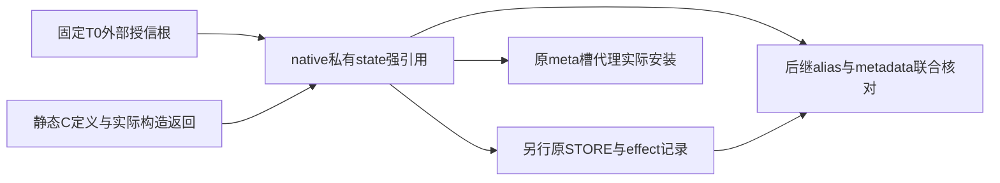

# r1112 固定 T0 授信与 native 实际构造根交接

r1112完成固定T0有限授信、native实际构造根与发布交接子设计修订02。01把字典发布叫无callback终段的B001经双红审否决；02改为可再入准备/释放、最终raw重核与list-only安装成功段。六组具体C API和引用路线已列，完整metadata/P2实际local/联合消费/N4/COMPAT仍待。完整设计/source/execution均False，源码仍r1106 SOURCE02完整159，Goal active未完。

本批冻结29份完整原/副本pairs，每侧3758276B，核父r1111封存68与当前159源码7956657B，保护56同18lstat缺席。新增16份官方CPython3.12.10源码/文档826441B；继承importlib两文本和list原实现。31段准确原文、ADR01→02七段替换/完整正逆差异及具体API表均核同。没有新产品候选、compile/import/运行、native build/load、hook、模型、QA、SQL/Store或诊断。

T0裁决允许把既有可信首次导入边界具体化为原native初始化入口及固定具名stdlib根；外部前提、native actual construction与后继current核对分列，不要求递归证明整个解释器。T0不可后移，回调后缺项保持缺项，不补pin/first-wins或从业务subject登记。该裁决不自证binary来源、首body恒定或完整N0。

安装发生在原Py_mod_exec(actual_module)，m_methods=NULL；静态C定义→NewEx/type实际返回→state强持→另行STORE/effect，避免Python public install alias和AddFunctions后getattr认领原根。native __module__可写；opaque type明确IMMUTABLETYPE/DISALLOW_INSTANTIATION/无BASETYPE与无公开origin字段，exact type不等于实例来源。原模块/type/callable环和partial失败纳入N4未闭。

原01持旧值只排除特定last-DECREF，未排除合法watcher设置异常返回-1后CPython发audit/call unraisablehook。Root与同一独审各1实质阻塞保红，不以违规watcher直接执行Python作反例。02把字典发布、构造及任意临时释放放PREPARING无短锁区；回调后核实际phase/根/alias/effect，不重授信。所有任意临时释放先于最终raw核对；有限成功终段仅在GIL内替换actual meta list原槽、raw核effect并ACTIVE。PyList_SetItem成功失败均消费传入新引用，state另持原finder/proxy，错误清理不冒称无callback。

六组API路线区分C函数getter与audited属性getter、borrowed与NEW、合法NULL缺席与None/异常。class字典用PyType_GetDict保per-interpreter实际dict；builtin __func__/__builtins__采用固定readonly T_OBJECT C成员路线；PyMethod_New只在ROOTS_FROZEN后准备。完整metadata行/容量/失败、原helper实际dispatch/D1、23个P2实际产物到原caller local/原STORE、联合metadata/三D0/D2与N4/版本构建尚未完成。修订02双审材料0不作完整设计或源码准入，源码缺口关闭0、产品pass0。

本批只有静态设计与文档交付；Task9A9B、原111/94/r919、真实Store、P06/条件T15/生产云和完整Goal仍未完成，非只剩验收。正常库/service-dist/ACLsettings/平台/Git保持，canonical apply0/历史11。原17lease/1449slot/406尾/五S002及case30/parent360/matrix1680/cleanup10/control1MiB/并发1/最多2pytest children/native20–25–10保持。禁profiling/真实frames-locals/停点/定点计时/新异常链诊断/runtime journal，不改全局GC/trace/monitor/eval。r920/r964已耗不重放，r967不执行不重问，P06用户无材料0/7不再索取。

# ADR-r1112：固定 T0 授信与 native 实际构造根交接

状态：修订02，承接r1111的原根/安装入口子设计候选，待静态双审；原01的B001实质红审保留；不是完整N0–N4/COMPAT或源码/执行准入。当前源码仍r1106 SOURCE02完整159文件，没有native产品文件、构建、导入或模型执行。

## 1. 决策与合同解释

选择在native模块的原`Py_mod_exec(actual_module)`内创建并保留自己的根、准备代理、最终安装原PathFinder槽位。`reno/__init__.py`仅触发正常相对native导入，不再从Python查找并调用一个可被替换的public `install`别名。native实际初始化入口来自可信构建/加载这一外部起点，不能用模块名、路径后缀或metadata自证二进制原来源。

r1075第15/37/55/63行允许可信首次源码导入及捕获的stdlib/内建primitive；第37行明确不声称首次工厂执行自证。该边界允许在固定T0取得被外部授信的原stdlib对象。第63行禁止的是在边界内、以业务subject/晚槽/后来alias的第一次current读取重建expected，不能解释成取消原有首次信任起点。

因此分开三种来源：

| 来源类别 | 建立原根的事件 | 限制 |
| --- | --- | --- |
| TRUSTED_T0_CAPTURE | 原native初始化入口开始时，既有可信首次导入基线交付下列固定stdlib根 | 是明确外部前提，current读取不是其来源证明；不把T0后改过的值重新授信 |
| NATIVE_ACTUAL_CREATE | 静态C定义经过指定构造器，C直接取得actual返回并纳入state | 不能用发布后的module属性替代actual返回，不能接受任意subject登记 |
| MODULE_CODE_AND_P2_RESULT | 原get_code实际返回、原helper实际f/args以及P2逐次actual产物 | 沿r1110/r1111独立接线；本批不把前两种根冒认这一链已完成 |

T0的外部条件仅是：预期native二进制的原初始化代码实际执行，且该入口开始时的具名stdlib/builtin根确为原对象。这是既有可信首次导入边界的具体化，不是一个可不断后移的区间。不禁用audit/监控/合法再入；T0后的变动仍由固定原根核对。若T0基线本身被整体替换，本子图不声称完整解释器防篡改。该限制不能用来豁免T0捕获过程中新出现的callback或后续alias变动。

## 2. 原入口与实际模块

采用多阶段扩展模块；静态`PyModuleDef.m_methods = NULL`，显式定义一个原exec slot。`PyInit_*`返回初始化后的`PyModuleDef`，不是实际module。actual module取自原exec slot的参数；使用原importlib默认module创建，不定义接受任意对象的custom create，不从sys.modules同名属性反向认领actual native module。

每次原exec slot进入先检查自己的state阶段。标准已初始化extension的reload会在上层skip，不靠Python installer重新认领根；直接重复`PyModule_ExecDef`也可能再次进slot，必须复用已有同代state或拒绝不合法再入，不能重新T0捕获。失败初始化的新模块实例与已成功模块的重复exec分列，不能因“还未READY”就允许覆盖旧expected。

模块`m_size`提供独立state，static C定义可共享，Python对象根不得放进跨解释器全局变量。先定义`UNENTERED→CAPTURING→ROOTS_FROZEN→PREPARING→INSTALLING→ACTIVE`及`FAILED/RETIRING/RETIRED`；阶段由C内部原路径更新，不接受Python传入阶段或原根。此表是后续实现合同，不是当前运行中的记录。

## 3. T0 的固定集合与一次捕获

固定六组捕获路线；一组含多个原对象，不冒称只有六个root。原函数的code/defaults/kwdict完整键值/closure逐cell/globals/builtins及实际调用结构，须在同批原始快照中强持；没有字段可以在业务调用时再首次补pin。

| ID | T0实际来源与目标 | 原调用形式/后继验证 |
| --- | --- | --- |
| C001 | CPython提供的actual模块映射，原sys module/dict及actual sys.meta_path列表 | 列表原对象及原PathFinder唯一槽；不是package锁代替全局列表所有权 |
| C002 | 原`_frozen_importlib_external` module/dict；原PathFinder class及其原type dict | metaclass为原内建type；后继class alias、descriptor和metadata保持原根 |
| C003 | 原PathFinder.find_spec classmethod descriptor、原`__func__`与原class | 允许由原func/class通过C构造持有actual bound method；仍只执行原find_spec一次，不新增before-finder |
| C004 | 原invalidate_caches/find_distributions staticmethod descriptor与各原func | 前者无参；后者保原args/kwargs与lazy iterable；不统一改成带cls调用 |
| C005 | 原SourceLoader/SourceFileLoader class及原SourceLoader.get_code plain function | 用原func(actual原loader, actual name)一次；不从后来loader.get_code认领原方法 |
| C006 | 原`_frozen_importlib` module/dict与原helper；原builtins module/dict与builtin exec | helper(original_exec,same_code,G)；helper func_builtins与builtin exec分别保存，不从目标G重pin |

本节具体读取API和所有权见同目录CAPTURE-API-TABLE-01.md，该表是本修订组成部分；它不冒认完整metadata快照/N4或其它版本准入。

开始点固定为该模块实例第一次原exec slot进入。C先取得实际state与actual module，所有记录从NULL/未取得开始。捕获路线只用已核exact类型的C原始访问、raw字典迭代、已识别内建descriptor的C读取和直接字段；不执行Python函数，不通过audited function getter取得code/defaults/kwdefaults，也不运行候选或读取真实frame/locals。

模块映射及sys字典用PyDict_Next的raw迭代定位具名exact-str条目，比较仅用exact-unicode字符的C读取对固定ASCII literal，不对未知key调用hash/eq；非目标条目不作普通key查找。class字典用PyType_GetDict取得NEW引用，保3.12静态builtin的per-interpreter实际dict，不一概读type->tp_dict。认证row/kwdict及随后需要key查找的actual字典仍遵循完整exact-str键前验，不能先查后验。classmethod/staticmethod的`__func__`仅允许原内建descriptor的已知C路径，不能把任意getattr纳入“raw”。完整源码须列清每次实际C API与可能分配/释放边，不能仅凭本段宣称无callback。

捕获期新取得的原对象立即强持，borrowed引用不能跨后续操作。若某步可能回到Python或释放任意对象，不允许继续从变更后的current补齐baseline：未取得项仍未取得，进入失败/拒绝路线；若只发生在原根已完整固定之后，则按原根重核actual值，不重建expected。准备类型、公开alias或安装代理前必须到ROOTS_FROZEN；最终安装前再核actual alias/metadata/container及原meta槽。

T0是有限primitive与基础import设施的可信起点，不承诺所有第三方finder或全部importlib内部依赖都在全解释器unknown=0。原path hooks/custom finder选择仍由r1111的原PathFinder body处理。原caller body/可信源码导入前提继续存在，不能把“有同名模块返回CodeType”冒认源码或二进制文件已获独立认证。

## 4. native 入口必须来自实际 C 构造

对需要长期保存的native callable，使用静态寿命的`PyMethodDef`，明确普通入口的flags（例如METH_FASTCALL|METH_KEYWORDS，不误用METH_METHOD/METH_CLASS/METH_STATIC）。`PyCFunction_NewEx`直接返回actual新引用；成功后该引用立即移交native state，另有需要时再创建发布引用。expected包括actual object、静态methoddef地址/原function pointer/flags、actual self、原module字段与vectorcall结构，不能从current alias生成。

原`PyModule_AddFunctions`内部创建、发布、DECREF，只返回int，且可能partial失败；不采用“先AddFunctions，再getattr当原根”。`m_methods=NULL`也避免importlib在本批手工创建前另外生成一批同名callable。`PyModule_AddObjectRef`可以在已持actual root后另行发布，它不偷调用者引用；`PyModule_AddObject`仅成功偷引用，两者不得混淆。

不得笼统称native callable的全部metadata不可写：官方PyCFunction的`__module__`成员可写。本批的来源来自actual构造，后继检查仍须使用保存的原module字段及其它原值。native入口的self若为actual module，则与state根形成环，生命周期必须被遍历/清理。C入口调用时要先核实际self/原state/阶段，不能从传入任意module查同名state当原owner。

原PathFinder代理的固定C协议方法可由原native type的静态slots/method definitions生成；其来源是自建actual type与静态定义，并非每次取到一个新的bound method就重新登记原根。type、descriptor/slot、actual proxy与其generation须关联；不提供接受任意proxy或subject的register入口。

## 5. opaque type 与 origin 的区别

origin/attempt/proxy需要的native type由固定静态`PyType_Spec/slots`经`PyType_FromModuleAndSpec(actual_module, spec, fixed_bases)`产生，直接强持actual返回。bases只取固定原内建object，metaclass只允许原内建type；不把外来bases/metaclass/slots作为入参。设置IMMUTABLETYPE、DISALLOW_INSTANTIATION，不设置BASETYPE；不暴露实例dict或可写origin成员。

仅省略heap type的tp_new不足：type准备逻辑可以继承object.__new__。禁止Python公开实例化与native内部从原type allocator自行创建actual实例是不同路径；后者必须由固定C producer执行并保actual返回，不能把“exact type正确”当实例来源证明。

origin的后续producer仅从本代原attempt/固定route及独立原code根创建实际function与对应opaque origin；不接受外部subject/current code建立expected，不first-wins、不覆写owner原发布槽。真实actual function/origin对如何到原caller local、原STORE后如何消费仍是P2未完成项，本批只固定native自建根的来源与公开构造禁区。

heap type的ht_module会强持actual module；type不是无成本、无环或整个实例状态自动不可变。完整traverse/clear/free、partial失败与新type构造错误都须进入N4，当前没有证明它们已闭或在预算内。

## 6. 创建、发布和 current effect 分列

每个待发布root至少有以下独立事实：`CREATED_ACTUAL`、`STATE_HELD`、`STORE_ATTEMPTED`、`STORE_RETURNED`、`EFFECT_OBSERVED`、后继`CURRENT_MATCHES`。这些是固定状态字段，不是新增runtime journal，也不授权观测运行中frame。

PyModule_AddObjectRef最终字典写入可能释放旧值并再入。即使持旧值避免last-DECREF，合法dict watcher仍可设置异常并返回-1；CPython随后经PyErr_WriteUnraisable发audit并调用sys.unraisablehook，hook可改其它source alias/meta_path或再入而不修改watched dict。watcher直接执行Python/改watched dict被官方禁止，不使用违规watcher作反例。01的“字典STORE无callback终段”因此被B001实质红审否决，原稿及两份红审保留。

修订选择把所有公开alias字典写入、构造分配和任意临时旧值释放都放到PREPARING无短锁区，明确允许再入。actual module/dict及fixed exact-str key先核，全键前验在每次需要普通lookup/STORE前完成；先记录STORE_ATTEMPTED，再进行原API。返回0只记STORE_RETURNED，之后raw核actual effect/current。任何callback返回后核same-generation phase、原根、metadata、source/native alias和actual容器；expected一直来自state-held actual，不重授信、不从受影响current补pin或重试认领。

持actual旧值额外强根仍有避免特定last-DECREF的局部用途，但不证明无callback。旧值及其它任意临时引用释放在短锁外、最终安装核对之前完成；每次释放都视为可再入。若准备/释放后仍失配则拒绝，不进入INSTALLING。未知effect保持unknown；失败保原异常首对象及实际所有权，不以current覆盖原根。自有alias的失败删除/恢复也可能触发watcher，须留在N4可再入路线，不能叫无callback回滚。

新native模块的这些发布不提前替换23个产品factory的原STORE。产品P2原STORE先于新消费拒绝这一规则保持，本批不通过native预先发布factory绕过原时序。

## 7. 安装只在原 exec slot 最后完成

根全部固定、类型/代理及恢复记录准备完成、所有任意临时引用释放已在PREPARING结束后，才作最终raw联合核对并进入INSTALLING。核same-generation phase、全部原根/metadata/source-native alias/actual容器；原sys.meta_path仍为actual原exact-list，原PathFinder实际identity恰有一槽。核对到替换/effect/ACTIVE的有限成功段保持同解释器GIL，不调Python、不写字典、不再作分配性准备或任意临时DECREF；GIL本身不是排除callback的理由，具体成功路径才是。重复访问不层层包装，不在前面插一个再调用原PathFinder的项。

state同时强持原PathFinder与actual proxy。预先准备的恢复字段均已就位，Py_NewRef(proxy)仅建立单独传入引用；PyList_SetItem成功失败都会消费该传入引用，state根不移交。最终核过exact list/有效实际index/old identity且无插入callback时，3.12.10成功路径只替换slot并DECREF old；old仍state-held，故该DECREF非最后释放，不触发dict watcher。立即raw核same list/slot effect，再设置ACTIVE。失败分支不标ACTIVE，转N4可再入错误/释放路线，不能把成功段论证外推至错误创建/清理。原STORE返回、raw effect和ACTIVE分列；外部改槽不盲写旧index、不从current重新认领expected。安装成功后返回前不得再释放任意临时对象或调用可回调的准备API。

安装成功后原exec slot返回0；真正Python导入返回及后续alias可能被回调改变，不能由0推出所有别名永久一致。包装state的expected根不依赖native module的public属性，因此这些alias变动不改变原根。保原sys.modules/模块锁/失败规则；native init失败可能留下已创建对象或自有proxy，须按所有权恢复，不能仅靠importlib删除模块完成清理。

普通package reload不重新授信：native已初始化时的正常import返回不会再跑slot；本代仍自有的proxy复用，原路径对象不改。若显式再次执行原slot，只处理既存state状态，不用它刷新基线。外部删除/重排meta_path后不偷偷修回；缺seed的后继认证消费按r1111拒绝。active attempt的代际清理、retiring旧proxy和失败回滚仍要与N4完整接线。

## 8. 强引用与失败生命周期要求

所有source/native根与state字段必须逐一被m_traverse覆盖；m_clear/m_free要容忍尚无state、partial构造、重复调用及已经分离的字段。官方m_clear不保证总先于m_free，不能仅在m_clear清理或仅用sys.modules删除作为释放证明。

先将阶段标为RETIRING、禁止新attempt，按所有权脱离自有meta槽/aliases并把实际已取得引用与待清字段分开；实际引用逆序释放在短锁外。释放任一任意Python对象都可能再入，重入路径只能见已退休/已detach的明确状态。active attempt持有其原代所需根，不能在仍消费时提前清空；具体活动引用、module/type/callable环、重复clear/free与最终释放协议仍须在完整N4设计逐边列清，本批不声称已经实现。

state不直接持有业务budget、Context、异常/tb或资源；原module/function/globals根可能间接可达业务对象，不报“零间接可达”或完整产品GC。原17lease/1449slot/406尾/五S002不因native根而重写。新增type/method/记录的实际数量、保留时长与字节成本尚未实测，control1MiB等原限额不放宽。

## 9. 实施顺序与本批边界

本批给出：固定T0的合同解释与六组具体API/引用路线；自建actual native根而非public install别名；NewEx→state held→另行STORE/effect；B001修订为可再入字典发布与释放、最终raw重核及list-only安装成功段；明确opaque type禁区、可写metadata和生命周期义务。这些是可继续实施的具体子设计，不能称runtime N0完成。

下一步同一完整设计必须接入：T0全metadata容量/字段快照/失败精确实现及后继原alias联合消费；23个P2原producer实际返回/原caller local/STORE/effect及同次code槽；原helper/D1、联合metadata/三D0/D2、N3/N4与版本构建。尤其不能把“native已自建入口”写成P2 source caller已握其原指针。

`reno/__init__.py`新增native导入会增加包启动依赖与失败路径；必须由构建/安装/source-editable/in-place/缺native fail-closed方案支撑，不能暗中改变现有>=3.11声明或回落原不安全快照。3.12.10官方静态依据不是3.11/其它版本/平台或二进制来源已验证，当前无native build配置及构建依赖元数据的现状保持。

完整设计、source_approved、execution_admitted均False；不生成/编译/import/运行产品候选，不运行局部bootstrap/control模型、native build、QA、旧绿/F001或诊断。正常库/service-dist/ACLsettings/真实平台/Git保持。r920/r964已耗不重放，r967不执行不重问，P06用户无历史材料0/7不再索取。原case30/parent360/matrix1680/cleanup10/control1MiB/并发1/最多2pytest children/native20–25–10保持。禁profiling/真实frames-locals/停点/定点计时/新异常链诊断/runtime journal，不改全局GC/trace/monitor/eval。Task9A9B、原111/94/r919、真实Store、P06/条件T15/生产云与完整Goal未完，非只剩验收。

# r1112 固定 T0 读取路线与所有权表

本表是 ADR-ROOT-HANDOFF-02 的组成部分，只依据被冻结的 CPython 3.12.10 文本。它固定具名根的读取路线，不是完整metadata快照/N4或>=3.11 ABI批准。T0外部授信、actual构造、后续current核对三层仍分开；没有执行这些API、注册watcher或读取真实frame。

## 成功读取路线

所有路线在同解释器GIL内，无主动释放GIL/调用Python/任意DECREF；类型失败、缺项和内存错误离开成功路线，不能把错误格式化/清理也宣称无callback。只读宏及INCREF不得隐藏未知Python getter。字符串定位仅在已核exact-unicode上，以长度/KIND/DATA/READ读取字符对固定ASCII literal作C比较，不调用未知key的hash/eq或格式化。未知key可跳过；将来需要普通key lookup的字典须先完整exact-str键前验。

| 路线 | 具体 C 访问及原对象 | 引用与缺席 | callback / 实施义务 |
| --- | --- | --- | --- |
| C001 actual native module/state | 原Py_mod_exec参数；PyModule_GetState(actual_module)，先核本模块原def/阶段；不接受Python传入替代module | 参数已有原调用所有权；state是C指针，不把它当PyObject INCREF | getter在已核module成功路直接取state；默认module实际创建与失败来源另列，不从sys.modules认领owner |
| C001 modules/sys/meta_path | PyImport_GetModuleDict；exact dict的PyDict_Next遍历，选exact-str `sys`；exact module的PyModule_GetDict，再raw遍历`meta_path`并核exact list | modules/dict/value为borrowed，取得后立即INCREF到空state槽；list本身及原PathFinder均强持 | 不用PyImport_ImportModule、PyObject_GetAttr或未知key查找；T0需modules已存在，官方缺modules是fatal前提失败，不设计捕获fatal后恢复 |
| C002/C005 frozen external/classes | 上述modules raw扫描取得原外部module/dict；raw字典取PathFinder、SourceLoader、SourceFileLoader；核actual class的metaclass是原PyType_Type | 每个borrowed立即强持；class/dict身份都保存 | class字典统一用PyType_GetDict(actual_class)，返回NEW reference；3.12静态builtin可能用per-interpreter字典，不能一概把type->tp_dict当实际字典 |
| C003/C004 原descriptor | 在上述actual class dict用PyDict_Next取原find_spec、invalidate_caches、find_distributions；分别核exact PyClassMethod_Type/PyStaticMethod_Type | 原descriptor立即强持；不走descriptor binding或通用getattr | 固定builtin PyClassMethod_Type/PyStaticMethod_Type的tp_members静态C表选`__func__`的T_OBJECT/READONLY条目，再PyMember_GetOne((char*)actual_descriptor, fixed_member)。不从可改current类字典取得任意member/getset函数 |
| C003 原func/cls bound method | 持原function与原class后，PyMethod_New(actual_func, actual_cls)产生actual bound method | 成功返回NEW，立即state-held；NULL是失败，不从current bound method补pin | 该构造的分配在ROOTS_FROZEN之后PREPARING，原func/cls已完整授信；构造后重核。不能把分配/错误边纳入最小T0成功只读段 |
| C005/C006 原Python函数及metadata | 原plain get_code/helper和descriptor的原func均核exact PyFunction_Type；PyFunction_GetCode/Globals/Defaults/KwDefaults/Closure直接读取；保存vectorcall及其它声明字段的版本专用直接字段方案仍属N2完整设计 | 各C getter返回borrowed；code/globals应存在，defaults/kwdefaults/closure的NULL可合法缺席，另存present位；非NULL立即INCREF。NULL、Py_None、异常三者分列 | 不用`__code__`/`__defaults__`/`__kwdefaults__`属性getset，其原实现发audit。完整row、kwdict每项、closure每cell和可变字段共同快照容量/错误仍须N2/N4精确表，未宣称仅这几个API已完 |
| C006 原helper builtins | 固定PyFunction_Type.tp_members静态C表取`__builtins__`的T_OBJECT/READONLY原member，用PyMember_GetOne直接取得；核exact dict并保存 | T_OBJECT成功给NEW；NULL成员读为Py_None，helper此字段要求actual dict，不得把None重解释成合格dict | 该固定member无PY_AUDIT_READ；不是对任意属性一概称raw，也不以helper globals里的`__builtins__`替代func_builtins |
| C006 builtin exec | modules raw扫描取原builtins module/dict，raw取原exec并核对应native callable结构 | borrowed立即强持，原module/dict/exec分别存 | helper func_builtins与builtins module dict分别核，不从待执行G的current值重pin。native结构metadata仍须N2共同消费设计 |

PyType_GetDict的NEW引用不能再当borrowed漏释放，也不能为方便在final terminal释放；持有至明确N4阶段。固定tp_members路线读取的是CPython原builtin静态C表；对类型/条目失败不动态fallback到getattr。它在3.11或其它版本是否可用属于COMPAT未闭，不按当前文本泛化。

## 原根固定和可再入准备

最小T0读取段不做type/method构造、dict写入或任意临时释放。完整metadata行需要的容量及分配失败必须在源码前给出N2/N4实现；本表不声称所有N0原根/字节预算已完成。未取得的字段保持未取得，不能在callback之后重读补成T0。原根完整固定后才进入可能分配/回调的PREPARING，重入只能见PREPARING并拒绝建立新attempt或基线。

所有native callable/type构造、公开alias字典发布、旧值和其它任意临时引用释放都在PREPARING无短锁区。合法dict watcher可设置异常返回-1；随后CPython的WriteUnraisable可audit并调用sys.unraisablehook。这是合法回调边，不靠禁止watcher或吞其异常排除。发布后current核对失败、再入导致phase变动、源alias/meta_path变动均拒绝，不重授信/补pin。

所有任意临时引用释放和可能回调的准备必须在最终raw核对之前结束。最终核对不做字典写入、不调用Python、不分配准备对象、不释放任意旧引用、不放开GIL；原same-generation state、根/metadata/alias、实际list身份及原PathFinder唯一槽共同核对。之后只向PyList_SetItem提交独立新引用，原finder和proxy均由state强持，成功路的old DECREF不成为最后释放；raw核effect后才ACTIVE。SetItem成功失败均消费传入的新引用。错误路保持未ACTIVE并转N4，不能把成功路无callback论证外推到错误清理。

这段有限成功终段不证明原helper/D1、P2 actual-local/STORE、完整N4、binary来源、首body不可变或产品兼容已完成。原短锁不跨Python、字典发布、任意DECREF或foreign业务调用；不修改全局GC/trace/monitoring/eval来达成上述条件。

# 下一批：P2实际native指针到原caller local与联合消费

源码父仍r1106 SOURCE02完整159，文档父r1112。读取ADR-ROOT-HANDOFF-02、CAPTURE-API-TABLE、ADR正逆及两版双审；01的B001红保。T0有限可信首次导入起点已裁决，不递归扩大为整个解释器自证，也不把T0后current重读当原根。

1. 优先设计23个顶层factory的P2 native实际入口如何到原可信source caller local；actual function/origin对、同次get_code原const槽、原caller实际return/原STORE/effect同时接线。没有通用register(subject)、first-wins或当前module alias补pin；两个已证inner local来源不重做。
2. 将T0 API表落实为完整metadata快照容量/每字段强持/缺席/失败协议；同一完整设计接原helper实际dispatch/D1、联合metadata和三D0/D2及原参数、audit、异常、锁/释放语义，不能仅凭连续C getter就宣称首body恒定。
3. 补N4 own-restore的字典watcher/任意DECREF再入、active attempt/generation、module/type/callable环、partial失败与逆序释放/control预算；列表安装成功段与错误清理分列。保持>=3.11，补native打包/source-editable/in-place/缺失fail-closed及回滚，当前3.12.10静态证据不等于其它版本已验。
4. 完整设计双审前不生成产品候选，完整源码准入前不运行候选/局部bootstrap-control模型/native build/QA/旧绿/F001；所有保护、诊断禁项与原限额保持。无需重复用户批准，Goal active未完。
