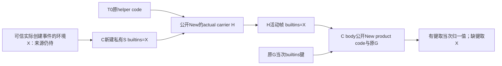

# r1115 公开构造器与私有环境 carrier 接点裁决

r1115完成公开构造器与私有环境carrier的有限接点裁决：已持原X时可用独立scratch globals建立carrier，再在其活动帧下直接构造保原G的函数；X最初取得仍未闭。原builtin exec接线是可显式修订的内部设计，R2自持module function仅为备选，CREATE/doc/audit/错误delta未准入。B001/B002仍open2，完整设计/source/execution均False；源码仍r1106 SOURCE02完整159，Goal active未完。

本批冻结29完整原/副本pairs，每侧1041696B；核父r1114封存80和当前完整159源码7956657B，保护56同18lstat缺席。继承10份官方CPython3.12.10文本561558B，30段准确原文、一份原helper源码AST核同，无新下载。纯PE字节读取确认本机11个列明公开symbol有named export、私有constructor无；不证明实际链接、ABI/行为或其它版本。没有新产品候选、compile/import/运行、模型、native build/load、QA、SQL/Store或新诊断。

carrier方向的前提是C已从可信actual创建事件持有归一化原func_builtins根X；不从post-exec G、原helper B或任意入参补pin。S仅属于新carrier，public New原helper code/S取得实际H；实际H调用帧持X，native body在该帧下直接New(product code,原G)，有键取当次归一值，缺键回X。产品func_globals不改成S，原G不做补偿预插；外部carrier调用不认证任意f/payload，也不授予原槽登记权。

原helper源码只有f/args/kwds三个参数Name Load；AST不是新编译或runtime code证明。H是新增actual函数，不冒认原helper。若先进入其它Python frame，再New时必须按该实际frame重新论证，不能把本局部机制直接推广P0/23P2或源caller。完整X来源、原P0两次环境求值与所有构造时机仍待。

三份原要求材料区分：原callee/错误/来源/unknown0保持，r1111 helper(original_exec,code,G)属于内部接点决定，可显式修订并重审。R2提出helper(E,same_code,G)，E经原条件/audit后用公开New实际握module function M，再交X给carrier；它不再实际调用原builtin exec。module doc/CREATE、额外H事件/帧、audit/错误/tb/引用、flags/版本等实质delta未解决，R2未选为最终路线，现行r1111合同未替换。材料双审0不代表完整方案批准。

独审补充两项具体R2义务：原EvalCode先取builtins、再由private constructor读G的name；public New先读name、再取builtins，不能以字段最终一致消去顺序/失败差异。原builtin exec在成功后释放求值结果并返回None，E不能直接返回M的call result；释放和原first顺序也须处理。两项均属未闭设计，未作运行验证。

下一批聚焦R2完整native executor的受支持参数/插键/audit/原X独立取得/New/联合核/实际call/原错误与引用顺序，先裁决上述delta，再联动P0/catalog第4目标与可能0→1 maker ABI、23P2/CORE第24项、原sourcecaller return/STORE/del、D1/联合metadata/三D0/D2、N2/N4/预算与>=3.11发布。不能把已持X当成已取得X，也不重复P0 prefix库存。

源码缺口关闭0、产品pass0；Task9A9B、原111/94/r919、真实Store、P06/条件T15/生产云与完整Goal仍未完成，非只剩验收。正常库/service-dist/ACLsettings/平台/Git保持，apply0/历史11。原17lease/1449slot/406尾/五S002及case30/parent360/matrix1680/cleanup10/control1MiB/并发1/最多2pytest children/native20–25–10保持。禁profiling/真实frames-locals/停点/定点计时/新异常链诊断/runtime journal，不改全局GC/trace/monitoring/PEP523；r920/r964耗不重放，r967不执行不重问，P06用户无材料0/7不再索取。

# r1115：公开构造器与私有环境 carrier 的接点裁决

状态：有限子设计与明确的执行接点备选，不是完整设计、源码或执行批准。r1114 的 B001/B002 均保持 open；本批不生成产品候选，不 compile/import/执行候选、模型、native 或 QA。源码仍 r1106 SOURCE02 完整159文件。

## 1. 原约束与可修订的设计决定

r1075 要求原定义/实际返回建立来源、固定认证调用前 fresh、原错误首对象/次数/传播及 unknown=0；r1109 明确不能用离线 code、同结构或同 hash 冒认 live 原身份。这些继续作为约束。

r1111 的 `helper(original_exec, actual_code, G)` 属于其“决定三”的具体安装子设计，而非已找到的用户不可修改指令。该文件自己声明是子设计候选，且明确承认原 exec_module 帧被移除等 delta。因此可以提出显式替代，再完成设计双审；不能把新路线偷偷称为仍执行原 builtin exec。CREATE、audit、异常及引用变化没有自动豁免，仍须逐项审查。

本轮选择：在**已经由可信实际 producer 持有原环境 X**的条件下，后续环境绑定采用公开构造器建立私有 carrier 的方向。X 的最初取得仍是独立未闭项；仅此绑定子方向不允许实施。为取得 X，下面另列 native 自持 module function 的备选 R2，尚未选择为完整执行接点，也未取代现行 r1111 合同。

本轮冻结29完整输入 pairs，每侧1041696B；继承10份官方 CPython v3.12.10 文本561558B，无新下载。一份原 helper 源 AST 与纯 PE named-export 读取均为静态依据，不是新函数或调用的运行验证。

## 2. 新的绑定机制：scratch globals 只属于 carrier

X 必须来自后续设计的实际原 module/function 创建事件并由 C 强持，不能来自 post-exec current G、原 helper 的 B、任意 Python 入参或 first-wins 登记。本子设计不提供接受外部 X/subject 的 register API。X 是该创建事件的**实际归一化 func_builtins 根**；若原 G 中存的是 module 值，则应区分原字典值与其 dict。归一后的 None 或其它非 module 对象不能与缺席混同。未建立这一来源就不能进入本子设计。

在此前提下：

1. C 实际新建并握住 scratch exact dict S，在准备区写入 `S['__builtins__']=X` 及固定自有 `__name__`。S 是新 carrier 的 globals，**不替换产品函数的 G、不预插或补写 G 的 builtins**。这些字典写入/分配不冒称无 callback；之后重核 S 的 actual identity、完整 exact-str keys、两个实际 value 与本代状态。
2. C 从 r1112 C006 已持的原 helper code 根，用公开 `PyFunction_NewWithQualName(helper_code, S, held_qualname)` 取得实际新函数 H，立即强持。H 是新增 carrier，不冒认原 helper 对象；原 code 来源仍来自 T0 实际原 helper，不从当前 helper alias 补 pin。源码无额外 compile 或 code const 注入。
3. public New 从 S 取得 X；X 已是归一化的非 module 实际根，故不会再次把它换成别的 module dict。若支持范围将来允许 module 类型的 func_builtins，必须另论证，不能静默归一并称 identity 保持。
4. CREATE 可能让 H、S 或其它状态被观察/变更；C 必须用预先持有的 code/S/X/name/qualname/doc/default/kw/closure、原 vectorcall 等联合核 H，不能从 CREATE 之后的 current 造 expected。原 helper 源为一普通位置参数 f、varargs args、varkw kwds，无 defaults/kwonly/decorator；实际 runtime ABI/closure/flags 仍须在 T0 原根和最终候选核对，AST 不代编译证明。
5. C 直接调用实际 H，并以实际位置参数传入 C 自有 native body 与 payload。原 helper body `return f(*args, **kwds)` 的所有 Name Load 均为这三个参数局部，源码没有未绑定 global Name；其实际 f/args 运输沿已核 vectorcall/localsplus 路线，不能换成 module alias 查回 body。实际 native 入口仍须原 C pointer/flags/self/state/phase 来源与末次门。
6. H 的实际调用帧从实际 H.func_builtins 取得 X。native body 在该帧活动期间用 `PyFunction_New(code, original_G)` 创建产品函数：若 original_G 当次有键，则依原规则取当次值并作 module 归一；若当次缺键，fallback 为 carrier frame 的 X。产品函数的 func_globals 仍为 original_G。

这消除了 r1114 “第二次原 helper 只能回到 B”的局部绑定障碍：H 是明确新增、由 S/X 建立的实际函数，不是重复调用原 helper 后假定 B=X。它没有证明 X 最初从哪里取得，也没有证明全部 P0/23个P2/第24项CORE的创建时序已保持。

## 3. 来源、外部再入与保证范围

S/H 不被当作秘密。CREATE 或既有监控可能看到它们；外部也可能调用同一个 carrier。来源保证仅针对 C 自有的 actual H/body/payload 调用路径，不能以“别人拿不到对象”证明独占。任意外部 carrier 调用不取得原槽登记权、不允许接受外部 subject 补 expected；它的返回也不能替代原 caller actual local。

carrier helper 本身是通用 f 调用代码，不自证任意外部 f 为原入口。固定认证图的 unknown=0 仍须由可信 C 调用方对 actual body 和 payload 提供来源/调用前门。native body 的重入、预算消耗、实际产物/原STORE/effect以及外来调用不得抢占原槽，仍是完整 producer 设计义务。本轮没有把这些写成已闭。

H 的原 code 与标准 vectorcall 末次核对、实际 call 的 D1、frame 初始化及 D2 各自分列；不声称公共 API 保证首 body 前永远 fresh，也不借新 Python frame 修改全局 PEP523/trace/monitoring。X 的 identity 不保证其映射内容恒定；原 globals/builtins 内容仍按边 fresh。

## 4. 取得 X 的备选 R2：C 自持 actual module function

仅靠原 builtin exec 的返回 None，没有在现有已选接点中取得它内部的 actual module function；事后读 current G/任意函数不能补造 X。这里不作“所有可能方案绝对不可能”的无界结论，只保留此已知缺口。

R2 具体备选：仍单次原 get_code，强持其 same actual root；原 helper 的 f 改为 C 自建 native executor E，E 处理受支持 exact-code/exact-G 路径、原插键/closure条件、发同 actual code 的 exec audit，然后用公开 `PyFunction_NewWithQualName(actual_code, G, actual_code.co_name)` 实际创建并握住 module function M。C 在相应创建点独立确定原环境期望（G 当次键的归一值，缺席则原 helper 实际环境 B），不从 CREATE 后 M 的字段补 pin；构造返回后联合核 M。调用 M 时非 optimized code 的 public vectorcall 使用其原 G 作为 locals，存在官方静态路径。

如果这一执行接点经完整设计接受，C 已持 M 的实际环境 X，后续可为 X 创建 H，native body 在 H 帧中构造 P0/P2/sourcecaller。原 caller 的第三 actual native 参数方向沿 r1113 保留；其私有2→3 ABI、原tail/STORE/del和24行顺序仍需整体设计。这里没有创建 E/M/H、没有派生或执行 CodeType。

**R2 明确改变 r1111 决定三：三个目标路径不再实际调用原 builtin exec，而是 helper(E, same_code, G)。** 手工调用 PySys_Audit 不是“原 builtin exec 已执行”的证据。r1111 的原 PathFinder/loader/原 get_code 安装方向可继续作为输入，但其 EXEC_RETURNED 等含义必须重写，不能沿用旧状态文字冒认。

## 5. R2 必须正面处理的字段、事件与错误 delta

| 项目 | 原 builtin exec/EvalCode | R2公开New与carrier的后果 |
| --- | --- | --- |
| actual code/G | 原 helper→builtin→EvalCode | 仍须同次get_code actual root与G，不能用同结构/hash替代；新消费接点须实际证明 |
| module function name/qualname | EvalCode的fc_name/fc_qualname均co_name | 必须显式传co_name；public New缺省co_qualname不自动等价 |
| module function doc | private constructor固定None | public New取co_consts首字符串；模块有docstring时CREATE观察值不同，不能在CREATE后改字段并冒称事件未变 |
| defaults/kw/closure/version | module内部构造NULL/NULL/NULL与version0 | 受支持module必须确证相应布局；public New初态version0；不误套MAKE_FUNCTION后填co_version |
| CREATE/监控/trace | 原内部module function CREATE、原helper/module帧 | public M仍CREATE，另新增H的CREATE/调用帧；原builtin的C调用事件消失，新E和H事件增加；不能声称透明 |
| audit | builtin自身验证后发exec audit | E必须重接原条件/次数/同code/首异常；PySys_Audit存在不等于这组语义已经实现 |
| 原异常与tb | 原get_code/exec/业务错误传播 | 新准备/New/carrier失败另分；原first对象/次数/业务tb要求继续保留，不能包装或吞掉；新增帧/清理影响待审 |
| locals | EvalCode显式locals=G | public非optimized vectorcall传func_globals；实际module flags/无参/无freevars仍须核定 |
| 字段可变/再入 | 原路径已有CREATE及回调 | H/S和M有更多可见根及失败点；最终metadata与actual dispatch不能拿一次构造成功代替 |

上表是实质兼容义务。原方案允许记录bootstrap帧delta，不提供CREATE字段、audit错误或业务异常的通用豁免。R2 尚未给出完整 E 的参数/错误路径、全部原事件/失败差异裁决，因此本轮不选它作为最终执行路线、不修改现行执行合同；它是下一批可继续收敛的明确候选，不能称B002已关闭。

不调用未导出的私有 constructor，不自行复刻 PyFunctionObject/解释器求值器，不原位修改 func_builtins/doc/code；不向产品G临时补入X，不通过原code const放token，不读取真实frame/locals或改全局eval hooks。这些路线没有因本子设计自动获准。

## 6. API、引用与版本边界

本机同一3.12.10 DLL的纯PE读取确认11个所列公开symbol有named export（含NewWithQualName、Vectorcall、DictNew/SetItemString、PySys_Audit、ModuleGetDict和五个Function getters）；私有constructor仍无。仅此DLL；这不验证实际链接、稳定ABI、结构布局、行为或其他版本。

PyFunctionObject完整结构与原始字段在冻结的cpython header中位于非Py_LIMITED_API范围；使用它并非abi3。当前>=3.11合同保持，逐版本/平台构建及元数据读取实现仍待，不以3.12.10静态文本冒认跨版本支持。

S、固定keys、X、helper code/qualname、H、native body、payload、M及实际参数引用须在每次实际取得处明确强持；public New返回NEW，其globals/builtins由函数另持引用。S写入不偷调用方的引用；SetItemString包含key构造，失败/GC/释放不得叫无callback终段。所有任意临时释放在metadata短锁外、最终fresh前安排，保原首异常并允许合法再入。H↔S↔X↔原G/owner可能成环；不声称私有dict意味着无环或零成本。N4 traverse/clear/失败/reload/预算尚未闭。

新增carrier的varargs/kwargs、创建与调用次数、引用根和错误分支必须进入原control1MiB及case30/parent360/matrix1680/cleanup10/并发1/最多2pytest children/native20–25–10预算；未测不称满足，也不靠减少fresh或缩小fixture解决。

## 7. 后继工作与完整目标

下一批不再盘同一P0 prefix或原helper签名。先裁决R2相对原执行合同的上述实质delta，给出E的具体受支持参数/插键/audit/环境独立取得/New/联合核/实际call/错误与强引用顺序；若不能保原要求则否决，不能只保留好测的分支。若选择其它X取得接点，仍须给actual source与同阶段消费，不能预设已经持有X。

随后在同一完整设计联动P0/catalog第4目标、原0→1私有maker ABI（若采用）、23P2/CORE第24项、原sourcecaller实际return/STORE/del、D1/联合metadata/三D0/D2、N2容量/N4和>=3.11交付。B001/B002、完整来源与COMPAT均仍待；材料准确可审0，不等于完整设计批准。

原17lease/1449slot/406尾/五S002保持；完整设计双审前不生成产品候选，源码准入前不compile/import/运行候选、局部模型、native build、QA/旧绿F001或诊断。正常库/服务-dist/ACLsettings/真实平台/Git保持；不profiling、真实frames-locals、停点、定点计时、新异常链诊断或runtime journal，不改全局GC/trace/monitoring/PEP523。r920/r964已耗不重放，r967不执行不重问，P06用户无材料0/7不再索取。apply0/历史11、源码缺口关闭0、产品pass0；Task9A9B、原111/94/r919、真实Store、P06/条件T15/生产云与完整Goal仍未完成，非只剩验收。

# 下一批：R2 native executor 的完整接点与兼容裁决

父文档r1115；源码仍r1106 SOURCE02完整159。先读ADR-BRIDGE-01.md、ROOT-BRIDGE-EVIDENCE的30段原文与独审。r1115新增“已持X→scratch仅carrier→其实际frame X→直接public New保持产品G”的条件路径，并确认原builtin接线是可显式修订的内部设计；这改变下一步，不代表原X来源已闭或R2批准。

1. 对R2明确给出E的受支持exact-code/G/原None分支、原插键条件、closure校验、同actual code exec audit、原X独立取得/归一强持、public module New及name/qualname/doc/version/CREATE、联合核与实际非optimized call完整顺序。原builtins→name与public New的name→builtins次序差异须裁决；成功须按原顺序释放求值结果并返回None，不能直接把M结果当exec返回。不得把E自发audit说成原builtin exec已经调用。
2. 正面裁决module doc可见差异、额外H CREATE/帧、原helper f变化、C-call事件/traceback/首异常、原get_code失败与新增准备失败；没有通用bootstrap豁免。不能保原要求时否决此备选，而不是选仅易测分支。其它X接点也须actual source及同阶段消费。
3. 同一完整设计接P0/catalog第4目标/私有ABI（若采用）、原pair两次求值/23P2和CORE第24项的实际顺序、原caller actual return/原STORE/del、D1/联合metadata/三D0/D2、N2容量/N4引用/预算和>=3.11交付。carrier仅对其实际活动帧下的直接C New成立，进入其它Python frame须分别论证。
4. 完整设计双审前不生成候选；源码准入前不compile/import/运行候选、局部bootstrap-control模型、native build/QA/旧绿F001或诊断。原保护/限额/禁项保持，Goal active未完。
